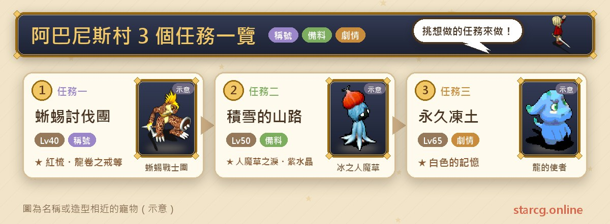
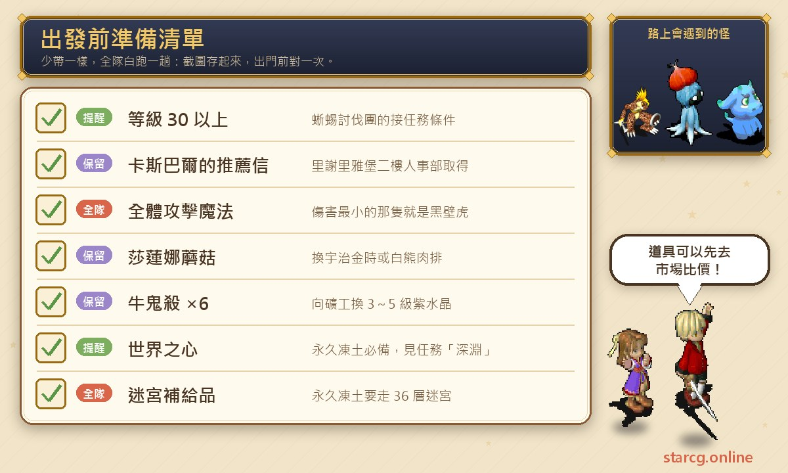
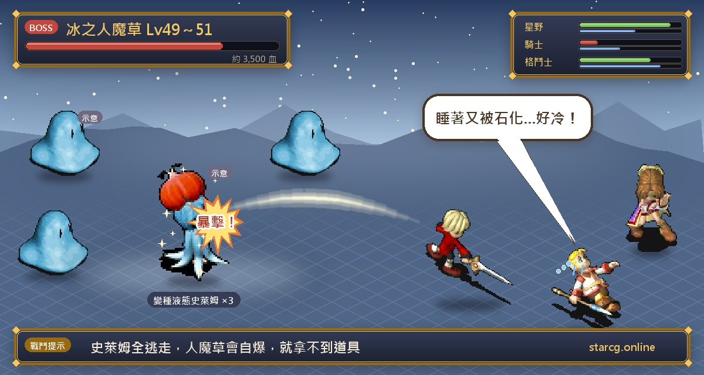

아바니스 마을(阿巴尼斯村)은 설산 기슭에 있어서 많은 플레이어가 처음으로 추운 지역에 발을 들이는 곳이에요. 이 일대의 지역 퀘스트는 모두 3개로, 30레벨부터 받을 수 있는 **도마뱀 토벌단(蜥蜴討伐團)**, 설산을 넘는 **눈 쌓인 산길(積雪的山路)**, 그리고 36층 미궁을 끝까지 걸어야 하는 **영원히 얼어붙은 땅(永久凍土)**이에요. 권장 레벨은 40, 50, 65로, 중반 사냥터에서 후반으로 넘어가는 구간에 딱 맞아요. 끝내면 붉은 빗(紅梳), 반짝이는 불꽃 팔찌(閃亮之火手鐲), 용권의 반지(龍卷之戒) 같은 장신구와 칭호 「리저드 맨 전사단(蜥蝪戰士團)」을 받고, 3~5레벨 자수정과 설산 요리로 교환할 수 있으며, 마지막에는 스토리 아이템 「하얀 기억(白色的記憶)」을 얻어요.

이 글은 퀘스트 3개의 조건, 단계별 NPC와 좌표, 건네야 할 아이템, 두 전투의 적 정보를 하나의 목록으로 정리했고, 「단장이 도망간다」「아라우네가 자폭한다」처럼 실수하기 쉬운 부분은 따로 표시했어요. StarCG(星詠魔力), 水藍魔力, 初心魔力寶貝 어느 쪽을 하든 아바니스 마을 퀘스트 흐름은 같으니 그대로 활용하면 돼요.

> 이 글은 [StarCG 공략 사이트](https://guide.starcg.net/)의 아바니스 마을 퀘스트 페이지를 바탕으로 저희 방식대로 순서를 바꾸고 새로 쓴 것으로, 그대로 옮기지 않았어요. 적 HP와 수치는 대략적인 값이며 실제로는 게임 내 표시가 우선이에요. 공략 사이트에 나오지 않은 부분은 모두 「공략 사이트 미기재」로 표시했고, 게임 업데이트 후 내용이 바뀔 수 있어요.

## 아바니스 마을 퀘스트는? 먼저 전체 순서 보기

퀘스트 3개는 서로 선행 관계가 없어서 자기 레벨에 맞춰 골라 하면 돼요. 다만 권장 레벨 순으로 늘어놓으면 자연스러운 루트가 돼요. 40레벨쯤에 도마뱀 토벌단으로 장신구를 받고, 50레벨 전후에 눈 쌓인 산길을 걸으며 재료를 모으고, 65레벨이 되어 세계의 심장(世界之心)도 손에 넣었다면 영원히 얼어붙은 땅에 도전하세요.

| 순서 | 퀘스트 이름 | 권장 레벨 | 조건 | 획득 |
|---|---|---|---|---|
| 퀘스트 1 | 도마뱀 토벌단 | 40 | 30레벨 | 붉은 빗／반짝이는 불꽃 팔찌／용권의 반지 중 하나, 감사장 |
| 퀘스트 2 | 눈 쌓인 산길 | 50 | 35레벨 | 아라우네의 눈물, 3~5레벨 자수정, 우지킨토키／백곰의 스테이크 |
| 퀘스트 3 | 영원히 얼어붙은 땅 | 65 | 세계의 심장 소지 | 하얀 기억(공략 사이트 퀘스트 정보란에는 「白之記憶」로 표기) |

한 줄로 정리하면: **도마뱀 토벌단은 장신구를 받는 작은 퀘스트, 눈 쌓인 산길은 여러 번 쓸 수 있는 재료 포인트, 영원히 얼어붙은 땅은 메인 스토리의 일부라서 먼저 「심연(深淵)」을 끝내고 세계의 심장을 받아야 해요.**

도마뱀 토벌단과 눈 쌓인 산길은 공략 사이트에 「자동 내비게이션 지원」으로 표시돼 있어서 심부름 부분은 내비게이션에 맡겨도 돼요. 영원히 얼어붙은 땅은 이 표시가 없어서 36층 미궁을 직접 걸어야 해요.

## 출발 전에 준비할 것

아바니스 마을 퀘스트 3개는 길지 않지만, 각각 「안 가져가면 헛걸음」인 물건이 한두 개씩 있어요. 도마뱀 토벌단은 먼저 성에서 추천서를 받아야 하고, 눈 쌓인 산길의 자수정은 우귀살로 교환해야 하며, 영원히 얼어붙은 땅은 세계의 심장을 가지고 있어야 해요. 아래에 모아서 정리했어요.

가장 자주 잊는 건 눈 쌓인 산길의 **우귀살(牛鬼殺)**이에요. 자수정으로 바꾸려면 한 번에 6병을 내야 하는데, 공략 사이트에는 교환 수량만 있고 얻는 방법은 나와 있지 않아요. 먼저 사이트의 [시세 검색](/ko/market/)에서 파는 사람이 있는지, 시세가 어떤지 확인한 뒤 어떻게 모을지 정하세요. 도마뱀 토벌단은 파티에 전체 공격 마법을 쓰는 캐릭터가 적어도 한 명 있는 게 좋아요. 이유는 아래 공략법에서 설명할게요. 영원히 얼어붙은 땅은 세계의 심장 외에도 36층 미궁용 보급품을 평소보다 넉넉히 챙기세요.

## 퀘스트 1: 도마뱀 토벌단(같은 이름 10마리 중 단장 흑도마뱀 찾기)

권장 40레벨, 퀘스트 수락 조건은 30레벨이에요. 「성에서 의뢰를 받고, 마을 밖에서 토벌하고, 다시 성에 보고하는」 전형적인 의뢰 퀘스트예요.

1. 리셰리아 성(里謝里雅城堡)(28, 50)에서 **병사 하겐(士兵哈根)**에게 말을 걸어 정보를 들어요.
2. 리셰리아 성 2층으로 올라가 **인사부 카스파르(人事部的卡斯巴爾)**(58, 68)를 찾아 「카스파르의 추천서」를 받아요.
3. 아바니스 마을 병원(47, 64)에 가서 **대장 지코무트(隊長吉可穆特)**(16, 10)에게 소식을 물어요.
4. 마을 밖 동쪽의 리저드 맨 둥지(蜥蜴之巢)(318, 136) 가장 안쪽까지 가서 **리저드 맨 전사단**에게 말을 걸어 전투를 시작해요.
5. 이기면 파티 중 **랜덤으로 한 명**이 「단장의 망치」「반짝이는 불꽃 팔찌(閃亮之火腕輪)」「붉은 빗」「용권의 반지」 중 하나를 받아요.
6. 아바니스 마을 병원으로 돌아가 「단장의 망치」를 **대장 지코무트**에게 건네면 「지코무트의 편지」를 받아요.
7. 다시 리셰리아 성으로 가서 편지를 **인사부 카스파르**에게 건네면 「감사장」(상점 판매가 600G)을 받고 퀘스트가 완료돼요.

**적 정보**: 모두 10마리이고 이름이 전부 「리저드 맨 전사단(蜥蝪戰士團)」이에요. 레벨 45, 속성 땅 50 물 50이고 공격, 방어, 연속 공격을 써요. 그중 한 마리가 단장 **흑도마뱀(黑壁虎)**이고 HP는 약 1,000이에요. 나머지 9마리의 HP는 공략 사이트 미기재예요.

**공략법**: 이 전투의 핵심은 전부 쓰러뜨리는 게 아니라 **흑도마뱀이 도망가지 못하게 하는 것**이에요. 10마리가 이름이 같아서 이름으로는 누가 단장인지 알 수 없고, 단장이 도망가면 퀘스트는 실패예요. 이때는 파티 전원이 전투에서 먼저 도망친 뒤 다시 도전하면 돼요. 공략 사이트가 알려 주는 구분법은 전체 마법으로 한 번 공격해서 **마법 피해 수치가 가장 작게 뜬 한 마리가 흑도마뱀**이라는 거예요. 찾았으면 화력을 집중해 먼저 처리하면 중간에 도망갈 걱정이 없어요.

**주의할 점**: 보상은 파티 중 한 명에게만 랜덤으로 떨어지고, 그것도 네 개 중 하나예요. 지코무트에게 보고할 때 필요한 건 「단장의 망치」인데, 이번에 망치가 아니라 장신구가 나왔다면 그다음 어떻게 해야 하는지 공략 사이트에는 설명이 없어요. 먼저 파티에서 누가 망치를 받았는지 확인하고 그 사람이 건네세요. 「반짝이는 불꽃 팔찌」를 장착하면 칭호 「리저드 맨 전사단」을 얻어요.

## 퀘스트 2: 눈 쌓인 산길(버섯은 요리로, 우귀살은 자수정으로)

권장 50레벨, 조건은 35레벨이에요. 이 퀘스트는 일종의 「지역 시스템」에 가까워요. 눈 쌓인 산길을 따라 올라가며 재료를 모으고, 정상 오두막의 NPC에게 교환하는 방식이에요.

1. 세레네(莎蓮娜)(84, 193)의 노란 전송석으로 눈 쌓인 산길에 들어가요.
2. 위로 올라가며 미궁의 적을 쓰러뜨리면 「세레네 버섯(莎蓮娜蘑菇)」을 랜덤으로 얻어요.
3. 최상층 설산 정상의 설산 오두막(23, 20)까지 가요.
4. 「세레네 버섯」을 **요리사 샤제프(廚師沙傑弗)**(11, 3)에게 주고 「우지킨토키(宇治金時)」 또는 「백곰의 스테이크(白熊肉排)」로 바꿔요.
5. 「우귀살」 6병을 **광부 데릴라호(礦工德里拉荷)**(8, 5)에게 주고 R3~5 자수정으로 바꿔요.
6. 돌아가고 싶다면 **지름길 안내인(捷徑指引者)**(4, 1)에게 말을 걸어 500G를 내면 세레네섬(84, 193)으로 돌아갈 수 있어요.

**설산 정상의 랜덤 전투**: 설산 정상에서는 **얼음 아라우네(冰之人魔草)**와 **변종 우즈(變種液態史萊姆)** 전투가 랜덤으로 일어나요.

- 얼음 아라우네: 49~51레벨, HP 약 3,500, 2회 행동. 초강력 중독, 초강력 수면, 초강력 석화, 초강력 혼란, 초강력 만취, 초강력 망각 마법을 쓰고, 바다의 기도와 아군 전체에 피해를 주는 자폭도 써요.
- 변종 우즈 ×3: 49~51레벨, 땅 80 물 20, 2회 행동. 양날 공격, 강력 빙결 마법, 마법 반사, 그리고 자기편 전체를 회복하는 자폭을 써요. HP는 공략 사이트 미기재예요.

**공략법**: 이 전투는 승리 조건이 특이해요. **변종 우즈가 모두 도망가면 얼음 아라우네가 얼마 안 가 자폭하고, 아라우네가 자폭하면 아이템을 얻을 수 없어요.** 즉 보상을 받으려면 아라우네가 자폭하기 전에 쓰러뜨려야 해요. 얼음 아라우네의 마법은 거의 모든 상태 이상을 커버하는 데다 2회 행동이라, 파티에 상태 이상을 풀 수단이 있는 게 좋아요. 우즈는 마법 반사를 쓰니 마법으로 칠 때는 조심하세요.

**보상**: 이기면 「향수」와 「살얼음 반지(薄冰的戒指)」를 랜덤으로 얻어요. 「향수」를 감정하면 퀘스트 보상란에 적힌 「얼음 아라우네의 눈물(冰之人魔草的眼淚)」(아라우네의 눈물)이 돼요.

**주의할 점**: 세레네 버섯은 「랜덤」으로 얻고 공략 사이트에 드롭률은 나와 있지 않아요. 자수정 레벨도 3~5 사이에서 랜덤이에요. 둘 다 몇 번이고 다시 와서 바꿀 수 있으니 한 번에 다 모을 필요는 없어요. 또 눈 쌓인 산길은 이후 여러 설산 퀘스트에서 꼭 지나가는 길이에요. 팔괘 8도 아바니스 마을 밖 눈 쌓인 산길을 올라 정상(41, 8)에서 영원히 얼어붙은 땅으로 들어가니, 처음 걸을 때 길을 기억해 두면 쓸모가 있어요.

## 퀘스트 3: 영원히 얼어붙은 땅(36층 미궁, 세계의 심장으로 하얀 기억 받기)

권장 65레벨, 조건은 **세계의 심장** 소지예요. 세계의 심장 얻는 방법은 공략 사이트에서 퀘스트 「심연」을 보라고 하니, 이 장은 메인 스토리의 일부라고 보면 되고 보통 그 스토리 라인을 진행할 때 돌아오게 돼요.

1. 아바니스 마을 남서쪽의 눈 쌓인 산길(84, 193)에서 정상의 「세레네 동토 지대(莎蓮娜凍土區)」까지 올라가요.
2. 동토 지대 북동쪽 구석의 암벽에 구멍이 있어서 「동토의 지하(凍土之地底)」로 들어갈 수 있어요.
3. 동굴 안의 **얼음 아라우네**에게 말을 걸어 영원히 얼어붙은 땅으로 가요.
4. 36층 미궁을 끝까지 걸어요.
5. 하얀 제단에 들어가 세계의 심장을 가진 채 **용의 사자(龍的使者)**와 대화하고 「예」를 고르면 「하얀 기억」을 받고 소환의 방(召喚之間)으로 전송되며 퀘스트가 완료돼요.

**주의할 점**: 공략 사이트에 특별히 적혀 있는데, **「검은 기억(黑色的記憶)」「하얀 기억」「검은 의지(黑之意志)」「하얀 의지(白之意志)」 중 하나라도 가지고 있으면 들어갈 수 없어요**. 예전에 다른 분기를 진행했거나 이런 아이템을 받은 적이 있다면, 중간까지 올라갔다가 못 들어가는 일이 없도록 출발 전에 꼭 확인하세요.

**미궁과 전투**: 공략 사이트의 영원히 얼어붙은 땅 페이지에는 미궁의 몬스터와 보스 정보가 없고, 하얀 기억을 받으려면 전투가 필요하다는 내용도 없어서 이 글에서도 적 수치를 따로 적지 않았어요. 36층은 꽤 긴 여정이니 사이트의 [미궁 계단 찾기](/ko/maze/)로 걸으면서 계단 위치를 기록하면 감으로 헤매는 것보다 훨씬 편해요.

## 아바니스 마을 자주 묻는 질문

**도마뱀 토벌단이 계속 실패하면 어떻게 하나요?** 실패하는 이유는 보통 단장 흑도마뱀이 도망갔기 때문이에요. 적 10마리의 이름이 모두 같으니 먼저 전체 마법으로 한 번 쳐서 피해를 가장 적게 받은 한 마리를 찾으면 그게 흑도마뱀이에요. 집중해서 쓰러뜨리면 돼요. 이미 도망갔다면 파티 전원이 전투에서 도망친 뒤 다시 도전할 수 있어요.

**반짝이는 불꽃 팔찌는 어디에 쓰나요?** 장착하면 칭호 「리저드 맨 전사단」을 얻어요. 다만 전투 보상은 네 개 중 하나이고 파티 중 랜덤 한 명에게만 가서 반드시 받는다는 보장은 없어요.

**눈 쌓인 산길의 자수정은 어떻게 바꾸나요?** 설산 정상의 설산 오두막까지 가서 「우귀살」 6병을 광부 데릴라호(8, 5)에게 주면 3~5레벨 자수정으로 바꿀 수 있고, 레벨은 랜덤이에요.

**얼음 아라우네를 잡았는데 아무것도 못 받았어요?** 변종 우즈가 모두 도망가면 얼음 아라우네가 얼마 안 가 자폭하고, 아라우네가 자폭하면 아이템을 얻을 수 없어요. 자폭하기 전에 쓰러뜨려야 해요.

**영원히 얼어붙은 땅에 왜 못 들어가나요?** 흔한 이유는 두 가지예요. 세계의 심장이 없거나, 검은 기억·하얀 기억·검은 의지·하얀 의지 중 하나를 이미 가지고 있는 경우예요. 후자는 공략 사이트에 「모두 입장 불가」라고 적혀 있어요.

**설산 정상에서 빨리 돌아가는 방법은?** 설산 오두막의 지름길 안내인(4, 1)에게 500G를 내면 세레네섬(84, 193)으로 보내 줘요.

## 정리: 장신구부터 받고, 설산은 재료 포인트로

아바니스 마을 퀘스트 3개는 각자 역할이 달라요. 도마뱀 토벌단은 40레벨 전후로 쉽게 끝낼 수 있는 장신구 퀘스트로, 전체 마법으로 흑도마뱀을 찾는 것만 기억하면 돼요. 눈 쌓인 산길은 반복해서 쓸 수 있는 재료 포인트에 가까워요. 버섯은 요리로, 우귀살은 자수정으로 바꾸고, 정상의 얼음 아라우네는 자폭하기 전에 쓰러뜨려야 해요. 영원히 얼어붙은 땅은 메인 스토리의 일부로, 세계의 심장을 가지고 다른 기억·의지 아이템이 없는 상태에서 36층을 끝까지 걸으면 하얀 기억을 받을 수 있어요. 권장 레벨 순서대로 하나씩 하면 아바니스 마을 퀘스트는 어렵지 않고, 정말 시간이 드는 건 설산의 미궁이에요.

더 자세한 원문과 다른 퀘스트는 [StarCG 공략 사이트](https://guide.starcg.net/)에서 볼 수 있어요. 사이트의 [시세 검색](/ko/market/)으로 우귀살과 보급품을 찾고, [미궁 계단 찾기](/ko/maze/)로 영원히 얼어붙은 땅 36층 미궁을 끝까지 걸어 보세요.
