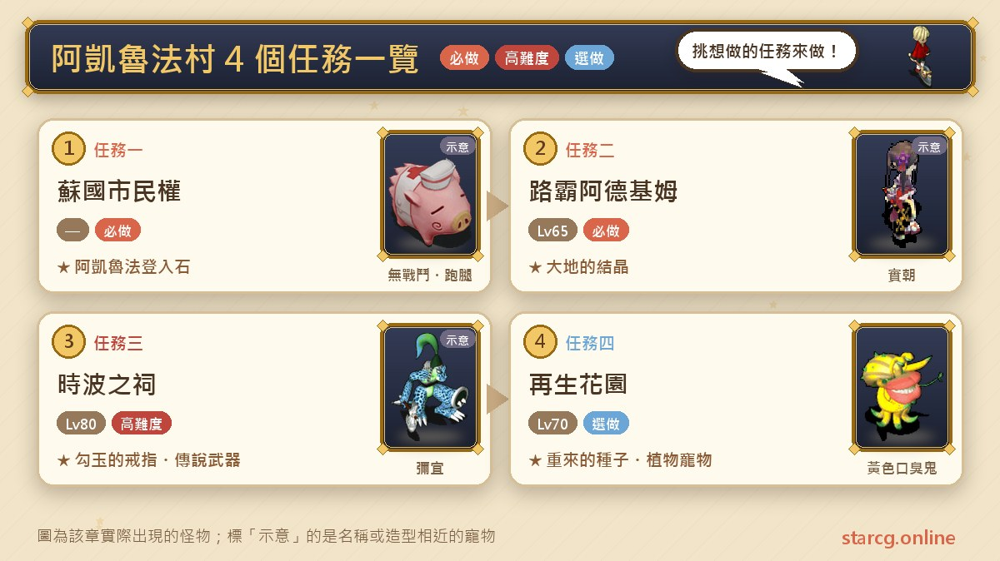
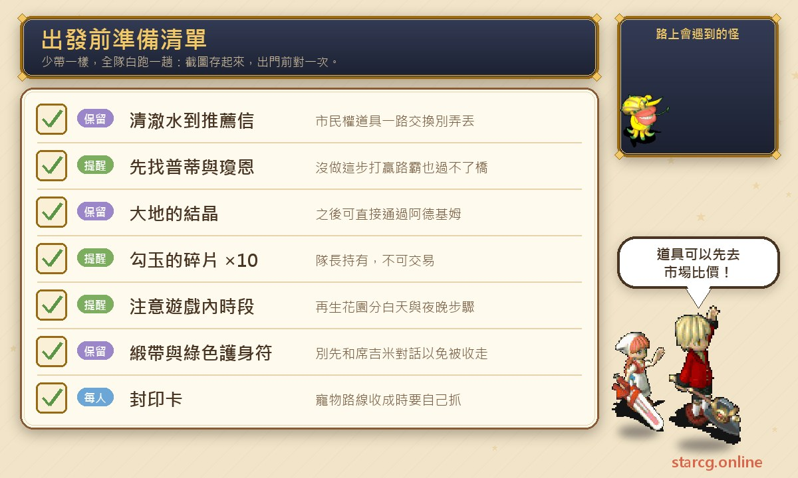
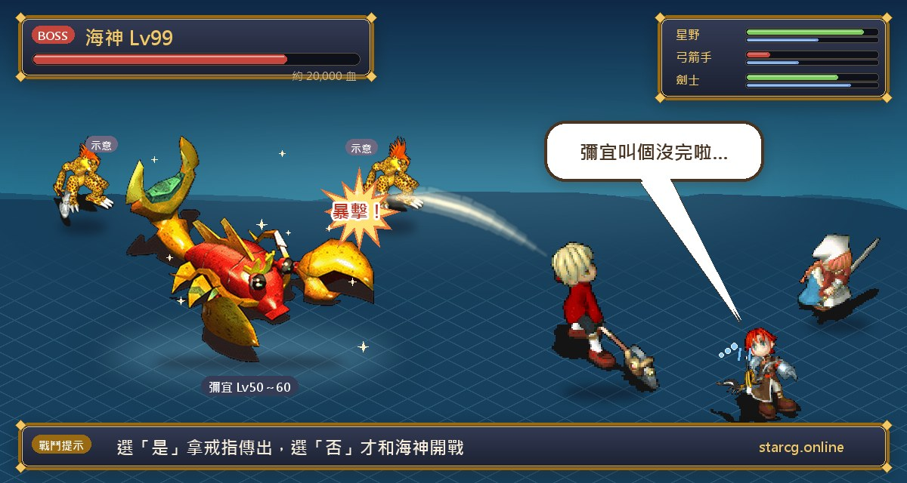
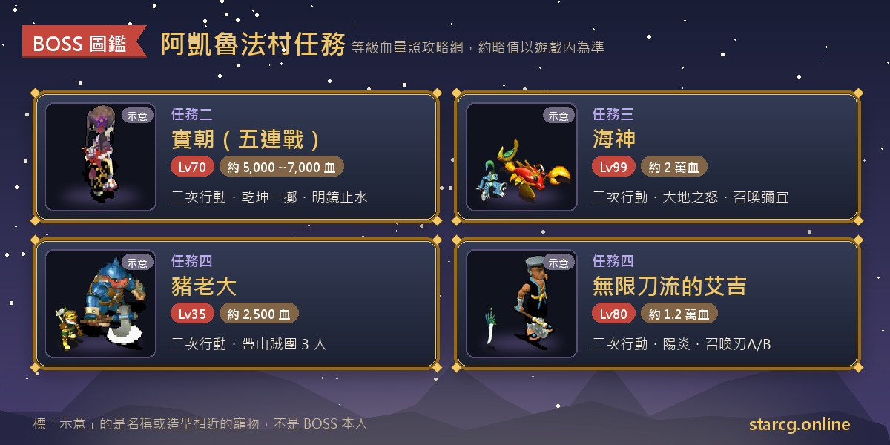

阿凱魯法村是蘇國的玄關，也是前往米內葛爾島的必經之地。這一帶的地區任務一共四個：不限等級的**蘇國市民權**、推薦 65 級的**路霸阿德基姆**、推薦 80 級的**時波之祠**，以及推薦 70 級的**再生花園**。做完可以把登入點設在阿凱魯法村、拿到護身符「大地的結晶」並直接通過橋頭、收集勾玉碎片換「勾玉的戒指」或挑戰海神拿水龍裝備材料與傳說武器，最後在再生花園栽培出「重來的種子」或水藍菇、妖花、妖草、黃色口臭鬼這幾種植物系寵物。

這篇把四個任務的條件、每一步的 NPC 與座標、BOSS 資料，以及再生花園的時段限制與栽培組合表整理在一起，特別標出「沒做第一步就過不了橋」「別先跟席吉米說話」這類容易漏掉的細節。不論你玩的是星詠魔力、水藍魔力還是初心魔力寶貝，阿凱魯法村的任務流程都一樣，這份整理都能直接拿來用。

> 本文整理自 [星詠魔力攻略網](https://guide.starcg.net/) 的阿凱魯法村任務頁面，並用我們自己的方式重新排序與改寫，沒有逐字照搬。BOSS 血量與數值是約略值，實際以遊戲內為準；攻略網沒有寫到的部分，本文一律標註「攻略網未列出」，遊戲更新後內容可能變動。

## 阿凱魯法村任務有哪些？先看整體順序

四個任務在攻略網上都沒有前置任務條件，但地理位置上有先後：市民權在村子裡跑腿就能完成；路霸阿德基姆和時波之祠都在村子南邊的南恰拉山通路上；而再生花園位在米內葛爾島，要先拿到路霸任務的「大地的結晶」，之後才能直接通過阿德基姆把守的橋。

| 順序 | 任務名稱 | 推薦等級 | 取得 |
|---|---|---|---|
| 任務一 | 蘇國市民權 | 無 | 阿凱魯法傳送門（登入石）使用權 |
| 任務二 | 路霸阿德基姆 | 65 | 護身符「大地的結晶」 |
| 任務三 | 時波之祠 | 80 | 勾玉的戒指；打海神可得生鏽武器防具、勾玉或傳說的武器 |
| 任務四 | 再生花園 | 70 | 香草(種子)→重來的種子，或香草(寵物)→植物系寵物 |

整理成一句話：**先把市民權辦好、登入點設在阿凱魯法，再做路霸拿大地的結晶打通往米內葛爾島的路；時波之祠看自己要不要挑戰海神，再生花園則是長期栽培型的任務。**

## 出發前先準備好這些

阿凱魯法村的任務戰鬥不算多，但流程裡有不少「道具要一路交換」「一定要先做某一步」「要在特定時段做」的規則。下面把它們集中整理。

市民權的道具是「清澈水 → 紀念寶石 → 黃金箱 → 馬查招待卷 → 馬查咖哩飯 → 推薦信」一路接力，任何一環弄丟都要回頭找。時波之祠的勾玉碎片只收隊長身上的 10 個，而且不可交易，誰當隊長要先講好。再生花園分成「清晨、白天、黃昏」與「夜晚」兩種時段的步驟，最好先看清楚再出發。栽培要用的除蟲劑、土地營養劑、水之營養劑以及香草本身都可以交易，打算大量栽培的話，可以先用本站的 [市場查價](/market/) 看看行情。

## 任務一：蘇國市民權（登入點改到阿凱魯法村）

推薦等級與任務條件都是「無」，任何時候都能做。全程是在阿凱魯法村裡跑腿交換道具。

1. 找阿凱魯法村的**小次郎**（119, 115），拿到「清澈水」。
2. 把清澈水交給**夏姆吉診所**（121, 155／117, 155）裡的**阿達巴**，換到「紀念寶石」。
3. 把紀念寶石交給**銀行**（139, 136）裡間金庫前的**銀行員**，換到「黃金箱」。
4. 把黃金箱交給**阿凱魯法鎮旅館**（192, 208／196, 208）裡的**利克嘉**，換到「馬查招待卷」。
5. 把馬查招待卷交給**馬查酒吧**（192, 162／196, 162）裡的**會長**，換到「馬查咖哩飯」。
6. 把馬查咖哩飯交給**小次郎**，換到「推薦信」。
7. 把推薦函交給阿凱魯法城裡的**倫達國王**，取得使用阿凱魯法傳送門的許可。
8. 到阿凱魯法村找**阿施阿神**（99, 163），就能使用阿凱魯法登入石。

**要注意的地方**：登記要**每個角色逐一操作**，不是隊長登記就全隊生效。登記之後，按畫面右下方常用的「回登入點」會傳送到阿凱魯法村，但畫面右上方的「回城」仍然固定傳送到法蘭城。想把登入點改回法蘭城的話，要回到法蘭城東醫旁的傳送石找**羅吉羅吉**（231, 76）。

## 任務二：路霸阿德基姆（五連戰換大地的結晶）

推薦 65 級，任務條件無。攻略網特別用警告標示提醒：**一定要先做步驟一，否則打贏路霸阿德基姆也無法過橋。**

1. 進入阿凱魯法村的民家（228, 199），和**普蒂**及**瓊恩**說話。
2. 越過南恰拉山第一通道與第二通道，和橋前面的**阿德基姆**發生戰鬥（兩連戰）。
3. 獲勝後與**生產中的烏龜**（317, 345）交談，出現選項時選「是」，場景變更。
4. 再次和**阿德基姆**對話，發生戰鬥（三連戰）。
5. 獲勝後被傳送回民家，和**阿德基姆**（12, 11）說話，拿到「大地的結晶」。

**BOSS 資料**：五場戰鬥的對手都是**實朝**，70 級、二次行動。

- 第一段第一戰：約 6,500 血，會攻擊、諸刃、陽炎、乾坤一擲、氣功彈。
- 第一段第二戰：約 7,000 血，會攻擊、諸刃、乾坤一擲、混亂攻擊、明鏡止水、魔法反彈。
- 第二段第一戰：約 7,000 血，技能同上。
- 第二段第二戰：約 7,000 血，再加上氣功彈(7)。
- 第二段第三戰：約 5,000 血，會混亂魔法、明鏡止水、魔法反彈，還會對自己放隕石魔法。

**打法**：實朝從第二戰開始就帶著魔法反彈，以魔法為主力的隊伍要特別留意，別讓自己的魔法被彈回來；明鏡止水則會讓戰鬥拖長。五場加起來是一段不短的消耗戰，中途補給的節奏要抓好。

**獎勵**：大地的結晶是 Lv6 護身符，攻擊 +3、防禦 +3、魔法抵抗 +2，耐久 128。更實用的是之後只要持有它，在米內葛爾島（309, 349）與阿德基姆交談就能直接通過，不必再打一次。

## 任務三：時波之祠（收集勾玉碎片，挑戰海神）

推薦 80 級，任務條件無。這是阿凱魯法村最硬的一場仗，但攻略網的流程其實給了「不打也能拿戒指」的選項。

1. 從阿凱魯法村往南，順著馬路走進**南恰拉山第 1 通路**（283, 457）。
2. 在南恰拉山第 2 通路和**納葛席**（32, 9）說話，進入時波之祠。
3. 在迷宮裡和隨機出現的「紙垂」戰鬥，收集隨機掉落的**勾玉的碎片** 10 個。碎片不可交易。
4. 由時波之祠 10 樓底下的黃色傳送石進入**海神的祭壇**。
5. 由**隊長**持有 10 個碎片和**海神**說話：選「是」，獲得「勾玉的戒指」並被傳出；選「否」，則進入戰鬥。

攻略網註明：海神只收取隊長持有的 10 個碎片，不會多收。

**BOSS 資料**：

- 海神：99 級、約兩萬血，邪魔系，地水火風各 20，二次行動。會攻擊、乾坤一擲、大地之怒、戰慄襲心、聖盾、超強冰凍魔法、超強風刃魔法、超強混亂魔法、恢復魔法，並會召喚黃、藍兩種彌宜。
- 彌宜（蜥蜴鬥士型）：50～60 級，地 30、水 70，會連擊、強力冰凍魔法、聖盾，還會再召喚 25～29 級的彌宜。
- 彌宜（獵豹蜥蜴型）：50～60 級，火 30、風 70，會諸刃、強力冰凍魔法、聖盾，同樣會召喚 25～29 級的彌宜。
- 彌宜（蜥蜴戰士型）：50～60 級，火 80、風 20，會防禦、攻擊吸收、攻擊反彈、攻擊無效。
- 彌宜（蜥蜴武士型）：50～60 級，水 30、火 70，會防禦、魔法吸收、魔法反彈、魔法無效。

攻略網把四種彌宜的數量都標為「無限」，血量則未列出。

**打法**：這場仗的麻煩之處在於彌宜會一直被召喚出來，而且四種彌宜分別對物理和魔法有吸收、反彈、無效的特性：打蜥蜴戰士型要用魔法，打蜥蜴武士型要用物理，用錯了反而會吃虧。海神本身是 99 級的二次行動 BOSS，比推薦等級高出將近 20 級，如果只是想要勾玉的戒指，直接選「是」就好。

**戰鬥獎勵**：打贏海神後，能隨機得到生鏽的武器或防具（水龍裝備材料）、勾玉寶石，或傳說的武器。

- **水龍配方**：持有一定數量的「勾玉」寶石（不是勾玉的碎片），在海神的祭壇找蜥蝪戰士兌換配方。1 個勾玉可換回力、小刀、頭盔、鎧甲、帽子、鞋子、料理、藥水配方；2 個可換劍、斧、槍、杖、弓、靴子、盾牌配方；3 個可換衣服、長袍配方。拿到配方後，用生鏽（破損）的武器、防具、材料製作水龍裝備，需要相關的 7 級製作技能。
- **勾玉**：海神低機率掉落，也可以在魔晶商城用 3800 魔晶兌換；不論掉落或購買都不可交易。
- **傳說的武器**：村正（8 級單手武器，攻擊 +240、耐久 300、連擊耗魔減少 100%）、天空之槍（攻擊 +160、反擊 +6、命中 +40、耐久 300）、帕魯凱斯之斧（攻擊 +250、必殺 +18、耐久 300、乾坤一擲耗魔減少 100%）。

## 任務四：再生花園（豬老大與兩條栽培路線）

推薦 70 級，任務條件無。地點在米內葛爾島（207, 447），所以通常是在路霸任務拿到大地的結晶之後才會來。這個任務的步驟很多，而且**每一步都有時段限制**，下面照順序整理。

1. 清晨、白天或黃昏，到再生花園點擊花圃閘門（32, 36）進入花圃。
2. 清晨、白天或黃昏，與**馬拉卡席**（33, 37）對話進入種子保管庫，再與**馬拉卡席**（9, 7）對話。
3. 調查花圃內死亡飛蛾的幼苗（42, 42），取得「緞帶」。
4. **夜晚**調查研究棟的門（30, 23）進入研究棟，與**姆魯姆魯**（17, 23）對話。注意：若與**席吉米**對話，緞帶會被收走。
5. 與花圃內的**豬老闆**（33, 45）對話變更場景，再與**豬老大**（33, 45）對話交出緞帶，拿到「山桃長靴」。
6. 清晨、白天或黃昏，與花圃內的**馬拉卡席**（33, 37）對話交出山桃之靴，拿到「綠色護身符」（Lv1 護身符，耐久 500，昏睡、石化、遺忘、混亂、酒醉、毒各 +0～2，不可交易）。
7. 前往米內葛爾島（290, 436）進入深綠色的山道，爬到頂層的山桃的秘密住處。
8. 點擊隱藏之家的門（14, 16）繼續前進，與**豬老大**（29, 16）對話進入戰鬥。
9. 勝利後與**豬老大**（22, 16）對話交出綠色護身符，拿到「委託書」。
10. 清晨、白天或黃昏前往研究棟（30, 13），與**席吉米**（28, 14）對話交出委託書，並做出選擇：選「是」走**種子路線**，選「否」走**寵物路線**。

**BOSS 資料（豬老大戰）**：豬老大 35 級、約 2,500 血，地 100，邪魔系、不抗咒，二次行動，只會攻擊。身邊有 3 名山桃山賊團，25 級、約 3,500 血，地 100，人形系、不抗咒，會攻擊、乾坤一擲（優先打血多的人），使用制禦技能後會追加連擊，我方只剩 1 人存活時則什麼都不做。

### 種子路線：拿到香草(種子)

1. 清晨、白天或黃昏，與花圃內的**馬拉卡席**（33, 37）對話。
2. 夜晚調查研究棟的門（30, 23）進行竊聽。
3. 到深綠色山道山頂的山桃的秘密住處，與**豬老大**（22, 16）對話，拿到「遺物的種子」並被傳出山道。
4. 清晨、白天或黃昏，到花圃與**馬拉卡席**（34, 37）對話，場景切換到種子保管庫。
5. 與保管庫內的**席吉米**（17, 14）對話，場景切換到花圃；再與**席吉米**（32, 45）對話交出遺物的種子，拿到「香草(種子)」，任務完結。

### 寵物路線：拿到香草(寵物)

1. 夜晚與研究棟內的**姆魯姆魯**（17, 23）對話，再與**無限刀流艾吉**（16, 22）對話進入戰鬥。
2. 戰鬥勝利後與**席吉米**對話，拿到「香草(寵物)」，任務完結。

**BOSS 資料（艾吉戰）**：無限刀流的艾吉 80 級、約 12,000 血，地水火風各 40，人形系、不抗咒，二次行動。會攻擊（優先打血多的人）、防禦、諸刃、陽炎，血量低於 50% 時追加恢復魔法，嘍囉少於 4 隻時會召喚刃 A／刃 B 各 2 隻。刃 A、刃 B 都是 50 級、約 1,500 血，地水火風各 20：刃 A 會連擊與低機率暗殺；刃 B 會護衛，血量低於 25% 時會自爆替己方全體回復。**艾吉被擊倒後，兩種刃都會自爆對我方造成全體傷害。**

**要注意的地方**：寵物路線如果戰鬥失敗、中途逃跑或掉線，再與姆魯姆魯或艾吉對話就會被傳出研究棟，任務終止，要回到第 2 步重新接。艾吉倒下時刃的自爆是全體傷害，打到最後一擊前先把隊伍血量補好。

### 栽培方法與收成

兩條路線拿到的香草，栽培方式相同：清晨、白天或黃昏前往再生花園（31, 33）的種子保管庫，與**販售員歐莉普**（22, 6）購買除蟲劑、土地營養劑、水之營養劑（保管處的門夜晚無法進入）。第一次用藥後要過 24 小時才能用第二次，第二次用藥後再過 48 小時才可收成；拿到香草後 **7 天內沒有收穫就會自動枯萎**。

- **香草(種子)**：依兩次藥劑的組合，得到 2～5 個不同種類的「重來的種子」，每顆都是「某項能力 +1、另一項 -1」的效果。數量規則是：第二次用除蟲劑且第一次不是除蟲劑時 3 個；第一次用除蟲劑、第二次用營養劑時 4 個；兩次都用除蟲劑時 5 個；其餘組合 2 個。
- **香草(寵物)**：收成時會進入戰鬥，出現一隻 Lv1 植物系魔物，**要自己帶封印卡捕捉**。對應如下表。

| 第一次 | 第二次 | 出現的魔物 |
|---|---|---|
| 土地營養劑 | 土地營養劑 | 水藍菇 |
| 土地營養劑 | 水之營養劑 | 妖花 |
| 土地營養劑 | 除蟲劑 | 黃色口臭鬼 |
| 水之營養劑 | 土地營養劑 | 妖草 |
| 水之營養劑 | 水之營養劑 | 黃色口臭鬼 |
| 水之營養劑 | 除蟲劑 | 水藍菇 |
| 除蟲劑 | 土地營養劑 | 妖草 |
| 除蟲劑 | 水之營養劑 | 黃色口臭鬼或妖草 |
| 除蟲劑 | 除蟲劑 | 水藍菇 |

重來的種子每種組合會出現哪幾種能力調整，攻略網有完整的對照表，數量很多，需要時可以直接到原頁查。抓到的植物系寵物可以到本站的 [寵物圖鑑與成長](/pets/) 查看資料。

## 阿凱魯法村任務常見問題

**打贏路霸阿德基姆卻過不了橋？** 攻略網註明一定要先到阿凱魯法村民家（228, 199）和普蒂、瓊恩說話，沒做這一步，打贏了也無法過橋。

**辦完市民權，按「回城」為什麼還是回法蘭城？** 畫面右上方的「回城」固定傳送到法蘭城；要回阿凱魯法村請按右下方的「回登入點」。而且登記要每個角色各自操作。

**時波之祠一定要打海神嗎？** 不用。隊長帶 10 個勾玉的碎片和海神說話選「是」，就能直接拿到勾玉的戒指；選「否」才會開戰，打贏有機會拿水龍裝備材料、勾玉或傳說的武器。

**再生花園的緞帶為什麼不見了？** 第 4 步夜晚進研究棟時，若與席吉米對話，緞帶會被收走。這一步要找的是姆魯姆魯。

**香草放著沒管會怎樣？** 拿到香草(種子)或香草(寵物)後 7 天內沒有收穫，就會自動枯萎。

**寵物路線失敗可以重打嗎？** 戰鬥失敗、逃跑或掉線後，任務會終止，要回到第 2 步重新接任務。

## 小結：先辦市民權，再打通往米內葛爾島的路

阿凱魯法村的四個任務各有用途：蘇國市民權讓你把登入點設在蘇國，路霸阿德基姆的大地的結晶是往米內葛爾島的通行證，時波之祠可以選擇安全地拿戒指或挑戰 99 級的海神，再生花園則是一個需要等待時間、但能穩定產出重來的種子或植物系寵物的長期任務。最容易出錯的不是戰鬥，而是路霸任務的第一步、再生花園的時段與席吉米的對話順序；照著上面的步驟一項一項確認，就能少跑很多冤枉路。

想看更完整的原文與其他任務，可以到 [星詠魔力攻略網](https://guide.starcg.net/) 查詢；也歡迎用本站的 [市場查價](/market/) 比較營養劑與材料的價格、用 [寵物圖鑑與成長](/pets/) 查看栽培出來的植物系寵物，再用 [傷害計算機](/damage/) 估一下隊伍能不能打穿海神的血量。
