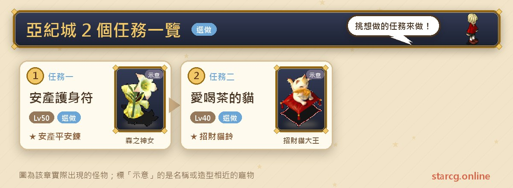
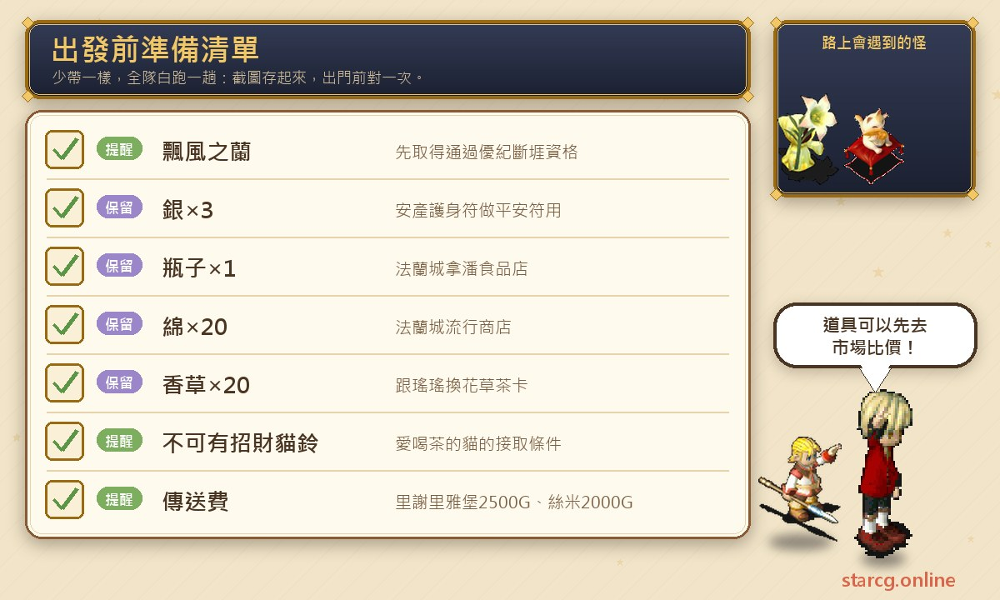
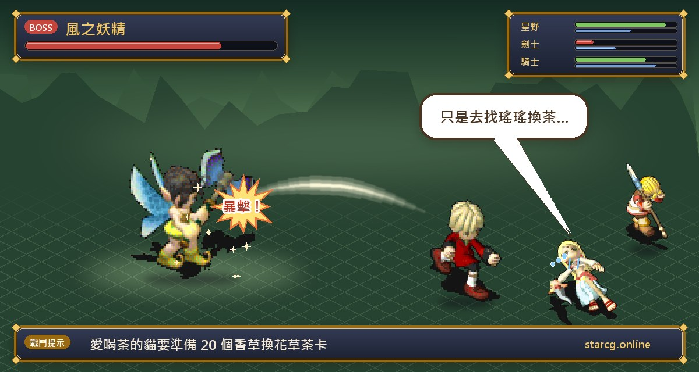

亞紀城是蘭國的首都，位在絲米村外的哈那可半島深處。攻略網的「地區任務」分頁在亞紀城底下列了兩個任務：**安產護身符**要幫醫院的阿里做一個平安符、再跑去絲米村找他的媽媽，最後換到能擋工作傷害的「安產平安鍊」；**愛喝茶的貓**則是用 20 個香草換一張花草茶卡，交給招財貓大王換「招財貓鈴」。兩個任務都沒有戰鬥，推薦等級 40～50 級，難的地方反而是「怎麼到亞紀城」。

這篇先整理前往亞紀城的條件與傳送方式，再把兩個任務的材料、NPC 與座標列清楚。不論你玩的是星詠魔力、水藍魔力還是初心魔力寶貝，亞紀城任務的流程都一樣，這份整理都能直接拿來用。

> 本文整理自 [星詠魔力攻略網](https://guide.starcg.net/) 的亞紀城任務頁面、裝備頁，以及前往亞紀城的「飄風之蘭」「前往絲米村 及 日耀之域」頁面，並用我們自己的方式重新排序與改寫，沒有逐字照搬。攻略網沒有列出的內容，本文一律寫「攻略網未列出」，遊戲更新後內容可能變動。

## 亞紀城任務是什麼？先看整體順序

| 任務 | 任務名稱 | 推薦等級 | 取得 |
|---|---|---|---|
| 任務一 | 安產護身符 | 50 | 安產平安鍊（99%）／安全帽頭飾(綁)（1%） |
| 任務二 | 愛喝茶的貓 | 40 | 招財貓鈴 |

整理成一句話：**先用飄風之蘭拿到通過優紀斷堐的資格並登記傳送點；安產護身符準備銀 ×3、瓶子 ×1、綿 ×20，愛喝茶的貓準備香草 ×20。**

另外，所有任務總表在「公主傳說」系列裡也有一章「生病的亞紀公主」，那是公主傳說的劇情任務，整理在 [公主傳說任務攻略](/posts/princess-quest-guide/)，本篇不重複。

## 出發前先準備好這些

兩個任務都要先買好材料，最好出發前一次備齊。

安產護身符要準備 **銀 ×3、瓶子 ×1、綿 ×20**：攻略網寫瓶子可以在法蘭城（217, 53）的拿潘食品店買、綿可以在法蘭城（117, 112）的流行商店買，銀的取得方式則沒有寫。愛喝茶的貓要準備 **香草 ×20**。如果不想自己採集，可以先用本站的 [市場查價](/market/) 看看銀和香草的行情。

## 怎麼去亞紀城？（飄風之蘭與傳送點）

第一次去亞紀城，要先完成聖拉魯卡村的「**飄風之蘭**」（推薦 70 級），拿到通過**優紀斷堐**的資格。這個任務要在法蘭城的香樁、維諾亞村的雨慈、芙蕾雅島的竹隱之間來回送信，途中**每個角色都要有一條鮭魚**，最後到絲米村錦次郎宅（32, 46）找**錦次郎**（9, 3）交出香樁的書信取得資格。

拿到資格後：

1. 依「前往絲米村」的方法，從聖拉魯卡港管理處（25, 89）花 1,000G 搭船到絲米村。
2. 出絲米村，到哈那可半島（216, 61）找**士兵**說話，有資格的人會被傳到優紀斷堐。
3. 通過優紀斷堐後，到哈那可半島（125, 85）就能進入亞紀城。
4. 到醫院旁的**傳送交通管理中心**（28, 50），找紅衣的**傳送石管理員**（42, 22）登記傳送點。

登記之後，就可以從里謝里雅堡啟程之間二樓（12, 26）或絲米村的傳送神官（66, 37）直接傳送到亞紀城，費用分別是 **2,500G** 與 **2,000G**。

## 任務一：安產護身符（平安符與雞酒）

推薦 50 級，條件無。

1. 到亞紀城的**亞紀醫院**（33, 53），找**阿里**（36, 31），拿到「**阿里的信**」。
2. 準備好銀 ×3、瓶子 ×1、綿 ×20。
3. 到哈那可半島（89, 134）找**森之神女**，製作「**平安符**」。
4. 回亞紀醫院找阿里對話，拿到「**家書**」，得知要去找阿里的媽媽。
5. 到**絲米村**找**阿里媽媽**（35, 55），拿到「**雞酒**」。
6. 回亞紀醫院找阿里對話，隨機拿到**安產平安鍊**（99%）或**安全帽頭飾(綁)**（1%）。

**獎勵說明**：任務頁寫安產平安鍊是 Lv1 飾品、耐久 200、防禦 +2，可以防 15 次工作傷害；裝備頁則寫防禦 +1～+3、耐久 200、可防 15 次工作傷害。防禦數值兩頁略有不同，以遊戲內為準。對常做採集、生產的角色來說，「防 15 次工作傷害」是這條鍊子的主要用途。

**要注意的地方**：這個任務要在亞紀城、哈那可半島、絲米村之間來回，登記好亞紀城傳送點會方便很多。安全帽頭飾只有 1% 機率，攻略網沒有寫能不能重複解。

## 任務二：愛喝茶的貓（香草換花草茶）

推薦 40 級，條件是**身上不可以有招財貓鈴**。

1. 到哈那可半島、亞紀城南方（113, 186）找**小招財貓**對話，拿到「**招財貓委託卡**」。
2. 準備 20 個**香草**，到哈那可半島（286, 245）找**瑤瑤**，用 20 個香草換「**花草茶卡**」。
3. 拿著花草茶卡，到哈那可半島（111, 182）找**招財貓大王**對話，拿到「**招財貓鈴**」。

**獎勵說明**：任務頁寫招財貓鈴是 Lv1 手環，魔攻 +5～+15、抗魔 +7～+10；裝備頁則只列出 1 級飾物、耐久 10～50，沒有寫能力加成。兩頁寫法不同，以遊戲內為準。

**要注意的地方**：條件寫明身上不可以有招財貓鈴，所以已經拿過一個的人要先把舊的處理掉才能再接。另外裝備頁列的耐久只有 10～50。

攻略網的妖精之羽頁面提到，哈那可半島（287, 244）一帶會出現地之妖精、風之妖精，位置就在瑤瑤（286, 245）旁邊，換花草茶卡時路上可能會遇到戰鬥。\n\n

## 亞紀城任務常見問題

**第一次怎麼去亞紀城？** 要先完成聖拉魯卡村的飄風之蘭拿到通過優紀斷堐的資格，再從絲米村外的哈那可半島（216, 61）找士兵傳送過去。

**之後有比較快的去法嗎？** 在亞紀城醫院旁的傳送交通管理中心登記傳送點後，可以從里謝里雅堡（2,500G）或絲米村（2,000G）直接傳送。

**安產護身符的材料在哪裡買？** 瓶子在法蘭城（217, 53）拿潘食品店，綿在法蘭城（117, 112）流行商店；銀的取得方式攻略網未列出。

**安全帽頭飾怎麼拿？** 交雞酒給阿里時隨機給，機率 1%，其餘 99% 是安產平安鍊。

**為什麼接不到愛喝茶的貓？** 條件是身上不可以有招財貓鈴。

## 小結：先把路打通，任務就很快

亞紀城的兩個任務本身都很短，也都沒有戰鬥，真正要花時間的是前置的飄風之蘭與往返哈那可半島的路程。先完成飄風之蘭並登記傳送點，再把銀、瓶子、綿和香草一次買齊，就能在一趟行程裡把安產平安鍊和招財貓鈴都拿到手。

想看更完整的原文與其他任務，可以到 [星詠魔力攻略網](https://guide.starcg.net/) 查詢；絲米村的妖精之羽、鬧鐘怪的逆襲也在同一片區域，整理在 [絲米村任務攻略](/posts/simi-village-quest-guide/)。
