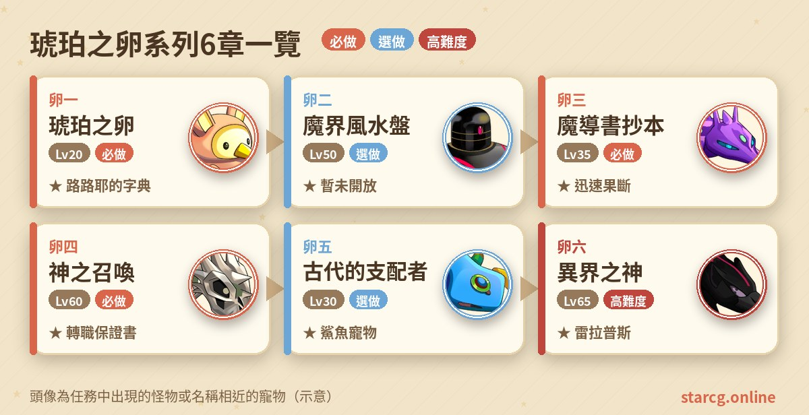
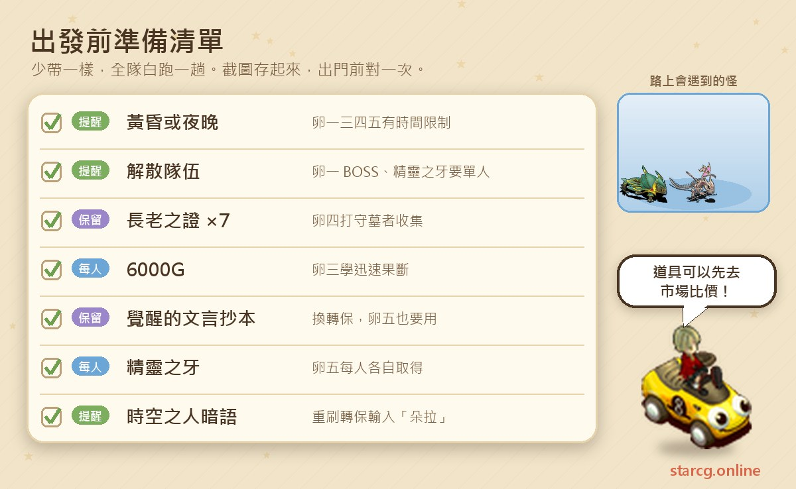
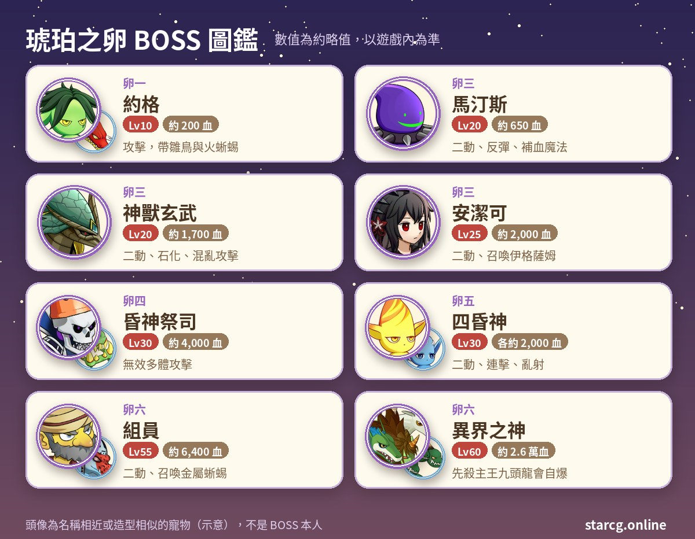

魔力寶貝的琥珀之卵系列，是以艾爾莎島、艾夏島與神殿伽藍為舞台，圍繞古代秘密與異界之神展開的六章任務。它最有名的一章是卵四「神之召喚」，也就是玩家口中的「轉保任務」——獎勵的轉職保證書能讓角色轉職時保留原有技能等級，而且可以重複解取。除此之外，卵三能學到技能「迅速果斷」，卵五送一隻鯊魚寵物，卵六則有機會拿到雷拉普斯或極稀有的劍神萊因哈特。

琥珀之卵的推薦等級很分散：卵一 20 級、卵三 35 級、卵五 30 級、卵四 60 級、卵六 65 級，敵人等級大多不高，但規則很多——多數章節只能在晚上做、有些關卡必須單人、BOSS 常常無效多體攻擊，還有一套用暗語操作的「時空之人」重置機制。不論你玩的是星詠魔力、水藍魔力還是初心魔力寶貝，琥珀之卵任務的流程都一樣，這份整理可以直接拿來對照。

> 本文整理自 [星詠魔力攻略網](https://guide.starcg.net/) 的琥珀之卵系列頁面，並用我們自己的方式重新排序與改寫，沒有逐字照搬。BOSS 血量與數值是約略值，攻略網沒有列出的數值本文也不另外補；實際以遊戲內為準，遊戲更新後內容可能變動。

## 琥珀之卵是什麼？先看整體順序

琥珀之卵共有卵一到卵六，外加一個負責重置進度的「時空之人」。其中**卵二「魔界風水盤」目前在伺服器中暫未開放**，實際能做的是卵一、卵三、卵四、卵五、卵六。卵四需要卵一與卵三都完成，卵五需要卵四，卵六需要卵五，所以標準順序是：**卵一 → 卵三 → 卵四 → 卵五 → 卵六**。

| 章節 | 任務名稱 | 推薦等級 | 取得 |
|---|---|---|---|
| 卵一 | 琥珀之卵 | 20（晚上） | 路路耶的字典 |
| 卵二 | 魔界風水盤 | 50（暫未開放） | 魔界風水盤、稱號「魔界風水師」 |
| 卵三 | 魔導書抄本 | 35（夜晚） | 血之耳環仿造品、技能「迅速果斷」 |
| 卵四 | 神之召喚 | 60（晚上） | 轉職保證書 |
| 卵五 | 古代的支配者 | 30（黃昏或夜晚） | 巖石鯊／沙地鯊／陸行鯊／丘陵鯊隨機一隻 |
| 卵六 | 異界之神 | 65 | 雷拉普斯，極低機率劍神萊因哈特 |

## 出發前先準備好這些

琥珀之卵最常見的失敗原因不是打不贏，而是「時間不對」「沒有單人」「沒跟 NPC 講到話」。出發前先把幾件事記住：卵一、卵三、卵四、卵五都有黃昏或夜晚的限制；卵一的 BOSS 和卵五的精靈之牙都必須單人戰鬥；卵四的重要對話要切換隊伍中的每個角色逐一完成。

錢的部分，卵三學迅速果斷要 6,000G；卵二若日後開放，傑諾瓦鎮武器店的 5 級小刀售價 30,000G。卵四要收集 7 個長老之證，守墓者有冷卻時間，要預留足夠的時間慢慢刷；各章需要的補品與血瓶，可以先用本站的 [市場查價](/market/) 看看攤位行情再採購。

## 卵一：琥珀之卵（單人打路路耶博士）

推薦 20 級，限晚上。

1. 黃昏到夜晚前往艾爾莎島神殿伽藍三樓的約爾克神廟，調查（39, 21），取得「琥珀之卵」。
2. 夜晚到艾夏島查爾博士的家（133, 77），找**查爾博士**（11, 12）或**朱士伊**（5, 7），取得「查爾的介紹信」。
3. 到哈絲塔的家（167, 102）找**哈絲塔**，取得「路路耶的日記」。
4. 從蓋雷布倫森林（244, 76）進入路路耶博士的家。**必須先解散隊伍、單人進入**，與**路路耶博士**交談後開戰。
5. 戰鬥勝利後取得「路路耶的字典」。

**BOSS 資料**：約格 10 級、約 200 血（地 100），帶著 4 隻雛鳥（8 級、約 100 血，會風刃魔法）與 4 隻火蜥蜴（8 級、約 100 血，會火焰魔法）。

**最重要的提醒**：勝利後**一定要從路路耶博士家的正門走出去**，任務才會正式判定完成。直接登出或用其他方式離開，之後做卵四時可能因為判定未完成而卡關，必須重解卵一。另外，第 2 步還能拿到介紹信的話，代表這個角色尚未完成卵一，可以用來檢查進度。

## 卵二：魔界風水盤（目前暫未開放）

攻略網標示這一章目前在伺服器中**暫未開放**，這裡只簡單記錄頁面上的內容，供日後參考。推薦 50 級，條件是自備 R5 以上小刀，並學會變身技能 Lv.3。流程大致是：帶 5 級小刀到法蘭城遺跡（142, 101）找破破爛爛的神官開戰，拿到「斷頭蛇狀匕首」；到梅布爾隘地使用匕首開出洞窟，**單人**進入「罪之房」，在第三層打倒封印者（50 級、約 2,300 血，會超強即死魔法），再用變身變成前教主威普爾的樣子去對話，隨機拿到壞掉的風水盤 A～D 其一。集齊四種後到艾夏島克羅利的店找荷特普（47, 19），花 1,000G 修好魔界風水盤，使用後得到稱號「魔界風水師」。

## 卵三：魔導書抄本（學迅速果斷）

推薦 35 級，限夜晚。

1. 黃昏到夜晚到神殿伽藍三樓的約爾克神廟調查（39, 21），取得琥珀之卵。
2. 到梅布爾隘地（170, 120）找**馬汀斯**開戰。勝利後隊伍中隨機一人拿到「魔導書抄本」，並被傳送到（135, 104）；再跟馬汀斯說話，不論選什麼都會再打一次，可以用來刷抄本。
3. 到蓋雷布倫森林（245, 73）找**納塞**，選「是」。選「否」會被收走道具，要重新接任務。
4. 黃昏或夜晚回神殿伽藍找**荷特普**（92, 138）選「是」，再到艾夏島冒險者旅館（102, 115）找**安潔可**（55, 32）選「是」。
5. 從梅布爾隘地（255, 167）進入布拉基姆高地東南側，走（204, 264）的黃色傳送石進入「蟲洞」，在迷宮中找到隨機出現的納塞，選「是」被傳送。
6. 找**神獸玄武**（195, 32）選「是」開戰。勝利後**一定要先跟玄武說話**，再到技能大師**納塞**（232, 57）花 6,000G 學「迅速果斷」。
7. 從（230, 57）的傳送石回布拉基姆高地，走到（208, 281）再進蟲洞到最底層。
8. 夜晚到清晨找**安潔可**（50, 113）選「否」，進入最終戰。勝利後隨機拿到「耳環」或「金塊」。
9. 找**荷特普**（131, 100）交出魔導書抄本，回到布拉基姆高地，任務完成。

**BOSS 資料**：

| BOSS | 等級 | 約略血量 | 技能 |
|---|---|---|---|
| 馬汀斯 | 20 | 650 | 二動；反彈攻擊與魔法、補血魔法 |
| 神獸玄武 | 20 | 1,700 | 二動；乾坤一擲、隕石魔法、石化攻擊、混亂攻擊 |
| 安潔可 | 25 | 2,000 | 二動；風刃魔法、中毒魔法、召喚伊格薩姆 |
| 伊格薩姆 ×7 | 16～20 | 每隻 800 | 毒性攻擊、風刃魔法 |

**要注意的地方**：全隊每人都需要一本抄本，否則納塞會拒絕對話；但如果只是想學迅速果斷，只要一人有抄本帶隊對話，打完玄武後全隊都能學。打完玄武沒有跟牠說話的話，之後找安潔可時道具會被沒收，要重接任務。耳環鑑定後是「血之耳環的仿造品」（生命 ×0.8～×0.95、魔法 ×1.2～×1.25），金塊鑑定後是賣店 1,000G 的活動資金。

## 卵四：神之召喚（轉保任務）

推薦 60 級，條件是完成卵一與卵三，並在晚上進行。重要對話需要**切換隊伍中的每個角色逐一對話**。

1. 黃昏到夜晚到神殿伽藍三樓約爾克神廟調查（39, 21），取得琥珀之卵。進不去的話，代表卵一當初異常登出，需要重解卵一。
2. 從蓋雷布倫森林（246, 76）進入路路耶博士的家，出門就會傳送到「？？？」。如果被傳回森林（244, 76），代表前置任務沒有完成。
3. 找**荷特普**（131, 60），從（142, 69）或（122, 69）的傳送石進入海底墓場外苑，與隨機出現的**守墓者**戰鬥，每次勝利隨機拿到 0～3 個「長老之證」，**共需 7 個**交給荷特普。守墓者冷卻約 3～7 分鐘，隊伍中一人持有 7 個即可帶全隊離開。長老之證也能用偷竊技能 R1，或從「整形手術」任務取得一個。
4. 黃昏至夜晚到神殿伽藍找**荷特普**（92, 138），再到冒險者旅館（102, 115）找**安潔可**（55, 32），取得「逆十字」。
5. 帶著琥珀之卵與逆十字，找梅布爾隘地（212, 116）的**祭壇守衛**，進入（156, 197）的傳送石。
6. 擊敗任一**阻擋者**就會被隨機傳送，阻擋者重生很快，有時要挑戰 5～6 次。傳送成功後走（242, 117）的傳送石。
7. 找**昏神祭司**（222, 188）選「否」開戰。勝利後傳回入口，隊伍中**一人**會拿到「覺醒的文言抄本」。
8. 帶著文言抄本到蓋雷布倫森林（245, 73）找**納塞**，換取轉職保證書。

**BOSS 資料**：

| 敵人 | 等級 | 約略血量 | 特性 |
|---|---|---|---|
| 龍骨 ×4（守墓者） | 27～35 | 1,500 | 連擊、崩擊、戒驕戒躁；無效多體攻擊 |
| 阻擋者（紅）×2～3 | 25 | 2,000 | 乾坤一擲、火焰魔法；無效多體攻擊 |
| 阻擋者（藍）×2～3 | 25 | 2,000 | 連擊、冰凍、隕石、強力冰凍魔法；無效多體攻擊 |
| 昏神祭司 | 30 | 4,000 | 補血魔法、乾坤一擲、戒驕戒躁；無效多體攻擊 |
| 冰凍龍骨、灼熱龍骨 各 ×2 | 25 | 1,500 | 冰凍／火焰系魔法 |

**打法**：這一章幾乎所有敵人都**無效多體攻擊技能**（亂射、氣功彈、多體魔法），隊伍要以單體攻擊為主。戰敗也算完成任務，只是不會掉文言抄本；攻略網也提醒，用塞滿隊友背包的方式逼特定角色拿到抄本是行不通的。

## 卵五：古代的支配者（四昏神與鯊魚寵物）

推薦 30 級，條件是完成卵四，並在黃昏或夜晚進行。

1. 黃昏或夜晚，在法蘭城遺跡（83, 36）、（63, 87）、（167, 86）、（133, 74）附近遇敵，**單人戰鬥並獲勝**，每位隊員都要各自拿到一個「精靈之牙」。會出現的地、水、火、風之精靈是 100 級，可以逃跑。
2. 帶著覺醒的文言抄本與精靈之牙，到神殿伽藍二樓的精靈之下宮調查四個屬性雕像，交出精靈之牙後傳送到地之昏神領域。
3. 在每個領域的（166, 79）依序打倒**地、水、火、風使者**（各 25 級、約 2,000 血、可二動），旁邊各有 5 隻 20～24 級的小怪；勝利後進內宮與昏神談話，前往下一個領域。
4. 從傳送石（166, 141）進入四昏神領域，在底層傳送後找**阿布荷斯主教**（67, 171），交出覺醒的文言抄本開戰。
5. 再到內宮與阿布荷斯、安潔可談話，挑戰瘋狂狀態的四精靈。
6. 勝利後傳回精靈之下宮，隊伍中隨機一人拿到「阿布荷斯的逆十字」，0～2 人拿到金塊。
7. 持有逆十字的人到蓋雷布倫森林找**納塞**（245, 73），隨機獲得一隻鯊魚寵物。

**BOSS 資料**：四昏神——地的葛拉奇、水的克塔多、火的庫特嘉、風的哈斯塔——都是 30 級、約 2,000 血、可二動；克塔多無法被多體攻擊，庫特嘉會連擊（4）、崩擊與迅速果斷，哈斯塔會亂射（6）。瘋狂狀態的四精靈等級血量相同，技能與前一戰相近。

**組隊小技巧**：由最後一位隊員持有文言抄本，隊長調查雕像後隊伍解散，其他人重新組隊依序進入。身上若有精靈之卵，與昏神談話時會被強制收走。火領域可以找旅行商人阿曼森（142, 109）用七折賣魔石，風領域的護士（62, 141）可以免費恢復血魔。鯊魚寵物**每個角色只能拿一次**，重解不會再給；四種鯊魚的成長差異可以到本站的 [寵物圖鑑](/pets/) 比較。

## 卵六：異界之神（雷拉普斯與劍神萊因哈特）

推薦 65 級，條件是完成卵五，隊伍中有人沒完成前置就無法進入。

1. 在艾夏島冒險者旅館（102, 115），由持有「阿布荷斯的逆十字」的隊員找**克羅**（22, 44）對話，全隊開啟任務。
2. 找**安潔可**（55, 32）領「神秘雞尾酒」，使用後進入「心傷者的避難所」，擊敗隨機敵人收集 5 個「凍結的悲鳴」（只能戰鬥掉落，無法偷竊）。
3. 隊長帶材料回去找安潔可，被傳到神殿伽藍，調查（156, 96）的機關進入撕裂空間。
4. 第一層（257, 103）到第二層，第二層（130, 156）下到第三層；在第三層踩（119, 120）傳送，找**納塞**（257, 103）交談，進入中頭目戰。
5. 打倒**組員**後，從第三層（130, 126）下到第四層，依序踩傳送點：第四層（189, 48）→ 第四層（212, 110）→ 第五層（168, 135）→ 第四層（168, 115）→ 第三層（177, 116）→ 第二層（162, 185）→ 第一層（138, 194）→ 第二層（142, 124）→ 回到第一層。
6. 在第一層找**安潔可**（175, 125）對話，進入異界之神戰。
7. 勝利後隊伍中隨機一人拿到「安潔可的逆十字」，傳回艾爾莎島（195, 99），再到蓋雷布倫森林找**納塞**（245, 73）領取寵物。

**BOSS 資料**：中頭目組員 55 級、約 6,400 血、二動，會一石二鳥並召喚金屬蜥蜴；旁邊是 4 隻突擊神官（55 級、約 800 血）與 5 隻金屬蜥蜴（會攻擊反彈與魔法反彈，還會召喚突擊神官）。最終 BOSS **異界之神** 60 級、約 26,000 血、二動，技能有氣功彈（6）、超強隕石、超強風刃、攻擊反彈、超強混亂魔法、吸血攻擊與魔法封印；身邊有黑、藍、灰、紅四隻九頭龍，各 60 級、約 5,000 血。

**最重要的提醒**：如果先打倒異界之神，剩下的九頭龍會用**全體傷害的自爆**，很容易團滅。攻略網的建議是**先清空九頭龍，再打主王**。四隻九頭龍技能各不相同，例如藍色會攻擊吸收與超強補血魔法，紅色會反擊、崩擊與戰慄襲心。打這種二動又帶反彈的 BOSS 前，用本站的 [傷害計算機](/damage/) 估一下輸出，比較能掌握要打幾回合。

**獎勵**：雷拉普斯，或極低機率的劍神萊因哈特，攻略網沒有列出確切機率。

## 時空之人：用暗語重置進度

琥珀之卵系列（卵二除外）無法正常重複接取，要靠艾夏島冒險者旅館（102, 115）裡的**時空之人**（30, 20）重置。面對他在一般頻道輸入暗語即可：安登（回到全新狀態，重接卵一）、貝爾達（解完卵一）、凱撒（解完卵二）、朵拉（解完卵三，可重接卵四）、愛蜜兒（解完卵四，可重接卵五）、腓特烈（解完卵五，可重接卵六）。

前提是要**完整解過一次**該階段。想重刷轉職保證書請輸入「朵拉」；只解過卵三、或卵四只做到一半就輸入愛蜜兒，系統不會承認你完成過卵四，也遇不到法蘭遺跡的精靈，這時同樣要輸入朵拉重新完整解一次。

## 琥珀之卵常見問題

**轉職保證書可以重複拿嗎？** 可以。完成卵四後到時空之人輸入「朵拉」重置到卵三完成的狀態，就能再解一次神之召喚。

**卵四一直被傳回森林怎麼辦？** 從路路耶博士的家出門被傳回蓋雷布倫森林（244, 76），代表前置任務未完成，通常是卵一沒有從正門離開，需要回頭補完卵一。

**迅速果斷一定要每個人都有抄本嗎？** 不用。只想學迅速果斷的話，一人持有抄本帶隊對話即可，打完玄武後全隊都能花 6,000G 學。

**卵五的鯊魚可以刷很多隻嗎？** 不行。每個角色只能拿一次，重解也不會再給。

**卵六為什麼打贏主王還是團滅？** 異界之神倒下後，殘存的九頭龍會全體自爆。先清掉四隻九頭龍再打主王就能避免。

## 小結：記住時間、單人與對話

琥珀之卵任務的敵人等級普遍不高，難處在規則：晚上才能做、卵一與精靈之牙要單人、卵四要逐一切換角色對話、卵一要從正門離開、卵三打完玄武要記得說話、卵六要先清九頭龍。把這些細節記好，從卵一一路做到卵六，轉職保證書、迅速果斷、鯊魚與雷拉普斯都能順利入手；之後想重刷，再善用時空之人的暗語。

想看原始任務頁的完整資料，可以到 [星詠魔力攻略網](https://guide.starcg.net/quests/amber) 查詢；也歡迎用本站的 [寵物圖鑑](/pets/)、[傷害計算機](/damage/) 與 [市場查價](/market/)，把琥珀之卵的整趟流程安排得更有效率。
