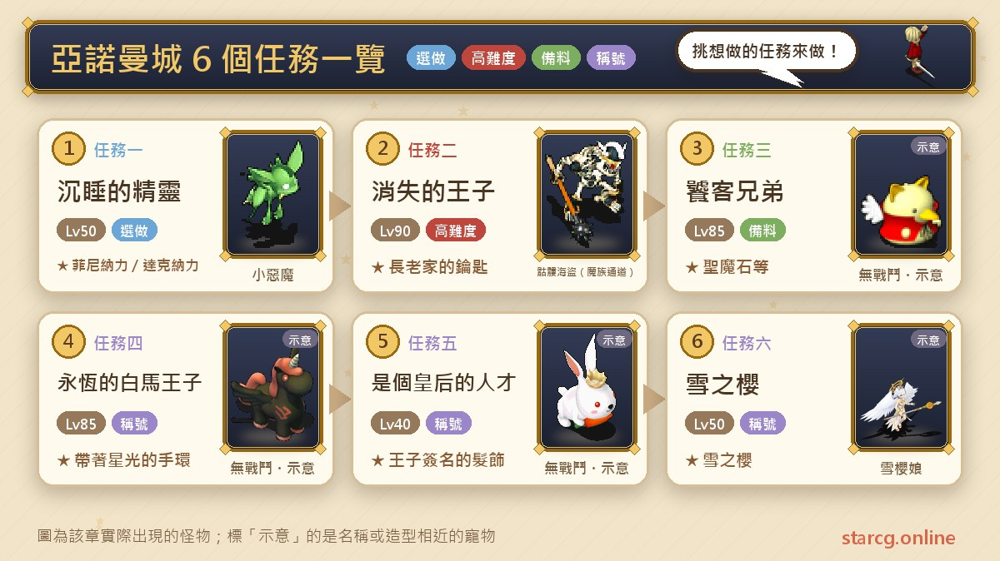
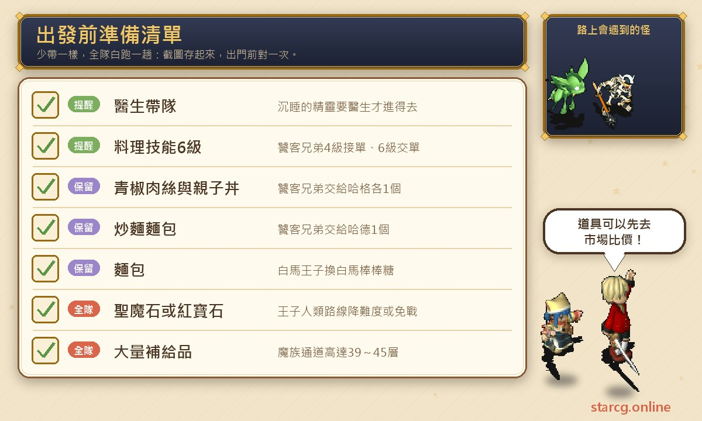
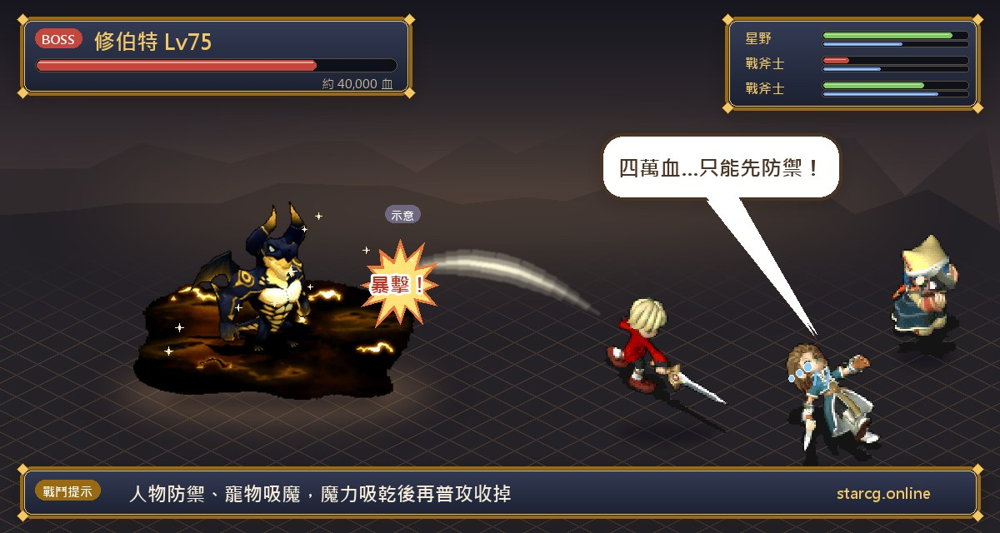
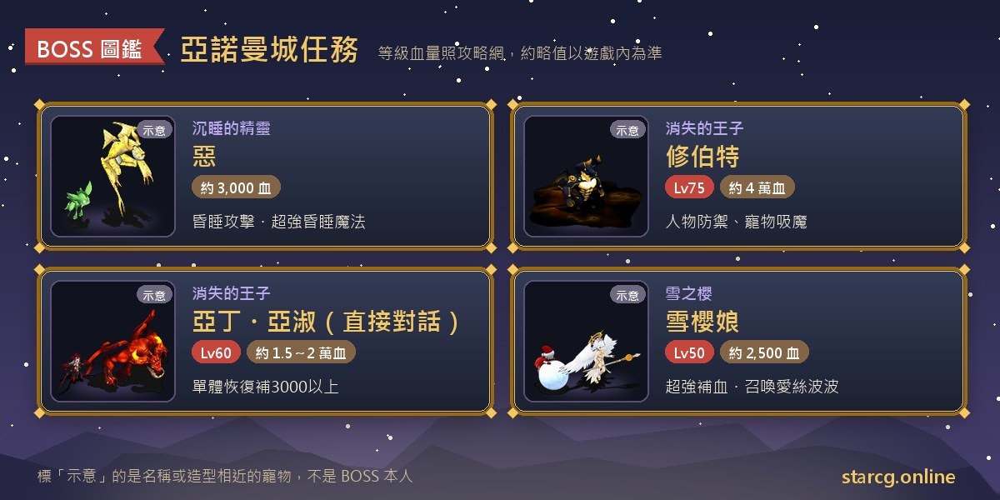

아노만 성(亞諾曼城)은 크로스게이트에서 퀘스트가 가장 다양한 도시 중 하나예요. 의사가 리더가 되어 다른 사람의 내면세계로 들어가는 「잠든 정령」, 인간과 마족 두 루트로 나뉘어 마지막에 마족 지하 감옥에서 휴버트를 쓰러뜨리는 「사라진 왕자」, 남성 전용·여성 전용 소형 칭호 퀘스트, 그리고 빙봉 계곡 꼭대기까지 올라가는 「눈의 벚꽃」이 있어요. 권장 레벨은 40부터 90까지 다양하고, 보상은 부적·장신구·칭호가 붙은 장비가 중심이에요. 그중 사라진 왕자에서 받는 「장로 집 열쇠」는 이후 스토리에서 쓰이는 핵심 아이템이에요.

이 글은 아노만 성의 퀘스트 6개를 「조건, 진행 순서, NPC와 좌표, 전투, 보상」 순으로 정리해 게임하면서 바로 볼 수 있게 만든 목록이에요. 놓치기 쉬운 제한(의사 리더, 성별, 밤, 요리 레벨)은 따로 표시했어요. StarCG(星詠魔力), 水藍魔力, 初心魔力寶貝 어느 쪽을 하든 아노만 성 퀘스트 흐름은 같으니 그대로 활용하면 돼요.

> 이 글은 [StarCG 공략 사이트](https://guide.starcg.net/)의 아노만 성 퀘스트 페이지를 바탕으로 저희 방식대로 순서를 바꾸고 새로 쓴 것으로, 그대로 옮기지 않았어요. 보스 HP와 수치는 대략적인 값이며 실제로는 게임 내 표시가 우선이에요. 공략 사이트에 나오지 않은 수치는 모두 「공략 사이트 미기재」로 적었고, 게임 업데이트 후 내용이 바뀔 수 있어요.

## 아노만 성 퀘스트란? 먼저 전체 순서 보기

아노만 성의 퀘스트 6개는 서로 선후 관계가 없어서 자기 레벨과 직업에 맞춰 골라 하면 돼요. 다만 몇몇 퀘스트는 서로 얽혀 있어요. 사라진 왕자의 인간 루트에서는 미식가 형제에서 받은 「성마석(聖魔石)」으로 전투 하나의 난이도를 낮출 수 있고, 미식가 형제 후반부는 제놈섬(傑諾姆島)의 레오나 마을(雷歐娜村)까지 가야 해서 니빌 해촌(尼維爾海村)의 땡땡이 선장 또는 크레 마을(克瑞村)의 동쪽 섬으로 퀘스트를 먼저 끝내야 갈 수 있어요.

| 퀘스트 | 퀘스트 이름 | 권장 레벨 | 획득 |
|---|---|---|---|
| 퀘스트 1 | 잠든 정령 | 50 | 펫 은화(잠금)×2, 피니나리／다크나리 등 |
| 퀘스트 2 | 사라진 왕자 | 90 | 장로 집 열쇠, 기습 비권／회피의 책 |
| 퀘스트 3 | 미식가 형제 | 85 | 빙원의 결정／펫 충성 물약, 성마석 등 |
| 퀘스트 4 | 영원한 백마 왕자 | 85 | 별빛 팔찌 |
| 퀘스트 5 | 왕비감 | 40 | 왕자 사인 머리장식 |
| 퀘스트 6 | 눈의 벚꽃 | 50 | 눈의 벚꽃(부적) |

한 줄로 정리하면: **낮은 레벨에서는 왕비감(여성 전용)과 잠든 정령(의사 리더)을 먼저, 중간에 눈의 벚꽃, 마지막으로 90레벨 사라진 왕자에 도전하세요. 미식가 형제와 백마 왕자는 직업 스킬과 성별을 보고 할지 정하면 돼요.**

## 출발 전에 준비할 것

아노만 성 퀘스트는 준비물이 많지 않지만 하나하나가 중요해서, 빠뜨리면 파티 전체가 돌아가야 해요.

잠든 정령은 반드시 **의사**가 리더여야 메이보 집 방에 들어갈 수 있어요. 미식가 형제는 요리 스킬 4레벨이어야 첫 주문서를 받고, 6레벨이어야 두 번째 단계를 납품할 수 있어요. 또 **고추잡채, 오야코동, 야키소바빵**을 각 1개씩 준비해야 해요. 영원한 백마 왕자는 **빵** 1개가 필요해요. 사라진 왕자 인간 루트에서 크레 마을 전투를 쉽게 하고 싶다면 **성마석**(미식가 형제 보상 중 하나) 1개를, 아예 전투를 건너뛰고 싶다면 1인당 **완전 결정체 루비(完全結晶體的紅寶石)** 1개를 준비하세요. 요리나 보석을 직접 만들기 번거롭다면 먼저 사이트의 [시세 검색](/ko/market/)에서 파는 사람이 있는지, 시세가 어떤지 확인해 보세요.

## 퀘스트 1: 잠든 정령(의사 리더, 내면세계 진입)

권장 50레벨, 조건은 **의사가 리더**일 것. 조사 의뢰서는 바닥에 버릴 수도 있고 거래할 수도 있어요.

1. 아노만 성 상인 카스트로(卡斯楚)의 집(82, 64) 2층에서 **하녀 엘마(女傭愛爾瑪)**(20, 20)와 대화해 「조사 의뢰서」를 받아요.
2. 모턴 마을(摩頓村) 메이보의 집(52, 33)에서 의사나 간호사가 **라임(賴姆)**에게 말을 걸면 파티 전원이 방에 들어갈 수 있어요. 이어서 **집사 메이보(總管梅博)**와 대화해 「마스 도련님께 보내는 편지」를 받아요.
3. 아노만 성 카스트로의 집 2층으로 돌아가 **하녀 엘마**에게서 「의료 의뢰서」를 받아요.
4. **마스의 방**에 들어가 **마스(馬斯)**와 대화하면 마스의 내면세계로 들어가요. 먼저 바닥에 보이지 않는 책 4권 **이성주의(理性主義), 항상 변화(恆常變化), 원소의 힘(元素力量), 만물의 근원(萬物之源)**을 모은 뒤 전송 수정으로 들어가요.
5. 랜덤 맵 「마스의 내면세계」로 이동해요(공략 사이트에는 1층 미궁이 3층이라고 적혀 있어요). 안에서 보스 「선(善)」과 「악(惡)」을 찾고, **「악」을 쓰러뜨려야 퀘스트가 완료돼요**.
6. 악을 쓰러뜨리면 마스의 방으로 돌아와요. 책 4권을 가진 채 **마스**와 대화하면 「광석」을 받고, 감정하면 **피니나리(菲尼納力)** 또는 **다크나리(達克納力)**가 나와요.

**보스 정보**: 「악」은 HP 약 3,000이고 공격, 방어, 수면 공격, 초강력 수면 마법을 써요. 곁에 40~49레벨 소악마(小惡魔) 9마리(HP 약 2,500, 망각 공격 사용)가 있고, 전리품으로 한손검과 안티슬립(安提史利普)이 랜덤으로 나와요. 「선」의 수치는 공략 사이트 미기재이고, 수면 공격을 쓰며 40~49레벨 꼬마 천사(小天使) 9마리(연속 공격 사용)를 데리고 있어요.

**주의할 점**: 공략 사이트에서는 선을 먼저 쓰러뜨린 뒤 악을 쓰러뜨리면 아이템을 더 많이 얻을 수 있다고 해요. 책 4권은 「바닥에 보이지 않는」 아이템이라 방 안을 꼼꼼히 클릭해야 하고, 마지막에 책을 낼 때도 4권 모두 가지고 있어야 해요. 보상 부적 중 피니나리는 체력 +50~80, 다크나리는 마력 +50~80이고, 둘 다 장착하면 칭호 「철학에 관심 있는 사람(對哲學感興趣的人)」을 얻어요. 안티슬립(수면 저항)과 안티컨퓨즈(安提肯飛斯, 혼란 저항)도 각각 자기 칭호가 있어요.

## 퀘스트 2: 사라진 왕자(인간 루트와 마족 루트 중 택1)

권장 90레벨, 퀘스트 조건은 없어요. 시작 전에 판부르크(法蘭城) 서쪽 성문 전송석 옆의 **마력 꼬마버섯 사프트(魔力小三菇莎芙特)**(64, 83)에게 정보를 들을 수 있는데, 생략해도 되는 스토리 단계예요. 두 루트 모두 마족 지하 감옥에서 휴버트와 싸우고, 차이는 보상이에요. **인간 루트는 「기습 비권(偷襲密卷)」, 마족 루트는 「회피의 책(閃躲之策)」**을 받고, 양쪽 모두 「장로 집 열쇠(長老家的鑰匙)」를 받아요. 공략 사이트에 따르면 미식가 형제를 하기 싫거나 성마석을 사기 싫다면 마족 루트로 가면 된다고 해요.

### 인간 루트(기습 비권)

1. 아노만 성에서 대머리 아이 **비루(比魯)**(148, 122)와 대화해 「결혼식 초대장」을 받아요.
2. 크리트 대성당(克里特大教堂) 앞의 **문지기(門侍)**(195, 69)를 찾아 결혼식을 구경하러 들어가요.
3. 재상 외의 아무 NPC와 대화하면 전투가 시작되고, 신부 리타(莉塔)가 신랑 두즈(竇梓)를 한 대 때리고 도망가요. **전투 중에는 방어만 하면** 대화가 끝난 뒤 자동으로 종료돼요.
4. 옆의 **재상(宰相)**(17, 12)과 대화해 「리타에게 보내는 편지」를 받아요.
5. 모턴 마을 촌장 집 밖에서 **리타**(58, 47)를 찾아요. 「예」를 고르면 퀘스트 진행용 「리타의 머리장식」을 받고, 「아니요」를 고르면 「리타의 반지」를 받아요. 반지는 아노만 성의 재상에게 가져가면 「리타의 인형」으로 바꿀 수 있어요.
6. 모턴 마을 입구 근처의 **소식통 소두(包打聽小豆)**(90, 37)에게 정보를 들어요.
7. 니빌 해촌 입구의 **마족 군단(魔族軍團)**(32, 62)과 전투를 시작하면 2턴째에 적이 도망가요. 그 뒤 **중상 입은 카이중(重傷的凱中)**(37, 61)에게 정보를 들어요.
8. (생략 가능) 크레 마을 밖의 **니얼(尼珥)**(468, 90)에게 정보를 들어요.
9. 크레 마을 안의 부부 **아딘(亞丁)**(75, 25), **아슈(亞淑)**(75, 24)를 찾아 아래 세 방법 중 하나로 그들의 집에 들어가요.
10. 아딘의 집에 들어가 노란 전송 수정(16, 7)을 밟고 마족 영역 제1영역으로 가요. 20~25층 랜덤 미궁을 지나 최하층인 마족 지하 감옥에서 **휴버트(修伯特)**(23, 2)와 전투를 시작해요.
11. 이기면 감옥으로 보내지고, **라제팔(拉傑法爾)**(22, 36)과 대화해요. 리타가 나타나면 리타의 머리장식을 건네고 「장로 집 열쇠」와 「기습 비권」을 받아요. 마지막으로 바네사(凡妮莎)가 나타나 구경만 하면 되는 스토리 전투가 한 번 있어요.

| 아딘의 집에 들어가는 방법 | 결과 |
|---|---|
| 그냥 대화 | 매우 어려운 전투: 아딘 60레벨 HP 약 15,000, 아슈 60레벨 HP 약 20,000, 단일 회복으로 3,000 이상 회복 |
| 성마석 1개 제출 | 쉬운 전투: 둘 다 30레벨, HP 약 9,000 |
| 1인당 완전 결정체 루비 1개 제출 | 전투 없이 바로 입장 |

### 마족 루트(회피의 책)

1. 아노만 성 성 앞의 요정 **마족 소녀(魔族少女)**(141, 77)를 찾아가요. **첫 질문에는 「아니요」를 고르세요**. 그러면 「교환 일기」를 받아요.
2. 모턴 마을 입구의 **소식통 소두**(90, 37)에게서 라제팔이 니빌 해촌으로 갔다는 걸 들어요.
3. 니빌 해촌 입구의 **마족 군단**(32, 62)과 전투를 시작하면 2턴째에 적이 도망가요. 이어서 오른쪽 위로 걸어가 **마족 소녀 바네사**(39, 64)와 대화해 「마족 횃불」을 받아요.
4. 크레 마을 병원 옆 눈사람이 있는 곳(43, 72)에서 눈사람을 클릭하면 자동으로 횃불을 써서 지하 방으로 들어가요. (34, 20)까지 걸어가 **마족 통로(魔族通道)**로 들어가요.
5. 마족 통로는 **39~45층**이나 되고, 몬스터는 61~69레벨 해골 해적(骷髏海盜)과 미라(木乃伊)예요. 마족 지하 감옥에 도착하면 (23, 2)에서 **휴버트**와 대화해 전투를 시작해요.
6. 이기면 **라제팔**(22, 36)과 대화해요. 바네사가 나타나면 교환 일기를 건네고 「장로 집 열쇠」와 「회피의 책」을 받아요. 그 뒤 리타가 나타나 스토리 전투가 벌어지고, 다 보면 완료예요.

**보스 정보**: 휴버트는 75레벨, HP 약 40,000이에요. 공략 사이트의 공략법은 **인물은 방어, 펫은 마력 흡수**(마족 루트에는 펫이 전율습심(戰慄襲心)으로 마력을 흡수한다고 적혀 있어요)로 마력을 바닥낸 뒤 일반 공격으로 마무리하는 거예요.

**주의할 점**: 두 루트 모두 니빌 해촌을 지나는데, **마을에 들어갈 때 파티에서 강제로 빠지게 돼요**. 한 명씩 마을에 들어간 뒤 다시 파티를 짜고 마족 군단과 대화하세요. 인간 루트의 미궁은 20~25층, 마족 루트는 39~45층으로 층수 차이가 커요. 마족 루트를 고른다면 보급품을 넉넉히 챙기고, 사이트의 [미궁 계단 찾기](/ko/maze/)로 지나온 길을 기록해도 좋아요.

## 퀘스트 3: 미식가 형제(요리 스킬 퀘스트)

권장 85레벨, 조건은 **요리 스킬 6레벨**(첫 주문서는 4레벨, 두 번째 단계 납품은 6레벨)이에요.

1. 아노만 성 문명 예술 광장(74, 119)에서 **메티(梅蒂)**(25, 3)를 찾아 「식품 주문서」를 받아요. 요리가 4레벨 미만이면 받을 수 없어요.
2. 크레 마을 미식가 하그의 집(77, 48)에서 **미식가 하그(饕客哈格)**(18, 1)에게 식품 주문서, 고추잡채, 오야코동을 각 1개씩 건네면 **빙원의 결정(冰原之晶)** 또는 **펫 충성 물약(寵忠藥水)** 중 하나와 「하드에게 보내는 편지」를 받아요.
3. 제놈섬 레오나 마을의 식당(68, 77)에서 **미식가 하드(饕客哈德)**(10, 8)에게 편지를 건네고 「야키소바빵 주문서」를 받아요. **요리가 6레벨 미만이면 이 편지를 빼앗겨요**.
4. 야키소바빵 주문서와 야키소바빵 1개를 미식가 하드에게 건네면 **바크다의 정보(巴克達的情報), 성마석, 매력 물약(魅力藥水)** 중 두 가지를 받아요.

**주의할 점**: 바크다의 정보는 레오나 마을 퀘스트 「봄바람이 가져온 희망(春風帶來希望)」에 쓰이는 아이템이고, 성마석은 사라진 왕자 인간 루트의 전투를 쉽게 만들어 줘요. 레오나 마을에 가는 방법은 [니빌 해촌 퀘스트 공략](/ko/posts/neville-quest-guide/)의 땡땡이 선장이나, 크레 마을의 동쪽 섬으로 퀘스트를 참고하세요.

## 퀘스트 4: 영원한 백마 왕자(남성 전용, 밤)

권장 85레벨, 조건은 **남성 캐릭터**이고 **밤**에 받아야 해요.

1. 아노만 성 사랑의 나무 광장에서 **소녀 티클링(少女蒂克鈴)**(77, 103)을 찾아 백마 탄 왕자를 찾아 달라는 부탁을 받아요.
2. 크리트 대성당 오른쪽의 **아이 롤링프(小孩羅林普)**(204, 66)에게 빵 1개를 주고 「백마 막대사탕」으로 바꿔요.
3. 소녀 티클링에게 돌아가면 「귀걸이」를 받고, 감정하면 **별빛 팔찌(帶著星光的手環)**가 나와요. 장착하면 칭호 「영원한 백마 왕자(永恆的白馬王子)」를 얻어요.

퀘스트 전체에 전투가 없어서 시간대와 성별 제한만 기억하면 돼요.

## 퀘스트 5: 왕비감(여성 전용)

권장 40레벨, 조건은 **여성 캐릭터**예요.

1. 아노만 성 밖 북쪽의 **충직한 하인 부걸(忠心僕人溥傑)**(324, 317)에게 나쁜 하인에 대한 정보를 들어요.
2. 아노만 성 빌리 맥줏집(比利啤酒屋)(196, 129)의 **취객 아다(醉漢阿達)**(20, 16)에게서 「독한 술」을 받아요.
3. 크레 마을 술집(89, 63)의 **나쁜 하인 커구웨(壞僕人可古越)**(12, 18)에게 「홍샤의 정보(洪剎的情報)」를 받아요.
4. 술집 객실(7, 15)에 들어가 **왕자 페이차이(王子費儕)**(10, 7)에게 정보를 건네면 「왕자의 피 묻은 더러운 손수건」을 받아요.
5. 충직한 하인 부걸에게 돌아가면 「머리장식」을 받고, 감정하면 **왕자 사인 머리장식(王子簽名的髮飾)**이 나와요. 장착하면 칭호 「왕비감(是個皇后的人材)」을 얻어요.

백마 왕자와 마찬가지로 전투가 없고 레벨 조건도 가장 낮아서, 여성 캐릭터라면 아노만 성에 도착하자마자 먼저 끝내 두기 좋아요.

## 퀘스트 6: 눈의 벚꽃(빙봉 계곡 꼭대기)

권장 50레벨, 퀘스트 조건은 없어요.

1. 드위트섬(德威特島) 빙봉 계곡(冰封之谷)(336, 56)에서 꼭대기 층(랜덤 20~24층)까지 올라가 **눈벚꽃 아가씨(雪櫻娘)**와 대화하고 **「아니요」를 골라** 전투에 들어가요.
2. 전투가 끝나면 영구 동토(永久凍土)로 보내지고, **시실크(西西爾克)**(51, 29)와 대화해 「벚나무 가지」를 받아요. 안쪽으로 걸어가면 벚나무와 바닥에 있는 시실크가 보여요.
3. 크레 마을(80, 21)에서 문을 클릭해 들어가 침대 위의 **샤미(夏咪)**와 대화해요. **벚나무 가지가 있어야 들어갈 수 있고**, 문이 화면에 보이지 않아서 좌표 지점까지 가서 마우스로 훑어야 해요.
4. 샤미와 대화하면 화면이 바뀌고, 이어서 **로산(羅珊)**과 대화해 「부적」을 받아요.
5. 빙봉 계곡으로 돌아가 **눈벚꽃 아가씨**(27, 11)와 대화하고 **「예」를 골라** 영구 동토로 들어가요. 부적을 가지고 있으면 전투가 일어나지 않아요.
6. 영구 동토의 벚나무 아래에서 **샤미**(53, 31)와 대화하면 **눈의 벚꽃(雪之櫻)**을 받고 퀘스트가 완료돼요.

**보스 정보**: 눈벚꽃 아가씨는 50레벨, HP 약 2,500이고 성스러운 방패, 강력 빙결 마법, 초강력 회복 마법을 쓰며 에스포포(愛絲波波)를 소환해요. 에스포포 ×9는 HP 약 1,500, 땅 50 바람 50이고 성스러운 방패, 강력 혼란 마법, 초강력 빙결 마법을 써요.

**공략법**: 공략 사이트는 눈벚꽃 아가씨부터 집중 공격하라고 해요. 옆의 눈사람들이 혼란과 회복을 쓰기 때문에 전투가 길어질수록 「아군끼리 때리는」 상황이 생기기 쉬워요. 또 빙봉 계곡에서 원거리 무기를 쓰면 망령이 마법을 쓰니 미궁을 걸을 때 주의하세요. 눈의 벚꽃을 장착하면 칭호 「꼭 행복해야 해(一定要幸福唷)」를 얻고, 각 능력치가 랜덤으로 1~5씩 오르내려요.

## 아노만 성 퀘스트 자주 묻는 질문

**잠든 정령은 꼭 의사가 있어야 하나요?** 퀘스트 조건은 의사 리더예요. 공략 사이트의 진행 순서에는 의사 또는 간호사가 라임에게 말을 걸어야 파티 전원이 메이보 집 방에 들어갈 수 있다고 적혀 있어요.

**사라진 왕자는 어느 루트로 가야 하나요?** 기습 비권을 원하면 인간 루트, 회피의 책을 원하면 마족 루트예요. 인간 루트는 미궁이 짧지만 성마석이나 루비가 없으면 크레 마을 전투가 매우 어려워요. 마족 루트는 보석이 필요 없지만 마족 통로가 39~45층이에요. 두 루트 모두 장로 집 열쇠를 받아요.

**휴버트는 어떻게 잡나요?** 공략 사이트의 추천은 인물은 방어, 펫은 마력 흡수로 마력을 바닥낸 뒤 일반 공격으로 마무리하는 거예요.

**미식가 형제 도중에 편지를 빼앗겼어요?** 미식가 하드에게 건넬 때 요리 스킬이 6레벨이어야 해요. 아니면 하드에게 보내는 편지를 빼앗기니 요리 레벨부터 올려 두세요.

**눈의 벚꽃에서 눈벚꽃 아가씨에게 「예」와 「아니요」 중 뭘 골라야 하나요?** 처음에는 「아니요」를 골라 전투에 들어가고, 부적을 받은 뒤 돌아와서 「예」를 골라 영구 동토의 샤미를 찾아가요.

**백마 왕자와 왕비감 퀘스트를 한 캐릭터로 둘 다 할 수 있나요?** 안 돼요. 영원한 백마 왕자는 남성 전용, 왕비감은 여성 전용이에요.

## 정리: 조건부터 보고 퀘스트를 고르세요

아노만 성 퀘스트의 가장 큰 특징은 「조건이 제각각」이라는 점이에요. 의사 리더, 요리 레벨, 성별 제한, 밤 제한 모두 하다가 중간에야 못 한다는 걸 알게 될 수 있어요. 위의 표에서 자기가 어떤 조건을 충족하는지 먼저 확인하고, 낮은 레벨에서는 왕비감과 잠든 정령의 장신구를 먼저 챙기세요. 90레벨이 되면 사라진 왕자에 도전하고, 원하는 보상에 따라 루트를 고르면 돼요. 휴버트의 HP 4만은 이 도시에서 가장 큰 전투이고 마력 흡수 전술에는 펫의 도움이 필요하니, 출발 전에 사이트의 [펫 도감](/ko/pets/)에서 가진 펫을 확인하고 [데미지 계산기](/ko/damage/)로 마무리에 얼마나 걸릴지 계산해 보세요.

더 자세한 원문과 다른 퀘스트는 [StarCG 공략 사이트](https://guide.starcg.net/)에서 볼 수 있어요. 니빌 해촌의 떠돌이 악사 토드, 사라진 가수, 땡땡이 선장은 [니빌 해촌 퀘스트 공략](/ko/posts/neville-quest-guide/)에 정리해 두었어요.
