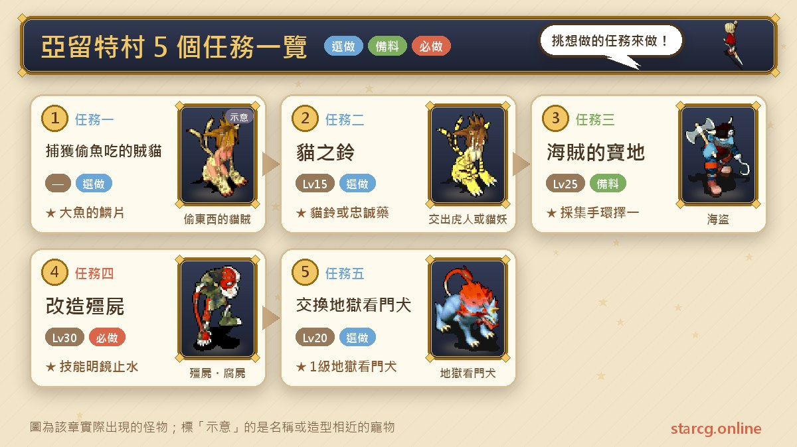
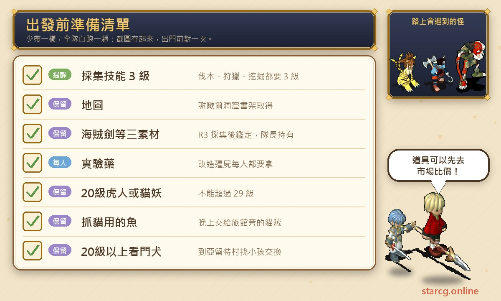
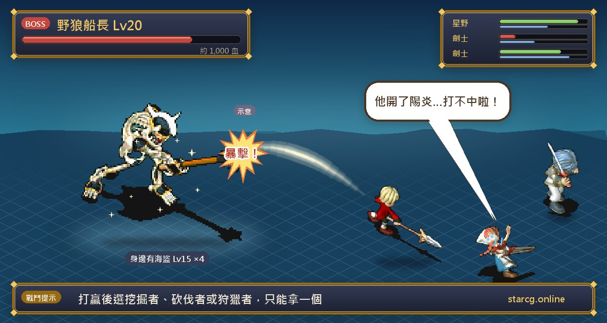
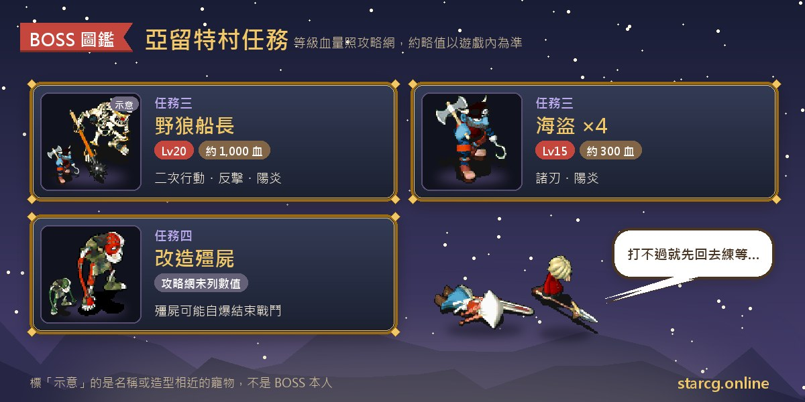

아류트 마을(亞留特村)은 파렌 왕국(法蘭王國) 동쪽 바닷가에 있어요. 공략 사이트는 이곳을 마을 사람들의 의뢰가 가득하고, 실용적인 스킬을 배우거나 특별한 펫을 교환하기 좋은 곳이라고 소개해요. 아류트 마을 관련 퀘스트 다섯 개는 모두 15~30레벨이에요. 판부르크 성(法蘭城)에서 생선 장수를 도와 고양이 도둑을 잡고, 워타이거(虎人)나 캣시(貓妖)로 고양이 방울을 교환하고, 해적의 보물을 찾아 특별 채집 장소용 팔찌를 얻고, 이상한 동굴(奇怪的洞窟)에서 좀비 개조 실험을 도와 스킬 **명경지수**를 배우고, 20레벨 켈베로스(地獄看門犬)를 1레벨 켈베로스로 교환하는 퀘스트예요.

그중 먼저 할 가치가 큰 것은 「좀비 개조(改造殭屍)」와 「해적의 보물섬(海賊的寶地)」예요. 좀비 개조는 캐릭터가 명경지수를 배우고, 1등 훈장에 쓰이는 탐욕의 죄서(貪欲的罪書)가 나올 수도 있어요. 해적의 보물섬은 특수 소재 「강기의 광석(鋼騎之礦)」을 채집할 수 있는 유일한 곳이에요. 이 글에서는 다섯 퀘스트의 조건, 좌표, 준비물, 전투 정보를 한곳에 모았어요. StarCG(星詠魔力), 水藍魔力, 初心魔力寶貝 중 무엇을 하든 아류트 마을 퀘스트 진행은 같으니 그대로 활용하면 돼요.

> 이 글은 [StarCG 공략 사이트](https://guide.starcg.net/quests/arute)의 아류트 마을 퀘스트 페이지를 바탕으로 저희 방식대로 순서를 다시 짜고 새로 쓴 것으로, 원문을 그대로 옮기지 않았어요. 보스 HP와 수치는 대략적인 값이니 실제 게임을 기준으로 해 주세요. 공략 사이트에 없는 내용은 본문에 「공략 사이트 미기재」라고 표시했어요.

## 아류트 마을 퀘스트는 무엇이 있나요? 전체 순서부터

다섯 퀘스트는 서로 선행 조건이 없어서 자유롭게 진행하면 돼요. 편한 순서는 먼저 판부르크 성에서 고양이 도둑과 고양이의 방울 심부름을 끝내고, 20레벨 전후에 켈베로스를 잡아 펫을 교환하고, 채집 스킬을 3레벨까지 올린 뒤 해적의 보물섬을, 30레벨에 좀비 개조로 명경지수를 배우는 거예요.

| 퀘스트 | 퀘스트 이름 | 권장 레벨 | 보상 |
|---|---|---|---|
| 퀘스트 1 | 물고기를 훔쳐 먹는 도둑 고양이 | 공략 사이트 미기재 | 명성 200, 큰 물고기의 비늘 |
| 퀘스트 2 | 고양이의 방울 | 15 | 명성 200, 고양이 방울 또는 충성 약 |
| 퀘스트 3 | 해적의 보물섬 | 25 | 명성 200, 채집 팔찌 3종 중 하나 |
| 퀘스트 4 | 좀비 개조 | 30 | 명성 500, 명경지수, 탐욕의 죄서(랜덤) |
| 퀘스트 5 | 지옥의 문지기 교환 | 20 | 1레벨 켈베로스 |

공략 사이트의 지역 페이지에서는 앞의 네 퀘스트를 자동 길안내 지원으로, 지옥의 문지기 교환은 길안내 미내장으로 표시해요.

## 출발 전에 이것부터 준비하세요

아류트 마을 퀘스트는 「먼저 갖춰야 하는」 조건이 꽤 많아요. 해적의 보물섬은 채집 스킬 3종이 모두 3레벨이어야 하고, 고양이의 방울과 지옥의 문지기 교환은 지정 레벨의 펫을 먼저 잡아 둬야 하며, 좀비 개조는 모두가 실험약을 받아야 해요.

가장 시간이 드는 건 해적의 보물섬이에요. 벌목, 수렵, 채굴 세 스킬이 모두 3레벨이어야 하고, 소재 3종을 각각 다른 장소에서 R3으로 채집한 뒤 감정해서 확인해야 해요. 펫은 고양이의 방울에 20레벨 이상 29레벨 이하의 워타이거 또는 캣시가, 지옥의 문지기 교환에 20레벨 이상의 켈베로스가 필요해요. 이 펫들의 성장과 능력이 궁금하면 이 사이트의 [펫 도감](/ko/pets/)에서 확인하고, 소재를 직접 채집하기 싫다면 [시세 조회](/ko/market/)로 시세를 살펴보세요.

## 퀘스트 1: 물고기를 훔쳐 먹는 도둑 고양이(밤에 고양이, 정오에 비늘)

권장 레벨은 공략 사이트 미기재, 퀘스트 조건 없음, 자동 길안내 지원이에요. 장소는 모두 판부르크 성이지만 시간대 조건이 두 번 있어요.

1. 판부르크 성 북동쪽 **나판 식품점(拿潘食品店)**(217, 53)에서 **생선 장수 파린(賣魚的帕林)**과 대화해 돕겠다고 하면 「고양이 잡이용 생선」을 받아요.
2. **밤**에 옆의 **모험가 여관**(238, 64)에 가면 입구 오른쪽 랜덤 위치에 **물건 훔치는 고양이 도둑(偷東西的貓賊)**이 나타나요. 고양이 잡이용 생선을 주면 「방울」로 바꿔 줘요.
3. 방울을 **생선 장수 파린**에게 돌려주면 「미끼」를 받아요.
4. **정오**에 미끼를 들고 판부르크 성 안 남문 입구(165, 225)의 **낚시꾼**과 대화하면 「큰 물고기의 비늘(大魚的鱗片)」로 바꿔 줘요.

**주의할 점**: 고양이 도둑은 밤에만 나오고 낚시꾼은 정오에만 교환해 줘서, 중간에 게임 시간을 꽤 기다려야 해요. 고양이 도둑은 입구 오른쪽에 랜덤으로 나타나니 안 보이면 근처를 더 돌아보세요. 큰 물고기의 비늘의 용도는 이 페이지에 공략 사이트 미기재예요.

## 퀘스트 2: 고양이의 방울(워타이거 또는 캣시 제출)

권장 15레벨, 퀘스트 조건 없음, 자동 길안내 지원이에요.

1. 판부르크 성 아파트(182, 132) 2층의 **고양이를 사랑하는 사가키(愛貓的莎佳琦)**가 20레벨 **워타이거**나 **캣시**를 원한다고 해요.
2. 잡아서 20레벨까지 키워요(29레벨을 넘으면 안 돼요).
   - **워타이거**: 아노만 성(亞諾曼城) 서문에서 드웨트 섬(德威特島)(128, 295)으로 가서 300골드를 내고 리오폴도의 동굴(里歐波多的洞窟)에 들어가면, 전송 수정 뒤에서 랜덤으로 만나요.
   - **캣시**: 아류트 마을 근처 수수께끼 미궁(謎之迷宮) 최상층에 최고 16레벨로 나오고, 암영(闇影)에 도전할 때 18레벨 캣시가 나올 수도 있어요. 봉인한 뒤 직접 20레벨까지 키워야 해요.
3. 워타이거를 주면 **고양이 방울(貓鈴)**을, 캣시를 주면 **피니스키(菲妮斯基)**(충성 약)를 받아요.

**보상 차이**: 고양이 방울을 장비하면 종족이 인형계에서 야수계으로 바뀌는데, 공략 사이트는 종족 변환은 피해 감소 효과만 있고 피해 증가는 없다고 설명해요. 피니스키는 충성도를 랜덤으로 10 올리거나 내리며, 펫이 조교 범위를 넘으면 사용해도 효과가 없어요. 공략 사이트는 종족 상성 순환 두 가지도 함께 실었어요. 용계, 비행계, 곤충계, 특수계, 금속계 순으로 상성이고, 불사계, 인형계, 야수계, 식물계 순으로 상성이에요.

**주의할 점**: 리더가 목표 펫 한 마리만 내면 파티 전원이 퀘스트를 완료하니, 각자 한 마리씩 잡을 필요는 없어요.

## 퀘스트 3: 해적의 보물섬(늑대 선장과 채집 팔찌)

권장 25레벨, 조건은 **벌목·수렵·채굴 모두 3레벨**, 자동 길안내 지원이에요. 특수 소재 「강기의 광석」 채집지에 갈 수 있는 유일한 퀘스트예요.

1. 셰오르 동굴(謝歐爾洞窟)(699, 197)에서 낡은 책장(42, 24)을 조사해 「지도」를 얻어요.
2. 소재 3종을 모아요. 세 가지 모두 R3으로 채집해야 해요.
   - **해적검(海賊劍)**: 지도를 가진 채 셰오르 동굴 (4, 11)에서 반대편으로 들어가 (27, 36) 근처에서 채굴해요.
   - **셰르시라의 나뭇가지(謝爾席拉的樹枝)**: 프레이아(芙蕾雅) 아류트 지역(550, 19) 근처에서 벌목해요.
   - **아류트 사자의 가죽(亞留特獅子的皮)**: 프레이아 아류트 지역(621, 33) 근처에서 수렵해요.
3. 채집 가방에서 진짜 소재인지 확인하고 감정하세요. 다른 아이템은 지워도 돼요.
4. **새벽**에 아류트 서쪽 동굴(549, 43)의 (11, 7) 계단으로 해적의 사당(海盜的祠堂)에 들어가, 소재 3종을 가진 채 제단을 조사하면 해적의 동굴로 전송돼요. 리더의 퀘스트 아이템만 회수돼요.
5. 동굴 4층을 지나 최하층의 늑대 선장의 영당에서 **늑대 선장(野狼船長)**(22, 21)과 대화해 전투에 들어가요.
6. 이긴 뒤 늑대 선장과 다시 대화하고, 말하는 키워드에 따라 팔찌를 받아요. 「채굴자」라고 하면 **광부의 팔찌**, 「벌목자」라고 하면 **나무꾼의 팔찌**, 「수렵자」라고 하면 **사냥꾼의 팔찌**예요.
7. 늑대 선장의 묘(22, 13)를 조사해 나가요.

**보스 정보**: 늑대 선장은 20레벨, HP 약 1,000, 화 50·풍 50, 2회 행동이며 공격·방어·반격·아지랑이(陽炎)를 써요. 주변에 15레벨 파이어리트가 4마리 있고 각각 HP 약 300, 수 50·화 50이며, 두 마리는 양날 공격(諸刃), 두 마리는 아지랑이를 써요.

**팔찌 사용법**: 팔찌는 하나만 고를 수 있고, 잘못 받았으면 버리고 다시 받으면 돼요. 팔찌를 장비하고 판부르크 성 서쪽(342, 172)의 수수께끼 동굴(謎之洞窟)에 들어가 팔찌에 맞는 뱃사공을 찾아요. 광부의 팔찌는 동굴행 뱃사공(17, 8)에게서 **해적의 광산**으로, 나무꾼의 팔찌는 숲행 뱃사공(14, 6)에게서 **해적의 숲**으로, 사냥꾼의 팔찌는 섬행 뱃사공(11, 8)에게서 **해적의 섬**으로 가요. 팔찌는 한 번 쓸 때마다 내구 20이 줄어 최대 세 번까지 쓸 수 있어요. 안에서는 채집 성공률이 100%이고 **해적의 보물 상자**가 나올 수도 있어요. 채굴 6레벨 이상으로 해적의 광산에서 채집해야 **강기의 광석**이 나올 수 있어요.

**보물 상자 내용**: 3레벨 상자는 떠다니는 씨앗 또는 풍·화 수정 조각, 4레벨 상자는 떠다니는 씨앗, 매력 귤 또는 수·지 수정 조각, 5레벨 상자는 떠다니는 씨앗, 잡역부 구티의 항해일지(상점 판매가 100G) 또는 늑대 선장의 항해일지(상점 판매가 1000G)예요.

## 퀘스트 4: 좀비 개조(명경지수 배우기)

권장 30레벨, 퀘스트 조건 없음, 자동 길안내 지원이에요. 보상은 명성 500, 스킬 **명경지수**, 랜덤 드롭인 **탐욕의 죄서**예요.

1. 이상한 동굴 안에서 집시 여성처럼 차려입은 **무면허 간호사 미네루파(無照護士米內魯帕)**와 대화해 「실험약」을 받아요. **모두가 반드시 받아야 해요**.
2. (스토리, 생략 가능) 실험약을 가진 채 동굴 안의 「인간?」이라는 NPC와 대화해도 전투가 벌어지고, 쓰러뜨리면 유품 「스카프」를 얻어요. 아류트 마을에 있는 그의 아내에게 주면 고맙다고는 하지만 보상은 없어요.
3. 미궁을 지나 최하층으로 가요. 최하층에는 위로 가는 계단이 하나 있는데 그곳이 최하층의 입구이고, 실험약을 가지고 있으면 전투가 벌어져요.
4. 이기면 랜덤으로 탐욕의 죄서를 얻어요. 좀비를 쓰러뜨린 뒤(또는 좀비가 자폭해 전투가 끝난 뒤) 옆에 NPC **사이신(賽辛)**이 나타나고, 그와 대화하면 명경지수를 배워요.
5. **암흑 의사(暗醫)**와 대화해 열쇠를 받고 뒤쪽 문을 열어 계단을 올라가면 밖으로 전송돼요.

**보스 정보**: 공략 사이트의 이 페이지에는 개조 좀비의 레벨, HP, 스킬이 없고, 좀비나 거스트(腐屍)가 일정 확률로 아군을 공격한다는 점과 좀비가 자폭해서 전투가 끝날 수 있다는 점만 적혀 있어요.

**탐욕의 죄서**: 2레벨 부적, 반격 +4, 내구 100이며, 1등 훈장 「마지막 진실(最後的真相)」 여섯 번째 문의 도전 자격이에요. 랜덤 드롭이라 못 얻으면 다시 돌아야 해요.

## 퀘스트 5: 지옥의 문지기 교환(20레벨을 1레벨로)

권장 20레벨, 퀘스트 조건 없음, 직접 찾아가야 해요.

1. 20레벨 이상의 **켈베로스**를 한 마리 잡아요. 공략 사이트가 정리한 장소는 다음과 같아요.
   - **리오폴도 동굴**에서는 잡을 수 없어요.
   - **루미나스 마을(魯米那斯村)** 밖에 45~46레벨이 있어요.
   - **이상한 동굴**은 최고 19레벨뿐이지만, 10층에 NPC 형태로 지도에 나타나는 켈베로스는 20레벨이에요.
2. 아류트 마을(48, 37)의 **아이**와 대화해 20레벨 이상의 켈베로스를 1레벨 켈베로스 한 마리로 교환해요.

**주의할 점**: 받는 건 1레벨 켈베로스라 처음부터 키울 수 있어요. 성장을 먼저 비교해 보고 싶다면 이 사이트의 [펫 도감](/ko/pets/)을 확인하세요. 이상한 동굴은 좀비 개조의 퀘스트 장소이기도 해서 두 퀘스트를 한 번에 묶을 수 있어요.

## 아류트 마을 자주 묻는 질문

**명경지수는 어떻게 배우나요?** 좀비 개조 퀘스트를 하세요. 모두 먼저 무면허 간호사 미네루파에게 실험약을 받고, 이상한 동굴 최하층에서 이긴 뒤 나타나는 사이신과 대화하면 배울 수 있어요.

**해적의 보물섬에서 사당에 왜 못 들어가나요?** 새벽에 아류트 서쪽 동굴에 가야 하고, 리더가 해적검, 셰르시라의 나뭇가지, 아류트 사자의 가죽 세 소재를 가지고 있어야 제단을 조사해 전송될 수 있어요.

**강기의 광석은 어떻게 채집하나요?** 광부의 팔찌를 가지고 해적의 광산에 가서, 채굴 스킬 6레벨 이상으로 채집해야 얻을 수 있어요.

**고양이의 방울은 모두 펫을 내야 하나요?** 아니요. 리더가 20~29레벨 워타이거나 캣시 한 마리만 내면 전원 완료돼요.

**지옥의 문지기 교환용은 어디서 잡나요?** 루미나스 마을 밖에 45~46레벨이, 이상한 동굴 10층에 NPC로 나오는 20레벨이 있고, 리오폴도 동굴에서는 잡을 수 없어요.

**탐욕의 죄서는 반드시 얻나요?** 아니요. 좀비 개조에서 이긴 뒤 랜덤으로 얻어요.

## 정리: 채집 스킬부터 올리고 동굴은 한 번에

아류트 마을의 다섯 퀘스트는 레벨이 높지 않고, 정말 시간이 드는 건 사전 준비예요. 해적의 보물섬의 채집 스킬 3종과 소재, 고양이의 방울과 지옥의 문지기 교환용 펫, 좀비 개조의 1인당 실험약이에요. 시간대도 주의하세요. 고양이 도둑은 밤, 비늘은 정오, 해적의 사당은 새벽이에요. 이 조건들을 먼저 갖추면 좀비 개조에서 배우는 명경지수와 해적의 광산의 강기의 광석은 나중에 아주 쓸모 있는 수확이 돼요.

더 자세한 원문과 다른 퀘스트는 [StarCG 공략 사이트](https://guide.starcg.net/quests/arute)에서 확인할 수 있어요. 이 사이트의 [펫 도감](/ko/pets/)에서 워타이거, 캣시, 켈베로스의 성장을 찾아보고, [시세 조회](/ko/market/)로 소재와 보물 상자 아이템 시세를 보고, [데미지 계산기](/ko/damage/)로 늑대 선장을 상대할 파티 화력도 가늠해 보세요.
