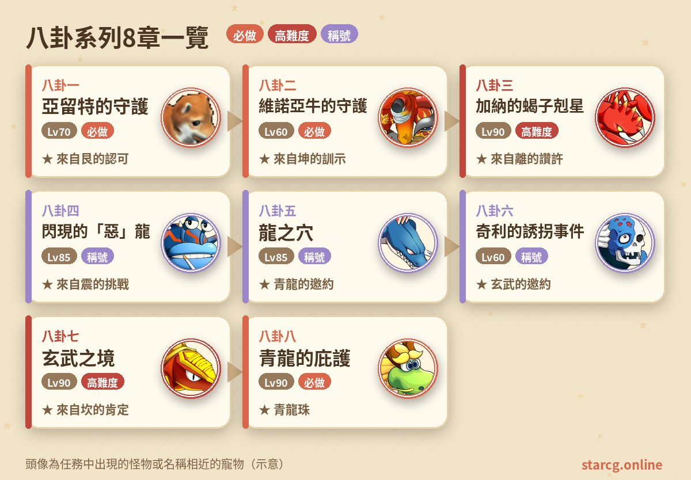
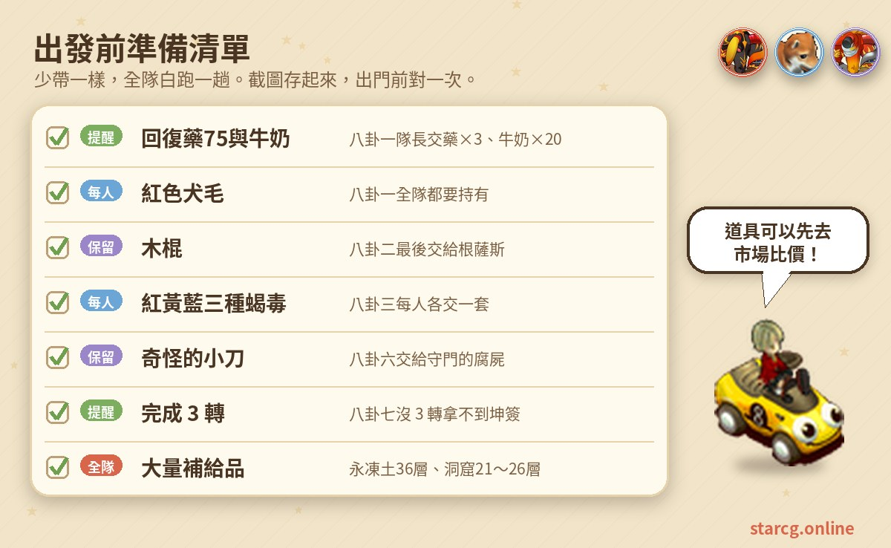
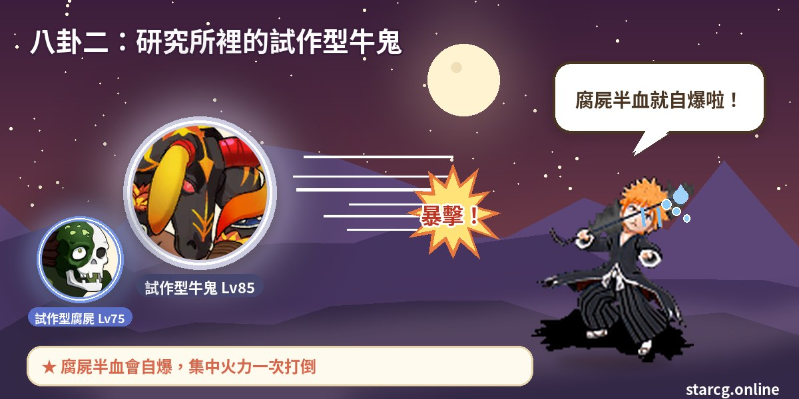
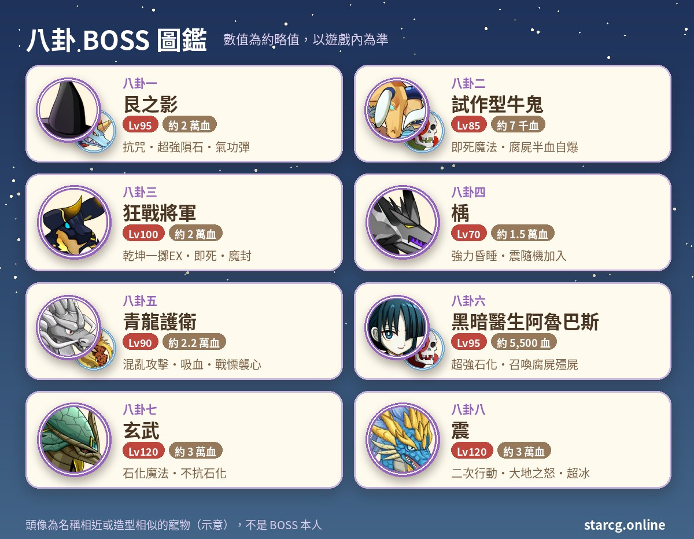

魔力寶貝的八卦系列，是一條從亞留特村的一隻小狗開始、最後走進青龍幻境的長篇任務線。一共八章，每一章都會遇到一位以八卦命名的守護者——艮、坤、離、震、坎——並拿到對應的永久稱號；走到最後的八卦八，則能拿到**青龍珠**，用來進入 100 級的練功點「龍族試煉場」。推薦等級從 60 級一路拉到 90 級，BOSS 等級最高到 120 級，是一條適合中後期隊伍慢慢推進的任務線。

這篇把八章的順序、條件、每一步的 NPC 與座標、要先準備的道具和 BOSS 資料整理成一份可以邊玩邊翻的流程，並把容易卡住的時段限制、道具持有規則特別標出來。不論你玩的是星詠魔力、水藍魔力還是初心魔力寶貝，八卦系列的任務流程都一樣，這份整理都能直接拿來用。

> 本文整理自 [星詠魔力攻略網](https://guide.starcg.net/) 的八卦系列頁面，並用我們自己的方式重新排序與改寫，沒有逐字照搬。BOSS 血量與數值是約略值，實際以遊戲內為準；遊戲更新後內容可能變動。

## 八卦系列是什麼？先看整體順序

八卦系列一共八章，每一章都以前一章拿到的稱號當作接任務的條件，所以必須照順序做。整條線的舞台橫跨亞留特村、維諾亞村、加納村、雪山的永久凍土、奇利村、傑諾瓦鎮與莎蓮娜島，幾乎把大陸東半部都跑過一遍。

整理成一句話：**前面四章是一路累積稱號，八卦五拿到「青龍的邀約」後，八卦八就能去換青龍珠；八卦三與八卦七是整條線最硬的兩場仗。**

| 章節 | 任務名稱 | 推薦等級 | 取得 |
|---|---|---|---|
| 八卦一 | 亞留特的守護 | 70 | 稱號「來自艮的認可」 |
| 八卦二 | 維諾亞牛的守護 | 60 | 稱號「來自坤的訓示」 |
| 八卦三 | 加納的蝎子剋星 | 90 | 稱號「來自離的讚許」 |
| 八卦四 | 閃現的「惡」龍 | 85 | 稱號「來自震的挑戰」 |
| 八卦五 | 龍之穴 | 85 | 稱號「青龍的邀約」 |
| 八卦六 | 奇利的誘拐事件 | 60 | 稱號「玄武的邀約」 |
| 八卦七 | 玄武之境 | 90 | 稱號「來自坎的肯定」 |
| 八卦八 | 青龍的庇護 | 90 | 青龍珠 |

要注意推薦等級不是一路往上：八卦二和八卦六都只寫 60 級，但前一章分別要 70 級與 85 級，所以實際上會在什麼等級做，取決於你卡在哪一章。

## 出發前先準備好這些

八卦系列有不少「只有特定的人要拿」或「每個人都要交」的道具，少一樣就得整隊折返。下面把整條線會用到的東西集中整理，建議出發前截圖存起來。

最早要準備的是八卦一的**生命力回復藥（75）×3** 與**牛奶 ×20**，只要隊伍中一人持有即可。回復藥可以在法蘭城東醫院（221, 83）的藥劑師**波洛姆**（16, 35）或西醫院（82, 83）的藥劑師**帕洛姆**（12, 18）買到；牛奶可以靠哥布林綠頭盔任務兌換或狩獵取得。八卦三的紅、黃、藍三種蝎毒掉率偏低，而且每個隊員都要交，是整條線最花時間的備料。這些材料如果自己打太慢，可以先用本站的 [市場查價](/market/) 看看有沒有玩家在賣、價格多少，再決定要買還是自己刷。

另外，八卦五的永凍土迷宮有 36 層、八卦六的阿魯巴斯洞窟有 21～26 層，補給品要準備得比平常多。

## 八卦一：亞留特的守護（全隊都要有紅色犬毛）

推薦 70 級。條件是隊伍中一人持有生命力回復藥（75）×3、牛奶 ×20。

1. 到亞留特村東門外（622, 133），與**小白**對話，取得「紅色犬毛」。
2. 到亞留特村的民家（48, 37；從 48, 36 點擊進入），與**塔基**（12, 10）對話，任選一個選項，取得「塔基的信」。
3. 前往法蘭城東門外的山男之家（509, 153），由隊長與**山男哈葛利特**（9, 3）對話，交出塔基的信、生命力回復藥（75）×3、牛奶 ×20，換到「山男的犬類傷藥」。
4. 回亞留特村民家（48, 37），隊長與**小白**對話並交出傷藥。
5. 與**漁夫歐姆豪克**對話，交出紅色犬毛，拿到「豪克轉述的線索」。
6. 到亞留特東邊（666, 130）附近找到紅色水晶，進入「流浪狗聚集地」。這是約 12～18 層的隨機迷宮，到底層後與**艮**對話開戰。
7. 打贏後再與艮對話，交出豪克轉述的線索，拿到永久稱號「來自艮的認可」，並被單人傳送到芙蕾雅（688, 188）。

**要注意的地方**：這章的道具持有規則最容易搞混。塔基的信與山男的犬類傷藥**只要隊長持有**；紅色犬毛則**全隊每個人都要有**，豪克轉述的線索也是所有要參戰的人都要拿。另外，攻略網提醒持有傷藥或豪克線索的角色調查民家，才會進到正確的地圖。迷宮裡是 70 級的被激怒的流浪狗與地獄看門犬，每場 1～4 隻。

**BOSS 資料**：艮之影 95 級、約兩萬血，邪魔系、抗咒，地水火風各 30。技能有聖盾、中毒魔法、超強隕石魔法、戰慄襲心、氣功彈、乾坤一擲，魔力低於 10% 時還會追加氣功彈 EX。推薦等級只有 70，BOSS 卻是 95 級，而且抗咒，靠控制技能拖節奏的打法不好用，建議以穩定輸出和補血為主。

## 八卦二：維諾亞牛的守護（夜晚限定、兩連戰）

推薦 60 級。條件是擁有「來自艮的認可」，而且要在**夜晚**進行。

1. 到維諾亞村與**根薩斯的母親**（34, 39）對話，選擇接受，拿到「木棍」。
2. 夜晚調查玄關（25, 45），選擇進入怪醫生的家。
3. 與「牛鬼？」對話開戰，對手是**坤之意志**。
4. 勝利後走樓梯（8, 13）進地下室，再從樓梯（10, 6）進入「黑暗醫生的洞窟」，約 7～8 層的隨機迷宮。
5. 走到洞窟最底層，進入黃色水晶，抵達「黑暗醫生的研究所」。
6. 往東走到（23, 32），與**試作型牛鬼**對話，進入兩連戰。
7. 勝利後與**根薩斯**對話，交出木棍，場景切換。
8. 依順時針方向走到（40, 26），與**坤**對話，拿到永久稱號「來自坤的訓示」，並被傳回維諾亞村。

**BOSS 資料**：

- 坤之意志：80 級、約兩萬血，邪魔系，以火焰魔法為主（火焰魔法、強力火焰魔法、超強火焰魔法、火焰的祈禱）。攻略網的建議是可以考慮脫下飾品裝備來打出合擊。
- 試作型牛鬼（兩連戰第一戰）：85 級、約七千血，會聖盾、乾坤一擲、中毒攻擊、單體即死魔法、崩擊，HP 低於 50% 時會用明鏡止水。身邊帶著 4 隻試作型腐屍（75 級、約 2,300 血，二次行動，HP 低於 50% 時會自爆攻擊）與 5 隻殭屍（75 級、約 2,300 血，會吸血攻擊與諸刃）。
- 第二戰的坤之意志會逃跑。

**打法**：第一戰敵方數量多達十隻，腐屍血量掉到一半就會自爆，最好一口氣集中打倒，不要把一堆半血的腐屍留在場上。洞窟裡也是 70 級的殭屍、腐屍和大蝙蝠，每隻約 1,500 血，每場 1～3 隻，推薦等級 60 的隊伍走起來不算輕鬆，補給要帶夠。

## 八卦三：加納的蝎子剋星（每個人都要交蝎毒）

推薦 90 級，條件是擁有「來自坤的訓示」。這一章是八卦系列前半段的難關，備料和 BOSS 都很吃力。

1. 到加納村（72, 70）與**離**對話，拿到「蝎毒血清」。
2. 收集三種蝎毒：
   - 紅蝎毒：加納村外鯰魚洞窟（626, 209）
   - 黃蝎毒：加納村外索奇亞（525, 348）
   - 藍蝎毒：加納村外索奇亞（582, 327），這一帶藍、黃蝎毒都有機會拿到
3. 回加納村（72, 70）交出三種蝎毒，換到「增效毒蝎血清」。**隊伍中每個人都要自己交**。
4. 從加納村南門到索奇亞沙漠，找隨機出現的黃色傳送石（大約在 570～640、300～400 的範圍），進入「沙漠之祠」。這是 5 層的隨機迷宮，怪物是 25～27 級的殺手蝎與木乃伊。攻略網提供的找廟路線是（579, 309）→（579, 391）→（598, 391）→（598, 309）→（617, 309）→（617, 391），沒找到再走（617, 391）→（631, 391）。
5. 地下 6 層的樓梯（14, 13）通往沙漠之廟。廟內是固定路線：
   - （42, 19）寶箱選「是」，拿到「古代王族的血壺」（要拿兩次，給兩位守護者用）。
   - （12, 32）**天空的守護者**交出血壺，通過柵欄。
   - （12, 37）樓梯下樓，（11, 8）寶箱拿「古代莎草製繃帶」。
   - （10, 11）樓梯上樓，把繃帶交給天空的守護者。
   - （66, 24）**大地的守護者**交出繃帶，通過柵欄。
   - （34, 12）樓梯上樓，（73, 30）樓梯下樓。
   - （16, 4）寶箱拿到「泛紅光的古代石」。
6. 帶著增效毒蝎血清與泛紅光的古代石回到地下 6 層，與**離**（12, 10）對話開戰。
7. 打贏後再與離對話，交出兩樣道具，拿到永久稱號「來自離的讚許」，被傳送到索奇亞。

**BOSS 資料**：狂戰將軍 100 級、約兩萬血，邪魔系，地水火風各 40。技能有乾坤一擲 EX、恢復魔法、即死魔法、魔法封印（持續 7 回合）、EXP 抽取魔法等。

**要注意的地方**：增效毒蝎血清與泛紅光的古代石**缺一不可**，少一樣就拿不到稱號。攻略網也提醒要特別注意乾坤一擲 EX 與即死魔法，並提到角色 10 級時戰慄顯示在 8 以內、寵物 V 級時戰慄顯示在 6 以內。蝎毒掉率低，最好在出發打 BOSS 之前就全隊收齊，沙漠之廟內的解謎也可以利用「沙漠之祠」任務的自動導航。

## 八卦四：閃現的「惡」龍（走進鯰魚肚子裡）

推薦 85 級，條件是擁有「來自離的讚許」。

1. 到加納村（72, 70）與**離**對話，拿到「風水盤」。
2. 前往加納村外的鯰魚洞窟（626, 209），到第四層「鯰魚洞窟的地底湖」，與**大鯰魚大人**（39, 32）對話，進入牠的口內。
3. 依序穿過鯰魚大王的胃袋、大腸，抵達小腸。一路上的一般怪是 53～55 級的藍色口臭鬼與布丁史萊姆。
4. 在小腸找到**楀**（22, 55）對話開戰，**震**會隨機加入戰鬥。
5. 勝利後，隊伍中**隨機一人**拿到「楀珠」。
6. 由持有楀珠的隊員與**震**（47, 64）對話交出楀珠，全隊被傳回地底湖。
7. 在地底湖（38, 34）與**離**對話，拿到永久稱號「來自震的挑戰」，被傳送到索奇亞。

**BOSS 資料**：楀 70 級、約一萬五千血，會對自己放恢復魔法、強力昏睡魔法與聖盾。震 95 級、約兩萬六千血，會諸刃、混亂攻擊 EX、吸血攻擊、聖盾與戰慄襲心。

**打法**：震不是每次都會出現，如果這次只有楀，難度會低很多；若震加入，等於多一隻比推薦等級高 10 級的對手，昏睡加混亂的組合要留好解異常的手段。打完記得看一下楀珠落在誰身上，由那個人去交。

## 八卦五：龍之穴（36 層的永凍土）

推薦 85 級，條件是擁有「來自震的挑戰」。

1. 到雪山之頂，從（41, 8）進入永久凍土，與**離**（10, 21）對話，進入永凍土地下。攻略網特別註明：要對話的是「和雞」，不是人魔草；而且**不需要世界之心**，只要持有前置稱號即可。
2. 經由（21, 8）的傳送石進入永凍土迷宮，一共 36 層，怪物是 55～63 級的水龍蜥、蜥蜴戰士、風龍蜥、蜥蜴武士。
3. 穿過迷宮進入青龍居所，與**青龍護衛**（24, 22）對話開戰。
4. 勝利後與**震**對話，拿到永久稱號「青龍的邀約」。

**BOSS 資料**：青龍護衛 1～2 隻，90 級、約兩萬兩千血，地水火風各 30。技能有混亂攻擊、吸血攻擊（約吸 500 血）、諸刃、戰慄襲心、聖盾與混亂魔法。

**重點**：這章的戰鬥本身不算長，真正耗時的是 36 層隨機迷宮。每次樓梯位置都不一樣，用本站的 [迷宮找樓梯](/maze/) 邊走邊記，會比憑感覺亂繞省事很多。拿到「青龍的邀約」之後，八卦六與八卦八的條件就都滿足了。

## 八卦六：奇利的誘拐事件（有時段限制的洞窟）

推薦 60 級，條件是擁有「青龍的邀約」，而且時段要是**黃昏、夜晚或清晨**。

1. 在黃昏、夜晚或清晨，到奇利村村長家旁與**坤**（49, 54）對話，傳送到民家。
2. 在民家與**黑暗醫生阿魯巴斯**（12, 7）對話，拿到「奇怪的小刀」，場景切換。
3. 與**坤**（12, 10）對話，回到奇利村。
4. 在**夜晚或清晨**，從奇利村北門到索奇亞（216, 222），把奇怪的小刀交給**守門的腐屍**，傳送到森林小路。
5. 從小路西南方（8, 38）進入「阿魯巴斯的洞窟」，約 21～26 層，每 2 小時刷新一次，怪物是 59～64 級的殭屍、腐屍、食屍鬼，每組 1～7 隻。
6. 穿過迷宮抵達「阿魯巴斯的研究所」，與**黑暗醫生阿魯巴斯**（48, 46）對話開戰。
7. 勝利後再與**坤**對話，拿到永久稱號「玄武的邀約」。

**BOSS 資料**：黑暗醫生阿魯巴斯 95 級、約五千五百血，二次行動，會超強石化魔法、超強中毒魔法、強力恢復魔法、聖盾、吸血魔法，敵方單位少於 5 個時會召喚 4 隻腐屍或殭屍。旁邊還有最終決戰型牛鬼（90 級、約六千五百血，二次行動，會乾坤一擲、諸刃、連擊、崩擊、明鏡止水、反擊、破壞裝備），以及各 4 隻 73 級的殭屍與腐屍，殭屍血量低於 50% 時會自爆，腐屍在我方有滿血單位時會自爆。

**要注意的地方**：步驟 1 與步驟 4 的時段不一樣，步驟 4 只剩夜晚或清晨可以，別在黃昏時跑到索奇亞空等。洞窟層數多、單層面積大、遇敵率高，攻略網建議帶足補給並掌握刷新時間，避免走到一半被傳出去。BOSS 本身血不多，但會一直召喚小怪，持續把場面清乾淨才不會被拖住。

## 八卦七：玄武之境（三轉後才能做）

推薦 90 級，條件是擁有「玄武的邀約」，而且要是**師範階級**。

1. 到傑諾瓦鎮找**坎**（48, 69）對話，拿到「坤簽」。**沒完成 3 轉的話拿不到**。
2. 到莎蓮娜島（365, 439）附近找隨機出現的黃色傳送石，進入「奇怪的坑道」。
3. 穿過隨機迷宮到最下層，進入紅色傳送石（10, 15），與**迪次郎**（9, 5）對話開戰。
4. 打贏後全隊被傳送到地下水脈，找**坎**（45, 55）交出坤簽，從綠色傳送石（50, 30）進入「玄武之淵」。
5. 穿過迷宮到最底層的玄武之境，與**玄武**（20, 17）對話開戰。
6. 戰勝後找**坎**（20, 14）對話，拿到永久稱號「來自坎的肯定」。

**BOSS 資料**：迪次郎 39 級、約一萬血，只會攻擊、防禦和聖盾，算是過場。玄武則是 120 級、約三萬血，邪魔系，地水火風各 50，抗毒但不抗石化，會諸刃 EX、戰慄、氣功彈，還會用石化魔法，HP 低於 20% 時對自己放即死魔法。

**打法**：玄武不抗石化，有石化手段的隊伍可以多加利用；反過來牠也會對我方放石化，解石化的道具或技能要備好。攻略網提醒留意自身 HP 與石化防護。

## 八卦八：青龍的庇護（拿青龍珠開龍族試煉場）

推薦 90 級，條件是持有「青龍的邀約」。

1. 從阿巴尼斯村外的積雪山路爬到山頂（41, 8），進入永久凍土，與**離**（10, 21）對話並選「是」，進入青龍居所。
2. （劇情，可省略）與**青龍**（24, 20）對話，了解任務內容。
3. 從居所內的黃水晶（18, 24）進入青龍的幻境。迷宮裡有 84～94 級的藍龍影、黃龍影，每場 3～10 隻，擊倒或用竊盜技能可以取得「啟輝石」。
4. （劇情，可省略）隊伍中任一人收集 10 個啟輝石後，到迷宮頂層與**震**（22, 23）對話，交出啟輝石後開戰。
5. 帶著 10 個啟輝石回青龍居所，與**青龍**（24, 20）對話，拿到**青龍珠**。
6. 與**青龍護衛**（24, 18）對話選「是」，離開幻境，被傳送到永久凍土地下，任務結束。

**BOSS 資料**：震 120 級、約三萬血，二次行動，會戰慄襲心、聖盾、大地之怒、超冰、強風、明鏡止水；身邊有 3 隻青龍護衛，各 100 級、約一萬兩千血，同樣二次行動，會戰慄襲心、聖盾、混亂攻擊、單體混亂魔法與諸刃。

**重點**：攻略網把步驟 2 與步驟 4 標為可省略的劇情步驟，也就是說，只要收齊 10 個啟輝石直接交給青龍就能拿到青龍珠。幻境裡的龍影數量多、等級高，一場最多 10 隻，是收集啟輝石時要小心的地方。青龍珠是進入 100 級練功點「龍族試煉場」的鑰匙，想去那裡練功的話，這一章就是整條線的終點。

## 八卦系列常見問題

**八卦任務一定要照順序做嗎？** 是的。每一章的條件都是前一章的稱號，從「來自艮的認可」一路串到「玄武的邀約」。唯一的例外是八卦八，攻略網列出的條件是「青龍的邀約」（八卦五的稱號）。

**青龍珠有什麼用？** 用來進入「龍族試煉場」，是 100 級的練功點。

**八卦七為什麼拿不到坤簽？** 八卦七要求師範階級，沒有完成 3 轉，坎不會給坤簽。

**八卦三的蝎毒要準備幾份？** 隊伍中每位角色都要自己交出紅、黃、藍三種蝎毒，才能換到增效毒蝎血清，所以是每人各一套。

**八卦五需要世界之心嗎？** 不需要。只要持有「來自震的挑戰」就能進入永凍土地下，而且要找的是「和雞」，不是人魔草。

**哪幾章有時段限制？** 八卦二要在夜晚進行；八卦六第一步要黃昏、夜晚或清晨，交小刀那一步則要夜晚或清晨。

## 小結：備料與迷宮是最大關卡

八卦系列八章走下來，真正卡人的不是單一場戰鬥，而是分散在各章的條件：八卦一的道具持有規則、八卦三每人一套的蝎毒、八卦六與八卦二的時段限制、八卦七的三轉門檻，再加上永凍土 36 層與阿魯巴斯洞窟 21～26 層這兩段長迷宮。把準備清單照上面那張圖一次備齊，戰鬥前確認好誰身上帶什麼，就能少跑很多冤枉路。BOSS 方面，八卦三的狂戰將軍、八卦七的玄武與八卦八的震是三個高峰，等級和隊伍配置都夠了再去挑戰比較穩。

想看更完整的原文與其他任務，可以到 [星詠魔力攻略網](https://guide.starcg.net/) 查詢；也歡迎用本站的 [市場查價](/market/) 找蝎毒與補給品、用 [迷宮找樓梯](/maze/) 走完那幾段長迷宮，再用 [傷害計算機](/damage/) 估一下隊伍能不能打穿玄武和震的血量。
