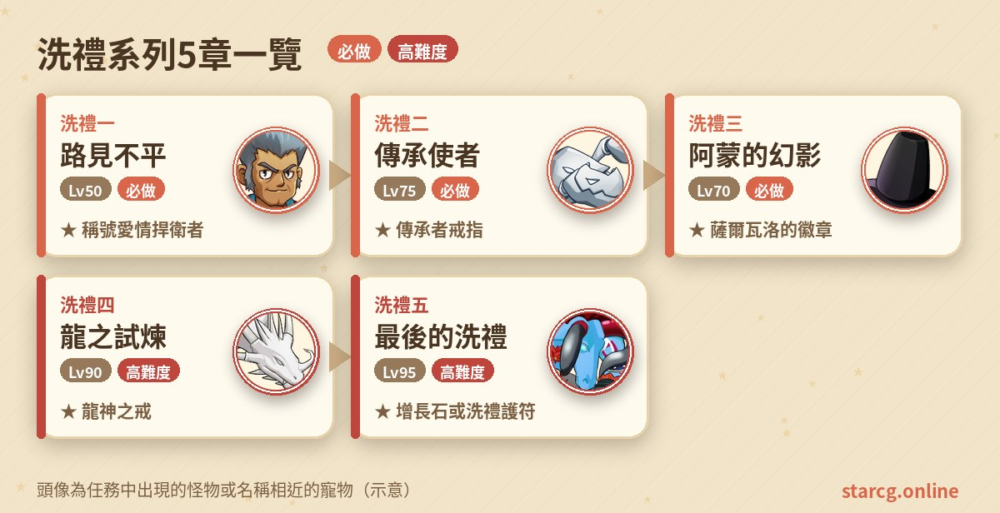
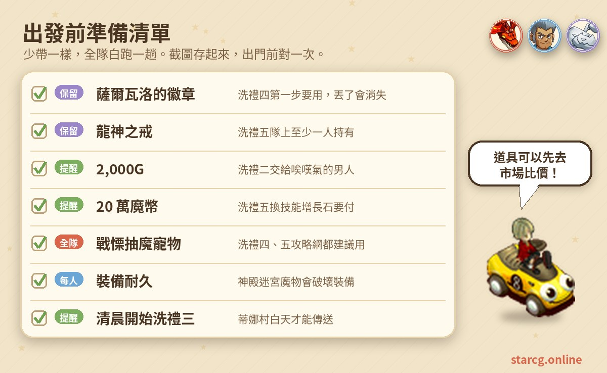
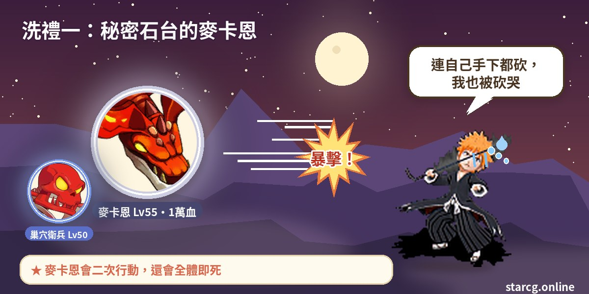
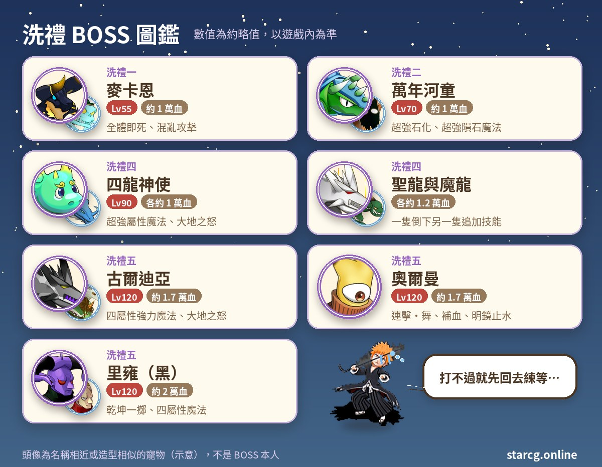

在魔力寶貝裡，洗禮系列是很多中高等級玩家一定會排進行程的任務線。它從法蘭城酒吧裡一個喝醉的男人開始，一路走到杰諾姆島的龍之試煉，最後在塵封的神廟迎接「最後的洗禮」。整條線推薦等級從 50 級拉到 95 級，跨度很大，適合邊練功邊推進；做完最終章，可以在**技能增長石（初）**與**洗禮的護符**之中二選一，前者能把技能欄位往上擴充，是整個系列最有價值的獎勵。

這篇把五章的順序、座標、要帶的東西、每一場 BOSS 的等級血量和打法整理成一份能邊玩邊翻的流程，並把最容易卡關、最容易白跑的地方特別標出來。不論你玩的是星詠魔力、水藍魔力還是初心魔力寶貝，洗禮系列的任務流程都一樣，這份整理都可以直接拿來用。

> 本文整理自 [星詠魔力攻略網](https://guide.starcg.net/) 的洗禮系列頁面，並用我們自己的方式重新排序與改寫，沒有逐字照搬。BOSS 血量與數值是約略值，實際以遊戲內為準；遊戲更新後內容可能變動。

## 洗禮系列是什麼？先看整體順序

洗禮系列一共五章，每一章的稱號或道具都是下一章的入場券：洗禮一拿「愛情捍衛者」才能接洗禮二，洗禮二拿「法蘭城義勇軍」才能接洗禮三，洗禮三拿到的「薩爾瓦洛的徽章」是洗禮四的條件，洗禮四的「龍族守護者」與「龍神之戒」又是洗禮五的條件。換句話說，這條線**不能跳著做**，而且中間的道具千萬不能隨手丟。

整理成一句話就是：**一、二可以邊練功邊做，三是跑腿加四個迷宮，四、五是真正的高難度戰鬥。**

| 章節 | 任務名稱 | 推薦等級 | 取得 |
|---|---|---|---|
| 洗禮一 | 路見不平 | 50 | 稱號「愛情捍衛者」 |
| 洗禮二 | 傳承使者 | 75 | 稱號「法蘭城義勇軍」、傳承者戒指、Lv.6 綠寶石、錢袋 |
| 洗禮三 | 阿蒙的幻影 | 70 | 薩爾瓦洛的徽章、隕石碎片 |
| 洗禮四 | 龍之試煉 | 90 | 稱號「龍族守護者」、龍神之戒 |
| 洗禮五 | 最後的洗禮 | 95 | 技能增長石（初）或洗禮的護符（二選一） |

洗禮三的推薦等級（70）比洗禮二（75）低，這是攻略網原本的標示；實際上洗禮三的條件是要有洗禮二的稱號，所以等級夠了也還是得照順序來。

## 出發前先準備好這些

洗禮系列不像有些任務需要一大堆材料，但有幾樣東西一旦弄丟或沒準備，就得整段重跑。下面這張圖把各章需要留意的東西集中在一起，建議截圖存起來。

錢的部分，洗禮二要交 2,000G，洗禮五如果選技能增長石（初）要交 **200,000 魔幣**，這筆錢最好提早存。洗禮二拿到的傳承者戒指、洗禮四的龍神之戒都是可以交易的裝備，如果你只是想要裝備、不需要稱號，也可以先用本站的 [市場查價](/market/) 看看目前攤位價格，再決定要自己打還是直接買。洗禮五的神殿迷宮會遇到破壞裝備的魔物，身上的主力裝備耐久也要先確認夠不夠。

## 洗禮一：路見不平（拿到「愛情捍衛者」）

這是整個系列的起點，沒有任務條件，推薦 50 級。

1. （劇情可略過）到法蘭城**安其摩酒吧**（102, 131），找**酩酊大醉的男人**（9, 20）對話。
2. 找**酒店主人**（21, 12）對話，取得「酒店主人的委託」。
3. 到法蘭城大聖堂（154, 29），從（23, 14）進入後台，找**僧侶特倫**（37, 26）交出委託，取得「老師的信」。
4. 到哈巴魯東邊洞穴地下二樓，找**修女琳達**（22, 7）交出老師的信，取得「藥草囊」。琳達在熊男「殺熊者歐茲那克」的後方。
5. 回大聖堂找特倫（37, 26）交出藥草囊，取得「醒酒藥湯」。
6. 回安其摩酒吧，把醒酒藥湯交給酩酊大醉的男人（9, 20），取得「瑪莎的照片」。
7. （劇情可略過）到聖拉魯卡村找村長薩巴普對話。
8. 在聖拉魯卡村（39, 43）調查傳送石進入巢穴。
9. 在巢穴最底層走黃色傳送石進入巢穴中部。中部有 3 個傳送石，**一真兩假**：走到假的那邊，到底層跟武裝骷髏對話確定後會被送回中部；真的路線最底層有柵欄，穿過隨機迷宮後抵達巢穴底部。
10. 與底部 BOSS 對話開戰。
11. 戰勝後調查石門（16, 9）進入秘密石台，找**麥卡恩**（21, 12）開戰。
12. 戰勝後找瑪莎交出瑪莎的照片，取得「瑪莎的信」，並被傳出巢穴。
13. 回安其摩酒吧把瑪莎的信交給酩酊大醉的男人（9, 20），獲得稱號「愛情捍衛者」，完成。

**BOSS 資料**：第一戰在巢穴底部，主角是**巢穴武裝守衛**（50 級、約 5,500 血，邪魔系、二次行動），會攻擊、諸刃，偶爾用即死魔法；旁邊有兩隻 45 級的巢穴捕捉者（水屬性，會冰凍魔法）和兩隻 50 級的巢穴衛兵（不死系，會吸血攻擊）。第二戰是**麥卡恩**（55 級、約一萬血，邪魔系、二次行動），技能非常多：聖盾、乾坤一擲、連擊、氣功彈、**全體即死**，還有混亂攻擊。

**要注意的地方**：巢穴中部的傳送石有陷阱，選錯就得從中部重來，記住自己試過哪一個能省不少時間。麥卡恩的混亂攻擊會打到他自己的嘍囉，算是少數對玩家有利的地方；真正危險的是全體即死，以 50 級的隊伍來說，麥卡恩的等級和血量都偏高，等級不夠時建議多練幾級再進秘密石台。

## 洗禮二：傳承使者（拿到傳承者戒指）

條件是擁有「愛情捍衛者」，推薦 75 級。

1. 到加納村酒吧（51, 34），找**酒吧女服務生**（10, 9）取得「給基里安特的信」。
2. 找**唉嘆氣的男人**（9, 1）對話並選同意，交出 **2,000G** 與信件，取得「基里安特的便條」。
3. 到加納村內找**依莉**（54, 56）交出便條，取得「主人留下的便條」。
4. 回酒吧找唉嘆氣的男人（9, 1）交出便條，取得「給魯耶利蓮娜的信」。
5. 前往「沒落的村莊」，有兩種方法：一是**夜間**在索奇亞島（600, 300）附近找隨機出現的**古代人民**，對話選同意；二是進行「風鳴之塔」任務時，從阿斯提亞鎮神殿直接進入。
6. 在沒落的村莊調查傳送石（63, 39），進入「陰冷的地下裂隙」。
7. 從（25, 25）的黃色傳送石進入迷宮，穿過**四段隨機迷宮**到最底層。
8. 找**萬年河童**（58, 62）對話開戰。
9. 戰勝後找魯耶利蓮娜交出信件，取得「女主人的信」與**傳承者戒指**，被傳回沒落的村莊。
10. 回加納村酒吧找唉嘆氣的男人（9, 2）交出女主人的信，拿到錢袋、寶石與稱號「法蘭城義勇軍」，完成。

**BOSS 資料**：萬年河童 70 級、約一萬血，二次行動，會戰慄襲心、吸血魔法、**超強石化魔法**、**超強隕石魔法**與暗殺。旁邊的小怪很多：腐屍、鐵剪螃蟹、沼澤樹精、地龍蜥，都是 55 級、約 1,000 血。其中沼澤樹精有三隻，會用石化魔法。

**打法**：攻略網的建議很明確——**先清沼澤樹精**。它們血量低但石化機率高，放著不管很容易整隊被控住，再被萬年河童的超強魔法收尾。鐵剪螃蟹會酒醉魔法和戰慄襲心，也建議早點處理。

**獎勵說明**：傳承者戒指是 Lv.6 戒指，攻擊 +41、防禦 +10、敏捷 +10、回復 +10，對毒、昏睡、石化、酒醉、混亂、遺忘各有 +20 抗性，耐久 50，可以交易。錢袋可以使用四次，每次開出隨機數量的阿爾卡迪亞古錢；寶石鑑定後是 Lv.6 綠寶石。

## 洗禮三：阿蒙的幻影（拿到薩爾瓦洛的徽章）

條件是擁有「法蘭城義勇軍」稱號，推薦 70 級。這章大半是跑腿收集線索卡片，最後是四個隨機迷宮。

1. 在黃昏、夜晚或清晨，到法蘭城找**阿蒙的幻影**（229, 83），取得「委託調查信」。如果身上有「收集品清單」，要先丟掉才拿得到。攻略網建議**清晨開始**，後面要傳送到蒂娜村會比較順。
2. 到法蘭城冒險者旅館門口找**愛說明的漢克**（238, 66），取得「線索卡片 1」。
3. 到大聖堂，調查建築背後的樹（158, 13），取得「線索卡片 2」。
4. 找**凱特**（145, 133）交出卡片 2，取得「線索卡片 3」。
5. 到法蘭城裡謝里雅堡找 **GM17**（11, 12）交出卡片 3，取得「線索卡片 4」。
6. 到靈堂調查閃光的石像（13, 52），交出卡片 4，取得「線索卡片 5」。
7. 回旅館門口找漢克交出卡片 5，取得「線索卡片 6」。
8. 到蒂娜村，在黃昏或夜晚找**薩爾瓦洛**（49, 38）交出卡片 6，取得「收集品清單」，並被傳到幻之地底遺跡。
9. 在幻之地底遺跡挑戰**四個隨機迷宮**，打倒每個迷宮頂層的 BOSS，集齊古樹之葉、幽冥火種、沙塵顆粒、凍源結晶。
10. 回遺跡找**傳送者**（19, 18），被傳到蒂娜村外。
11. 夜晚進蒂娜村找薩爾瓦洛，交出收集品清單與四種材料，取得「給漢克的信」。
12. 回法蘭城旅館門口找漢克（238, 66）交信，完成。

**容易卡關的地方**：蒂娜村只有白天能傳送，薩爾瓦洛卻只在黃昏或夜晚出現。攻略網的做法是白天先傳過去，在村外等到時間切換再進村；月卡玩家不受這個限制。攻略網只寫到四個迷宮頂層有 BOSS，沒有列出名稱與數值，這部分只能實際進去確認。

**獎勵說明**：薩爾瓦洛的徽章是 Lv.8 護身符，耐久 +100、攻擊 +30、閃避 +10、抗魔 +15，裝備後會得到稱號「法蘭義勇軍二等兵」。它**不能交易、不能寄存，丟在地上會直接消失**，而且是洗禮四第一步的必要道具，在洗禮四完成前絕對不要丟。另一個獎勵隕石碎片可以交易，帶著它進戰鬥會隨機遇到一隻 1 級的鳥人、石怪、史萊姆或哥布林。

另外兩個小規則：完成洗禮五之後若想再跑，必須重新完成洗禮一、二才能接洗禮三；如果已經完成過一次洗禮五、身上還留著薩爾瓦洛的徽章，則可以直接跳過洗禮三。

## 洗禮四：龍之試煉（四座洞穴與聖龍、魔龍）

條件是持有薩爾瓦洛的徽章，推薦 90 級，難度在這裡明顯拉高。

1. 帶著徽章到**杰諾姆島雷歐娜村**，找**埃爾斯潘祭司**（33, 46），取得「埃爾斯潘的認證卡」。去杰諾姆島的方法可以參考「前往東島」或「偷閒的船長」任務。
2. 到**義勇軍前哨站**（418, 204）找**艾爾斯多**（9, 8），交出認證卡，取得「艾爾斯多的證明」。
3. 挑戰杰諾姆島上的**四座試煉洞穴**。每座都是 10 層，前 9 層是隨機迷宮，最底層固定。到底層跟 BOSS 對話開戰，贏了會被送到**神使之間**，找對應的龍神使拿「龍神使的認證」。
4. 集齊四個認證，回前哨站交給艾爾斯多。
5. 找**聖龍**或**魔龍**對話開戰。
6. 戰勝後找聖龍交出艾爾斯多的證明，獲得**龍神之戒**與稱號「龍族守護者」，被傳到召喚之間，完成。

**建議路線**：雷歐娜村 → 義勇軍前哨站（418, 204）→ 地之試煉（422, 155）→ 水之試煉（240, 11）→ 風之試煉（80, 146）→ 火之試煉（317, 306）。途中可以回城補給，不必一口氣跑完。

**BOSS 資料（四神使）**：四位龍神使都是 90 級、約一萬血，邪魔系、二次行動，每場都帶四隻 85 級、約 1,600 血的翼龍，而且四位都會**大地之怒**。

- 地龍神使：諸刃、隕石魔法、超強隕石魔法；小怪大地翼龍。
- 冰龍神使：冰凍魔法、超強冰凍魔法、恢復魔法，物理攻擊有機會被閃避；小怪寒冰翼龍。
- 風龍神使：風刃魔法、超強風刃魔法、超強補血魔法，物理攻擊有機會被閃避；小怪烈風翼龍（會諸刃）。
- 火龍神使：乾坤一擲、諸刃、連擊、火焰魔法、超強火焰魔法；小怪火焰翼龍（會聖盾）。

**BOSS 資料（最終戰）**：聖龍與魔龍各約一萬兩千血。聖龍會攻擊、連擊、諸刃、乾坤一擲；魔龍會四屬性超強攻擊魔法、攻擊無效、吸血魔法。麻煩在於**先倒一隻，另一隻就會追加技能**：魔龍倒了，聖龍會多出魔法封印；聖龍倒了，魔龍會多出超強即死魔法。

**打法**：攻略網建議先對魔龍用「戰慄」把魔力抽掉；沒有戰慄的話就先合擊聖龍。魔龍的魔力見底後，可以先合擊聖龍、再合擊魔龍。用本站的 [傷害計算機](/damage/) 先估一下隊伍對一萬兩千血的輸出要幾回合，比較好決定要不要帶戰慄寵物。

**獎勵說明**：龍神之戒是 Lv.8 戒指，耐久 100、可交易，攻擊 +25、敏捷 +10、回復 +5、必殺 +5、命中 +10、閃避 +5、抗魔 +20。洗禮五要求隊上至少一人持有，所以就算之後拿到更好的戒指，也先留著。

## 洗禮五：最後的洗禮（技能增長石與洗禮的護符）

條件是持有愛情捍衛者、法蘭城義勇軍、龍族守護者三個稱號，而且**隊伍中至少一人持有龍神之戒**，推薦 95 級。

1. 到魔法大學實驗室（133, 49）找**魔法大學校長**（22, 12），傳到塵封的神廟。
2. 從神廟（35, 30）的黃色傳送石進入「神殿的迷宮」，這是**隨機生成的 10 層迷宮**。
3. 抵達門口（80, 80），由**持有龍神之戒的隊員**調查門扉。全隊會被隨機傳到三張地圖之一，地圖相同、BOSS 陣容不同。
4. 打贏後被傳到薩蒂神殿遺跡底層，找魔法大學校長選擇獎勵。

**迷宮小怪**：神殿的迷宮裡有 95 級的大角羊寒冰牛頭怪與莉迪雅烈風牛頭怪，都是二次行動，會乾坤一擲、崩擊，而且會**裝備破壞**。走 10 層隨機迷宮時，用本站的 [迷宮找樓梯](/maze/) 邊走邊記錄，少繞路就少挨幾次破壞裝備。

**BOSS 陣容一：黑龍**。古爾迪亞 120 級、約一萬七千血，會乾坤一擲、四屬性強力攻擊魔法、強力中毒魔法、大地之怒；旁邊五隻 95 級奇美拉（綠、藍、黑、紅、黃）各約一萬血，會戰慄襲心、連擊、聖盾。攻略網給兩種打法：一是帶寵物用戰慄抽魔，BOSS 魔量降到 200 以下就不再用超級魔法、降到 10 以下就不再用乾坤一擲，抽乾後逐一擊倒奇美拉再合擊 BOSS，適合有專職補血與祈禱的傳教士；二是不帶巫師、全隊防禦 20 以上，直接集火 BOSS，再清奇美拉。

**BOSS 陣容二：奧爾曼**。奧爾曼 120 級、約一萬七千血，會諸刃、乾坤一擲、連擊·舞、補血魔法、明鏡止水；身邊四隻 95 級鬥神（綠地、紅火、黃風、藍水）各約一萬兩千血，各有一套技能，黃色會魔法封印，藍色會強力昏睡魔法與石化。鬥神的魔量掉到 5% 以下後會一直用氣功彈。穩健打法是依**黃 → 紅 → 綠 → 藍**清掉嘍囉再合擊 BOSS，黃色鬥神放魔法封印時可以用防禦減傷；高輸出隊伍則可以依紅 → 綠 → 黃 → 藍的順序擊殺。

**BOSS 陣容三：里雍**。黑色里雍 120 級、約兩萬血，會乾坤一擲、諸刃、四屬性攻擊魔法，被戰慄後還會追加連擊；黃、紅、綠、藍四隻里雍各 95 級、約一萬兩千血，四屬性抗性都是 20。建議用祈禱減傷，擊殺順序可以是黃 → 綠 → 藍 → BOSS → 紅，或黃 → BOSS → 綠 → 藍 → 紅；紅色里雍一直放明鏡止水的話，直接戰慄抽魔。另一種做法是先用戰慄抽乾黃色，再依屬性剋制逐一擊殺。

**獎勵怎麼選**：

- **技能增長石（初）**：選「是」要交出 **200,000 魔幣**與三個稱號，每個角色只能拿、只能用一次。技能欄位預設 10 格，使用後 +1，最多到 13 格；已經 13 格的話改得 5,000 綁定魔晶。
- **洗禮的護符**：等級 10 飾品，選「是」只要交三個稱號、不用錢。數值隨機，攻擊 +10～+50、防禦 +8～+40、敏捷 +6～+30、生命 +20～+100、魔法 +10～+50，另有必殺、反擊、命中、閃躲與異常抗性加成，耐久 300。
- 選「否」或魔幣不夠時，不扣稱號，改拿不可交易的「**試煉通過證明**」，之後可以憑證明直接找校長兌換，**不用再打一次**。

交出的三個稱號不會從永久稱號成就裡消失，成就會以橘色保留；但想再領一次獎勵，就得重跑前置任務把稱號拿回來。

## 洗禮系列常見問題

**洗禮任務可以跳章做嗎？** 不行。每一章的稱號或道具都是下一章的條件，洗禮三的薩爾瓦洛的徽章、洗禮四的龍神之戒尤其不能丟。

**技能增長石（初）和洗禮的護符該選哪個？** 增長石能擴充技能欄位，但每個角色只能用一次，而且要 20 萬魔幣；護符不用錢、數值隨機。錢還不夠時可以先選「否」拿試煉通過證明，存夠錢再回來找校長兌換，不必重打。

**洗禮五一定要每個人都有龍神之戒嗎？** 不用。條件是隊伍中至少一人持有，並由這位隊員調查門口（80, 80）的門扉。

**洗禮五會遇到哪個 BOSS？** 調查門扉後隨機傳到黑龍（古爾迪亞）、奧爾曼、里雍三種陣容之一，出發前三種打法都要先看過。

**洗禮二的沒落的村莊怎麼去？** 夜間到索奇亞島（600, 300）附近找隨機出現的古代人民，或在進行風鳴之塔任務時從阿斯提亞鎮神殿進入。

## 小結：留好道具、存好魔幣

洗禮系列的前三章不難，最常見的失誤是把薩爾瓦洛的徽章或龍神之戒丟掉、或是在蒂娜村卡日夜時間；後兩章才是真正的考驗，龍之試煉要跑四座 10 層洞穴，最後的洗禮要面對 120 級的 BOSS 與四到五隻護衛。把戰慄抽魔、擊殺順序和 20 萬魔幣先準備好，就能一次拿到技能增長石或洗禮的護符。

想知道更多任務、寵物與市場資料，可以到 [星詠魔力攻略網](https://guide.starcg.net/) 查更完整的原文，也歡迎用本站的 [市場查價](/market/)、[迷宮找樓梯](/maze/) 與 [傷害計算機](/damage/) 把整趟旅程規劃得更有效率。
