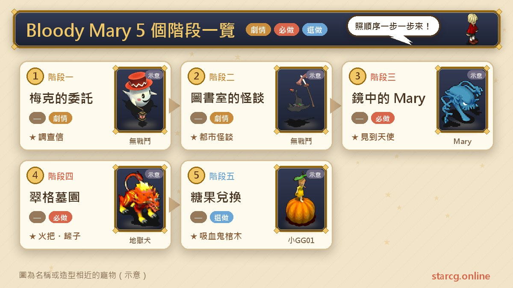
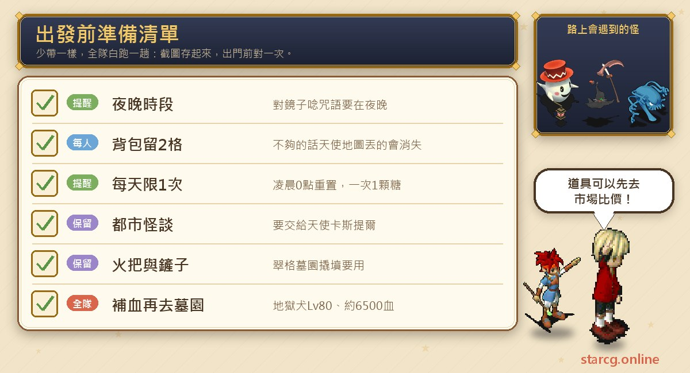
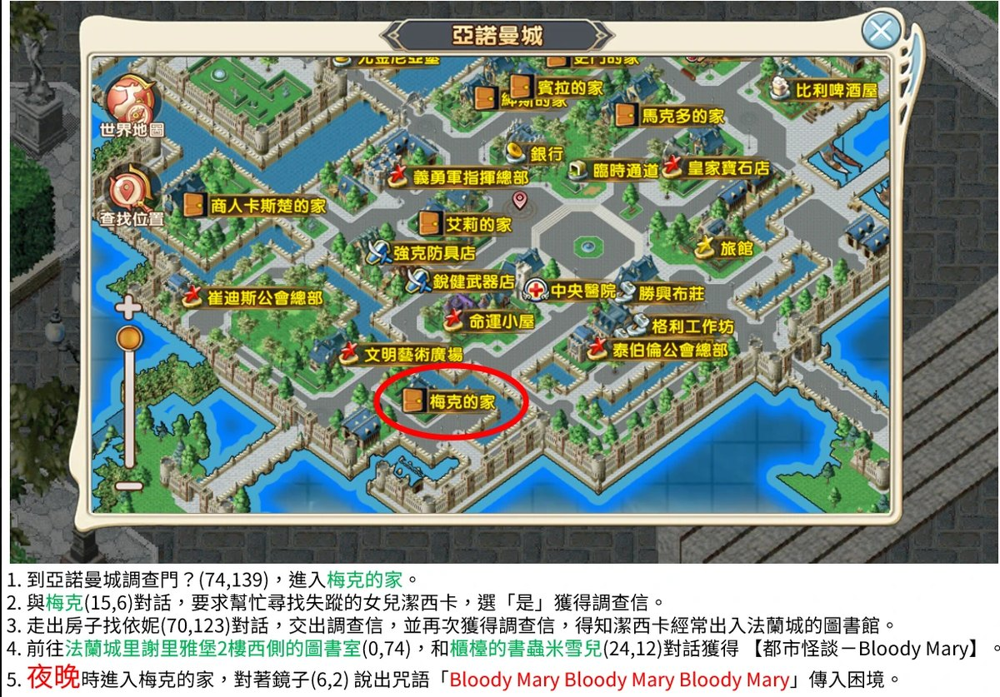
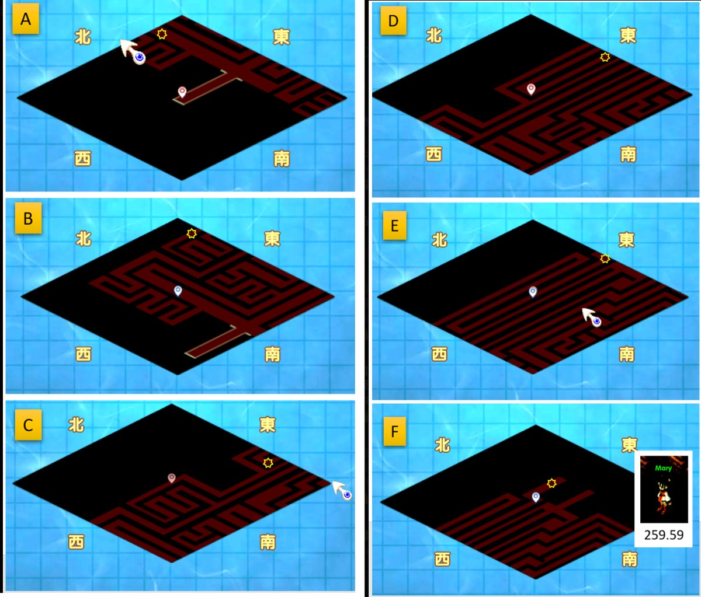
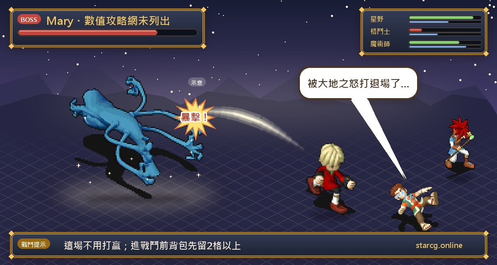
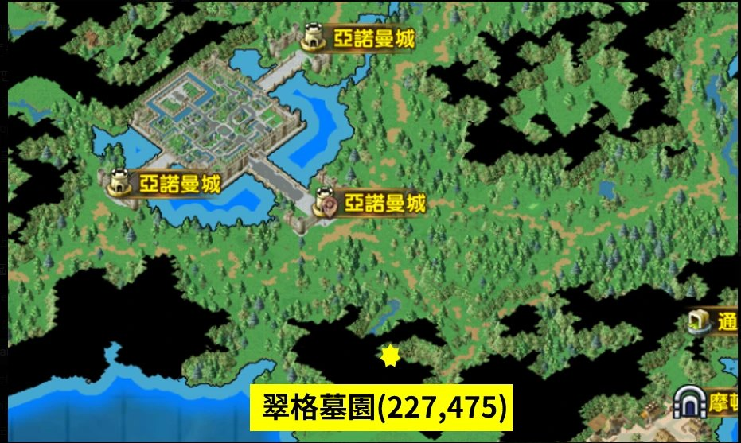
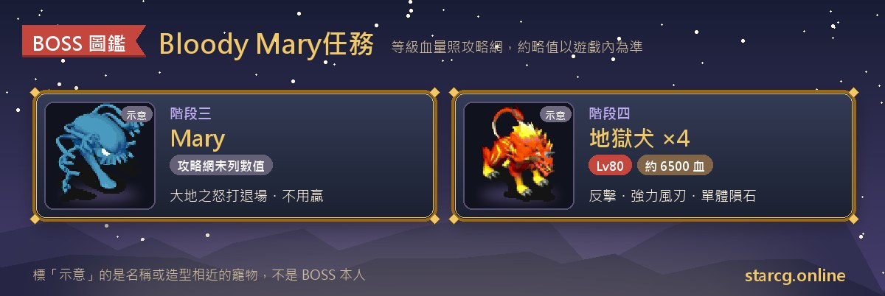

**Bloody Mary** 是星詠魔力 2026 年的萬聖節限時活動任務。活動從 **2026 年 10 月 15 日維護後開始，到 11 月 15 日 23:59 結束**（台灣時間），**每天限解 1 次，凌晨 0 點重置**。每過一次關會拿到 1 個**萬聖節糖果**，存到一定數量就能在法蘭城換坐騎**吸血鬼棺木**、寵物**萬聖綠南瓜**和**南瓜頭飾(綠)**。

任務從亞諾曼城一位父親的委託開始：他的女兒潔西卡失蹤了，線索指向法蘭城圖書室裡一本講「Bloody Mary」的都市怪談。你要在**夜晚**對著鏡子唸三次咒語進入困境，再到翠格墓園撬開墳墓、打贏棺木裡的敵人。整條流程不長，玩家實測一輪大約 **15 分鐘**，但有兩個地方很容易白跑一趟：**唸咒語一定要在夜晚**，以及**進入 Mary 的戰鬥前，身上要留 2 格以上的空位**。不論你玩的是星詠魔力、水藍魔力還是初心魔力寶貝，這類萬聖節任務的走法都可以照這份整理準備；活動時間、獎勵與糖果數量則以星詠魔力的公告為準。

> 本文整理自 [星詠魔力攻略網](https://guide.starcg.net/) 的「Bloody Mary (2026年)」活動頁，並用我們自己的方式重新排序與改寫，沒有逐字照搬。文中標「玩家實測」的部分（夜晚時段的換算、困境路線圖、Mary 的位置與招式、棺木戰的地獄犬資料與戰力參考、地圖截圖）來自玩家實際跑過的整理，攻略網本身沒有寫；這些屬於實測結果，可能因版本或運氣不同而有出入。活動內容可能隨公告調整，實際以遊戲內為準。



## Bloody Mary 是什麼？先看整體順序

這個活動只有一條任務，但要在亞諾曼城和法蘭城之間來回一趟，最後再從亞諾曼城南門出去。可以分成五段：

| 階段 | 內容 | 地點 | 取得 |
|---|---|---|---|
| 階段一 | 梅克的委託 | 亞諾曼城 | 調查信 |
| 階段二 | 圖書室的都市怪談 | 法蘭城 里謝里雅堡 2 樓 | 【都市怪談－Bloody Mary】 |
| 階段三 | 夜晚對鏡子唸咒語、找 Mary | 梅克的家 → 困境 | 傳送到 ？？？ |
| 階段四 | 天使卡斯提爾、翠格墓園棺木戰 | 亞諾曼城南方 翠格墓園 | 【長期燃燒的火把】、【鏟子】 |
| 階段五 | 領獎、糖果兌換 | 法蘭城（238, 74） | 萬聖節糖果 ×1（綁定） |

整理成一句話：**亞諾曼城接委託拿調查信 → 法蘭城圖書室拿都市怪談 → 夜晚回梅克家對鏡子唸咒 → 找到 Mary 打一場（不用贏）→ 天使給火把和鏟子 → 翠格墓園撬墳打贏棺木 → 領 1 個萬聖節糖果。**

## 出發前先準備好這些

Bloody Mary 不需要收集材料，要顧好的是「時段」「背包空位」和「每天的次數」。



- **夜晚時段**：攻略網把對鏡子唸咒語這一步標成【夜晚時】。玩家實測的換算是：遊戲裡的夜晚＝**現實時間的奇數小時**（1、3、5、7……23 點）。前面拿調查信、跑圖書室的步驟沒有標時段，可以先做好，抓好奇數小時再回梅克家。
- **背包留 2 格以上**：攻略網特別提醒，進 Mary 的戰鬥前，要確認和天使對話時身上有 **2 格以上的空間**，否則在天使地圖裡丟出的物品**一律會消失**。天使會給你火把和鏟子兩樣東西，所以出發前先把背包清出空位最保險。
- **每天 1 次**：任務每天限解 1 次，凌晨 0 點（台灣時間）重置。想換最貴的永久坐騎要 25 個糖果，活動期間大約一個月，所以要換的話最好從開始就每天做。
- **出發去墓園前記得補血**：棺木戰是 80 級的地獄犬，血量約 6500（玩家實測），被 Mary 打退場之後別直接去墓園，先把血魔補滿。補給品手邊不夠的話，可以先用本站的 [市場查價](/market/) 看看行情。
- **戰力參考**：玩家實測 **90 級、4 忍者＋1 傳教士**的隊伍可以掛自動通過，等級或配置差不多的話不用太緊張。

## 階段一：亞諾曼城，梅克的委託

1. 到**亞諾曼城**調查**門？**（74, 139），進入**梅克的家**。
2. 和**梅克**（15, 6）對話，他會請你幫忙尋找失蹤的女兒**潔西卡**，選「是」拿到「**調查信**」。
3. 走出房子，找**依妮**（70, 123）對話，交出調查信後會再拿到一份「**調查信**」，並得知潔西卡經常出入**法蘭城的圖書館**。

**要注意的地方**：梅克的家入口是門口那個「門？」，要先調查才進得去。這一段沒有戰鬥，也沒有時段限制。梅克的家在亞諾曼城南側、文明藝術廣場的下方，打開城內地圖就看得到。



## 階段二：法蘭城圖書室，拿到都市怪談

1. 前往**法蘭城里謝里雅堡 2 樓西側**的**圖書室**（0, 74）。
2. 和櫃檯的**書蟲米雪兒**（24, 12）對話，拿到【**都市怪談－Bloody Mary**】。

**要注意的地方**：這本都市怪談是後面和天使對話時要交出去的道具，拿到後不要丟掉。如果現在還是白天，可以趁這段時間把背包整理好，留出 2 格以上的空位，再等夜晚回亞諾曼城。

## 階段三：夜晚對鏡子唸咒語，找到 Mary

1. **夜晚時**回到亞諾曼城，再次進入**梅克的家**。
2. 對著**鏡子**（6, 2）說出咒語：**Bloody Mary Bloody Mary Bloody Mary**，就會被傳進**困境**。
3. 在困境裡尋找 **Mary**，找到後和她說話會觸發戰鬥。
4. 戰鬥結束後會被傳送到「**？？？**」，在那裡和**天使卡斯提爾**對話。

**困境怎麼走（玩家實測路線）**：困境是一片暗紅色的迷宮。照下面圖 A 到圖 F 的順序，每張圖點一次星星（☆）的位置讓角色**自動導航**過去，走到圖 F 的星星就是 Mary 所在的地方，圖上標的座標是 259.59。玩家實測 **S1、S2、S3 三條線的 Mary 位置都一樣**，換線也能照同一張圖走。



咒語是三次「Bloody Mary」，中間用空格隔開，可以直接複製貼上，避免打錯：

```
Bloody Mary Bloody Mary Bloody Mary
```

**要注意的地方**：

- **不用戰勝 Mary**。攻略網寫的是「戰鬥結束後」就會傳送；玩家實測 Mary 會用**大地之怒**把隊伍打退場，被打退場一樣算戰鬥結束，會照常傳到天使那裡，不必為了這場硬拼。
- **進入這場戰鬥前，先確認背包有 2 格以上的空位**。傳送到天使地圖後，如果空間不夠，丟出的物品會直接消失，而且是在天使地圖裡發生，很難補救。

**BOSS 資料**：Mary 的等級與血量攻略網未列出；招式依玩家實測有**大地之怒**（會把隊伍打退場）。



## 階段四：天使卡斯提爾與翠格墓園的棺木

1. 和**天使卡斯提爾**對話，交出【都市怪談－Bloody Mary】，拿到【**長期燃燒的火把**】和【**鏟子**】，並被傳送到**亞諾曼城**（133, 113）。玩家實測這一步**可以組隊一次拿**，全隊一起對話就好。
2. 從**亞諾曼城南門**出去，往南走，進入**翠格墓園**（227, 475）。



3. 和**墳墓？**（21, 7）對話，撬開墳墓後畫面會切換，再和**棺木**對話進入戰鬥。
4. 戰勝後地圖會切換，和**天使卡斯提爾**對話領取獎勵。

**要注意的地方**：和 Mary 那場不同，**棺木這場要打贏**才能切換地圖領獎。天使給的火把和鏟子就是這一段要用的道具，撬開墳墓之前別把它們丟掉。

**BOSS 資料**（攻略網未列出，以下是玩家實測）：

- 敵人：**地獄犬**，80 級，目前看到最多 **4 隻**。
- 屬性：**邪魔系**，地 8 水 2。
- 血量：大約 **6500**。
- 技能：攻擊、反擊、強力風刃、單體隕石，有**低機率讓人中毒**。

**打法**：地獄犬是地 8 水 2，照屬性相剋（風剋地）帶風屬性攻擊會比較有利；牠會反擊和放單體隕石，補血要跟上。玩家實測 90 級 4 忍者＋1 傳教士可以掛自動通過。最重要的一句話重複三次：**出發去墓園前記得補血！**



## 階段五：領獎與萬聖節糖果兌換

每次過關的獎勵是**萬聖節糖果 ×1（綁定）**。糖果要拿到**法蘭城**（238, 74）找 NPC **小GG01** 兌換：

| 需要糖果 | 兌換獎勵 | 說明 |
|---|---|---|
| 25 個 | 坐騎 - 吸血鬼棺木 | 綁定、永久 |
| 5 個 | 坐騎 - 吸血鬼棺木 | 綁定；30 天（90%）或永久（10%） |
| 5 個 | 寵物 - 萬聖綠南瓜 | — |
| 5 個 | 頭飾 - 南瓜頭飾(綠) | 永久、綁定 |

攻略網的溫馨提示：**30 天的吸血鬼棺木重複使用可以疊加時間**，例如用 3 個就能疊到 90 天。5 個糖果那一檔有 10% 機率直接開出永久版。

**萬聖綠南瓜的資料**（攻略網）：

- 銀卡，檔次 122，技能欄 8。
- 屬性地 10，植物系。
- 血／攻／防／敏／魔：26／40／24／16／16。
- 洗檔：188 魔晶。

想知道這隻寵物升級後的能力，可以把這五項檔次填進本站的 [寵物成長模擬](/pets/)，看看不同等級、不同加點方式下的能力值；洗檔要花的魔晶也可以用 [匯率比價](/exchange/) 換算成魔幣。

## Bloody Mary 常見問題

**Bloody Mary 活動到什麼時候？** 攻略網寫的是 2026 年 10 月 15 日維護後，到 11 月 15 日 23:59（台灣時間）。

**一天可以做幾次？** 每天限解 1 次，凌晨 0 點（台灣時間）重置。每次過關拿 1 個萬聖節糖果。

**為什麼對鏡子唸咒語沒有反應？** 攻略網標明這一步要在**夜晚**；玩家實測夜晚是現實時間的奇數小時（1、3、5……23 點）。咒語是三次「Bloody Mary」，可以直接複製本文的咒語貼上，避免拼錯。

**困境裡找不到 Mary？** 照本文的圖 A～圖 F，依序點每張圖的星星位置自動導航，圖 F 的星星就是 Mary。玩家實測 S1、S2、S3 的位置都一樣。

**隊伍要多強才打得過棺木？** 棺木裡是 80 級的地獄犬，玩家實測血量約 6500、最多 4 隻；90 級 4 忍者＋1 傳教士可以掛自動通過。出發前記得補滿血。

**Mary 一定要打贏嗎？** 不用。攻略網註明不用戰勝 Mary，玩家實測她會用大地之怒把隊伍打退場，戰鬥結束後就會傳送到天使所在的地圖。真正要打贏的是翠格墓園的棺木那一場。

**和天使對話後東西不見了？** 進 Mary 的戰鬥前，背包要留 2 格以上的空位；在天使地圖裡空間不夠，丟出的物品會直接消失。下次出發前先清背包。

**吸血鬼棺木要換永久版還是 30 天版？** 25 個糖果可以直接換永久版；5 個糖果的那一檔是 30 天（90%）或永久（10%），30 天版重複使用可以疊加時間。要怎麼換看你能累積多少糖果。

## 小結：夜晚、空位、每天一次

Bloody Mary 的流程本身不複雜，接委託、跑圖書室、對鏡子唸咒、打棺木，一輪下來就是在亞諾曼城和法蘭城之間繞一圈。真正要記住的只有三件事：**咒語要在夜晚唸**、**進 Mary 的戰鬥前背包留 2 格以上**、**每天記得做一次**，去墓園打地獄犬之前再把血補滿。想換永久的吸血鬼棺木要 25 個糖果，活動大約一個月，越早開始越從容。

想看原文，可以到 [星詠魔力攻略網](https://guide.starcg.net/) 的活動任務頁查詢；也可以用本站的 [寵物成長模擬](/pets/) 試算萬聖綠南瓜，用 [市場查價](/market/) 準備補給。
