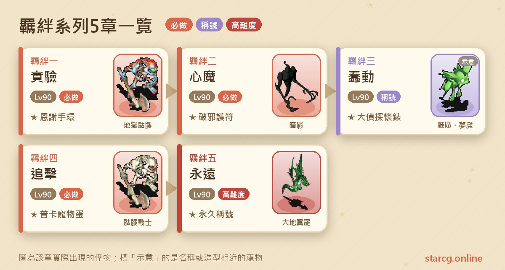
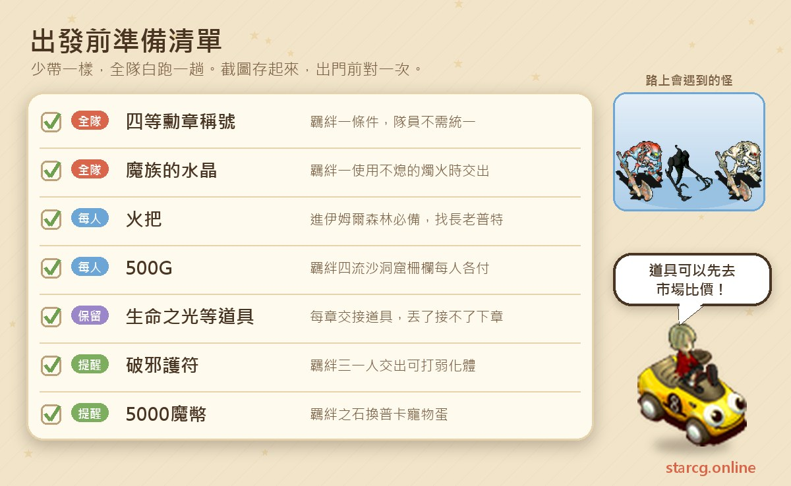
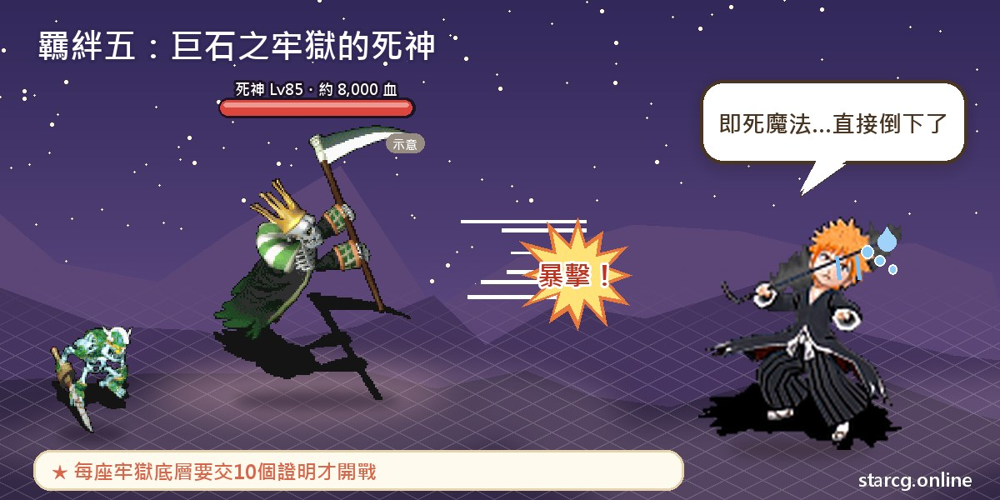
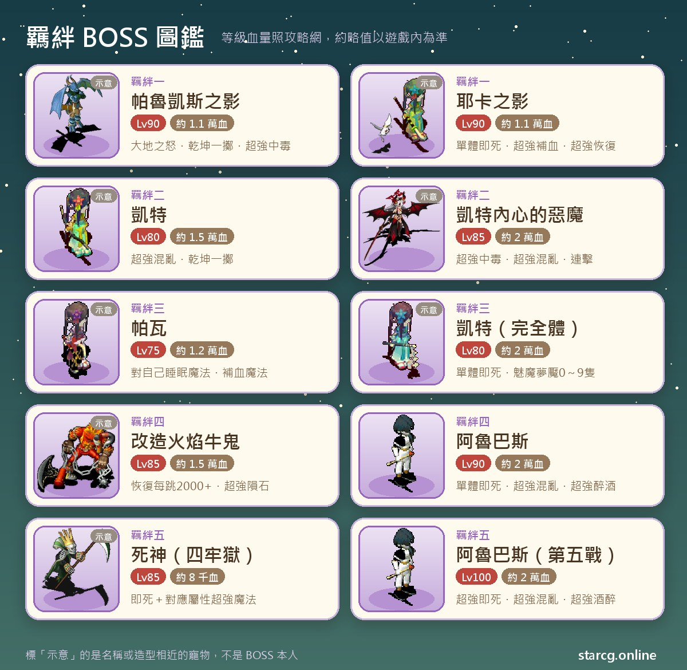

크로스게이트의 인연(羈絆) 시리즈는 케이트(凱特), 발케스(帕魯凱斯), 암흑 의사 알바스(暗醫阿魯巴斯)를 중심으로 한 긴 스토리 퀘스트예요. 판부르크(法蘭城) 셰리아 성(謝里雅堡)의 엘바니아 사자(艾爾巴尼亞使者)에서 시작해 단서를 따라 코랄(哥拉爾), 미노키아(米諾基亞), 이므르 숲(伊姆爾森林), 쿠룩스 섬(庫魯克斯島), 몰락한 마을(沒落的村莊)을 지나고, 마지막에는 아스파(阿斯法) 지하 실험 기지에서 알바스와 결판을 내요. 시리즈는 모두 5장이고 장마다 권장 레벨은 90이에요. 전투는 「연전」 위주라서 4연전, 2연전을 거쳐 마지막 5연전까지 이어져요.

인연 퀘스트는 보상이 개성 있어요. 인연 1의 은사의 팔찌(恩謝手環)에는 칭호 「마음의 축복(心之祝福)」이, 인연 3의 명탐정 회중시계(大偵探懷錶)에는 칭호 「진실 추적자(真相追查者)」가 붙어 있고, 인연 4에서는 푸카 펫 알(普卡寵物蛋)로 바꿀 수 있으며, 인연 5는 영구 칭호 「우리는 영원한 친구(我們是永遠的朋友)」예요. 서브 루트에서는 영혼의 조각(魂之碎片)을 모아 슬라임 펫으로 바꿀 수도 있어요. StarCG(星詠魔力), 水藍魔力, 初心魔力寶貝 어느 쪽이든 인연 시리즈 흐름은 같으니 이 정리를 그대로 쓰면 돼요.

> 이 글은 [StarCG 공략 사이트](https://guide.starcg.net/)의 인연 시리즈 페이지를 바탕으로 저희 방식으로 순서를 다시 짜고 새로 쓴 것이에요. 그대로 옮기지 않았어요. 보스 HP와 수치는 대략적인 값이니 실제 게임을 기준으로 하세요. 게임 업데이트 후 내용이 바뀔 수 있어요.

## 인연 시리즈란? 전체 순서부터 보기

인연 시리즈는 모두 5장이고, 퀘스트 아이템이 사슬처럼 장과 장을 잇고 있어요. 인연 1에서 받는 「허무한 생명의 빛(虛無的生命之光)」은 인연 2의 조건, 인연 2의 「라이노의 감사 편지(萊諾的感謝信)」는 인연 3의 조건, 인연 3의 「케이트의 암링(凱特的臂環)」은 인연 4의 조건, 인연 4의 「뜨거운 생명의 빛(熾熱的生命之光)」은 인연 5의 조건이에요. **이 중 하나라도 버리면 다음 장을 받을 수 없어요.** 시리즈 전체에서 가장 꼭 기억해야 할 점이에요.

| 장 | 퀘스트 이름 | 권장 레벨 | 획득 |
|---|---|---|---|
| 인연 1 | 실험 | 90 | 허무한 생명의 빛, 은사의 팔찌(칭호 「마음의 축복」) |
| 인연 2 | 마음의 악마 | 90 | 라이노의 감사 편지, 파사의 부적 |
| 인연 3 | 준동 | 90 | 케이트의 암링, 명탐정 회중시계(칭호 「진실 추적자」) |
| 인연 4 | 추격 | 90 | 뜨거운 생명의 빛, 인연의 돌(푸카 펫 알로 교환) |
| 인연 5 | 영원 | 90 | 영구 칭호 「우리는 영원한 친구」 |

작은 서브 루트도 두 개 있어요. 인연 4의 **병사장 서브 루트**(직업이 병사장인 플레이어만 가능)에서는 「보물 비밀 열쇠(寶藏密匙)」를 받고, 인연 5의 **보물 비밀 열쇠 서브 루트**에서는 영혼의 조각을 받을 수 있어요.

## 출발 전에 준비할 것

인연 시리즈의 문턱은 1장이에요. 「4등 훈장(四等勳章)」 칭호와 마족의 수정(魔族的水晶)이 먼저 있어야 해요. 그 뒤로는 특별한 소모품이 거의 필요 없지만 「현실 시간 기다리기」와 「1인당 돈 내기」 구간이 꽤 있어서, 미리 알아 두면 왕복을 많이 줄일 수 있어요.

연전이 많고 보스가 자주 회복과 상태 회복을 하니 보급품은 넉넉히 챙기세요. 요리, 물약 같은 소모품은 이 사이트의 [시세 검색](/ko/market/)으로 노점별 가격을 비교한 뒤 한 번에 사 두면 좋아요. 인연 4 마지막에 푸카 펫 알로 바꾸려면 5000골드가 들고, 유사 동굴(流沙洞窟) 울타리는 1인당 500G가 드니 이 현금도 미리 남겨 두세요.

## 인연 1: 실험(4연전의 시작)

권장 90레벨. 조건은 「4등 훈장」 칭호(먼저 「4등 훈장-코랄 성의 만찬(四等勳章－哥拉爾城的晚宴)」 완료)와 【마족의 수정】 소지예요. 파티원의 4등 훈장 칭호는 통일하지 않아도 돼요.

1. 판부르크 셰리아 성 알현실(謁見之間)에서 **엘바니아 사자**(12, 14)에게 퀘스트를 받고 【꺼지지 않는 촛불(不熄的燭火)】을 받아요.
2. 마족의 수정을 가진 채 꺼지지 않는 촛불을 사용하고 「예」를 고르면, 수정과 촛불을 내고 **칠흑의 방(漆黑的房間)**으로 보내져요(적과 마주치지 않아요).
3. 방 가운데의 **녹슨 촛대(生鏽的燭台)**를 조사하면 이능의 자기장(異能的磁場)으로 전송돼요.
4. **병사 메벨(士兵梅伯爾)**과 대화하고 전송석으로 **칠흑의 비밀 통로(漆黑的暗道)**에 들어가요. 약 10층의 랜덤 미궁이고 팬텀(亡靈)과 스펄토이(地獄骷髏)이 나오며, HP 약 2,000의 그림자 보스도 랜덤으로 만나요.
5. 미궁에서 랜덤으로 나타나는 **발케스의 그림자(帕魯凱斯之影)**를 찾아 싸워요. 이기면 파티원 중 한 명이 랜덤으로 【가짜 발케스의 도끼(贗品帕魯凱斯之斧)】를 받는데, **파티원 모두 한 자루씩 있어야 해요.** 그림자는 쓰러진 뒤 약 3분 30초 후 같은 자리에 다시 나타나니 여러 번 잡으면 돼요.
6. 미궁 바닥층에서 메벨에게 가짜 도끼를 내고 【기이한 생명의 빛(詭異的生命之光)】으로 바꾸면 코랄 마을(哥拉爾鎮)로 보내져요.
7. 코랄 항구에서 **선원 시프(船員西普)**에게 기이한 생명의 빛을 내면 【승선 안내문(乘船須知)】을 받고, 무인도로 가는 배에 태워져요. **약 5분 기다린** 뒤 메벨과 싸워요.
8. 이긴 뒤 시프에게 가서 배로 돌아가고, **노란 전송석**(22, 26)으로 두 번째 칠흑의 비밀 통로에 들어가요. 이 구간은 약 19~22층의 랜덤 미궁이에요.
9. **실험 기지**에 도착하면 **발케스의 그림자**(23, 20)와 대화해 **4연전**을 시작해요.
10. 4연전을 이기면 **능력 코어(能力核心)**를 조사해 「예」를 고르고 승선 안내문을 내면 【허무한 생명의 빛】과 【에너지 결정(能量結晶)】을 받고 코랄 마을로 돌아가요.
11. 코랄 마을 하얀 궁전(白之宮殿) 알현실에서 **엘피나스 여왕(艾爾菲那斯女王)**(58, 46)에게 에너지 결정을 내면 【은사의 팔찌】를 받고 완료예요.

**보스 정보**

- 배 위｜**메벨**: 80레벨, HP 약 10,000, 4속성 각 50. 회복과 공격/마법 흡수·무효를 써요. 곁에 70레벨 코랄 병사(哥拉爾士兵) 5명(전율습심 사용)이 있어요.
- 4연전 1차전: 빨강·파랑 아샤프의 그림자(阿夏芙之影) 각 2마리, 85레벨, 각 HP 약 6,000. 양날(諸刃), 강력 빙결, 화염 마법을 써요.
- 4연전 2차전: 발케스의 그림자(85레벨, HP 약 7,000)와 코랄 병사 3명(80레벨, HP 약 2,000). 건곤일척, 대지의 분노(약 100~120 변동 데미지), 붕격(崩擊), 연격을 써요.
- 4연전 3차전: 예카의 그림자(耶卡之影)(83레벨, HP 약 7,000)와 팬텀 3마리. 예카의 그림자는 초강력 혼란과 강력 즉사 마법을 쓰고, 팬텀은 자기에게 단일 즉사를, 상대에게 초강력 회복을 써요.
- 4연전 4차전: 빨강 아샤프의 그림자(90레벨, HP 약 10,000), 파랑 아샤프의 그림자(85레벨, HP 약 10,000), 발케스의 그림자(90레벨, HP 약 11,000), 예카의 그림자(90레벨, HP 약 11,000), 그리고 데블 배트(惡魔蝙蝠)와 엔젤 배트(天使蝙蝠) 각 2마리(85레벨, HP 약 2,500, 공격·마법 흡수와 반사). 네 보스는 모두 사마계(邪魔系)예요.

**공략법**: 4차전이 이 장의 핵심이에요. 공략 사이트가 권하는 순서는 이래요. 먼저 아샤프의 그림자 두 마리의 마력을 비우고, 그다음 예카의 그림자를 처리하는데, 이때 석화 마법으로 묶어 두면 전율을 넣기 편해요. 이어서 엔젤·데블 배트를 정리하고, 마지막으로 **발케스의 그림자 → 예카의 그림자 → 아샤프의 그림자** 순서로 합격하면서 중독 마법을 섞어요.

**주의할 점**: 은사의 팔찌는 Lv.5 팔찌, 내구도 50이고 공격 +10, 민첩 +10, 정신 +5, 생명 +40, 마력 +40이며, 장비하면 칭호 「마음의 축복」을 얻어요. 수치는 변동이 있어요. **허무한 생명의 빛은 버리지 마세요.** 인연 2에 써요.

## 인연 2: 마음의 악마(이므르 숲과 수수께끼의 마을)

권장 90레벨, 조건은 【허무한 생명의 빛】 소지예요. 이 장에는 「과거로 돌아가는」 스토리가 있고, 마지막에는 현실 시간 12시간을 기다려야 해요.

1. (스토리, 건너뛰기 가능) 코랄 마을에서 생명의 빛을 가진 채 **카루(卡魯)**(131, 64)를 찾아가요.
2. 미노키아 마을 민가(91, 148)에서 **라이노(萊諾)**에게 생명의 빛을 내고 【파와의 초상화(帕瓦的肖像)】를 받아요.
3. 이므르 숲 입구에서 **경고판**과 대화해 숲에 들어가요. 숲에 들어가려면 【횃불(火把)】이 필요하고, 받는 법은 「발레스의 망령(帕魯凱斯的亡靈)」 퀘스트를 참고하거나 그 퀘스트의 자동 내비게이션을 쓰면 돼요. 공략 사이트는 직업이 「저주의 미로(詛咒的迷宮)」을 끝냈는지도 확인하라고 알려 줘요.
4. 과거의 코랄 지하 감옥: 코랄 마을 하얀 궁전(47, 36) 1층 왼쪽 계단으로 지하 감옥에 내려가 **경비병 리디르(守衛利迪爾)**(33, 15)를 통해 들어가요. **방황하는 망령(徬徨的亡靈)**(28, 6)을 찾아 과거의 지하 감옥으로, **무술사 예카(巫術師耶卡)**(27, 12)를 찾아 리옹의 방으로, 마지막으로 **용사 리옹(勇者里雍)**(10, 7)을 찾아 과거의 코랄로 가요. 도중에 랜덤으로 만나는 제국병(帝國兵)을 쓰러뜨리면 일정 확률로 【아르카디아 옛 동전(阿爾卡迪亞古錢)】이 나와요.
5. **제국병 디프라(帝國兵迪普拉)**(84, 66)나 **소년병 케라(少年兵凱拉)**(83, 66)를 찾아 싸워요. 이기면 (84, 76)으로 보내지고, (84, 84)까지 걸어가 **마술사 아샤프(魔術師阿夏芙)**와 두 번째 전투를 해요. 이기면 야영지로 보내지고, 발케스와 대화하면 현대의 감옥으로 돌아가요.
6. 루미나스 장로의 집(魯米那斯長老之家)(94, 43) 2층에서 **장로 푸트(長老普特)**(12, 14)에게 【횃불】을 받아요. 발케스를 쓰러뜨리기 전까지는 반복해서 받을 수 있어요.
7. 이므르 숲 첫 번째 고정 지도에서 **파와(帕瓦)**(27, 10)에게 파와의 초상화를 내고 【케이트의 초상화(凱特的肖像)】로 바꿔요.
8. 이므르 숲 세 번째 고정 지도에서 **케이트**(25, 30)에게 케이트의 초상화를 내면 **수수께끼의 마을(謎樣的村莊)**로 보내져요.
9. **케이트**(77, 58)를 찾아 싸워요.
10. 「깊은 마음속(深邃的內心)」 미궁(암영(暗影), 쉐도우(幻影), 데코이(陰影)이 나와요)을 지나 케이트의 마음속에 도착해요.
11. **케이트 마음속의 악마(凱特內心的惡魔)**(15, 3)를 찾아 싸워요.
12. 이기면 이므르 숲으로 돌려보내지고, 케이트에게 【케이트의 편지(凱特的信)】를 받으면 쿠룩스 섬으로 보내져요.
13. 미노키아 마을 민가(91, 148)의 라이노에게 돌아가 케이트의 편지를 내면 【라이노의 감사 편지】와 【꾀죄죄한 부적(髒兮兮的護身符)】을 받아요.
14. 코랄 마을로 돌아가 **탈출한 실험원(逃出的實驗員)**에게 「예」를 고르고 꾀죄죄한 부적을 내면 【연금 증명서(煉金證明)】로 바꿔 줘요. 실험원 위치는 시간대마다 달라요. 아침 (164, 53), 낮 (83, 139), 저녁 (162, 151), 밤 (89, 51).
15. **현실 시간 12시간을 기다린** 뒤 실험원을 다시 찾아 연금 증명서를 내면 【파사의 부적(破邪護符)】을 받고 완료예요.

**보스 정보**

- 중간 보스전: 제국병 디프라와 소년병 케라는 모두 70레벨, HP 약 4,000, 2회 행동이에요. 두 번째 전투의 빨강·파랑 아샤프 각 2마리는 70레벨, HP 약 6,000이고 강력/초강력 4속성 마법과 공격/마법 흡수·반사·무효를 쓰며 역시 2회 행동해요.
- **케이트**: 80레벨, HP 약 15,000, 4속성 각 30, 사마계. 초강력 혼란 마법과 건곤일척을 써요.
- **케이트 마음속의 악마**: 85레벨, HP 약 20,000, 4속성 각 50. 회복, 상태 회복, 초강력 중독, 초강력 혼란, 연격, 건곤일척을 써요. 같은 전투에 **케이트의 환영(凱特的幻影)**(85레벨, HP 약 12,000, 성스러운 방패·건곤일척·대지의 분노)과 80레벨, HP 약 5,500의 졸개 넷, 무력한 바람(無助風)·두려운 물(恐懼水)·증오의 불(憎恨火)·분노의 땅(憤怒地)이 있고, 각각 해당 속성의 초강력 마법을 써요.

**공략법**: 공략 사이트는 졸개 4마리를 먼저 정리하고, 그다음 케이트의 환영, 마지막으로 케이트 마음속의 악마를 치라고 권해요. 그 사이 중독과 석화 마법을 섞어 쓰세요.

**주의할 점**:

- **수수께끼의 마을 몬스터는 장비를 훔치고 망가뜨려요.** 게다가 여기서 퀘스트에 실패하면 인연 1부터 다시 시작해야 해서, 시리즈 전체에서 실패 대가가 가장 큰 지점이에요.
- 아샤프를 쓰러뜨리면 낮은 확률로 「아샤프의 귀걸이(阿夏芙的耳飾)」가 나오고 상점에 2000G에 팔 수 있어요. 가루나(加納) 뒷문의 무덤에 가져가 교환하면 아주 드문 「Q 부품(Q 零件)」이나 「O 부품(O 零件)」을 받을 기회가 있어요. 아샤프를 쓰러뜨린 뒤 루미나스 마을에서 장로 보상을 받기 전까지는 지하 감옥에 다시 들어갈 수 없어요.
- **파사의 부적**은 인연 3에서 두 번째 케이트전의 졸개 4마리를 줄이는 데 써요. 라이노의 감사 편지는 인연 3의 조건이니 버리지 마세요.

## 인연 3: 준동(명탐정의 조사)

권장 90레벨, 조건은 【라이노의 감사 편지】 소지예요. 이 장 앞부분은 심부름과 키워드 입력이고, 뒷부분은 연구탑 밀실의 전투 세 번이에요.

1. (스토리, 건너뛰기 가능) 코랄 마을에서 **카루**(131, 64)를 찾아가요.
2. 미노키아 마을 민가(91, 148)에서 **라이노**에게 감사 편지를 내고 【용의자의 특징(疑犯的特徵)】을 받아요.
3. 판부르크 직업 길드(職業公會)(73, 60)로 돌아가 **명탐정 행크(大偵探漢克)**(7, 11)에게 용의자의 특징을 내고 【조사의 기술(調查的技巧)】을 받아요.
4. 다시 행크와 대화해 **「凱特」를 입력하면** 【행크의 힌트(漢克的提示)】를 받아요.
5. 코랄 마을의 **탈출한 실험원**(시간대별 위치는 인연 2와 같아요)에게 **「醫生」을 입력**하고 행크의 힌트를 내면 【실험원의 증명서(實驗員的證明)】를 받아요.
6. 다시 **카루**(131, 64)에게 **「帕瓦」를 입력**하면 【파와의 정보(帕瓦的情報)】를 받아요.
7. **병사 메벨**(96, 211)에게 파와의 정보와 실험원의 증명서를 내면 **파티가 강제로 해산되고** 전투에 들어가요. 이기면 【구겨진 쪽지(揉皺的紙條)】를 받아요. **지면 3단계부터 다시 해야 해요.**
8. 쿠룩스 섬 (706, 706) 마도 연구탑(魔導研究塔) 근처에서 구겨진 쪽지를 가진 채 **메벨**을 찾아가면 함정 미궁에 들어가요.
9. 랜덤 미궁을 지나 함정 바닥층에서 **에너지 집적체(聚能體)**(11, 4)를 조사해 「예」를 고르면 연구탑 밀실로 전송돼요.
10. **파와**를 찾아 싸워요.
11. 이기면 **케이트**와 싸워요(1차전).
12. 다시 **케이트**와 싸워요. 파티에 **파사의 부적**을 가진 사람이 있으면 한 명만 내도 「약화체」 전투로 들어가요.
13. 이긴 뒤 케이트에게 구겨진 쪽지를 내면 【케이트의 암링】을 받고 쿠룩스 섬으로 보내져요.
14. 판부르크 직업 길드의 **명탐정 행크**(7, 11)에게 조사의 기술을 내면 【명탐정 회중시계】를 받고 완료예요.

**보스 정보**

- **메벨**(파티 강제 해산 후 전투): 75레벨, HP 약 2,000, 4속성 각 30. 붕격, 건곤일척, 중독 마법을 써요.
- **파와**: 75레벨, HP 약 12,000. 수면 마법(자기에게 사용), 회복 마법을 쓰고 가끔 아무것도 하지 않아요.
- **케이트**(1차전): 75레벨, HP 약 15,000. 건곤일척, 회복 마법, 연격·파(連擊・破), 성스러운 방패를 써요.
- **케이트**(2차전): 80레벨, HP 약 20,000, 4속성 각 50. 건곤일척, 연격을 쓰고 상대를 회복시켜 주기도 해요. 약화체는 서큐버스(魅魔)와 나이트메어(夢魘)를 각 2마리 데리고 나와요. 완전체 케이트는 **단일 즉사**가 추가되고 서큐버스와 나이트메어 수가 0~9마리가 돼요. 서큐버스는 마법 흡수와 공격 흡수, 나이트메어는 마법 반사와 공격 반사를 쓰고, 둘 다 75레벨, HP 약 5,000이에요.

**주의할 점**: 키워드는 그대로 입력해야 해요(凱特, 醫生, 帕瓦). 틀리면 NPC가 반응하지 않아요. 서큐버스와 나이트메어는 하나는 흡수, 하나는 반사라서 물리와 마법 모두 안 들어갈 수 있어요. 파사의 부적이 있으면 이 전투가 훨씬 편해지니 인연 2에서 받은 것을 꼭 챙기세요. 명탐정 회중시계는 Lv.5 부적, 내구도 30이고 모든 저항 +10, 기습률 증가이며 장비하면 칭호 「진실 추적자」를 얻을 수 있어요. **케이트의 암링은 버리지 마세요.** 인연 4에 써요.

## 인연 4: 추격(유사 동굴과 푸카 펫 알)

권장 90레벨, 조건은 【케이트의 암링】 소지예요.

1. 판부르크에서 **케이트**(137, 122)에게 케이트의 암링을 내고 【암흑 의사의 행적(暗醫的行蹤)】을 받아요.
2. 셰리아 성 알현실의 **왕비(王妃)**에게 암흑 의사의 행적을 내고 【조사 허가증(勘察許可)】을 받아요.
3. 몰락한 마을의 **병사장 크루스(士兵長克魯斯)**(19, 18)를 찾아 **유사 동굴**에 들어가요. 몰락한 마을 가는 길은 「몰락한 마을」 퀘스트를 참고하고, 「바람 울리는 탑(風鳴之塔)」을 끝냈다면 아스티아 마을(阿斯提亞鎮)의 전송석으로 갈 수 있어요. 유사 동굴은 약 10층의 랜덤 미궁이고, 몬스터는 69~70레벨 스켈레톤(骷髏戰士), 암드본(武裝骷髏), 팬 위도우(土蜘蛛), 타란툴라(風蜘蛛)예요.
4. 유사 동굴 비밀 통로에서 **병사 쿡(士兵庫克)**과 대화해 「예」를 고르고, **파티원 각자 500G를 내면** 울타리를 지나 유사 동굴 깊은 곳으로 들어가요. 여기도 약 10층의 랜덤 미궁이고 몬스터는 69~73레벨 스펄토이, 카완챠(血骷髏), 날카로운 이빨(利牙), 이빨뼈(牙骨)이에요.
5. 유사 동굴 바닥층에서 **알바스**를 찾으면 죄악의 방(罪惡之間)으로 전송돼요.
6. **개조 화염 미노타우로스(改造火焰牛頭怪)**를 찾아 싸워요. 2연전이에요.
7. 이긴 뒤 알바스에게 조사 허가증을 내면 【기이한 세포(詭異的細胞)】를 받고 솔키아(索奇亞) 섬으로 보내져요.
8. 판부르크의 **케이트**(137, 122)에게 돌아가 기이한 세포를 내면 【인연의 돌(羈絆之石)】과 【뜨거운 생명의 빛】을 받고 완료예요.

**보스 정보**

- 1차전｜**개조 화염 우귀(改造火焰牛鬼)**: 85레벨, HP 약 15,000, 화 100, 사마계. 회복 마법(한 번에 약 2000 이상)과 초강력 운석 마법을 써요.
- 2차전｜**알바스**: 90레벨, HP 약 20,000, 4속성 각 50. 초강력 상태 회복, 초강력 혼란, 초강력 만취, **단일 즉사**를 써요. 같은 전투에 대지·한빙·화염·열풍 네 마리의 **개조 미노타우로스**(85레벨, HP 약 14,000~15,000, 각각 회복·상태 회복과 해당 속성 초강력 마법)와 **개조 좀비(改造殭屍)** 5마리(80레벨, 각 HP 약 4,500, 명경지수와 전체 데미지 **자폭**)가 있어요.

**공략법**: 1차전은 먼저 전율로 보스의 마력을 빼고 합격하면서 석화와 중독 마법을 섞어요. 2차전은 먼저 알바스의 마력을, 그다음 네 미노타우로스의 마력을 전율로 빼요. 이어서 개조 좀비 1마리, 미노타우로스 1마리 순으로 처치하고 마지막에 알바스를 합격해요. 전율하는 동안은 석화를, 처치하는 동안은 중독을 섞어 주세요. 적이 많고 HP도 두꺼우니 [데미지 계산기](/ko/damage/)로 파티 화력을 먼저 계산해 보면 딜러를 한 명 더 데려갈지 판단하기 쉬워요.

**푸카 펫 알**: 인연의 돌을 사용하면 신비한 작은 방(神秘的小房間)으로 전송되고, **신비한 상자(神秘箱)**와 대화해 **5000골드**와 인연의 돌을 내면 푸카 펫 알을 받아요. 부화한 펫은 [펫 도감](/ko/pets/)에서 성장 정보를 확인할 수 있어요.

**병사장 서브 루트**(직업이 병사장일 때만): 유사 동굴에서 병사 쿡을 통해 비밀 통로(랜덤 미궁)로 들어가, 밀실의 **고대의 조각상(古代的雕像)**을 조사하고 어둠의 반지(黑暗之戒)를 내면 【낡은 열쇠(古舊的鑰匙)】를 받아요. 메인 퀘스트를 끝낸 뒤 코랄 마을의 탈출한 실험원에게 열쇠를 주고 【연금 증표(煉金憑證)】로 바꾸고, **현실 시간 2시간** 뒤에 증표를 다시 내면 【보물 비밀 열쇠】를 받아요. 인연 5 서브 루트에 쓰는 아이템이에요.

**뜨거운 생명의 빛은 버리지 마세요.** 인연 5의 조건이 바로 이거예요.

## 인연 5: 영원(네 감옥과 5연전)

권장 90레벨, 조건은 【뜨거운 생명의 빛】 소지예요. 시리즈에서 진행이 가장 길고 전투가 가장 많은 장이에요.

1. **이른 아침이나 낮**에 판부르크 모험가 여관(冒險者旅館) 1층에서 생명의 빛을 가진 채 **헤튼모어(赫頓摩爾)**(17, 14)를 찾으면 아스파 지하 미궁으로 전송돼요.
2. 랜덤 미궁을 지나 아스파 밀실에서 **케이트**(18, 7)를 찾으면 **거석의 감옥(巨石之牢獄)**으로 전송돼요.
3. **거석, 한빙, 열염, 폭풍** 네 감옥을 차례로 지나가요. 감옥마다 고정 2층이고, 몬스터를 잡으면 해당 증표(거석의 증표, 한빙의 증표, 열염의 증표, 폭풍의 증표)가 랜덤으로 나와요. **바닥층에서 리더가 증표 10개를** 간수에게 내면 전투가 시작되고, 이기면 다음 감옥으로 가요.
4. 네 곳을 다 끝내면 아스파 지하 실험실로 보내지고, **이상한 석조상(奇怪的石雕)** 3개 중 하나를 조사해 해당 실험실 비밀 통로로 들어가요. 석조상과 통로의 대응은 랜덤이고, 통로마다 약 20층의 랜덤 미궁이라 잘못 들어가면 왔던 길로 돌아가야 해요.
5. 비밀 통로에서 랜덤으로 나타나는 **헤튼모어**와 대화하면 【진실의 거울(真實之鏡)】을 받고 자동으로 미궁을 나가요. 통로 바닥층의 아스파 실험실은 진실의 거울이 있어야 들어갈 수 있어요.
6. 아스파 실험 기지에 도착하면 **알바스**와 대화해 **5연전**을 시작해요.
7. 이긴 뒤 케이트에게 뜨거운 생명의 빛을 내면 영구 칭호 「**우리는 영원한 친구**」를 받고 판부르크로 돌아가며 완료예요.

**보스 정보**

- 네 감옥의 간수전: 모두 **사신(死神)**(85레벨, HP 약 8,000, 속성은 감옥에 따라 지·수·화·풍 100)이고 **즉사**와 해당 속성 초강력 마법을 쓰며, 그 밖에 각각 초강력 석화, 초강력 수면, 초강력 중독, 초강력 만취를 써요. 전투마다 스켈레톤 계열 2마리와 윙드래곤 2마리(80레벨, 각 HP 약 2,800)도 나와요.
- 5연전의 알바스(4속성 각 30): 1차전 1명(90레벨, HP 약 10,000, 상태 회복·단일 즉사·초강력 혼란), 2차전 3명(90레벨, HP 약 10,000), 3차전 5명(90레벨, HP 약 5,000), 4차전 10명(90레벨, HP 약 3,000), 5차전 1명 **100레벨, HP 약 20,000**이고 초강력 바람 칼날, 초강력 빙결, 초강력 만취, 초강력 즉사, 초강력 혼란을 써요.

**주의할 점**:

- 네 감옥의 증표는 랜덤 드롭이고 10개가 모여야 전투를 시작할 수 있어서, 이 구간이 시간을 가장 많이 잡아먹어요.
- 실험실 비밀 통로는 약 20층이고 석조상 대응이 랜덤이라 잘못 들어가면 되돌아가야 해요. 매번 길이 다르니 이 사이트의 [미궁 계단 찾기](/ko/maze/)로 걸으면서 계단 위치를 기록하면 편해요.
- 5연전의 알바스는 즉사, 혼란, 만취, 수면 등 여러 상태 이상을 쓰고 마지막 전투에서는 100레벨까지 올라가요. 상태 이상 해제와 회복 수단을 넉넉히 준비하세요.
- **반복 완료**: 이미 칭호가 있는 사람이 생명의 빛을 다시 내면 반짝이는 조개껍데기(閃耀貝殼)를 받고, 사용하면 형광 슬라임(螢光史萊姆), 맹독 슬라임(劇毒史萊姆), 또는 영혼의 조각 1~5개를 얻어요.

**보물 비밀 열쇠 서브 루트**(선택): 파티 전원이 보물 비밀 열쇠를 가지고 있으면 각자 감옥방에 들어간 뒤 다시 파티를 짤 수 있어요. 리더가 **갇힌 자(被囚禁之人)**에게 「아득한 생명의 빛(飄渺的生命之光)」을 받아 장비하고 다시 대화하면 전투가 시작돼요. 모두 **5전이고 연전은 아니며**, 전투마다 정비할 수 있고 첫 번째 감옥방으로 돌아가 재도전이나 포기를 고를 수도 있어요. 이 아이템은 **내구도가 2뿐이라** 조심해서 지켜야 해요. 5전을 모두 이기면 아이템을 돌려주고 **망자의 뼈(亡者之骨)**를 조사해 【신계의 비보(神界秘寶)】를 받고, 메인 최종전이 끝난 뒤 헤튼모어에게 주면 **영혼의 조각 ×5**로 바꿔 줘요. 영혼의 조각 50개를 모아 코랄 마을의 연금술을 동경하는 소녀(崇拜煉金術的女孩)를 찾아가면 황금 슬라임(黃金史萊姆)이나 캔디 슬라임(糖果史萊姆)으로 바꿀 수 있어요.

## 인연 자주 묻는 질문

**인연 퀘스트의 선행 조건은 무엇인가요?** 인연 1은 「4등 훈장」 칭호(「4등 훈장-코랄 성의 만찬」 완료)와 마족의 수정이 필요해요. 그 뒤 장마다 조건은 이전 장에서 받은 아이템이에요. 허무한 생명의 빛, 라이노의 감사 편지, 케이트의 암링, 뜨거운 생명의 빛이에요.

**수수께끼의 마을에서 실패하면 어떻게 되나요?** 공략 사이트에 따르면 인연 2에서 수수께끼의 마을 퀘스트에 실패하면 인연 1부터 다시 시작해야 해요. 마을 몬스터가 장비를 훔치고 망가뜨리기도 하니 들어가기 전에 준비를 단단히 하세요.

**파사의 부적은 꼭 받아야 하나요?** 필수는 아니지만, 있으면 인연 3 두 번째 케이트전에서 한 명만 내도 약화체(졸개 4마리뿐, 케이트가 단일 즉사를 쓰지 않음)와 싸우게 되어 훨씬 편해요.

**푸카 펫 알은 어떻게 받나요?** 인연 4를 끝내고 인연의 돌을 받은 뒤 사용해서 신비한 작은 방으로 가, 신비한 상자에 5000골드와 인연의 돌을 내면 돼요.

**인연 5는 반복할 수 있나요?** 네. 「우리는 영원한 친구」 칭호가 이미 있는 사람이 생명의 빛을 내면 반짝이는 조개껍데기를 받고, 형광 슬라임, 맹독 슬라임, 영혼의 조각 중 하나가 나와요.

**인연 시리즈에서 현실 시간을 기다려야 하는 곳은 어디인가요?** 인연 2 마지막에 12시간을 기다려야 파사의 부적으로 바꿀 수 있고, 인연 4 병사장 서브 루트는 2시간을 기다려야 보물 비밀 열쇠로 바꿀 수 있어요.

## 정리: 장마다 받은 아이템을 잘 보관하기

인연 시리즈 5장은 모두 권장 90레벨이지만, 난이도는 주로 연전의 길이에서 와요. 인연 1의 4연전, 인연 4의 2연전, 인연 5의 네 감옥과 5연전, 여기에 10~22층짜리 랜덤 미궁이 여러 번 있어서 전체를 끝내려면 시간이 꽤 들어요. 가장 중요한 건 장과 장을 잇는 아이템을 잘 보관하는 것이고, 수수께끼의 마을 구간은 특히 조심하세요. 파사의 부적, 병사장 서브 루트 같은 선택지는 파티 상황에 맞춰 정하면 돼요.

더 자세한 원문은 [StarCG 공략 사이트](https://guide.starcg.net/)의 인연 시리즈 각 페이지에서 볼 수 있어요. 이 사이트의 [시세 검색](/ko/market/), [펫 도감](/ko/pets/), [데미지 계산기](/ko/damage/), [미궁 계단 찾기](/ko/maze/)도 함께 써서 인연 퀘스트 여정을 더 매끄럽게 짜 보세요.
