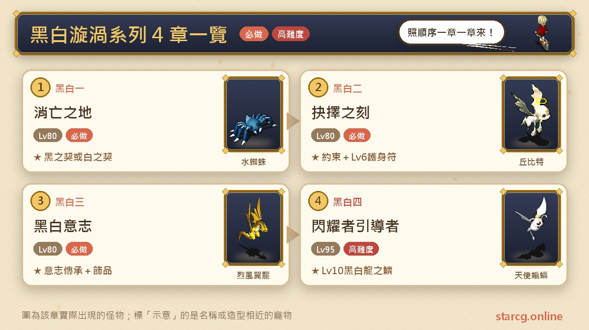
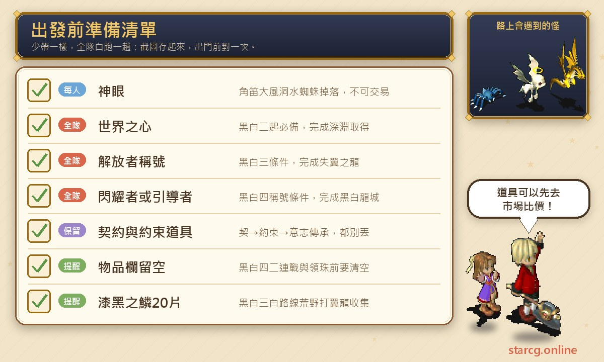
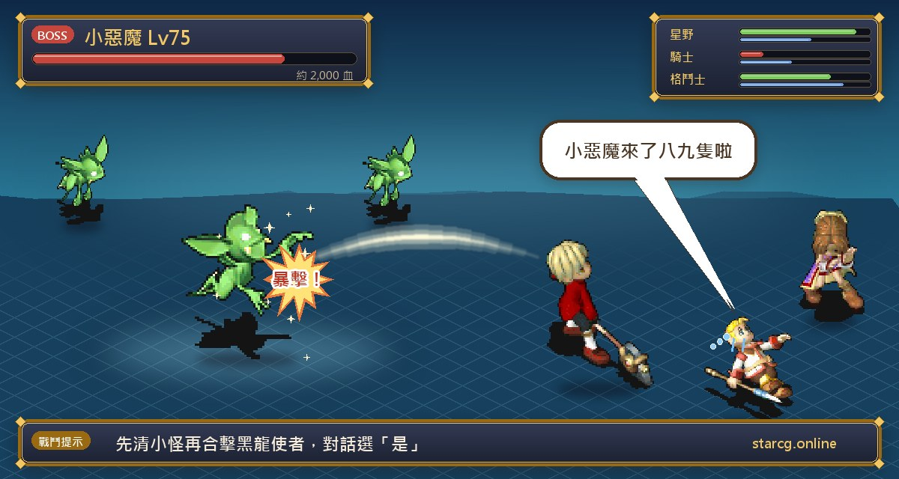
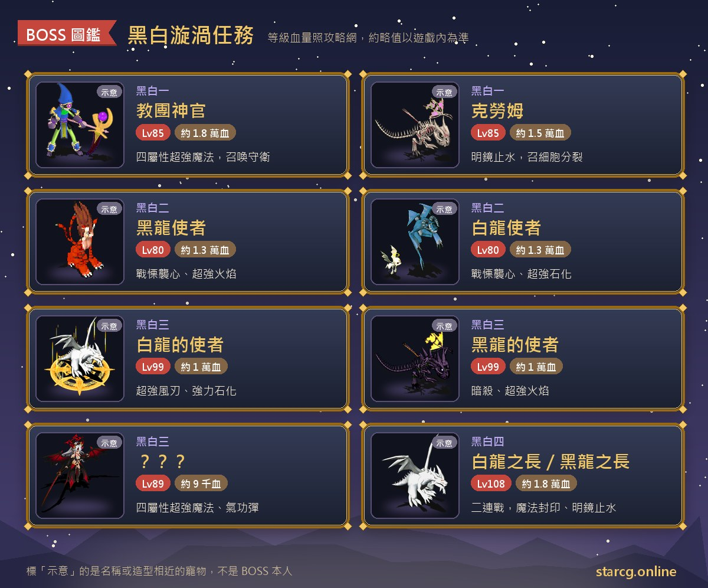

魔力寶貝的黑白漩渦系列，是一條「選邊站」的劇情任務線：從法蘭城的露塔交給你的一張破舊紙條開始，你會被捲進黑龍與白龍兩股勢力的對立，在每一章做出選擇，最後在螺旋之塔拿到 Lv.10 的龍之鱗寶石。整個系列共四章，前三章推薦 80 級，最後一章推薦 95 級，中間還夾著「深淵」「失翼之龍」「黑白龍城」等其他任務的條件，是一條需要提早規劃的長線任務。

黑白漩渦任務最大的特色是**黑、白兩條路線**：第一章的選擇決定你拿到黑之契或白之契，之後每一章都沿著同一個顏色走下去，獎勵也跟著不同。黑路線最後拿到黑龍之鱗（閃躲、必殺），白路線拿到白龍之鱗（命中、反擊），而且兩條路線互不衝突，想要兩種鱗片可以都刷。不論你玩的是星詠魔力、水藍魔力還是初心魔力寶貝，黑白漩渦系列的任務流程都是一樣的，這份整理都能直接拿來用。

> 本文整理自 [星詠魔力攻略網](https://guide.starcg.net/) 的黑白漩渦系列頁面，並用我們自己的方式重新排序與改寫，沒有逐字照搬。BOSS 血量與數值是約略值，實際以遊戲內為準；攻略網部分頁面有用字前後不一致的地方，本文已標註，遊戲更新後內容也可能變動。

## 黑白漩渦系列是什麼？先看整體順序

黑白漩渦系列一共四章，每一章都分成黑、白兩條路線。路線不是每章重新選，而是在黑白一的牢房裡由你對克勞姆的回答決定，之後手上拿的是哪一種契約、約束、意志的傳承，就只能走對應顏色的入口。

| 章節 | 任務名稱 | 推薦等級 | 取得 |
|---|---|---|---|
| 黑白一 | 消亡之地 | 80（無條件） | 黑之契 或 白之契 |
| 黑白二 | 抉擇之刻 | 80 | 黑之約束＋果敢的勇氣，或 白之約束＋堅毅的決心 |
| 黑白三 | 黑白意志 | 80 | 黑之意志的傳承＋漆黑之環，或 白之意志的傳承＋純白耳環 |
| 黑白四 | 閃耀者引導者 | 95 | 黑龍之鱗＋混沌之珠，或 白龍之鱗＋秩序之珠 |

要特別記住的是各章的**前置條件**，它們不在這個系列裡面：

- 黑白二起，每一章都要持有**世界之心**（完成「深淵」任務取得）。
- 黑白三要有**「解放者」稱號**（完成「失翼之龍」任務取得）。
- 黑白四要有**「閃耀者」或「引導者」稱號**（完成「黑白龍城」任務取得）。

攻略網在黑白四頁面也把整條前置寫成：黑白漩渦 → 黑白一 → 黑白二 → 黑白三 → 黑白四。想拿白龍之鱗，前面每一章都要選白色路線；想拿黑龍之鱗，就每一章都選黑色。

## 出發前先準備好這些

黑白漩渦系列的準備重點不在消耗品，而在「條件」與「任務道具」：少一個稱號就進不了門，丟掉一個約束就得重跑。下面這張清單把每章需要的東西集中在一起，出發前對照一次最保險。

黑白一需要每個人自己的**神眼**，要到角笛大風洞打水蜘蛛取得，不能交易，只能自己打。黑白三黑路線的獎勵**漆黑之環**（Lv.8 手環）可以交易，如果只是想要這條手環、不打算走完整個系列，可以先用本站的 [市場查價](/market/) 看看攤位上有沒有人在賣、價格大概多少，再決定要不要自己跑。黑白四兩場二連戰都要求**每位隊員的物品欄留空**，這一點最常被忘記，建議出發前先把背包整理乾淨。

## 黑白一：消亡之地（決定黑或白的一章）

推薦 80 級，沒有任務條件，是整個系列的入口。

1. 到法蘭城找**露塔**（95, 83）對話，拿到【破舊的紙條】。
2. 到哈貝魯村找**桑德**（44, 47），交出紙條換【桑德的指引】。哈貝魯村的走法可以參考「索奇亞古文明調查」任務。
3. **白天**到索奇亞島（400, 254），持【神眼】調查**破敗的石碑**。石碑在角笛大風洞外、靠近加納村的那一側。交出神眼與桑德的指引後，會被傳送到過去的柯馬特依村。
4. 找**瑞克**（49, 56）對話，被傳送到殘破的牢房。
5. 找**克勞姆**（36, 20）對話，依你的回答分成兩條路線。

**選「是」：黑之契路線**

選「是」的成員會**單獨**被傳送到諾斯菲拉特，找**教團神官**（785, 68）開戰。打贏後被送到時空裂縫，找**黑龍使者**（9, 7）拿【黑之契】，回到索奇亞島，最後回法蘭城找露塔完成任務。

**選「否」：白之契路線**

全隊直接和克勞姆開戰。打贏後被送到時空裂縫，找**白龍使者**（9, 7）拿【白之契】，回到索奇亞島，再回法蘭城找露塔完成任務。

**BOSS 資料**

- 黑路線｜**教團神官**：85 級、約 18,000 血，地 30／水 70，邪魔系、抗咒。會攻擊、防禦、聖盾、四屬性強力攻擊魔法、強力中毒與補血魔法，開場召喚 2 隻**教團守衛**（80 級、各約 8,000 血，不抗咒，會四屬性攻擊魔法與強力昏睡魔法）。
- 白路線｜**克勞姆**：85 級、約 15,000 血，地 70／水 30，不死系、抗咒。會諸刃、乾坤一擲、連擊、聖盾、明鏡止水，開場召喚 2 隻**細胞分裂**（80 級、各約 8,000 血，不抗咒，會乾坤一擲、連擊、諸刃，擊倒克勞姆後還會加入全體傷害的自爆）。

**打法**：攻略網對白路線的建議是先清掉被召喚的小怪，等克勞姆沒辦法再用明鏡止水時，再集中合擊。黑路線要注意教團神官的戰鬥是「選是的那個人單獨過去」，等於是一個人面對 85 級的 BOSS 加兩隻守衛，等級與裝備不夠的話會很吃力。

**要注意的地方**：

- **每位隊員都要有自己的神眼**，不能共用、不能交易。
- 調查石碑要在**白天**。
- 黑之契與白之契都是後續任務的關鍵道具，**千萬不要丟**；持有契約期間，這個任務也不能重解。

## 黑白二：抉擇之刻（拿到第一個護身符）

推薦 80 級，條件是持有【黑之契】或【白之契】，以及【世界之心】。

**黑之契路線**

1. 到蒂娜村，出村到莎蓮娜島（449, 334），持世界之心與黑之契找**龍的使者**，傳送到混沌的甬道。
2. 穿過隨機迷宮抵達漆黑之間，找**黑龍使者**（24, 21）選「是」開戰。
3. 打贏後再找黑龍使者（24, 21）交出黑之契，拿到【黑之約束】與【果敢的勇氣】，傳回法蘭城，完成。

**白之契路線**

1. 到阿巴尼斯村，出村到莎蓮娜島（335, 132），持世界之心與白之契找**龍的使者**，傳送到秩序的甬道。
2. 穿過迷宮抵達純白之間，找**白龍使者**（24, 15）選「是」開戰。
3. 打贏後再找白龍使者（24, 15）交出白之契，拿到【白之約束】與【堅毅的決心】，傳回法蘭城，完成。

**BOSS 資料**

- 黑路線｜**黑龍使者**：80 級、約 13,000 血，四屬性各 30，邪魔系、抗咒。會氣功彈、戰慄襲心、超強火焰、超強冰凍、超強補血、超強混亂魔法。身邊有 8～9 隻**小惡魔**（75 級、各約 2,000 血，飛行系、抗咒，會強力隕石、超強中毒、超強恢復）。
- 白路線｜**白龍使者**：80 級、約 13,000 血，四屬性各 30，邪魔系、抗咒。會氣功彈、戰慄襲心、超強風刃、超強隕石、超強恢復、超強石化魔法。身邊有 3～9 隻**丘比特**（75 級、各約 2,000 血，飛行系、抗咒，會強力火焰、超強昏睡、超強恢復、超強補血）。

**打法**：攻略網整理了兩種做法。一是收寵並用 W 站位，先清掉小怪再合擊 BOSS；二是帶寵物先清小怪，用戰慄讓 BOSS 無法行動，再合擊 BOSS。小怪數量多、而且都會補血與恢復，拖得越久越難收尾，所以兩種做法的共通點都是「先把小怪清乾淨」。想估一下隊伍清場的速度，可以用本站的 [傷害計算機](/damage/) 算算看。

**要注意的地方**：

- 對話時**一定要選「是」開戰**。如果選「否」，會再跳一次選項，這時選「是」就會直接交出契約、任務結束，等於白跑一趟。
- 想重打白路線，要先丟掉白之約束；想重打黑路線，要先丟掉黑之約束。
- 獎勵護身符都是 Lv.6、耐久 100、不可交易。**果敢的勇氣**：攻擊 +30、防禦 +10、敏捷 +15、必殺 +6、命中 +6、生命 +100、魔力 +85。**堅毅的決心**：攻擊 +20、防禦 +20、敏捷 +15、必殺 +3、反擊 +3、命中 +3、閃躲 +3、生命 +85、魔力 +100。

## 黑白三：黑白意志（流程最長的一章）

推薦 80 級。條件是持有【黑之約束】或【白之約束】、【世界之心】，並擁有**「解放者」稱號**。這章兩條路線的流程差異最大，分開說明。

**黑之約束路線**

1. 到蒂娜村，出村到莎蓮娜島（449, 334），找**龍的使者**，傳送到漆黑之間。
2. 找**白龍的使徒**（24, 22）開戰。
3. 打贏後再對話，傳送到**純白的雪原**。這是固定迷宮，遇到的是大地、火焰、寒冰、烈風四種翼龍，每場固定 4 隻，有經驗值。
4. 調查（75, 18）、（23, 19）、（26, 77）、（84, 74）四座**石碑**，各自進入**陰霾之影**。四座沒有先後順序，但**全部都要調查**。陰霾之影是 3 層的隨機迷宮。
5. 抵達**虛無之墓**，找「**？？？**」開戰。
6. 四次戰鬥分別拿到【純白的羽毛】、【純白的手鐲】、【純白的金屬】、【純白的證明】，每次打完會被送回純白的雪原。
7. 集齊四種後，雙擊【純白的證明】，交出四種道具換【秩序之匙】。
8. 到純白的雪原（52, 50），走**藍色傳送石**到漆黑的祭壇。
9. 找**迷惘的龍**（73, 20），選「是」交出秩序之匙，並**解散隊伍**，進入單人戰鬥。
10. 打贏後被送到螺旋之塔・底層，找**黑龍的使徒**（20, 12）交出黑之約束，拿到【黑之意志的傳承】與【漆黑之環】，傳回法蘭城，完成。

**白之約束路線**

1. 到阿巴尼斯村，出村到莎蓮娜島（335, 132），找**龍的使者**，傳送到純白之間。
2. 找**黑龍的使徒**（24, 14）開戰。
3. 打贏後再對話，傳送到**漆黑的荒野**。同樣是固定迷宮、四種翼龍、每場 4 隻，打倒魔物會隨機掉落【漆黑之鱗】。
4. 收集 **20 片**漆黑之鱗後，到漆黑的荒野（48, 42），走**紅色傳送石**到黑龍之祭壇。
5. 找**迷惘的龍**（73, 20）：選「是」會交出漆黑之鱗並解散隊伍，進入單人戰鬥；選「否」則是交出白之約束換成黑之約束，回到法蘭城，改從黑路線第 1 步重新開始。
6. 打贏後被送到螺旋之塔・塔頂，找**白龍的使者**（20, 12）交出白之約束，拿到【白之意志的傳承】與白色耳飾，傳回法蘭城，完成。

**BOSS 資料**

- 黑路線開場｜**白龍的使者**：99 級、約 10,000 血，四屬性各 30，邪魔系、抗咒。會諸刃、補血魔法、超強風刃魔法、強力石化魔法，帶 2～4 隻**白龍族**（90 級、各約 8,000 血，水 100，龍系、不抗咒，會諸刃、陽炎、冰凍魔法）。
- 白路線開場｜**黑龍的使者**：99 級、約 10,000 血，四屬性各 30，邪魔系、抗咒。會混亂攻擊、暗殺、乾坤一擲、氣功彈、超強火焰魔法、強力混亂魔法，帶 2～4 隻**黑龍族**（90 級、各約 8,000 血，火 100，龍系、不抗咒，會連擊、乾坤一擲、火焰魔法）。
- 黑路線虛無之墓｜**？？？**：89 級、約 9,000 血，四屬性各 30，邪魔系，會對應四屬性的單體超強攻擊魔法與氣功彈，身邊有大地、火焰、寒冰、烈風翼龍（87 級、各約 2,000 血，不抗咒，**二次行動**，會聖盾、陽炎）。
- 單人戰｜**迷茫的龍**：75 級、約 6,000 血，風 100，龍系、不抗咒。會強力風刃魔法，但攻略網註明是**固定傷害 1**，單人也不用太緊張。

**要注意的地方**：

- 黑白三的開場 BOSS 是 99 級，比推薦等級高出一大截，而且黑路線的白龍的使者會強力石化、白路線的黑龍的使者會強力混亂與暗殺，建議帶能解異常狀態的隊員。
- 陰霾之影的 3 層是隨機迷宮，要跑四趟，每次樓梯位置都不一樣。可以搭配本站的 [迷宮找樓梯](/maze/) 一邊走一邊記錄，少繞冤枉路。
- **漆黑之環**是 Lv.8 手環，耐久 200，攻擊 +25、防禦 +13、敏捷 +10、必殺 +6、命中 +6、生命 +100、魔力 +95，數值會浮動，可以交易。
- 攻略網在白路線有兩處用字不一致：收集的道具前面寫「漆黑之鱗」、後面寫「漆黑之麟」，應為同一樣東西；獎勵耳飾在內文寫「純白耳飾」、在任務表格寫「純白耳環」，數值也沒有寫完整，以遊戲內為準。
- 【黑之意志的傳承】、【白之意志的傳承】是黑白四的條件道具，不要丟。

## 黑白四：閃耀者引導者（Lv.10 龍之鱗）

推薦 95 級，是系列最終章，也是最難的一章。條件是持有【黑之意志的傳承】或【白之意志的傳承】、【世界之心】，並擁有**「閃耀者」或「引導者」稱號**。隊員的頭銜不必統一。

**黑之意志路線（黑龍之鱗）**

1. 到蒂娜村，出村到莎蓮娜島（449, 334），持世界之心與黑之意志的傳承找**龍的使者**，傳送到**螺旋之塔**。塔共 4 層，魔物是天使蝙蝠，第 3 層要走樓梯到 BOSS 處。
2. 擊敗各層的 BOSS **白龍族**（4～10 隻），抵達螺旋之塔中層。
3. 找**黑龍之長**選「是」開戰，這是**二連戰**：第一戰白龍之長，第二戰黑龍之長。
4. 打贏後，隊伍中**隨機一人**拿到【黑色囚室的鑰匙】。
5. 調查（10, 29）的門，選「是」交出鑰匙，進入囚室。
6. 找**黑龍之長**（18, 11）拿到**黑龍之鱗**，被送到交錯之間。
7. 找**迷惘之龍**（18, 11），交出黑之意志的傳承，拿到【混沌之珠】，傳回法蘭城，完成。

**白之意志路線（白龍之鱗）**

1. 到阿巴尼斯村，出村到莎蓮娜島（334, 132），持世界之心與白之意志的傳承找**龍的使者**，傳送到螺旋之塔。塔共 4 層，魔物是惡魔蝙蝠。
2. 擊敗各層的 BOSS **黑龍族**（4～10 隻），抵達中層。
3. 找**白龍之長**（22, 29）選「是」開戰，同樣是二連戰。
4. 打贏後，隊伍中隨機一人拿到【白色囚室的鑰匙】。
5. 調查（10, 29）的門，選「是」交出鑰匙，進入白囚室。
6. 找**白龍之長**（18, 11）拿到**白龍之鱗**，被送到交錯之間。
7. 找**迷惘之龍**（18, 11），交出白之意志的傳承，拿到【秩序之珠】，傳回法蘭城，完成。

**BOSS 資料**

- 各層 BOSS｜**白龍族**（黑路線）：約 100 級、約 12,000 血，水 50／火 50，不抗咒，**二次行動**，會諸刃、陽炎、冰凍魔法。
- 各層 BOSS｜**黑龍族**（白路線）：約 100 級、約 12,000 血，火 50／風 50，不抗咒，**二次行動**，會乾坤一擲、連擊、火焰魔法。
- 二連戰｜**白龍之長**、**黑龍之長**：兩者都是 108 級、約 18,000 血，地 30／風 70，抗咒，**二次行動**。會乾坤一擲、崩擊、反擊、魔法封印、混亂攻擊、大地之怒、明鏡止水，被施放制禦魔法後還會追加連擊。

**要注意的地方**：

- 兩場二連戰之前，**每位隊員的物品欄都要留空**，否則戰後可能拿不到鑰匙；最後找迷惘之龍時物品欄沒留空，也會直接被傳回法蘭城、拿不到珠子。
- 二連戰的 BOSS 會魔法封印和明鏡止水，還會二次行動，108 級的數值是整個系列最高，建議等級與補給都準備充足再進塔。
- 攻略網這一頁有幾處明顯筆誤：黑路線的警告寫成「秩序之珠」，與本步驟獎勵的混沌之珠不一致；白路線第一戰的名稱寫成「白黑龍之長」。本文依各路線的獎勵整理，實際以遊戲內為準。

**龍之鱗效果（Lv.10 寶石，可鑲嵌於武器或防具）**：

- **黑龍之鱗**：攻擊 +10、閃躲 +9、必殺 +1、耐久 -20%。
- **白龍之鱗**：攻擊 +10、命中 +9、反擊 +1、耐久 -20%。

兩種鱗片可以都刷，兩條路線互不衝突。如果想兩種都拿，就要從黑白一開始各走一次對應顏色的路線。

## 黑白漩渦系列常見問題

**黑白路線是在哪裡決定的？** 在黑白一殘破的牢房裡和克勞姆對話時決定：選「是」走黑之契路線，選「否」走白之契路線。之後每一章依你手上的契約、約束、意志的傳承，從對應的入口進入（黑路線多從蒂娜村出發，白路線多從阿巴尼斯村出發）。

**黑龍之鱗和白龍之鱗可以都拿嗎？** 可以。攻略網說明兩條路線互不衝突，想要兩種鱗片就各走一次完整的黑色路線與白色路線。

**黑白二對話時不小心選了「否」怎麼辦？** 選「否」之後會再出現一次選項，這時如果選「是」，會直接交出契約並結束任務。所以第一次就選「是」開戰最安全。

**黑白系列需要哪些外部任務？** 黑白二起需要「深淵」任務給的世界之心；黑白三需要「失翼之龍」的解放者稱號；黑白四需要「黑白龍城」的閃耀者或引導者稱號。

**黑白四為什麼打贏了卻拿不到鑰匙或珠子？** 最常見的原因是物品欄沒有空位。二連戰前與找迷惘之龍前，每位隊員都要把物品欄留空。

**漆黑之環可以買嗎？** 攻略網註明漆黑之環可以交易，可以到 [市場查價](/market/) 看看有沒有人在賣；兩個龍之鱗與黑白二的護身符則要自己做任務取得。

## 小結：先把條件湊齊，再選好顏色

黑白漩渦系列本身只有四章，但牽涉到深淵、失翼之龍、黑白龍城三個外部任務的條件，加上黑白三四座石碑、四趟隨機迷宮，以及黑白四 108 級的二連戰，整體來說是需要提早規劃的長線任務。建議先決定要走黑還是白（看你想要閃躲必殺，還是命中反擊），把世界之心與各章稱號準備好，再一章一章往下推；每一章拿到的契約、約束與意志的傳承都要保留，物品欄記得清空。

想看更完整的原文，可以到 [星詠魔力攻略網](https://guide.starcg.net/) 查詢黑白漩渦系列各頁；也歡迎用本站的 [市場查價](/market/)、[迷宮找樓梯](/maze/) 與 [傷害計算機](/damage/) 把整趟黑白漩渦任務安排得更順。
