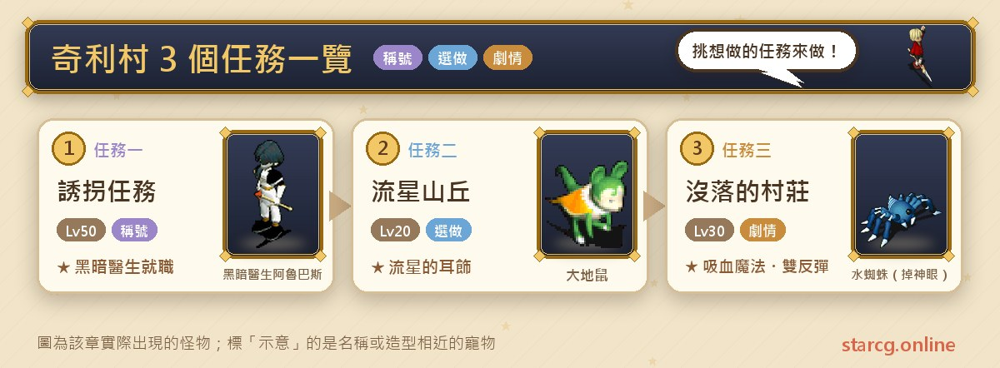
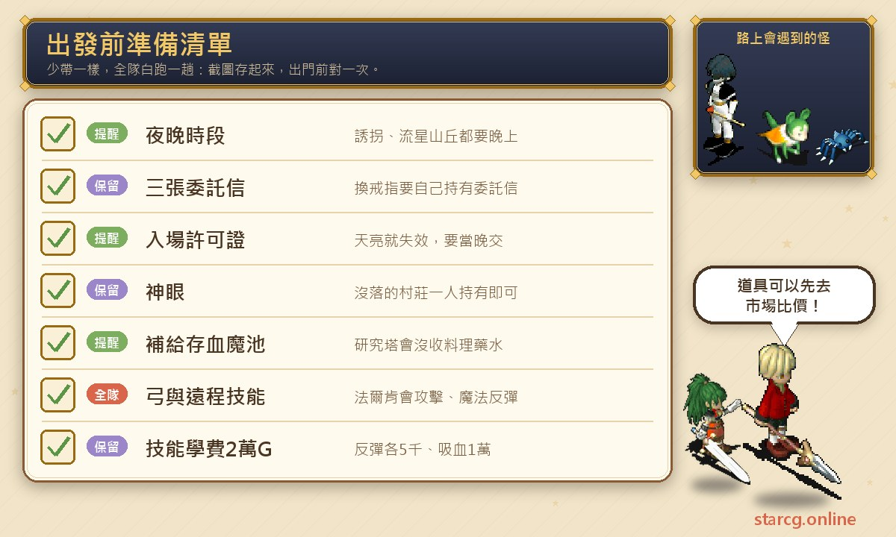
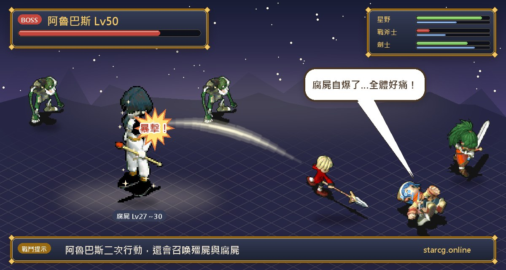

키리 마을(奇利村)은 솔키아(索奇亞)섬의 사막 마을로, 공략 사이트는 이곳을 「주변에 유성 언덕의 전설과 몰락한 마을의 비극이 숨어 있다」고 소개해요. 이 글은 키리 마을의 지역 퀘스트 세 개, **유괴 퀘스트(誘拐任務)**(암흑 의사 취직 퀘스트), **유성 언덕(流星山丘)**, **몰락한 마을(沒落的村莊)**을 정리했어요. 세 퀘스트 모두 조건은 20레벨이고, 권장 레벨은 각각 50, 20, 30이에요. 끝내면 암흑 의사 취직 자격과 셋 중 하나를 고르는 반지, 유성의 귀걸이, 흡혈 마법·공격 반사·마법 반사 세 기술을 배울 기회를 얻고, 조교술사는 트렌트 계열 펫도 한 마리 받을 수 있어요.

세 퀘스트에는 공통점이 있어요. 모두 「밤」과 관련이 있다는 거예요. 유괴 퀘스트는 밤에 진행해야 하고, 유성 언덕은 같은 날 밤 안에 끝내야 하며, 몰락한 마을도 고대인 루트로 가면 밤에만 출발할 수 있어요. 이 글은 단계별 NPC, 좌표, 챙길 아이템, 보스 정보를 게임하면서 넘겨 볼 수 있는 순서로 정리했어요. StarCG(星詠魔力), 水藍魔力, 初心魔力寶貝 어느 쪽을 하든 키리 마을 퀘스트 흐름은 같아요.

> 이 글은 [StarCG 공략 사이트](https://guide.starcg.net/quests/chili)의 키리 마을 퀘스트 페이지를 바탕으로, 저희 방식대로 순서를 다시 짜고 새로 써서 정리했어요(그대로 옮기지 않았어요). 보스 HP와 수치는 대략적인 값이니 실제 게임을 기준으로 하세요. 게임 업데이트 후 내용이 바뀔 수 있어요. 격투가, 무술사 취직 퀘스트는 직업 퀘스트라서 이 글에는 넣지 않았어요.

## 키리 마을 퀘스트는 무엇이 있나요? 전체 순서부터

세 퀘스트는 서로 선후 관계가 없어서 레벨과 시간대에 맞춰 골라 하면 돼요. 추천 순서는 20레벨이면 쉽게 끝나는 유성 언덕을 먼저, 그다음 30레벨의 몰락한 마을, 마지막으로 권장 50레벨에 알버스의 동굴에 들어가야 하는 유괴 퀘스트예요.

| 퀘스트 | 퀘스트 이름 | 권장 레벨 | 보상 |
|---|---|---|---|
| 퀘스트 1 | 유괴 퀘스트 | 50 | 암흑 의사 취직, 셋 중 하나 반지, 간호사 모자 |
| 퀘스트 2 | 유성 언덕 | 20 | 명성 400, 유성의 귀걸이, 트렌트 계열 펫(조교술사) |
| 퀘스트 3 | 몰락한 마을 | 30 | 명성 400, 흡혈 마법, 공격 반사, 마법 반사 |

유괴 퀘스트는 팔괘 시리즈와도 이어져 있어요. 팔괘 6 「키리의 유괴 사건」도 밤에 솔키아에서 문지기 부패 시체를 찾아 알버스의 동굴에 들어가는데, 레벨과 보스 강도가 훨씬 높아요. 계속 이어서 하고 싶다면 이 사이트의 [팔괘 퀘스트 완벽 공략](/ko/posts/bagua-quest-guide/)을 참고하세요.

## 출발 전에 준비할 것

키리 마을 세 퀘스트는 아이템이 많지 않아요. 진짜 준비할 것은 「시간대」와 「보급」이에요. 유괴 퀘스트 도중에는 키리 마을 병원에서 회복이 안 되고, 몰락한 마을에서 로렌스 연구탑에 들어가면 요리와 물약을 압수당해요. 이 두 가지가 무엇을 챙길지에 바로 영향을 줘요.

가장 돈이 많이 드는 건 몰락한 마을을 끝낸 뒤 배우는 기술이에요. 공격 반사, 마법 반사는 각각 5,000G, 흡혈 마법은 10,000G라서 셋 다 배우려면 20,000G가 필요해요. 조교술사가 트렌트를 받으려면 사육 사부에게 1,000G를 따로 내야 해요. 보급품은 이 사이트의 [시세 검색](/ko/market/)에서 가격을 먼저 보고 직접 만들지 정하면 돼요. 그리고 몰락한 마을에 필요한 신안(神眼)은 뿔피리 대풍혈(角笛大風穴)의 물거미가 무작위로 떨어뜨리니 먼저 얻고 출발하는 게 좋아요.

## 퀘스트 1: 유괴 퀘스트(암흑 의사 취직, 밤 한정)

권장 50레벨, 조건은 20레벨, **밤**이에요. 공략 사이트는 이 퀘스트를 「암흑 의사 취직 퀘스트」로 표시하고, 보상으로 암흑 의사 취직, 셋 중 하나 반지, 간호사 모자, 기술 「이혈역강(以血易強)·주인비화(咒刃飛花)·비인난무(飛刃亂舞)」, 그리고 무작위 드롭 분노의 죄서(憤怒的罪書)를 들어요.

**1단계: 의뢰 편지 세 장 모으기**

1. 키리 마을 노부부의 집(50, 54)에서 쪽지(6, 5)를 조사해 「죄를 적은 쪽지(記載罪行的紙條)」를 받고, **와치(瓦奇)**(11, 8)와 대화해 「유괴 사건 조사 의뢰 편지(調查誘拐事件的委託信)」를 받아요.
2. 병원(64, 56)에 들어가 **간호사 파프(護士帕芙)**(8, 2)와 대화해 「죄를 적은 쪽지」를 받고, **간병인 코닐리(看護柯尼莉)**(14, 16)와 대화해 두 번째 의뢰 편지로 바꿔요.
3. 밤에 촌장의 집(50, 63)에서 (10, 2)의 방으로 들어가 **암흑 의사 알버스(黑暗醫師阿魯巴斯)**(8, 6)와 대화해 전투를 시작해요.
4. 전투가 끝나면 쪽지(7, 3)를 조사해 「죄를 적은 쪽지」를 받고, **촌장 호바크(村長荷巴克)**와 대화해 세 번째 의뢰 편지로 바꿔요.

**주의할 점**: 파티 전원이 1단계를 끝내야 장면이 바뀌어요. 퀘스트 도중 키리 마을 병원에 들어가면 **HP와 MP가 회복되지 않아요**. 공략 사이트의 해결법은 퀘스트 아이템이 없는 사람의 파티에 먼저 들어간 뒤 병원에서 회복하는 거예요. 촌장 집 전투의 알버스는 도망가니 끝까지 붙잡고 싸울 필요는 없어요.

**1차전 정보**: 암흑 의사 알버스 50레벨, HP 약 5,000, 인간형, 지 60 수 40, 도망감. 옆에 좀비(殭屍) 2마리, 20레벨, HP 약 700, 언데드형, 지 50 풍 50.

**2단계(선택): 미네루파 지선으로 간호사 모자 받기**

이 지선은 공략 사이트에 따로 올라온 「암흑 간호사(黑暗護士)」 퀘스트예요. 간호사 모자만 원하면 여기까지만 해도 돼요.

1. 민가(71, 63)에서 **미네루파의 아버지(米內魯帕的父親)**와 대화해 「부모님의 편지(雙親的信)」를 받아요.
2. 밤에 의뢰 편지 세 장을 들고 솔키아(216, 222)의 **문지기 부패 시체(守門的腐屍)**와 대화해 숲길로 들어간 뒤, (8, 38)에서 알버스의 동굴로 들어가요.
3. 동굴 안에서 무작위로 나타나는 **무면허 간호사 미네루파(無照護士米內魯帕)**를 찾아 편지를 주고 「미네루파의 편지(米內魯帕的信)」를 받아요.
4. 민가로 돌아가 아버지에게 편지를 주고 새 「부모님의 편지」를 받은 뒤, 다시 동굴의 미네루파에게 주고 「구겨진 편지(被揉爛的信)」를 받아요.
5. 다시 민가에 구겨진 편지를 주고 「미네루파가 가장 아끼는 인형(米內魯帕最愛的娃娃)」을 받고, 마지막으로 인형을 미네루파에게 주면 **간호사 모자(護士帽)**로 바뀌어요.

간호사가 간호사 모자를 장착하면 칭호 「암흑 간호사」를 받아요. 암흑 간호사 페이지는 미네루파의 편지나 구겨진 편지를 가지고 있을 때 **로그아웃하면 안 된다**고 특별히 알려 줘요. 편지가 사라져요. 간호사 모자는 나중에 제노바 마을(傑諾瓦鎮)의 심연, 마족 개조 계획에서도 쓰여요. 문지기 구울(食屍鬼)을 통과시켜 줘서 30,000G짜리 암흑 의사 목걸이(黑暗醫生項鏈)를 살 필요가 없어요.

**3단계: 알버스의 연구소**

1. 밤에 의뢰 편지 세 장을 들고 솔키아(216, 222)의 문지기 부패 시체를 찾아 알버스의 동굴로 들어가요. 의뢰 편지는 파티장만 가지고 있어도 되지만, 그러면 다른 사람은 나중에 의뢰 편지로 보상을 바꿀 수 없어요(훈장과 죄서는 똑같이 얻을 수 있어요).
2. 꼭대기 층 알버스 연구소의 (61, 54)에서 안으로 들어가요. 간호사 모자가 있는 사람은 문지기 부패 시체와 대화해 바로 들어갈 수 있고, 간호사 모자가 없을 때의 경로는 공략 사이트에 스크린샷으로 표시되어 있어요.
3. **암흑 의사 알버스(黑暗醫生阿魯巴斯)**와 싸워요.

**보스 정보**: 암흑 의사 알버스 50레벨, 지수화풍 각 50, 2회 행동. 흡혈 마법, 초강력 중독/수면/석화/만취/혼란/망각 마법을 쓰고, 좀비, 구울, 부패 시체를 소환해요. 최종형 결전 우귀(最終型決戰牛鬼)를 쓰러뜨리면 성스러운 방패와 강력 회복 마법이 추가돼요. 최종형 결전 우귀는 45레벨, 사악형, 지수화풍 각 30, 2회 행동이고 연속 공격(3), 건곤일척, 반격, 명경지수, 장비 파괴를 써요. 소환되는 부패 시체, 좀비, 구울은 모두 27~30레벨이고, 부패 시체는 자폭으로 전체 피해를 주며, 좀비는 흡혈 공격과 양날 공격, 구울은 전율습심을 써요. 공략 사이트에는 이 전투의 HP가 없어요.

**공략법**: 알버스는 한 턴에 두 번 움직이고 상태 이상 마법을 한 세트로 퍼부으니 상태 이상 해제 수단을 넉넉히 준비하세요. 부패 시체의 자폭은 전체 피해라서 소환되면 먼저 처리하세요. 우귀가 쓰러지면 알버스에게 성스러운 방패와 강력 회복이 생기니 누구를 먼저 칠지는 파티가 직접 판단해야 해요. 공략 사이트는 순서를 정해 두지 않았어요.

**보상과 취직**: 이기면 분노의 죄서 또는 **훈장**을 무작위로 받아요. 훈장을 감정하면 「암흑 의사의 상징(黑暗醫生的象徵)」이 되고, 의사가 장착하면 칭호 「암흑 의사」를 받아요. 훈장과 의뢰 편지를 들고 의뢰인과 대화하면 보상을 바꿀 수 있는데 **셋 중 하나**예요. 와치는 인도의 반지(引導的戒指), 간병인 코닐리는 호봉륜(護封輪), 촌장 호바크는 신성한 눈(神聖之眼)을 줘요. 그 뒤 연구소(54, 40)에서 「숨겨진 방」에 들어가 미네루파와 대화하면 암흑 의사로 취직하고, 옆 책장에서 이혈역강, 주인비화, 비인난무를 배워요. 나중에 승급할 때는 키리 마을 북쪽(224, 214)의 문지기 구울과 대화하면 바로 숨겨진 방의 미네루파에게 갈 수 있어요. 분노의 죄서는 공격 +8의 2레벨 부적이고, 1등 훈장 「마지막 진실(最後的真相)」 일곱 번째 문의 도전 자격이기도 해요. 훈장 시리즈는 이 사이트의 [훈장 퀘스트 공략](/ko/posts/medals-quest-guide/)을 참고하세요.

## 퀘스트 2: 유성 언덕(하룻밤에 끝내기, 2인 이상)

권장 20레벨, 조건은 20레벨, **밤**이고, **2인 이상**이어야 들어갈 수 있어요. 보상은 명성 400과 유성의 귀걸이이고, 조교술사는 트렌트 계열 펫도 받을 수 있어요.

1. 키리 마을 북서쪽 유성 언덕(202, 235)에서 2인 이상 파티로 **언덕 관리인 오사(山丘管理員歐莎)**에게 「입장 허가증(入場許可證)」을 받아요.
2. 언덕에 들어가 전투에서 **노커(大地鼠)**를 쓰러뜨리고 「운석(隕石)」을 얻어요. 입구 근처에서도 노커를 잡을 수 있어요.
3. 100M → 200M → 300M 순으로 정상에 올라가요(자동 길안내 가능). 200M에서 300M 사이에 동굴을 잘못 들어가면 250M로 가는데, 막다른 곳이니 되돌아가 다른 입구로 들어가세요.
4. **노커 할머니의 집**에서 운석과 입장 허가증을 **노커 할머니(大地鼠婆婆)**에게 주고 감정받아요. 진짜면 「유성(流星)」이 되고, 가짜면 운석 그대로예요.
5. 유성이나 운석을 들고 키리 마을 장비점(66, 77)의 **속이 깊은 여자 체르(城府深的女人雀兒)**와 교환하면 **유성의 귀걸이(流星的耳飾)**를 받고 퀘스트가 끝나요.

**주의할 점**: 퀘스트 전체를 같은 날 밤 안에 끝내야 해요. 날이 밝으면 입장 허가증이 무효가 되어, 전날 밤의 허가증으로는 퀘스트를 완료할 수 없고 다음 밤에 오사에게 다시 받아야 해요. 공략 사이트는 게임 시간이 새벽에 가까우면 다음 밤을 기다렸다가 시작하라고 권해요. 그리고 운석을 몇 개 잡든 **하룻밤에 유성은 하나만** 나와요. 유성을 원하면 운석을 여러 개 잡아 감정받고, 첫 클리어 명성만 원하면 운석 하나만 얻고 바로 교환 단계로 넘어가도 돼요.

**조교술사 전용 지선**: 조교술사는 300M 서쪽으로 내려가 사육사 기숙소(飼養師寄宿所)(148, 199)에서 **사육 사부(飼養師傅)**에게 1,000G로 「말라 죽어가는 트렌트(快枯死的樹精)」를 사고, 20레벨까지 키운 뒤 다시 대화하면 트렌트(樹精), 데스 트렌트(死亡樹精), 늪 트렌트(沼澤樹精), 창백한 트렌트(慘白樹精) 중 한 마리로 바꿀 수 있어요. 공략 사이트는 말라 가는 트렌트의 능력치가 매우 낮아서 20레벨이 되어도 HP가 300이 안 될 수 있으니, 성스러운 방패를 배운 뒤 병원 근처에서 키우고 HP·MP가 떨어지면 병원으로 돌아가 회복해 충성도가 너무 낮아져 도망가지 않게 하라고 알려 줘요. 받은 트렌트의 성장은 이 사이트의 [펫 도감](/ko/pets/)에서 확인할 수 있어요.

## 퀘스트 3: 몰락한 마을(신안, 로렌스 연구탑, 팔켄)

권장 30레벨, 조건은 20레벨이에요. 보상은 명성 400과 흡혈 마법, 공격 반사, 마법 반사 세 기술을 배울 기회예요.

1. 먼저 뿔피리 대풍혈에서 **물거미(水蜘蛛)**를 쓰러뜨려 「신안」을 무작위로 얻어요. 파티에서 한 명만 가지고 있으면 돼요.
2. 루트를 하나 골라 몰락한 마을로 가요:
   - **고대인 루트(밤 한정)**: 밤에 뿔피리 대풍동을 지나 사막(600, 300) 근처 ±50 범위에서 무작위로 나타나는 **고대인(古代人民)**을 찾아 대화하고 「예」를 고르면 전송돼요.
   - **아스티아 참배길 루트(얼음 감옥 완료 필요)**: 제노바 마을 북문에서 세레네(莎蓮娜)섬(260, 360)의 **아스티아 신관(阿斯提亞神官)**을 찾아 「예」를 고르고 참배길로 들어가요(풍명의 탑(風鳴之塔) 자동 길안내 사용 가능). 아스티아 마을(阿斯提亞鎮)에 도착하면 (101, 72)의 계단으로 신전에 가서, 신전 안 **아스티아 신관**(9, 10)과 대화해 위층으로 올라간 뒤 **브루멜(布魯梅爾)**(12, 5)과 대화하고, (13, 10)의 마을 전송석을 조사해 「예」를 골라요.
3. 몰락한 마을의 (40, 39)로 가서 계단으로 「시공을 잇는 방(連接時空的房間)」에 들어가요.
4. **시공을 잇는 석판(連接時空的石盤)**과 대화하면 파티 전원이 제도 아세펜(帝都亞瑟芬) 지하로 전송돼요. 파티에 신안이 있어야 대화할 수 있고, 파티장을 바꿀 필요는 없어요.
5. **용사 리옹(勇者里雍)**과 대화해 「해주의 법(解咒之法)」을 받아요.
6. 오른쪽으로 가서 **대원(隊員)**과 대화하고 약 16층짜리 랜덤 미궁 「로렌스 연구탑(羅連斯研究塔)」에 들어가요.
7. 꼭대기 층에서 해주의 법을 **무술사 예카(巫師耶卡)**에게 주고, 결계가 풀리면 **팔켄(法爾肯)**과 대화해 전투를 시작해요.
8. 이기면 방 안의 **천서(天書)**에게 기술을 배워요: (18, 10) 공격 반사 5,000G, (10, 3) 마법 반사 5,000G, (29, 8) 흡혈 마법 10,000G.
9. 시공을 잇는 석판과 대화하면 솔키아(571, 358)로 전송되고 퀘스트가 끝나요.

**주의할 점**: 로렌스 연구탑에 들어갈 때 지니고 있는 요리, 물약, 식재료, 허브는 감시자에게 전부 압수돼요. 공략 사이트의 팁은 StarCG(星詠魔力)의 「혈마지(血魔池)」가 탑 안에서도 정상 작동하니, 탑에 들어가기 전에 보급품을 혈마지에 넣어 두라는 거예요. 아스티아 루트는 얼음 감옥(冰雪的牢籠)을 먼저 끝내야 하는데, 그 부분은 이 사이트의 [시공의 문 퀘스트 공략](/ko/posts/time-gate-quest-guide/)을 참고하세요. 16층 랜덤 미궁은 [미궁 계단 찾기](/ko/maze/)로 지나온 길을 기록할 수도 있어요.

**보스 정보**: 팔켄 50레벨, HP 약 6,000, 사악형, 지수화풍 각 30. 회복 마법, 공격 반사, 마법 반사, 즉사 마법을 써요. 전투 시작 때는 팔켄 혼자지만, 잠시 뒤 35레벨 리자드 파이터(蜥蜴鬥士) 5마리를 소환해요. 속성은 용형(지 30 수 70)과 언데드형(지 30 풍 70) 두 종류예요.

**공략법**: 공략 사이트는 「풍지」 또는 「순수 지」 수정 장착을 권해요. 졸개가 나오면 옆에 있는 것부터 처리하되, **맨 앞의 한 마리는 죽이지 마세요**. 죽으면 팔켄이 다시 소환해요. 팔켄은 공격 반사와 마법 반사를 자주 써서 근접전에 매우 불리하니, 공략 사이트는 전원 활을 장착해 건곤일척을 쓰거나 1레벨 기공탄 같은 원거리 물리 기술로 포위 공격하라고 권해요.

## 키리 마을 퀘스트 자주 묻는 질문

**키리 마을 퀘스트 중 밤에 해야 하는 건?** 유괴 퀘스트는 조건이 밤이고, 유성 언덕은 같은 날 밤 안에 끝내야 해요. 몰락한 마을은 고대인 루트일 때 고대인이 밤에만 무작위로 나타나고, 아스티아 참배길로 가면 시간 제한이 없어요.

**유성 언덕은 혼자 할 수 있나요?** 아니요. 공략 사이트에 2인 이상이어야 들어갈 수 있다고 되어 있어요.

**하룻밤에 유성을 여러 개 받을 수 있나요?** 아니요. 운석을 몇 개 잡든 하룻밤에 유성은 하나만 나와요. 다만 운석 자체로도 유성의 귀걸이로 바꿀 수 있어요.

**유괴 퀘스트의 반지 세 개를 다 받을 수 있나요?** 아니요. 인도의 반지, 호봉륜, 신성한 눈 중 하나만 골라요.

**몰락한 마을의 신안은 모두 있어야 하나요?** 이 퀘스트는 파티에서 한 명만 신안을 가지고 있으면 돼요. 다만 제노바 마을의 심연 퀘스트는 모든 사람이 신안을 가져야 해서 규칙이 달라요.

**간호사 모자는 또 어디에 쓰나요?** 간호사가 「암흑 간호사」 칭호를 받는 것 말고도, 알버스 연구소 내부와 제노바 마을 「암흑의 둥지(黑暗之巢)」의 통행 조건 중 하나이고, 마족 개조 계획에서 약제사가 비크은산(畢克銀酸)을 배울 때도 이걸 쓰고 있어야 해요.

## 정리: 밤 시간을 먼저 잡고 출발하세요

키리 마을 세 퀘스트는 모두 어렵지 않고, 막히는 건 대부분 규칙이에요. 유괴 퀘스트는 도중에 병원 회복이 안 되고, 의뢰 편지를 파티장만 가지고 있으면 다른 사람은 보상을 바꿀 수 없어요. 유성 언덕은 하룻밤에 유성 하나, 날이 밝으면 허가증이 무효예요. 몰락한 마을은 탑에 들어가면 보급품을 압수당하고 팔켄은 반사 두 가지를 갖고 있어요. 시간대를 잡고, 보급품은 혈마지에 넣고, 원거리 무기를 준비하면 세 퀘스트 모두 깔끔하게 끝낼 수 있어요. 유괴 퀘스트에서 얻은 간호사 모자와 암흑 의사의 상징은 나중에 제노바 마을에서 다시 쓰여요.

더 자세한 원문은 [StarCG 공략 사이트](https://guide.starcg.net/quests/chili)에서 확인하세요. 이 사이트의 [시세 검색](/ko/market/)으로 보급품을 준비하고, [펫 도감](/ko/pets/)으로 트렌트 성장을 보거나, [데미지 계산기](/ko/damage/)로 원거리 기술이 팔켄의 HP를 뚫을 수 있을지 계산해 보세요.
