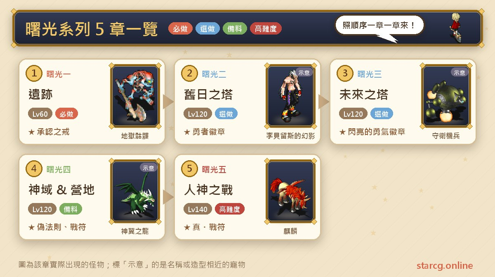
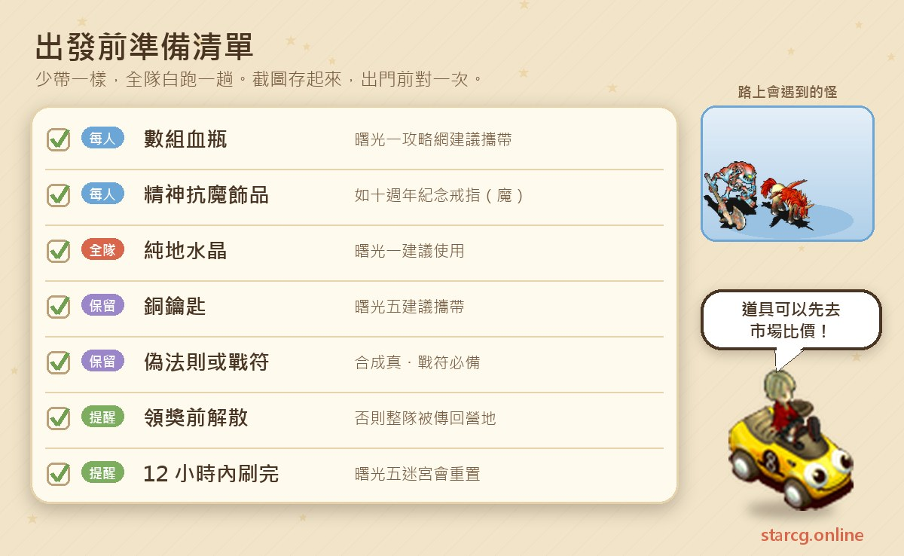
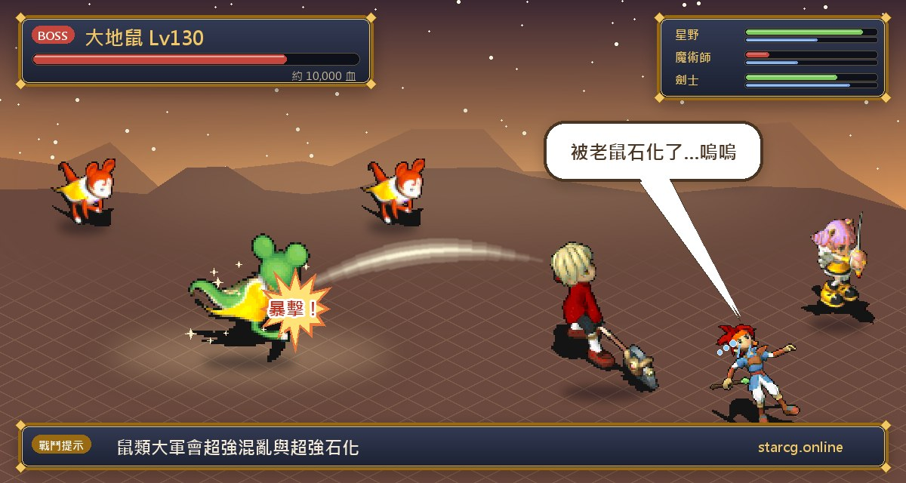
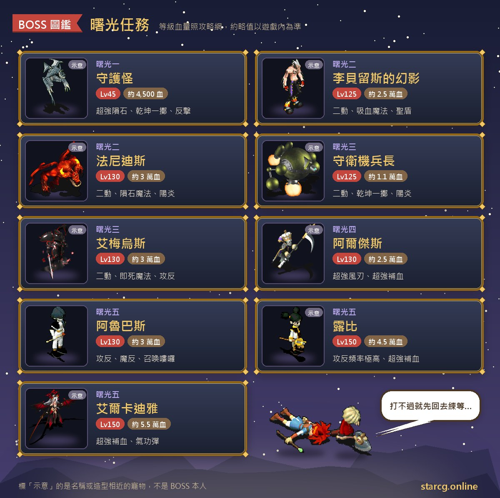

크로스게이트의 서광 시리즈는 판부르크(法蘭城) 샤리아 성(謝里雅堡)의 대제사장 브루멜(布魯梅爾)에서 시작해 켄지로 섬(肯吉羅島) 깊숙이 들어가는 5장짜리 퀘스트예요. 1장 「유적」은 권장 레벨 60으로, 플레이어를 서광 기사단 캠프와 신시아 탐사 지휘부 아래의 폐허로 데려가요. 2장부터는 난이도가 크게 뛰어서 옛날의 탑, 미래의 탑, 어둠의 고탑은 모두 120레벨부터 시작하는 콘텐츠이고, 마지막 「인신의 전쟁」은 권장 레벨이 140이에요. 중간 레벨과 만렙 플레이어를 동시에 챙기는 몇 안 되는 퀘스트 라인이라고 할 수 있어요.

보상도 분명해요. 서광 1은 **인정의 반지(承認之戒)**, 서광 2는 용사의 휘장과 시간의 모래시계, 서광 3은 Lv.7 부적 **빛나는 용기의 휘장(閃亮的勇氣徽章)**을 주고, 서광 4와 서광 5는 10레벨 부적 **진・전부(真・戰符)**를 합성하는 핵심이에요. StarCG 공략 사이트에서는 진・전부만 원한다면 서광 4와 서광 5만 완료하면 된다고 특별히 적어 두었어요. StarCG(星詠魔力), 水藍魔力, 初心魔力寶貝 어느 서버든 서광 퀘스트의 진행은 같으니 이 정리를 그대로 대조해서 쓰면 돼요.

> 이 글은 [StarCG 공략 사이트](https://guide.starcg.net/)의 서광 시리즈 페이지를 바탕으로, 저희 방식대로 순서를 다시 정리하고 새로 쓴 것이에요. 그대로 옮기지 않았어요. 보스 HP와 수치는 대략적인 값이고, 공략 사이트에 없는 수치는 따로 채우지 않았어요. 실제 내용은 게임 안을 기준으로 하고, 업데이트 후 바뀔 수 있어요.

## 서광 시리즈란? 전체 순서부터 보기

서광 시리즈는 모두 5장이지만, 모든 장을 순서대로 해야 하는 건 아니에요. 서광 1은 조건이 없고, 서광 2는 서광 1을 먼저 완료해야 하며, 서광 3은 서광 2를 완료하고 용사의 휘장을 가지고 있어야 해요. 서광 4는 **퀘스트 조건이 없어서** 바로 받을 수 있고, 서광 5는 서광 4에서 얻은 위법칙이나 전부에 이번 장에서 모은 아이템을 더해 진・전부를 합성해요.

| 장 | 퀘스트 이름 | 권장 레벨 | 획득 |
|---|---|---|---|
| 서광 1 | 유적 | 60 | 인정의 반지 |
| 서광 2 | 옛날의 탑 | 120 | 용사의 휘장, 시간의 모래시계 |
| 서광 3 | 미래의 탑 | 120 | 빛나는 용기의 휘장 |
| 서광 4 | 신역 & 캠프 | 120 | 위법칙, 전부 |
| 서광 5 | 인신의 전쟁 | 140 | 진・전부(아이템 6개를 모아 합성) |

한 문장으로 정리하면: **60레벨에 서광 1로 반지를 받고, 120레벨 이후 필요에 따라 2, 3으로 휘장을 받고, 진・전부를 원하면 바로 4와 5를 하세요.**

또한 서광 2 이후의 퀘스트는 모두 켄지로 섬에서 진행돼요. 켄지로 섬에 가는 데 **인정의 반지는 필요 없어요**. 프레이아(芙蕾雅)(513, 282)에서 서광 기사단 캠프로 들어가 (55, 47)에서 아래층으로 내려가 신시아 탐사 지휘 본부로 가고, 맨 아래층의 석비 (7, 21)를 클릭해 성기사 캠프로 전송된 뒤 서문으로 나가면 켄지로 섬이에요.

## 출발 전에 준비할 것

서광 시리즈의 어려운 점은 두 가지예요. 미궁이 길고, 보스가 단단해요. 서광 1의 폐허는 약 18층, 서광 2는 약 20층짜리 구간이 두 개, 서광 4의 어둠의 고탑은 40층, 서광 5는 무려 50층의 랜덤 미궁이라 보급품과 시간을 넉넉히 잡아야 해요.

서광 5에서 모으는 아이템 6개는 모두 **거래 가능**하고, 진・전부의 대체 방법에도 기향목, 용의 뿔, 별의 모래 등 재료가 각 20개씩 필요해요. 직접 파밍하기 어려운 부분은 먼저 이 사이트의 [시세 조회](/ko/market/)에서 노점 시세를 보고, 직접 잡을지 사는 게 나을지 판단해 보세요.

## 서광 1: 유적 (60레벨에 인정의 반지)

권장 레벨 60, 퀘스트 조건은 없어요. 이미 인정의 반지를 가진 사람은 다시 받을 수 없지만, 파티에 따라가서 도와줄 수는 있어요.

1. 판부르크 샤리아 성 2층 알현실에서 **대제사장 브루멜**(5, 3)에게 말을 걸고 수락해 편지를 받아요.
2. 판부르크 동문이나 남문으로 나가 프레이아 섬 (513, 282)에서 서광 기사단 캠프로 들어가요.
3. 서광 캠프 지휘부 (52, 68)의 방 (69, 69)에서 **성기사 팔티아(法爾緹婭)**(95, 7)를 찾아 「예」를 골라 편지를 건네면 「단장의 증명」을 받아요. 「아니요」를 고르면 퀘스트가 바로 끝나요.
4. 서광 기사단 캠프 (55, 47)의 계단으로 신시아 탐사 지휘부로 내려가 **교단 기사 크로미(克羅米)**(40, 22)를 찾아요. 파티 중 한 명이 단장의 증명을 건네면 파티 전원이 울타리를 통과하고, 노란 전송석 (44, 22)로 폐허에 가요.
5. 약 18층의 랜덤 미궁을 통과해요. 몬스터는 29~39레벨의 지옥 해골, 무장 해골, 해골 해적, 피 해골, 좀비, 구울, 미라, 부패 시체 같은 언데드 계열이에요.
6. 유적에 도착하면 **기이한 장치**(14, 14)를 조사해 전투를 시작해요.
7. 승리하면 무작위로 신의 금을 얻고, 장면이 바뀌면 **수수께끼의 인물**(14, 14)에게서 「몬스터 조각」을 받아 판부르크로 돌아가요.
8. 지휘부 방의 팔티아(95, 7)에게 조각을 건네 「편지」로 바꾸고, 다시 샤리아 성 2층의 브루멜(5, 3)에게 전하면 인정의 반지를 얻어요.

**보스 정보**: 수호 괴물(守護怪)은 45레벨, HP 약 4,500이고 공격, 방어, 강력 화염 마법, 초강력 운석 마법, 연속 공격, 건곤일척, 반격을 써요. 옆에는 40레벨, HP 약 2,500의 개조 괴물 5마리가 있고 초강력 빙결 마법, 건곤일척, 연속 공격과 반격을 써요. 적 여섯이 모두 마법을 쓰기 때문에 60레벨 파티에게는 부담이 적지 않아요.

**공략법**: 공략 사이트의 조언은 아주 구체적이에요. 펫을 넣고 W형으로 서고, 1인당 회복약을 몇 세트씩 챙기고, 정신이나 마법 저항이 오르는 장신구(예: 10주년 기념 반지(마))를 끼고, 순수 땅 수정을 쓰라고 해요.

**인정의 반지**: Lv.3 반지, 내구 1000, 공격·방어·민첩·정신·회복 각 +1, 독·석화·수면·만취·혼란·망각 저항 각 +1이에요. 거래할 수 없고, **바닥에 떨어뜨리면 사라지니** 실수로 버리지 않게 조심하세요. 다른 파티원은 완료 후 가지고 있는 단장의 증명을 버려도 돼요.

## 서광 2: 옛날의 탑 (20층 두 구간과 2회 행동 보스 둘)

권장 레벨 120, 조건은 서광 1 완료예요.

1. 성기사 캠프 본부 1층 (116, 69)에서 **정예 기사 파렐(法瑞爾)**(87, 50)에게 「전투 나팔」을 받아요.
2. 성기사 캠프에서 **마도사 오드(奧得)**(120, 81)를 찾아 옛날의 땅으로 들어가요.
3. **파니디스(法尼迪斯) 환영**(45, 46)에게서 미궁 입구로 들어가 약 20층의 옛날 미궁을 통과해요(몬스터는 120~130레벨, 승리 후 에너지 결정을 떨어뜨릴 수 있어요).
4. (12, 5)에서 **리벨리우스의 환영**에 도전하고, 이기면 옛날의 탑 입구로 전송돼요.
5. 다시 약 20층의 랜덤 미궁을 지나 (45, 46)에서 **파니디스**에게 도전해요.
6. 승리 후 파니디스(12, 5)와 대화해 전투 나팔을 건네면 「시간의 모래시계」를 받고 성기사 캠프로 돌아가요.
7. 본부 1층의 파렐(87, 50)에게 돌아가면 용사의 휘장을 얻어요.

**보스 정보**:

| 보스 | 레벨 | 대략 HP | 특성과 스킬 |
|---|---|---|---|
| 리벨리우스의 환영 | 125 | 25,000 | 4속성 각 25, 1턴 2회 행동; 초강력 빙결, 초강력 바람칼날, 흡혈 마법, 흡혈 공격, 성스러운 방패 |
| 파니디스 | 130 | 30,000 | 4속성 각 30, 1턴 2회 행동; 운석 마법(단일·강력·초강력), 화염 마법, 건곤일척, 아지랑이, 붕격, 연속 공격, 회복 마법 |

**주의할 점**: 두 보스 모두 매 턴 두 번 행동하기 때문에 딜 템포가 일반 보스와 달라요. 클리어 후 용사의 휘장과 시간의 모래시계를 가지고 있으면 마도사 오드에게서 바로 옛날의 탑으로 갈 수 있어요. 도중에 모은 **에너지 결정**은 성기사 캠프의 **초능력자 메타(梅塔)**(120, 90)에게서 상품으로 교환할 수 있지만, 필요한 개수와 상품 내용은 공략 사이트에 나와 있지 않아요. 각 20층짜리 미궁 두 구간은 [미궁 계단 찾기](/ko/maze/)로 계단 위치를 기록하며 지나가면 편해요.

## 서광 3: 미래의 탑 (빛나는 용기의 휘장)

권장 레벨 120, 조건은 서광 2 완료와 용사의 휘장 소지예요.

1. 성기사 캠프 본부 1층 (116, 69)에서 **정예 기사 기스트(吉斯特)**(93, 56)에게 용사의 휘장을 건네 「전사의 휘장」으로 바꿔요.
2. 켄지로 섬 (530, 266)의 전송석으로 미래의 탑 입구에 들어가 랜덤 미궁을 지나가요.
3. **수위 기병장(守衛機兵長)**(45, 46)과 전투하고, 이기면 (12, 5)의 파란 전송석으로 미래의 탑에 가요.
4. 다시 랜덤 미궁을 지나 미래의 정상에서 **에메우스(艾梅烏斯)**(45, 46)와 전투해요.
5. 승리 후 에메우스와 대화해 전사의 휘장을 건네면 「시간의 모래」를 받고 성기사 캠프로 돌아가요.
6. 기스트(93, 56)에게 시간의 모래를 건네면 빛나는 용기의 휘장을 얻어요.

**보스 정보**: 수위 기병장은 125레벨, HP 약 11,000, 1턴 2회 행동이고 건곤일척과 아지랑이를 쓰며, 120레벨·HP 약 3,500의 수위 기병 4마리(수면 공격 사용)를 데리고 있어요. 에메우스는 130레벨, HP 약 30,000, 1턴 2회 행동이고 공격 반사, 성스러운 방패, 양날, 전율습심, **즉사 마법**을 써요. 곁에는 128레벨·HP 약 10,000의 기계 친위대 4마리가 있고 혼란 공격, 수면 공격에 **자폭(전체 피해)**까지 해요.

**주의할 점**: 이 전투는 즉사, 자폭, 상태 이상이 한꺼번에 나와서 서광 3에서 가장 신경 써야 할 부분이에요. 공격 반사가 켜져 있을 때는 물리 딜에 특히 조심하세요.

**빛나는 용기의 휘장**: Lv.7 부적, 내구 250, 공격 +1, 방어 +1, 민첩 +3, 정신 +1, 회복 +2, 혼란 저항 +5, 필살 +2, 반격 +2, 명중 +2, 회피 +1, 마법 저항 +2이고 수치는 고정이에요.

## 서광 4: 신역 & 캠프 (어둠의 고탑 40층)

권장 레벨 120, **퀘스트 조건이 없어서** 진・전부를 원하는 사람은 이 장부터 바로 시작해도 돼요.

1. 성기사 캠프 (90, 94)에서 **성기사 파르보(帕爾博)**를 찾아 「예」를 골라 「기사의 증명」을 받아요.
2. 켄지로 섬 (334, 473)의 **정예 기사 우라이(晤來)**에게 기사의 증명을 건네면 어둠의 고탑 1층으로 전송되고, 무작위로 나타나는 노란 전송석을 찾아 탑에 들어가요.
3. 어둠의 고탑은 랜덤 미궁과 고정 미궁으로 이루어져 있고 **10층마다 관문이 하나씩** 있어요. 승리하면 신의 금이나 별의 모래를 얻을 수 있어요.
4. 10층 (11, 5)에서 **파니디스**를 쓰러뜨리고, (45, 68)의 노란 전송석으로 11층에 가요.
5. 20층 (11, 5)에서 **에메우스**를 쓰러뜨리고, 동쪽의 노란 전송석으로 21층에 가요.
6. 30층 (11, 5)에서 **오르니스(歐爾尼斯)**를 쓰러뜨리고, (50, 69)의 노란 전송석으로 31층에 가요.
7. 탑 꼭대기 40층 (35, 24)에서 **아르게스(阿爾傑斯)**를 쓰러뜨린 뒤 대화하면 위법칙과 전부를 얻고 성기사 캠프로 돌아가요. 다시 파르보에게 가면 퀘스트 완료예요.

**보스 정보**:

| 층 | 보스 | 레벨/HP | 함께 나오는 적 |
|---|---|---|---|
| 10층 | 파니디스(물 100) | 120/약 15,000 | 신익의 용(神翼之龍) ×9(HP 약 12,000) |
| 20층 | 에메우스(불 100) | 120/약 15,000 | 신익의 용 ×5, 신의 종(神僕) ×4 |
| 30층 | 오르니스(바람 100) | 125/약 15,000 | 신익의 용 ×5, 신의 종 ×4 |
| 40층 | 아르게스(4속성 각 30) | 130/약 25,000 | 신의 종 ×9(HP 약 12,000) |

매 전투는 보스에 120레벨·HP 약 12,000의 졸개 9마리가 붙어요. 공략 사이트에는 이 적들이 **모두 저주 저항이 없다**고 적혀 있어서 주술 계열 제어 스킬이 잘 통해요. 스킬이 가장 많은 건 아르게스로, 건곤일척, 아지랑이, 연속 공격・무, 붕격, 운석 마법, 초강력 바람칼날 마법, 초강력 회복 마법을 써요.

**가장 중요한 주의**: 아르게스를 쓰러뜨리고 대화해서 보상을 받기 전에 **먼저 파티를 해산하세요**. 그렇지 않으면 파티 전체가 함께 전송돼요.

## 서광 5: 인신의 전쟁 (50층 미궁과 진・전부)

권장 레벨 140, 시리즈 전체에서 가장 어려운 장이에요.

1. 루미나스 마을(魯米那斯村) 주점 (71, 48)의 **알버스**(14, 13)에게 「아니요」, 이어서 「예」를 고르면 미궁 입구로 전송되고, 노란 전송석으로 들어가요.
2. **50층 랜덤 미궁**을 통과해요. 지도가 넓고 보물상자가 적고 몬스터 레벨이 높은 데다, **캐릭터와 펫 경험치를 주지 않아요**. 공략 사이트는 미궁이 초기화되기 전 12시간 안에 한 번에 끝내고, 구리 열쇠(「신비한 연락」 퀘스트에서 획득)를 챙기라고 조언해요.
3. 50층에서 알버스(9, 8)에게 「아니요」를 고르면 2연전이 시작돼요. 먼저 개조 좀비 10마리, 다음으로 알버스와 개조 좀비 9마리를 상대해요. 이기면 어둠의 증표, 능력의 원천, 개조기 중 하나를 무작위로 얻어요(Lv.10, 거래 불가, 바닥에 버릴 수 없고 은행에만 보관 가능).
4. 다시 알버스와 대화해 「기이한 거울」로 전송되면, 워프 지점을 통해 무작위로 이동하다가 왼쪽 아래 워프 지점 (14, 43)에서 「예」를 골라 **루비**(10, 9) 앞에서 전투해요(2연전). 도중에 120레벨 기린 10마리를 만나요.
5. 승리 후 「미환의 경지(弭患之境)」에서 같은 방법으로 왼쪽 아래 워프 지점 (27, 51)을 찾아 **아르카디아(阿爾卡迪亞)**(4, 6) 앞에서 전투해요(2연전).
6. 아르카디아와 대화하면 주점으로 돌아가고 퀘스트가 끝나요.

**보스 정보**: 개조 좀비는 120레벨, HP 약 10,000이고 초강력 운석, 초강력 화염, 초강력 석화 마법과 자폭을 써요. 알버스는 130레벨, HP 약 30,000이고 공격 반사, 마법 반사, 여러 초강력 상태 이상 마법에 졸개 소환까지 해요. 루비전은 2연전이에요. 첫 전투는 노커(大地鼠) ×3, 악몽 쥐(惡夢鼠) ×2, 화염 쥐(火焰鼠) ×2, 보석 쥐(寶石鼠) ×2로 이루어진 쥐 군단(130레벨, HP 약 10,000, 4속성 초강력 공격, 초강력 혼란, 초강력 석화 사용, 노커는 회복도 해요)이고, 두 번째 전투의 루비는 150레벨, HP 약 45,000으로 4속성 초강력 공격, 초강력 회복, 초강력 회복술, 공격 반사, 마법 반사, 졸개 소환을 쓰며 곁에도 같은 쥐 군단이 있어요. 공략 사이트는 루비의 **공격 반사 빈도가 매우 높으니** 비행 물리 공격으로 상쇄하라고 조언해요. 마지막 엘카디아(艾爾卡迪雅)는 150레벨, HP 약 55,000이고 초강력 회복, 초강력 회복술, 건곤일척, 연속 공격, 기공탄을 쓰며 역시 쥐 군단을 데리고 있어요.

**대체 방법**: 알버스에게서 「예」를 고르고 기향목, 용의 뿔, 별의 모래, 비문의 가죽, 은밀한 휘장(땅)을 각 20개씩 건네면 바로 「의사의 보답」을 받고 퀘스트를 끝낼 수 있어요.

**진・전부 합성**: 루비전에서는 「루비의 인형(루비)」 또는 「루비의 인형(노커)」이 무작위로 나오고, 아르카디아전에서는 「나의 사랑」 「원한의 저주」 「추억」 「루비의 편지」 중 하나가 무작위로 나와요. 이 퀘스트를 **반복 도전**해서 거래 가능한 아이템 6개를 모으고, 서광 4의 위법칙이나 전부를 더하면 진・전부를 합성할 수 있어요. 진・전부는 10레벨 부적, 내구 999로 각종 상태 이상 저항과 필살·반격·명중·회피가 각 +15~+20, 생명과 마력이 각 +150~+200이에요. 공략 사이트에 따르면 현재 버전에서 가장 강한 장신구는 성역 별반지와 진・전부이고, 둘을 동시에 장착할 수 있어요.

HP 45,000 이상의 보스를 상대할 때는 미리 이 사이트의 [데미지 계산기](/ko/damage/)로 파티 딜을 계산해 보면 몇 턴이 필요한지 판단하기 쉬워요.

## 서광 퀘스트 자주 묻는 질문

**서광 퀘스트는 꼭 서광 1부터 해야 하나요?** 아니요. 서광 1, 2, 3은 하나의 라인이고, 서광 4는 퀘스트 조건이 없어요. 진・전부만 원한다면 서광 4와 서광 5만 하면 충분해요.

**켄지로 섬에 가려면 인정의 반지가 필요한가요?** 필요 없어요. 프레이아의 서광 기사단 캠프에서 신시아 탐사 지휘 본부로 내려가 맨 아래층 석비 (7, 21)를 클릭해 성기사 캠프로 간 뒤 서문으로 나가면 돼요.

**인정의 반지는 거래할 수 있나요?** 아니요. 게다가 바닥에 떨어뜨리면 사라져요. 인정의 반지를 가진 사람은 서광 1을 다시 받을 수 없지만, 파티에 따라가서 도울 수는 있어요.

**어둠의 고탑을 깨고 나서 왜 파티 전체가 전송됐나요?** 아르게스와 대화해 보상을 받으면 파티 전체가 전송돼요. 공략 사이트는 대화 전에 먼저 파티를 해산하라고 안내해요.

**진・전부는 몇 번이나 돌아야 하나요?** 아이템 6개는 모두 무작위 드롭이고, 매번 루비전과 아르카디아전에서 하나씩 얻어요. 다 모일 때까지 서광 5를 반복 도전해야 해요. 이 아이템들은 거래할 수 있어서 다른 플레이어에게서 사도 돼요.

## 정리: 레벨에 맞춰 나눠서 완료하기

서광 시리즈 5장은 레벨 폭이 아주 넓어요. 60레벨에 먼저 서광 1로 인정의 반지를 받으면서 서광 기사단 캠프와 켄지로 섬 가는 길을 익히고, 120레벨이 되면 필요에 따라 서광 2, 3의 휘장을 챙기고, 마지막으로 140레벨을 향해 달리며 서광 4의 어둠의 고탑과 서광 5의 인신의 전쟁에 도전해 진・전부 재료를 천천히 모으세요. 구간마다 긴 랜덤 미궁이 있으니 보급과 시간을 여유 있게 잡으면 훨씬 순조로워요.

원래 퀘스트 페이지의 전체 자료는 [StarCG 공략 사이트](https://guide.starcg.net/quests/dawn)에서 볼 수 있어요. 이 사이트의 [미궁 계단 찾기](/ko/maze/), [데미지 계산기](/ko/damage/), [시세 조회](/ko/market/)도 함께 써서 이 긴 퀘스트 라인을 더 효율적으로 계획해 보세요.
