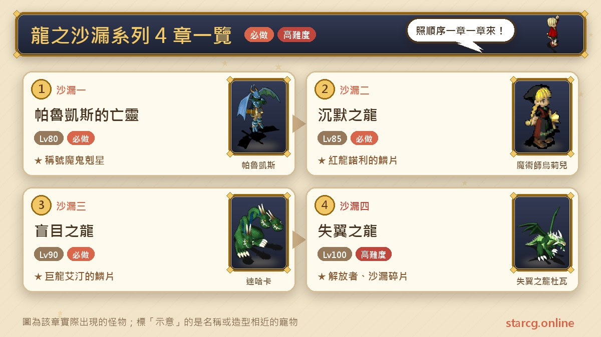
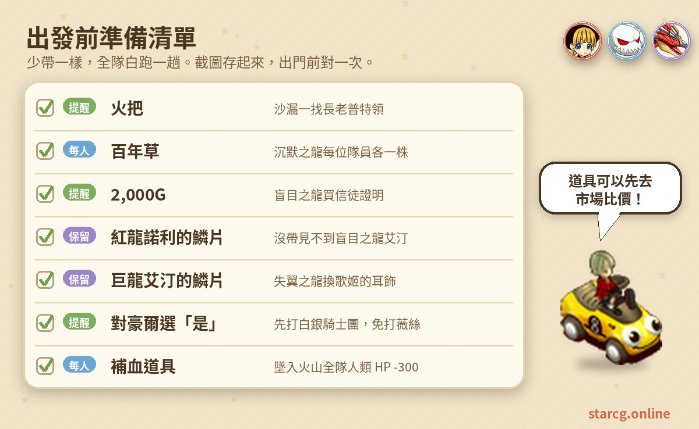
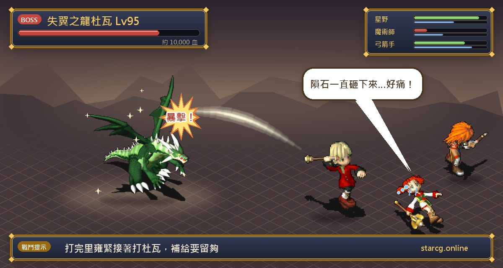
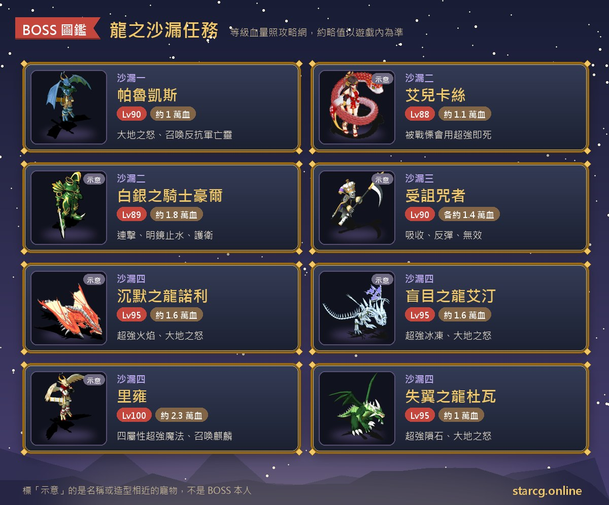

용의 모래시계(龍之沙漏)는 크로스게이트에서 「과거의 고랄(過去的哥拉爾)」, 베니차스 화산(貝尼恰斯火山), 저주자의 동굴(詛咒者之洞窟), 검은 궁전(黑之宮殿)을 잇는 긴 퀘스트 라인이에요. 고랄 마을(哥拉爾鎮) 하얀 궁전(白之宮殿) 지하 감옥의 방황하는 망령 하나에서 시작해 침묵의 용 노리(諾利), 맹목의 용 에딘(艾汀)을 거쳐, 마지막에는 검은 궁전 최하층에서 용사 리옹(里雍)과 날개 잃은 용 두와(杜瓦)를 마주해요. 시리즈는 총 4장이고 권장 레벨은 80에서 100까지 올라가며, 마지막 장 「날개 잃은 용」을 마치면 영구 칭호 「**해방자(解放者)**」와 「**모래시계의 파편(沙漏的碎片)**」을 받아요. 이 두 가지는 훈장 시리즈 3등 훈장의 수락 조건이기도 해요.

이 글은 4장의 조건, 좌표, 챙길 물건, 보스전마다의 레벨과 HP를 플레이하면서 바로 펼쳐 볼 수 있는 흐름으로 정리했고, 가장 실수하기 쉬운 선택(예: 침묵의 용에서 백은 기사단을 먼저 잡을지)을 눈에 잘 띄는 곳에 두었어요. StarCG(星詠魔力)든 水藍魔力든 初心魔力寶貝든 용의 모래시계 퀘스트 흐름은 똑같아서 이 정리를 그대로 쓰면 돼요.

> 이 글은 [StarCG 공략 사이트](https://guide.starcg.net/)의 용의 모래시계 시리즈 페이지를 바탕으로 水藍魔力 공략 wiki의 플레이어 댓글을 참고해 저희 방식대로 순서를 다시 정리하고 새로 쓴 것으로, 그대로 옮기지 않았어요. 보스 HP와 수치는 대략적인 값이니 실제 게임을 기준으로 해 주세요. 게임 업데이트 후 내용이 바뀔 수 있어요.

## 용의 모래시계란? 먼저 전체 순서부터

용의 모래시계 4장은 일직선이에요. 앞 장의 칭호와 비늘이 다음 장의 조건이에요. 1장의 「마귀 퇴치자(魔鬼剋星)」가 있어야 2장의 소개장을 받을 수 있고, 2장에서 얻는 「붉은 용 노리의 비늘(紅龍諾利的鱗片)」은 3장에서 맹목의 용을 만날 때 필요하며, 3장의 「거룡 에딘의 비늘(巨龍艾汀的鱗片)」은 4장에서 가희와 귀걸이를 바꾸는 아이템이에요. 1장 자체의 조건은 「저주의 미궁(詛咒的迷宮)」 퀘스트 완료예요.

한 문장으로 정리하면: **비늘은 절대 버리지 말고, 2장에서는 「예」를 골라 백은 기사단을 먼저 잡고, 4장은 시간을 넉넉히 잡아 한 번에 끝내세요.**

| 장 | 퀘스트 이름 | 권장 레벨 | 획득 |
|---|---|---|---|
| 용의 모래시계 1 | 발케스의 망령 | 80 | 칭호 「마귀 퇴치자」, 넋 잃은 귀걸이, 발케스의 전투 도끼(랜덤) |
| 용의 모래시계 2 | 침묵의 용 | 85 | 칭호 「용의 구원자」, 붉은 용 노리의 비늘 |
| 용의 모래시계 3 | 맹목의 용 | 90 | 칭호 「북국의 여행자」, 거룡 에딘의 비늘, 솜사탕 꼬치 |
| 용의 모래시계 4 | 날개 잃은 용 | 100 | 칭호 「해방자」, 모래시계의 파편 |

## 출발 전에 챙길 것

용의 모래시계는 전투가 많지만, 정작 헛걸음하게 만드는 건 대개 아이템이에요. 횃불이 없으면 숲에 못 들어가고, 백년초가 한 포기라도 모자라면 비약을 못 바꾸고, 노리의 비늘이 없으면 에딘을 만날 수 없어요. 아래 그림에 장별로 챙길 것을 모아 두었으니 캡처해 두세요.

비용 면에서는 맹목의 용에서 2,000G로 「신도 증명서(信徒證明)」를 사야 해요. 퀘스트를 마쳐도 회수되지 않으니 보관해도 되고 버렸다가 필요할 때 다시 사도 돼요. 후반은 보스전이 많아 소모품이 많이 들어가니, 출발 전에 사이트의 [시세 검색](/ko/market/)으로 회복 요리와 물약 가격을 비교해 한 번에 사 두세요. 또 水藍魔力 공략 wiki의 플레이어 정리에 따르면 명부의 길(冥府之道), 노스페라투 대지(諾斯菲拉特大地), 심해(深海)에서는 **펫 메일을 받을 수 없고**, 곶의 신전(岬之神殿) 지하도 마찬가지라서 필요한 물건은 들어가기 전에 몸에 지니고 있어야 해요.

## 용의 모래시계 1: 발케스의 망령(「마귀 퇴치자」 획득)

조건은 「저주의 미궁」 완료, 권장 80레벨이에요.

1. 고랄 마을 하얀 궁전(47, 36)에서 1층 왼쪽 계단으로 지하 감옥에 내려가 **경비병 리딜(守衛利迪爾)**(33, 15)을 찾아 지하 감옥에 들어가요.
2. 지하 감옥에서 **방황하는 망령(徬徨的亡靈)**(28, 6)을 찾으면 과거의 고랄 성 지하 감옥으로 이동돼요. 이어서 **무술사 예카(巫術師耶卡)**(27, 12)를 찾으면 리옹의 방으로 이동돼요.
3. **용사 리옹(勇者里雍)**(10, 7)을 찾으면 과거의 고랄로 이동돼요. 가는 길에 제국병(帝國兵)이 랜덤으로 나오고, 쓰러뜨리면 아르카디아 옛 동전(阿爾卡迪亞古錢)을 얻을 수도 있어요.
4. **제국병 디플라(帝國兵迪普拉)**(84, 66) 또는 **소년병 케라(少年兵凱拉)**(83, 66) 중 한 명과 대화하면 중간 보스전이 시작돼요. 이기면 (84, 76)으로 이동되고, (84, 84)로 걸어가 **마술사 아샤프(魔術師阿夏芙)**를 찾아 두 번째 전투를 해요. 이기면 야영지에서 발케스와 대화하고 현대의 감옥으로 돌아와요.
5. 루미나스(魯米那斯) 장로의 집(94, 43) 2층의 **장로 푸트(長老普特)**(12, 14)에게서 「**횃불(火把)**」을 받아요. 발케스를 쓰러뜨리기 전까지는 몇 번이든 다시 받을 수 있어요.
6. 쿠루크스섬(庫魯克斯島)(463, 632)에서 전송석으로 이므르 숲(伊姆爾森林)에 가서 (28, 13)의 **경고판을 횃불을 든 채 조사**해요. 「인도자(引導者)」 칭호가 있으면 끝의 방(盡頭之間)으로 이동해 백룡을, 「빛나는 자(閃耀者)」 칭호가 있으면 경계의 방(邊際之間)으로 이동해 흑룡을 찾게 되고, 둘 다 없으면 바로 숲으로 들어가요.
7. 숲의 미궁(森之迷宮) 4구간(랜덤)과 고정 지도 4장을 차례로 지나 숲의 묘지(森之墓場)에 도착해요.
8. **발케스의 망령**과 대화하면 마지막 2연전이 시작돼요.
9. 루미나스로 돌아가 장로 푸트를 찾으면 「넋 잃은 귀걸이(失魂的耳飾)」와 칭호 「마귀 퇴치자」를 받아요.

**보스 정보**: 중간 보스전의 디플라와 케라는 둘 다 70레벨, HP 약 4,000이고 2회 행동을 해요. 두 번째 전투는 파랑 둘, 빨강 둘 총 네 명의 아샤프(각 70레벨, HP 약 6,000)로, 파랑은 운석과 빙결, 빨강은 화염과 바람 칼날을 쓰고, 모두 공격과 마법의 흡수·반사·무효를 가지고 있어요. 마지막 첫 전투는 발케스의 망령(80레벨, HP 약 7,000, 붕격·혼란·성스러운 방패·마법 봉인 사용)과 코코베(可可貝)·토루크(托魯克)의 망령(각 70레벨, HP 약 4,500)이고, 두 번째 전투는 **발케스** 본인(90레벨, HP 약 1만)으로 건곤일척, 양날, 연격, 흡혈, 대지의 분노를 쓰고 반란군의 망령(60레벨, HP 약 1,000, 즉사 마법 사용)도 소환해요.

**주의할 점**: 아샤프는 흡수와 반사를 쓰니 공격하기 전에 상대가 무슨 색인지, 어떤 반사를 켰는지 먼저 확인하세요. 아샤프를 쓰러뜨린 뒤에는 루미나스 장로에게 보상을 받기 전까지 **지하 감옥에 다시 들어갈 수 없어요**. 아샤프는 낮은 확률로 「아샤프의 귀걸이(阿夏芙的耳飾)」(상점가 2,000G)를 떨어뜨리는데, 가루나 마을(加納村) 뒷문 쪽 무덤에서 교환하면 아주 희귀한 Q 부품이나 O 부품을 받을 수도 있어요. 발케스를 이기면 발케스의 전투 도끼를 랜덤으로 떨어뜨리고, 그 뒤 그와 대화해 횃불을 건네면 숲을 나갈 수 있어요.

## 용의 모래시계 2: 침묵의 용(백은 기사단은 꼭 잡기)

조건은 「마귀 퇴치자」 칭호, 권장 85레벨이에요.

1. 미노키아 마을(米諾基亞鎮) 민가(68, 88)의 **약제사 카렘(藥劑師卡雷姆)**(8, 5)을 찾아요. 공략 사이트에 따르면 이 단계는 자동 길찾기가 이상할 수 있는데, 직접 걸어가면 다시 정상이 돼요.
2. 물의 정령 술집(水精靈酒吧)(91, 87)의 **안내인 아삼(帶路人阿薩姆)**(22, 10)에게 「예」를 고르면 「아삼의 소개장(阿薩姆的介紹信)」을 받아요. 마귀 퇴치자 칭호가 없으면 받을 수 없어요.
3. 쿠루크스섬(609, 774)의 **감시자 라임(看守者萊姆)**에게 「예」를 골라 엘카스의 집(艾兒卡絲之家)에 들어가고, (24, 2)에서 식당으로 들어가 **단장 엘카스(團長艾兒卡絲)**(6, 3)에게 「예」를 고르면 「제물의 반지(犧牲品之指輪)」를 받아요.
4. 쿠루크스섬(530, 705)의 부하 **아루그(阿魯格)**를 찾은 뒤 (546, 635)에서 베니차스 화산에 들어가요.
5. 화산 꼭대기까지 올라가 찢어진 옷(60, 33)을 조사하고 「예」를 고르면 분화구로 떨어져요. **떨어질 때 파티의 인간 캐릭터 전원 HP -300**이고 펫은 깎이지 않아요.
6. 화산 최하층에서 **약제사 세밀레(藥劑師賽米列)**(76, 37)를 찾아 「세밀레의 메모(賽米列的記事紙條)」를 받으면 화산 밖으로 이동돼요.
7. 엘카스의 집으로 돌아가 부하 **호세(荷西)**(14, 32)를 찾아 2층으로 올라가고, 미궁을 지나 **백은의 기사 하울(白銀之騎士豪爾)**(23, 15)을 찾아요. **여기서는 「예」를 고르세요**.
8. 단장 엘카스(14, 21)와 전투를 시작하고, 이긴 뒤 다시 대화해 「고대의 막자사발(古代的研缽)」을 받아요.
9. 화산 꼭대기로 돌아가 랜덤으로 나오는 1레벨 백년초를 잡아 「**백년초(百年草)**」를 얻어요. **파티원 한 명당 한 포기씩** 필요해요. 공략 사이트는 이미 얻은 사람은 잠시 파티를 나가고 용병으로 자리를 채워 계속 잡으라고 권해요.
10. 화산 최하층에서 메모, 고대의 막자사발, 백년초, 제물의 반지를 세밀레에게 주고 「세밀레의 비약(賽米列的秘藥)」으로 바꾼 뒤, **침묵의 노리(沉默的諾利)**(78, 38)에게 건네면 「**붉은 용 노리의 비늘**」을 받아요.
11. 7단계에서 「예」를 골랐다면 돌아가는 길에 백은 기사단(白銀騎士團)을 만나요. 하울(14, 13)과 전투를 시작하고, 이긴 뒤 하울이나 베스(薇絲)와 대화하면 화산을 나갈 수 있어요.
12. 미노키아 마을로 돌아가 약제사 카렘을 찾으면 칭호 「용의 구원자(龍之拯救者)」를 받아요.

**보스 정보(엘카스)**: 엘카스는 88레벨, HP 약 1만 1천, 4속성 모두 50이고 4속성 강력·초강력 마법과 여러 상태 이상 마법을 써요. 곁에 남녀 부하가 네 명씩(64~66레벨, HP 약 3,000) 있고 전율, 건곤일척, 혼란 공격, 돈 훔치기, 기공탄을 써요. **엘카스에게 전율습심으로 마나를 뽑지 마세요.** 공략 사이트에 따르면 그러면 초강력 즉사 마법을 추가로 써요.

**보스 정보(백은 기사단)**: 백은의 기사 하울은 89레벨, HP 약 1만 8천이고 연격, 양날, 아지랑이(陽炎), 명경지수, 호위를 써요. 나머지 여섯 명은 모두 81레벨이에요. 검사 로엄(劍士羅嚴, HP 약 9,600), 사냥꾼 케제르(獵人凱傑爾, HP 약 9,000, 부메랑 건곤과 양날), 마술사 우리엘(魔術師烏莉兒, HP 약 1만, 운석과 바람 칼날 마법), 샤오우(小烏, HP 약 1만 4천, 「차차(恰恰)」 자폭으로 아군 전체를 완전 회복), 승려 팔리에(僧侶帕利耶, HP 약 1만, 초강력 회복), 쿠마미(熊美, HP 약 1만 400, 호위 사용).

**왜 꼭 「예」를 골라야 할까**: 「아니요」를 고르면 이 전투가 다음 장 맹목의 용으로 미뤄지고, 백합의 소녀 베스(百合之少女薇絲)가 이끌게 돼요. 베스의 난사는 위협적이라 공략 사이트도 전멸하기 쉽다고 표현해요. 이 장에서 백은 기사단을 먼저 잡아 두면 다음 장에서 하울이 통행 허가증을 바로 줘서 베스와의 전투를 건너뛸 수 있어요.

## 용의 모래시계 3: 맹목의 용(저주자의 동굴 세 곳)

조건은 「용의 구원자」 칭호와 **붉은 용 노리의 비늘**, 권장 90레벨이에요. 공략 사이트에 따르면 자동 길찾기가 틀릴 수 있으니 4단계까지는 직접 걸어간 뒤 켜는 걸 권해요.

1. 렉타르 마을(雷克塔爾鎮) 신전(105, 22) 왼쪽의 **헌금 수납원(捐獻收款員)**에게 2,000G로 「신도 증명서」를 사요.
2. 신전 현관 오른쪽 첫 번째나 두 번째 방으로 들어가 계단(10, 9)으로 2층 알현실에 올라가서 **성녀의 심복(聖女的心腹)**(19, 10)에게 「예」를 골라요. 水藍魔力 wiki 댓글에 따르면 퀘스트를 받은 뒤 **심복을 다시 클릭하지 마세요**. 다시 대화하면 퀘스트 포기가 돼요.
3. 쿠루크스섬의 **저주자의 동굴** 세 곳에 도전해요. 순서는 자유이고 각각 19층이에요. 물(418, 254), 불(582, 521), 땅(354, 630)이고 입구마다 시녀가 있어요. 마지막 방(27, 11)의 **저주받은 자(受詛咒者)**를 쓰러뜨린 뒤 특별한 방에 들어가 조사하면 아이템을 얻어요. 물의 동굴 석비(20, 9)에서 「징계의 돌(懲戒之石)」, 불의 동굴 석비(15, 17)에서 「재앙의 물(災禍之水)」, 땅의 동굴 나무(19, 10)에서 「진리의 가지(真理之枝)」예요.
4. 신전 2층으로 돌아가 성녀의 심복에게 「예」를 골라 성녀의 방에 들어가고, 지하 성당에서 세 아이템을 **성녀 마하(聖女瑪哈)**(14, 24)에게 건네면 「여관(과거)」으로 이동돼요.
5. 장면 속 NPC와 대화하면 「명부의 길」로 이동돼요. 길에는 75레벨, HP 약 9,000의 이름 없는 자(無名者)가 있는데 싸워도 되고 돌아가도 돼요. 또 예카(77레벨, HP 약 7,000, 초강력 회복과 강력 즉사 마법 사용)가 영매사(通靈師)를 데리고 랜덤으로 나와요.
6. 북서쪽으로 가서 **백은의 기사 하울**(36, 9)을 찾아요. 앞 장에서 백은 기사단을 잡았다면 「**통행 허가증(通行許可證)**」을 주고 렉타르(72, 71)로 돌려보내 줘요. 잡지 않았다면 그냥 돌려보내지고 허가증을 받지 못해요.
7. 쿠루크스섬 곶의 신전(832, 688)에서 통행 허가증을 들고 **백합의 소녀 베스**와 대화하면 바로 신전 지하로 들어가요. 없으면 먼저 베스 일행을 이겨야 해요.
8. 신전 최하층에서 **맹목의 용 에딘**(22, 14)을 찾아요. **반드시 붉은 용 노리의 비늘을 가지고 있어야** 대화할 수 있고, 없으면 신전 입구로 돌려보내져요. 대화하면 칭호 「북국의 여행자(北國行者)」, 「거룡 에딘의 비늘」, 「솜사탕 꼬치(棉花糖串)」를 받아요.

**보스 정보**: 저주받은 자 세 명은 모두 90레벨, HP 약 1만 4천, 4속성 50이고 2회 행동을 하며, 각자 75레벨, HP 약 5,000의 호위 네 마리를 데리고 있어요. 물의 동굴은 유니콘(獨角獸)이고 저주받은 자가 공격·마법 흡수를 가져요. 불의 동굴은 페가수스(天馬)이고 저주받은 자가 공격·마법 **반사와 무효**를 가져요. 땅의 동굴은 산비갑(山飛甲)이고 저주받은 자가 상태 이상 마법을 많이 쓰며 공격·마법 무효를 가져요. 세 동굴에서는 각각 교룡(蛟龍), 이집트 코브라(埃及眼鏡蛇), 다하카(達哈卡)(각 76레벨, HP 약 1만, 공략 사이트상 두 마리 한 조)도 만나는데, 水藍魔力 wiki는 그냥 도망치고 오래 싸우지 말라고 권해요. 세 동굴은 합쳐서 57층의 랜덤 미궁이니 사이트의 [미궁 계단 찾기](/ko/maze/)로 걸으면서 기록하면 훨씬 수월해요.

통행 허가증을 받지 못했다면 베스 전투의 구성은 베스(89레벨, HP 약 1만 2,500, 난사 사용)와 로엄, 케제르, 우리엘, 샤오우, 팔리에, 쿠마미예요. 앞 장에서 백은 기사단을 먼저 잡으라고 강하게 권하는 이유가 바로 이거예요.

**솜사탕 꼬치**: 사용하면 「당첨 대나무 제비(中獎竹籤)」나 「꽝 대나무 제비(銘謝惠顧竹籤)」가 랜덤으로 나와요. 꽝 9개를 모으면 에딘에게 당첨 제비 1개로 바꿀 수 있고, 당첨 제비를 쓰면 숨겨진 펫 「**솜뭉치(棉球) Lv.1**」을 얻어요. 얻은 뒤에는 [펫 도감](/ko/pets/)에서 성장 정보를 확인할 수 있어요.

## 용의 모래시계 4: 날개 잃은 용(해방자와 모래시계의 파편)

조건은 「북국의 여행자」 칭호와 **거룡 에딘의 비늘**, 권장 100레벨이에요. 이 장은 연속 보스전이 가장 많고, 중간에 파티가 여러 번 자동으로 해산돼요.

1. 렉타르 마을 (72, 71)의 깊은 우물을 조사하고 「예」를 골라 명부의 길에 들어가, 출구에서 **예카**(90, 18)와 전투를 시작해요.
2. 이기면 노스페라투 대지로 가서 (153, 101)에서 검은 궁전에 들어가요. 공략 사이트 추천 경로: (139, 99) → (144, 99) → (144, 100) → (147, 100) → (147, 101) → (153, 101).
3. 검은 궁전을 지나 묘지 계단(80, 77)으로 안뜰에 들어가고, (47, 125)까지 걸어가 아래층 묘지로 내려가서 **가희 세렌(歌姬賽蓮)**(24, 23)을 찾으면 용의 모래시계 앞으로 이동돼요. **날개 잃은 용 두와(失翼之龍杜瓦)**(44, 47)와 대화한 뒤 가희에게 돌아가 거룡 에딘의 비늘을 「**가희의 귀걸이(歌姬的耳飾)**」로 바꿔요.
4. 북쪽 입구로 베니차스 화산에 들어가 최하층의 **침묵의 용 노리**(76, 38)에게 「예」를 골라 전투를 시작해요. 이기면 화산 지하 2층의 용의 모래시계(100, 80)를 조사해 가희에게 돌아가요(**파티가 해산돼요**).
5. 남쪽 입구로 쿠루크스섬(857, 659)에서 심해로 내려가, 심해 1층 (40, 42)의 등롱을 조사해 「**시간의 초(刻之蠟燭)**」를 받고, **제한 시간 안에** 지하 7층의 등롱(50, 48)을 조사한 뒤(파티 해산) 바다의 신전(海之神殿)에서 **맹목의 용 에딘**(53, 24)과 전투를 시작해요. 이기면 심해 7층의 용의 모래시계를 조사해 가희에게 돌아가요(파티 해산).
6. 다시 가희에게 검은 궁전으로 이동해 묘지까지 간 뒤 동쪽으로 1층에 들어가요. 여기에는 길이 8개, 길마다 방이 3개 있고, 잘못 고르면 **사자의 왕(死者之王)**(80레벨, 잔혹한 수확자(殘酷收割者) 두 마리 동반)과 싸운 뒤 처음 위치로 돌려보내져요. 공략 사이트에는 정답 경로가 없어요.
7. 빠져나간 뒤 검은 궁전 최하층의 옥좌에서 **리옹**과 전투를 시작해요. 이긴 뒤 다시 대화하면(파티 해산) 장면이 바뀌고 **날개 잃은 용 두와**와 전투를 시작해요.
8. 이기면 용의 모래시계를 조사해 마방진 앞으로 이동하고, 마방진을 조사해 「예」를 고른 뒤 리벨리우스(李貝留斯)와 대화해요. 그다음 용의 모래시계 앞의 **세크메트의 혼(賽格梅特之魂)**을 찾으면 칭호 「해방자」와 「모래시계의 파편」을 받아요.

**보스 정보**: 예카는 80레벨, HP 약 1만이고 공격 반사, 공격 무효, 회복 마법을 쓰며, 70레벨, HP 약 5,500의 무의(巫醫) 네 마리(각종 강력 상태 이상 마법과 강력 즉사 마법)를 소환해요. 노리와 에딘은 둘 다 95레벨, HP 약 1만 6천, 4속성 50이에요. 노리는 화염 마법이 주력이고 80레벨 붉은 날개 용(紅翼龍) 네 마리를, 에딘은 빙결 마법이 주력이고 80레벨 바다의 투신(海之鬥神) 네 마리를 데리고 있어요. 둘 다 기공탄과 대지의 분노를 쓰고, 공략 사이트는 이들에게 전율습심을 쓰면 추가 공격이 발동한다고 적어 두었어요. 리옹은 100레벨, HP 약 2만 3천으로 4속성의 일반부터 초강력까지 모든 공격 마법을 쓰고, 85레벨, HP 약 5,000의 기린(麒麟) 네 마리를 데리고 있으며 기린이 줄고 리옹의 HP가 낮아지면 다시 소환해요. 마지막 두와는 95레벨, HP 약 1만으로 운석 계열 마법과 대지의 분노가 주력이에요.

**주의할 점**: 가희의 귀걸이는 한 번 쓸 때마다 내구도가 1 줄고, 쓰면 가희에게 바로 돌아갈 수 있어요. 다 썼는데 퀘스트가 끝나지 않았다면 **비늘을 다시 얻어도 또 바꿀 수 없어서**, 매번 검은 궁전 2층까지 걸어가야 해요. 水藍魔力 wiki 정리에는 이런 점도 덧붙어 있어요. 시간의 초는 **로그아웃하면 사라지니** 심해에서 적을 만나도 제자리 로그아웃으로 도망치지 마세요. 심해의 야마타노오로치(八岐大蛇)는 HP가 매우 높고 소환도 하니 그냥 도망치는 게 좋아요. 리옹전은 길고 화력이 많이 필요하니 [데미지 계산](/ko/damage/)으로 파티가 HP 2만 3천을 몇 턴에 깎을 수 있는지 미리 계산해 보세요.

## 용의 모래시계 자주 묻는 질문

**침묵의 용에서 백은의 기사 하울과 대화할 때 「예」와 「아니요」 중 무엇을 골라야 하나요?** 「예」를 고르세요. 「예」를 고르면 침묵의 용 돌아가는 길에 백은 기사단과 싸우고 다음 장에서 통행 허가증을 바로 받아요. 「아니요」를 고르면 맹목의 용으로 미뤄지고 난사를 쓰는 베스가 이끌게 돼서 훨씬 어려워요.

**왜 맹목의 용 에딘을 만날 수 없나요?** 붉은 용 노리의 비늘을 가지고 있지 않으면 에딘과 대화할 때 곶의 신전 입구로 바로 돌려보내져요.

**저주자의 동굴은 순서대로 가야 하나요?** 아니요. 물·불·땅 세 곳은 순서가 자유이고, 징계의 돌·재앙의 물·진리의 가지만 모으면 돼요.

**날개 잃은 용을 마치면 어디에 쓰이나요?** 해방자 칭호 외에도 「해방자」와 「모래시계의 파편」은 훈장 시리즈 3등 훈장 「천제의 증표(天帝之證)」의 수락 조건이고, 3등 훈장의 추가 스토리에도 모래시계의 파편이 필요해요.

**솜뭉치는 어떻게 얻나요?** 맹목의 용에서 받은 솜사탕 꼬치로 제비를 뽑아 당첨 제비가 나오거나, 꽝 9개를 에딘에게 당첨 제비 1개로 바꾼 뒤 사용하면 솜뭉치를 얻어요.

## 정리: 비늘은 챙기고, 선택지는 바르게

용의 모래시계에서 가장 실수하기 쉬운 건 특정 전투가 아니라 몇 가지 핵심 선택이에요. 침묵의 용에서 하울에게 「예」, 엘카스에게 전율 금지, 비늘 두 장은 끝까지 지참, 시간의 초를 들고 로그아웃 금지. 앞의 세 장은 레벨업하면서 진행해도 되고, 날개 잃은 용은 100레벨 안팎의 파티를 갖춰 예카·노리·에딘·리옹·두와를 이어서 잡을 수 있도록 시간을 넉넉히 잡는 게 좋아요.

더 많은 퀘스트·펫·시장 정보는 [StarCG 공략 사이트](https://guide.starcg.net/)에서 원문을 확인하고, 사이트의 [시세 검색](/ko/market/), [미궁 계단 찾기](/ko/maze/), [데미지 계산](/ko/damage/)으로 여정을 더 효율적으로 계획해 보세요.

## 참고 자료

- [StarCG 공략 사이트: 용의 모래시계 시리즈](https://guide.starcg.net/quests/dragon-hourglass/帕魯凱斯的亡靈)
- [水藍魔力 공략 wiki(Gamerch): 날개 잃은 용](https://gamerch.com/blue-cg/453347)
- [水藍魔力 공략 wiki(Gamerch): 맹목의 용](https://gamerch.com/blue-cg/entry/452876)
