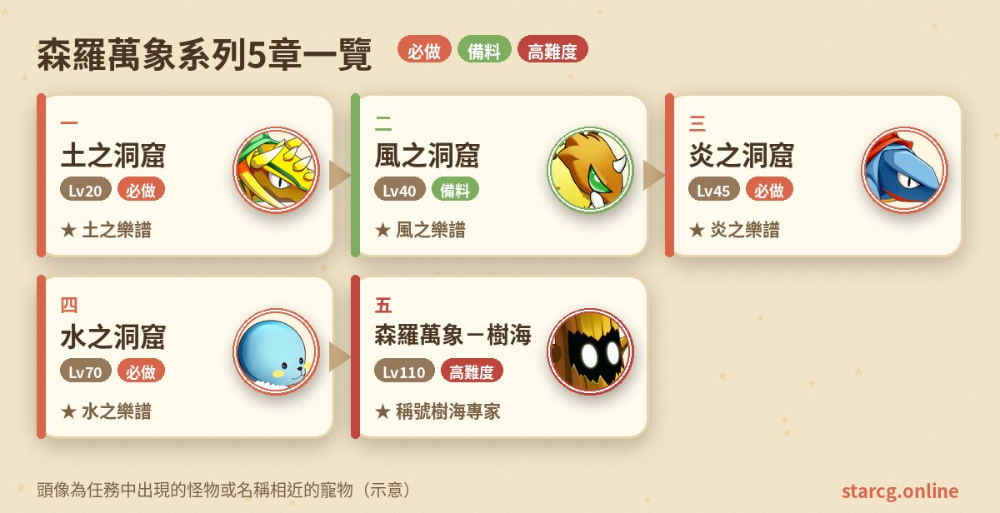
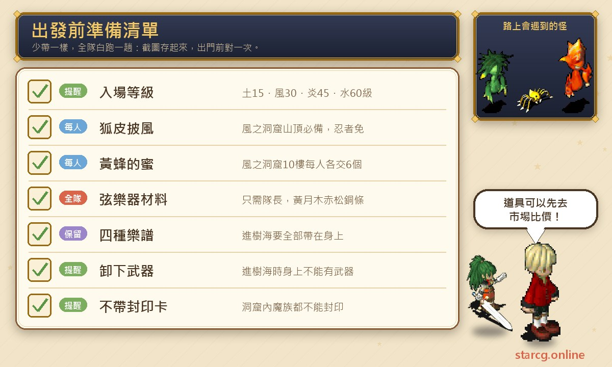
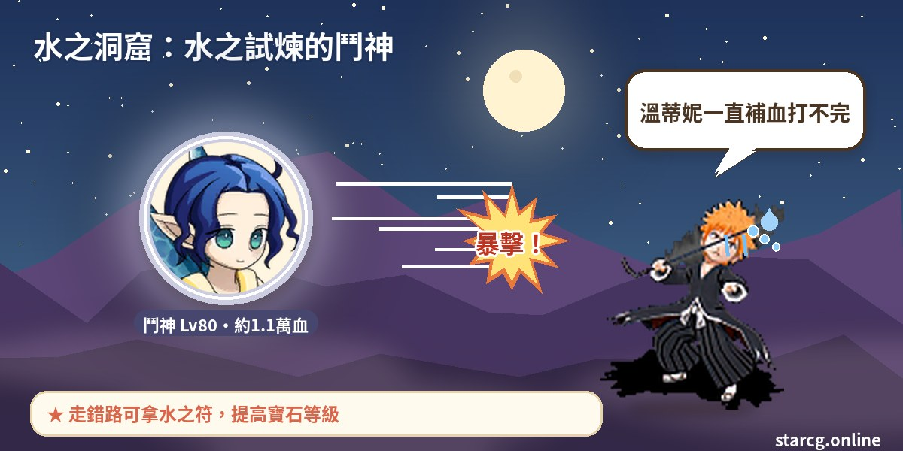
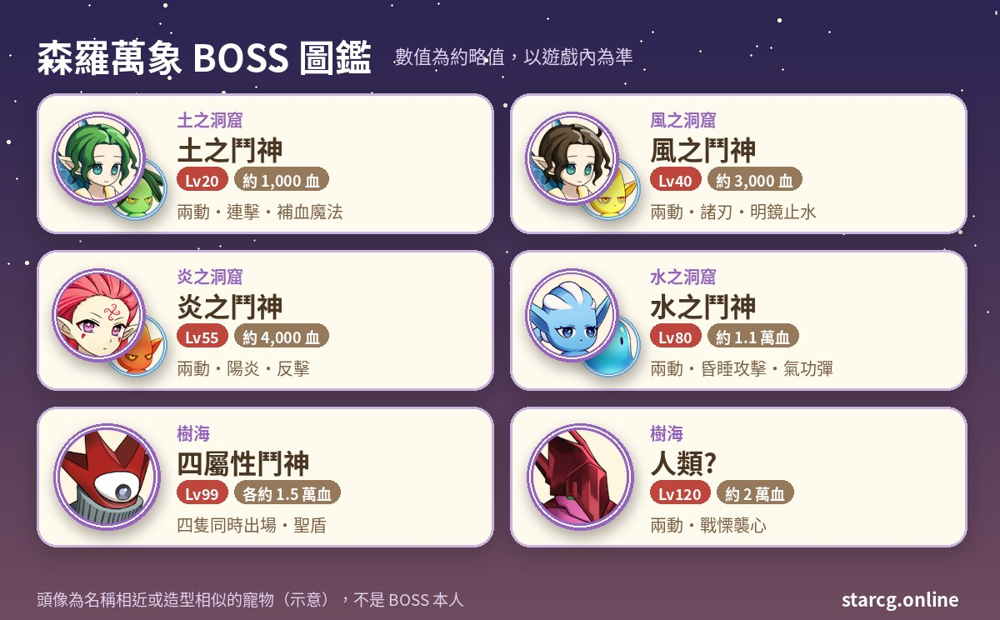

在魔力寶貝裡，「森羅萬象」指的是一整條元素任務線：先後闖過土之洞窟、風之洞窟、炎之洞窟、水之洞窟，在每座洞窟最深處打倒該屬性的鬥神、拿到一份樂譜，湊齊四份樂譜之後，再回到土之洞窟進入樹海，挑戰四屬性鬥神一起出場的最終戰。四座洞窟各有入場等級門檻，從 15 級一路到 60 級，最後的樹海則要求 75 級、推薦 110 級，是一條可以陪著角色慢慢成長的任務線。

做完這個系列能拿到的東西不少：四座洞窟打完都會給隨機寶石，炎、水兩座洞窟還可能拿到鋼騎之礦、魔族的水晶、誓言之證或德特家的布；樹海則會給永久稱號「樹海專家」，並開放龍之使者教寵物的高階技能。不論你玩的是星詠魔力、水藍魔力還是初心魔力寶貝，森羅萬象任務的流程都一樣，以下的整理可以直接對照使用。

> 本文整理自 [星詠魔力攻略網](https://guide.starcg.net/) 的森羅萬象系列頁面，並參考水藍魔力攻略 wiki 的樹海頁面，用我們自己的方式重新排序與改寫，沒有逐字照搬。BOSS 血量與數值是約略值，實際以遊戲內為準；遊戲更新後內容可能變動。

## 森羅萬象系列是什麼？先看整體順序

整個系列可以看成「四把鑰匙＋一扇門」：四座屬性洞窟各給一份樂譜（土之樂譜、風之樂譜、炎之樂譜、水之樂譜），四份都到手才能進樹海。四座洞窟之間沒有互相限制，但入場等級一座比一座高，所以多數人會照土、風、炎、水的順序做下去。

另外有一個共通點值得先記住：**四座洞窟裡的魔族都不能封印**，想抓寵的人別白帶封印卡。每座洞窟打完鬥神都會被傳進一個「充滿謎的房間」，房間配置幾乎一樣：（7, 2）的鋼琴拿樂譜、（10, 2）的精靈給獎勵後送你出去、（11, 4）的精靈則是直接送出去。因為（10, 2）的精靈給完獎勵就會把你傳出去，**一定要先調查鋼琴拿樂譜，再找精靈領獎勵**。

| 章節 | 任務名稱 | 推薦等級 | 取得 |
|---|---|---|---|
| 一 | 土之洞窟 | 20（條件 15） | 土之樂譜、1～3 級寶石 |
| 二 | 風之洞窟 | 40（條件 30） | 風之樂譜、1～4 級寶石 |
| 三 | 炎之洞窟 | 45（條件 45） | 炎之樂譜、1～8 級寶石等 |
| 四 | 水之洞窟 | 70（條件 60） | 水之樂譜、1～8 級寶石等 |
| 五 | 森羅萬象－樹海 | 110（條件 75） | 稱號「樹海專家」、寵物技能 |

## 出發前先準備好這些

森羅萬象最需要備料的是風之洞窟：隊長要一把「米摩沙的弦樂器」，除了全隊都是忍者以外，**每個人都要一件狐皮披風**。土、炎、水三座洞窟則主要是等級門檻，樹海要記得四份樂譜都在身上，而且**身上不能帶武器**。

狐皮披風的材料是狐皮 ×4、棉 ×20、莎蓮娜線 ×4、杉 ×2，其中狐皮要在角笛大風穴山頂用狩獵 R4 採集，掉率極低，攻略網也直接建議向其他玩家買成品。弦樂器則要風蜘蛛的絲 ×6、黃月木 ×4、赤松 ×4、銅條 ×1。這些東西大多能在攤位上找到，出發前用本站的 [市場查價](/market/) 輸入「狐皮披風」或各材料名稱，比較一下自己採集和直接買哪個划算。

## 土之洞窟：森羅萬象的第一步（15 級可進）

條件 15 級、推薦 20 級，是整個系列最輕鬆的一座。

1. 從法蘭城東門過橋往上走，到土之洞窟入口（583, 172）。
2. 與**土精**（13, 4）交談進入洞窟。未滿 15 級無法進入。
3. 照攻略網的路線圖一路往下走到最底層（路線以圖片標示，共 6 張）。
4. 在最底層與**土之鬥神**（73, 6）交談，開始戰鬥。
5. 打贏後被傳到充滿謎的房間，牆上提示「FIND PIANO SCORE」：先調查（7, 2）的**鋼琴**拿「土之樂譜」，再找（10, 2）的**地精**領 1～3 級的隨機寶石並被傳出；（11, 4）的地精則只會直接送你出去。

**BOSS 資料**：土之鬥神 20 級、約 1,000 血，地水火風各 20，邪魔系、一回合兩動，會攻擊、連擊、乾坤一擲、氣功彈、陽炎與補血魔法。身邊有 2 隻地精（15 級、約 750 血、同樣兩動），會用混亂攻擊、強力隕石、超強混亂、超強遺忘、超強中毒，還會超強補血。

**打法**：從技能表來看，地精的狀態魔法種類比鬥神本人還多，而且會替隊友補血；推薦 20 級對上 20 級的鬥神，等級沒有優勢，帶一些能解除異常狀態的手段會比較安心。

## 風之洞窟：備料最多的一章（30 級可進）

條件 30 級、推薦 40 級。這一章的戰鬥不算難，難的是**蜂蜜、蜘蛛絲、弦樂器、披風**四樣東西的規則各不相同。

1. 從奇利村出發，到索奇亞島（369, 351）進入風之洞窟，與**希魯夫**交談，從（23, 5）的黃色傳送石進入。
2. **10 樓**：打倒隨機出現的敵人收集 6 個「黃蜂的蜜」，交給**月之輪熊**（15, 5）即可通過，再從（10, 8）進 11 樓。蜂蜜可以交易，但**每位隊員都要各自上交**。
3. **20 樓**：打敵人收集 6 個「風蜘蛛的絲」（不可交易，只有隊長需要），連同黃月木 ×4、赤松 ×4、銅條 ×1 交給**樂器職人米摩沙**，換到「米摩沙的弦樂器」。樂器只要隊長裝備。
4. 由裝備樂器的隊長與 20 樓的**風精**交談，抵達大風穴山頂。
5. 山頂的**獵人薩拉特卡**可以教長袍工做狐皮披風（需長袍製作 4 級）；已經買好披風的話可以略過。
6. **每位隊員裝備一件狐皮披風**，與**脫走忍者拿姆**交談，前往山頂另一側。忍者職業可以直接通過；沒有披風硬要過的話，對方會索取 999,999G。
7. 進入古老的巢穴，與**風之鬥神**交談開戰。
8. 勝利後在充滿謎的房間調查鋼琴（7, 2）拿「風之樂譜」，再找（10, 2）的**風精**領 R1～R4 的隨機寶石。

**BOSS 資料**：風之鬥神 40 級、約 3,000 血，邪魔系、一回合兩動，會攻擊、連擊、乾坤一擲、諸刃、攪亂攻擊、明鏡止水與恢復魔法。旁邊 2 隻風精 30～35 級、約 2,000 血，會超強混亂魔法、超強中毒魔法，也會替鬥神超強補血。

**材料去哪找**：棉在法蘭城流行商店（117, 112）的布商克蘿姆買，每個 33G；莎蓮娜線在傑諾瓦鎮雜貨店（43, 23）買，每個 100G；杉在芙蕾雅島（451, 163）附近伐木 R2；黃月木在索奇亞島（295, 325）附近伐木 R3；赤松在米內葛爾島（192, 375）附近伐木 R6；銅條則是在國營第 24 坑道 B1（12, 29）附近挖掘 R1 的銅，再拿到法蘭城米克爾工房（106, 61）壓煉。

## 炎之洞窟：先拿炎之符再打鬥神（45 級可進）

條件與推薦都是 45 級。這一章有個隱藏重點：**「炎之符」會決定最後寶石的等級**。

1. 從維諾亞村到芙蕾雅（299, 538），與**士兵塔拉帕**對話進入維諾亞海底洞窟。
2. 穿過海底洞窟到芙蕾雅島另一端，從（260, 449）進入，找**火精莎拉曼達**（13, 6）對話，再由黃色傳送石（25, 4）進入炎之洞窟。
3. 在 16 樓與莎拉曼達對話選「是」，傳送到火之迴廊。
4. 在房間裡反覆找莎拉曼達進行隨機傳送，直到抵達（68, 74）的房間，再與（77, 84）的莎拉曼達對話，前往鬥神所在處。
5. 與（42, 11）的**炎之鬥神**對話開戰。
6. 勝利後調查鋼琴（7, 2）拿「炎之樂譜」，再找（10, 2）的**火精**，隨機得到一種寶石，或鋼騎之礦、魔族的水晶、誓言之證、德特家的布其中一樣。

**炎之符怎麼拿**：隨機傳送時如果被傳到（20, 64），可以進入（10, 74）的地下迷宮，穿過 10 層後與（14, 33）的**紅冑甲**戰鬥，贏了再找（24, 5）的莎拉曼達拿「炎之符」，並被傳回 16 樓。寶石等級與持有張數的關係如下：0 張為 R2～3、1 張為 R4～7、2 張為 R5～8。想拿高級寶石的話，被傳到（20, 64）時別急著離開。地下迷宮共 10 層，可以搭配 [迷宮找樓梯](/maze/) 一邊走一邊記樓梯位置。

**BOSS 資料**：炎之鬥神 55 級、約 4,000 血，邪魔系、一回合兩動，會攻擊、氣功彈、混亂攻擊、諸刃、陽炎、反擊、連擊、補血魔法與明鏡止水（攻略網原文在連擊旁註明「我方使用巫術追加」）。2 隻火精 48 級、各約 2,500 血，會石化攻擊與超強中毒、混亂、石化、補血魔法。攻略網頁面有時寫「火之鬥神」，指的是同一位。

## 水之洞窟：三選一的岔路與水之符（60 級可進）

條件 60 級、推薦 70 級，四座洞窟裡的鬥神最強的就是這裡。

1. 前往維諾亞村外東南方的水之洞窟（429, 570），與**水精溫蒂妮**對話進入，再從（10, 8）的黃色傳送石進入洞窟。
2. **20 樓**有四個傳送石，扣掉入口那個後還有三條路，只有一條正確。
3. 走錯路會被傳到「水之試煉」，與裡面的**水精溫蒂妮**對話可以拿到「水之符」。
4. 走對路則進入水之試煉，與**水之鬥神**對話開戰。
5. 勝利後調查鋼琴（7, 2）拿「水之樂譜」，再找（10, 2）的**水精**，隨機得到寶石或鋼騎之礦、魔族的水晶、誓言之證、德特家的布。

**水之符的用處**：和炎之符一樣決定寶石等級：0 張為 R2～4、1 張為 R3～6、2 張為 R4～8。換句話說，走錯路也不是全無收穫，至少能拿到一張符。

**BOSS 資料**：水之鬥神 80 級、約 11,000 血，邪魔系、一回合兩動，會攻擊、反擊、陽炎、乾坤一擲、諸刃、氣功彈、昏睡攻擊，還會替同伴補血。旁邊有 2 隻水精溫蒂妮（74～76 級、約 5,500 血），會強力冰凍、超強中毒、超強混亂，並替隊友超強補血；另外還有 2 隻液態史萊姆（70～72 級），會混亂攻擊、明鏡止水與強力冰凍魔法。

**打法**：這一場同時有五個會兩動的敵人，其中三個會補血或施放狀態魔法。推薦等級 70 對上 80 級的鬥神，本來就沒有等級優勢；從技能表來看，溫蒂妮的補血會拖長戰鬥，混亂與冰凍也會打亂行動順序，出發前把解除異常狀態的手段準備好比較穩。輸出夠不夠可以先用本站的 [傷害計算機](/damage/) 估算，再決定要不要多練幾級。

## 森羅萬象－樹海：四鬥神與樹海專家（75 級可進）

這是系列最後一章，條件為 75 級並持有土、風、炎、水四份樂譜，推薦 110 級。

1. 從法蘭城東門過橋往上，在土之洞窟入口（583, 172）與**土精**對話。**此時身上不能有武器**，可以先用網頁銀行或切換裝備方案把武器收起來。
2. 在洞窟內找**地精諾姆**（17, 17）交出四份樂譜，經傳送石進入樹海。
3. 進入樹海後會隨機拿到一把四屬性鑰匙和一把「破爛不堪的鑰匙」。破爛鑰匙只能開一次對應的寶箱；普通四屬性鑰匙可以重複用，但同種寶箱開過後要等 15 分鐘。
4. 沿著路線開啟**無屬性寶箱**（不用鑰匙），每開一個會被傳到指定地點，並隨機拿到一件樹海限定武器，一路傳到結界（393, 247）。
5. 回答結界石板的兩道問題（關於萬物的生死興衰與毀滅之後的歸宿），答案的方向是「萬物由四元素而生、終將毀滅，毀滅後各自回歸其元素」，實際選項請照遊戲內文字作答。
6. 通過結界後與**影子**對話繼續前進，抵達四屬性鬥神所在處。
7. 與鬥神對話選「是」開戰。
8. 勝利後進入古代樹，調查樹洞觸發劇情，取得永久稱號「**樹海專家**」。

**BOSS 資料**：第一戰是土、水、火、風四位鬥神同時出場，各為 99 級、約 15,000 血、邪魔系、一回合兩動，屬性分別是地、水、火、風 100。土之鬥神會聖盾、連擊、大地之怒、明鏡止水；水之鬥神會聖盾、連擊、氣功彈、超強昏睡魔法；火之鬥神會聖盾、乾坤一擲、連擊、混亂攻擊、大地之怒；風之鬥神會聖盾、恢復與超強恢復魔法、乾坤一擲、連擊與魔法封印。第二戰是名為「人類?」的對手，120 級、約 20,000 血，地水火風各 20，一回合兩動，會攻擊、乾坤一擲、諸刃、連擊、氣功彈與戰慄襲心。水藍魔力攻略 wiki 的頁面則把四鬥神血量記為約 13,000～16,000，數值以遊戲內為準。

**樹海裡要知道的事**：樹海的怪物是 68～69 級、每組 1～2 隻的牛頭怪類（莉迪雅、大角羊、大地牛頭怪、火焰牛頭怪），攻略網提到可以用「遇敵登出」來避開戰鬥。鑰匙和拿到的武器都可以上鎖，避免登出後消失。水藍魔力 wiki 也提醒，樹海裡寵郵與隨身倉庫都不能用，武器只能靠寶箱取得。各屬性寶箱的內容不同：地之寶箱有料理的幻影、水之寶箱有回復藥的幻影、風之寶箱有四屬性古文盤，火之寶箱則以武器為主。限定武器包含飛燕之劍、烈震之斧、地蜂之槍、古代樹之弓、古代樹之杖、夏鳶小刀、古代樹投射道具，以及多把古董系列武器。

**寵物技能**：樹海裡的**龍之使者**分布在三處：地圖中央（216, 259）教戰鬥技能 V（約 16,000～27,000G）；東北（360, 17）教魔法技能 IX（約 40,500G）與魔法技能 X（約 50,000G）；西南（98, 392）教狀態攻擊技能 V（約 12,150G）與狀態抵抗技能 V（約 8,100G），多數需要寵物 80 級以上。想知道自家寵物學哪個技能最划算，可以先到 [寵物圖鑑](/pets/) 查成長與能力再決定。

## 森羅萬象系列常見問題

**四座洞窟一定要照順序做嗎？** 不用，洞窟之間沒有前置關係，只要達到入場等級（土 15、風 30、炎 45、水 60）就能進。但樹海需要四份樂譜都在身上。

**洞窟裡的怪可以抓嗎？** 不行，攻略網每一座洞窟都註明魔族不可封印。

**狐皮披風一定要自己做嗎？** 不用。狐皮掉率極低，攻略網建議直接向玩家買成品；忍者職業則完全不需要披風。

**炎之符、水之符有什麼用？** 會影響打完鬥神後精靈給的寶石等級，持有 2 張時可以拿到最高 R8 的寶石。

**進樹海為什麼被擋下來？** 最常見的原因是身上帶著武器，或四份樂譜沒有帶齊；另外角色要 75 級以上。

**樹海可以重複進去嗎？** 水藍魔力 wiki 標示樹海任務可以重複完成，寶箱鑰匙也能重複使用（同種寶箱有 15 分鐘冷卻）。

## 小結

森羅萬象是一條跨度很長的任務線：15 級就能在土之洞窟拿到第一份樂譜，到了 75 級以上才能挑戰樹海。最花時間的不是戰鬥，而是風之洞窟的披風與弦樂器備料，以及炎、水兩座洞窟要不要多繞一點路拿符。建議隨著等級把四座洞窟一路清掉，樂譜收好別丟，等隊伍練到推薦等級再一口氣進樹海拿「樹海專家」與寵物高階技能。

更完整的原文可以到 [星詠魔力攻略網](https://guide.starcg.net/) 查閱；備料與戰鬥規劃也可以搭配本站的 [市場查價](/market/)、[寵物圖鑑](/pets/) 與 [傷害計算機](/damage/)。

## 參考資料

- [水藍魔力攻略 wiki：森羅萬象（Gamerch）](https://gamerch.com/blue-cg/453247)
