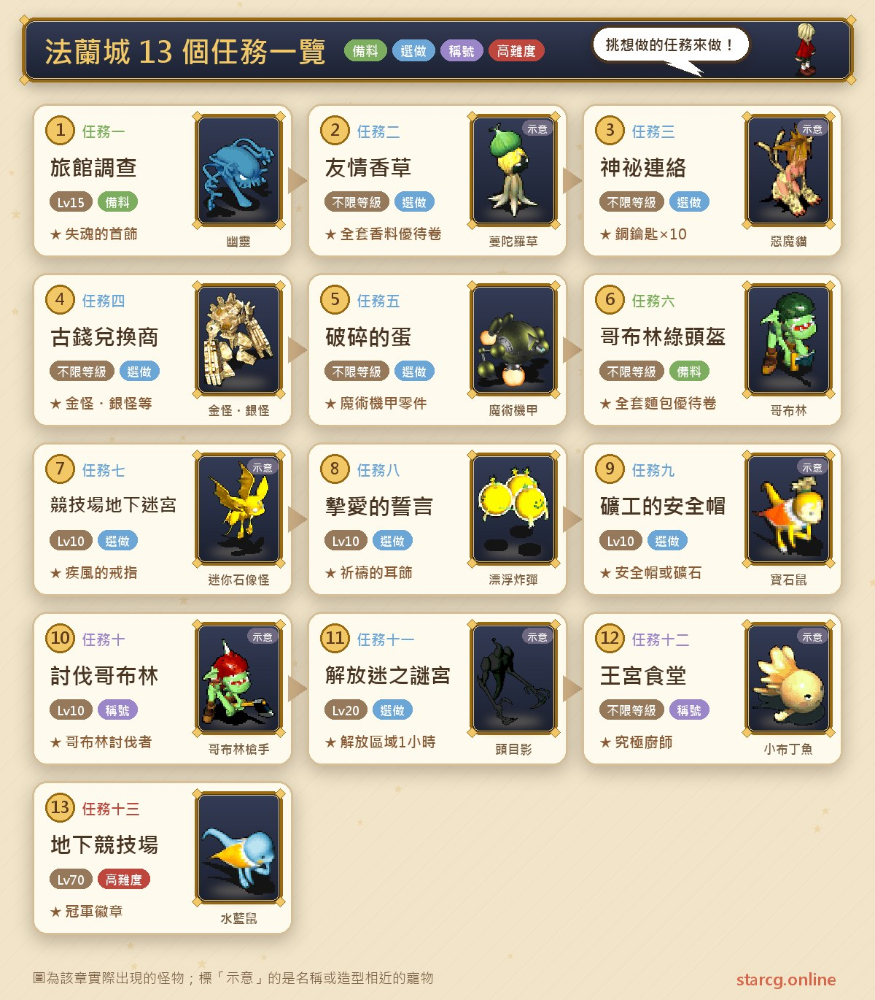
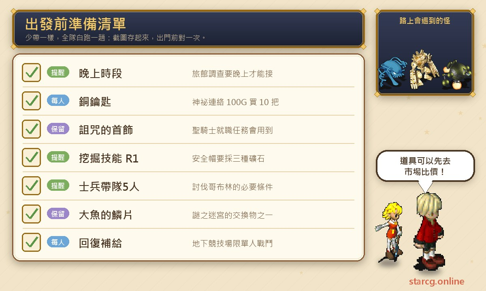
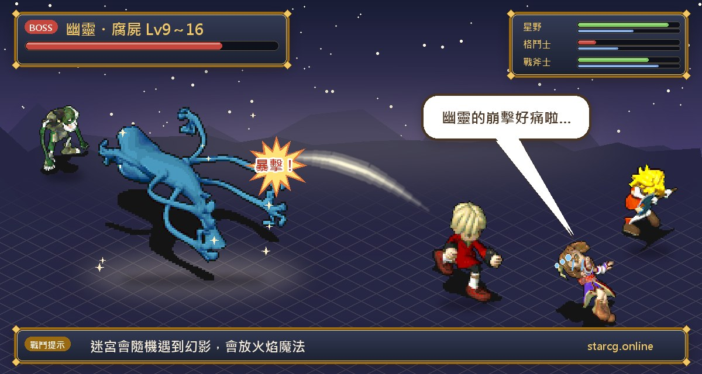
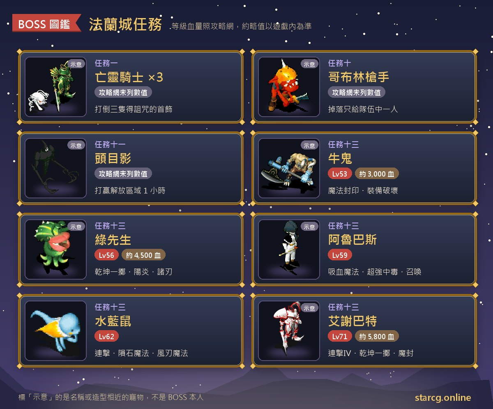

판부르크(法蘭城)는 크로스게이트 초보가 태어나서 가장 먼저 알게 되는 도시이자, 대륙 전체에서 퀘스트가 가장 많이 몰려 있는 곳이에요. 공략 사이트는 이곳의 퀘스트를 「판부르크 첫걸음(初識法蘭城)」으로 묶어 두었고, 모두 13개예요. 밤에 여관 벽난로 밑으로 숨어드는 **여관 조사**, 세상을 떠난 남편의 말을 전하는 **사랑의 맹세**, 채굴 스킬이 필요한 **광부의 안전모**, 병사가 이끄는 **고블린 토벌**이 있고, 혼자 연전하는 **지하 투기장**과 시간 감각을 시험하는 **왕궁식당**도 있어요. 대부분 레벨 제한이 없거나 10레벨이면 되고, 가장 높은 지하 투기장이 권장 70레벨이라서 갓 태어났을 때부터 중반까지 계속 판부르크로 돌아와 퀘스트를 하게 돼요.

끝내고 받는 보상도 실용적이에요. 혼을 잃은 목걸이, 기도의 귀걸이(체력 상한 +25~35), 안전모, 병사 투구와 병사 신발, 한 번에 10개씩 주는 구리 열쇠, 챔피언의 반지부터 챔피언 휘장까지, 그리고 향신료·빵 우대권 두 장과 요리사 칭호 네 가지가 있어요. StarCG(星詠魔力), 水藍魔力, 初心魔力寶貝 어느 쪽을 하든 판부르크 퀘스트의 흐름은 같으니 이 정리를 그대로 쓰면 돼요.

> 이 글은 [StarCG 공략 사이트](https://guide.starcg.net/)의 「판부르크 첫걸음」 퀘스트 페이지를 정리한 것으로, 순서와 문장은 저희 방식으로 다시 정리했고 그대로 옮기지 않았어요. 여관 조사 항목은 水藍魔力 플레이어 공략 페이지(글 끝 참고 자료)도 참고했어요. 공략 사이트에 나와 있지 않은 수치나 좌표는 「공략 사이트 미기재」라고 적고 임의로 채우지 않았어요. 게임 업데이트로 내용이 바뀔 수 있으니 실제 게임을 기준으로 해 주세요.

## 판부르크 퀘스트란? 먼저 전체 순서부터

판부르크 퀘스트끼리는 선후 관계가 거의 없어서 자기 레벨과 필요에 맞게 골라 하면 돼요. 특별한 건 「다른 곳으로 이어지는」 세 퀘스트예요. 여관 조사에서 얻는 저주받은 목걸이는 성기사 취임에 쓰이는 아이템이고, 고블린의 녹색 투구로 받는 빵 우대권으로는 빵 재료를 싸게 살 수 있어요. 미궁 해방은 먼저 큰 물고기의 비늘을 얻어야 하고, 미궁 자체도 아류트 마을(亞留特村) 밖에 있어요.

한 문장으로 정리하면, **10레벨 전에는 전투가 없는 작은 퀘스트(우정 허브, 비밀 연락, 고블린의 녹색 투구)를 먼저 하고, 10~20레벨에 사랑의 맹세, 광부의 안전모, 여관 조사, 고블린 토벌을 끝낸 다음, 지하 투기장은 70레벨쯤에 도전하세요.**

| 퀘스트 | 퀘스트 이름 | 권장 레벨 | 보상 |
|---|---|---|---|
| 퀘스트 1 | 여관 조사 | 15(밤) | 혼을 잃은 목걸이/여관 우대권 |
| 퀘스트 2 | 우정 허브 | 없음 | 명성 100, 향신료 세트 우대권 |
| 퀘스트 3 | 비밀 연락 | 없음 | 명성 100, 구리 열쇠 ×10 |
| 퀘스트 4 | 고대화폐 교환상 | 없음 | 회수권, 내성 장신구, 골드 골렘, 실버 골렘 등 |
| 퀘스트 5 | 부서진 알 | 없음 | 머리 장식, 마술기 갑 부품 A~E |
| 퀘스트 6 | 고블린의 녹색 투구 | 없음 | 명성 100, 빵 세트 우대권 |
| 퀘스트 7 | 투기장 지하 미로 | 10 | 질풍의 반지 등 1~5위 상품 |
| 퀘스트 8 | 사랑의 맹세 | 조건 10레벨 | 기도의 귀걸이 |
| 퀘스트 9 | 광부의 안전모 | 10 | 구리/은/금광석 또는 안전모 |
| 퀘스트 10 | 고블린 토벌 | 10(병사 인솔) | 병사 투구, 병사 신발, 칭호 |
| 퀘스트 11 | 미궁 해방 | 20 | 구역 해방 1시간 |
| 퀘스트 12 | 왕궁식당 | 없음 | 요리사 칭호 4종 |
| 퀘스트 13 | 지하 투기장 | 70(조건 20레벨) | 챔피언의 반지, 챔피언 팔찌, 챔피언 휘장 |

## 출발 전에 준비할 것

판부르크 퀘스트는 대부분 특별한 준비물이 필요 없지만, 놓치기 쉬운 조건이 몇 가지 있어요. 여관 조사는 반드시 밤에 받아야 하고, 광부의 안전모는 채굴 스킬이 있어야 하며, 고블린 토벌은 병사가 이끄는 5인 파티여야 하고, 지하 투기장은 혼자서만 싸울 수 있어요. 아래 그림에 이 지역에서 쓰는 것들을 모아 두었어요.

왕궁식당에서는 바게트(法國麵包), 오므라이스(蛋包飯), 카레라이스(咖哩飯)를 그 자리에서 만들어야 하고, 광부의 안전모에서는 마노, 적철석, 천청석을 캐야 해요. 아직 요리나 채굴 스킬이 없다면 이 사이트의 [시세 검색](/ko/market/)에서 재료 시세를 먼저 보고 직접 만들지 친구에게 부탁할지 정하세요. 비밀 연락의 열쇠 10개는 100G밖에 안 해서, 초보가 랜덤 미궁의 일반 보물상자를 여는 가장 싼 방법이에요. 태어나자마자 먼저 받아 두는 걸 추천해요.

## 퀘스트 1: 여관 조사(밤에 벽난로 밑바닥으로 잠입)

권장 15레벨, 조건은 **밤**이에요.

1. 밤에 판부르크의 **여관(旅館)**(106, 38)에서 **여관 주인(旅館主人)**(8, 18)과 대화해 장사가 안되는 이유를 조사하겠다고 하면 「조사 의뢰서(調查請求信)」를 받아요.
2. 여관 밖(108, 31)으로 가서 (107, 31)을 클릭해 뒷문으로 여관에 들어가세요.
3. 카운터의 **총책임자(總負責人)**(7, 6)와 대화해 「부싯돌(打火石)」을 받으세요.
4. 여관 안의 **벽난로(暖爐)**(25, 17)를 조사해 벽난로 밑으로 들어가고, 서쪽으로 쭉 가면 「벽난로 밑바닥(暖爐之底)」 지하 1층이에요. 이곳은 미궁이고, 가는 길에 **탐정 아폴로(偵探阿波羅)**를 랜덤으로 만나는데 그가 사건의 배경을 설명해 줘요.
5. 5층까지 가서 노란 전송석으로 「썩은 사당(腐朽的祠堂)」에 도착한 뒤, 북동쪽으로 가면 **망령 기사(亡靈騎士)** 세 마리가 보여요.
6. 가운데 망령 기사를 조사하면 전투가 시작되고, 망령 기사 3마리를 쓰러뜨리면 「저주받은 목걸이(詛咒的首飾)」를 받고 여관으로 돌아와요.

**미궁 몬스터**: 고스트(幽靈)(9~16레벨, 붕격 사용), 좀비(殭屍)(9~16레벨, 흡혈 공격 사용), 거스트(腐屍)(9~16레벨), 그리고 랜덤으로 쉐도우(幻影)(15~17레벨, 화 10, 공격·화염 마법·강력 화염 마법 사용)을 만나요. 망령 기사의 레벨과 HP는 공략 사이트에 나와 있지 않아요. 水藍魔力 플레이어 공략 페이지에는 25레벨, HP 약 900, 모두 3마리이고 붕격, 성스러운 방패, 흡혈 공격, 전율습심을 쓴다고 적혀 있으니 참고하세요.

**저주받은 목걸이 쓰는 법**: 공략 사이트에는 네 가지 용도가 나와 있어요.

- **성기사 취임 퀘스트**용으로 보관하기.
- 여관 주인에게 주고 「여관 우대권(旅館優待卷)」으로 바꾼 뒤, 대성당 2층 객실의 **과학자 오즈치(科學家歐茲啟)**에게 가져가면 철광석, 구리광석, 인도 경목(印度輕木), 레몬그라스, 달걀 중 하나로 랜덤 교환.
- 대성당 2층 왼쪽 객실의 **해주사(解咒師)**에게 바로 가져가 저주를 풀면 감정이 필요한 「목걸이?(項鍊？)」가 되고, 감정하면 **혼을 잃은 목걸이(失魂的首飾)**예요. 공격, 방어, 민첩이 각각 -5~+5 랜덤이에요.
- 모험가 여관(冒險者旅館) 2층의 상인 **바로크(巴洛可)**에게 개당 500G에 팔기.

**주의할 점**: 水藍魔力 공략 페이지에 따르면 조사 의뢰서는 모두가 각자 받아야 하고, 의뢰서를 받기 전에 파티를 해산해야 하며, 이미 저주받은 목걸이나 혼을 잃은 목걸이를 가진 사람은 먼저 처리해야 해요. 성기사가 되고 싶다면 목걸이를 서둘러 팔지 마세요.

## 퀘스트 2: 우정 허브(향신료 가게와 도서관 심부름)

레벨과 조건이 없고, 전투도 전혀 없어요.

1. 판부르크 남동쪽의 **리링 향신료 가게(里玲香料店)**(216, 158)에서 **간판 점원 릴리루(招牌侍女 莉莉露)**와 대화하고 「우정 허브(友情香草)」를 받으세요.
2. **리셰리아 성(里謝里雅堡)** 2층에서 왼쪽 끝까지 가면 도서관이 있어요. 카운터의 **책벌레 미셸(書蟲 米雪兒)**에게 허브를 건네면 책 「우정의 비극(友情的悲劇)」을 전해 달라고 부탁해요.
3. 책을 릴리루에게 가져다주면 「향신료 세트 우대권(全套香料優待卷)」을 받아요.

이후 릴리루에게 다시 가면 20원으로 **애플민트(蘋果薄荷)** 10단위를 살 수 있어요. 지나가는 길에 끝낼 수 있는 심부름 퀘스트이고, 명성 100도 함께 받아요.

## 퀘스트 3: 비밀 연락(암호로 열쇠 10개 받기)

레벨과 조건이 없어요.

1. (스토리, 생략 가능) **코틀리아 술집(科特利亞酒吧)**(220, 136)의 **연락원 B(連絡員B)**를 찾으면 암호 「頭目萬歲」(두목 만세)를 알려 줘요.
2. **안키모 술집(安其摩酒吧)**(102, 131) 안쪽 객실의 **연락원 A(連絡員A)**에게 암호 「頭目萬歲」를 입력하면 100G로 「열쇠(鑰匙)」 10개를 살 수 있어요.

**주의할 점**: 이 열쇠는 랜덤 미궁의 **일반 보물상자**만 열 수 있고, 검은색·흰색 보물상자에는 쓸 수 없어요. 공략 사이트는 1단계를 생략 가능으로 표시했어요. 즉, 암호만 알면 바로 연락원 A를 찾아가도 돼요.

## 퀘스트 4: 고대화폐 교환상(아르카디아 고전을 상품으로 교환)

한 번만 하는 퀘스트가 아니라 계속 이용하는 교환소예요. 모험가 여관 3층의 상인들이 「아르카디아 고전(阿爾卡迪亞古錢)」을 모으고 있어요. 고전은 보물상자를 열어서(매번 랜덤 1~5개) 얻을 수 있고, 7등 훈장 - 인어의 눈물(七等勳章－人魚之淚), 발레스의 망령(帕魯凱斯的亡靈) 같은 퀘스트에서도 얻을 수 있어요.

여관 3층에는 **고전 대량 거래원(古錢大宗交易員)**(17, 4), **고전 거래원(古錢交易員)**(19, 4), **포장 서비스원(裝箱服務員)**(34, 4), **잔돈 환전원(零錢兌換員)**(32, 3)이 있어요. 교환할 수 있는 물건은 개수에 따라 나뉘어요.

| 개수 | 교환 가능 물품 |
|---|---|
| 10/30 | 전송석 회수권/미용실 회수권 |
| 60 | 내성 장신구: 얼음 조각(혼란), 오르골(수면), 수룡도마뱀의 비늘(석화), 광천수?(만취), 일기장(망각), 독사 목도리(독), 각 +10 |
| 100 | 종족 변환: 무형 연고(특수), 가을바람의 하프(곤충), 고목의 마른 잎(식물) |
| 200 | V/S/T/Q/M 목줄(생명 +30, 공격/방어/민첩 +8, 정신 +4) |
| 320 | H/A/I/C/R 연고(명중, 회피, 필살, 반격, 회복 각 +8) |
| 3상자(2,997개) | 1레벨 실버 골렘(銀怪) |
| 10상자(9,990개) | 1레벨 골드 골렘(金怪) |

골드 골렘과 실버 골렘의 성장이 궁금하면 이 사이트의 [펫 도감](/ko/pets/)에서 확인하세요. 평소 보물상자에서 나온 고전은 함부로 버리지 말고 모아 두면 적어도 내성 장신구 몇 개는 바꿀 수 있어요.

## 퀘스트 5: 부서진 알(알껍데기 짝 맞추기)

어느 지역의 보물상자를 열든 「깨진 알껍데기(碎蛋殼)」가 나올 수 있어요. 알껍데기는 10가지 무늬가 있고 무늬마다 위·아래 두 조각이 있어요. 같은 무늬의 위아래 조각을 함께 가지고 사용하면 아이템 하나를 랜덤으로 받아요.

받을 수 있는 것은 달콤한 추억(甜蜜回憶), 잘 가라 나의 청춘(再見了我的青春), 상투형 가발(髮髻型假髮), 4색 오리 모자(四色鴨帽)의 외형 머리 장식 4종과 **마술기 갑 부품(魔術機甲零件) A~E**예요. 부품을 한 세트 다 모으면 마술기 갑을 소환할 수 있어요(공략 사이트에는 낮은 확률로 「마술기기(魔術機己)」가 나온다고 적혀 있어요).

**주의할 점**: 공략 사이트에 따르면 부스트 약초(布斯特藥草), 특급 부스트 약초, 게레브렌 견과(蓋雷布倫堅果), 메이블 야자(梅布爾椰子) 네 가지는 StarCG에서 효과가 구현되지 않았으니 쓰레기로 처리해도 돼요.

## 퀘스트 6: 고블린의 녹색 투구(빵 우대권 교환)

레벨과 조건이 없어요.

1. 판부르크 북동쪽의 **나팡 식품점(拿潘食品店)**(217, 53)에서 **투구 좋아하는 포유에(愛頭盔的波月)**와 대화하세요. 그는 고블린의 녹색 투구를 모으고 싶어 해요.
2. **고블린(哥布林)**을 잡아 얻은 「녹색 투구(綠頭盔)」가 이미 있다면, 다시 대화해서 건네면 「빵 세트 우대권(全套麵包優待卷)」을 받아요.
3. 없다면 성문 밖에서 고블린을 잡으세요. 공략 사이트가 꼽은 고블린만 나오는 지점은 (505, 201), (500, 162), (515, 195) 부근이에요. **고블린의 동굴(哥布林的洞窟)에서는 녹색 투구가 나오지 않아요.**

우대권을 들고 다시 포유에에게 가면 60원으로 밀가루 16단위, 우유 10단위, 소금 5단위를 살 수 있고, 요리 스킬로 마력 100을 회복하는 빵을 만들 수 있어요. 팔괘 1에서 내야 하는 우유도 여기서 살 수 있어요.

## 퀘스트 7: 투기장 지하 미로(1~5위 다툼)

권장 10레벨, 조건 5레벨이에요.

1. 판부르크 **투기장(競技場)**(122, 161)에서 왼쪽으로 가 휴게실(2, 15)에 들어가, **낮**에 **미궁 입구 관리원(迷宮入口管理員)**(2, 2)과 대화하고 미궁 세 개 중 하나를 골라 들어가면 「입장 허가증(入場許可證)」을 받아요. 어느 미궁을 고르든 퀘스트에는 영향이 없어요.
2. 미궁에서 랜덤으로 나타나는 확인 지점 NPC를 찾으세요. NPC는 여러 명이지만 맞는 사람은 한 명뿐이고, 맞는 NPC와 대화하면 바로 종점으로 가면 돼요.
3. 종점은 모두 맵 북서쪽 끝(6, 3)이에요. **미궁 종점 관리원(迷宮終點管理員)**과 대화하면 순위에 따라 다른 방으로 보내져요.

**보상(미궁별 1~5위)**:

- 1위: 「반지?(戒指？)」, 감정하면 **질풍의 반지(疾風的戒指)**이고, 장착하면 칭호 「방랑하는 질풍(流浪的疾風)」을 받아요.
- 2위: **군용 장갑(軍用手套)**(안전모와 효과가 같지만 부상을 1번만 막아요).
- 3위: 「카드?(卡片？)」, 감정하면 모든 종족을 봉인할 수 있는 **봉인 카드(특별)(封印卡（特別）)**예요.
- 4위: 구리 열쇠 1개.
- 5위: 지·수·화·풍 중 랜덤 1종의 수정 조각 1개.

## 퀘스트 8: 사랑의 맹세(지하 납골당의 전언)

권장 레벨은 공략 사이트에 「없음」으로 되어 있고, 조건은 캐릭터 **10레벨**이에요.

1. **비안자의 집(畢安札的家)**(132, 132)에서 **로잔나(羅珊娜)**와 대화하고 「阿比安吉」(아비안지)라는 말을 기억해 두세요.
2. **리셰리아 성**의 **지하 납골당(地下靈堂)**(9, 8)에 **해 질 녘이나 새벽**에 가면 병사가 한 명 나타나요. 10레벨 이상이면 그와 대화해 지하성 미궁에 들어갈 수 있어요.
3. 미궁에서 랜덤으로 나타나는 병사 **비안자(畢安札)**에게 「阿比安吉」라고 말하면 「맹세의 염주(誓言的念珠)」를 받아요.
4. (132, 132)로 돌아가 염주를 **비안자의 아내 로잔나**에게 건네면 **기도의 귀걸이(祈禱的耳飾)**를 받아요.

**미궁 몬스터**: 부유 폭탄(漂浮炸彈)(9~16레벨, 바람 칼날 마법 사용), 고스트(9~16레벨, 붕격 사용).

**주의할 점**: 병사는 해 질 녘이나 새벽에만 나타나서 낮이나 밤에 가면 허탕이에요. 기도의 귀걸이의 체력 상한 보너스는 25~35로 사람마다 다르고, 초반 캐릭터에게는 체감이 커요.

## 퀘스트 9: 광부의 안전모(광석 3종을 보상으로)

권장 10레벨이고 다른 조건은 없지만, 공략 사이트는 **캐릭터마다 직접 바꿔 가며 하나씩 대화해야** 한다고 알려 줘요.

1. **리셰리아 성**(47, 85)에서 소환의 방(召喚之間)으로 들어가 오른쪽 위에서 회랑(迴廊)으로, 회랑(23, 19)에서 영당(靈堂)으로, 영당(7, 52)의 계단으로 **지하 감옥(地下牢房)**에 내려가세요.
2. 지하 감옥(31, 20)의 **조르카프(喬爾凱夫)**를 찾아 「친구에게 보내는 편지(給朋友的信)」를 받으세요.
3. 판부르크(61, 63)의 **창고(倉庫)**에서 편지를 **데미도프(德米多夫)**에게 건네고 「광산 열쇠(礦山鑰匙)」를 받으세요.
4. **국영 제24 갱도(國營第24坑道)** 지하 2층에서 광산 열쇠를 가진 채 문(22, 20)을 조사해 안으로 들어가고, 계단(23, 13)으로 지하 3층에 가세요.
5. 지하 3층(20, 20)에서 채굴 스킬 R1로 **마노(瑪瑙)** 3개를 캐세요.
6. 지하 3층(29, 3)에서 지하 4층으로 내려가 (21, 16)에서 **적철석(赤鐵礦)** 3개를 캐세요.
7. 지하 3층(6, 3)의 다른 계단으로 지하 4층에 내려가 (5, 3)에서 **천청석(天青石)** 3개를 캐세요.
8. 판부르크로 돌아가 광석 세 종류를 데미도프에게 주고 「감옥 열쇠(牢房鑰匙)」를 받은 뒤, 지하 감옥의 조르카프에게 건네세요.

**보상**: 구리광석 20단위, 은광석 10단위, 금광석 10단위, **안전모(安全帽)**(2레벨 머리 방어구, 방어 +2, 내구 128) 중 하나를 랜덤으로 받아요.

**주의할 점**: 세 채집 지점 모두 채굴 스킬 R1이 필요해서, 채굴 스킬이 없는 캐릭터는 이 퀘스트를 할 수 없어요. 지하 4층의 적철석과 천청석은 지하 3층의 서로 다른 계단으로 내려가야 하니, 계단을 잘못 타면 채집 지점을 찾을 수 없어요.

## 퀘스트 10: 고블린 토벌(병사가 이끄는 5인 퀘스트)

권장 10레벨, 조건은 **병사** 직업인 사람이 파티를 이끄는 거예요.

1. 병사가 리더가 되어 **5명**을 채운 뒤(공략 사이트는 인원이 부족하면 훈장을 받을 수 없다고 경고해요), 먼저 판부르크 남문 옆(155, 103)의 **병사장 오리(士兵長歐裡)**와 대화하세요.
2. 남문으로 나가 **고블린 동굴(哥布林洞窟)**(437, 308)로 가세요.
3. 동굴에서 병사가 어떤 고블린과 대화하거나 어떤 고블린을 쓰러뜨리면 「붉은 프리즘(紅色三稜鏡)」을 얻을 수 있어요. 파티 전원이 받는데, **모두 인벤토리에 빈칸을 남겨 둬야** 해요. 못 받은 사람은 들어갈 수 없어요.
4. 받은 뒤 가장 위층의 붉은 전송 지점으로 들어가 **고블린 창수(哥布林槍手)**와 대결하세요.
5. 쓰러뜨리면 「주황 투구(橘色頭盔)」를 얻어요. 병사장 오리에게 건네면 「투구?(頭盔？)」와 「신발?(鞋？)」을 받고, 감정하면 **병사 투구(士兵盔)**와 **병사 신발(士兵鞋)**이에요.
6. 장착한 뒤 아무(阿姆) 또는 아몽(阿蒙)과 대화하면 칭호 「고블린 토벌자(哥布林討伐者)」를 받아요.

**보스 정보**: 고블린 창수의 레벨, HP, 스킬은 공략 사이트 미기재예요.

**주의할 점**: 파티로 고블린 창수를 잡으면 드롭 아이템은 **파티 중 한 사람에게만** 가고, 모든 파티원이 받는 게 아니에요. 인벤토리 빈칸도 놓치기 쉬우니 동굴에 들어가기 전에 다 같이 가방을 정리하세요.

## 퀘스트 11: 미궁 해방(큰 물고기의 비늘을 붉은 수정으로)

권장 20레벨이에요. 이 퀘스트는 먼저 **큰 물고기의 비늘(大魚的鱗片)**을 얻어야 해요(공략 사이트는 이를 아류트 마을의 「물고기를 훔쳐 먹는 도둑 고양이 잡기(捕獲偷魚吃的賊貓)」 퀘스트와 연결해 두었어요).

1. **나팡 식품점**(217, 53)에서 생선 장수 **파린(帕林)**을 찾아 생선 훔치는 고양이 잡기를 돕겠다고 하면 「고양이 잡을 생선?(抓貓用的魚？)」을 받아요.
2. **밤**이 되면 식품점 밖에서 랜덤으로 나타나는 **도둑 고양이(賊貓)**를 찾아 대화하고 「방울?(鈴？)」을 받은 뒤, 파린에게 주고 「미끼?(魚餌？)」로 바꾸세요.
3. 미끼를 들고 판부르크(165, 225)의 **낚시꾼 하마(釣魚人哈瑪)**에게 가면 큰 물고기의 비늘로 바꿔 줘요.
4. 아류트 마을 밖의 **수수께끼의 미궁(謎之迷宮)**(675, 135 부근에 랜덤 출현)으로 가세요.
5. 미궁에서 랜덤으로 나타나는 NPC를 찾으면, 붉은 수정과 바꿔 줄 물건 하나를 요구해요.
6. 붉은 수정을 받은 뒤 **두목 그림자(頭目影)**와 싸워 이기면 이 지역을 1시간 동안 해방하고, 리더의 이름으로 구역 이름이 붙어요.

**랜덤 요구 물품**: 큰 물고기의 비늘, 철광석 1개, 케첩 1병, 레몬그라스 1개, 닭고기 1개, 고블린 카드 1장, 사탕 1개, 회복약 1병, 오므라이스 1개 중 하나예요. NPC가 무엇을 원할지는 랜덤이니 여러 개 챙겨 가는 게 안전해요.

**보스 정보**: 두목 그림자의 레벨, HP, 스킬은 공략 사이트 미기재예요.

공략 사이트에는 사냥꾼의 관찰도 실려 있어요. 해방된 구역에는 적이 없고 1~5레벨 식재료를 사냥할 수 있는데, 가죽과 닭고기가 섞여 나오는 경우가 가장 많고 한 종류만 나오는 지점은 찾지 못했다고 해요.

## 퀘스트 12: 왕궁식당(요리사 칭호 4종)

레벨과 조건은 없고, 요리 스킬이 있어야 해요.

1. 투기장 옆의 **왕궁식당(王宮食堂)**(111, 148)에서 **페리베컨(培裡貝肯)**(15, 7)을 찾으세요.
2. 그 자리에서 **바게트**를 만들어 **완성 후 1분 안에** 건네세요.
3. 이어서 그 자리에서 **오므라이스**를 만들어 **완성 후 1분 10초~2분 사이에** 건네면 영구 칭호 「민완 요리사(敏腕廚師)」를 받아요.
4. 민완 요리사가 되면 **백곰 스테이크(白熊肉排)**(시간 제한 없음)를 건네고 「극상 요리사(極上廚師)」를 받으세요. 백곰 스테이크를 얻는 법은 「눈 쌓인 산길(積雪的山路)」 퀘스트에 있어요.
5. 마지막으로 **카레라이스**를 만들어 **완성 후 24시간 1분~24시간 2분 사이에** 건네면 「궁극 요리사(究極廚師)」와 기념 아이템 「만능 조리 세트(萬能調理組)」를 받아요.

**주의할 점**: 바게트나 오므라이스를 건네는 시간이 틀리면 「불합격 요리사(不合格廚師)」가 되고, 상위 칭호에 도전하려면 다시 해야 해요. 궁극 요리사의 시간 창은 1분뿐이라 공략 사이트는 휴대폰 알람으로 시간을 재라고 권해요. 요리를 낼 때마다 부산물 「조미료(味精)」를 받지만, 조미료와 만능 조리 세트는 현재 실제 효과가 없어요. 또 공략 사이트에 따르면 업적 시스템은 요리사 칭호를 하나로만 쳐서, 업적만 노린다면 일부러 시간을 틀려 「불합격 요리사」를 받는 게 가장 빨라요.

## 퀘스트 13: 지하 투기장(혼자 연전해서 챔피언 휘장 얻기)

권장 70레벨, 조건은 **20레벨 이상, 혼자서만 전투**예요. 판부르크에서 가장 어려운 퀘스트예요.

1. 판부르크 **투기장**(123, 161)에서 오른쪽의 **치유의 광장(治癒的廣場)**으로 가서 석상 「地下競技場」(지하 투기장)(26, 13)과 대화하고 맨 아래층까지 내려가세요.
2. **아딜레타(阿迪萊塔)**(16, 11)와 대화해 **휴게실**에 들어가고, **켈촌(凱爾瓊)**(15, 6)에게 「투사의 증표(鬥士之證)」를 받으세요.
3. **심판(파이어댄서)(裁判員（火焰舞者）)**을 클릭해 예선 경기장에 들어가 상대를 자유롭게 골라 예선을 치러요. 고른 상대에 따라 출전 체급이 정해져요.
4. 예선을 통과하면 「예선 통과 증명서(預賽通過證明書)」를 받고, 로그아웃해서 회복한 뒤 챔피언전을 해도 돼요.
5. 챔피언전을 마치고 휴게실의 켈촌에게 돌아가면 챔피언의 반지 또는 챔피언 팔찌를 받아요.

**예선 선수**: 지라(吉拉)(23레벨 주술사), 발레리(巴雷莉)(26레벨 기사), 이루마(伊魯瑪)(29레벨 궁술사), 이조타(伊佐塔)(32레벨 도끼투사), 우나(伍那)(35레벨 마술사), 석웅(石雄)과 금웅(金雄)(41레벨), 우귀(牛鬼)(53레벨 두목)이고, 그란(葛藍)은 싸울 필요가 없어요. 페더급은 인간 선수 4명만 이기면 되고, 라이트급은 석웅과 인간 선수 3명, 미들급은 금웅과 3명, 헤비급은 우귀와 3명이에요.

**챔피언전 상대(공략 사이트의 HP는 대략값)**:

| 체급 | 상대 | 주요 스킬 |
|---|---|---|
| 페더급 | 이녹(伊諾克) 38레벨 약 1,700, 라이오넬(萊歐尼爾) 38레벨 약 1,800, 금웅 41레벨 약 1,800 | 기공탄, 혼란 공격, 양날, 건곤일척 |
| 라이트급 | 곰잡이 오즈나그(殺熊者歐茲那克) 47레벨 약 2,000, 열사의 오즈니크(熱砂的歐茲尼克) 50레벨 약 2,000, 우귀 53레벨 약 3,000 | 우귀는 명경지수, 마법 봉인, 장비 파괴 사용 |
| 미들급 | 미스터 그린(綠先生) 56레벨 약 4,500, 알바스(阿魯巴斯) 59레벨, 큐(水藍鼠) 62레벨(뒤의 둘은 HP 공략 사이트 미기재) | 아지랑이, 흡혈 마법, 초강력 중독 마법, 소환, 운석 마법 |
| 헤비급 | 메즈(梅茲) 65레벨 약 3,100, 루비(露比) 68레벨 약 4,200, 에셰바트(艾謝巴特) 71레벨 약 5,800 | 암살, 분신 증가, 강력 재생 마법, 연격Ⅳ, 마법 봉인 |

**보상**: 페더급은 챔피언의 반지(冠軍之戒)(칭호 「페더급 챔피언」)이고, 라이트급·미들급·헤비급은 능력 범위가 다른 챔피언 팔찌(冠軍手環)예요(칭호는 각각 라이트급, 미들급, 헤비급 챔피언). 그중 세 종류를 얻은 뒤 다른 체급의 챔피언전을 한 번 더 끝내고 켈촌을 찾으면 **챔피언 휘장(冠軍徽章)**(공격, 방어, 필살, 반격, 명중 각 +1~+5, 칭호 「삼관왕(三冠王者)」)으로 바꿀 수 있어요. 이긴 뒤 휴게실의 오즈나그를 찾으면 「조금 더러운 제비(有點髒的籤)」도 받을 수 있고, 노커 복권(大地鼠彩卷)의 1~6등(랜덤)으로 바꿀 수 있어요.

**주의할 점**: 로그아웃했다가 돌아왔고 이전에 이미 싸운 적이 있다면 예선 통과 증명서가 회수되니, 다시 이겨서 발급받아야 해요. 처음부터 끝까지 혼자라서 회복해 줄 동료가 없어요. 헤비급의 루비는 회복과 소환을 하고 에셰바트는 HP가 가장 높으니, 먼저 이 사이트의 [데미지 계산기](/ko/damage/)로 자신이 뚫을 수 있는지 계산해 보세요.

## 판부르크 자주 묻는 질문

**판부르크 퀘스트에 순서가 있나요?** 정해진 순서는 없고 13개 퀘스트가 각각 독립적이에요. 주의할 점은 미궁 해방은 큰 물고기의 비늘을 먼저 얻어야 하고, 왕궁식당의 극상 요리사는 민완 요리사와 백곰 스테이크가 먼저 있어야 한다는 거예요.

**비밀 연락의 열쇠로 모든 보물상자를 열 수 있나요?** 아니요. 랜덤 미궁의 일반 보물상자만 열 수 있고, 검은색과 흰색 보물상자에는 쓸 수 없어요.

**저주받은 목걸이는 팔까요, 보관할까요?** 성기사로 전직할 생각이라면 보관하세요. 성기사 취임 퀘스트에 쓰는 아이템이에요. 필요 없다면 저주를 풀어 혼을 잃은 목걸이로 바꾸거나, 여관 우대권으로 바꾸거나, 바로크에게 500G에 팔 수 있어요.

**사랑의 맹세에서 병사가 왜 안 보이나요?** 지하 납골당(9, 8)의 병사는 해 질 녘이나 새벽에만 나타나고, 캐릭터가 10레벨 이상이어야 대화할 수 있어요.

**병사 없이 고블린 토벌을 할 수 있나요?** 안 돼요. 공략 사이트의 조건은 병사가 이끄는 5인 파티이고, 인원이 부족하면 훈장을 받을 수 없어요.

**지하 투기장은 파티로 갈 수 있나요?** 안 돼요. 조건은 20레벨 이상, 혼자서만 전투이고 권장 레벨은 70이에요.

## 정리: 초보부터 70레벨까지 이어지는 도시 퀘스트

판부르크의 13개 퀘스트는 폭이 넓어요. 앞쪽 심부름 퀘스트는 거의 싸울 일 없이 우대권, 열쇠, 명성을 챙길 수 있고, 10~20레벨의 여관 조사, 사랑의 맹세, 광부의 안전모, 고블린 토벌로는 초반에 쓰기 좋은 장신구와 방어구를 얻어요. 지하 투기장은 나중에 혼자 실력을 시험하는 도전이에요. 막히는 곳은 대부분 조건이에요. 밤에만 받을 수 있는 여관 조사, 해 질 녘과 새벽에만 나타나는 병사, 채굴 스킬이 필요한 광석, 병사가 이끄는 5인 파티가 그래요. 출발 전에 위의 준비물을 한 번만 확인해도 헛걸음을 크게 줄일 수 있어요. 미궁형 퀘스트(벽난로 밑바닥, 지하성, 수수께끼의 미궁)는 이 사이트의 [미궁 계단 찾기](/ko/maze/)로 지나온 길을 기록할 수도 있어요.

더 자세한 원문과 다른 지역 퀘스트는 [StarCG 공략 사이트](https://guide.starcg.net/)에서 볼 수 있어요. 요리와 광석 재료는 이 사이트의 [시세 검색](/ko/market/)에서, 골드 골렘·실버 골렘의 성장은 [펫 도감](/ko/pets/)에서 확인하고, 지하 투기장 상대의 HP는 [데미지 계산기](/ko/damage/)로 가늠해 보세요.

## 참고 자료

- [水藍魔力 gamerch 공략: 판부르크 공포 사건(여관 조사)](https://gamerch.com/blue-cg/452862)
