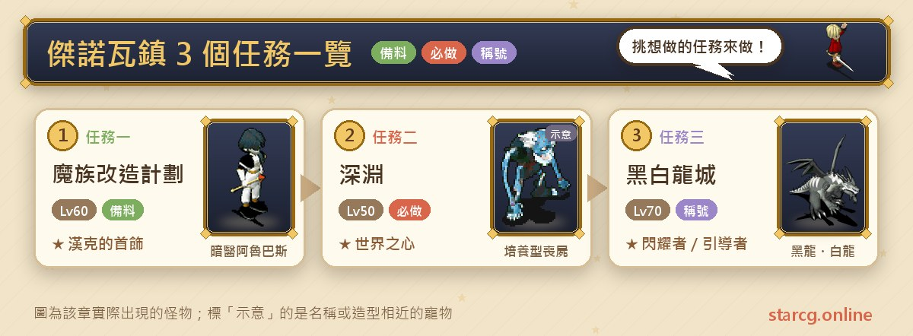
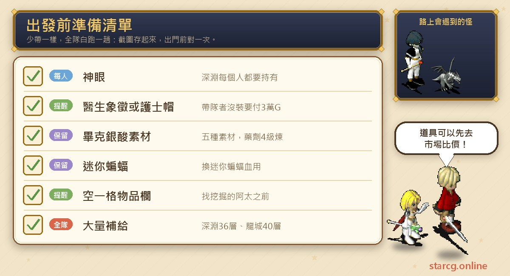
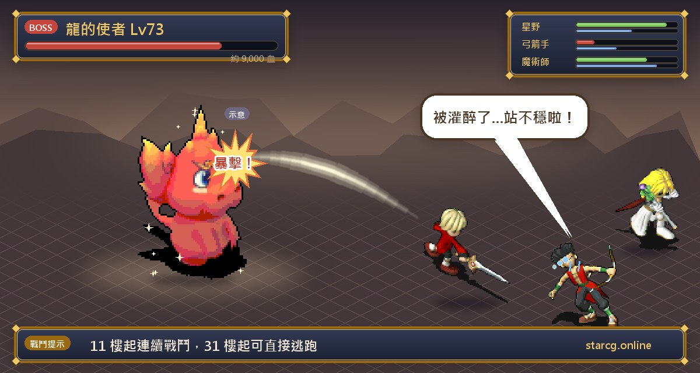
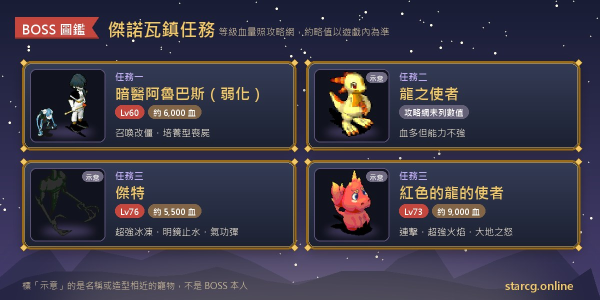

제노바 마을(傑諾瓦鎮)은 세레네(莎蓮娜)섬에 있고, 마을 밖의 이상한 갱도(奇怪的坑道), 지하 수맥(地下水脈), 암흑의 둥지(黑暗之巢)가 여러 중반 퀘스트를 이어 줘요. 이 글은 제노바 마을의 지역 퀘스트 세 개, **마족 개조 계획(魔族改造計劃)**, **심연(深淵)**, **흑백 용성(黑白龍城)**을 정리했어요. 권장 레벨은 각각 60, 50, 70이고, 끝내면 질투의 죄서(嫉妒的罪書)와 한크의 목걸이(漢克的首飾), 세계의 심장(世界之心)과 검은 기억(黑之記憶), 흑백 용성의 영구 칭호 「빛나는 자(閃耀者)」 또는 「인도자(引導者)」, 그리고 가고일(石像怪), 오커스(血魔), 플레티(墮天使), 레서 데몬(惡魔) 중 한 마리를 받을 수 있어요.

세 퀘스트는 앞부분이 많이 겹쳐요. 마족 개조 계획과 심연 모두 이상한 갱도를 지나 디지로(迪次郎)를 쓰러뜨리고 문지기 구울(食屍鬼)을 통과해 지하로 들어가요. 심연에서 얻는 검은 기억은 흑백 용성의 입장 조건 중 하나예요. 그래서 심연을 먼저 하고 흑백 용성으로 이어 가고, 마족 개조 계획은 파티에 약제사가 있는지 보고 정하는 게 수월해요. StarCG(星詠魔力), 水藍魔力, 初心魔力寶貝 어느 쪽을 하든 제노바 마을 퀘스트 흐름은 같아요.

> 이 글은 [StarCG 공략 사이트](https://guide.starcg.net/quests/genova)의 제노바 마을 퀘스트 페이지를 바탕으로, 저희 방식대로 순서를 다시 짜고 새로 써서 정리했어요(그대로 옮기지 않았어요). 보스 HP와 수치는 대략적인 값이니 실제 게임을 기준으로 하세요. 게임 업데이트 후 내용이 바뀔 수 있어요.

## 제노바 마을 퀘스트는 무엇이 있나요? 전체 순서부터

| 퀘스트 | 퀘스트 이름 | 권장 레벨 | 보상 |
|---|---|---|---|
| 퀘스트 1 | 마족 개조 계획 | 60 | 질투의 죄서(무작위), 한크의 목걸이 |
| 퀘스트 2 | 심연 | 50 | 세계의 심장, 검은 기억 |
| 퀘스트 3 | 흑백 용성 | 70 | 가고일/오커스 또는 플레티/레서 데몬, 칭호 「빛나는 자」 또는 「인도자」 |

조건을 보면, 마족 개조 계획은 40레벨에 **약제 기술 4레벨 이상**인 약제사가 있어야 하고, 심연은 40레벨에 「바람 울리는 탑(風鳴之塔)」을 끝내야 하며, 흑백 용성은 심연의 「검은 기억」이나 영원히 얼어붙은 땅(永久凍土) 퀘스트의 「하얀 기억(白之記憶)」이 있어야 해요. 바람 울리는 탑은 시공의 문 시리즈라서 이 사이트의 [시공의 문 퀘스트 공략](/ko/posts/time-gate-quest-guide/)을 참고하세요.

또 팔괘 7 「현무의 경지」도 제노바 마을에서 감(坎)을 찾아 퀘스트를 받고, 똑같이 세레네섬의 이상한 갱도와 디지로를 거쳐요. 관련 흐름은 이 사이트의 [팔괘 퀘스트 완벽 공략](/ko/posts/bagua-quest-guide/)을 보세요.

## 출발 전에 준비할 것

제노바 마을 퀘스트에서 가장 빠뜨리기 쉬운 건 「통행증」이에요. 문지기 구울은 파티장이 암흑 의사의 상징(黑暗醫生的象徵)이나 간호사 모자(護士帽)를 장착했는지 확인하고, 없으면 30,000G로 암흑 의사 목걸이(黑暗醫生項鏈)를 사야 암흑의 둥지에 들어갈 수 있어요. 이 두 가지는 모두 키리 마을의 유괴 퀘스트에서 나오니 먼저 끝내고 오는 걸 추천해요.

심연은 모든 사람이 자기 신안(神眼)을 가져야 해요(뿔피리 대풍혈의 모노아이가 무작위 드롭). 마족 개조 계획의 비크은산(畢克銀酸)은 재료 다섯 가지를 먼저 모아야 하고, 이상한 갱도에서 채굴꾼 아타를 찾기 전에 아이템 칸을 한 칸 비워야 해요. 심연 36층과 흑백 용성 40층의 긴 미궁에는 보급품이 넉넉히 필요해요. 재료와 보급품은 이 사이트의 [시세 검색](/ko/market/)에서 파는 사람이 있는지 먼저 확인해 보세요.

## 퀘스트 1: 마족 개조 계획(비크은산으로 알바스 약화)

권장 60레벨, 조건은 40레벨, **약제 기술 4레벨 이상**이에요. 보상은 무작위 드롭 질투의 죄서와 한크의 목걸이예요.

1. (스토리, 생략 가능) 세레네섬 제노바 마을 동쪽(281, 370)에서 **배양형 라세돈(培養型喪屍)**을 쓰러뜨려 「타비오의 세포(塔比歐的細胞)」를 무작위로 얻어요.
2. (스토리, 생략 가능) 다리 근처의 **마족 연구가 파시(魔族研究家帕席)**(313, 432)를 찾아 세포를 가진 채 대화하면 「달의 곡괭이(月之鋤頭)」로 바꿔 줘요.
3. 세레네섬(365, 439) 근처에서 무작위로 나타나는 노란 전송석을 찾아 약 15층짜리 랜덤 미궁 「이상한 갱도」에 들어가요.
4. (스토리, 생략 가능) 갱도 안에서 **채굴꾼 아타(挖掘的阿太)**를 찾아 대화하면 파티 전원이 「붉은 프리즘(紅色三菱鏡)」을 1개씩 받아요. 대화 전에 아이템 칸을 반드시 한 칸 이상 비워 두세요.
5. 갱도 깊은 곳의 빨간 전송석으로 들어가 **디지로**(9, 5)와 대화해 쓰러뜨리고, 다시 대화해 지하 수맥으로 들어가요. 게임 시간으로 같은 날에는 다시 싸울 수 없어서 서버를 바꿔야 해요.
6. 문지기 **구울**과 대화해요. 파티장이 암흑 의사의 상징이나 간호사 모자를 장착하지 않았다면 30,000G로 「암흑 의사 목걸이」를 사야 「암흑의 둥지」에 들어갈 수 있어요.
7. 암흑의 둥지 1층 남서쪽의 **암흑 간호사(黑暗護士)**(17, 50)를 찾아, 파티의 약제사가 **간호사 모자를 쓰고** 대화하면 4레벨 약제 레시피 「비크은산」을 배워요.
8. 암흑의 둥지 1층 북동쪽의 **미라 요리사(木乃伊廚師)**(49, 13)에게 「피그미 배트(迷你蝙蝠)」 한 마리를 데리고 대화하면 재료 「피그미 배트의 피(迷你蝙蝠血)」로 바꿔 줘요.
9. 비크은산을 만든 뒤 암흑의 둥지 3층에서, 파티장이 비크은산을 가진 채 **암흑 의사 알바스(暗醫阿魯巴斯)**와 대화해 전투를 시작해요. 쓰러뜨리면 지하 수맥으로 전송되고, 출구는 서쪽 철창 방 밖에 있어요.
10. 지하 수맥 출구에서 아스티아(阿斯提亞)로 가서 **한크(漢克)**와 대화하면 5레벨 목걸이 「한크의 목걸이」를 받고, 장착하면 칭호 「진실을 쫓는 자(追查真相的人)」를 받아요.

**비크은산 재료**:

| 재료 | 얻는 곳 | 얻는 방법 |
|---|---|---|
| 모스 도마뱀(摩斯蜥蜴) | 솔키아섬(528, 326) 난사 배우는 곳 근처 | 수렵 기술 4레벨 |
| 우물 안 개구리(井底蛙) | 홍은 대풍동(洪恩大風洞)(13, 55) 근처 | 수렵 기술 4레벨 |
| 악마 물고기(惡魔魚) | 솔키아섬(282, 404) 근처 | 수렵 기술 4레벨 |
| 피그미 배트의 피 | 암흑의 둥지 1층(49, 13) 미라 요리사 | 피그미 배트로 교환 |
| 순은 광석(純銀礦) | 위동(維洞) 1층(47, 70) 근처 | 채굴 기술 4레벨 |

**보스 정보**: 전투 전에 비크은산이 **없으면** 75레벨 배양형 알바스(培養型阿魯巴斯)와 개조 알바스(改造阿魯巴斯)를 상대해야 하고, 상대가 같은 레벨의 배양형 알바스를 계속 소환해서 공략 사이트는 난이도가 매우 높다고 해요. 비크은산이 **있으면** 알바스가 60레벨, HP 약 6,000으로 약해지고, 45레벨 개조 좀비나 45레벨 배양형 라세돈을 계속 소환해요.

**공략법**: 공략 사이트는 반드시 비크은산으로 보스를 약화시키라고 권해요. 알바스가 쓰러지면 배양형 라세돈이 자폭하지만 피해는 크지 않아요. 조심할 건 **개조 좀비(改造殭屍)**로, 자폭 위력이 더 크니 합격으로 먼저 쓰러뜨려 자폭할 기회를 주지 마세요. 이기면 질투의 죄서를 무작위로 받는데, 정신 +8의 2레벨 부적이고 1등 훈장 「마지막 진실」 두 번째 문의 도전 자격이기도 해요. 훈장 시리즈는 이 사이트의 [훈장 퀘스트 공략](/ko/posts/medals-quest-guide/)을 참고하세요.

## 퀘스트 2: 심연(36층 미궁에서 세계의 심장과 검은 기억)

권장 50레벨, 조건은 40레벨, 「바람 울리는 탑」 완료예요. 보상은 「검은 기억」과 「세계의 심장」이고, 흑백 용성의 선행 퀘스트예요.

1. 뿔피리 대풍혈에서 **모노아이**를 쓰러뜨려 「신안」을 얻어요. **모든 사람이 가지고 있어야 해요**.
2. 갱도 전까지의 흐름은 마족 개조 계획과 같아요. (생략 가능) 제노바 마을 동쪽(281, 370)에서 배양형 라세돈을 잡아 타비오의 세포 얻기, (생략 가능) 마족 연구가 파시(313, 432)에게서 달의 곡괭이로 바꾸기, 세레네섬(365, 439) 근처에서 노란 전송석을 찾아 약 15층의 이상한 갱도로 들어가기, (생략 가능) 채굴꾼 아타에게서 붉은 프리즘 받기.
3. 갱도 깊은 곳의 빨간 전송석으로 들어가 **디지로**(9, 5)와 대화해 쓰러뜨리고, 다시 대화해 지하 수맥으로 들어가요. 같은 게임 날에는 다시 싸울 수 없어서 서버를 바꿔야 해요.
4. 문지기 **구울**과 대화해요. 파티장이 암흑 의사의 상징이나 간호사 모자를 장착하지 않았다면 30,000G로 암흑 의사 목걸이를 사야 암흑의 둥지에 들어갈 수 있어요.
5. 울타리를 지나 오른쪽으로 가서 **카오스위프(凱歐斯威普)**(44, 32)와 대화해 지하 균열(地底的龜裂處)에 들어가고, (14, 7)에서 심연으로 들어가요.
6. **36층**이나 되는 미궁을 지나 「검은 제단(黑之祭壇)」에 도착해요.
7. **먼저 파티를 해산**하고, 각자 벽화(20, 9)를 조사해 신안을 내고 **용의 사자(龍之使者)**와의 전투를 시작해요. 이기면 「세계의 심장」을 받아요.
8. **용의 사자**(15, 21)와 대화해 「예」를 고르면 「검은 기억」을 받고 소환의 방(召喚之間)으로 전송되며 퀘스트가 끝나요.

**주의할 점**: 7단계가 이 퀘스트에서 가장 중요해요. 공략 사이트는 느낌표까지 붙여 파티를 해산하라고 강조해요. 파티로 용의 사자와 싸우면 전원의 신안이 회수되는데 세계의 심장은 한 명만 받아요. 모든 사람의 아이템 칸에 신안이 있어야 하고, 없으면 이벤트를 일으킬 수 없어요. 용의 사자는 HP가 많은 것 말고는 강하지 않아서 혼자서도 어렵지 않게 이길 수 있어요. 8단계에서 「아니요」를 고르면 검은 기억을 못 받아서, 나중에 하얀 기억을 따로 받아야 흑백 용성을 할 수 있어요. 36층 미궁은 이 사이트의 [미궁 계단 찾기](/ko/maze/)로 계단 위치를 기록하면 헛걸음을 줄일 수 있어요.

## 퀘스트 3: 흑백 용성(물음의 땅 답과 흑룡·백룡 루트)

권장 70레벨, 조건은 「검은 기억」(심연) 또는 「하얀 기억」(영원히 얼어붙은 땅) 소지예요. 보상은 영구 칭호 「빛나는 자」 또는 「인도자」와 가고일, 오커스, 플레티, 레서 데몬 중 한 종류의 펫이에요.

**중요 경고**: 이 퀘스트는 **다시 할 수 없어요**. 두 번째로 마지막 단계까지 가면 흑룡도 백룡도 상대해 주지 않아서, 처음 고른 루트가 보상과 칭호를 결정해요.

**1단계: 물음의 땅에서 의지 얻기**

1. 기억을 써서 용의 사자에게 전송돼요. 검은 기억은 「검은 제단」, 하얀 기억은 「하얀 제단(白之祭壇)」으로 가요.
2. **용의 사자(龍的使者)**와 대화해 「빛과 어둠의 제단(光明與黑暗的祭壇)」에 들어가고, 북쪽으로 가서 집 문 앞의 **용의 상(龍之像)**과 대화해 오른쪽의 「물음의 땅(詢問之地)」에 들어가요. 검은 기억을 가진 사람은 「혼돈의 혼(渾沌之魂)」, 하얀 기억을 가진 사람은 「질서의 혼(秩序之魂)」을 받아요.
3. 10층, 20층, 30층에서 한 번씩 질문에 답하고, 마지막 40층에서 의지를 받아요:
   - 검은 기억: 예/예/예 → 하얀 의지(白之意志), 아니요/예/아니요 → 검은 의지(黑之意志).
   - 하얀 기억: 예/예/예 → 하얀 의지, 아니요/아니요/아니요 → 검은 의지.
   - 그 밖의 답은 모두 「수수께끼의 의지(迷之意志)」가 돼요.

**연속 전투 경고**: 11층부터 연속 전투가 일어나요. 한 무리를 정리하면 바로 다음 무리가 이어지고, 횟수는 0~16번 이상으로 무작위예요. 공략 사이트는 31층부터는 바로 도망치고, HP가 없을 때 물약이나 요리를 먹으라고 권해요. 몬스터가 너무 많으면 몇 마리 정리한 뒤 도망쳐도 돼요. 미궁이 재구성되면 위치에 따라 1층, 10층, 20층, 30층으로 돌아가요.

**2단계: 의지에 따라 다른 루트**

- **수수께끼의 의지**: 사실 퀘스트를 계속할 수는 없고, 다시 고를 기회예요. 사용하면 금빛 용 곁으로 전송되고, 대화한 뒤 **고고학자 나바(考古學家納巴)**(12, 9)에게 가서 그 뒤 통로의 전송석으로 들어가 16층짜리 「길 잃은 용의 둥지(走失的龍的巢)」를 지나 **늙은 용(老龍)**과 대화해요. 「예」를 고르면 검은 의지, 「아니요」를 고르면 하얀 의지를 받아요.
- **검은 의지**: 빛과 어둠의 제단으로 전송되면 「남쪽 하산길(往南邊的下山道)」로 작은 섬에 가서, (116, 46)의 **샤오추이(小翠)**의 집에 들어가 대화하면 회상 장면이 시작돼요. 회상 속에서 용의 사자와 대화하고, 원래 세계로 돌아온 뒤 다시 샤오추이와 대화해 「샤오추이의 편지(小翠的信)」를 받고 (124, 103)에서 흑룡성(黑龍城)에 들어가요(편지와 의지는 회수되고 혼돈의 혼으로 바뀌어요). 20층 미궁을 지나 **제트(傑特)**와 싸우고, 다시 10층을 올라 「천수각(天守閣)」에서 **흑룡(黑龍)**과 대화하면 소환의 방으로 전송되고, 영구 칭호 「빛나는 자」와 플레티나 레서 데몬이 나오는 「이상한 알(不可思議的蛋)」을 받아요.
- **하얀 의지**: 빛과 어둠의 제단으로 전송되면 「북쪽 하산길(往北邊的下山道)」로 작은 섬에 가서, (24, 58)의 **세이야(聖夜)**의 집(NPC 좌표표에는 「聖葉」로 표기)에 들어가 대화하면 회상 장면이 시작돼요. 회상 속에서 파티를 다시 짜고 용의 사자와 싸워 이긴 뒤, 원래 세계로 돌아와 다시 세이야와 대화해 「세이야의 편지(聖夜的信)」를 받고 (66, 113)에서 백룡성(白龍城)에 들어가요(편지와 의지는 회수되고 질서의 혼으로 바뀌어요). 20층 미궁을 지나 **붉은 용의 사자(紅色的龍的使者)**와 싸우고, 다시 10층을 올라 천수각에서 **백룡(白龍)**과 대화하면 칭호 「인도자」와 가고일이나 오커스가 나오는 「이상한 알」을 받아요.

**보스 정보**: 제트 76레벨, HP 약 5,500. 기공탄, 명경지수, 빙결 마법, 초강력 빙결 마법, 흡혈 공격, 초강력 중독/혼란/만취 마법을 써요. 붉은 용의 사자 73레벨, HP 약 9,000. 연속 공격, 만취 공격, 화염 마법, 초강력 화염 마법, 흡혈 공격, 대지의 분노를 써요.

**주의할 점**: 펫 칸이 가득 차 있으면 마지막에 「이상한 알」을 먼저 받으니, 펫 칸을 비운 뒤 사용하면 펫을 받을 수 있어요. 빛나는 자나 인도자 칭호가 없다면, 검은 의지 루트에서는 용의 사자(116, 77), 하얀 의지 루트에서는 용의 사자(66, 134)를 찾아 의지를 수수께끼의 의지로 바꾸고 다시 고를 수 있어요. 보상 펫 네 종류의 성장과 능력치는 이 사이트의 [펫 도감](/ko/pets/)에서 먼저 비교하고 흑룡과 백룡 중 어느 쪽으로 갈지 정하세요.

## 제노바 마을 퀘스트 자주 묻는 질문

**흑백 용성을 다시 해서 다른 펫을 받을 수 있나요?** 아니요. 공략 사이트에 이 퀘스트는 다시 할 수 없고, 두 번째로 마지막 단계까지 가면 흑룡도 백룡도 상대해 주지 않는다고 되어 있어요. 처음 선택이 칭호와 펫을 결정해요.

**심연의 용의 사자를 파티로 잡아도 되나요?** 잡을 수는 있지만, 파티로 싸우면 전원의 신안이 회수되고 세계의 심장은 한 명만 받아요. 그래서 공략 사이트는 먼저 파티를 해산하고 각자 혼자 싸우라고 강조해요.

**간호사 모자나 암흑 의사의 상징이 없으면요?** 문지기 구울이 30,000G로 암흑 의사 목걸이를 사야 통과시켜 줘요. 두 아이템은 키리 마을의 유괴 퀘스트에서 얻을 수 있어요.

**마족 개조 계획은 비크은산이 꼭 있어야 하나요?** 비크은산 없이도 전투는 시작되지만, 75레벨 배양형 알바스와 개조 알바스를 상대하고 계속 소환까지 당해서 공략 사이트는 난이도가 매우 높다고 해요. 비크은산이 있으면 보스가 60레벨, HP 약 6,000으로 약해져요.

**디지로를 잡고 바로 다시 잡을 수 있나요?** 아니요. 게임 시간으로 같은 날에는 다시 싸울 수 없어서 서버를 바꿔야 해요.

**검은 의지와 하얀 의지는 각각 무엇을 주나요?** 검은 의지는 흑룡성 루트로 칭호 「빛나는 자」와 플레티 또는 레서 데몬, 하얀 의지는 백룡성 루트로 칭호 「인도자」와 가고일 또는 오커스를 줘요.

## 정리: 심연을 먼저 하고 흑룡과 백룡 중 고르세요

제노바 마을 세 퀘스트의 공통 관문은 이상한 갱도, 디지로, 문지기 구울이에요. 키리 마을에서 간호사 모자나 암흑 의사의 상징을 먼저 받아 두면 30,000G를 아낄 수 있어요. 심연은 1인당 신안 하나, 용의 사자와 싸우기 전에 파티 해산을 꼭 기억하세요. 마족 개조 계획은 비크은산을 먼저 만들어 두어야 하고, 흑백 용성은 다시 할 수 없으니 답하기 전에 빛나는 자와 인도자 중 무엇을 원하는지 정한 뒤 위의 답표대로 답하세요. 긴 미궁 세 곳을 합치면 100층이 넘으니 보급품은 넉넉히 챙기는 게 마음 편해요.

더 자세한 원문은 [StarCG 공략 사이트](https://guide.starcg.net/quests/genova)에서 확인하세요. 이 사이트의 [미궁 계단 찾기](/ko/maze/)로 심연과 흑백 용성의 긴 미궁을 걷고, [펫 도감](/ko/pets/)으로 보상 펫 네 종류를 비교하거나, [시세 검색](/ko/market/)에서 비크은산 재료를 찾아보세요.
