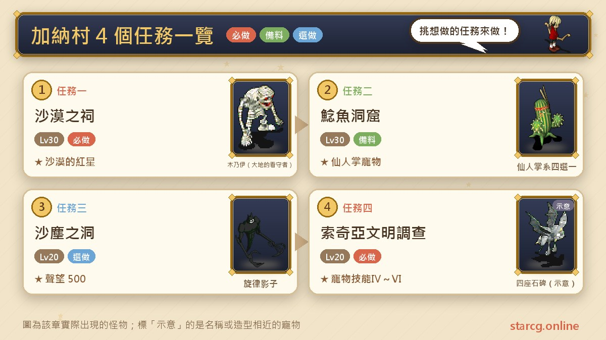
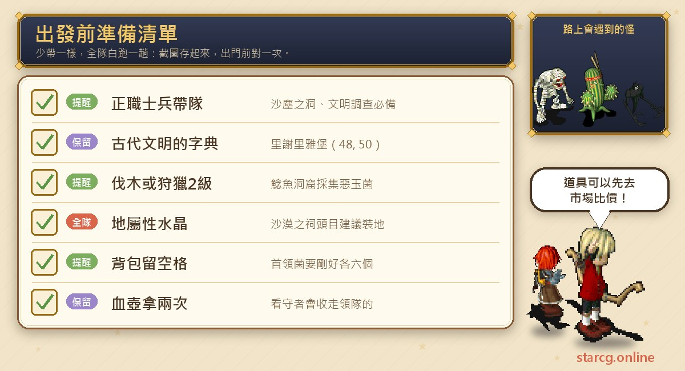
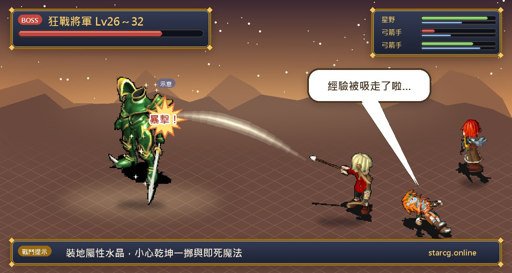
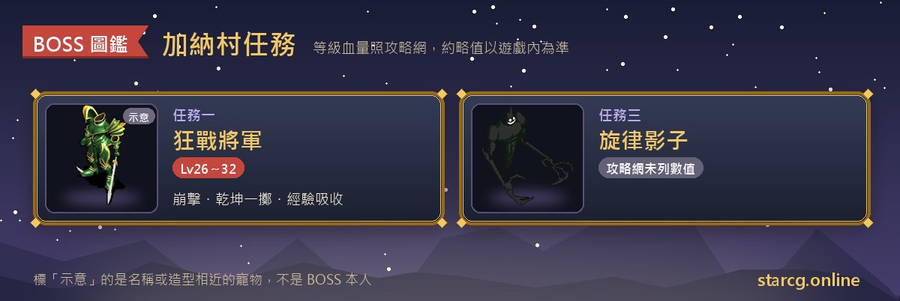

가루나 마을(加納村)은 솔키아(索奇亞)섬의 사막 가장자리에 있고, 마을 주변으로 솔키아 사막, 메기 동굴(鯰魚洞窟), 곳곳에 흩어진 고대 비석이 있어요. 이 글은 가루나 마을의 지역 퀘스트 네 개, **사막의 사당(沙漠之祠)**, **메기 동굴**, **모래먼지 동굴(沙塵之洞)**, **솔키아 문명 조사(索奇亞文明調查)**를 정리했어요. 네 퀘스트 모두 조건은 20레벨, 권장 레벨은 20~30이고, 보상으로 4레벨 보석 「사막의 붉은 별(沙漠的紅星)」, 넷 중 하나를 고르는 캑터스 계열 펫, 명성, 그리고 하베루 마을(哈貝魯村)에서 펫 전투·마법 기술을 배울 기회가 있어요.

네 퀘스트는 모두 어렵지 않지만 저마다 「문턱」이 하나씩 있어요. 메기 동굴은 벌목이나 수렵 기술이 필요하고, 모래먼지 동굴과 솔키아 문명 조사는 정식 병사가 파티를 이끌어야 하며, 사막의 사당에는 무작위로 나타나는 보스가 있어요. 이 글은 조건, 좌표, 아이템, 주의할 점을 한데 모아 일정을 한 번에 짤 수 있게 했어요. StarCG(星詠魔力), 水藍魔力, 初心魔力寶貝 어느 쪽을 하든 가루나 마을 퀘스트 흐름은 같아요.

> 이 글은 [StarCG 공략 사이트](https://guide.starcg.net/quests/ghana)의 가루나 마을 퀘스트 페이지를 바탕으로, 저희 방식대로 순서를 다시 짜고 새로 써서 정리했어요(그대로 옮기지 않았어요). 보스 수치는 대략적인 값이니 실제 게임을 기준으로 하세요. 게임 업데이트 후 내용이 바뀔 수 있어요.

## 가루나 마을 퀘스트는 무엇이 있나요? 전체 순서부터

네 퀘스트는 서로 선후 관계가 없어요. 파티에 마침 정식 병사가 있다면 모래먼지 동굴과 솔키아 문명 조사를 함께 하면 좋아요. 두 퀘스트 모두 첫 단계가 리세리아 성(里謝里雅堡)에 가서 같은 「고대 문명 사전(古代文明的字典)」을 받는 거라서요.

| 퀘스트 | 퀘스트 이름 | 권장 레벨 | 보상 |
|---|---|---|---|
| 퀘스트 1 | 사막의 사당 | 30 | 명성 500, 사막의 붉은 별 |
| 퀘스트 2 | 메기 동굴 | 30 | 명성 500, 캑터스 계열 펫 넷 중 하나 |
| 퀘스트 3 | 모래먼지 동굴 | 20 | 명성 500 |
| 퀘스트 4 | 솔키아 문명 조사 | 20 | 명성 500, 펫 전투 기술Ⅳ, 펫 마법 기술Ⅴ·Ⅵ |

가루나 마을은 팔괘 시리즈 중반의 무대이기도 해요. 팔괘 3 「가루나의 전갈 천적」은 사막의 사당과 사막의 사원(沙漠之廟)을 지나고, 팔괘 4 「번뜩인 「악」룡」은 메기 동굴에 들어가 큰메기의 배 속까지 들어가요. 이 두 지역 퀘스트를 먼저 한 번 해서 지형을 익혀 두면 팔괘가 훨씬 수월해요. 팔괘 전체 흐름은 이 사이트의 [팔괘 퀘스트 완벽 공략](/ko/posts/bagua-quest-guide/)을 보세요.

## 출발 전에 준비할 것

가루나 마을 퀘스트의 준비 포인트는 물약이 아니라 「사람」과 「기술」이에요. 먼저 파티에 정식 병사가 있는지, 벌목이나 수렵 기술이 2레벨 이상인 사람이 있는지 확인하고 오늘 할 퀘스트를 정하세요.

사막의 사당 보스는 지 속성에 약해서 공략 사이트는 지 속성 수정을 장착하고 싸우라고 권해요. 메기 동굴은 소장에서 유해균 우두머리를 각각 「딱」 여섯 개씩 모아야 해서 가방에 빈칸을 남겨 두고, 넘치는 건 버려야 해요. 수정과 보급품은 이 사이트의 [시세 검색](/ko/market/)에서 가격을 먼저 비교해 보세요.

## 퀘스트 1: 사막의 사당(고대 유물 세 개로 사막의 붉은 별)

권장 30레벨, 조건은 20레벨이고 자동 길안내를 지원해요. 보상은 명성 500과 「사막의 붉은 별」이에요.

1. 솔키아 사막에서 사막의 사당을 찾아요. 대략 (570~640, 300~400) 범위에 있고, 들어가서 맨 아래층까지 내려가면 사막의 사원에 도착해요. 이후 단계는 모두 자동 길안내를 쓸 수 있어요.
2. (43, 19)에서 「고대 왕족의 피 항아리(古代王族的血壺)」를 집고, 왼쪽 아래 (12, 31)의 작은 박쥐 **하늘의 파수꾼(天空的看守者)**과 대화해요. 파티장의 피 항아리를 가져가는 대신 박쥐를 지나 아래 계단으로 가게 해 줘요.
3. (10, 8)의 보물상자에서 「고대 파피루스 붕대(古代莎草製繃帶)」를 얻어요. 이후 붕대를 가지고 있으면 작은 박쥐를 자유롭게 지나갈 수 있어요.
4. 중앙으로 돌아가 파티장이 고대 왕족의 피 항아리를 **한 번 더** 집어요(앞의 것은 이미 가져갔으니까요).
5. 오른쪽 위 (66, 23)의 미라 **대지의 파수꾼(大地的看守者)**과 대화하면 파티장의 붕대를 가져가요. 그 뒤 계단(66, 33)으로 가서 (19, 18)의 킬러 전갈 **작은 사원의 파수꾼(小廟的看守者)**과 대화하면, 피 항아리를 가지고 있을 때 자유롭게 지나갈 수 있어요.
6. 전갈 뒤쪽 (16, 42)의 비석을 조사해 「고문서(古文書)」를 받고, 다시 전갈과 대화해 나가서 위층으로 돌아가요.
7. 위쪽 계단(73, 30)으로 들어가 (15, 4)의 보물상자에서 「붉게 빛나는 고대석(泛紅光的古代石)」을 얻어요. 이후 이 돌을 가지고 있으면 미라를 자유롭게 지나갈 수 있어요.
8. 「고대 왕족의 피 항아리」「붉게 빛나는 고대석」「고문서」 세 개가 있는지 확인하고, 가루나 마을 (60, 50) 민가의 **고고학자 요시무라(考古學家吉村)**에게 주면 보석을 받아요. 감정하면 4레벨 「사막의 붉은 별」이에요.

**보스 정보**: 사막의 사당 안의 보스 **광전 장군(狂戰將軍)**은 무작위로 나타나고 레벨은 26~32 사이 어느 것이든 될 수 있어요. 붕격, 건곤일척, 성스러운 방패, 경험치 흡수, 즉사 마법을 써요. 경험치 흡수는 자주 쓰지 않고, 한 번에 1,000 정도 흡수해요. 공략 사이트의 평은 지 속성 수정을 장착하고 조심해서 싸우면 쉽게 이길 수 있다는 거예요. 공략 사이트에는 HP가 없어요.

**주의할 점**: 이 사원의 파수꾼 셋은 모두 「물건을 내야 지나가게 해 주는」 방식이고, 가져가는 건 모두 파티장의 아이템이라 피 항아리를 두 번 집어야 해요. 전체 루트의 핵심은 작은 박쥐는 피 항아리, 미라는 붕대를 가져가고, 킬러 전갈은 피 항아리를 확인한다는 거예요. 위 순서대로 가면 막히지 않아요. 팔괘 3도 이 사원을 지나가는데, 공략 사이트의 팔괘 3 페이지에는 사원 안 퍼즐에서 사막의 사당 퀘스트의 자동 길안내를 활용할 수 있다고 나와 있어요.

## 퀘스트 2: 메기 동굴(큰메기왕의 배 속에서 유해균 채집)

권장 30레벨, 조건은 20레벨이고 자동 길안내를 지원해요. 공략 사이트에는 **벌목 또는 수렵 기술 2레벨 이상**이 필요하다고 되어 있고, 퀘스트 소개에서도 사냥꾼이나 나무꾼이 파티를 이끌어야 한다고 해요. 보상은 명성 500과 흉포 캑터스(兇暴仙人掌), 무술 캑터스(武術仙人掌), 토끼귀 캑터스(兔耳仙人掌), 인디언 캑터스(印地安仙人掌) 중 한 마리예요.

1. 가루나 마을 앞쪽에서 메기 동굴(626, 209)에 들어가 맨 아래층 「메기 동굴 지하 호수(鯰魚洞窟地底湖)」까지 가서, **큰메기님(大鯰魚大人)**과 대화해 큰메기왕(大鯰魚王)의 몸속으로 들어가요.
2. 입안에서 **유익균 미루미루(善玉菌米魯米魯)**와 대화하면 식도로 전송되고, 통과한 뒤 다른 유익균 미루미루와 대화해요.
3. 항생제 T-5(抗生素 T-5)를 받고 **위**로 전송돼요. 항생제 효과가 끝나기 전에 (71, 20), (85, 45), (85, 83)에서 유해균(惡玉菌) A, B, C를 차례로 채집해요. 개수는 기술 레벨에 따라 달라서 2레벨은 종류별 14개, 3레벨은 10개, 4레벨은 6개예요.
4. 유익균 미루미루(97, 85)에게 주면 체내 통로로 전송되고, 다시 **유익균**과 대화해 항생제 T5를 받으면 **대장**으로 전송돼요. 대장은 무작위 지도 세 가지가 있고 채집 지점이 각각 달라요:
   - 지도 1: A균(23, 13), B균(42, 8), C균(4, 51)
   - 지도 2: A균(4, 37), B균(23, 13), C균(29, 45)
   - 지도 3: A균(28, 66), B균(14, 37), C균(39, 30)
5. 통과한 뒤 유익균과 대화하면 **소장**으로 전송되고, 유해균 우두머리(惡玉菌首領) A(25, 55), B(22, 27), C(6, 54), D(45, 16) 네 종류를 **각각 6개씩** 채집해요.
6. 유익균(47, 64)과 대화해 큰메기왕 앞으로 가서 대화하면 「메기 대왕의 눈물(鯰魚大王的眼淚)」「메기 대왕의 수염(鯰魚大王的鬍鬚)」「메기 대왕의 금니(鯰魚大王的金牙)」「안전화(安全鞋)」 중 하나를 무작위로 받아요.
7. 눈물, 수염, 금니를 **하나씩** 모아 가루나 마을 술집 안의 **큰메기왕 연구가(大鯰魚王研究家)**에게 주면 캑터스 계열 펫 한 마리로 바꿔 줘요.

**주의할 점**: 소장의 우두머리 균은 **딱 6개씩**이어야 대화가 진행되니 넘치는 건 먼저 버리세요. 6단계는 한 번에 넷 중 하나만 받고 안전화가 나올 수도 있어서, 눈물, 수염, 금니 세 개를 모으려면 여러 번 돌아야 할 수 있어요. 위의 채집은 항생제 시간 제한이 있고, 채집 기술 레벨이 높을수록 필요한 개수가 적어서 훨씬 수월해요. 받을 캑터스의 성장 수치는 이 사이트의 [펫 도감](/ko/pets/)에서 비교한 뒤 고르세요.

## 퀘스트 3: 모래먼지 동굴(정식 병사가 이끌고 선율의 그림자에 도전)

권장 20레벨, 조건은 20레벨, **정식 병사가 파티장**이어야 하고 자동 길안내를 지원해요. 보상은 명성 500이에요.

1. 정식 병사가 파티장으로 리세리아 성(48, 50)에 가서 「고대 문명 사전」을 받아요.
2. 솔키아(622, 362)의 유적으로 가서 정식 병사가 파티를 이끌고 들어가요.
3. 맨 아래층까지 가서 빨간 전송석으로 들어가 **선율의 그림자(旋律影子)**와 결전을 벌여요.
4. 쓰러뜨린 뒤 보물상자를 열면 유적에서 나가고 퀘스트가 끝나요.

**보스 정보**: 공략 사이트에는 선율의 그림자의 레벨, HP, 기술이 없어요.

**주의할 점**: 파티장은 반드시 **정식** 병사여야 하고, 파티장을 바꾸면 들어갈 수 없어요. 이 퀘스트는 흐름이 짧아서 솔키아 문명 조사와 같은 날 하기 좋아요. 둘 다 같은 고대 문명 사전이 필요하고 병사가 파티를 이끌어요.

## 퀘스트 4: 솔키아 문명 조사(석판 네 개와 하베루 마을)

권장 20레벨, 조건은 20레벨, **정식 병사가 파티장**이어야 하고 자동 길안내를 지원해요. 보상은 명성 500과, 하베루 마을에서 펫 전투 기술Ⅳ, 펫 마법 기술Ⅴ, 펫 마법 기술Ⅵ을 배울 기회예요.

1. 정식 병사가 파티장으로 리세리아 성(48, 50)에 가서 「고대 문명 사전」을 받아요.
2. 솔키아섬의 **바람의 비석(風之石碑)**(296, 225)에서 바람의 석판을 받아요.
3. **불의 비석(火之石碑)**(512, 233)에서 불의 석판으로 바꿔요.
4. **물의 비석(水之石碑)**(581, 423)에서 물의 석판으로 바꿔요.
5. 마지막으로 **땅의 비석(地之石碑)**(629, 300)에서 물의 석판을 내고 「大地」(대지)를 입력하면 하베루 마을에 들어갈 수 있어요.
6. 나갈 때는 하베루 마을의 전송 지점을 쓰면 난사(亂射)를 배우는 곳으로 전송돼요.

**하베루 마을에서 배울 수 있는 것**: 펫 기술점의 **라친(拉琴)**(19, 85)이 펫 전투 기술을, 펫 기술점의 **유하크(尤哈克)**(20, 86)가 펫 마법 기술을 가르쳐 줘요.

**주의할 점**: 비석 네 개의 순서는 바람, 불, 물, 땅이고, 한 곳에 갈 때마다 앞의 석판으로 다음 석판을 바꿔요. 마지막 땅의 비석에서 입력하는 글자는 「大地」예요(게임이 중국어 화면이라 그대로 입력하세요). 이 퀘스트는 전투가 없고 주로 이동이에요. 비석 네 개가 솔키아섬 곳곳에 흩어져 있으니 좌표 순서대로 가는 걸 추천해요.

## 가루나 마을 퀘스트 자주 묻는 질문

**병사가 없어도 모래먼지 동굴과 솔키아 문명 조사를 할 수 있나요?** 아니요. 두 퀘스트 모두 조건이 정식 병사 파티장이라 정식 병사 한 명을 파티장으로 데려가야 해요.

**메기 동굴은 꼭 벌목이나 수렵 기술이 있어야 하나요?** 네. 공략 사이트에 벌목 또는 수렵 기술 2레벨 이상이 필요하다고 되어 있고, 레벨이 높을수록 채집 개수가 줄어요(2레벨 14개, 3레벨 10개, 4레벨 6개).

**큰메기왕의 눈물, 수염, 금니를 한 번에 다 주나요?** 아니요. 대화할 때마다 눈물, 수염, 금니, 안전화 중 하나만 받으니 세 종류를 하나씩 모아야 캑터스로 바꿀 수 있어요.

**사막의 사당의 광전 장군은 반드시 만나나요?** 아니요. 공략 사이트에 따르면 무작위로 나타나는 보스이고 레벨은 26~32 사이예요.

**사막의 사당의 피 항아리는 왜 두 번 집어야 하나요?** 하늘의 파수꾼이 파티장의 피 항아리를 가져가는데, 뒤쪽 작은 사원의 파수꾼은 피 항아리를 확인해야 지나가게 해 주고, 마지막에 고고학자에게도 줘야 해서 중앙으로 돌아가 한 번 더 집어야 해요.

## 정리: 파티 조건부터 맞추고 출발하세요

가루나 마을 네 퀘스트는 모두 어렵지 않고, 핵심은 조건이에요. 모래먼지 동굴과 솔키아 문명 조사는 정식 병사 파티장, 메기 동굴은 벌목이나 수렵 기술, 사막의 사당은 피 항아리를 두 번 집고 무작위로 나오는 광전 장군을 조심해야 해요. 이것만 먼저 확인하면 한 번에 가루나 마을의 명성, 사막의 붉은 별, 캑터스 펫을 모두 챙길 수 있어요. 나중에 팔괘 3, 팔괘 4를 할 때도 사막의 사원과 메기 동굴이 익숙한 곳이 될 거예요.

더 자세한 원문은 [StarCG 공략 사이트](https://guide.starcg.net/quests/ghana)에서 확인하세요. 이 사이트의 [펫 도감](/ko/pets/)으로 캑터스 네 종류를 비교하고, [시세 검색](/ko/market/)으로 수정과 보급품을 준비하거나, [데미지 계산기](/ko/damage/)로 광전 장군을 몇 턴에 잡을 수 있을지 계산해 보세요.
