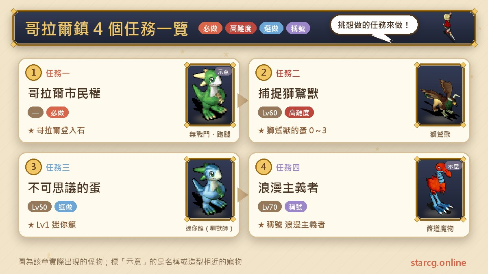
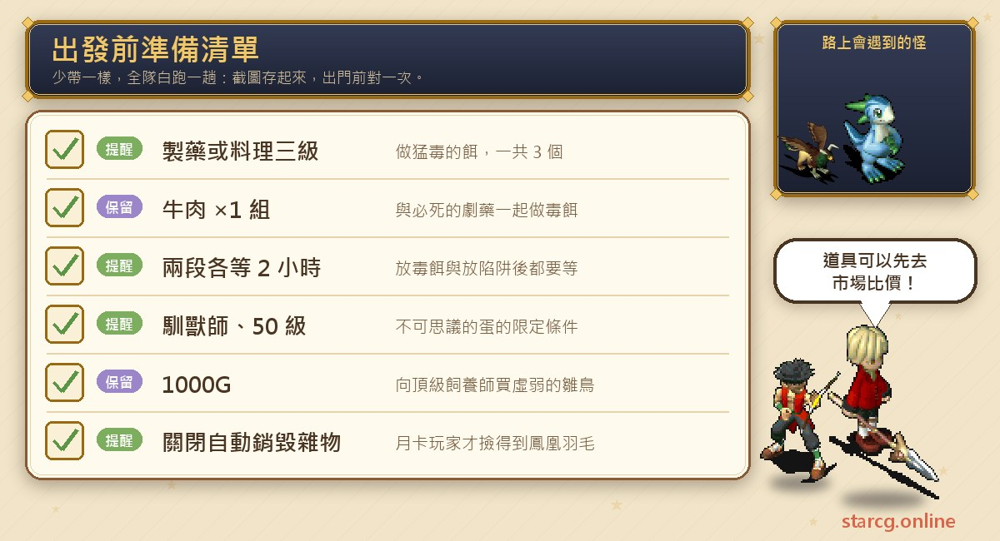
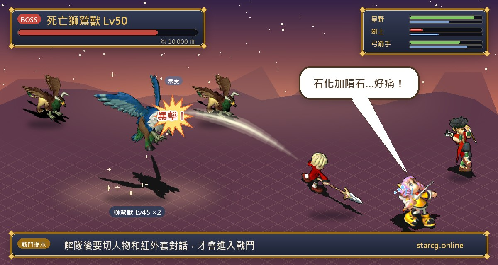
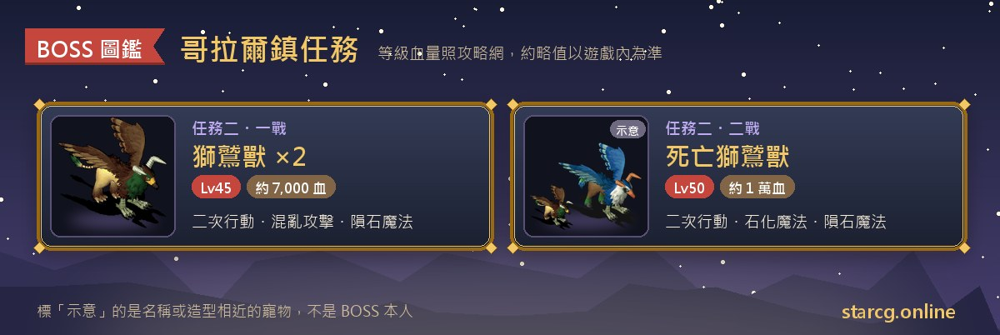

코랄 마을(哥拉爾鎮)은 쿠루크스섬(庫魯克斯島)의 큰 도시로, 이 지역 퀘스트는 모두 네 개예요. 레벨 제한이 없는 **코랄 시민권(哥拉爾市民權)**, 권장 레벨 60의 **그리폰 포획(捕捉獅鷲獸)**, 조교술사 전용 **이상한 알(不可思議的蛋)**, 권장 레벨 70의 **로맨티스트(浪漫主義者)**예요. 끝내면 로그인 지점을 코랄 마을로 바꿀 수 있고, Lv1 **그리폰(獅鷲獸)**이나 **보그런너(巖地跑者)**를 부화시킬 기회가 생기며, Lv1 **쁘띠 드래곤(迷你龍)**을 키울 수 있고, 영구 칭호 「로맨티스트」도 받을 수 있어요. 네 개 중 세 개가 펫이나 칭호와 관련 있어서, 수집을 좋아하는 플레이어라면 한 번에 끝내기 좋은 지역이에요.

이 글은 네 퀘스트의 조건, 단계별 NPC와 좌표, 그리폰 전투의 적 정보, 알 부화 판별법을 하나의 목록으로 정리하고, 「2시간 대기가 두 번」「술독 조사 순서」「파티 해산 후 캐릭터 전환」처럼 가장 막히기 쉬운 부분을 따로 표시했어요. StarCG(星詠魔力), 水藍魔力, 初心魔力寶貝 어느 쪽을 하든 코랄 마을 퀘스트 흐름은 같으니 그대로 쓰면 돼요.

> 이 글은 [StarCG 공략 사이트](https://guide.starcg.net/)의 코랄 마을 퀘스트 페이지를 바탕으로, 저희 방식대로 순서를 다시 짜고 새로 써서 정리했어요(그대로 옮기지 않았어요). 적 HP와 수치는 대략적인 값이니 실제 게임을 기준으로 하세요. 공략 사이트에 없는 부분은 모두 「공략 사이트에 없음」으로 표시했고, 게임 업데이트 후 내용이 바뀔 수 있어요.

## 코랄 마을 퀘스트는 무엇이 있나요? 전체 순서부터

네 퀘스트는 서로 선행 관계가 없어서 레벨과 직업에 맞춰 골라 하면 돼요. 시민권은 레벨 제한이 없어 언제든 할 수 있고, 그리폰 포획은 30레벨부터 받을 수 있지만 중간에 2시간 이상씩 두 번 기다려야 하니 여유 있을 때 시작하는 게 좋아요. 이상한 알은 조교술사만 할 수 있고, 로맨티스트는 70레벨이 되어야 브라운산(布朗山) 옛길에 들어갈 수 있어요.

| 순서 | 퀘스트 이름 | 권장 레벨 | 조건 | 보상 |
|---|---|---|---|---|
| 퀘스트 1 | 코랄 시민권 | 없음 | 없음 | 코랄 성 전송문(로그인 전송석) 사용권 |
| 퀘스트 2 | 그리폰 포획 | 60 | 30레벨 | 그리폰의 알 0~3개(보그런너 또는 그리폰 부화) |
| 퀘스트 3 | 이상한 알 | 50 | 50레벨, 조교술사 전용 | Lv1 쁘띠 드래곤 |
| 퀘스트 4 | 로맨티스트 | 70 | 70레벨 | 영구 칭호 「로맨티스트」 |

한 줄로 정리하면: **시민권을 먼저 받아 이동을 편하게 하고, 그리폰 포획은 이 지역에서 가장 시간이 걸리는 퀘스트, 조교술사는 쁘띠 드래곤을 겸사겸사 챙기고, 70레벨 이후 두 산의 옛길에서 봉황 깃털을 모으세요.**

## 출발 전에 준비할 것

코랄 마을 퀘스트의 전투는 한 번뿐이라, 진짜 준비할 것은 「기술」「시간」「직업 조건」이에요. 아래에 한데 모았어요.

그리폰 포획 도중에 「맹독 미끼(猛毒的餌)」를 만들어야 하는데, **제약(製藥) 3레벨** 또는 **요리(料理) 3레벨** 이상 기술을 가진 캐릭터에게 맡겨야 해요. 재료는 필사의 극약(必死的劇藥)과 소고기(牛肉)이고 모두 3개를 만들어야 해요. 파티에 이런 생산직이 없다면 먼저 친구에게 부탁해야 하고, 소고기는 이 사이트의 [시세 검색](/ko/market/)에서 가격을 먼저 확인해 볼 수 있어요. 이상한 알은 새끼 새를 살 1000G가 필요하고, 로맨티스트는 월정액을 산 플레이어라면 「잡동사니 자동 파기(自動銷毀雜物)」 기능을 먼저 꺼야 해요. 안 그러면 봉황의 깃털이 자동으로 지워져요.

## 퀘스트 1: 코랄 시민권(로그인 지점을 코랄 마을로)

권장 레벨과 조건 모두 「없음」이에요. 처음부터 끝까지 아이템을 주고받는 심부름이고, 중간에 아케루파 마을(阿凱魯法村)에 한 번 다녀와야 해요.

1. **코랄 마을 민가**(89, 64)에서 **김매 할머니(金梅婆婆)**(7, 5)와 대화해 「할머니의 어묵(老婆婆的黑輪)」을 받아요.
2. 코랄 마을(170, 114)의 **김다길 할아버지(金多吉爺爺)**에게 할머니의 어묵을 주고 「지비레의 모자(吉比雷的帽子)」를 받아요.
3. **아케루파 마을**의 **의사 지비레(醫師吉比雷)**(228, 201)에게 가서 「지비레의 위장약(吉比雷的胃腸藥)」으로 바꿔요.
4. 다시 **김다길 할아버지**에게 가서 위장약을 「어묵 꼬치(黑輪串)」로 바꿔요.
5. 민가의 **김매 할머니**에게 돌아가 「지비레의 책상 열쇠(吉比雷的桌子鑰匙)」로 바꿔요.
6. (15, 3)의 책상을 조사해 「코랄 시민권 증서(哥拉爾市民權狀)」를 받아요.
7. **하얀 궁전(白之宮殿) 2층 알현실**에서 **엘피나스 여왕(艾爾菲娜斯女王)**(58, 46)과 대화해 코랄 로그인 전송석 사용 허가를 받아요.
8. 코랄 마을의 **크룬크룬(克倫克倫)**(118, 105)을 찾아가면 코랄 마을 로그인 전송석을 쓸 수 있어요.

**주의할 점**: 아케루파 마을 시민권과 마찬가지로 등록은 **캐릭터마다 하나씩** 해야 해요. 등록 후 화면 오른쪽 아래에 자주 쓰는 「로그인 지점으로」를 누르면 코랄 마을로 전송되고, 오른쪽 위의 「귀환」은 항상 판부르크(法蘭城)로 전송돼요. 판부르크로 되돌리고 싶다면 판부르크 동쪽 병원 옆 전송석의 **로지로지(羅吉羅吉)**(231, 76)를 찾아가세요.

## 퀘스트 2: 그리폰 포획(독 미끼, 덫, 지하 투기장)

권장 60레벨, 조건은 30레벨이에요. 공략 사이트는 이 퀘스트 첫머리에서 **진행 중 오래 기다려야 하니 미리 계획하라**고 알려 줘요. 그 밖에도 중요한 규칙이 네 가지 있어요:

- **캐릭터 한 명**만 17단계(히티 박사와 대화하기 전)까지 진행하면 모든 파티원을 데리고 바에 들어갈 수 있어요.
- 모든 캐릭터가 동시에 진행하더라도 마지막 파티 전투에서 전원의 「데스 그리폰의 앞발」이 회수되지만, **보상은 한 번분**(그리폰의 알 0~3개)만 나와요.
- **그리폰을 부화시킨 적이 있는 캐릭터**는 파티를 이끌고 퀘스트를 완료할 수 없어요.
- 「맹독 미끼」나 「그리폰의 알」을 가지고 있는 캐릭터는 퀘스트를 시작할 수 없어요.

### 전반: 조사와 독 미끼 만들기

1. 코랄 거리의 **생물학자의 집**(166, 140)에서 **빨간 외투(紅外套)**와 대화해요.
2. 방어구점 옆 밭의 **채소**(102, 76)를 조사해 「맛있는 채소(好吃的蔬菜)」를 받고 **히티 박사(希堤博士)**에게 줘요.
3. 코랄 성에서 **수수께끼의 물체**(127, 170)를 조사해 「동물의 똥(動物的糞)」을 받아 히티 박사에게 줘요.
4. **란마르(蘭馬爾)**(104, 154)와 대화한 뒤 **민가**(92, 100)로 가서 **다다(達達)**와 대화해요.
5. **모모(墨墨)**와 대화하고 다시 다다와 대화한 뒤, 빨간 외투와 히티 박사에게 돌아가 대화해요. 공략 사이트 보충: 다다에게 물어본 다음 박사와 빨간 외투를 거치지 않고 바로 열쇠를 받으러 가도 돼요.
6. **코랄 공방**(150, 132)의 **아산(阿山)**에게서 「공방 창고 열쇠(工房倉庫的鑰匙)」를 받아요.
7. **제1창고**(132, 135)에 들어가 **데스 그리폰(死亡獅鷲獸)**과 대화해 「봉황의 깃털(鳳凰的羽毛)」을 받아요.
8. 봉황의 깃털을 히티 박사에게 주고 「필사의 극약」과 「맹독 미끼 만드는 법(猛毒的餌之做法)」을 받아요.
9. 만드는 법을 제약 3레벨 또는 요리 3레벨 이상인 캐릭터에게 주고, 필사의 극약 + 소고기 ×1세트로 「맹독 미끼」를 모두 3개 만들어요. 그다음 **코랄 병영**(174, 170)의 **수의사 카낙스(獸醫卡那克斯)**와 대화해요.

### 중반: 두 번 설치하고 두 번 기다리기

10. 거리의 **술독**(93, 42), (93, 158), (137, 151)에 맹독 미끼를 놓고 「맹독 미끼를 놓은 장소(放置猛毒餌的場所)」를 받아요.
11. 빨간 외투, 히티 박사와 대화한 뒤 **2시간 이상** 기다려요. 공략 사이트 보충: 독 미끼를 놓은 뒤 박사와 빨간 외투를 거치지 않고 바로 2시간 기다려도 돼요.
12. 미끼를 놓은 곳을 조사하고(이때 미끼는 이미 사라져 있어요) 「맹독 미끼를 놓은 장소」를 버려요. **(93, 42)를 마지막 조사 지점으로 해야 버리기 선택지가 나와요.**
13. 빨간 외투, 히티 박사와 대화한 뒤 **창고**(68, 47)에 들어가 **병사 노흐(士兵諾赫)**와 대화해요. 공략 사이트 보충: 2시간 뒤 독 미끼 쪽지를 버렸다면 바로 창고에 들어가 병사에게 물어봐도 돼요.
14. **의사 피스(醫生菲斯)**, 병사 노흐와 대화하고 다시 빨간 외투와 대화해 「맹수용 덫(猛獸用陷阱)」을 받아요.
15. 다시 (93, 42), (93, 158), (137, 151)의 술통에 맹수용 덫을 놓고 「맹수용 덫을 놓은 장소(猛獸用陷阱的場所)」를 받은 뒤, 또 **2시간 이상** 기다려요.
16. 마지막 **덫 장치**(137, 151)를 조사해 「데스 그리폰의 앞발(死亡獅鷲獸的前腳)」을 줍고 히티 박사와 대화해요. 공략 사이트 보충: 2시간 뒤 앞발을 얻었다면 박사와 대화하지 않고 바로 바에 들어가도 되고, 파티원은 퀘스트 진행 여부나 알 소지 여부와 상관없어요.

### 후반: 핏자국을 따라 지하 투기장으로

17. 핏자국을 따라 **돌고래 바(海豚酒吧)**(136, 158)에 들어가고, 다시 핏자국을 따라 **지하 투기장(地下競技場)**(32, 16)으로 가요.
18. 먼저 **빨간 외투**와 대화해 데스 그리폰의 앞발을 건네요. 앞발을 가진 캐릭터로 대화해야 해요.
19. 이때 파티가 해산되고 장면이 바뀌어요. 다시 대화해 「아니요」를 고르면 전투가 시작돼요.

**주의할 점**: 화면에 「이대로 가면 두 사람 다…」라는 문구가 나오면 **캐릭터를 바꿔서 빨간 외투와 대화**하세요. 안 그러면 전투를 못 하고 바로 밖으로 전송돼요.

**보스 정보**:

- 1차전: 그리폰 ×2, 45레벨, HP 약 7,000, 2회 행동. 공격, 연속 공격, 건곤일척, 혼란 공격, 명경지수, 운석 마법, 강력 운석 마법을 써요.
- 2차전: 데스 그리폰 50레벨, HP 약 10,000, 2회 행동. 공격, 방어, 연속 공격, 건곤일척, 혼란 공격, 강력/초강력 석화 마법, 명경지수, 단일/강력 운석 마법을 써요. 옆에 그리폰 2마리(1차전과 같은 수치)가 함께 나와요.

**공략법**: 두 판 모두 2회 행동하는 상대이고, 2차전은 세 마리가 동시에 나오며 혼란 공격과 석화 마법을 섞어 써서 상태 이상 해제 수단을 꼭 준비해야 해요. 권장 레벨이 60인데 상대는 45~50레벨이라 레벨로만 보면 어렵지 않지만, 적의 행동 횟수가 많아서 회복이 따라가야 해요.

### 부화: 무엇이 나올지 어떻게 알까요?

승리하면 「그리폰의 알(獅鷲獸的蛋)」을 무작위로 **0~3개** 받아요. 부화는 현실 시간 기준이에요:

- **16시간**이 지나면 알을 사용할 수 있어요.
- 사용할 때 「흔들린다」가 나오면 Lv1 **보그런너**가 나와요.
- 「흔들리지 않는다」가 나오면 Lv1 **그리폰**이 나와요.
- 공략 사이트의 특별 주석: 24시간 넘게 기다린 뒤 사용해서 「반응이 없다」가 나와야 그리폰이에요. **5일 동안 둔다고 반드시 그리폰이 나오는 건 아니에요.**

부화한 그리폰과 보그런너는 이 사이트의 [펫 도감·성장](/ko/pets/)에서 정보를 확인할 수 있어요.

## 퀘스트 3: 이상한 알(조교술사 전용, 새끼 새를 키워 쁘띠 드래곤으로)

권장 50레벨, 조건은 50레벨이고 **조교술사 전용**이에요.

1. 쿠루크스섬(331, 361)의 **레므르산(雷姆爾山)**에서 **작업반장(工頭)**과 대화해 「아니요」를 고르고 옛길로 들어가요.
2. 17층을 올라 산 정상에 도착하면 **사육사 합숙소(飼養師合宿所)**(24, 57)에 들어가요.
3. 펫 계열 직업 캐릭터로 안의 **최고급 사육사(頂級飼養師)**와 대화해 1000G로 「허약한 새끼 새(虛弱的雛鳥)」(BP 0~5)를 사요.
4. 허약한 새끼 새를 **Lv30**까지 키운 뒤 다시 최고급 사육사와 대화해 「이상한 알」로 바꿔요.
5. 이상한 알을 사용하면 Lv1 **쁘띠 드래곤**을 한 마리 얻어요.

**주의할 점**: 퀘스트 조건은 「조교술사 전용」인데 단계 설명에는 「펫 계열 직업」이 최고급 사육사와 대화한다고 되어 있어요. 공략 사이트의 퀘스트 조건을 기준으로 삼으면, 조교술사가 아니면 헛걸음하지 않는 게 좋아요. 레므르산 옛길은 17층이나 되니 이 사이트의 [미궁 계단 찾기](/ko/maze/)로 걸으면서 기록해 두면 편해요. 새끼 새를 사서 Lv30까지 키우려면 레벨업이 필요한데, 공략 사이트에 추천 육성법은 없으니 각자 방식대로 하면 돼요.

## 퀘스트 4: 로맨티스트(빨강·파랑 봉황 깃털 두 개)

권장 70레벨, 조건은 70레벨이에요. 공략 사이트는 첫머리에서 **월정액을 산 플레이어는 「잡동사니 자동 파기」 기능을 꺼야 봉황의 깃털을 얻을 수 있다**고 알려 줘요.

1. 미네갈섬(米內葛爾島)의 **브라운산**(181, 486)에서 광부와 대화해 「아니요」를 고르고 옛길로 들어가, 옛길 몬스터를 쓰러뜨려 「붉은 봉황의 깃털(紅鳳凰的羽毛)」을 얻어요. 브라운산 옛길은 70레벨부터 들어갈 수 있어요.
2. 쿠루크스섬의 **레므르산**(331, 361)에서 광부와 대화해 「아니요」를 고르고 옛길로 들어가, 옛길 몬스터를 쓰러뜨려 「푸른 봉황의 깃털(藍鳳凰的羽毛)」을 얻어요. 레므르산 옛길은 50레벨부터 들어갈 수 있어요.
3. 붉은 봉황의 깃털을 들고 코랄 마을의 **신랑 코코레(新郎可可雷)**(130, 176)에게 가서 「결혼반지(結婚戒指)」로 바꾸고, 장착하면 칭호 「이미 결혼한 사람(已經結婚的人)」을 받아요.
4. 푸른 봉황의 깃털을 들고 코랄 마을의 **신부 마샤(新娘瑪莎)**(132, 176)에게 가서 「약혼반지(訂婚戒指)」로 바꾸고, 장착하면 칭호 「약혼한 사람(有婚約的人)」을 받아요.
5. 반지 두 개를 모두 얻으면 영구 칭호 「**로맨티스트**」를 받아요.

**주의할 점**: 두 옛길의 몬스터 이름과 깃털 드롭률은 공략 사이트에 없어서 여러 번 싸우며 운을 시험할 수밖에 없어요. 레므르산 옛길은 이상한 알과 같은 길이라 조교술사는 두 퀘스트를 함께 할 수 있어요. 브라운산 옛길은 70레벨이 되어야 들어갈 수 있는데, 퀘스트 조건 70레벨과 같아요.

## 코랄 마을 퀘스트 자주 묻는 질문

**그리폰 포획은 모두가 진행해야 하나요?** 아니요. 한 명만 17단계까지 진행하면 모든 파티원을 데리고 바에 들어갈 수 있고, 모두가 진행해도 마지막 파티 전투 보상은 한 번분(알 0~3개)뿐이에요.

**독 미끼를 놓았는데 버리기 선택지가 안 나와요?** 술독 세 개를 조사할 때 (93, 42)를 반드시 마지막으로 남겨야 「맹독 미끼를 놓은 장소」를 버리는 선택지가 나와요.

**지하 투기장에 들어갔는데 바로 밖으로 전송돼요?** 「이대로 가면 두 사람 다…」가 나오면 캐릭터를 바꿔 빨간 외투와 대화해야 전투에 들어갈 수 있어요.

**그리폰의 알에서 무엇이 나올지 어떻게 구분하나요?** 16시간 뒤 사용해서 「흔들린다」면 보그런너, 「흔들리지 않는다」면 그리폰이에요. 24시간 넘게 지나 사용할 때는 「반응이 없다」가 나와야 그리폰이에요. 오래 둔다고 그리폰이 보장되지는 않아요.

**조교술사가 아니어도 쁘띠 드래곤을 받을 수 있나요?** 공략 사이트의 퀘스트 조건이 「50레벨, 조교술사 전용」이라 다른 직업은 완료할 수 없어요.

**왜 오래 싸워도 봉황의 깃털이 안 나오나요?** 먼저 월정액의 「잡동사니 자동 파기」 기능이 꺼져 있는지 확인하세요. 깃털 드롭률은 공략 사이트에 없어요.

## 정리: 그리폰은 시간을 잡고, 쁘띠 드래곤과 칭호는 겸사겸사

코랄 마을 네 퀘스트 중 그리폰 포획이 가장 계획이 필요해요. 제약이나 요리 3레벨인 사람이 독 미끼를 만들어야 하고, 2시간 이상 대기가 두 번 있고, 술독 조사에는 순서 규칙이 있으며, 마지막 지하 투기장에서는 캐릭터 전환도 잊으면 안 돼요. 위 단계를 하나씩 확인하며 가면 전투 자체는 어렵지 않아요. 시민권은 편한 로그인 지점을 하나 더 만들어 주고, 이상한 알은 조교술사 전용 쁘띠 드래곤, 로맨티스트는 깃털 두 개로 받는 영구 칭호라서 모두 가는 길에 끝내기 좋아요.

더 자세한 원문과 다른 퀘스트는 [StarCG 공략 사이트](https://guide.starcg.net/)에서 확인하세요. 이 사이트의 [펫 도감·성장](/ko/pets/)으로 그리폰, 보그런너, 쁘띠 드래곤 정보를 보고, [시세 검색](/ko/market/)으로 소고기 같은 재료를 찾고, [미궁 계단 찾기](/ko/maze/)로 레므르산 옛길 17층을 걸어 보세요.
