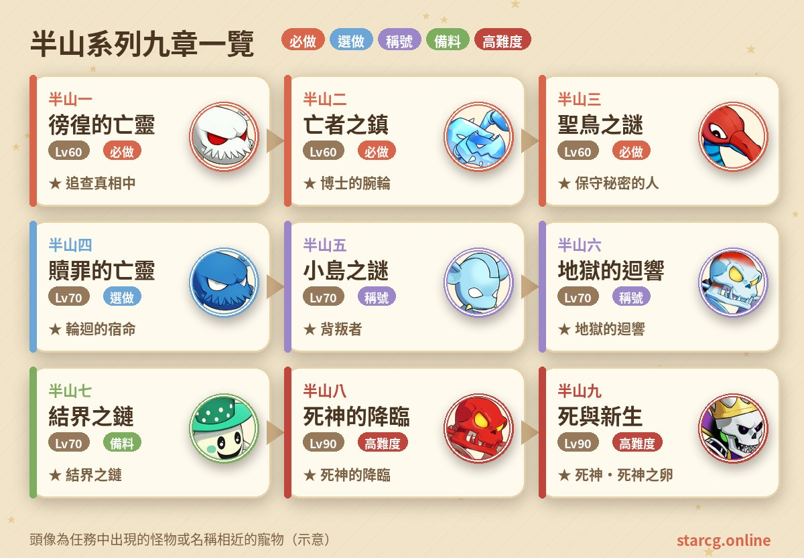
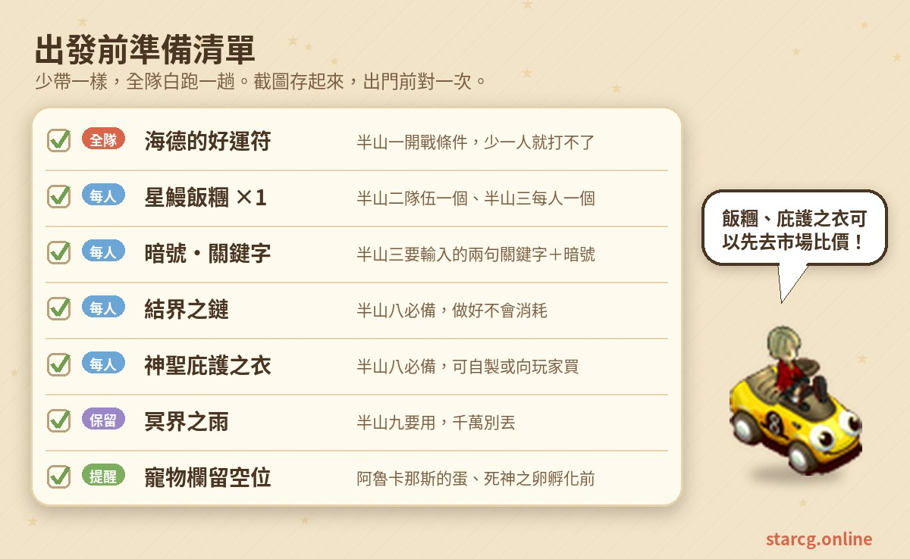
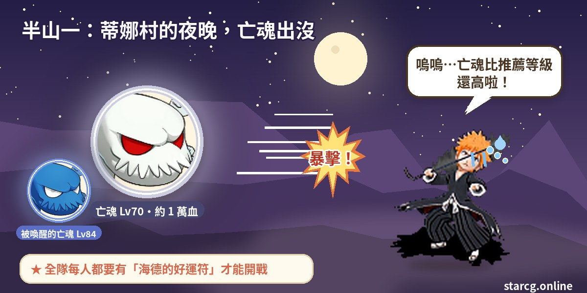
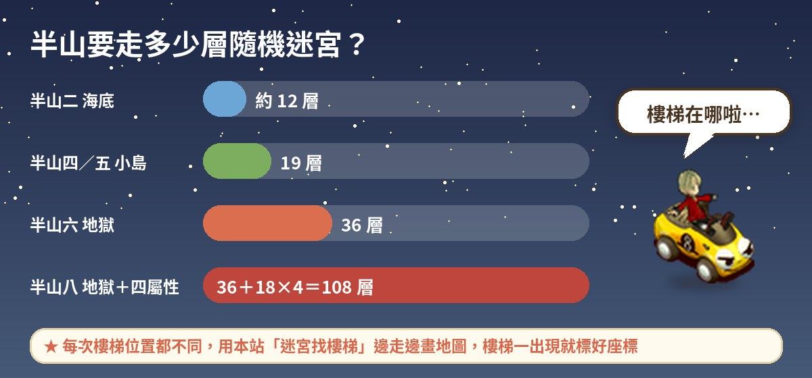
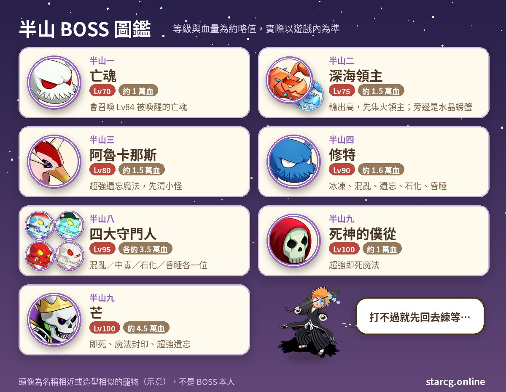
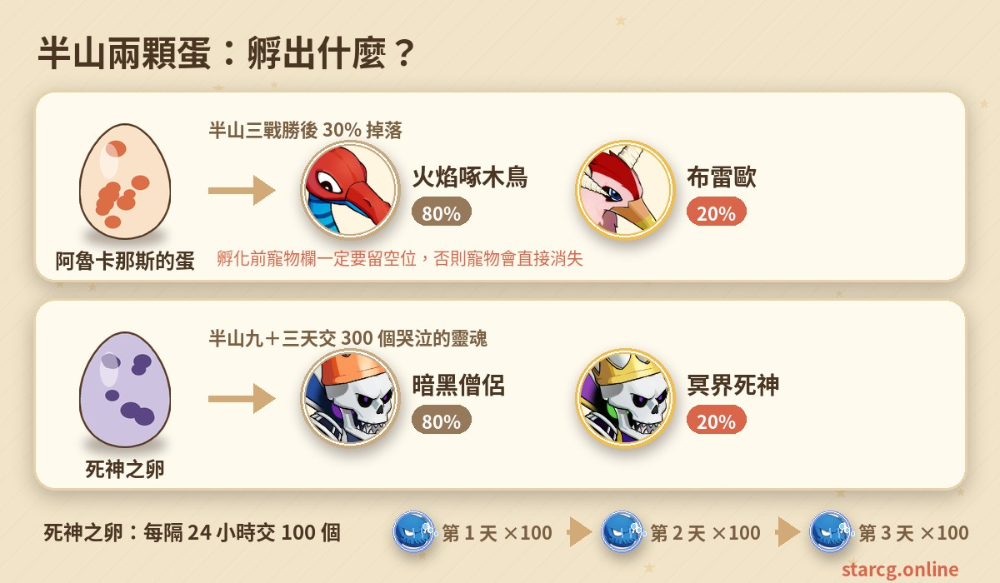

玩魔力寶貝到了 60 級上下，一定會聽到「去半山」。半山腰是 65～77 級很多人在用的練功點，而半山系列任務，就是把這個地方一步一步打開的九個任務。這篇把九個任務的順序、座標、要準備的東西和 BOSS 資料整理成一份能邊玩邊翻的流程，並把最容易卡關的地方特別標出來。不論你玩的是星詠魔力、水藍魔力還是初心魔力寶貝，半山系列的任務流程都是一樣的，這份整理都能直接拿來用。

> 本文整理自 [星詠魔力攻略網](https://guide.starcg.net/) 的半山系列頁面，並用我們自己的方式重新排序與改寫，沒有逐字照搬。BOSS 血量與數值是約略值，實際以遊戲內為準；遊戲更新後內容可能變動。

## 半山系列是什麼？先看整體順序

半山系列一共九章，從法蘭城的士兵海德開始，一路走到冥界。前面幾章（半山一到三）是大部分人的目標，因為做完就能前往半山腰練功；後面的半山五到九偏向稱號與劇情收集，難度和花費明顯提高。

整理成一句話就是：**一、二、三是必做，四是選做，五到九是想拿稱號與死神寵物才需要走完。**

| 章節 | 任務名稱 | 推薦等級 | 取得 |
|---|---|---|---|
| 半山一 | 徬徨的亡靈 | 60（條件 50） | 稱號「追查真相中」、海德的戒指 |
| 半山二 | 亡者之鎮 | 60 | 博士的腕輪 |
| 半山三 | 聖鳥之謎 | 60 | 稱號「保守秘密的人」、聖鳥羽毛 |
| 半山四 | 贖罪的亡靈 | 70 | 稱號「輪迴的宿命」、未閱讀的書 |
| 半山五 | 小島之謎 | 70 | 稱號「背叛者」 |
| 半山六 | 地獄的迴響 | 70 | 稱號「地獄的迴響」、大天使的呼吸 |
| 半山七 | 結界之鏈 | 70 | 結界之鏈 |
| 半山八 | 死神的降臨 | 90 | 稱號「死神的降臨」、冥界之雨 |
| 半山九 | 死與新生 | 90 | 稱號「死神」、死神之卵 |

## 出發前先準備好這些

半山系列最讓人頭痛的不是難打，而是「少帶一樣東西，全隊白跑一趟」。下面這張表把各章需要的東西集中在一起，建議截圖存起來。

有幾個東西靠自己做太花時間，可以直接去市場買。星鰻飯糰、神聖庇護之衣、結界之鏈都是可以交易的道具，用本站的 [市場查價](/market/) 輸入名稱就能看到目前的攤位價格；整隊都需要的話，用批次採購一次排好路線最省時間。

## 半山一：徬徨的亡靈（先拿海德的好運符）

這是整個系列的起點，條件 50 級，推薦 60 級。

1. 到法蘭城謝里雅堡 1 樓，找**士兵海德**（81, 18）對話，領到任務道具「海德的好運符」。
2. 等到夜晚或黃昏，前往**蒂娜村**（64, 51），與**亡魂**對話開戰。白天進村的話，要出村再進村等時間切到黃昏或夜晚。
3. 打贏之後再跟亡魂說一次話，拿到「修特的項鍊」。
4. 回到謝里雅堡 1 樓交給海德，完成。

**要注意的地方**：好運符要**全隊每個人都有**，只要有一個人沒拿，就無法開戰。亡魂本人 70 級、約一萬血，還會召喚 84 級的被喚醒亡魂，比推薦等級高，等級不夠建議帶有控制技能的隊員。打完之後可以直接接半山二。

## 半山二：亡者之鎮（第一次碰到 10,000G）

1. 到謝里雅堡 2 樓西邊走廊盡頭的圖書館（0, 74），找**博學者**（18, 19）取得「項鍊的情報」，雙擊「修特的項鍊」變成「航海圖」。
2. 從蒂娜村南門出去，到莎蓮娜島（668, 321），找**守信用的水手**交出航海圖，拿到「止吐藥」，傳到聖瑪利亞號。
3. 在船上**等約 10 分鐘**，再找守信的水手，交出止吐藥，傳到小島。
4. 找**瑞娜的父親**（70, 81），**選「否」**，交出項鍊的情報換「巧克力」；再找**羅伯尼克博士**（59, 78）換「金屬探測器」。
5. 隊伍中一人到**酒吧老闆**（55, 81）花 10,000G 買 1 個**星鰻飯糰**（也可以向玩家買）。
6. 持有飯糰的隊員找**覓食的水龍蜥**（82, 20），之後全隊進入達爾文海海底，通過約 12 層的隨機迷宮。
7. 到深海秘窟，找**深海領主**開戰。贏了之後交出金屬探測器，換到機器零件，傳回小島，再交給博士，領「博士的腕輪」。

**打法**：深海領主（75 級、約一萬五千血）輸出很高，旁邊的水晶螃蟹輸出較低，集中火力先解決領主最穩。**完成後不要急著回城**，直接在原地再找羅伯尼克博士，就能接上半山三的第一步。

## 半山三：聖鳥之謎（真正打開半山腰）

這一章流程最長，而且**每個人都要自己準備**星鰻飯糰和暗號。

1. 到莎蓮娜島找守信用的水手傳到小島，找博士（59, 78）進地下實驗室，調查**時光機器**（19, 11），來到過去的瑞娜家。
2. 找**瑞娜**（10, 13），**輸入關鍵字「阿魯卡那斯」**，拿到「匆忙寫下的筆錄」，傳回小島。
3. 回法蘭城圖書館找博學者交筆錄，換「鳥類大全」；再回小島找**村民**（78, 87），交鳥類大全換「暗號」。
4. 每位隊員到酒吧老闆買 1 個星鰻飯糰（10,000G）。
5. 小島（64, 46）走黃色傳送石進「通往山頂的路」，經過兩段隨機迷宮，抵達聖鳥之巢。
6. 找**聖鳥的子嗣**（14, 11），**輸入「我是來送鰻魚飯的」**，交出飯糰，傳到聖山之巔。
7. 找**阿魯卡那斯**（23, 32）開戰，贏了再對話，領稱號與聖鳥之羽。

**BOSS 資料**：阿魯卡那斯 80 級、約一萬五千血，會用「超強遺忘魔法」，身邊還有 60 級的阿魯卡那斯之子。攻略網的建議很實用：先清小怪再打大王，小怪不抗咒，咒術師的控制技能很好用；為了防遺忘，可以到冒險者旅館（216, 53）找寵物技能店的佩蒂（30, 20）多學幾個攻擊技能備用。

**兩個小提醒**：戰勝後有 30% 機率掉**阿魯卡那斯的蛋**，孵出火焰啄木鳥（80%）或布雷歐（20%）；孵之前**寵物欄一定要留空位**，否則寵物會直接消失。另外，關鍵字打錯或沒有暗號，NPC 都不會回應，卡在這裡的人不少。

做完半山三，就可以走半山腰練功路線了。想知道練功點怎麼選，可以搭配我們的 [傷害計算機](/damage/) 估一下隊伍輸出夠不夠。

## 半山四：贖罪的亡靈（可以略過）

想補齊稱號才做。條件是已有「保守秘密的人」，推薦 70 級。

簡單流程：蒂娜村南門找膽小鬼村民→找亡靈修特→在兩年前的小島找瑞娜拿**鰻魚飯**→走黃色傳送石穿過 19 層迷宮→找聖鳥的子嗣交鰻魚飯→找阿魯卡那斯→在海底打**修特**。修特是 90 級，約一萬六千血，會用超強冰凍、風刃、混亂、遺忘、石化與昏睡魔法，建議帶解異常的手段。獎勵是稱號「輪迴的宿命」，戰後隊伍中**隨機一人**得到「未閱讀的書」（Lv.5 護身符）。

## 半山五：小島之謎（拿到「背叛者」）

這章主要是走一趟 19 層迷宮：到圖書館找**阿斯提亞祭司**（27, 15）拿阿斯提亞錐形水晶，傳到小島，走黃色傳送石穿過迷宮到聖鳥之巢，最後把水晶交給阿魯卡那斯，換到稱號「背叛者」。這一章的半山腰不會遇敵，算是輕鬆的一章。

**重要的卡關點**：如果你已經有「背叛者」，或已經完成半山九、擁有「死神」稱號，就無法再拿到錐形水晶。這時要到謝里雅堡 1 樓找**半山任務重置**（81, 16），交出所有稱號，再重跑前置任務才能重新接。

另外，做完半山五之後，到法蘭城西門外找**阿魯卡**（398, 168）付 800G，就能直接傳到小島，省下半山二那一大段路。

## 半山六：地獄的迴響（36 層迷宮）

1. 到圖書館找阿斯提亞祭司（27, 15），交出 1,000G 換**鋤頭**，傳到小島。
2. 走黃色傳送石穿迷宮到半山腰，調查**奇怪的薄冰**（81, 56），交出鋤頭，進入聖山內部。
3. 走紅色傳送石下到地獄，約 36 層的隨機迷宮，抵達後找**瀕死的聖鳥嗣**（14, 11）。
4. 傳到聖山之巔，找阿魯卡那斯拿稱號「地獄的迴響」，再回圖書館找祭司領**大天使的呼吸**。

**重點**：36 層是半山系列最長的一段路，全程都是隨機迷宮，每次樓梯位置都不一樣。這種時候用我們的 [迷宮找樓梯](/maze/) 工具會輕鬆很多，連結一次遊戲資料夾，走到哪裡地圖就畫到哪裡，樓梯一出現就標好座標。如果身上還有鋤頭，要先丟掉才能重新換。

## 半山七：結界之鏈（備料任務）

結界之鏈是 Lv.9 項鍊，攻擊 +30、敏捷 +12、精神 +8、必殺 +7 等，後面的半山八每個人都要有一條，而且做好後**不會消耗**。

1. **夜晚**到法蘭城南門附近（167, 223）找**見習結界師之魂**，拿到「結界師的需求清單」。
2. 備齊材料：非常優良的騎士寶石 Lv.8 ×1、非常優良的綠寶石 Lv.8 ×2、流星 ×1、聖鳥之羽（任何耐久）×1。
3. 夜晚再回去找同一個 NPC 交付，領到結界之鏈。

寶石可以開寶箱、向玩家買或做四屬性洞窟任務取得；流星來自流星山丘任務；聖鳥之羽就是半山三的獎勵。攻略網也提醒：**如果有朋友能借你、或市場上買得到，這章可以直接跳過**，別為了一條鏈花太多時間。

## 半山八：死神的降臨（四大守門人）

推薦 90 級，這是整個系列難度最高的一章之一。每個人需要**結界之鏈**與**神聖庇護之衣**。

神聖庇護之衣可以自製：用 8 級技能在小島採集閃亮的珍珠（狩獵，66, 9）、古藤（伐木，73, 98）、稀有金屬（挖掘，95, 45）各 10 個，找**神官魯因**（60, 81）兌換；也可以直接向玩家買。

流程摘要：持結界之鏈找祭司傳到小島→走黃色傳送石→調查薄冰（81, 55）→走綠色傳送石下地獄（36 層）→找**瑞娜的幻象**（24, 25）→風、火、土、水四個地獄各打一個 18 層迷宮，最後挑戰守門人→取得四種冥界聯結石→找瑞娜換冥界聯結石並傳到冥界表→爬到塔頂（573, 37）找阿魯卡那斯（682, 19）開戰。

**BOSS 資料**：四位守門人都是 95 級、約三萬五千血，各自會用超強混亂、中毒、石化、昏睡魔法，加上戰慄襲心與明鏡止水。最後的阿魯卡那斯傷害極高，頁面建議有物理制禦巫術（攻擊反彈、無效、吸收）的話可以對自己無限施放，並搭配寵物護衛。贏了之後得到稱號「死神的降臨」與**冥界之雨**。

**冥界之雨不要丟**，下一章還要用到。

## 半山九：死與新生（死神稱號與死神之卵）

1. 用冥界之雨傳到冥界，調查**死亡石碑**（377, 422）進冥界之森。
2. 調查**死神的點火台**（5, 11）取得「冥炎的火把」，走到（20, 10）找**死神的僕從**開戰（100 級、約一萬血，會超強即死魔法）。
3. 戰後調查（216, 356）進入死神的搖籃，找**芒**（49, 6）開戰。芒是 100 級、約四萬五千血，技能非常多，包含即死魔法、魔法封印、超強遺忘魔法。
4. 打贏後找**荷特普**（22, 19）交出冥界之雨，得到「飢餓的死神之卵」，同時獲得稱號「死神」，並失去先前半山系列的稱號（成就仍計算）。

**孵化要花三天**：用死神之卵傳到冥界，打遊蕩靈魂收集 100 個**哭泣的靈魂**交給荷特普；每次要隔 24 小時，一共三次、共 300 個，第三次交出後拿到**死神之卵**，使用後隨機孵出暗黑僧侶（80%）或冥界死神（20%）。哭泣的靈魂不能交易、丟地或存銀行，記得寵物欄留空位。完成孵化前不能重新接任務，這個時間要先規劃好。

## 半山系列常見問題

**半山任務一定要全部做完嗎？** 不需要。只想去半山腰練功，做到半山三就夠；半山四到九是稱號與劇情。

**半山怎麼去最快？** 完成半山五或半山九之後，到法蘭城西門外找阿魯卡（398, 168）付 800G 就能傳到小島。

**結界之鏈一定要自己做嗎？** 不用。可以向朋友借、市場購買，或請有做過的人幫忙。

**半山任務可以重新做嗎？** 可以，到謝里雅堡 1 樓找半山任務重置（81, 16），交出稱號後重跑前置任務即可。要注意死神之卵沒走完三次交出前，不會再給新的蛋。

**哪裡可以查隨機迷宮的路線？** 迷宮每次都不同，建議用 [迷宮找樓梯](/maze/) 邊走邊記，比對攻略文章更有效率。

## 小結：安排時間最重要

從頭到尾走完半山九，最花時間的是三段隨機迷宮（19 層、36 層與四個 18 層）以及死神之卵的三天孵化。想要穩，就先用半山一到三打開半山腰練功，再依資源慢慢補後面的稱號；準備清單照上面那張圖備齊，能少跑很多冤枉路。

想知道更多任務、寵物與市場資料，可以到 [星詠魔力攻略網](https://guide.starcg.net/) 查更完整的原文，也歡迎用本站的 [市場查價](/market/)、[寵物圖鑑](/pets/) 與 [傷害計算機](/damage/) 把整趟旅程規劃得更有效率。
