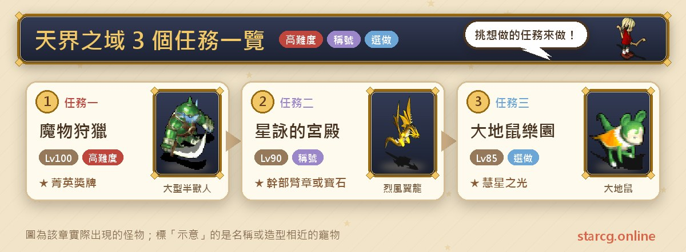
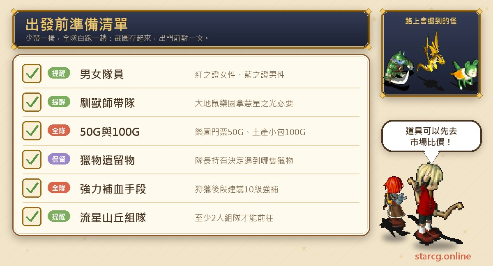
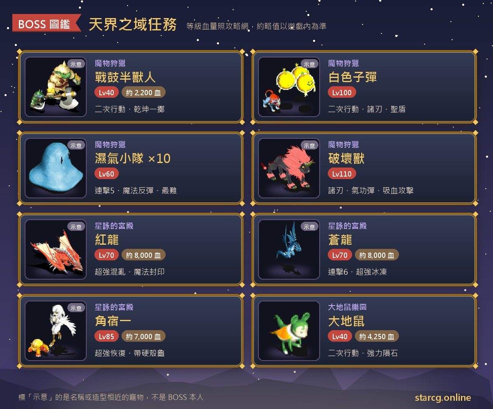
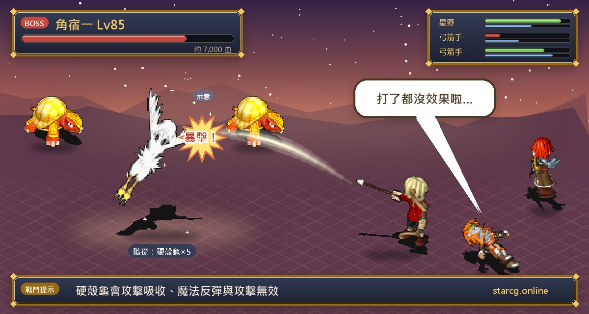

천계의 영역(天界之域)은 「빛의 길(光之路)」을 중심으로 플레이 방식이 전혀 다른 퀘스트 3개가 있어요. 이그니스 대지(依格尼斯台地)에서 사냥감 16종을 쫓고, 유류품에 따라 누구를 만날지 정해지는 「마물 사냥(魔物狩獵)」. 남녀가 따로 붉은 별과 푸른 별의 시험을 통과한 뒤 별의 수호자 넷과 연달아 싸우는 「성영의 궁전(星詠的宮殿)」. 그리고 조교술사가 리더가 되어 유성 언덕에서 유성을 찾아오는 「노커 낙원(大地鼠樂園)」이에요. 권장 레벨은 각각 100, 90, 85로 후반 콘텐츠이고, 보상은 엘리트 메달, 간부 완장, 8~10레벨 보석, 혜성의 빛, 그리고 토로티 새(托羅帝鳥)·사프 지뢰(薩普地雷)·타이탄 자이언트(泰坦巨人)·다하카(達哈卡)가 나오는 신비한 항아리(神秘之壺)예요.

이 글은 퀘스트 3개의 조건, NPC 좌표, 전투 정보, 보상을 하나의 목록으로 정리했고, 마물 사냥 사냥감 16종의 조우 조건과 추천 순서도 표로 만들어 싸우면서 바로 대조할 수 있게 했어요. StarCG(星詠魔力), 水藍魔力, 初心魔力寶貝 어느 쪽을 하든 천계의 영역 퀘스트 흐름은 같으니 그대로 활용하면 돼요.

> 이 글은 [StarCG 공략 사이트](https://guide.starcg.net/)의 천계의 영역 퀘스트 페이지를 바탕으로 저희 방식대로 순서를 바꾸고 새로 쓴 것으로, 그대로 옮기지 않았어요. 보스 HP와 수치는 대략적인 값이며 실제로는 게임 내 표시가 우선이에요. 공략 사이트에 나오지 않은 수치는 모두 「공략 사이트 미기재」로 적었고, 게임 업데이트 후 내용이 바뀔 수 있어요.

## 천계의 영역 퀘스트란? 먼저 전체 순서 보기

퀘스트 3개는 서로 선행 관계가 없고, 입구는 모두 빛의 길 근처에 있어요.

| 퀘스트 | 퀘스트 이름 | 권장 레벨 | 획득 |
|---|---|---|---|
| 퀘스트 1 | 마물 사냥 | 100 | 엘리트 메달(16종), 신비한 항아리, 합성 재료 |
| 퀘스트 2 | 성영의 궁전 | 90 | 간부 완장 또는 8~10레벨 보석 |
| 퀘스트 3 | 노커 낙원 | 85 | 노커 모자 머리장식, 혜성의 빛 |

한 줄로 정리하면: **노커 낙원이 가장 쉽고 조교술사 리더만 있으면 돼요. 성영의 궁전은 남녀가 모두 있어야 붉은·푸른 증표를 다 모을 수 있어요. 마물 사냥이 가장 머리를 써야 하는데, 사냥감 16종을 순서대로 잡으면서 유류품이 누구에게 떨어지는지 계속 확인해야 해요.**

## 출발 전에 준비할 것

천계의 영역 전투는 대부분 2회 행동하는 고레벨 몬스터라 보급품과 회복 수단은 기본이에요. 또 퀘스트마다 놓치기 쉬운 조건이 한두 개씩 있어요.

성영의 궁전은 **성별에 따라 따로 전송돼요**. 붉은 증표는 여성 루트, 푸른 증표는 남성 루트라서 파티에 남녀가 모두 있거나, 두 번에 나눠 각각 다녀와야 해요. 노커 낙원은 **조교술사가 리더**여야 하고, 입장료 50G, 기념품 꾸러미가 100G예요. 마물 사냥 추천 공략법에는 「10레벨 강력 회복(10級強補)」「10레벨 초석(10級超石)」「광역 스킬(群技)」이 자주 나오는데, 후반 사냥감은 안정적인 강력 회복과 광역 공격이 필요하다는 뜻이에요. 물약과 보급품은 먼저 사이트의 [시세 검색](/ko/market/)에서 가격을 비교해 보세요.

## 퀘스트 1: 마물 사냥(사냥감 16종과 유류품)

권장 100레벨, 퀘스트 조건은 없어요.

1. **빛의 길**(200, 95)에서 **플릭(弗力克)**과 대화하면 이그니스 대지로 전송돼요.
2. **접수 창구(受理櫃檯)**(211, 271)와 대화해 「예」를 고르면 「사냥 허가증」을 받아요.
3. 각 지역에 랜덤으로 나타나는 사냥감을 쓰러뜨려 「사냥감 유류품」을 모아요. **어떤 사냥감을 만날 수 있는지는 리더가 가진 유류품으로 정해져요**.
4. 다 모았으면 **정산 창구(總結櫃臺)**(207, 267)와 대화해 「예」를 고르고, 상품 수령처로 전송돼 교환해요.

**유류품 규칙**: 사냥감을 쓰러뜨리면 **100% 확률로 유류품 1개**가 떨어지지만, 파티의 누구에게 들어갈지는 정해져 있지 않아요. 공략 사이트에서는 「파티원 인벤토리를 꽉 채워서」 떨어질 사람을 조절하는 방법이 **통하지 않는다**고 분명히 적고 있어요. 교환할 때는 **파티 전체**가 가진 유류품 종류로 계산하고 같은 종류는 하나로 쳐요. 예를 들어 리더가 1~5번, 파티원이 6~16번을 가지고 있으면 정산할 때 다섯 명 모두 1등 상을 받을 수 있어요.

| 번호 | 사냥감 | 좌표 | 조우 조건(리더 기준) |
|---|---|---|---|
| 1 | 전고 오크(戰鼓半獸人) | (120, 178) | 2번 미보유 |
| 2 | 암야 폭군(闇夜暴君) | (208, 226) | 3번 미보유 |
| 3 | 철십자(鐵十字) | (297, 181) | 4번 미보유 |
| 4 | 암살 사마귀(暗殺螳螂) | (240, 200) | 5번 미보유 |
| 5 | 강화 닭(強化雞) | (200, 187) | 1번 보유 |
| 6 | 신비한 점액(神秘黏液) | (273, 232) | 2번 보유, 7번 미보유 |
| 7 | 독가시 괴물(毒刺怪) | (305, 257) | 3번 보유, 8번 미보유 |
| 8 | 충격자(衝擊者) | (207, 176) | 3번 보유, 9번 미보유 |
| 9 | 폭발탄(爆發彈) | (250, 115) | 5번 보유, 10번 미보유 |
| 10 | 하얀 탄환(白色子彈) | (163, 135) | 6번 보유, 11번 미보유 |
| 11 | 통격자(痛擊者) | (205, 294) | 6번 보유, 12번 미보유 |
| 12 | 서리 자이언트(冰霜巨人) | (236, 216) | 8번 보유, 13번 미보유 |
| 13 | 운석 바위 괴물(隕石岩怪) | (230, 159) | 9번 보유, 14번 미보유 |
| 14 | 금속의 혼(金屬之魂) | (161, 120) | 9번 보유, 15번 미보유 |
| 15 | 습기 소대(濕氣小隊) | (219, 257) | 9번 보유, 16번 미보유 |
| 16 | 파괴수(破壞獸) | (233, 126) | 11번 보유, 2번 미보유 |

**추천 순서**: 공략 사이트가 제시한 순서는 **1 → 2 → 5 → 9 → 6 → 13 → 14 → 3 → 11 → 8 → 10 → 12 → 4 → 16 → 15 → 7**이에요. 한 마리를 잡을 때마다 유류품이 누구에게 떨어졌는지 확인하고, 조건에 맞는 사람으로 리더를 바꾸세요. 공략 사이트가 순서표에 표시해 둔 함정은 다음과 같아요.

- 3번은 9번을 가진 사람에게 떨어지면 안 돼요. 11번은 6번이나 2번을 가진 사람에게, 8번은 3번이나 13번을 가진 사람에게, 16번은 9번을 가진 사람에게 떨어지면 안 돼요.
- 누군가 16번과 9번을 동시에 가지고 있다면, 9번을 버리고 폭발탄을 한 번 더 잡아서 9번이 다른 사람에게 떨어지게 하면 돼요.
- 4번 암살 사마귀를 잡을 때는 리더가 5번을 **가지고 있지 않아야** 해요.

**주요 사냥감 정보**(공략 사이트에 HP가 있는 것만 HP를 적었어요):

- 전고 오크: 40레벨, HP 약 2,200, 2회 행동, 건곤일척, 성스러운 방패, 명경지수, 붕격(崩擊)을 쓰고 대형 오크 2마리(HP 약 750)를 데리고 있어요.
- 암야 폭군: 45레벨, HP 약 2,700, 2회 행동, 양날 공격(諸刃), 운석 마법을 쓰고 암흑 드라고스컬 3~4마리를 데리고 있어요.
- 철십자: 50레벨, HP 약 3,900, 2회 행동, 1~4마리. 공략 사이트는 「한 마리일 때만 잡으라」고 추천해요.
- 암살 사마귀: 60레벨, HP 약 4,400 이상, 2회 행동, 연속 공격, 파(破)(3), 아지랑이(陽炎), 혼란 공격을 써요.
- 강화 닭: 65레벨, HP 약 6,500, 2회 행동, 혼란과 강력 수면 마법을 쓰는 아기 새 4마리를 데리고 있어요.
- 신비한 점액: 70레벨, HP 약 5,300, 2회 행동, 초강력 중독 마법과 분신 소환(HP 약 3,700)을 써요.
- 금속의 혼: 105레벨, 공격 반사와 **마법 흡수**를 써요. 공략 사이트는 「시간이 엄청 걸린다」고 경고하며, 일반 공격과 4레벨 단일 회복으로 잡고 **마법은 쓰지 말라**고 해요.
- 파괴수: 110레벨, 야마타노오로치(八岐大蛇), 이집트 코브라(埃及眼鏡蛇), 교룡(蛟龍)을 데리고 있어요. 파괴수는 남겨 두고 펫 합격으로 앞의 몬스터를 치고, 인물은 졸개부터 정리하라고 추천해요.
- 습기 소대: 60레벨, 한 번에 10마리, 연속 공격(5), 반격, 기공탄, 초강력 회복, 마법 반사를 써요. 공략 사이트에서 **가장 어렵다**고 표시했고, 광역 스킬과 10레벨 강력 회복 또는 초강력 회복, 펫 합격으로 하나씩 잡으라고 추천해요.

나머지 독가시 괴물(80레벨), 충격자(85레벨), 폭발탄(90레벨, 대형 폭탄 동반), 하얀 탄환(100레벨, 케르베로스와 거대 늑대 동반), 통격자(90레벨, 오비르 배트 동반), 서리 자이언트(90레벨, 얼음 괴물 동반), 운석 바위 괴물(90레벨, 바위벌레 동반)의 HP는 공략 사이트 미기재예요.

**상품**:

| 수집 종류 | 등급 | 내용 |
|---|---|---|
| 2종 이하 | 5등 | 사냥 기념품(상점 판매가 500G) |
| 3~6종 | 4등 | 만드라고라 껍질, 화염의 혼, 신비한 항아리(토로티 새／사프 지뢰) 중 랜덤 |
| 7~11종 | 3등 | 사냥 상금(1000G) 또는 사냥꾼 훈장 |
| 12~15종 | 2등 | 사냥 고액 상금(3000G) 확정, 추가로 화염의 혼, 요초의 피, 풍룡 도마뱀의 갑각, 신비한 항아리(토로티 새／타이탄 자이언트) 중 랜덤 1개 |
| 16종 | 1등 | 엘리트 메달 확정, 추가로 화염의 혼·요초의 피·풍룡 도마뱀의 갑각·만드라고라 껍질 각 2개, 또는 신비한 항아리(토로티 새／사프 지뢰／타이탄 자이언트／다하카) 중 랜덤 1개 |

엘리트 메달(菁英獎牌)을 장착하면 칭호 「엘리트 사냥꾼(菁英獵人)」을 얻어요. 신비한 항아리에서 나온 펫은 사이트의 [펫 도감](/ko/pets/)에서 성장 정보를 확인할 수 있어요.

## 퀘스트 2: 성영의 궁전(붉은 증표, 푸른 증표와 증명의 책 4권)

권장 90레벨, 조건은 **남녀가 각자의 루트를 완료하는 것**이에요.

1. (스토리, 생략 가능) 신멜(辛梅爾)에서 **센(森)**과 대화해요.
2. 빛의 길(162, 118)에서 **홀리(荷利)**와 대화하고 「예」를 두 번 고르면 성영의 시험으로 전송돼요. 여기서는 **성별에 따라 따로 전송되며**, 리더만 보는 「여는 자(開啟者)」와는 달라요.
3. **여성 루트(붉은 증표)**: ？？？ 안의 전송석으로 붉은 별의 시험 1층에 들어가 15~18층 랜덤 미궁을 지나고, 최하층에서 전송석을 찾아 나간 뒤 **붉은 용(紅龍)**과 대화해 전투를 시작해요. 이기면 랜덤으로 붉은 증표를 얻어요.
4. **남성 루트(푸른 증표)**: ？？？ 안의 큰 문으로 푸른 별의 시험 지하 1층에 들어가 15~18층 랜덤 미궁을 지나고, 최하층에서 전송석을 찾아 나간 뒤 **푸른 용(蒼龍)**과 대화해 전투를 시작해요. 이기면 랜덤으로 푸른 증표를 얻어요.
5. 붉은 증표와 푸른 증표를 **한 사람에게 모은 뒤** 빛의 길(162, 118)의 **홀리**와 대화해 「예」를 고르면 성영의 궁전 지하 1층으로 들어가요.
6. 수호자 넷에게 차례로 도전하고, 한 명을 이길 때마다 증명의 책을 1권씩 받아요: **각수일(角宿一) → 견우성(牽牛星) → 북락사문(北落師門) → 오거이(五車二)**. 이길 때마다 성영의 궁전으로 돌려보내지니 다시 홀리를 통해 지하층으로 돌아가요.
7. 증명의 책 4권을 한 사람에게 모아 성영의 궁전의 **홀리**와 대화하면 파티 전원이 임의의 위치로 전송돼요. 서쪽에서는 **적성(赤星)**, 동쪽에서는 **청성(青星)**을 만나고, 대화하면 전투가 시작돼요.
8. 이긴 뒤 성영의 궁전으로 돌아가 **홀리**와 대화해요. 「예」를 고르면 **간부 완장(幹部臂章)**, 「아니요」를 고르면 **8~10레벨 보석**을 받아요.

**보스 정보**:

| 상대 | 레벨 | HP | 스킬과 부하 |
|---|---|---|---|
| 붉은 용 | 70 | 약 8,000 | 건곤일척, 흡혈 마법, 강력 화염, 초강력 혼란, 마법 봉인 |
| 푸른 용 | 70 | 약 8,000 | 연속 공격(6), 붕격, 기공탄(4), 흡혈 공격, 전율습심, 초강력 빙결 |
| 각수일 | 85 | 약 7,000 | 바람 100, 아지랑이, 성스러운 방패, 초강력 회복. 껍질 거북(硬殼龜) 5마리 동반(HP 약 1,500, 공격 흡수, 마법 반사, 공격 무효) |
| 우랑성(牛郎星) | 85 | 약 6,500 | 성스러운 방패, 건곤일척, 연속 공격, 반격, 전율습심. 질풍 와이번(烈風翼龍) 5마리 동반(HP 약 1,700) |
| 북락사문 | 85 | 약 4,000 | 물 100, 강력 운석, 초강력 만취. 말벌(虎頭蜂) 5마리 동반(HP 약 1,300) |
| 오거이 | 85 | 약 4,000 | 운석, 빙결, 바람 칼날 마법. 질풍의 칼날(烈風之刃) 5마리 동반(HP 약 1,300, 초강력 바람 칼날) |
| 붉은 별(紅星)＋성룡(聖龍) | 90 | 각 약 9,000 | 붉은 별은 아지랑이, 운석, 화염 계열 마법. 성룡은 붕격, 호위 |
| 푸른 별(藍星)＋마룡(魔龍) | 90 | 공략 사이트 미기재 | 푸른 별은 연격무(連擊舞), 마법 봉인. 마룡은 반격, 빙결과 바람 칼날 마법 |

**주의할 점**: 붉은 용과 푸른 용은 모두 「이기면 **랜덤으로**」 증표를 주고, 공략 사이트에 확률은 없어요. 각수일 곁의 껍질 거북은 공격 흡수, 마법 반사, 공격 무효를 써서 물리도 마법도 잘 안 통하기 때문에 네 판 중 가장 오래 끌리기 쉬워요. 공략 사이트의 진행 표에는 대화 NPC가 「견우성」, 전투 표에는 「우랑성」으로 적혀 있고, 북락사문과 오거이 두 판의 보상이 모두 「증명의 책 4(證明之書 肆)」로 적혀 있으니 게임 내 표시를 기준으로 하세요. 간부 완장을 장착하면 칭호 「간부 후보(幹部後補)」를 얻어요.

## 퀘스트 3: 노커 낙원(조교술사 리더로 혜성의 빛 받기)

권장 85레벨. 혜성의 빛을 받는 조건은 **조교술사가 리더**인 거예요.

1. 빛의 길의 **검표원 아카(收票員阿卡)**(215, 194)와 대화해 50G를 내고 노커 낙원에 들어가요.
2. (선택) 빛의 길(223, 207)의 **판매원 아페이(販售員阿飛)**와 대화해 100G로 「기념품 꾸러미」를 사요. 열면 **노커 모자**가 나올 수 있지만, 공략 사이트에 따르면 사탕이 나올 확률이 매우 높아요.
3. 조교술사가 리더이고 유성이나 혜성의 빛을 **가지고 있지 않을 때** 빛의 길의 **노커 노카(大地鼠諾卡)**(239, 204)와 대화해 「예」를 고르면 「운석 조각」을 받고 퀘스트를 수락해요.
4. 솔키아(索奇亞)의 **유성 언덕(流星山丘)**에서 「유성」을 얻어 돌아와요. 유성 언덕은 **2인 이상 파티**여야 갈 수 있어요.
5. 유성을 가진 채 **노커 노카**(239, 204)와 대화하면 전투가 시작되고, 이기면 「깨진 보석」을 받아요.
6. 깨진 보석을 가지고 노커 노카와 대화하면 ？？？로 전송돼요. 안에 있는 **노커 노카**(57, 155)와 대화하면 **혜성의 빛(慧星之光)**을 받고 빛의 길로 돌려보내져요.

**보스 정보**: 노커는 40레벨, HP 약 4,250, 2회 행동이고 위치 이동, 단일 회복, 강력 운석, 대지의 기도를 써요.

**보상**: 혜성의 빛은 3레벨 목걸이로, 정신 +15~20, 석화 저항 +10, 내구도 100~120이에요.

## 천계의 영역 자주 묻는 질문

**마물 사냥은 16종을 꼭 다 잡아야 하나요?** 아니요. 상품은 파티 전체가 모은 종류 수에 따라 다섯 등급으로 나뉘고, 2종 이하여도 기념품을 받아요. 다만 엘리트 메달은 16종을 전부 모아야 받을 수 있어요.

**인벤토리를 꽉 채워서 유류품이 누구에게 갈지 조절할 수 있나요?** 안 돼요. 공략 사이트에 이 방법은 통하지 않는다고 적혀 있어요. 매번 100% 1개가 떨어지고 누구에게 갈지는 정해져 있지 않으니, 한 마리 잡을 때마다 확인하세요.

**왜 특정 사냥감을 못 만나나요?** 조우 조건은 리더가 가진 유류품만 봐요. 예를 들어 5번 강화 닭은 리더가 1번을 가지고 있어야 하고, 4번 암살 사마귀는 리더가 5번이 없어야 해요. 조건에 맞는 사람으로 리더를 바꾸면 돼요.

**성영의 궁전은 혼자서 끝낼 수 있나요?** 붉은 증표는 여성 루트, 푸른 증표는 남성 루트로만 받을 수 있어서 최소 남녀 캐릭터가 하나씩 필요하고, 마지막에 두 증표를 한 사람에게 모아야 해요.

**성영의 궁전 마지막에 「예」와 「아니요」 중 뭘 골라야 하나요?** 「예」는 간부 완장(칭호 「간부 후보」), 「아니요」는 8~10레벨 보석이에요.

**노커 낙원은 조교술사만 할 수 있나요?** 혜성의 빛을 받으려면 조교술사가 리더여야 해요. 낙원에 들어가거나 기념품 꾸러미를 사는 건 제한이 없어요.

## 정리: 사냥은 순서, 궁전은 파티 구성

천계의 영역 퀘스트 3개는 각자 넘어야 할 문턱이 있어요. 마물 사냥은 「순서」가 핵심이라 공략 사이트의 1→2→5→9… 순서대로 잡으면서 유류품이 누구에게 떨어졌는지 계속 확인해야 해요. 성영의 궁전은 「파티 구성」이 핵심이라 남녀가 모두 있어야 하고, 수호자 넷과 마지막 적성 또는 청성까지 버텨야 해요. 노커 낙원이 가장 쉬워서 조교술사 리더와 함께 유성 언덕에 갈 사람만 있으면 돼요. 뒤의 두 고레벨 전투는 모두 2회 행동하는 상대이니 출발 전에 사이트의 [데미지 계산기](/ko/damage/)로 화력을 계산해 보고, 붉은 별·푸른 별 시험의 15~18층 미궁은 [미궁 계단 찾기](/ko/maze/)로 길을 기록하세요.

더 자세한 원문과 다른 퀘스트는 [StarCG 공략 사이트](https://guide.starcg.net/)에서 볼 수 있어요. 신비한 항아리에서 나오는 토로티 새, 타이탄 자이언트 등의 펫은 사이트의 [펫 도감](/ko/pets/)에서 확인할 수 있어요.
