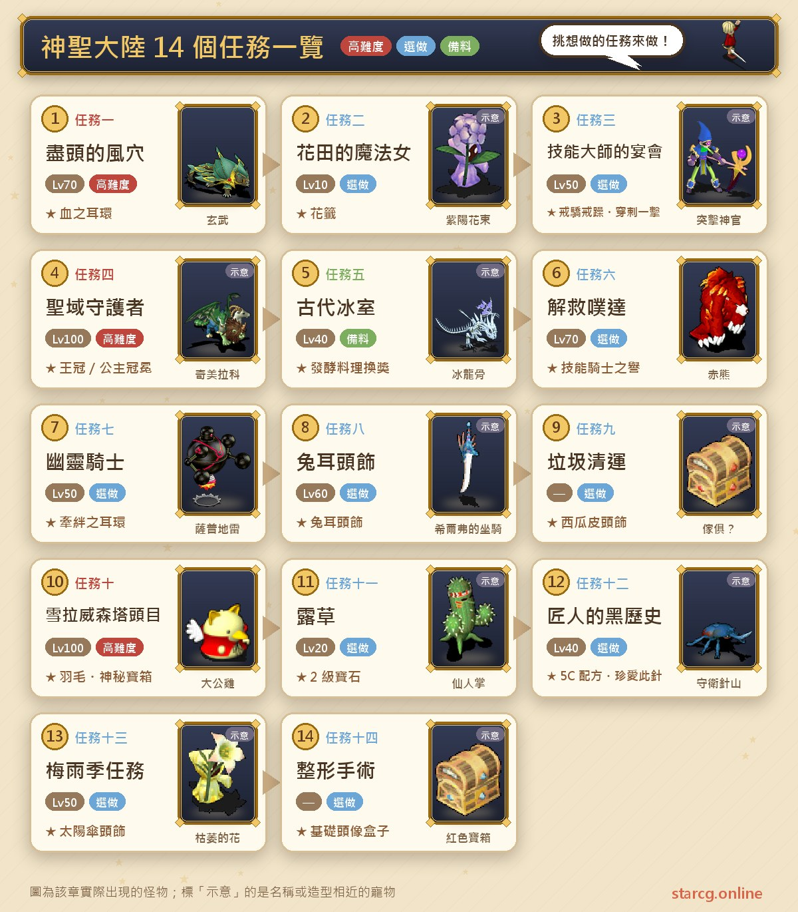
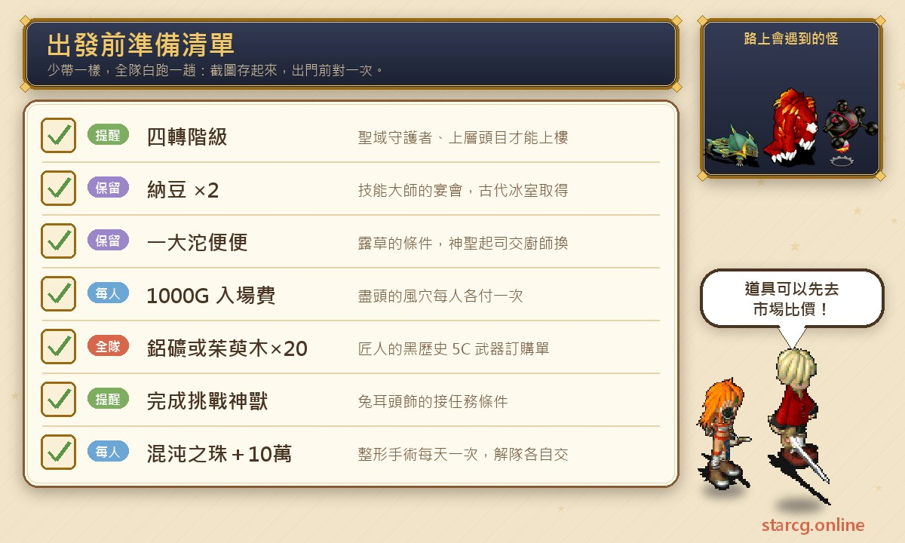
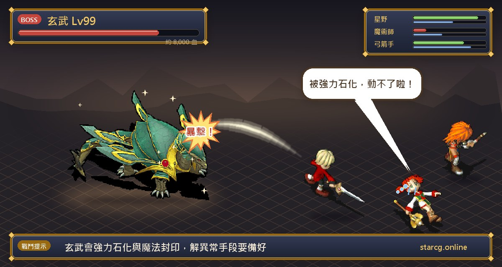
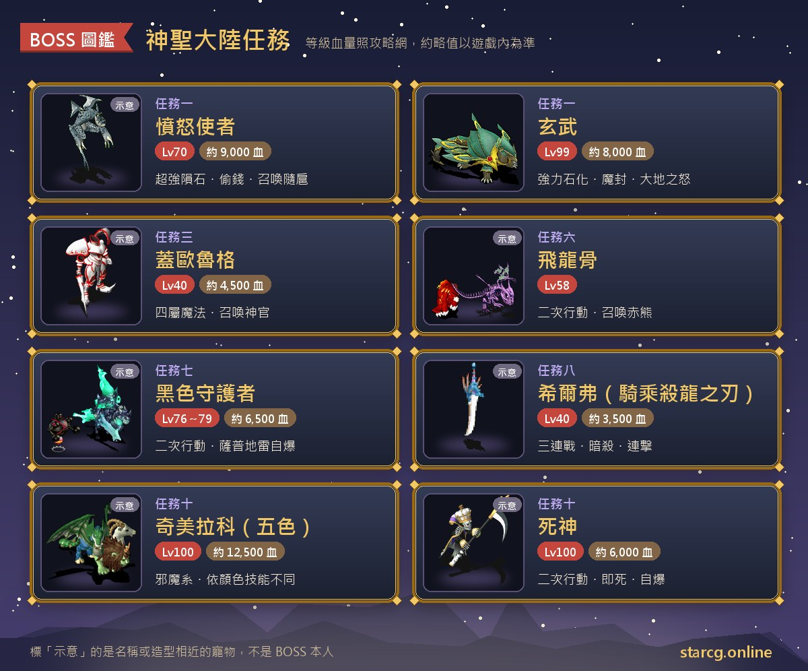

크로스게이트의 신성 대륙(神聖大陸)은 엘사 섬(艾爾莎島)과 에샤 섬(艾夏島)을 거점으로, 게레브렌 숲(蓋雷布倫森林), 메이블 협곡(梅布爾隘地), 브라킴 고원(布拉基姆高地), 셀라위슨탑(雪拉威森塔)까지 이어지는 넓은 지역이에요. 이곳의 퀘스트는 종류가 아주 다양해요. 귀걸이를 얻는 전투 퀘스트, 인물 스킬을 배우는 퀘스트, 머리 장식 외형을 받는 퀘스트, 요리를 만드는 서브 퀘스트가 있고, 4차 전직 이후에야 도전할 수 있는 탑 꼭대기 보스도 있어요. 권장 레벨도 10레벨 「꽃밭의 마법녀」부터 100레벨 「성역 수호자」까지 걸쳐 있어서, 거의 모든 단계에서 겸사겸사 풀 만한 게 있어요.

이 글은 공략 사이트의 신성 대륙 분류에 있는 14개 퀘스트를 하나의 흐름으로 모두 정리했어요. 각 퀘스트의 조건, NPC와 좌표, 준비할 아이템, 보스 레벨과 HP, 그리고 퀘스트 사이의 선후 관계(예를 들어 고대 얼음실의 요리가 스킬 마스터의 연회와 닭의장풀에 쓰이는 것)까지 담았어요. StarCG(星詠魔力), 水藍魔力, 初心魔力寶貝 어느 쪽을 하든 신성 대륙 퀘스트의 흐름은 같으니 그대로 따라 하면 돼요.

> 이 글은 [StarCG 공략 사이트](https://guide.starcg.net/) 신성 대륙 분류의 퀘스트 페이지를 정리한 것으로, 순서와 문장은 저희 방식으로 다시 정리했고 그대로 옮기지 않았어요. 보스 HP와 수치는 대략적인 값이니 실제 게임을 기준으로 해 주세요. 공략 사이트에 없는 내용은 「공략 사이트 미기재」라고 표시했고, 게임 업데이트로 내용이 바뀔 수 있어요.

## 신성 대륙 퀘스트란? 먼저 전체 순서부터

신성 대륙의 14개 퀘스트는 대부분 서로 독립적이라 시리즈 퀘스트처럼 장 순서대로 진행할 필요는 없지만, 미리 알아 둘 숨은 선후 관계가 몇 가지 있어요.

- **고대 얼음실 → 스킬 마스터의 연회**: 연회의 「낫토 루트」에는 낫토 2개(필수)와 신성한 치즈 1개(선택)가 필요한데, 모두 고대 얼음실의 압력솥으로 만들어요.
- **고대 얼음실 → 닭의장풀**: 닭의장풀 퀘스트를 받으려면 「커다란 똥 덩어리(一大沱便便)」가 있어야 하는데, 이건 신성한 치즈를 우울한 요리사에게 주고 받는 거예요.
- **성역 수호자 ↔ 셀라위슨탑 상층 보스**: 둘 다 셀라위슨탑 95층 이상에 있고 4차 전직이 필요해요. 상층 두목은 성역 수호자에서 파생된 퀘스트예요.
- **신수 도전 → 토끼 귀 머리장식**: 토끼 귀 머리장식은 직업 승급 분류의 「신수 도전(挑戰神獸)」을 먼저 끝내야 해요.

| 구분 | 퀘스트 이름 | 권장 레벨 | 보상 |
|---|---|---|---|
| 퀘스트 1 | 끝의 바람 구멍 | 70 | 피의 귀걸이(원한의 귀걸이도 랜덤 획득 가능) |
| 퀘스트 2 | 꽃밭의 마법녀 | 10 | 꽃 제비(감정 후 5가지 상 중 하나) |
| 퀘스트 3 | 스킬 마스터의 연회 | 50 | 스킬 계교계조, 관통 일격 |
| 퀘스트 4 | 성역 수호자 | 100(4차 전직) | 왕관/공주 티아라/냥냥 모자 머리 장식 |
| 퀘스트 5 | 고대 얼음실 | 40 | 식재료에 따라 낫토, 신성한 치즈 등 |
| 퀘스트 6 | 푸다 구출 | 70 | 스킬 기사의 명예 |
| 퀘스트 7 | 유령 기사 | 50 | 인연의 귀걸이, 마족의 수정, 7레벨 보석 |
| 퀘스트 8 | 토끼 귀 머리장식 | 60 | 토끼 귀 머리장식 |
| 퀘스트 9 | 쓰레기 수거 | 공략 사이트 미기재 | 수박 껍질 머리 장식(1% 확률) |
| 퀘스트 10 | 셀라위슨탑 상층 보스 | 100(4차 전직) | 키메라의 깃털, 신비한 보물상자 |
| 퀘스트 11 | 닭의장풀 | 20 | 2레벨 사파이어/모험의 별/자수정 |
| 퀘스트 12 | 장인의 흑역사 | 40 | 5C 무기·방어구 레시피, 소중한 이 바늘 |
| 퀘스트 13 | 장마철 퀘스트 | 50 | 양산 머리 장식 |
| 퀘스트 14 | 성형 수술 | 공략 사이트 미기재 | 기본 초상 상자 |

추천 순서는 이래요. 낮은 레벨에서는 꽃밭의 마법녀와 고대 얼음실을 먼저 풀어 낫토와 신성한 치즈를 만들어 두고, 50레벨쯤에 스킬 마스터의 연회, 유령 기사, 장마철 퀘스트를 하세요. 70레벨에는 끝의 바람 구멍과 푸다 구출을 하고, 4차 전직 후에 셀라위슨탑 꼭대기로 올라가요.

## 출발 전에 준비할 것

신성 대륙 퀘스트는 「몸에 어떤 물건이 있어야 받을 수 있는」 경우나 「사람마다 각자 돈을 내야 하는」 경우가 많아요. 쓰는 물건을 아래에 모아 두었으니 나가기 전에 한 번 확인하세요.

가장 큰 지출은 두 가지예요. 끝의 바람 구멍에 들어갈 때 파티의 **1인당 1000G**, 성형 수술 마지막 단계에서 **캐릭터마다 100,000골드**를 내야 해요. 스킬 마스터의 연회의 스킬 두 개는 각 6000G, 푸다 구출의 기사의 명예도 6000G예요. 재료로는 장인의 흑역사에 알루미늄 광석이나 수유나무 20개, 고대 얼음실에 대두, 우유 같은 식재료가 필요해요. 이런 것들은 사냥, 채굴, 벌목으로 직접 얻을 수도 있고, 이 사이트의 [시세 검색](/ko/market/)에서 시세를 먼저 보고 살지 직접 모을지 정해도 돼요.

## 퀘스트 1: 끝의 바람 구멍(피의 귀걸이)

권장 70레벨, 퀘스트 조건 없음. 보상은 **피의 귀걸이(血之耳環)**이고, 입구 전투에서 **원한의 귀걸이(怨恨之耳環)**를 랜덤으로 받을 수도 있어요.

1. 엘사 섬 북문으로 나가 **게레브렌 숲**에 들어가 **분노의 사자(憤怒使者)**를 찾으세요. 위치는 시간대에 따라 바뀌어요. 새벽(200, 34), 낮(190, 108), 해 질 녘(166, 65), 밤(200, 156)이에요.
2. 분노의 사자와 대화하세요.
   - 「예」를 고르면 파티 1인당 1000G를 내고 끝의 바람 구멍(盡頭的風穴)에 들어가요.
   - 「아니요」를 고르면 바로 전투가 시작돼요. 이기면 「귀걸이(耳飾)」를 랜덤으로 받고, 감정하면 **원한의 귀걸이**(상점 판매가 3000G)예요.
3. 들어간 뒤 1층(143, 59)의 계단으로 2층, (213, 134)로 3층에 가세요.
4. 3층의 **대지의 패왕(大地霸王)**(129, 111)과 대화하면 전투가 시작돼요.
5. 이긴 뒤 (94, 111)로 4층에 들어가고, 4층(133, 77)에서 3층으로 돌아갔다가 (200, 59)로 다시 4층에 가세요.
6. **용암 영감(岩漿老頭)**(212, 116)과 대화해 「오래된 열쇠(古老的鑰匙)」를 받고, 왔던 길로 3층에 돌아가 (94, 111)의 계단으로 내려가세요.
7. (275, 108)의 계단으로 5층에 가서 (22, 39)의 용암을 밟으면 뒤쪽에 붉은 전송석이 나타나요. 들어가서 **신수 줄리엣(神獸茱麗葉)**과 대화하면 전투가 시작돼요.
8. 이긴 뒤 오래된 열쇠로 뒤쪽의 전송 장치를 조사하면 모두 3층으로 된 용암 지대(熔岩地帶)에 들어가요.
9. 맨 아래층의 **현무(玄武)**(193, 169)와 대화해 싸우세요. 이기면 파티 중 **랜덤 3명**이 「귀걸이」를 받고 풍혈 밖으로 나가요. 감정하면 피의 귀걸이예요.

**보스 정보**:

- 분노의 사자: 70레벨, HP 약 9,000. 연격(5), 건곤일척, 돈 훔치기, 초강력 운석 마법을 쓰고, 호위가 4마리보다 적으면 소환해요. 곁에 영광의 사자(榮耀使者)와 용기의 사자(勇氣使者)가 각 3마리(68레벨, HP 약 1,000) 있어요.
- 대지의 패왕은 80레벨, HP 약 3,000, 신수 줄리엣은 80레벨, HP 약 4,000이고, 둘 다 공격만 해요.
- 현무: 99레벨, HP 약 8,000. 건곤일척, 강력 운석 마법, 강력 석화 마법, 마법 봉인, 대지의 분노를 써요.

**주의할 점**: 피의 귀걸이는 랜덤 3명만 받으니, 파티가 3명보다 많다면 분배를 미리 정해 두세요. 귀걸이 자체는 「생명 상한을 희생해 마법 상한을 얻는」 설계로, 공략 사이트에 나온 효과는 생명 상한 대폭 감소(×0.1~×0.05로 표기)와 마법 상한 ×1.2~×1.5라서 순수 마법형 캐릭터에게 잘 맞아요. 전체 루트에서 층을 여러 번 오가는데, 5단계의 「4층→3층→4층」이 가장 헷갈리니 좌표대로 가면 돼요. 마지막 현무는 석화도 하고 마법도 봉인하니, 상태 이상을 푸는 아이템과 스킬을 꼭 챙기세요.

## 퀘스트 2: 꽃밭의 마법녀(꽃말 릴레이)

권장 10레벨, 조건 없음. 보상은 감정이 필요한 「꽃 제비(花籤)」(R2 물품)예요.

윈딜 평원(溫迪爾平原) 서쪽에서 꽃말 순서에 따라 마법녀 네 명과 대화하면 되고, 누구부터 시작해도 돼요. 공략 사이트가 소개한 순서 중 하나는 에리카 → 유리카 → 마리카 → 세리카 → 에리카예요. 「 」 안의 꽃말은 게임 속 중국어 원문 그대로 적었어요.

1. **에리카(繪理佳)**(139, 130)와 대화해 「예」를 고르면 「수국 꽃다발(紫陽花束)」과 「에리카의 배달 카드(繪理佳的配達卡)」를 받고, 우엉꽃의 꽃말이 「不要欺負我」(괴롭히지 마)라는 걸 알게 돼요.
2. **유리카(由理佳)**(142, 153)에게 「歲月不饒人」(세월은 사람을 기다려 주지 않아)이라고 말하면 「관목 꽃다발(灌木花束)」과 「유리카의 배달 카드」를 받고, 수국의 꽃말이 「你很冷淡」(넌 차가워)이라는 걸 알게 돼요.
3. **마리카(麻理佳)**(115, 148)에게 「我不相信你」(널 믿지 않아)라고 말하면 「우설초 꽃다발(牛舌草花束)」과 「마리카의 배달 카드」를 받고, 관목 꽃의 꽃말이 「歲月不饒人」이라는 걸 알게 돼요.
4. **세리카(聖理佳)**(156, 178)에게 「不要欺負我」라고 말하면 「우엉꽃 꽃다발(牛蒡花束)」과 「세리카의 배달 카드」를 받고, 우설초의 꽃말이 「我不相信你」라는 걸 알게 돼요.
5. **에리카**에게 돌아가 「你很冷淡」이라고 말하면 「꽃 제비」를 받아요.

**보상**: 꽃 제비를 감정하면 5가지 상 중 하나예요. 금상(1000G에 판매), 은상(500G), 동상(200G), 참가상(30G), 다음 기회에(0G).

**주의할 점**: 마리카 근처의 **바위벌레(岩蟲)**(115, 150)는 함부로 클릭하지 마세요. 대화하면 퀘스트 아이템을 가져가 버려요. 이 퀘스트는 전투가 없어서 초보가 지나가는 길에 하기 좋지만, 보상은 순전히 운이에요.

## 퀘스트 3: 스킬 마스터의 연회(계교계조, 관통 일격)

권장 50레벨, 조건 없음. 보상은 스킬 마스터에게 **계교계조(戒驕戒躁)**와 **관통 일격(穿刺一擊)**을 배우는 것으로, 각 6000G예요. 공략 사이트는 두 가지 루트를 소개하며 **낫토 루트**가 더 쉽고 시간도 아낀다고 권해요. 사다리 루트는 오래 파밍해야 하고, 배우려는 캐릭터마다 사다리가 2개씩 필요해요.

### 낫토 루트(추천)

낫토 2개(필수)와 신성한 치즈 1개(선택)가 필요하고, 모두 퀘스트 5 「고대 얼음실」에서 만들어요. 치즈가 없어도 되지만 그 대신 예루크와 안센을 더 쓰러뜨려야 해요.

1. 동굴 마을(洞窟之村)과 추스트 마을(丘斯特村) 사이의 **브라킴 고원**으로 가서 견습 경비(實習守衛) 네 명(안센(安森), 하우(哈烏), 빌스(維爾斯), 예루크(耶魯克))을 쓰러뜨리세요. 적은 다리 위에 서 있는 순서대로 상대하는 게 아니에요. **경비 넷을 먼저 쓰러뜨리지 않고 음식을 주면, 나중에 다리 뒤의 경비 게오르크를 통과할 수 없어요.**
2. 예루크와 대화해 전투를 시작할 때는 몸에 **낫토와 신성한 치즈가 없어야** 해요. 동료에게 먼저 맡겨 두지 않으면 함께 빼앗겨요.
3. 견습 경비 하우를 쓰러뜨리면 (228, 126)으로 돌아와요. 예루크와 대화해 신성한 치즈를 건네고, 빌스와 대화해 낫토를 건네면 다리 반대편(224, 121)으로 이동돼요. 치즈를 쓰지 않는다면 예루크를 잡고 이어서 안센을 잡으면 돼요.
4. 이때 몸에는 **낫토가 1개만** 있어야 하고, 다른 하나는 다리 뒤의 경비에게 줄 몫이에요.
5. 다리 뒤의 경비 **게오르크(蓋歐魯格)**(177, 79)와 대화해 「예」를 고르고 낫토를 건네면 전투가 시작돼요.
6. 이기면 고원의 다른 곳으로 이동되고, **요르크(約爾克)**에게 계교계조를, **바덴(巴登)**에게 관통 일격을 각 6000G에 배워요.

### 사다리 루트

1. 브라킴 고원(227, 125)에서 견습 경비 예루크와 대화해 「아니요」를 고르면 전투가 시작돼요. 네 번째 경비인 **견습 경비 하우**를 쓰러뜨리면 「사다리(梯子)」가 랜덤으로 떨어질 수 있어요.
2. 순서대로 싸우지 않아도 되는 구조를 이용해 안센과 빌스를 건너뛸 수 있어요. 예루크를 잡은 뒤 왼쪽의 안센(206, 104)은 무시하고 오른쪽의 하우(224, 112)를 잡으세요.
3. 배우려는 캐릭터마다 **사다리 2개**를 모아야 해요. 사다리는 랜덤 드롭이고 거래할 수 없어서, 공략 사이트는 사다리가 필요한 캐릭터가 용병을 데리고 하우를 잡아 필요 없는 사람에게 떨어지지 않게 하라고 권해요.
4. 에샤 섬 동문으로 브라킴 고원에 들어가 (91, 192)에서 인벤토리의 사다리를 사용해 비밀 통로로 들어가고, 3층(234, 121) → 2층(133, 54) → 1층 순서로 가세요.
5. 비밀 통로 1층(150, 111)에서 사다리를 사용하면(위치가 맞으면 메시지가 떠요) 고원의 다른 곳으로 이동되고, 요르크와 바덴에게 스킬을 배워요.

**보스 정보**: 경비 넷은 모두 40레벨, HP 약 3,500~5,500(빌스가 가장 많음)이고, 각자 35~39레벨의 돌격 신관(突擊神官) 또는 기갑 신관(機甲神官) 5마리를 데리고 있어요. 게오르크는 40레벨, HP 약 4,500이고, 4속성 마법과 강력 회복 마법을 쓰며 신관을 소환해요.

**주의할 점**: 공략 사이트에 따르면, 나중에 다시 풀려면 한 번이라도 낫토를 주고 게오르크와 싸운 적이 있는 경우 경비 넷을 다시 잡는 1단계부터 시작해야 해요.

## 퀘스트 4: 성역 수호자(왕관, 공주 티아라, 냥냥 모자)

권장 100레벨, 조건은 **4차 전직 계급**이에요. 보상은 왕관, 공주 티아라, 냥냥 모자 머리 장식이에요.

**셀라위슨탑 가는 법**: 리셰리아 성(里謝里雅堡)(58, 89)에서 전송 → 전송석으로 방을 나감 → (26, 34)에서 아래층으로 → (30, 39)에서 아래층으로 → (59, 93)의 전송석으로 나감 → 엘사 섬(165, 154)에서 대화해 「예」 → (90, 99)에서 셀라위슨탑에 들어감 → (108, 41)에서 1500G를 내고 입장. 탑 안에는 빠른 이동 지점이 있어요. 1층(75, 50) ↔ 50층(78, 59), 50층(16, 44) ↔ 95층(102, 44)이에요.

1. 95층에서 **수호자 제스(守護者傑斯)**(28, 104)와 대화해 「예」를 고르면 「제스의 부적(傑斯的護身符)」을 받아요. **4차 전직을 하지 않은 캐릭터는 제스와 대화해도 위층으로 갈 수 없어요.**
2. 96층에서 **수호자 메아(守護者梅亞)**(88, 118)와 대화해 「메아의 부적」으로 바꾸세요. 부적 없이 수호자와 대화하면 제스에게 돌려보내지고, 다시 받을 수 있어요.
3. 97층에서 **수호자 디스(守護者迪斯)**(117, 125)와 「디스의 부적」으로 바꾸세요.
4. 98층에서 **수호자 우스(守護者烏斯)**(120, 120)와 「우스의 부적」으로 바꾸세요.
5. 99층에서 **수호자 니스(守護者妮斯)**(102, 54)와 「니스의 부적」으로 바꾸세요.
6. 맨 위층(103, 134)의 계단으로 셀라위슨탑 꼭대기에 올라가, 니스의 부적을 가진 채 **나이 영감(奈爺)**과 대화하세요.
   - 왕관도 공주 티아라도 없을 때 「예」를 고르면 **왕관(王冠)**을 받아요.
   - 왕관도 공주 티아라도 없을 때 「아니요」를 고르면 **공주 티아라(公主冠冕)**를 받아요.
   - 둘 중 하나를 이미 가지고 있으면 다른 하나로 바꿔 줘요.
   - 왕관과 공주 티아라를 둘 다 가지고 있으면 둘 다 내고 랜덤 1종의 **냥냥 모자(喵喵帽)**(순수 외형, 4가지 색)로 바꿔 줘요.

**머리 장식의 용도**: 왕관을 가지고 있으면 1층의 **히코(飛子)**(35, 95)와 대화해 신멜(辛梅爾)로, 공주 티아라를 가지고 있으면 1층의 **히미(飛美)**(33, 95)와 대화해 추스트 마을로 전송돼요. 둘 다 내구도가 줄지 않아요.

**주의할 점**: 여기서 「가지고 있다」는 인벤토리에 넣어 둔 상태를 말해요. 왕관이나 공주 티아라를 한 번 「사용」하면 외형만 남고 전송 기능을 잃으며, 그 캐릭터는 **같은 머리 장식을 퀘스트로 다시 받을 수 없어요.** 사용한 적 없는 캐릭터로 다시 풀거나 다른 플레이어에게 사야 해요. 냥냥 모자가 갖고 싶다면 두 개 모두 먼저 사용하지 마세요.

## 퀘스트 5: 고대 얼음실(압력솥 요리)

권장 40레벨, 조건 없음. 보상은 압력솥에 넣은 식재료에 따라 달라지고, 스킬 마스터의 연회와 닭의장풀의 재료 준비 퀘스트예요.

1. (스토리, 생략 가능) 에샤 섬 나카무라 청과점(中村蔬果店)(131, 150)과 모험가 여관(112, 115)에서 초록 보물상자(46, 16)(62, 56)를 조사해 「오늘 밤의 요리 제5권(今晚的佳餚第五集)」을 얻고, 에샤 섬(156, 147)의 **아는 것 많은 행인(所知甚詳的路人)**에게 내용을 들어요.
2. 준비한 식재료를 들고 프레이아(芙蕾雅)(521, 309) 빙실 안의 **빙고 경비(冰庫守衛)**(72, 111)에게 가서 100G를 내고 「압력솥 열쇠(壓力鍋的鑰匙)」를 받으세요. **식재료는 한 종류, 한 개만 가지고 있어야** 해요.
3. 메이블 협곡(142, 158)의 무너진 입구로 들어가 (192, 31), (187, 146)을 지나 붕괴된 빙실(崩壞的冰室)에 도착해요.
4. 빙실(74, 111)에서 열쇠로 압력솥을 열면 해당 발효 음식을 받아요(공략 사이트에는 여기 층수가 표시되어 있지 않아요).
5. 에샤 섬의 복신 식당(福神小館)(175, 138)에서 요리를 **우울한 요리사(憂鬱的廚師)**(21, 20)에게 주고 물건으로 바꾸세요.

**식재료와 완성품**:

| 식재료 | 얻는 법 | 압력솥 완성품 | 요리사에게 주고 받는 것 |
|---|---|---|---|
| 대두 | 재료 가게/판부르크 유적(111, 54) 사냥 R2 | 낫토(스킬 마스터의 연회용) | 오늘 밤의 요리 제4권 |
| 우유 | 재료 가게/이르 마을 밖(679, 312) 사냥 R2 | 신성한 치즈(스킬 마스터의 연회용) | 커다란 똥 덩어리(닭의장풀용) |
| 배추 | 재료 가게/메이블 협곡(189, 58) 사냥 R3 | 배추절임(泡菜)(마력 약 10 회복) | 요르크 성석(約爾克聖石) |
| 연어 | 빙실 1층 업무 중인 사람(137, 95)에게 100G 구매/메이블 협곡(202, 161) 사냥 R5 | 소금 건어물(鹹魚乾)(마력 약 20 회복) | 작은 땅의 보석(小顆的土之寶石) |
| 신성한 쌀 | 재료 가게/윈딜 평원(223, 68) 사냥 R1 | 고등어 절임 초밥(醃鯖魚壽司)(마력 약 150 회복) | 잘 만든 항아리(製作精良的壺)(600G에 판매) |

그 밖에 우유로 요구르트(마력 약 10 회복, 요리사에게 주면 마석으로 교환)가 나올 수도 있고, 모든 식재료는 일정 확률로 「신비한 요리(神秘的料理)」(생명력 약 50 감소)가 되기도 해요.

**가짜 압력솥**: 에샤 섬 술집 옆(167, 145)의 **동굴통(洞穴通)**과 여러 번 대화하면 「압력솥 열쇠(가짜)(壓力鍋的鑰匙（偽）)」를 받을 수 있고, 무제한으로 받을 수 있어요. 이걸로 붕괴된 빙실의 아무 압력솥(72, 113 제외)이나 열면 요구르트, 생명력 회복약(200), 신비한 요리, 신성한 치즈, 배추절임이 나오거나, **아이스 드라고스컬(冰龍骨)**(85레벨, 2회 행동, 공격만 함)과의 전투가 벌어질 수도 있어요.

**주의할 점**: 스킬 마스터의 연회에는 낫토 2개가, 닭의장풀에는 커다란 똥 덩어리(즉, 신성한 치즈를 먼저 만들어 요리사에게 주는 것)가 필요하니, 대두는 최소 두 번, 우유는 따로 한 번 더 다녀와야 해요.

## 퀘스트 6: 푸다 구출(기사의 명예)

권장 70레벨, 조건 없음. 보상은 스킬 **기사의 명예(騎士之譽)**이고 비용은 6000G예요. 셀라위슨탑까지 가는 길은 퀘스트 4와 같아요.

1. 셀라위슨탑 61층에서 **내트(奈特)**(290, 219)와 대화해 「예」를 고르면 「푸다의 사진(噗達的照片)」을 받아요. 빠른 루트는 1층(75, 50)에서 50층, 50층(25, 55)에서 60층으로 간 다음 60층 바깥층과 61층으로 걸어가는 거예요.
2. 62층(51, 114)에서 **내트**와 대화해 「예」를 고르면 파티가 해산되고 (47, 114)로 이동돼요. **기사 리몬(騎士李蒙)**(46, 105)과 대화해 기사의 명예를 배우세요. 다 배운 뒤 (50, 114)로 나갈 수 있어요. **스킬만 배울 사람은 여기까지 하면 돼요.**
3. (스토리, 생략 가능) 65층의 **비룡 드라고스컬(飛龍骨)**(66, 94)과 대화해 리더가 푸다의 사진을 내면 전투가 시작되고, 이긴 뒤 비룡 드라고스컬(78, 90)과 다시 대화하면 밖으로 나가요.

**보스 정보**: 비룡 드라고스컬은 58레벨, 2회 행동이며 건곤일척, 연격, 반격, 성스러운 방패를 쓰고 스칼렛 베어(赤熊)을 소환해요. HP는 공략 사이트 미기재예요. 스칼렛 베어는 58레벨, 화 80, 풍 20이고 양날, 연격, 파(2), 붕격을 써요.

## 퀘스트 7: 유령 기사(인연의 귀걸이)

권장 50레벨, 조건 없음. 보상은 **인연의 귀걸이(牽絆之耳環)**이고, 젖은 성냥으로 마족의 수정, 7레벨 보석 등을 교환할 수도 있어요.

1. 메이블 협곡(255, 167)에서 브라킴 고원 남동쪽으로 들어가 **동굴 경비(洞窟守衛)**(234, 314)와 대화하고 입장료를 내면 들어갈 수 있어요. 입장료는 레벨에 따라 49레벨 이하 무료, 50~59레벨 500G, 60~70레벨 700G, 71레벨 이상 2000G예요. 각 랜덤 미궁 중계 지점의 **철수 추진 위원(撤退推動委員)**이 동굴 밖으로 보내 줄 수 있어요.
2. (315, 213)의 노란 전송석으로 **깊은 풀의 녹색 동굴(深草的綠洞)**에 들어가세요. 여기서 랜덤으로 나타나는 **사프 지뢰(薩普地雷)**을 쓰러뜨리면 「젖은 성냥(潮濕的火柴)」이 떨어질 수 있고, 일정 개수를 모으면 중계 지점의 경품 교환 아가씨(獎品兌換女郎)에게 상품으로 바꿀 수 있어요. 예를 들어 14~16개는 랜덤 7레벨 보석, 17~18개는 마족의 수정이에요(19~20개는 오히려 아무것도 없어요). 공략 사이트는 성냥 드롭률이 매우 낮으니 훔치기 스킬 R1으로 얻으라고 권해요.
3. (123, 104)의 노란 전송석으로 **원령 동굴(怨靈洞窟)**에 들어가 랜덤으로 나타나는 기사 세 명을 찾으세요. 세 루트 중 하나를 고르면 돼요.
   - 먼저 **기사 하워드(騎士哈瓦德)**에게 「검의 목걸이(劍之首飾)」를 받음 → 기사 크래프트(騎士庫拉夫特)와 대화 → **기사 필립(騎士菲力普)**과 대화해 목걸이를 내고 전투.
   - 먼저 **기사 필립**에게 「먼 별의 반지(遠星之戒指)」를 받음 → 기사 하워드와 대화 → **기사 크래프트**와 대화해 반지를 내고 전투.
   - 먼저 **기사 크래프트**에게 「독수리 깃털 팔찌(鷲羽之手鐲)」를 받음 → 기사 필립과 대화 → **기사 하워드**와 대화해 팔찌를 내고 전투.
4. 이기면 파티 중 **랜덤 1명**이 인연의 귀걸이를 받아요. 동굴 경비(197, 7)와 대화해 나가면 퀘스트가 끝나요.

**보스 정보**: 검은 수호자(黑色守護者)는 76~79레벨, HP 약 6,500, 2회 행동이며 공격, 기공탄, 다중 공격 무효를 쓰고, 사프 지뢰가 3마리 이하로 남으면 소환해요. 곁에는 76~79레벨 사프 지뢰 9마리(수 40, 화 60)가 있고, 호위, 강력 화염 마법, 빙결 마법, 계교계조, 그리고 **전체 피해를 주는 자폭**을 써요.

**공략법**: 사프 지뢰 아홉 마리가 자폭으로 전체를 때리는 게 이 전투에서 가장 위험한 부분이에요. 인연의 귀걸이(5레벨 귀걸이, 정신 +5~+8, 회복 +15~+18)는 한 명만 받으니 파티를 짜기 전에 미리 정해 두세요. 동굴은 랜덤 미궁이라 길이 익숙하지 않다면 이 사이트의 [미궁 계단 찾기](/ko/maze/)로 길을 기록하면 도움이 돼요.

## 퀘스트 8: 토끼 귀 머리장식(서명 모으기)

권장 60레벨, 조건은 직업 승급의 「신수 도전」 완료예요. 보상은 순수 외형인 **토끼 귀 머리장식(兔耳頭飾)**이에요.

1. 에샤 섬(157, 93)의 집에서 **라파디(拉法地)**와 대화해 「예」를 고르면 「명부(名冊)」를 받아요.
2. 추스트 마을(80, 93)의 **이반(伊凡)**에게 서명을 받으세요.
3. 우크라이나 마을(烏克蘭)(85, 59)의 **피니(菲尼)**에게 서명을 받으세요.
4. 아케루파 마을(阿凱魯法村) 잡화점(158, 139)의 **코니(康妮)**에게 서명을 받으세요.
5. 코랄 마을(哥拉爾鎮)(174, 170)의 코랄 병영(哥拉爾兵營) 2층에서 **마틴(馬丁)**(18, 11)에게 서명을 받으세요.
6. 아스티아 신전(阿斯提亞神殿)(유다를 잡는 신전) 2층 북쪽(왼쪽) 방에서 **수아(蘇亞)**(13, 13)에게 서명을 받으세요.
7. 마법 대학(魔法大學)(118, 100)에서 내부 (44, 17) 또는 (35, 17)로 강당에 들어가고, (4, 9) 또는 (4, 10)으로 학장실에 들어간 뒤, (13, 8)의 전송석으로 들어가 **실프(希爾弗)**와 대화해 싸워요. 이기면 서명을 받아요.
8. 에샤 섬(157, 93)의 라파디에게 돌아가 명부를 토끼 귀 머리장식으로 바꾸세요.

**보스 정보**: 실프는 3연전이고 모두 40레벨이에요. 1전은 HP 약 2,000이고 분신 2마리를 소환해요. 2전은 분신 5마리를 소환해요. 3전은 드래곤 엣지(殺龍之刃)를 타고 나오며 HP 약 3,500, 건곤일척, 연격(5), 암살을 써요.

**주의할 점**: 서명 장소가 여섯 마을에 흩어져 있어서 전투보다 이동이 더 오래 걸려요. 머리 장식은 사용한 뒤 「캐릭터 꾸미기 → 외형 → 장식」에서 언제든 바꿀 수 있어요.

## 퀘스트 9: 쓰레기 수거(하루 한 번)

권장 레벨과 조건은 공략 사이트 미기재이고, **하루에 한 번만** 할 수 있어요.

에샤 섬 하스타의 집(哈絲塔的家)(167, 102)에서 **하스타(哈絲塔)**(12, 10)와 대화하면 「가구?(傢俱？)」를 받거나, **1% 확률**로 「수박 껍질 머리 장식(영구)(귀속)(西瓜皮頭飾（永久）（綁定）)」을 받아요. 가구?를 감정하면 쓰레기 1/쓰레기 2/쓰레기 3 세 종류 중 하나이고, 공략 사이트는 별 쓸모가 없다고 적어 두었어요. 확률이 아주 낮아서 매일 지나가는 길에 한 번씩 눌러 보면 되고, 일부러 찾아갈 필요는 없어요.

## 퀘스트 10: 셀라위슨탑 상층 보스(성역 신수)

권장 100레벨, 조건은 **4차 전직 계급**이고 성역 수호자의 파생 퀘스트예요. 셀라위슨탑 96~100층을 걸어 다니면 랜덤으로 보스전이 시작되고, 이기면 물품이 랜덤으로 떨어져요. 탑까지 가는 길과 빠른 이동 지점은 퀘스트 4와 같아요.

**출현 층과 드롭**:

- **96~97층: 키메라과(奇美拉科)**. 96층은 매 전투마다 빨강, 노랑, 파랑, 초록 중 한 마리가 랜덤으로 나오고, 97층은 매 전투 검정 한 마리 또는 다른 색 두 마리가 나와요. 쓰러뜨리면 색에 따라 「키메라의 깃털(奇美拉的羽毛)」 한 종류를 랜덤으로 받아요(10레벨 부적, 내구 1/1, 로그아웃하거나 바닥에 놓으면 사라지며, 잠금하면 로그아웃 시 사라지는 걸 막을 수 있어요). 깃털 효과는 색마다 달라서, 예를 들면 생명력·마력 교환 보너스, 공격력·방어력 -300~+300, 반격·회피 ±50, 필살·명중 ±50 같은 것들이 있어요.
- **97층~맨 위층: 사신(死神)**. 쓰러뜨리면 1~10레벨 「신비한 보물상자(神秘寶箱)」를 랜덤으로 받고, 펫 수정, 9레벨 보석, 설계도, 그리고 순수 외형인 굴뚝·새싹의 마음 머리 장식이 나올 수 있어요.
- **98층~맨 위층: 해룡과(海龍科)**. 쓰러뜨리면 「불가사의한 비늘(不可思議的鱗片)」을 랜덤으로 받을 수 있지만, 공략 사이트에는 **현재 일시적으로 드롭되지 않으며 수정 예정**이라고 적혀 있어요.

**보스 정보**:

- 키메라과는 다섯 색 모두 100레벨, HP 약 12,500, 사마계예요. 빨강은 화, 노랑은 풍, 초록은 지, 파랑은 수가 각 100이고, 검정은 4속성이 각 20이에요. 스킬은 색마다 달라요(노랑은 강력 마법과 석화 위주, 초록은 물리 연격 위주).
- 사신: 100레벨, HP 약 6,000, 2회 행동이며 양날, 건곤일척, 즉사 마법, 마법 봉인, 자폭을 써요.
- 해룡과: 여섯 종의 해룡이 모두 100레벨, HP 약 3,500~5,000이고, 망각, 석화, 수면, 혼란 같은 상태 이상 위주예요. 그 밖에 **큰 수탉(大公雞)**(100레벨)이 병아리를 소환하고 3턴째에 도망쳐요.

**공략법**: 이 층의 적들은 거의 다 강한 상태 이상을 걸고, 사신은 즉사와 자폭까지 있으니 파티에 안정적인 상태 이상 해제와 부활 수단을 갖추세요. 먼저 이 사이트의 [데미지 계산기](/ko/damage/)로 파티 화력을 계산해서 사신의 두 번 행동 사이에 잡을 수 있는지 확인해 보세요.

## 퀘스트 11: 닭의장풀(새벽 시간 제한)

권장 20레벨, 조건은 고대 얼음실에서 받은 **커다란 똥 덩어리**를 가지고 있는 거예요. 보상은 2레벨 사파이어, 2레벨 모험의 별, 2레벨 자수정 중 하나예요.

1. 메이블 협곡의 출렁다리로 브라킴 고원에 들어간 뒤 **벌레 굴(蟲洞)**(204, 267)로 들어가세요.
2. 맨 아래층까지 가면 **밤**에 선인장 한 그루가 나타나요. 똥을 넣으면 「땅속 선인장의 가시(地底仙人掌的刺)」를 받아요.
3. **현실 시간으로 2시간**이 지난 뒤 선인장을 다시 조사하면 「쇠똥구리(滾糞蟲)」를 받아요.
4. 새벽이나 해 질 녘에 게레브렌 숲에 가서 쇠똥구리를 **꽃 따는 소녀(採花的少女)**(144, 113)에게 주세요.
5. **새벽**에 꽃덤불(142, 113)로 걸어가면 「닭의장풀(露草)」을 받아요. 받는 순간부터 시간이 흐르고, **20분 뒤 닭의장풀이 시들면** 퀘스트 실패예요.
6. 역시 새벽에 닭의장풀을 들고 추스트 마을 이슬의 다리(露之橋)의 신비한 입구(88, 93)로 가세요. 메시지가 뜨면 확인을 눌러야 화면이 바뀌고, 보이지 않는 다리 위로 걸어가요.
7. **파리트(帕裡特)**(99, 88)와 대화해 닭의장풀을 건네면 보석을 받아요.

**주의할 점**: 공략 사이트는 실제로는 15분 안에 도착해야 한다고 경고하니, 닭의장풀을 받으면 바로 이동하세요. 퀘스트 전체가 밤과 새벽 두 시간대에 걸쳐 있고 현실 시간 2시간도 기다려야 하니, 게임 속 시간대를 먼저 맞춰 두고 출발하는 게 좋아요.

## 퀘스트 12: 장인의 흑역사(5C 레시피와 소중한 이 바늘)

권장 40레벨, 조건은 관련 생산 스킬 **5레벨**이에요. 보상은 5C 무기 제작, 5C 방어구 제작 레시피와 팔찌 **소중한 이 바늘(珍愛此針)**이에요.

**공통 입구**: 에샤 섬 동문에서 출발해 브라킴 고원의 폭포 경비(瀑布守衛)(145, 126)에게 500G를 내고 지나간 뒤, **흑역사의 석굴(黑歷史之石洞)**(266, 267)로 가세요. 석굴은 1층 계단(164, 67)에서 2층, 2층 계단(132, 203)에서 3층으로 가요. 알루미늄 광석(鋁礦)은 석굴 1층(163, 191)에서 채굴 R3으로, 수유나무(茱萸木)는 게레브렌 숲(187, 43) 근처에서 벌목 R3으로 얻어요.

**5C 무기 제작**:

1. 3층에서 해당 장인 펫 NPC에게 「주문서(訂購單)」를 받으세요(5레벨 생산 스킬이 여러 개여도 한 장만 받으면 돼요). 검 주조, 도끼 제작, 창 제작, 단검 제작은 알루미늄 광석 20개, 활 제작, 지팡이 제작, 투척 무기 제작은 수유나무 20개가 필요해요. 예를 들어 검 주조는 쿠로(庫羅)(219, 105), 활 제작은 스테티(史特堤)(191, 90)이고, 다른 장인의 좌표는 공략 사이트를 참고하세요.
2. 3층(274, 147)에서 4층으로 내려가 도구점(247, 85)에서 해당 「도구(工具)」로 바꾸세요.
3. 3층으로 돌아가 도구와 채집물을 장인 펫에게 주면 빨간 호루라기(紅哨子) 또는 파란 호루라기(藍哨子)를 받아요.
4. 3층(211, 28) 또는 (131, 157)에서 반대편 4층으로 들어간 뒤, (193, 198)에서 5층으로 내려가세요.
5. 빨간 호루라기를 가진 사람이 리더가 되어 5층(233, 118)에 서면 (237, 115)에 전송석이 나타나고, 파란 호루라기를 가진 사람이 (208, 109)에 서면 (203, 105)에 나타나요.
6. 일곱 명의 무기 장인에게 새 R5 무기 제작을 배워요. 예를 들어 검 주조의 흑작 태도(黑作太刀), 지팡이 제작의 마정석 지팡이(魔晶之杖) 같은 것들이에요.

**5C 방어구 제작**:

1. 3층(229, 193)의 **스티븐스(史帝文斯)**에게 「주종의 솔(主僕之刷)」을 받으세요.
2. 3층에서 **지킬(杰凱爾)**을 찾아 「장인의 증표 제작 도구 갑(工匠之證製作工具甲)」을 받으세요. 밤에는 (245, 151), 낮에는 (219, 48)에 있어요. 아직 도구 을이 없으면 수유나무 5개, 이미 도구 을이 있으면 10개를 내야 해요.
3. 5층에서 **하이드(海地爾)**를 찾아 「장인의 증표 제작 도구 을(工匠之證製作工具乙)」을 받으세요. 낮에는 (261, 131), 밤에는 (197, 58)에 있어요. 아직 도구 갑이 없으면 알루미늄 막대(鋁條) 1개, 이미 도구 갑이 있으면 2개를 내야 해요.
4. 3층(229, 193)의 스티븐스에게 돌아가 「방어구 장인의 증표(防具工匠之證)」를 받으세요.
5. 1층(259, 75)으로 돌아가 경비 바늘산(守衛針山)과 대화해 다음 구역으로 들어가서, 여덟 명의 방어구 장인에게 새 R5 방어구 제작을 배워요(예: 성기사의 투구(聖騎士之盔), 치유의 로브(治癒之袍)).

**소중한 이 바늘**:

1. 1층(259, 75)에서 **경비 바늘산**과 대화해 싸우고, 이기면 「바늘산표 특제 바늘(針山牌特製好針)」을 받아요.
2. 차례대로 2층(95, 204)의 하슈(哈修), 4층(159, 74)의 리슈(莉修), 6층(129, 149)의 아슈(亞修)와 대화해 싸우고, 아슈를 이기면 (299, 122)에서 마슈(馬修)와 대화하세요.
3. 1층의 경비 바늘산에게 돌아가면 **소중한 이 바늘**을 받아요. 장착한 뒤 칭호 담당 아몽(阿蒙)과 대화하면 칭호 「공허한 사람(空虛的人)」을 받을 수 있어요.

**보스 정보**: 이 전투들의 상대는 모두 경비 바늘산으로, 34레벨, HP 약 1,150, 2회 행동이며 계교계조, 신속과단(迅速果斷), 수면 공격, 공격 흡수를 써요.

**주의할 점**: 소중한 이 바늘을 몸에 지니고 있으면 스티븐스가 주종의 솔을 주지 않아서, 바늘을 버리지 않는 한 방어구 제작을 진행할 수 없어요. 그러니 둘 다 갖고 싶다면 **방어구 제작을 먼저 하고, 소중한 이 바늘을 나중에** 하세요.

## 퀘스트 13: 장마철 퀘스트(양산 머리 장식)

권장 50레벨, 조건 없음. 보상은 **양산 머리 장식(太陽傘頭飾)**이에요.

1. 게레브렌 숲에서 **암벽 등반 전문가 로치(攀岩專家羅奇)**(216, 43)를 찾아 대화에서 「아니요」를 고르면 루도트 분지(魯多特盆地)에 들어가요.
2. 루도트 분지에서 **루도트 분지 서부**로 들어가 시든 꽃(249, 180)을 조사해 「예」를 고르면 「시든 꽃(枯萎的花)」을 받아요.
3. **루도트 분지 남부**의 **빌리아(俾利雅)**(217, 86)와 대화해 「예」를 고르고 시든 꽃을 건네면 「물갈이꽃 씨앗(水割花的種子)」을 받아요.
4. 루도트 분지 서부(199, 192)로 가면 대화창이 뜨고, 「예」를 골라 씨앗을 건네면 「이슬 결정(露水結晶)」을 받아요.
5. **10분 안에** 루도트 분지 남부의 빌리아에게 돌아가 「예」를 고르고 이슬 결정을 건네면 「도니에게 남긴 말(給多尼的留言)」을 받아요. 시간이 지나면 이슬 결정이 녹아서 퀘스트 실패예요.
6. 루도트 분지로 돌아가 남긴 말을 **도니(多尼)**(169, 102)에게 건네면 양산 머리 장식을 받아요.

**주의할 점**: 5단계에 10분 제한이 있으니, 4단계 전에 서부에서 남부까지 가는 길을 미리 확인해 두세요. 공략 사이트에 따르면 퀘스트 아이템을 받은 뒤 돌아가는 길이 아주 머니, 그냥 로그아웃했다가 다시 가도 돼요.

## 퀘스트 14: 성형 수술(기본 초상 상자)

권장 레벨은 공략 사이트 미기재이고, **하루에 한 번**이에요. 프랭크 의사가 원하는 혼돈의 구슬을 내면, 초상 외형을 바꾸는 「기본 초상 상자(基礎頭像盒子)」를 한 번 살 수 있어요.

1. 엘사 섬의 「신전·가람(神殿．伽藍)」으로 가서 **밤**에 1층 오른쪽(84, 137)의 빨간 보물상자를 조사하면 「다곤 신의 열쇠(大袞神之匙)」를 받아요.
2. 2층 오른쪽의 「요르크 신묘(約爾克神廟)」에서 **밤**에 (39, 21)을 조사하면 「호박의 알(琥珀之卵)」을 받아요.
3. 메이블 협곡(208, 129)의 **참깨 인형(芝麻娃娃)**을 찾아 「참깨 인형의 편지(芝麻娃娃的信)」를 받으세요.
4. 에샤 섬(175, 138) 복신 식당의 **인스·페스(英斯．費司)**에게 편지를 주고 「장로의 증표(長老之證)」로 바꾸세요.
5. 에샤 섬(150, 125)의 크롤리의 가게(克羅利的店)에서 다곤 신의 열쇠, 호박의 알, 장로의 증표를 모두 가진 채 **호테프(荷特普)**(47, 19)에게 「혼돈의 구슬(混沌之珠)」로 바꾸세요.
6. 에샤 섬 병원(112, 81)에서 계단에 서 있는 **프랭크 의사(傅蘭克醫生)**(37, 18)에게 혼돈의 구슬과 100,000골드를 내면 기본 초상 상자를 받아요.

**주의할 점**: 마지막 단계는 **파티를 해산하고 캐릭터마다 각자 대화해야** 하며, 혼돈의 구슬과 10만 골드도 1인당 하나씩 필요해요. 앞의 두 단계는 둘 다 밤에만 할 수 있으니 같은 밤에 함께 끝내면 좋아요.

## 신성 대륙 자주 묻는 질문

**끝의 바람 구멍의 피의 귀걸이는 모두 받을 수 있나요?** 꼭 그렇진 않아요. 현무를 이기면 파티 중 랜덤 3명이 귀걸이를 받아요. 원한의 귀걸이는 입구에서 분노의 사자에게 「아니요」를 골라 싸워 이기면 랜덤으로 받아요.

**스킬 마스터의 연회에 신성한 치즈가 꼭 필요한가요?** 꼭 필요하진 않아요. 낫토 2개는 필수지만 신성한 치즈는 선택이에요. 치즈를 쓰지 않으면 예루크와 안센을 더 쓰러뜨려야 해요.

**왕관과 공주 티아라를 둘 다 가질 수 있나요?** 가능해요. 하나를 받은 뒤 다시 나이 영감과 대화하면 다른 하나로 바꿔 주고, 둘 다 인벤토리에 있을 때 대화하면 두 개를 내고 랜덤 냥냥 모자 하나로 바꿔 줘요. 「사용」한 머리 장식은 전송 기능을 잃고, 그 캐릭터는 다시 풀 수도 없다는 점에 주의하세요.

**닭의장풀이 왜 계속 실패하나요?** 닭의장풀은 받은 뒤 20분이 지나면 시들고, 꽃을 따는 것과 이슬의 다리를 건너는 것 모두 새벽에 해야 해요. 공략 사이트는 실제로는 15분 안에 도착해야 한다고 경고해요.

**장인의 흑역사에서 방어구 레시피와 소중한 이 바늘을 둘 다 받을 수 있나요?** 가능하지만 방어구 제작을 먼저 해야 해요. 소중한 이 바늘을 몸에 지니고 있으면 스티븐스가 주종의 솔을 주지 않아요.

## 정리: 빙실에서 재료를 먼저 만들고, 4차 전직 후 탑으로

신성 대륙의 14개 퀘스트에는 정해진 순서가 없지만, 「고대 얼음실」을 첫 번째 재료 준비 퀘스트로 삼으면 가장 매끄러워요. 낫토와 신성한 치즈는 곧바로 스킬 마스터의 연회에 쓰고, 커다란 똥 덩어리는 닭의장풀의 입장권이 돼요. 50~70레벨에는 유령 기사, 장마철 퀘스트, 끝의 바람 구멍, 푸다 구출을 차례로 풀어 귀걸이, 머리 장식, 기사의 명예를 챙기고, 4차 전직 후에는 셀라위슨탑 꼭대기에 올라 왕관과 공주 티아라를 받으면서 키메라과와 사신에도 도전해 보세요. 매일 쓰레기 수거와 성형 수술도 지나가는 길에 한 번씩 챙기는 걸 잊지 마세요.

더 자세한 원문과 다른 지역 퀘스트는 [StarCG 공략 사이트](https://guide.starcg.net/)에서 볼 수 있어요. 식재료와 채집물은 이 사이트의 [시세 검색](/ko/market/)에서, 스칼렛 베어, 사프 지뢰, 현무 같은 몬스터의 성장은 [펫 도감](/ko/pets/)에서 확인하고, 셀라위슨탑 보스을 잡을 화력이 충분한지는 [데미지 계산기](/ko/damage/)로 가늠해 보세요.
