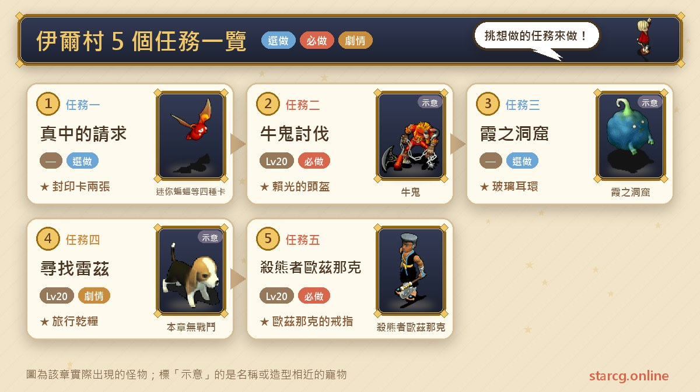
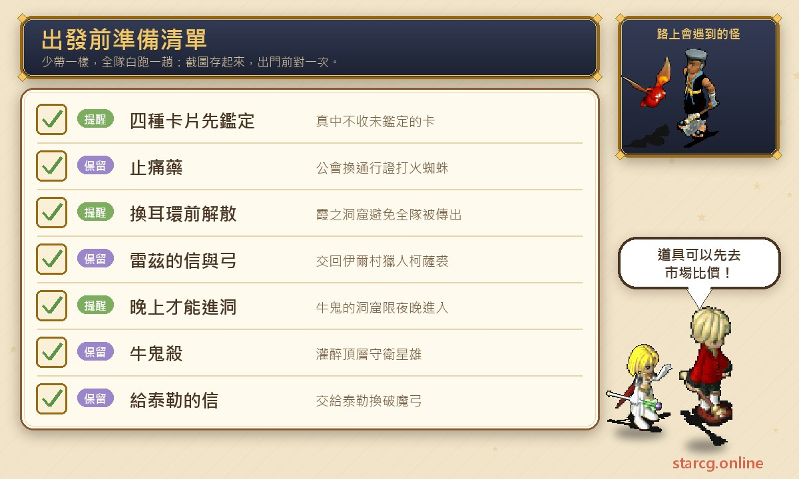
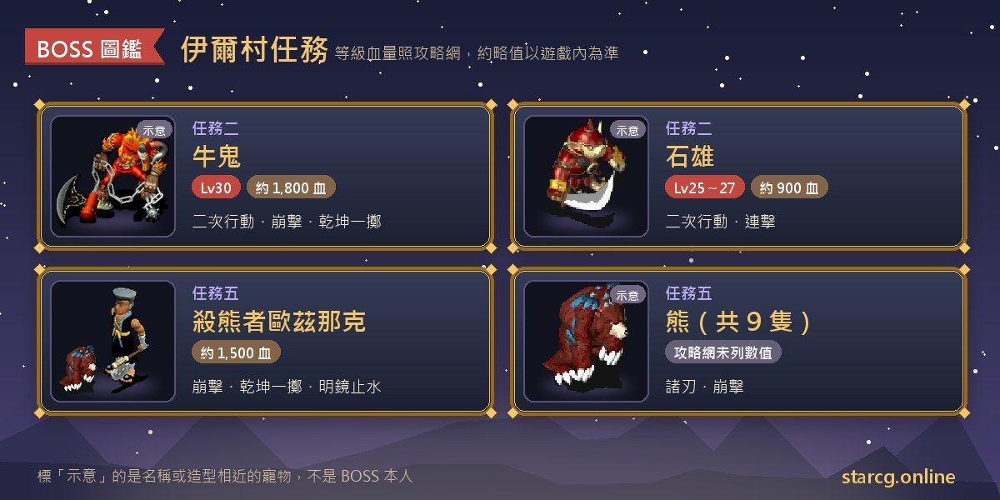
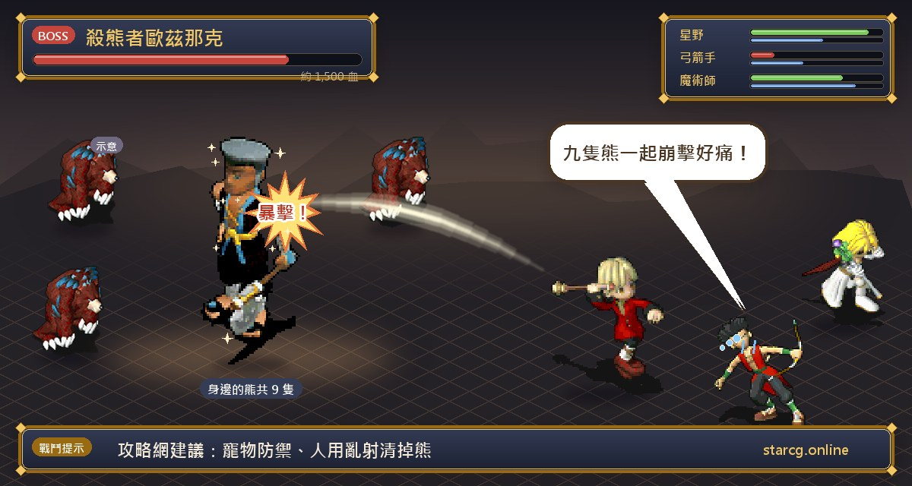

伊爾村是法蘭王國附近的海畔村落，從法蘭城東門過橋就能走到，攻略網形容它是新手冒險者的重要中繼站，也是討伐牛鬼與殺熊者的必經之地。這裡的五個任務大多落在 20 級以下：收集卡片換封印卡的「真中的請求」、走迷宮找耳飾的「霞之洞窟」、幫獵人找兒子的「尋找雷茲」，以及兩個有 BOSS 戰的「牛鬼討伐」與「殺熊者歐茲那克」。

這兩場戰鬥的獎勵後面都還用得到：牛鬼討伐的**賴光的頭盔**是聖拉魯卡村「回來報仇的牛鬼」的入場條件，殺熊者歐茲那克的**歐茲那克的戒指**則是另一個任務「攔路的熱沙」的必須品。這篇把五個任務的條件、NPC 與座標、BOSS 資料和容易出錯的地方整理在一起。不論你玩的是星詠魔力、水藍魔力還是初心魔力寶貝，伊爾村任務的流程都一樣，這份整理都能直接拿來用。

> 本文整理自 [星詠魔力攻略網](https://guide.starcg.net/quests/ier) 的伊爾村任務頁面，並用我們自己的方式重新排序與改寫，沒有逐字照搬。BOSS 血量與數值是約略值，實際以遊戲內為準；攻略網沒寫的部分，本文會直接標示「攻略網未列出」。

## 伊爾村任務有哪些？先看整體順序

伊爾村的五個任務彼此沒有前後條件，可以照自己的路線安排。比較順的做法是：先接真中的請求，在野外練功時順便收集卡片；20 級左右做尋找雷茲與殺熊者歐茲那克；有夜晚的空檔再去牛鬼的洞窟；霞之洞窟則看到黃色傳送石時隨時可以進。

| 任務 | 任務名稱 | 推薦等級 | 取得 |
|---|---|---|---|
| 任務一 | 真中的請求 | 攻略網未列出 | 聲望 100、封印卡 |
| 任務二 | 牛鬼討伐 | 20（條件 10 級） | 賴光的頭盔／鬼酒、破魔弓 |
| 任務三 | 霞之洞窟 | 攻略網未列出 | 聲望 100、玻璃耳環 |
| 任務四 | 尋找雷茲 | 20 | 聲望 100、旅行乾糧 |
| 任務五 | 殺熊者歐茲那克 | 20 | 聲望 500、歐茲那克的戒指 |

攻略網的區域頁把真中的請求、霞之洞窟、尋找雷茲標為支援自動導航；牛鬼討伐與殺熊者歐茲那克在區域頁上標為未內置導航，需要自己照座標走。

## 出發前先準備好這些

伊爾村的任務準備難度不高，但有幾個「沒先做會白跑」的細節：卡片要先鑑定、火蜘蛛要先拿通行證、牛鬼的洞窟只有晚上能進。

真中的請求需要的四種卡片都要打怪掉落，而且**要鑑定過**才收；其中火蜘蛛要先買止痛藥到公會換通行證才能進入試煉洞窟，這一步最容易忘記。如果不想自己刷，也可以先用本站的 [市場查價](/market/) 看看有沒有玩家在賣這些卡片或止痛藥。牛鬼討伐的洞窟有十多層，補給品要準備夠。

## 任務一：真中的請求（四種卡片換封印卡）

推薦等級攻略網未列出，沒有任務條件，支援自動導航。

1. 到**研究者真中的家**（192, 171）與**真中**對話。身上沒有卡片時他會說數據不足；有卡片時才會請你幫忙收集 4 張卡。
2. 左右兩個房間的地上有 4 本書當提示：迷你蝙蝠、史萊姆生態觀察、我愛哥布林、蜘蛛進化史。
3. 收集迷你蝙蝠、史萊姆、哥布林、火蜘蛛的卡片各一張（打倒後有一定機率取得），鑑定後交給真中，換到兩張需要鑑定的「封印卡」，種類隨機。

**四種卡片去哪裡打**：

- **迷你蝙蝠**：出法蘭城後到處都能遇到，西門外機率最大。
- **史萊姆**：法蘭城修理工波利的家（95, 49），從屋內（15, 5）進入地下通道，走到地下龜裂處（7, 23）。
- **哥布林**：出法蘭城就能遇到，東門外數量最多。
- **火蜘蛛**：先買止痛藥到公會（73, 60）換通行證，再到國營第 24 號礦坑跟**哈魯迪亞**對話進入試煉洞窟。

**要注意的地方**：真中**不收未鑑定的卡**。攻略網提到「聽說」有機會拿到 5 級封印卡，但沒有寫出機率，不要抱太大期待。這四種怪都是新手區的常見怪，邊練功邊收集最省時間。

## 任務二：牛鬼討伐（夜晚限定，賴光的頭盔）

推薦 20 級，條件 10 級。這是伊爾村最重要的任務，獎勵的賴光的頭盔是聖拉魯卡村「回來報仇的牛鬼」的入場條件。

1. （劇情，可省略）到伊爾村**泰勒的家**（35, 42）找**行商人泰勒**，他說女兒浦部被牛鬼抓走。
2. 到芙蕾雅（665, 184）的**牛鬼的洞窟**，**晚上才能進入**，在洞裡取得「牛鬼殺」。取得方法有兩種：
   - 跟洞裡隨機出現的**冒險者金德**對話。
   - 跟隨機出現的**小鬼**對話進入戰鬥，有一定機率打到「康正的背包」，交給**冒險者康正**換到牛鬼殺。
3. 拿著牛鬼殺到最頂層（約 17 樓），和**守衛星雄**（25, 33）對話把他灌醉，進去找到**浦部**，對話後拿到「給泰勒的信」。
4. 打敗看守的**鬼犬**（27, 14），通過柵欄，從後面的樓梯（27, 5）下樓。
5. 與**牛鬼**（16, 19）對話進入戰鬥。
6. 打贏後隊伍中一人拿到「賴光的頭盔」（需鑑定），裝備後得到稱號「牛鬼討伐者」；其他人隨機拿到「鬼酒」（會減少魔力約 10 點）。
7. 把給泰勒的信交給**行商人泰勒**，換到「破魔弓」（需鑑定）。

**BOSS 資料**：

- 牛鬼：30 級、約 1,800 血，二次行動，會攻擊、防禦、連擊、崩擊、乾坤一擲。
- 石雄：25～27 級、約 900 血，二次行動，會攻擊、防禦、連擊。
- 小鬼：10～15 級，只會攻擊與防禦，血量攻略網未列出。

**打法**：推薦 20 級去打 30 級、二次行動的牛鬼，等級差距不小，乾坤一擲與崩擊的單發傷害要特別注意，補血要跟得上。看守的鬼犬攻略網沒有列出數值。整個洞窟大約 17 層，又只能在晚上進入，最好一口氣走完，不要拖到天亮。

**要注意的地方**：賴光的頭盔只有隊伍中**一人**拿得到。想之後做「回來報仇的牛鬼」的話，記得把頭盔留著，不要賣掉。

## 任務三：霞之洞窟（找兩位旅行商人換耳環）

推薦等級攻略網未列出，沒有任務條件，支援自動導航。

1. 找隨機出現的**黃色傳送石**，通常在法蘭城東門過橋處到伊爾村之間（587, 257）一帶，也可以用錐形水晶尋找。
2. 進入迷宮後，一層一層找**旅行商人巴魯斯**，對話後拿到「寫有線索的紙條」。
3. 走到最底層找**旅行商人巴洛克**，對話後拿到「耳飾」，鑑定後是**玻璃耳環**。

**要注意的地方**：把紙條換玻璃耳環之前，**先解散隊伍**，不然一個人拿到後全隊會同時被傳回陸地，其他人就得重走一次。玻璃耳環的能力，任務頁寫的是魅力 +20，攻略網的裝備圖鑑則列為 1 級飾物、生命 +20、耐久 50，兩頁寫法不同，實際以遊戲內鑑定結果為準。迷宮內的怪物種類與層數攻略網未列出，樓梯位置每次不同，可以用本站的 [迷宮找樓梯](/maze/) 邊走邊記。

## 任務四：尋找雷茲（跑一趟亞留特村）

推薦 20 級，沒有任務條件，支援自動導航，全程沒有戰鬥。

1. 到伊爾村的**醫院**（52, 39）找**獵人柯薩裘**，他委託你找回兒子雷茲，拿到「雷茲的肖像畫」。
2. 到**亞留特村**（47, 47）找**獵人雷茲**，拿到「雷茲的信」與「弓」。
3. 回伊爾村，把雷茲的信與弓交給**獵人柯薩裘**，換到「旅行乾糧」（魔力回復約 15）。

**要注意的地方**：這是單純的跑腿任務，獎勵是聲望 100 與一份旅行乾糧。因為要到亞留特村，可以和亞留特村的任務排在同一趟一起做，例如交換地獄看門犬或改造殭屍。

## 任務五：殺熊者歐茲那克（20 級的熊群戰）

推薦 20 級，沒有任務條件，獎勵是聲望 500 與歐茲那克的戒指。

1. 出法蘭城東門，從往伊爾村的橋（557, 233）一帶進入**哈巴魯東邊洞窟**（670, 223）。
2. 下到 2 樓（17, 18），與**殺熊者歐茲那克**對決。
3. 打贏後隊伍中一人拿到「歐茲那克的戒指」。
4. （可選）調查他身後的**床**（10, 9），在床底發現隱藏小樓梯，可以到歐茲那克的小房間，裡面有 3 本日記。

**BOSS 資料**：殺熊者歐茲那克，攻略網估計約 1,500 血，會崩擊、乾坤一擲、明鏡止水，等級攻略網未列出。旁邊共有 9 隻熊，會諸刃與崩擊。

**打法**：攻略網的建議是 60 級左右的弓手可以單挑，讓寵物防禦，人用亂射把熊清掉。熊的數量多，以 20 級的隊伍來說，範圍攻擊會比一隻一隻打有效率；歐茲那克本人會明鏡止水回血，輸出要集中。

**日記裡的故事**：三本日記分別是少年期、青年期與最近的日記，記錄了他和好友「熊太」的過去，以及他在亞留特村附近洞穴開始新生活、養了熊吉、發明「熱砂旋轉功」的經過。攻略網還整理了劇情推理：歐茲尼克、歐茲那克與米內魯帕是三兄妹。歐茲那克的戒指是 4 級飾物，攻略網的裝備頁註明它是任務「攔路的熱沙」的必須品，拿到後記得保留。

## 伊爾村任務常見問題

**賴光的頭盔每個人都拿得到嗎？** 不行。打倒牛鬼後只有隊伍中一人拿到賴光的頭盔，其他人隨機拿到鬼酒；破魔弓則是用給泰勒的信另外換。

**牛鬼的洞窟為什麼進不去？** 牛鬼的洞窟只有晚上才能進入，白天去會無法進洞。

**真中為什麼不收我的卡片？** 卡片要先鑑定，真中不收未鑑定的卡；另外要湊齊迷你蝙蝠、史萊姆、哥布林、火蜘蛛四種。

**霞之洞窟換耳環時全隊被傳出去怎麼辦？** 這是組隊時的機制：一人拿到耳環，全隊會同時被傳回陸地。換耳環前先解散隊伍就能避免。

**歐茲那克的戒指有什麼用？** 攻略網的裝備頁註明它是「攔路的熱沙」任務的必須品，記得不要賣掉。

## 小結：牛鬼的頭盔與熊的戒指都要留著

伊爾村的五個任務都很適合 10～20 級的角色，真中的請求和霞之洞窟可以穿插在練功途中完成，尋找雷茲順路帶過，真正需要排時間的是只有晚上能進的牛鬼的洞窟，以及 9 隻熊圍攻的歐茲那克。兩場戰鬥拿到的賴光的頭盔與歐茲那克的戒指，後面都還有任務會用到，拿到就先放在倉庫裡保留。

想看更完整的原文與其他任務，可以到 [星詠魔力攻略網](https://guide.starcg.net/quests/ier) 查詢；也歡迎用本站的 [市場查價](/market/) 找卡片與補給品、用 [迷宮找樓梯](/maze/) 走完霞之洞窟，再到 [寵物圖鑑](/pets/) 看看迷你蝙蝠、史萊姆這些新手怪的資料。
