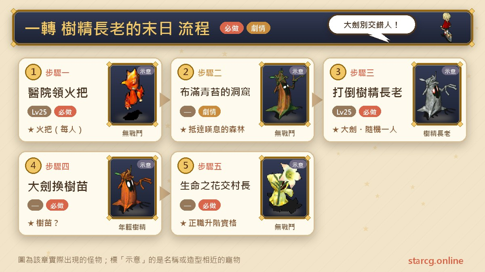
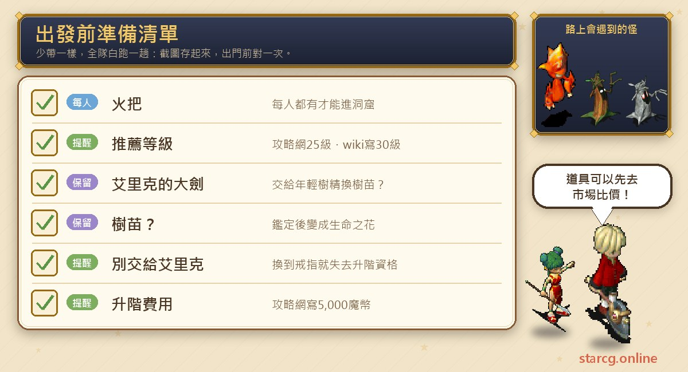
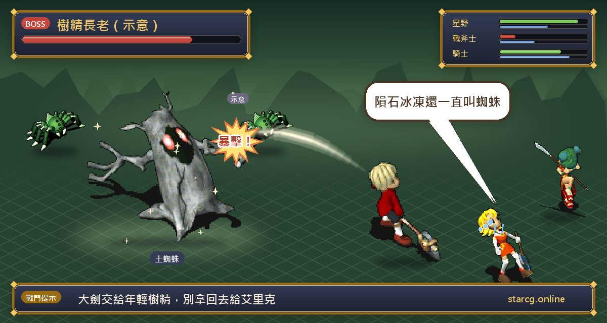
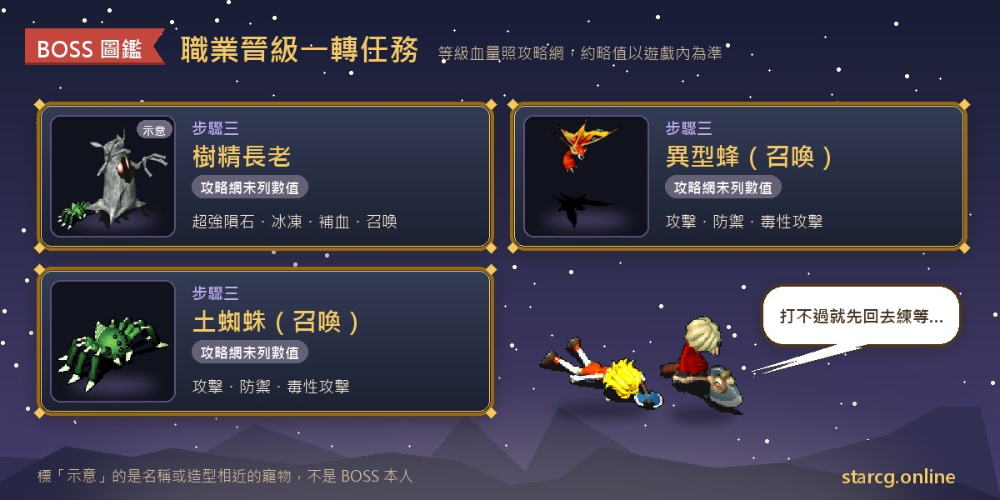

魔力寶貝的職業從「見習」升到「正職」，是每個角色遇到的第一道職業晉級門檻。除了技能等級與聲望要達標，還得先完成一轉晉級任務「樹精長老的末日」，拿到正職升階資格。任務本身不長：在維諾亞村接任務、領火把，穿過村北布滿青苔的洞窟，到嘆息的森林打倒樹精長老，再把戰利品換成「生命之花」交給村長。

星詠魔力攻略網把這個任務的推薦等級列為 25 級，沒有任何接取條件，見習職業就能接。最容易出錯的地方不是 BOSS，而是**戰後那把大劍要交給誰**：交錯人會拿到一枚戒指，卻同時放棄這次的升階資格。不論你玩的是星詠魔力、水藍魔力還是初心魔力寶貝，職業晉級一轉的任務流程都一樣，可以把這篇當成接任務前的檢查清單。

> 本文整理自 [星詠魔力攻略網](https://guide.starcg.net/) 的職業晉級「樹精長老的末日」任務頁，並參考水藍魔力攻略 wiki 的「戰鬥系升階 I」頁面，用我們自己的方式重新排序與改寫，沒有逐字照搬。樹精長老的等級、血量與技能是攻略網未列出、取自水藍魔力 wiki 的資料，數值是約略值；兩邊寫法不同的地方會分開標註，實際以遊戲內為準。遊戲更新後內容可能變動。

## 一轉任務是什麼？先看整體步驟

職業晉級任務是「一階一個」的設計：完成「樹精長老的末日」只代表拿到**正職升階資格**，真正升階還要回到當初就職的 NPC 那裡，在技能等級與聲望都符合條件時付費辦理。下一階的二轉任務「挑戰神獸」只有正職能接，所以這一轉是整條職業晉級路線的起點。

| 步驟 | 地點 | 要做的事 | 取得 |
|---|---|---|---|
| 步驟一 | 維諾亞村醫院（61, 53） | 與艾里克的傭兵對話接任務 | 火把（每人一支） |
| 步驟二 | 村北布滿青苔的洞窟（380, 353） | 穿過洞窟前往嘆息的森林 | — |
| 步驟三 | 嘆息的森林 | 打倒樹精長老 | 艾里克的大劍（隨機一人） |
| 步驟四 | 嘆息的森林 | 與年輕樹精對話 | 樹苗？ |
| 步驟五 | 鑑定後回維諾亞村 | 生命之花交給村長卡丹 | 正職升階資格（無實體道具） |
| 步驟六 | 當初就職的地點 | 技能與聲望達標後付費升階 | 晉升正職 |

## 出發前先準備好這些

一轉的準備很單純，重點是「人人有火把」與「大劍別交錯人」。攻略網寫明隊伍**每個人都要有火把**才能進洞窟，所以組隊出發前，每位隊員都要先在醫院和艾里克的傭兵對話過。戰後的大劍、「樹苗？」與鑑定後的「生命之花」都是任務道具，在交給村長之前不要隨手處理掉。

升階本身要花錢：攻略網寫的是 5,000 魔幣，水藍魔力 wiki 則寫攜帶 1,000G，兩邊不同，建議以遊戲內就職 NPC 的實際要求為準，身上多帶一些比較保險。手頭不夠的話，可以先用本站的 [市場查價](/market/) 看看身上的材料、裝備現在能賣多少，再決定要賣哪些東西湊錢。

## 步驟一：維諾亞村醫院接任務、領火把

1. 到維諾亞村醫院（61, 53）找**艾里克的傭兵**對話。他會請你去村北的洞穴把他的大劍拿回來，並給你「火把」。
2. **隊伍每個人都要有火把**才能進洞窟，組隊的話每位隊員都要各自對話領取。

**要注意的地方**：這個 NPC 的名稱兩邊寫法不同。攻略網寫「艾里克的傭兵」，座標是醫院在維諾亞村的位置（61, 53）；水藍魔力 wiki 寫成「傭兵艾里克」，並標出他在醫院裡的座標（7, 5）。指的是同一位 NPC，進醫院後依室內座標找就可以。

任務沒有接取條件，攻略網的推薦等級是 25 級；水藍魔力 wiki 把建議等級寫成 30 級，並註明這個任務可以重複完成。

## 步驟二：穿過布滿青苔的洞窟

1. 前往維諾亞村北方的**布滿青苔的洞窟**（380, 353）。水藍魔力 wiki 寫的是從芙蕾雅的（380, 353）進入。
2. 穿過洞窟後抵達樹精長老所在的**嘆息的森林**。wiki 補充是走到洞窟頂層，踩黃色傳送石前往。

**要注意的地方**：進洞窟與開戰前，全隊都要持有火把。若有隊員中途才加入、身上沒有火把，就要先回醫院領。攻略網沒有列出洞窟內的樓層數與遇敵怪物。

## 步驟三：嘆息的森林打倒樹精長老

1. 在嘆息的森林找到**樹精長老**，水藍魔力 wiki 標出他的座標是（29, 13），與他對話即可開戰。
2. 打倒樹精長老後，隊伍中**隨機一人**會拿到「艾里克的大劍」，其他人則與旁邊的**年輕樹精**對話，拿到「樹苗？」。

**BOSS 資料**：攻略網未列出樹精長老的等級、血量與技能。以下是水藍魔力 wiki 的資料，數值是約略值：

| 項目 | 樹精長老 | 異型蜂（召喚） | 土蜘蛛（召喚） |
|---|---|---|---|
| 等級 | 35 | 24～25 | 24～25 |
| 血量 | 約 2,000～2,400 | wiki 未列出 | wiki 未列出 |
| 屬性 | 地 7、水 3 | 火 5、風 5 | 地 10 |
| 技能 | 攻擊、防禦、超強隕石魔法、超強冰凍魔法、聖盾、三種補血魔法、召喚 | 攻擊、防禦、毒性攻擊 | 攻擊、防禦、毒性攻擊 |

wiki 註明樹精長老的召喚是**二次行動**，會叫出異型蜂與土蜘蛛，兩種小怪的數量欄都記為 9。

**打法提醒**：以 wiki 列出的技能來看，樹精長老會用聖盾，也會替自己補血，還會用二次行動召喚小怪，所以戰鬥可能被拖長；超強隕石魔法與超強冰凍魔法都是範圍魔法，小怪又會毒性攻擊，隊伍的血量要顧好。攻略網與 wiki 都沒有寫具體打法，實際配置請依自己的隊伍調整。

**偷竊卡片**：wiki 另外提到可以從樹精長老身上偷到他的卡片，是頭帶類裝備，智力 +25，並能使用「急救」技能、成功率提升 25%。

想認識異型蜂、土蜘蛛或樹精系的寵物，可以到本站的 [寵物圖鑑](/pets/) 查牠們的成長與屬性。

## 步驟四：大劍的分歧，換樹苗還是賢者的戒指

這一步是整個一轉最容易出錯的地方，**拿到大劍的那位隊員一定要看清楚**。

1. 拿到大劍的人**不要直接回村交給艾里克**。正確做法是把大劍交給旁邊的**年輕樹精**，換成「樹苗？」，這樣才能繼續升階。
2. 沒拿到大劍的隊員，直接和年輕樹精對話領「樹苗？」即可。

水藍魔力 wiki 把兩位年輕樹精的位置分開寫：持有大劍的人找（32, 12）的年輕樹精，可以選擇換取道具；沒有大劍的人找（25, 13）的年輕樹精領「樹苗？」。

**如果把大劍交給艾里克**：會拿到「賢者的戒指」（攻略網也寫作賢者之戒），但同時**放棄這次的升階資格**。想升階就必須丟掉戒指，重新打一次樹精長老。

| 賢者的戒指 | 內容 |
|---|---|
| 類型 | 限定飾品，不可交易 |
| 敏捷 | +3～+5 |
| 精神 | +5 |
| 耐久 | 100～150 |
| 代價 | 拿到戒指就放棄這次的升階資格，要丟掉才能重做 |

**要注意的地方**：大劍是戰後隨機給隊伍中的一人，不是隊長固定拿，所以戰後每個人都要先看自己的背包。拿到大劍的人如果想升階，就照上面換成「樹苗？」；一旦交給艾里克換了戒指，就得丟掉戒指再重打一次。

## 步驟五：鑑定生命之花、交給村長卡丹並辦理升階

1. 鑑定「樹苗？」，它會變成關鍵道具「**生命之花**」。水藍魔力 wiki 補充這個道具不能丟在地上也不能交易，可以自己鑑定，或找 NPC 幫忙鑑定。
2. 把生命之花交給維諾亞村村長**卡丹**。這一步不會給實體道具，但系統會記錄你的升階資格。wiki 標出村長家在（40, 36），卡丹在屋內（16, 7）。
3. 技能等級與聲望符合條件後，回到當初就職的地點找 NPC，付費晉升正職。攻略網寫的費用是 5,000 魔幣，wiki 寫 1,000G。

**任務獎勵**：攻略網列出的獎勵是升階資格與賢者之戒。水藍魔力 wiki 則列出完成可得金錢 1,500、聲望 200、人物經驗 65,000、水晶點數 10，並寫「全職業」都能用這個任務取得正職資格；生產系也可以解這個任務升正職。各職業的技能等級與聲望門檻，兩邊都沒有在這個任務頁列出，要另外查職業資料。

**額外的支線**：wiki 提到在嘆息的森林與（29, 9）的**阿邦的門徒**對話，可以拿到嘆息森林的試煉證明，和技能「空裂斬」有關。攻略網的任務頁沒有提到這一段。

## 職業晉級一轉常見問題

**一轉任務做完就會直接升正職嗎？** 不會。交出生命之花只會記錄升階資格，還要技能等級與聲望符合條件，再回到就職處付費辦理。

**一轉拿到賢者的戒指怎麼辦？** 把大劍交給艾里克就會走飾品路線、放棄這次升階資格。要丟掉戒指，重新打一次樹精長老，並把大劍交給年輕樹精。

**為什麼隊友進不了洞窟？** 攻略網寫明隊伍每個人都要有火把。沒有在維諾亞村醫院和艾里克的傭兵對話過的隊員，要先回去領。

**樹精長老多少級、多少血？** 攻略網未列出。水藍魔力 wiki 記為 35 級、約 2,000～2,400 血，會用超強隕石、超強冰凍與補血魔法，並用二次行動召喚異型蜂和土蜘蛛。

**升正職要付多少錢？** 攻略網寫 5,000 魔幣，水藍魔力 wiki 寫 1,000G，以遊戲內就職 NPC 的實際要求為準。

**生命之花可以交給別人代交嗎？** wiki 寫生命之花不能丟地也不能交易，所以每個人都要自己拿到「樹苗？」、自己鑑定、自己交給村長卡丹。

## 小結

「樹精長老的末日」是職業晉級的第一關，流程只有六步：醫院領火把、穿過布滿青苔的洞窟、打倒樹精長老、大劍交給年輕樹精換「樹苗？」、鑑定成生命之花交給村長卡丹、回就職處辦理升階。真正要小心的只有兩件事：每個人都要有火把，以及大劍不要拿回去給艾里克。把這兩點顧好，就能少走重來的冤枉路。

更完整的原文可以到 [星詠魔力攻略網](https://guide.starcg.net/) 的職業晉級任務頁查閱；備錢與認識寵物，也可以搭配本站的 [市場查價](/market/) 與 [寵物圖鑑](/pets/)。

## 職業晉級分篇

- [職業晉級任務總覽：一轉到四轉](/posts/job-advance-quest-guide/)
- [二轉：挑戰神獸](/posts/job-advance-2-quest-guide/)
- [三轉：詛咒的迷宮](/posts/job-advance-3-quest-guide/)
- [四轉：四轉連戰](/posts/job-advance-4-quest-guide/)

## 參考資料

- [水藍魔力攻略 wiki：戰鬥系升階 I（Gamerch）](https://gamerch.com/blue-cg/452313)
