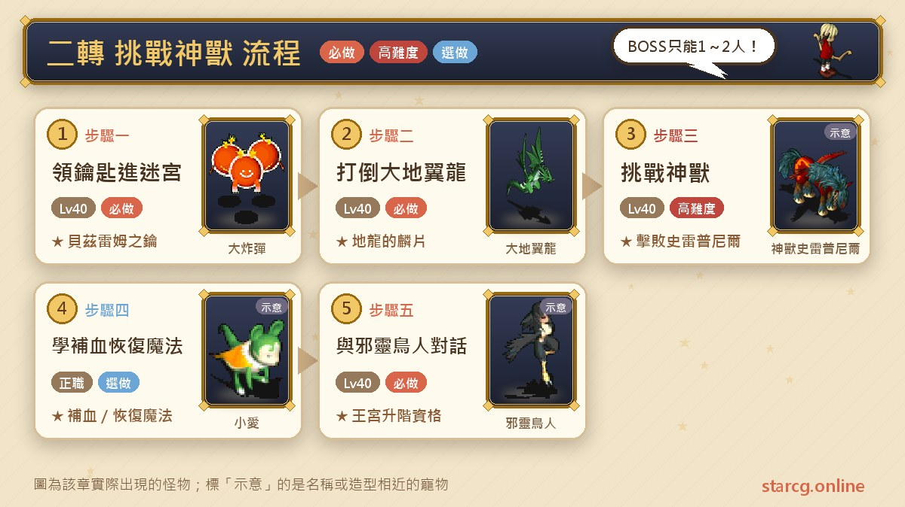
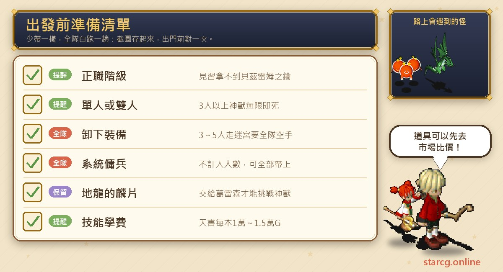
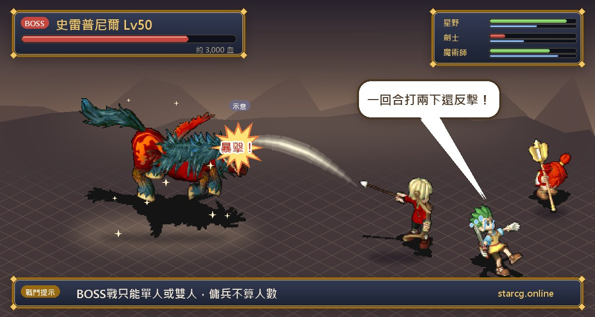
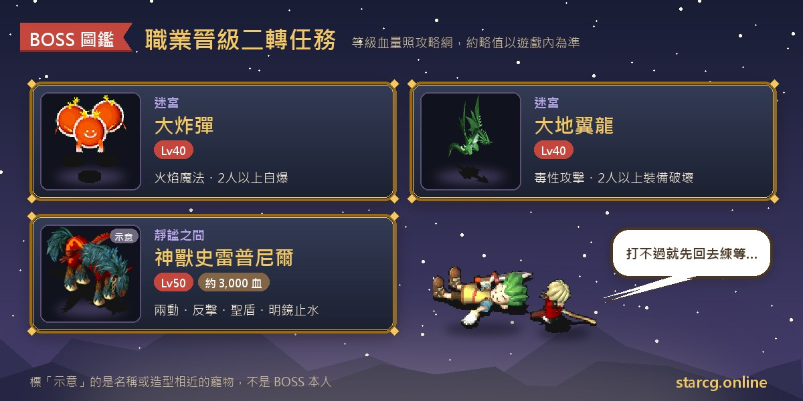

「신수 도전(挑戰神獸)」은 크로스게이트 직업 승급(職業晉級) 시리즈의 두 번째 퀘스트, 흔히 말하는 2차 전직이에요. 정직(正職) 캐릭터가 왕궁(王宮) 계급으로 올라가려면 먼저 세레네(莎蓮娜)섬의 베즈렘 미궁(貝茲雷姆迷宮)에서 신수 슬레이프니르(神獸史雷普尼爾)를 쓰러뜨려 승급 자격을 얻어야 해요. 권장 레벨은 40이고, 직업이 이미 정직이어야 해요. 견습(見習) 계급은 퀘스트 아이템조차 받을 수 없어요.

1차와 가장 크게 다른 점은 **인원 제한**이에요. 미궁은 혼자나 둘이 가는 걸 권하고, 보스전은 아예 혼자나 둘만 가능해요. 인원이 많으면 오히려 신수의 즉사 마법에 강제로 전멸해요. 또 신수를 이기면 미궁 안에서 성직자의 초강력 보혈 마법, 무술사의 강력 회복 마법과 초강력 회복 마법을 배울 수 있어서 힐러라면 꼭 들르게 되는 곳이에요. StarCG(星詠魔力)든 水藍魔力든 初心魔力寶貝든 신수 도전 퀘스트 흐름은 똑같으니, 출발 전 체크리스트로 쓰면 돼요.

> 이 글은 [StarCG 공략 사이트](https://guide.starcg.net/)의 직업 승급 「신수 도전」 페이지를 바탕으로 水藍魔力 공략 wiki의 전투계 승급 II 페이지를 참고해 저희 방식대로 순서를 다시 정리하고 새로 쓴 것으로, 그대로 옮기지 않았어요. 두 곳의 내용이 다른 부분은 따로 표시했어요. 보스 HP는 대략적인 값이니 실제 게임을 기준으로 해 주세요. 게임 업데이트 후 내용이 바뀔 수 있어요.

## 신수 도전이란? 먼저 퀘스트 단계부터

공략 사이트는 이 퀘스트를 「2차 왕궁 승급 퀘스트」로 소개해요. 전설의 신수를 쓰러뜨려 왕궁 계급으로 승급할 자격을 얻고, 고급 회복·보혈 마법도 해금하는 퀘스트예요. 다른 승급 퀘스트처럼 퀘스트를 마치면 **승급 자격**만 생기고, 실제 승급은 스킬 레벨과 명성이 조건을 만족했을 때 처음 취직한 NPC에게 돌아가서 진행해야 해요.

| 단계 | 장소 | 할 일 | 얻는 것 |
|---|---|---|---|
| 1 | 제노바 마을 병원 2층 | 신관 빌반 찾기 | 베즈렘의 열쇠 |
| 2 | 베즈렘 신전 | 신관 제라나와 대화, 노란 전송석 밟기 | 베즈렘 미궁 입장 |
| 3 | 베즈렘 미궁 | 와이번 쓰러뜨리기 | 지룡의 비늘 |
| 4 | 미궁 꼭대기 층 고요의 방 | 신관 그레슨에게 비늘 전달, 신수 도전 | 신수 슬레이프니르 격파 |
| 5 | 신수 뒤쪽 방 | 성직자·무술사 스킬 습득(선택) | 보혈/회복 마법 |
| 6 | 뒤쪽 방 | 턱시토르와 두 번 대화 | 왕궁 승급 자격 |

퀘스트 조건: 직업이 정직 계급. 권장 레벨: 40. 보상: 2차 왕궁 승급 자격, 그리고 초강력 보혈 마법·강력 회복 마법·초강력 회복 마법 습득 기회.

## 출발 전에 챙길 것

2차에서 가장 흔한 실패 원인은 이기지 못해서가 아니라 **인원과 장비 조건이 안 맞아서**예요. 3명 이상이 그대로 신수와 싸우면 무한 즉사를 맞고, 3~5명이 장비를 벗지 않고 미궁을 돌면 봄(大炸彈)이 자폭하고 와이번(大地翼龍)이 장비 파괴를 써요. 출발 전에 혼자 갈지, 둘이 갈지, 아니면 전원 빈손으로 미궁을 돌다가 보스 앞에서 파티를 나눌지 먼저 정해 두세요.

시스템 용병은 인원에 포함되지 않으니 모두 데려가 전력을 채워도 돼요. 스킬을 배우려는 성직자와 무술사는 천서(天書) 수업료를 따로 준비해야 해요. 공략 사이트 기준으로 초강력 보혈 마법 15,000G, 강력 회복 마법 10,000G, 초강력 회복 마법 15,000G예요(水藍魔力 공략 wiki는 금액이 달라요. 아래 비교를 참고하세요). 돈이 모자라면 먼저 사이트의 [시세 검색](/ko/market/)으로 가진 재료와 장비가 지금 얼마에 팔리는지 보고 무엇을 팔지 정하세요.

## 1단계: 제노바 마을에서 베즈렘의 열쇠 받기

1. 세레네섬의 제노바 마을(傑諾瓦村)(216, 457)로 가요.
2. 병원 2층(44, 33)에서 **신관 빌반(神官比爾班)**과 대화해 「베즈렘의 열쇠(貝茲雷姆之鑰)」를 받아요.

**주의할 점**: 견습 계급은 베즈렘의 열쇠를 받을 수 없어요. 이게 「정직 필요」 조건이 실제로 걸리는 곳이에요. 공략 사이트에는 빌반 본인의 좌표가 따로 없고, 병원 2층에 있다고만 적혀 있어요.

## 2단계: 베즈렘 신전과 미궁 입장(인원 규칙)

1. 제노바 마을에서 북서쪽으로 가 베즈렘 신전(貝茲雷姆神殿)에 도착해요.
2. **신관 제라나(神官傑拉娜)**(135, 333)와 대화해 신전에 들어가요.
3. 노란 전송석을 밟아 베즈렘 미궁에 들어가요.

**미궁 인원 규칙**:

- **혼자나 둘이** 가는 걸 권해요.
- 3~5명 파티로 간다면 **파티 전원이 빈손에 장비를 모두 벗어야** 해요. 그렇지 않으면 봄이 자폭을, 와이번이 장비 파괴를 써요.

공략 사이트에는 미궁 「꼭대기 층」의 고요의 방(靜謐之間)만 나오고, 전체 층수나 텍스트 지도는 없어요.

## 3단계: 와이번을 쓰러뜨려 지룡의 비늘 얻기

1. 미궁에서 **와이번**을 쓰러뜨려 「지룡의 비늘(地龍的麟片)」을 얻어요.
2. 공략 사이트에 따르면 파티에서 한 명만 비늘을 가지고 있어도 모두 가진 것으로 처리되어 꼭대기 층 고요의 방에 들어갈 수 있어요.

**미궁 몬스터 정보(공략 사이트)**:

| 몬스터 | 레벨 | 사용 스킬 | 2명 이상일 때 추가 |
|---|---|---|---|
| 봄 | 40 | 공격, 방어, 화염 마법 | 자폭 |
| 와이번 | 40 | 공격, 방어, 독 공격 | 장비 파괴 |

두 몬스터의 HP는 공략 사이트 미기재예요.

## 4단계: 고요의 방에서 신수 슬레이프니르에게 도전

1. 미궁 꼭대기 층의 **고요의 방**으로 가요.
2. 지룡의 비늘을 **신관 그레슨(神官葛雷森)**에게 건네고 보스전을 준비해요.
3. **신수 슬레이프니르**에게 도전해요.

**보스전 인원 제한**: **혼자나 둘만** 가능해요. 3명 이상이면 신수가 초강력 즉사 마법을 끝없이 써서 사실상 강제 전멸이에요. 시스템 용병은 인원에 포함되지 않아요.

**보스 정보**: 신수 슬레이프니르는 50레벨, HP 약 3,000이고 한 턴에 두 번 행동하며 공격, 방어, 양날, 붕격, 아지랑이(陽炎), 반격, 성스러운 방패, 명경지수를 써요. 공략 사이트의 보스 표에는 「초강력 즉사 마법」이 2명 이상일 때의 추가 스킬로 따로 적혀 있어요.

**스킬로 정리한 주의점**: 공략 사이트에는 구체적인 공략법이 없어요. 아래는 사이트에 나온 스킬을 바탕으로 정리한 참고 사항이고, 실측 데이터가 아니에요.

- 신수는 **반격**을 써서 물리 공격이 되돌아올 수 있으니, HP가 낮은 캐릭터는 공격 전에 먼저 회복해 두세요.
- **성스러운 방패**와 **아지랑이**가 있으면 공격이 잘 안 들어가거나 빗나가기 쉬우니, 그때 마나를 한꺼번에 다 쓰지 마세요.
- **명경지수**는 회복 스킬이라 화력이 너무 낮으면 소모전이 되기 쉬워요.
- **한 턴 2회 행동**에 붕격·양날까지 있으니 혼자 도전할 때는 회복 타이밍을 조금 일찍 잡으세요.

**인원 표기에 주의**: 공략 사이트의 제한 설명은 「3명 이상」이면 무한 즉사라고 쓰지만, 보스 표에는 즉사가 「2명 이상」 추가로 적혀 있어요. 水藍魔力 공략 wiki는 「두 명을 넘으면 추가되며 반드시 성공」이라고 적었어요. 둘이 도전할 때 즉사 마법이 나오는지는 공략 사이트 미기재라서, 둘을 상한으로 보고 두 사람 모두 HP를 가득 유지하는 게 가장 안전해요.

## 5단계: 보혈·회복 마법 배우기(성직자, 무술사)

신수를 쓰러뜨리면 앞쪽 방에서 스킬을 배울 수 있어요. 스킬을 배우려면 해당 직업의 정직 계급이 필요해요.

| 직업 | 방에 들여보내 주는 NPC | 천서 좌표 | 스킬 | 비용(공략 사이트) |
|---|---|---|---|---|
| 성직자(정직) | 경비병(13, 52) | (14, 4) | 초강력 보혈 마법 | 15,000G |
| 무술사(정직) | 샤오아이(小愛)(40, 52) | (15, 9) | 강력 회복 마법 | 10,000G |
| 무술사(정직) | 샤오아이(40, 52) | (11, 9) | 초강력 회복 마법 | 15,000G |

**다른 직업도 배울 수 있나요?** 공략 사이트는 두 가지 방법을 알려 줘요.

1. 잠시 성직자나 무술사로 전직해서 배운 뒤 다시 돌아가기.
2. (공략 사이트 추천) 제2 직업 시스템으로 부직업을 성직자나 무술사로 설정해 방에 들어간 뒤, 다시 주직업으로 바꿔서 배우기.

水藍魔力 공략 wiki는 방 가는 길을 보충해요. 성직자는 왼쪽 아래 길 끝에서 경비병을, 무술사는 오른쪽 위 길 끝에서 「노커(大地鼠) 샤오아이」를 찾으면 되고, 두 방 모두 견습이 아니어야 들어갈 수 있어요.

## 6단계: 턱시토르와 대화해 승급 자격 확인

1. 스킬을 배운 뒤(또는 배우지 않고) 뒤쪽 방에 들어가요.
2. **턱시토르(邪靈鳥人)**와 두 번 대화해요.
3. 대화창에 마무리 말 「我想再睡一陣子...」(조금 더 자고 싶구나…)가 나와야 승급 자격을 얻은 거예요.

**주의할 점**: 한 번만 대화하고 나가면 자격이 생기지 않아요. 반드시 마무리 말을 보고 떠나세요. 자격을 얻은 뒤 스킬 레벨과 명성이 조건을 만족하면 취직한 NPC에게 돌아가 왕궁 계급으로 승급할 수 있어요. 2차 승급 비용은 공략 사이트 미기재예요.

## 신수와 미궁 몬스터 정보 한눈에 보기

| 이름 | 레벨 | HP | 스킬 | 2명 이상일 때 추가 |
|---|---|---|---|---|
| 신수 슬레이프니르 | 50 | 약 3,000 | 공격, 방어, 양날, 붕격, 아지랑이, 반격, 성스러운 방패, 명경지수, 2회 행동 | 초강력 즉사 마법 |
| 봄 | 40 | 공략 사이트 미기재 | 공격, 방어, 화염 마법 | 자폭 |
| 와이번 | 40 | 공략 사이트 미기재 | 공격, 방어, 독 공격 | 장비 파괴 |

이 몬스터들의 모습과 성장이 궁금하면 사이트의 [펫 도감](/ko/pets/)에서 와이번, 봄 등을 검색해 보세요.

## 水藍魔力 공략 wiki의 다른 표기

水藍魔力 공략 wiki의 「전투계 승급 II」 페이지(최종 업데이트 2025/09/01)도 같은 퀘스트를 다루는데, 공략 사이트와 다른 부분이 있어 비교용으로 정리했어요. 실제로는 게임 안 내용을 기준으로 해 주세요.

- **퀘스트 이름과 레벨**: 사냥 번호 17 「신수 각성의 노래(神獸甦醒之歌)」로 기록되어 있고, 권장 LV50, 반복 가능이에요.
- **보상**: 왕궁 승급 자격과 스킬 습득 자격 외에 돈 3000, 명성 200, 캐릭터 경험치 150000, 수정 포인트 30이 적혀 있어요.
- **지룡의 비늘**: 「파티원 모두가 가지고 있어야 한다」고 적혀 있어서, 공략 사이트의 「한 명만 있으면 모두 처리」와 반대예요. 안전하게 가려면 와이번을 여러 마리 잡아 모두가 받아 두세요.
- **NPC 좌표**: 신관 그레슨(26, 67), 신수 슬레이프니르(26, 25), 턱시토르(14, 14).
- **추가 단계**: 승리 후 아반의 제자(阿邦的門徒)(29, 22)와 대화하면 베즈렘 미궁의 시련 증명을 받을 수 있고, 페이지는 「공열참(空裂斬)」 스킬 설명으로 안내해요.
- **드롭**: 두 명을 넘는 파티일 때 와이번이 「맹세의 증표(誓言之證)」를 떨어뜨릴 수 있어요.
- **비용**: 천서 수업료가 초강력 보혈 마법 7,500G, 강력 회복 마법 5,000G, 초강력 회복 마법 7,500G이고, 승급에 따로 5,000G가 필요하다고 적혀 있어요.
- **속성**: 신수는 4속성 각 2, 봄은 불 8·바람 2, 와이번은 땅 10이에요.

## 2차를 마친 뒤 이어서 할 퀘스트

공략 사이트에는 「신수 도전 완료」를 조건으로 하는 퀘스트가 두 개 있어요.

- **여는 자(開啟者)**(시공의 문(時空之門) 시리즈): 권장 55레벨, 남자 한 명과 여자 한 명이 각각 리더가 되어 이끌어야 하고, 보상은 영구 칭호 「여는 자」예요. 이 칭호는 3차 「저주의 미로(詛咒的迷宮)」를 받는 조건이라, 사범까지 올라갈 생각이면 꼭 해야 해요.
- **토끼 귀 머리장식(兔耳頭飾)**(신성 대륙(聖地) 시리즈): 권장 60레벨, 보상은 토끼 귀 머리장식이에요.

## 신수 도전 자주 묻는 질문

**견습 계급도 2차를 받을 수 있나요?** 아니요. 견습은 신관 빌반의 베즈렘의 열쇠조차 받을 수 없으니 먼저 1차를 마치고 정직으로 올라가야 해요.

**신수와 싸우면 왜 계속 전멸하나요?** 가장 흔한 원인은 3명 이상이 보스전에 들어가는 거예요. 그러면 신수가 초강력 즉사 마법을 끝없이 써요. 보스전은 혼자나 둘만 가능하고, 시스템 용병은 인원에 포함되지 않으니 모두 데려가도 돼요.

**3명 이상이 미궁을 돌아도 되나요?** 돼요. 다만 파티 전원이 빈손에 장비를 모두 벗어야 하고, 그렇지 않으면 봄이 자폭하고 와이번이 장비 파괴를 써요. 보스전 전에는 혼자나 둘로 나눠야 해요.

**신수를 이긴 뒤 자격을 얻었는지 어떻게 확인하나요?** 뒤쪽 방에서 턱시토르와 두 번 대화해 「我想再睡一陣子...」라는 마무리 말이 나오면 완료예요.

**성직자나 무술사가 아니어도 보혈·회복 마법을 배울 수 있나요?** 공략 사이트는 제2 직업 시스템으로 부직업을 성직자나 무술사로 설정해 방에 들어간 뒤 주직업으로 바꿔 배우는 방법을 추천해요. 잠시 전직하는 방법도 있어요. 스킬을 배우려면 해당 직업의 정직 계급이 필요해요.

**수업료는 정확히 얼마인가요?** 공략 사이트는 초강력 보혈 마법 15,000G, 강력 회복 마법 10,000G, 초강력 회복 마법 15,000G라고 쓰고, 水藍魔力 공략 wiki는 7,500G, 5,000G, 7,500G라고 써요. 게임 안 천서에 표시되는 금액을 기준으로 해 주세요.

## 정리

신수 도전은 정직에서 왕궁으로 가는 필수 관문이에요. 과정은 길지 않지만 어려운 건 전부 규칙이에요. 미궁을 여럿이 돌면 빈손에 장비를 벗고, 보스전은 혼자나 둘만, 이긴 뒤에는 턱시토르와 마무리 말이 나올 때까지 대화해야 자격이 생겨요. 성직자와 무술사는 가는 김에 초강력 보혈, 강력·초강력 회복 마법을 배우고, 이어서 「여는 자」 칭호 퀘스트를 하면 3차로 바로 이어갈 수 있어요.

더 자세한 원문은 [StarCG 공략 사이트](https://guide.starcg.net/)의 직업 승급 「신수 도전」 페이지에서 확인할 수 있어요. 수업료 마련과 몬스터 확인에는 사이트의 [시세 검색](/ko/market/)과 [펫 도감](/ko/pets/)도 함께 활용해 보세요.

## 직업 승급 분편

- [직업 승급 퀘스트 총정리: 1차~4차](/ko/posts/job-advance-quest-guide/)
- [1차: 트리플 장로의 종말(정직 승급 자격)](/ko/posts/job-advance-1-quest-guide/)
- [3차: 저주의 미로(60층, 수호자전 여섯 번)](/ko/posts/job-advance-3-quest-guide/)
- [4차: 4차 연속 전투(대가 자격, 110레벨 돌파)](/ko/posts/job-advance-4-quest-guide/)

## 참고 자료

- [水藍魔力 공략 wiki: 전투계 승급 II(Gamerch)](https://gamerch.com/blue-cg/452314)
