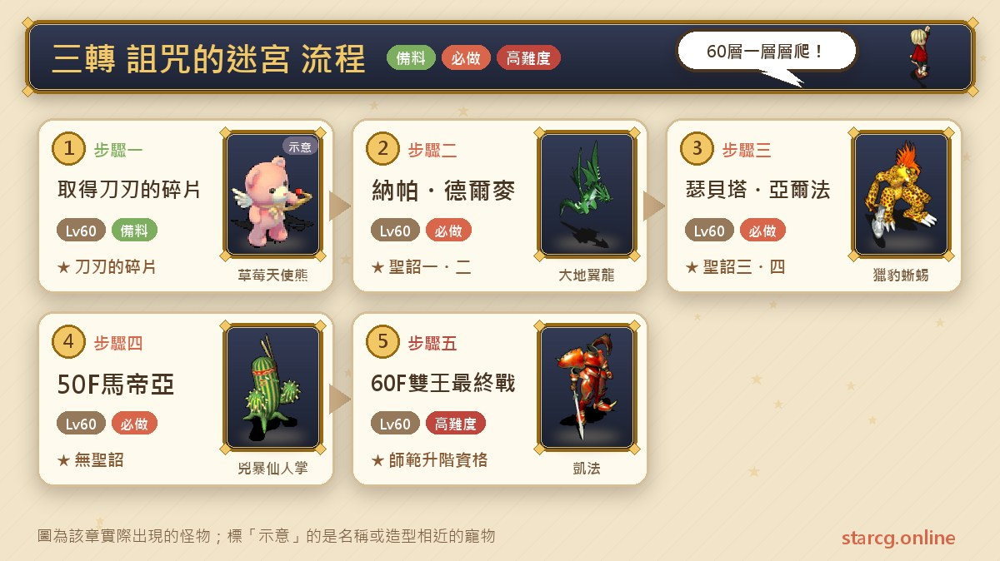
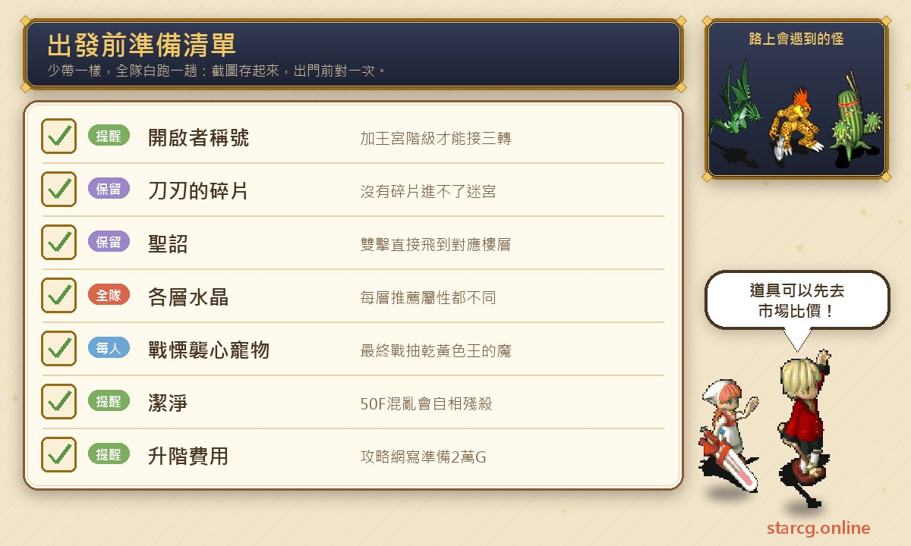
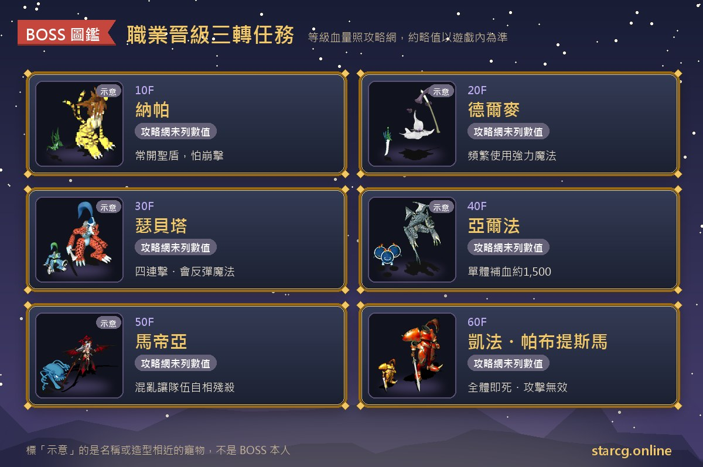
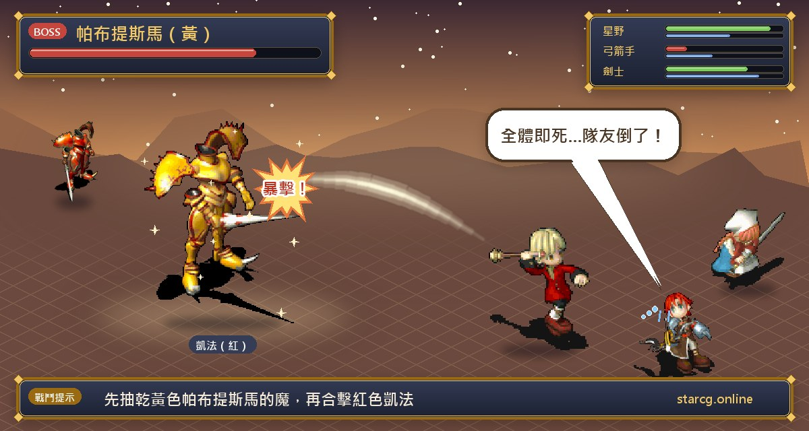

「저주의 미로(詛咒的迷宮)」는 크로스게이트 직업 승급의 세 번째 퀘스트, 흔히 말하는 3차 전직이에요. 이 퀘스트를 마치면 **사범 승급 자격**을 얻어 왕궁 계급에서 한 단계 올라갈 수 있어요. 권장 레벨은 60이고, 수락 조건은 왕궁 계급과 「여는 자(開啟者)」 칭호예요. 먼저 과거로 가서 「칼날의 파편(刀刃的碎片)」을 받은 뒤 60층짜리 고대 미궁을 올라가며 10층마다 수호자를 쓰러뜨리고, 마지막 60층에서 케파와 파브티스마 두 보스를 동시에 상대해요.

1차, 2차와 비교하면 3차는 길이도 난도도 한 단계 올라가요. 수호자전 여섯 번은 잡몹 구성, 추천 수정, 공략법이 모두 다르고, 앞의 다섯 번은 「전투 면제 조건」으로 그냥 통과할 수도 있어요. StarCG(星詠魔力)든 水藍魔力든 初心魔力寶貝든 저주의 미로 퀘스트 흐름은 똑같으니, 3차 전직 전에 체크리스트로 쓰면 돼요.

> 이 글은 [StarCG 공략 사이트](https://guide.starcg.net/)의 직업 승급 「저주의 미로」 페이지를 바탕으로 水藍魔力 공략 wiki의 3차 페이지를 참고해 저희 방식대로 순서를 다시 정리하고 새로 쓴 것으로, 그대로 옮기지 않았어요. 공략 사이트에는 수호자의 레벨과 HP가 없어요(공략 사이트 미기재). wiki에서 가져온 수치는 따로 표시했으니 실제 게임을 기준으로 해 주세요. 게임 업데이트 후 내용이 바뀔 수 있어요.

## 저주의 미로란? 먼저 퀘스트 단계부터

3차 퀘스트는 다섯 단계로 나눌 수 있어요. 먼저 아바니스 마을(阿巴尼斯村)에서 미궁 입장 열쇠인 「칼날의 파편」을 받고, 위로 올라가며 10층마다 수호자를 잡거나(또는 전투 면제로 통과), 마지막 60층에서 두 보스를 잡은 뒤 취직한 곳에 돌아가 승급해요.

| 단계 | 내용 | 장소/층 | 획득 |
|---|---|---|---|
| 1단계 | 산딸기 → 과거 → 칼날의 파편 | 아바니스 마을 민가 지하실 | 칼날의 파편 |
| 2단계 | 수호자 나파, 델마이 | 10F, 20F | 성조 1, 성조 2 |
| 3단계 | 수호자 세베타, 알파 | 30F, 40F | 성조 3, 성조 4 |
| 4단계 | 수호자 마티아 | 50F | 성조 없음 |
| 5단계 | 케파와 파브티스마 | 60F 봉인석 | 사범 승급 자격 |

퀘스트를 마치면 **승급 자격**만 얻을 뿐이고, 실제 승급은 처음 취직했던 NPC에게 돌아가 스킬 레벨과 명성이 조건을 만족할 때 비용을 내고 해야 해요.

## 출발 전에 챙길 것

3차에서 가장 흔히 막히는 이유는 못 이겨서가 아니라 **조건이 안 맞아서**예요. 「여는 자」 칭호가 없어서 퀘스트를 못 받거나, 칼날의 파편이 없어서 미궁에 못 들어가거나, 전투 면제로 넘어간 층의 성조가 없어서 마을에 다녀온 뒤 날아갈 수 없는 경우예요.

- **여는 자 칭호**: 먼저 「여는 자」 퀘스트를 끝내야 얻을 수 있고, 왕궁 계급이어야 3차를 받을 수 있어요.
- **칼날의 파편**: 미궁 입장 아이템이라 없으면 들어갈 수 없어요.
- **수정**: 공략 사이트가 층마다 추천 수정을 적어 두었고 속성이 다 달라서, 층에 맞춰 바꾸는 게 좋아요.
- **「전율습심」 펫**: 60층 마지막 전투에서 파브티스마의 마나를 뽑는 데 써요.
- **보혈과 정화**: 델마이는 강력 마법을 자주 쓰고 마티아는 파티를 혼란에 빠뜨리니, 성직자(傳教士)와 정화를 쓰는 무술사(巫師)가 함께 가면 좋아요.
- **승급 비용**: 공략 사이트에는 20,000G를 준비해 취직한 곳에서 승급한다고 적혀 있어요.

돈이 모자라면 먼저 사이트의 [시세 검색](/ko/market/)으로 가진 재료와 장비가 지금 얼마에 팔리는지 보고, 무엇을 팔아 돈을 모을지 정하세요.

## 1단계: 칼날의 파편 받기(아바니스 마을)

1. 아바니스 마을 민가(40, 30)의 **역사학자 레버슨(歷史學家雷伯爾森)**(14, 10)과 대화해 「산딸기(野草莓)」를 받아요.
2. 산딸기를 계단 앞의 **미시안(米希安)**(9, 4)에게 건네면 민가 지하실에 들어갈 수 있어요.
3. 지하실의 **시공 석반(時空石盤)**(15, 7)을 조사해 과거로 가서 **전사 발케스(戰士帕魯凱斯)**(15, 7)와 대화하고 「칼날의 파편」을 받아요.
4. 지하실의 시공 석반으로 다시 현재로 돌아와요.
5. 아바니스 마을에서 서쪽으로 가서 **고동치는 석반(鼓動的石盤)**(54, 162)을 조사해 저주의 미로에 들어가요.

**주의할 점**: 칼날의 파편이 없으면 미궁에 들어갈 수 없어요. 水藍魔力 공략 wiki에는 칼날의 파편이 **로그아웃하면 사라져서** 중간에 접속이 끊기면 마을로 돌아가 다시 받아야 한다고 적혀 있고, 현재로 돌아오는 석반 좌표도 (15, 10)으로 적혀 있어요. 공략 사이트에는 로그아웃 시 사라진다는 내용이 없으니, 안전하게 파편을 받으면 바로 미궁에 들어가는 게 좋아요.

## 미궁 규칙: 성조, 전투 면제 조건, 추천 수정

저주의 미로는 모두 60층이고 10층마다 수호자가 한 명씩 있어요. 이긴 뒤 수호자와 대화하면 「성조(聖詔)」를 받아요(50층 제외). **성조를 더블클릭하면 해당 층으로 바로 날아갈 수 있어요.** 예를 들어 성조 1은 11층으로 가므로, 중간에 마을로 돌아가 보급해도 바로 진행 지점으로 돌아올 수 있어요.

**전투 면제 조건**: 앞의 다섯 수호자는 「파티 중 누군가 특정 스킬이 8레벨」이면 싸우지 않고 통과할 수 있지만, **면제로 넘어간 층은 성조를 받을 수 없어요**. 며칠에 나눠 오를 생각이라면 수호자를 잡고 성조를 챙겨 두는 게 좋아요.

| 층 | 수호자 | 미궁 몬스터(레벨) | 면제 조건(한 명이 8레벨) | 추천 수정 |
|---|---|---|---|---|
| 10F | 나파(納帕) | 와이번(大地翼龍), 헬하운드(地獄獵犬)(38~40) | 조교, 펫 강화 | 불·바람 |
| 20F | 델마이(德爾麥) | 브랜디쉬(血腥之刃), 라크샤사(羅剎)(41~43) | 공격 마법 아무거나 | 순수 땅 또는 땅·물 |
| 30F | 세베타(瑟貝塔) | 펄드리자드(獵豹蜥蜴), 도마뱀 투사(蜥蜴鬥士)(44~46) | 물리 전투 스킬 | 바람·땅 또는 불·바람 |
| 40F | 알파(亞爾法) | 크리터(寶貝炸彈), 쁘띠 가고(迷你石像怪)(47~49) | 회복 계열 스킬 | 물·불 |
| 50F | 마티아(馬帝亞) | 고스트(幽靈), 캑터스(兇暴仙人掌)(50~52) | 주술, 주술 저항 또는 제어 무술(巫術) | 땅·바람 |
| 60F | 파브티스마(帕布提斯馬), 케파(凱法) | 앞 다섯 관문의 잡몹(53~55, 1~8마리) | 없음, 반드시 전투 | 순수 물 또는 물·불 |

공략 사이트에는 수호자의 레벨, HP, 전체 스킬표가 없어요. 水藍魔力 공략 wiki의 3차 페이지에 더 자세한 자료가 있어서 따로 정리했어요(공략 사이트와 분리, 실제 게임 기준).

| 수호자 | wiki 기재 레벨 | wiki 기재 주요 스킬 |
|---|---|---|
| 나파 | 65 | 공격, 성스러운 방패, 와이번 소환, 2회 행동 |
| 델마이 | 65 | 성스러운 방패, 초강력 운석/빙결/화염/바람 칼날 마법, 공격 흡수/반사/무효, 2회 행동 |
| 세베타 | 65 | 연격, 양날, 반격, 성스러운 방패, 마법 흡수/반사/무효, 2회 행동 |
| 알파 | 65 | 성스러운 방패, 각종 보혈과 회복 마법, 정화 마법, 2회 행동 |
| 마티아 | 65 | 성스러운 방패, 초강력 중독/수면/석화/만취/혼란/망각 마법, 2회 행동 |
| 케파 | 70 | 연격, 양날, 건곤일척, 붕격, 흡혈 공격, 마법 무효, 반격 |
| 파브티스마 | 70 | 초강력 운석/빙결/화염/바람 칼날 마법, 공격 무효 |

wiki에 적힌 면제 스킬 범위는 공략 사이트보다 더 자세해요. 예를 들어 10층에는 「정령의 맹약(精靈的盟約)」이 더 있고, 40층에는 보혈, 회복, 기절 회복, 정화 마법이 포함돼요. 헷갈릴 때는 스킬을 가진 사람이 직접 수호자와 대화해 보는 게 가장 정확해요.

## 2단계: 10F 나파, 20F 델마이

**10F 나파**(추천 수정 불·바람)

- 헬하운드를 되도록 한 턴에 정리하고 나파에게 화력을 집중하세요.
- 나파가 쓰러지기 전에는 **와이번을 상대하지 마세요.** 계속 소환되어 채워지니 때려도 소용없어요.
- 나파는 성스러운 방패를 자주 켜는데 「붕격」이 아주 잘 들어요.
- 이긴 뒤 나파와 대화하면 성조 1을 받아 11층으로 바로 날아갈 수 있어요.

**20F 델마이**(추천 수정 순수 땅 또는 땅·물)

- 브랜디쉬와 라크샤사를 빠르게 정리한 뒤 원거리 공격으로 델마이를 치세요.
- 델마이는 강력 마법을 자주 쓰니 성직자나 무술사가 파티의 HP와 마나를 유지해 줘야 해요.
- 이기면 성조 2를 받아요.

## 3단계: 30F 세베타, 40F 알파

**30F 세베타**(추천 수정 바람·땅 또는 불·바람)

- 원거리 무기를 권해요. 뒷줄의 도마뱀 투사부터 정리하고, 앞줄 펄드리자드는 가운데 한 마리를 남겨 자리를 막게 하세요.
- 세베타의 4연격은 치명적이라 공략 사이트는 「펫은 방어, 사람은 공격」을 권해요.
- 마법사가 공격하기 전에는 **반드시 먼저 그의 반사를 깨야** 해요. 그렇지 않으면 자기 마법에 쓰러질 수 있어요.
- 이기면 성조 3을 받아요.

**40F 알파**(추천 수정 물·불)

- 크리터와 쁘띠 가고를 모두 정리한 뒤 가장 강한 공격이나 협공으로 몰아치세요.
- 알파는 단일 보혈이 약 1,500이고 2회 행동 회복 마법도 있어서, 화력이 부족하면 소모전으로 늘어져요.
- 이기면 성조 4를 받아요.

주력의 한 방이 알파의 보혈을 넘길 수 있는지는 사이트의 [데미지 계산](/ko/damage/)으로 먼저 가늠해 보세요.

## 4단계: 50F 마티아

추천 수정은 땅·바람이에요.

- 뒷줄 고스트, 앞줄 캑터스 순으로 정리하고 마지막에 마티아를 협공하세요.
- 파티에 정화를 쓸 무술사가 없으면 혼란에 걸려 서로 때리기 쉬워요.
- **50층 수호자는 성조를 주지 않아요.** 이 층을 끝내면 바로 위로 올라가야 하고, 마을로 돌아가면 41층(성조 4)부터 다시 시작해야 해요.

## 5단계: 60F 케파와 파브티스마(노랑은 흡마, 빨강은 협공)

60층에서 **봉인석(封印石)**(24, 19)을 조사하면 마지막 전투가 시작돼요. 이 전투는 면제 조건이 없어서 반드시 싸워야 해요. 추천 수정은 순수 물 또는 물·불이고, 앞 다섯 관문의 잡몹(53~55레벨, 1~8마리)도 함께 나와요.

**공략법: 노랑은 흡마, 빨강은 협공**

1. 펫으로 노란색 **파브티스마**에게 「전율습심(戰慄襲心)」을 써서 마나를 10 이하로 뽑으면 멍하니 서 있게 돼요.
2. 그동안 빨간색 **케파**를 전력으로 쳐요.
3. 케파가 쓰러지면 다시 파브티스마를 처리해요.

**주의할 점**:

- 보스는 전체 즉사 마법과 공격 무효를 써요. 즉사가 항상 성공하는 건 아니니, 쓰러진 사람은 동료가 서로 살려 줘야 해요.
- 처음 몇 턴은 초강력 보혈로 버텨도 되지만, 후반에 마나가 바닥나지 않도록 조절하세요.
- 경장비에 방어가 낮은 마법사는 날아갈(즉사할) 위험이 있어요.
- 水藍魔力 공략 wiki에 따르면 파브티스마가 쓰러진 뒤 케파가 **마법 봉인**을, 케파가 쓰러진 뒤 파브티스마가 **초강력 즉사 마법**을 추가로 써요. 공략 사이트가 파브티스마를 먼저 멍하게 만든 뒤 케파를 집중 공격하라고 하는 이유 중 하나이고, 케파를 잡은 뒤에는 파브티스마도 빨리 정리하는 게 좋아요.

펫에게 「전율습심」으로 마나를 뽑는 역할을 맡기고 싶다면, 먼저 사이트의 [펫 도감](/ko/pets/)에서 어떤 펫이 이런 스킬을 들기 좋은지 찾아보세요.

## 완료: 신관 베미우스와 대화하고 승급하기

1. 마지막 전투에서 이기면 **신관 베미우스(神官貝米鳥斯)**와 대화해 미궁을 나가고 사범 승급 자격을 얻어요.
2. 직업별 승급 조건에 맞춰 20,000G를 준비해 취직한 곳에서 승급해요.

**다른 플레이어 정리와의 차이**: 水藍魔力 공략 wiki의 완료 흐름에는 「아방의 문도(阿邦的門徒)와 대화해 저주의 미로 시련 증명(試煉證明)을 받기」 단계가 하나 더 있고, 승급 비용은 10,000G로 적혀 있어요. 그 페이지는 권장 레벨을 70으로 적었고, 돈 3,000, 명성 500, 캐릭터 경험치 600,000, 1시간 한정 철우 A 활력 음료(鐵牛A活力飲料) 같은 보상도 적었어요. 이 내용은 공략 사이트 미기재이고 비용 표기도 다르니 실제 게임을 기준으로 하세요.

## 저주의 미로 자주 묻는 질문

**「여는 자」 칭호 없이 3차를 받을 수 있나요?** 아니요. 3차 조건은 왕궁 계급과 「여는 자」 칭호라서 먼저 「여는 자」 퀘스트를 끝내야 해요.

**칼날의 파편을 잃어버리면 어떻게 하나요?** 아바니스 마을 민가 지하실로 돌아가 시공 석반으로 과거에 간 뒤, 전사 발케스에게 다시 받으면 돼요. 水藍魔力 wiki에는 파편이 로그아웃하면 사라져 접속이 끊기면 다시 받아야 한다고 적혀 있어요.

**수호자를 건너뛸 수 있나요?** 앞의 다섯 명은 가능해요. 파티 중 누군가 해당 스킬이 8레벨이면 면제되지만, 면제한 층은 성조를 받을 수 없어서 나중에 성조로 그 층에 바로 날아갈 수 없어요. 60층 두 보스는 반드시 싸워야 해요.

**성조는 어떻게 쓰나요?** 성조를 더블클릭하면 해당 층으로 날아가요. 예를 들어 성조 1은 11층이에요. 50층 수호자는 성조를 주지 않아요.

**마지막 전투에서 계속 즉사당하면요?** 먼저 전율습심으로 노란 파브티스마의 마나를 10 이하로 뽑아 멍하게 만든 뒤 빨간 케파를 집중 공격하세요. 처음 몇 턴은 보혈로 버티고, 쓰러진 동료는 서로 살리고, 후반에 마나가 떨어지지 않게 조절하세요.

**승급 비용은 얼마인가요?** 공략 사이트는 20,000G, 水藍魔力 wiki는 10,000G로 적고 있으니 실제 게임을 기준으로 하세요.

## 정리

저주의 미로는 직업 승급에서 처음 만나는 「장거리」 퀘스트예요. 여는 자 칭호와 칼날의 파편을 먼저 챙기고, 층에 맞춰 수정을 바꾸며 수호자를 하나씩 잡아 성조를 모으세요. 싸우기 싫은 수호자는 면제 조건으로 넘길 수 있지만 그 층의 성조는 없다는 걸 기억하세요. 60층 마지막 전투는 「노랑은 흡마, 빨강은 협공」만 기억하면 돼요. 파브티스마를 먼저 멍하게 만들고 케파에 화력을 모으면 사범 승급 자격을 얻을 수 있어요.

더 자세한 원문은 [StarCG 공략 사이트](https://guide.starcg.net/)의 직업 승급 「저주의 미로」 페이지에서 확인할 수 있어요. 돈 마련, 펫 구성, 화력 계산에는 사이트의 [시세 검색](/ko/market/), [펫 도감](/ko/pets/), [데미지 계산](/ko/damage/)도 함께 활용해 보세요.

**직업 승급 편별 보기**: [직업 승급 총정리](/ko/posts/job-advance-quest-guide/) | [1차: 트리플 장로의 종말](/ko/posts/job-advance-1-quest-guide/) | [2차: 신수 도전](/ko/posts/job-advance-2-quest-guide/) | [4차: 4차 연속 전투](/ko/posts/job-advance-4-quest-guide/)

## 참고 자료

- [水藍魔力 공략 wiki: 전투계 승급 III(Gamerch)](https://gamerch.com/blue-cg/452315)
