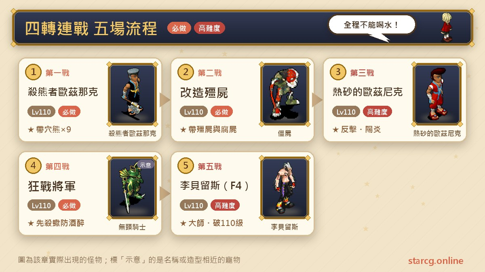
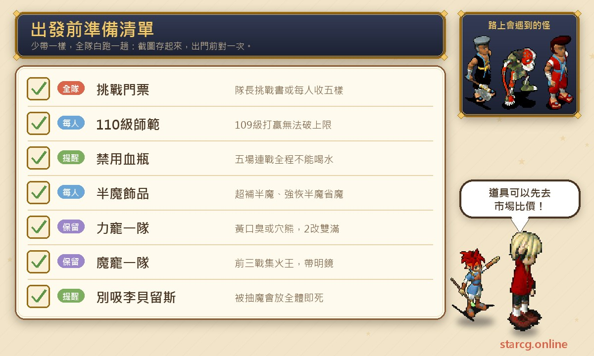
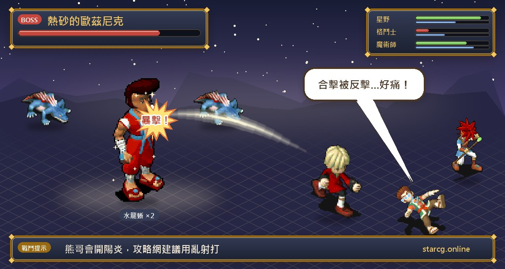

四轉連戰是魔力寶貝職業晉級系列的最後一關，也就是從「師範」升到「大師」的四轉任務。推薦等級 110 級，條件是師範階級並持有挑戰門票。打贏後可以拿到四轉大師升階資格，而且在 110 級打贏時還會同時突破 110 級的等級上限，另外每位隊員各得一把「記憶之鑰」。

這個任務沒有複雜的跑腿流程，難點全在戰鬥：要連打五場 BOSS 戰，全程**不能使用任何血瓶**，最後一場還要同時面對李貝留斯與三位護衛王加上四個影子。不論你玩的是星詠魔力、水藍魔力還是初心魔力寶貝，四轉連戰的規則與陣容都一樣。這篇先整理攻略網的資料，再另外整理一份玩家實戰心得，兩者分開寫，方便對照。

> 本文整理自 [星詠魔力攻略網](https://guide.starcg.net/) 的「四轉連戰」任務頁與四轉連戰詳細攻略頁，用我們自己的方式重新排序與改寫，沒有逐字照搬；標示「玩家實戰整理」的段落，則是整理自玩家提供的四轉實戰心得，屬於個人打法建議，不是攻略網的官方資料。攻略網沒有列出各 BOSS 的等級與血量，實際以遊戲內為準；遊戲更新後內容可能變動。

## 四轉連戰是什麼？先看整體步驟

四轉連戰的流程很單純：湊齊門票、全員 110 級師範組隊，進去之後五場戰鬥一場接一場打，中間不能喝水補血補魔，打贏最終戰的李貝留斯就完成四轉晉升。真正要規劃的是「怎麼讓傳教士與巫師的魔力撐完五場」。

| 步驟 | 內容 | 敵方主將 | 隨從 |
|---|---|---|---|
| 準備 | 取得挑戰門票，全員 110 級師範 | — | — |
| 第一戰 | 連戰開始 | 殺熊者歐茲那克 | 穴熊 ×9 |
| 第二戰 | 連戰 | 改造殭屍 | 殭屍 ×4、腐屍 ×5 |
| 第三戰 | 連戰 | 熱砂的歐茲尼克 | 蜥蜴戰士 ×2、水龍蜥 ×2 |
| 第四戰 | 連戰 | 狂戰將軍 | 木乃伊 ×4、殺手蝎 ×4 |
| 第五戰 | 最終戰（F4） | 李貝留斯 | 巴羅斯、阿卡斯、佛利波羅、幻影、暗影、陰影、旋律 |

**一定要在 110 級打**：在 110 級挑戰成功，才會同時取得四轉大師升階資格與突破 110 級上限；若在 109 級或之前打贏，之後升到 110 級只能升四轉，**無法突破經驗上限**，要在滿 110 級時再挑戰一次。攻略網特別提到，這是唯一不能用魔幣或聲望突破的等級關卡。

連戰中所有 BOSS 的等級與技能都經過調整，攻略網沒有列出各 BOSS 的等級與血量。

## 出發前先準備好這些

四轉連戰最容易出問題的不是輸出，而是**資源**：門票沒湊齊、有人還沒滿 110 級、寵物的魔力不夠撐到最終戰。出發前把下面幾件事確認好。

**挑戰門票（二選一）**：

1. 隊長在魔晶商城購買「挑戰書」，500 魔晶。隊長有就可以。
2. 隊伍**每個人**各自收集五樣道具：
   - 歐茲那克的戒指：在哈洞擊敗熊男「殺熊者歐茲那克」取得。
   - 歐茲尼克的戒指：在海底 2 層擊敗「攔路的熱沙」取得。
   - 牢房的鑰匙：在狗洞擊敗「改造殭屍」，再與密醫阿魯巴斯對話取得。
   - 砂漠的紅星：完成「沙漠之祠」任務，在迦納村民家找考古學家吉村領取。
   - 精靈的水鏡：「六曜之塔」的任務道具，向伊爾村的漁夫歐姆豪克購買。

**裝備與飾品**：攻略網的穩健型配置是傳教士、巫師都穿 10A 帽、神器杖、10A 袍、10A 鞋，飾品以「超補半魔」「強恢半魔」這類降低耗魔的飾品為主。因為整場不能補魔，飾品幾乎決定了能不能撐完。半魔飾品或寵物技能要花錢準備的話，可以先用本站的 [市場查價](/market/) 看看行情。

**寵物**：攻略網建議前三戰用魔寵、備用與最終戰用力寵（黃口臭或穴熊，建議 2 改雙滿），力寵要帶明鏡、戰慄襲心、乾坤 3、護衛。寵物的成長與技能可以先到本站的 [寵物圖鑑](/pets/) 查。

## 隊伍配置：攻略網的三種打法

攻略網的詳細攻略整理了三種隊伍。共通鐵則只有兩條：**連戰期間不能喝水**、**絕對不要對李貝留斯吸魔**。另外第 1、3、4 戰的熊男、熊哥（熱砂）與狂戰將軍會用崩擊，不要防禦，也小心別誤按逃跑。

**1 傳 1 巫 3 任意職（穩健型）**：

- 傳教士：10A 帽、神器杖、10A 袍、10A 鞋；飾品為超補半魔或專屬飾品，搭配撐 MP 的飾品；配點體滿、敏 105、其餘魔；技能超補 10、專屬 4 以上、氣絕、攻無、潔淨 2。
- 巫師：裝備同上；飾品為強恢（T 恢）半魔加回復或 MP 飾品；技能單恢、超恢、強恢 10，祈禱 6，潔淨 10，屬轉，攻無。T 恢第一次放 2、3、4、8 號位，第二次放 1、6、7、4、5、0 號位，三回合可以覆蓋全隊。
- 其餘 3 人：任意職業。聖騎士可以當主坦，法師可以當「充電寶」幫傳教補魔，戰鬥系專心輸出。

**4 格鬥 1 傳（速刷型，需要神器箱）**：思路是靠神器盾的高回復與黃口臭／穴熊的回復，盡量減少傳教耗魔。

- 傳教士：10A 黃昏帽、神器杖、10A 靈魂袍、10A 黃金鞋，帶超補半魔或專屬飾品；體滿、敏 105；技能以超補與祈禱為主。
- 格鬥士 ×4：10A 黃昏帽、神器盾、10A 不死鳥衣、10A 黃金鞋；神器盾提供回復 +100 與必殺 20；技能帶氣功彈 10 與專屬 4。
- 寵物：5 隻單火 10 的魔寵（不屬轉），加一隊雙滿 2 改的黃口臭或穴熊（明鏡、戰慄、乾坤 3）。

**平民 3 弓 2 傳／4 弓 1 傳**：最大的難點同樣是不能補水，另外要注意**消滅全部敵方單位會直接進入下一戰**，所以想整備就要留小怪。

- 弓箭手：滿攻、敏 80、其餘點血；穿 10 等白板套，另備 4 斧給合擊用。
- 傳教士：滿血、敏 100、其餘魔；必備罪飾與水袍，疊加後超補 10 的耗魔只要 96。
- 寵物：115 等雙滿未改的攻黃口臭（普攻、明鏡 V、乾坤 III）。

## 玩家實戰整理：1 傳 1 巫的配點、技能與寵物

以下是玩家提供的四轉實戰心得整理，以「1 傳 1 巫＋3 任意」為主，跟攻略網的建議大方向相同，但配點與細節不完全一樣，可以依自己的角色取捨。

**隊伍分工**：巫師負責屬轉、祈禱、強恢與超恢，目的是**減少傳教士的耗魔**；聖騎士用「騎譽」扛全場；法師用專屬技能幫傳教補魔；其他戰鬥系負責輸出。心得裡也提到另一種「平民 1 傳 4 格」的版本，但需要神器箱。

| 職業 | 配點 | 飾品 | 技能 |
|---|---|---|---|
| 傳教士 | 魔滿、敏 80～100、剩下點體；或魔體各半、敏 80～100 | 超補半魔（超補耗魔 -50%）＋專屬，或強補半魔＋專屬（專屬讓超補耗魔 -30%）；專屬 +15 回復必備 | 超補 10、專屬 4 以上、氣絕、攻無、潔淨 2、抗遺忘、抗酒醉 |
| 巫師 | 體滿、敏 90～110、剩下點魔；或體魔各半 | 強恢（T 恢）半魔＋專屬（+15 回復、T 恢耗魔 -30%），也可換超恢半、強補半或超補半 | 單恢 10、超恢 10、強恢 10、祈禱 6（風或地）、潔淨 10、屬轉、攻無、抗遺忘、抗酒醉；強補 5、超補 5 非必要 |
| 戰鬥系 | 敏 80～100，比傳教慢一點 | — | 專心輸出 |
| 法師 | 體可以多點一些 | 可用神器杖的吸血魔法（0 耗魔） | 專屬技能幫傳教補魔 |
| 聖騎士 | — | — | 主坦，騎譽守護全隊；F4 前半段可用神聖之光減輕補血壓力 |

**省魔小技巧**：傳教士帶超補半魔時盡量只用超補；巫師先用 T 恢把全隊掛上恢復狀態後，傳教士可以改成「看血量才補」的節奏補血。巫師 T 恢的站位以 1 2 3 4 5／6 7 8 9 0 兩排來算，第一次放 2、3、4、8，接著 1、6、7，再來 4、5、0，三回合就能覆蓋全隊。

**寵物配置**：

- **魔寵一隊**（非必要但推薦，多在第 1～3 戰上場，狂戰也能用）：
  - 屬轉型：搭黃口臭的話用月球風兔（中秋活動寵）或神盾，屬風；搭穴熊的話用妖草或大地鼠，屬地。純白、嚇人箱都可以，風或地 5 即可，金寵較貴。
  - 不屬轉型：粉紅菇、火焰之刃（火屬）。
  - 技能：各自屬性的單體 10 法或 EX 法，加明鏡 4 或 5。心得建議不要花太多資源幫魔寵補魔，氣絕靠巫師拉、血靠明鏡補。
  - 單體 EX 法：寵物有 10 法後，要打百人道場到 100 關找 NPC 升級；心得記載單法 50 萬魔幣、T 法 100 萬魔幣，也可以在世界頻拜託在打百人的玩家幫忙。
  - 建議至少 1 改，不一定要滿檔。
- **力寵**：黃口臭（心得記載洗檔 $10）或穴熊（洗檔 $50）準備 5～10 隻；技能明鏡 4～5、戰慄襲心 4～5、乾坤 3、護衛 1～2；建議至少 2 改雙滿。沒有魔寵的話，建議準備兩隊力寵。

**進場屬性**：帶黃口臭的隊伍全員風 10；帶穴熊的隊伍全員地 10。後面每一戰的屬轉都是照這個屬性來決定。

## 第一戰：殺熊者歐茲那克（熊弟）

敵方是殺熊者歐茲那克（玩家常叫「熊弟」）帶穴熊 ×9。熊弟會用崩擊，所以不要防禦。

**攻略網打法**：穩健型的第一回合由巫師對熊弟做屬性轉換（地 5、水 5），魔寵集火王；之後可以留小怪，讓巫師上祈禱。4 格鬥隊用氣功彈 10 集火打王，魔寵單火 10，攻略網形容幾乎沒有難度。

**玩家實戰整理**：心得把第一、二戰放在一起打。熊弟的屬性記為火 5 風 5。

1. 風 10／地 10 隊伍：第一回合巫師把熊弟屬轉成地 5 水 5，魔寵集火王，用範圍技清小怪。
2. 第二回合之後，巫師放祈禱、T 恢，必要時補攻無。
3. 帶火屬魔寵的話可以省略屬轉，直接放祈禱。
4. 沒有魔寵的隊伍，用力寵乾坤 3 集火王。

## 第二戰：改造殭屍（改殭）

敵方是改造殭屍帶殭屍 ×4、腐屍 ×5。攻略網的說明是：改殭只有在帶地 10 寵的時候才需要屬轉；4 格鬥隊照樣用氣功彈 10 集火。

**玩家實戰整理**：改殭的屬性記為地 4 風 6。

1. 地 10 隊伍才需要讓巫師屬轉（改成火 4 水 6）；風 10 隊伍直接打。
2. 心得建議這一戰**留下小怪**，在進入第三戰熊哥之前讓巫師先放好祈禱。

## 第三戰：熱砂的歐茲尼克（熊哥）

敵方是熱砂的歐茲尼克（玩家常叫「熊哥」）帶蜥蜴戰士 ×2、水龍蜥 ×2。熊哥的反擊非常痛，還會開高閃避的陽炎，是前四戰最需要小心的一場。

**攻略網打法**：

- 穩健型：巫師屬轉熊哥（地 5、水 5），魔寵集火；物理合擊會被反擊，要斟酌使用。進狂戰前巫師幫全隊上滿 T 恢，並換上力寵。
- 4 格鬥隊：改用「氣功彈 1」打王（專屬技會丟兩顆），留小怪整備並換力寵；進狂戰前傳教丟祈禱、格鬥上攻無。
- 平民弓手隊：建議用「亂射」打陽炎；寵物合擊很看運氣，合不上就會被反擊，消耗很大。

**玩家實戰整理**：熊哥的屬性記為火 5 風 5，會用氣功彈、反擊與陽炎。

1. 第一回合巫師屬轉熊哥（地 5 水 5），魔寵集火王；戰鬥系用合擊或遠程攻擊，但合擊可能吃到反擊。
2. 之後誰的血掉了就補攻無。帶火屬魔寵可以省略屬轉；沒有魔寵也一樣要屬轉熊哥，再賭合擊。
3. 打死王後**留下小怪**整備。進狂戰前巫師放祈禱、T 恢補滿全隊。
4. 狂戰可以換力寵，也可以繼續用魔寵，但只有風、地屬的魔寵適合續用。

## 第四戰：狂戰將軍

敵方是狂戰將軍帶木乃伊 ×4、殺手蝎 ×4。這一戰的麻煩是**酒醉**與**魔封**：殺手蝎會讓人酒醉，酒醉每跳約掉 124 魔，要第一時間潔淨；魔封期間如果有人倒下或中酒醉都很不利。

**攻略網打法**：

- 優先用群攻殺蠍子，避免被酒醉；遇到魔封直接換力寵。
- 狂戰將軍死後留一隻小怪，靠巫師的恢復與寵物的明鏡回血。
- 4 格鬥隊用氣功彈 10 打王、寵物乾坤 3 打王，同樣優先殺蠍子。
- **進第五戰前不可以帶著攻擊無效或恢復狀態進場**，巫師（4 格鬥隊則是傳教）先放祈禱；也要確保場上沒有魔封。

**玩家實戰整理**：狂戰將軍的屬性記為水 8 地 2。

1. 力寵用乾坤 3，魔寵用單風或單石魔法集火王。
2. 傳教士普攻小怪，視情況放超補或攻無；其他人用群體技能優先殺蠍子。
3. 小怪快死光時改用合擊，**留 2～3 隻木乃伊**方便整備。魔寵遇到魔封就換力寵。
4. 心得認為風 10／地 10 加祈禱，扛得住狂戰的乾坤；被魔封又瀕死時，可以讓寵物護衛血少的人。
5. 狂戰死後留一隻小怪，靠巫師 T 恢、單恢與寵物明鏡回血。
6. 只有 5 隻主力寵的隊伍要注意寵物魔量，因為最終戰還要用戰慄襲心吸乾波羅與阿卡斯的魔。
7. 進最終戰前不能帶攻無或恢復狀態，心得說明原因是王會放超強石化，帶著狀態進場可能被 T 即死；巫師放祈禱（黃口臭隊放風、穴熊隊放地）。
8. 有聖騎士的話很穩：騎譽加單恢，甚至可以先不補血，放好專屬技能的盾和祈禱就進最終戰。

**玩家實戰整理：控血先手流**：心得提到一種搶先手的作法，依據是「血量與魔量總和越低，行動越快」。在狂戰結束前，讓一名隊員（例如巫師）維持殘血，並換上滿血的備用寵，最終戰就能搶到第一順位；進場第一動先對剋制我方屬性的影子做屬轉（例如我方是風屬，就把火屬影子轉成地屬），寵物集火。

## 第五戰：李貝留斯（F4 最終戰）

最終戰的敵方是李貝留斯，加上巴羅斯、阿卡斯、佛利波羅三位王（四位合稱 F4），另有幻影、暗影、陰影、旋律等影子單位。每位王都有「觸發條件」，一旦滿足就會追加危險技能，所以這一戰的重點是**照順序、控條件**。

**F4 追加技能對照（攻略網）**：

| BOSS | 觸發條件 | 追加技能 |
|---|---|---|
| 李貝留斯 | 被戰慄襲心抽魔；敵方只剩 1 隻；血量低於 50%／25% | 100% 全體即死（瞬間團滅）、四屬性超強魔法 Lv.9、暗殺與全體即死魔法 |
| 佛利波羅 | 敵方少於 4 隻；我方使用恢復類技能；血量低於 25% | 強力風刃與冰凍魔法、超強冰凍魔法 Lv.9、強力即死魔法 |
| 阿卡斯 | 我方有魔法封印；敵方少於 4 隻；血量低於 25% | 暗殺、吸血與強力火焰隕石、超強火焰 Lv.9 |
| 巴羅斯 | 我方同時有魔法封印與物理封印；敵方少於 4 隻 | 超強石化、超強中毒與超強酒醉、超強魔法 |

**攻略網打法（穩健型）**：

1. 口訣：**佛利波羅死之前，巫師只能放祈禱與屬轉，不能放恢復**（因為恢復類技能會觸發佛利波羅）。
2. 第一步：集火剋制我方屬性的影子，傳教放超補。
3. 第二步：寵物對佛利波羅與阿卡斯用戰慄襲心，直到魔乾、開始發呆。
4. 第三步：擊殺順序為巴羅斯（前）→ 佛利波羅（右）→ 李貝留斯（後）→ 阿卡斯（左）。佛利波羅死後巫師才開始放恢復。
5. 李貝留斯血量低於 50% 會狂暴，放超強魔法與即死，**傳教士這段期間絕對不能斷超補**。

**4 格鬥隊**：第一回合集火剋制屬性的影子，清完後格鬥改用「氣功彈 5」打四隻王；寵物用戰慄襲心抽阿卡斯與佛利波羅到魔乾發呆。擊殺順序為巴羅斯 → 李貝留斯（50% 血狂暴期間傳教不可斷補）→ 阿卡斯與佛利波羅。

**平民弓手隊**：用合擊逐一擊破。巴羅斯低血時不會追加技能，如果控血到下回合打得死，可以先扣著不殺。打死其中一隻王之後，巴羅斯會追加全體酒醉或中毒：中毒約 300 一跳，不用潔淨，靠超補頂過去；酒醉 124 一跳，要立刻潔淨。所以要趁控好血時盡快殺掉巴羅斯，再收掉其餘兩隻，最後圍攻李貝留斯。

**玩家實戰整理：F4 回合流程**：

1. 原則：巫師在佛利波羅（波羅）死前只放祈禱與屬轉，其他時間普攻或防禦。
2. 第 1 回合：
   - 穴熊隊（地屬）：戰鬥系集火暗影（風 10），傳教超補 10，巫師把暗影從風屬轉成水屬。
   - 黃口臭隊（風屬）：戰鬥系集火幻影（火 10），傳教超補 10，巫師把幻影從火屬轉成地屬。
3. 第 2 回合：穴熊隊挑水屬影子以外的一個集火；黃口臭隊挑地屬影子以外的一個集火。清完影子，場上只剩 F4。
4. 之後傳教士開始省魔，以人的血量為主，寵物靠明鏡自己回。傷害不夠時可以讓巫師放祈禱，但祈禱也會幫 F4 減傷，要斟酌。
5. 寵物對波羅、阿卡斯用戰慄襲心，直到魔低於 40；吸乾後牠們只會普攻、吸血攻擊或發呆。心得把吸魔分成三種：最穩是波羅、阿卡斯都吸乾；輸出夠的話只吸阿卡斯；寵物是金卡滿檔的話可以不吸。
6. 擊殺順序：巴羅斯（前）＞波羅（右）＞李貝留斯（後）＞阿卡斯（左）。
7. 波羅死後巫師開始放恢復，三個 T 恢就能涵蓋全隊；心得記載這時巫師通常還有三成以上的魔。
8. 人寵用乾坤打李貝留斯：心得記載牠在 50%～100% 血時很常用吸血魔法與吸血攻擊，一次補 1,000 多，所以要用乾坤快速壓到半血以下；李貝留斯不會開陽炎。低於 50% 後會大量放超強魔法甚至全體即死，傳教士不能斷超補。
9. 打死李貝留斯後，合擊正在發呆的阿卡斯就獲勝。

**打法提醒**：攻略網的鐵則是「不要吸魔李貝留斯」，因為被戰慄襲心抽魔正是牠放 100% 全體即死的觸發條件之一。戰慄襲心只用在佛利波羅與阿卡斯身上。

輸出是否足以壓過李貝留斯的狂暴期，可以先用本站的 [傷害計算機](/damage/) 估一下主力的單發傷害再決定陣容。

**獎勵**：挑戰成功後每位隊員得到一把「記憶之鑰」，開啟後隨機得到一個 BOSS 碎片，集滿 999 個可以兌換 129 檔金卡寵：殺熊者歐茲那克、熱砂的歐茲尼克或黑暗醫生阿魯巴斯。

## 玩家實戰整理：懶人包

把玩家心得濃縮成幾句話：

- 力寵至少雙滿 2 改，魔寵至少 1 改。
- 沒有第二套力寵的話，要特別注意寵物魔量，最終戰還要吸魔。
- 傳教士與巫師能不能活下來，是整場連戰的關鍵。
- 寵物多帶明鏡，減輕傳教補血的負擔。

## 四轉連戰常見問題

**四轉 109 級打贏了，還要再打嗎？** 要。109 級以前打贏只能升四轉，想突破 110 級上限，必須在滿 110 級時重新挑戰。

**四轉門票哪種比較快？** 隊長花 500 魔晶買挑戰書最省事，而且只要隊長有就可以；不想花魔晶的話，就要每個人各自收集五樣道具。

**連戰中可以喝血瓶或魔水嗎？** 不行。四轉連戰全程不能使用任何血瓶，所以要靠半魔飾品、巫師的恢復、寵物明鏡與法師補魔撐完五場。

**為什麼不能對李貝留斯用戰慄襲心？** 被戰慄襲心抽魔是李貝留斯放 100% 全體即死的觸發條件之一。要抽魔的對象是佛利波羅與阿卡斯。

**為什麼最終戰一開始不能放恢復？** 我方使用恢復類技能會觸發佛利波羅追加強力風刃、冰凍與即死魔法。攻略網建議佛利波羅死之前，巫師只放祈禱與屬轉；進場前身上也不要帶恢復或攻擊無效狀態。

**最終戰要先打誰？** 攻略網的穩健型順序是巴羅斯 → 佛利波羅 → 李貝留斯 → 阿卡斯，玩家心得的順序也相同；開打前兩回合先清掉剋制我方屬性的影子。

## 小結

四轉連戰是職業晉級系列的終點：在 110 級、不喝血瓶的條件下打完五場，第三戰小心熊哥的反擊與陽炎，第四戰先殺蠍子防酒醉，最終戰則照「先清影子、抽乾佛利波羅與阿卡斯、巴羅斯 → 佛利波羅 → 李貝留斯 → 阿卡斯」的順序，並記得李貝留斯半血後傳教不能斷超補。把門票、飾品與寵物魔量先準備好，就能少翻很多次車。

更完整的原文可以到 [星詠魔力攻略網](https://guide.starcg.net/) 的四轉連戰任務頁與詳細攻略頁查閱；備錢、配寵與估算輸出，也可以搭配本站的 [市場查價](/market/)、[寵物圖鑑](/pets/) 與 [傷害計算機](/damage/)。

## 職業晉級分篇

- [職業晉級任務總覽：一轉到四轉](/posts/job-advance-quest-guide/)
- [一轉：樹精長老的末日](/posts/job-advance-1-quest-guide/)
- [二轉：挑戰神獸](/posts/job-advance-2-quest-guide/)
- [三轉：詛咒的迷宮](/posts/job-advance-3-quest-guide/)
