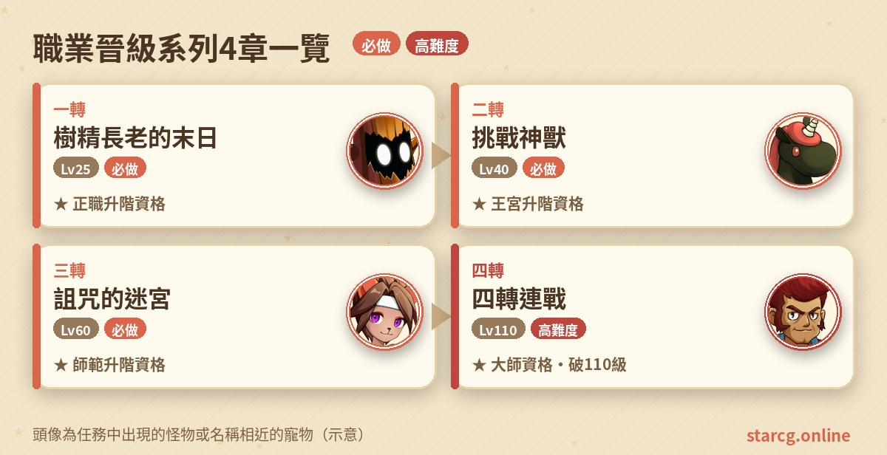
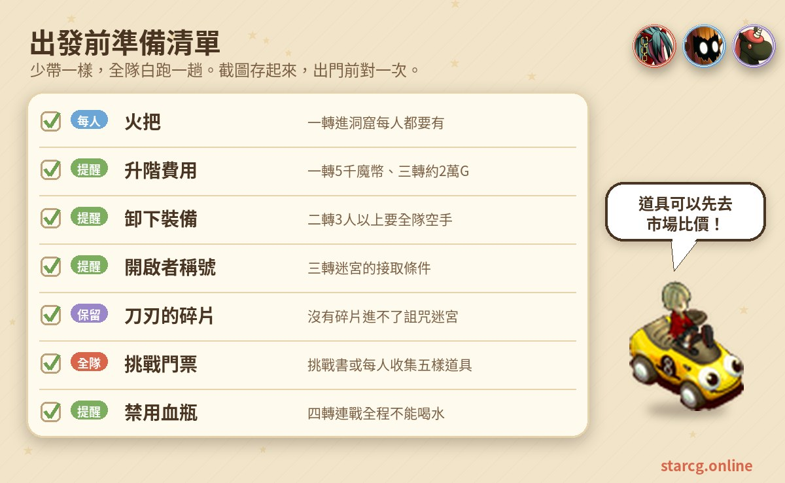
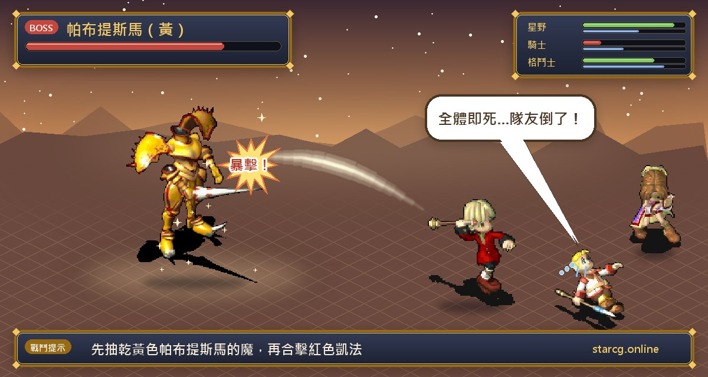
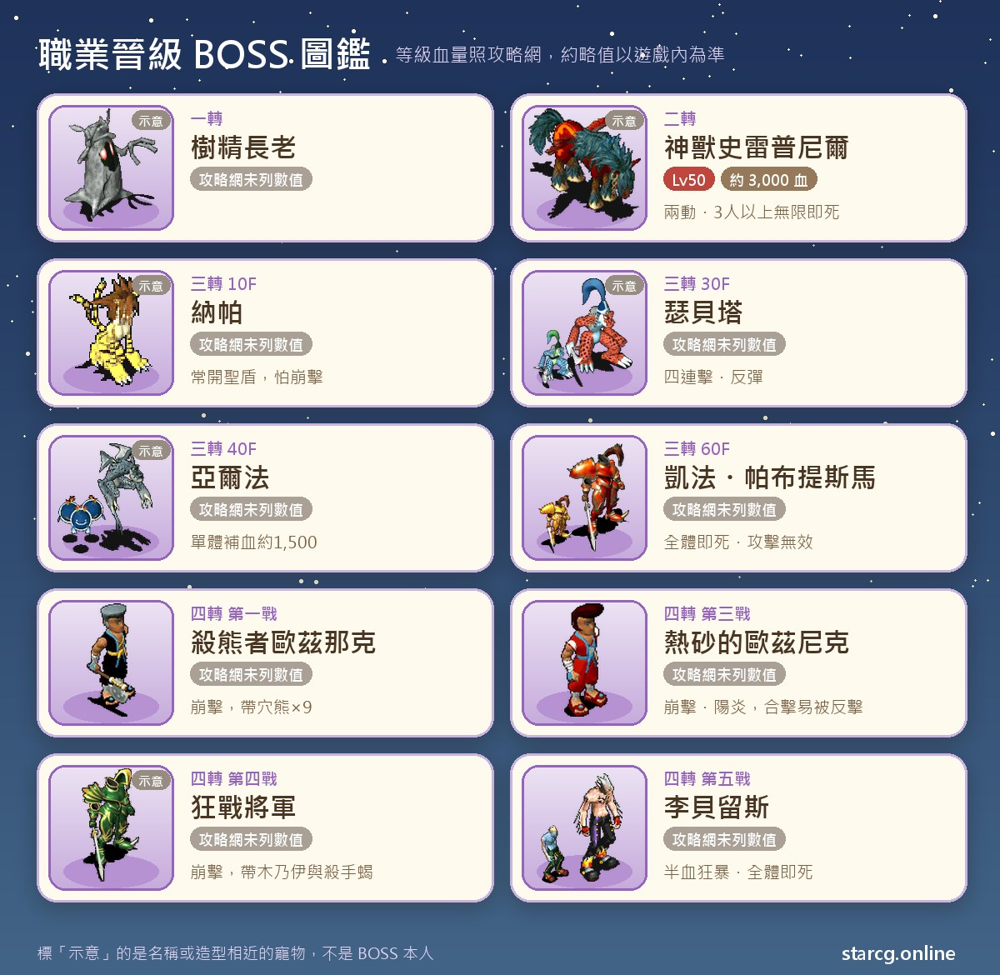

魔力寶貝的職業有見習、正職、王宮、師範、大師等階級，每往上升一階，除了技能等級與聲望要達標，還得先完成一個「晉級任務」拿到升階資格。這篇要整理的，就是從一轉到四轉的四個職業晉級任務：一轉的「樹精長老的末日」、二轉的「挑戰神獸」、三轉的「詛咒的迷宮」，以及四轉的「四轉連戰」。

四個任務的推薦等級分別是 25、40、60、110 級，難度也一路往上：一轉只是走一趟洞窟打一隻王，二轉開始有人數限制，三轉要爬 60 層迷宮並連打六場守護者戰，四轉則是不能喝血瓶的五連戰，打贏才能升大師並突破 110 級上限。不論你玩的是星詠魔力、水藍魔力還是初心魔力寶貝，職業晉級任務的流程都一樣，可以把這篇當成升階前的檢查清單。

> 本文整理自 [星詠魔力攻略網](https://guide.starcg.net/) 的職業晉級系列頁面與四轉連戰詳細攻略，並參考水藍魔力攻略 wiki 的三轉頁面，用我們自己的方式重新排序與改寫，沒有逐字照搬。BOSS 血量與數值是約略值，實際以遊戲內為準；遊戲更新後內容可能變動。

**分篇詳細攻略**：每一轉都有獨立的一篇，步驟、BOSS 資料與打法寫得更完整：
- [一轉：樹精長老的末日](/posts/job-advance-1-quest-guide/)
- [二轉：挑戰神獸](/posts/job-advance-2-quest-guide/)
- [三轉：詛咒的迷宮](/posts/job-advance-3-quest-guide/)
- [四轉：四轉連戰（含玩家實戰配置）](/posts/job-advance-4-quest-guide/)

## 職業晉級系列是什麼？先看整體順序

職業晉級任務是「一階一個」的設計：完成任務只代表拿到**升階資格**，真正升階還要回到當初就職的 NPC 那裡，在技能等級與聲望都符合條件時付費辦理。任務之間有明確的先後關係：二轉任務只有正職能接，三轉要王宮階級並持有「開啟者」稱號，四轉則要師範階級加上挑戰門票。

| 章節 | 任務名稱 | 推薦等級 | 取得 |
|---|---|---|---|
| 一轉 | 樹精長老的末日 | 25（無條件） | 正職升階資格 |
| 二轉 | 挑戰神獸 | 40（需正職） | 王宮升階資格、補血／恢復魔法學習 |
| 三轉 | 詛咒的迷宮 | 60（需王宮＋「開啟者」） | 師範升階資格 |
| 四轉 | 四轉連戰 | 110（需師範＋門票） | 大師升階資格、突破 110 級上限、記憶之鑰 |

## 出發前先準備好這些

晉級任務最常見的失誤，大多不是打不贏，而是**條件沒對上**：一轉忘了每個人都要拿火把、二轉帶了 3 個人以上還穿著裝備、三轉沒有「開啟者」稱號或弄丟了刀刃的碎片、四轉在 109 級就去打，結果升到 110 級還要再打一次。

升階本身也要花錢：一轉 5,000 魔幣、三轉依職業約 20,000G，二轉還有學補血、恢復魔法的 10,000～15,000G 學費。手頭不夠的話，可以先用本站的 [市場查價](/market/) 看看身上的材料、裝備現在能賣多少，再決定要賣哪些東西湊錢。

## 一轉：樹精長老的末日（正職升階資格）

無任務條件，推薦 25 級，是大部分角色第一個遇到的晉級任務。

1. 到維諾亞村醫院（61, 53）找**艾里克的傭兵**對話，他會請你去村北的洞穴拿回大劍，並給你「火把」。**隊伍每個人都要有火把**才能進洞窟。
2. 前往村北布滿青苔的洞窟（380, 353），穿過後抵達嘆息的森林。
3. 打倒**樹精長老**。戰後隊伍中**隨機一人**拿到「艾里克的大劍」，其他人與旁邊的**年輕樹精**對話，可以拿到「樹苗？」。
4. 鑑定「樹苗？」，它會變成關鍵道具「生命之花」。
5. 把生命之花交給維諾亞村村長**卡丹**。這一步不會給實體道具，但系統會記錄你的升階資格。
6. 技能等級與聲望符合條件後，回到就職地點找 NPC，付 5,000 魔幣晉升正職。

**要注意的地方（路線分歧）**：拿到大劍的那位**不要直接回村交給艾里克**。正確做法是把大劍交給旁邊的年輕樹精，換成「樹苗？」才能繼續升階。若把大劍交給艾里克，會拿到「賢者的戒指」（不可交易，敏捷 +3～+5、精神 +5、耐久 100～150），但同時**放棄這次的升階資格**，必須丟掉戒指、重新打一次樹精長老才能升階。攻略網沒有列出樹精長老的等級與血量。

## 二轉：挑戰神獸（王宮升階資格與補血魔法）

推薦 40 級，職業要是「正職」階級，見習無法接取。這章最大的特色是**人數限制**。

1. 前往莎蓮娜島傑諾瓦村（216, 457），到醫院二樓（44, 33）找**神官比爾班**，領取「貝茲雷姆之鑰」。
2. 到傑諾瓦村西北方的貝茲雷姆神殿，與**神官傑拉娜**（135, 333）對話進入，踩黃色傳送石進入貝茲雷姆迷宮。
3. 在迷宮中打倒**大地翼龍**取得「地龍的麟片」。隊伍裡只要一人拿到，全隊都會有。
4. 前往迷宮頂層的靜謐之間，把地龍的麟片交給**神官葛雷森**，挑戰神獸。
5. 擊敗神獸後，前方房間可以學技能；再到後方房間與**邪靈鳥人**對話兩次，**直到對話框出現結束語**，才算拿到升階資格。

**人數規則一定要看清楚**：迷宮裡建議單人或雙人前進；如果要 3～5 人組隊，**全隊必須空手並卸下所有裝備**，否則大炸彈會自爆、大地翼龍會用裝備破壞。BOSS 戰則**只能單人或雙人**，3 人以上神獸會無限施放超強即死魔法，等於強制全滅。系統傭兵不計入人數，可以全部帶上。

**BOSS 資料**：神獸史雷普尼爾 50 級、約 3,000 血，一回合兩動，會攻擊、防禦、諸刃、崩擊、陽炎、反擊、聖盾與明鏡止水；2 人以上時會追加超強即死魔法。迷宮裡的大炸彈（40 級）會攻擊、防禦、火焰魔法，2 人以上追加自爆；大地翼龍（40 級）會攻擊、防禦、毒性攻擊，2 人以上追加裝備破壞。

**技能學習**：傳教士（正職）找守衛（13, 52）進專屬房間，向天書（14, 4）花 15,000G 學超強補血魔法；巫師（正職）找小愛（40, 52）進專屬房間，向天書（15, 9）花 10,000G 學強力恢復魔法、向天書（11, 9）花 15,000G 學超強恢復魔法。其他職業可以暫時轉職，或用第二職業系統把副職設成傳教士或巫師，進房後再切回主職。學技能本身要具備對應職業的正職階級。

## 三轉：詛咒的迷宮（60 層與六場守護者戰）

推薦 60 級，條件是王宮階級並持有「開啟者」稱號（要先完成「開啟者」任務）。整個任務的重心是一座 60 層的迷宮，每 10 層有一位守護者。

1. 到阿巴尼斯村民家（40, 30），找**歷史學家雷伯爾森**（14, 10）拿「野草莓」。
2. 把野草莓交給樓梯前的**米希安**（9, 4），進入民家地下室。
3. 調查**時空石盤**（15, 7）傳到過去，找**戰士帕魯凱斯**（15, 7）拿「刀刃的碎片」，再用地下室的時空石盤回到現在。
4. 從阿巴尼斯村往西，調查**鼓動的石盤**（54, 162）進入迷宮。沒有刀刃的碎片進不去。
5. 每 10 層有一位守護者，打贏後對話可拿「聖詔」（50 層除外）。雙擊聖詔可以直接飛到對應樓層，例如聖詔一可飛往 11 樓，所以中途回城補給後也能飛回來。
6. 第 60 層調查**封印石**（24, 19）進入最終戰。
7. 打贏後找**神官貝米鳥斯**對話離開迷宮，取得升階資格，依職業準備約 20,000G 到就職處辦理。

**免戰條件**：前五位守護者都可以用「隊伍中有人某項技能達 8 級」的方式免戰通過，但免戰的樓層**拿不到聖詔**。

| 樓層 | 守護者 | 迷宮魔物（等級） | 免戰條件（一人 8 級） | 推薦水晶 |
|---|---|---|---|---|
| 10F | 納帕 | 大地翼龍、地獄獵犬（38～40） | 調教、寵物強化 | 火風 |
| 20F | 德爾麥 | 血腥之刃、羅剎（41～43） | 任一攻擊魔法 | 純地或地水 |
| 30F | 瑟貝塔 | 獵豹蜥蜴、蜥蜴鬥士（44～46） | 物理戰鬥技能 | 風地或火風 |
| 40F | 亞爾法 | 寶貝炸彈、迷你石像怪（47～49） | 回復系列技能 | 水火 |
| 50F | 馬帝亞 | 幽靈、兇暴仙人掌（50～52） | 咒術、抗咒或制御巫術 | 地風 |
| 60F | 帕布提斯馬、凱法 | 前五關小怪（53～55） | 無，必須戰鬥 | 純水或水火 |

**各層打法重點**：

- **納帕**：盡量一回合清掉地獄獵犬，再集中打納帕；納帕倒下前別理大地翼龍，否則牠會不斷被召喚補上。納帕常開聖盾，「崩擊」對他很有效。
- **德爾麥**：先快速清小怪，再用遠程攻擊打德爾麥。他會頻繁使用強力魔法，需要傳教士或巫師維持全隊血量與魔力。
- **瑟貝塔**：建議用遠距離武器，先清後排的蜥蜴鬥士，前排獵豹蜥蜴可以留中間一隻卡位。瑟貝塔的四連擊很致命，攻略網建議「寵防人打」；法師要出手前，**必須先替他破除反彈**，否則可能被自己的魔法打倒。
- **亞爾法**：清光小怪後用最強攻擊或合擊猛攻。亞爾法單體補血約 1,500，還有兩動的恢復魔法，輸出不夠就會拖成消耗戰。
- **馬帝亞**：依序清後排幽靈、前排仙人掌，最後合擊馬帝亞。隊伍裡沒有巫師施放潔淨的話，很容易被混亂到自相殘殺。
- **最終戰**：核心是「抽黃合紅」：用寵物對黃色的**帕布提斯馬**使用「戰慄襲心」，把他的魔力抽到 10 以下，他就會發呆；接著全力打紅色的**凱法**，倒下後再回頭處理帕布提斯馬。BOSS 會用全體即死與攻擊無效，即死成功率不高，倒下的人要靠隊友互救；前幾回合可以用強力補血，但要控制魔力，避免後期沒魔。輕裝與低防的法師有被打飛的風險。

**其他玩家整理的補充**：水藍魔力攻略 wiki 的三轉頁面提到，刀刃的碎片**登出後會消失**，中途斷線要回村重新取得；該頁把各層守護者記為 65 級、最終雙王為 70 級，並註明凱法在帕布提斯馬倒下後會追加魔法封印、帕布提斯馬在凱法倒下後會追加超強即死魔法。該頁的完成流程還多了「與阿邦的門徒對話取得試煉證明」一步，升階費用寫法也和攻略網不同，實際以遊戲內為準。

想讓寵物負責「戰慄襲心」抽魔，可以先到本站的 [寵物圖鑑](/pets/) 查哪些寵物適合帶這類技能。

## 四轉：四轉連戰（大師資格與突破 110 級）

推薦 110 級，條件是師範階級並持有挑戰門票。這是整個晉級系列最難的一關。

**一定要在 110 級打**：在 110 級挑戰成功，才會同時取得四轉大師升階資格與突破 110 級上限；若在 109 級或之前打贏，之後升到 110 級只能升四轉，**無法突破經驗上限**，要在滿 110 級時再挑戰一次。

**挑戰門票（二選一）**：

1. 隊長在魔晶商城購買「挑戰書」，500 魔晶。
2. 隊伍**每個人**各自收集五樣道具：
   - 歐茲那克的戒指：在哈洞擊敗熊男「殺熊者歐茲那克」取得。
   - 歐茲尼克的戒指：在海底 2 層擊敗「攔路的熱沙」取得。
   - 牢房的鑰匙：在狗洞擊敗「改造殭屍」，再與密醫阿魯巴斯對話取得。
   - 砂漠的紅星：完成「沙漠之祠」任務，在迦納村民家找考古學家吉村領取。
   - 精靈的水鏡：「六曜之塔」的任務道具，向伊爾村的漁夫歐姆豪克購買。

**五場連戰陣容**：

| 場次 | 敵方主將 | 隨從 |
|---|---|---|
| 第一戰 | 殺熊者歐茲那克 | 穴熊 ×9 |
| 第二戰 | 改造殭屍 | 殭屍 ×4、腐屍 ×5 |
| 第三戰 | 熱砂的歐茲尼克 | 蜥蜴戰士 ×2、水龍蜥 ×2 |
| 第四戰 | 狂戰將軍 | 木乃伊 ×4、殺手蝎 ×4 |
| 第五戰 | 李貝留斯 | 巴羅斯、阿卡斯、佛利波羅、幻影、暗影、陰影、旋律 |

連戰中所有 BOSS 的等級與技能都經過調整，而且**戰鬥中不能使用任何血瓶**。攻略網沒有列出各 BOSS 的等級與血量。

**打法重點（整理自攻略網四轉連戰詳細攻略）**：

- **共通規則**：連戰期間不能喝水，也**絕對不要對李貝留斯吸魔**。第 1、3、4 戰的熊男、熱砂與狂戰將軍會用崩擊，不要防禦，也小心別誤按逃跑。
- **1 傳 1 巫 3 任意職**：傳教士以超強補血為主；巫師在第 1、3 戰第一回合先對王做屬性轉換，之後放祈禱或恢復。第 4 戰先群攻殺手蝎，避免被酒醉。進最終戰前不要帶著攻擊無效或恢復狀態。
- **4 格鬥 1 傳（速刷）**：格鬥士持神器盾，第 1、2 戰用氣功彈 10 集火，第 3 戰改用氣功彈 1 並換力寵，第 4 戰用氣功彈 10 與乾坤打王；最終戰第一回合先集火剋制屬性的影子，清完再處理其餘四王。
- **平民弓手隊（3 弓 2 傳或 4 弓 1 傳）**：最大難點同樣是不能補水。第 3 戰熱砂的歐茲尼克會開陽炎，建議用亂射打，合擊容易被反擊；第 4 戰注意魔封與酒醉，酒醉每跳約掉 124 魔，要立即潔淨。

**最終戰的擊殺順序**：巴羅斯 → 佛利波羅 → 李貝留斯 → 阿卡斯是攻略網給的順序。四位王都有觸發條件：李貝留斯被戰慄襲心抽魔、場上只剩一個敵人、或血量低於 50%／25% 時，會放 100% 全體即死；佛利波羅在我方使用恢復類技能、敵方少於 4 隻或血量低於 25% 時會追加強力風刃、超強冰凍與即死魔法；阿卡斯在我方有魔法封印、敵方少於 4 隻或血量低於 25% 時，會追加暗殺、吸血與強力火焰類魔法；巴羅斯在我方同時有魔法封印與物理封印、或敵方少於 4 隻時，會追加超強石化、中毒、酒醉等魔法。李貝留斯血量低於 50% 會狂暴，**這段期間傳教士不能斷超強補血**。另外，擊殺其中一隻王之後，巴羅斯可能放全體酒醉或中毒，所以攻略網建議盡快解決巴羅斯；中毒約 300 一跳，建議用超強補血頂過去，酒醉則要馬上潔淨。

輸出是否足以壓過狂暴期，可以先用本站的 [傷害計算機](/damage/) 估一下主力的單發傷害再決定陣容。

**獎勵**：挑戰成功後每位隊員得到一把「記憶之鑰」，開啟後隨機得到一個 BOSS 碎片，集滿 999 個可以兌換 129 檔金卡寵：殺熊者歐茲那克、熱砂的歐茲尼克或黑暗醫生阿魯巴斯。

## 職業晉級常見問題

**晉級任務做完就會直接升階嗎？** 不會。任務只給升階資格，還要技能等級與聲望符合條件，再回到就職處付費辦理。

**一轉拿到賢者的戒指怎麼辦？** 把大劍交給艾里克就會走飾品路線、放棄這次升階資格。要丟掉戒指，重新打一次樹精長老，並把大劍交給年輕樹精。

**二轉為什麼一直全滅？** 最常見的原因是 3 人以上打神獸，神獸會無限施放超強即死魔法。BOSS 戰只能單人或雙人，系統傭兵不計入人數。

**三轉可以跳過守護者嗎？** 可以用免戰條件，隊伍中有人對應技能達 8 級即可，但免戰的樓層拿不到聖詔，之後就不能用聖詔直接飛回那一層。

**四轉 109 級打贏了，還要再打嗎？** 要。109 級以前打贏只能升四轉，想突破 110 級上限，必須在滿 110 級時重新挑戰。

**四轉門票哪種比較快？** 隊長花 500 魔晶買挑戰書最省事；不想花魔晶的話，就要每個人各自收集五樣道具。

## 小結

職業晉級系列是每個角色都繞不開的四道關卡：一轉注意大劍別交錯人，二轉記得人數與裝備限制，三轉把刀刃的碎片顧好並善用聖詔分段攻略，四轉則要在 110 級、不喝血瓶的條件下打完五連戰。把每一轉的條件與陷阱先確認清楚，就能少走很多重來的冤枉路。

更完整的原文可以到 [星詠魔力攻略網](https://guide.starcg.net/) 的職業晉級與四轉連戰攻略頁查閱；備錢、配寵與估算輸出，也可以搭配本站的 [市場查價](/market/)、[寵物圖鑑](/pets/) 與 [傷害計算機](/damage/)。

## 參考資料

- [水藍魔力攻略 wiki：戰鬥系升階 III（Gamerch）](https://gamerch.com/blue-cg/452315)
