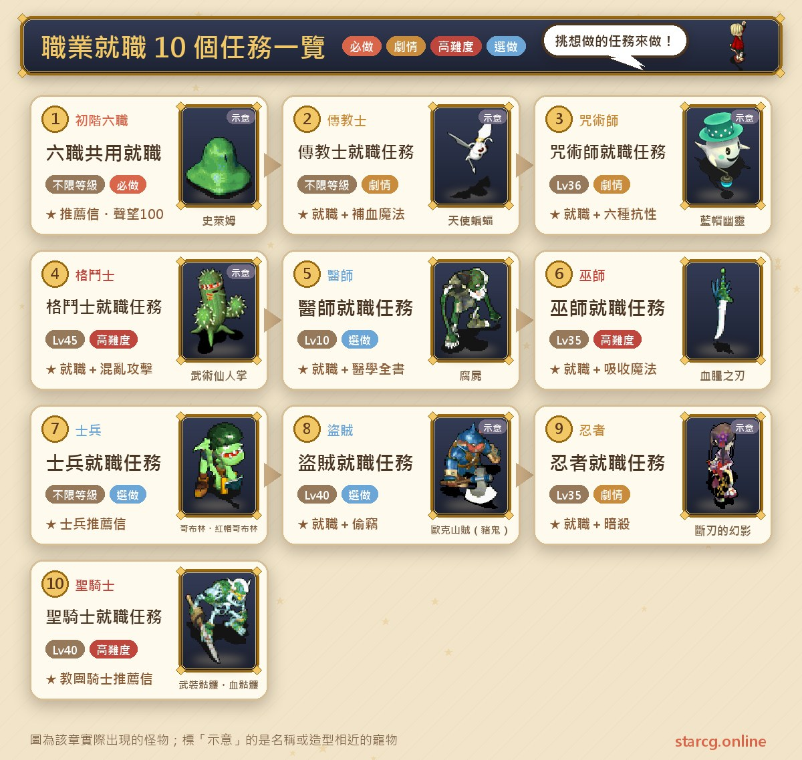
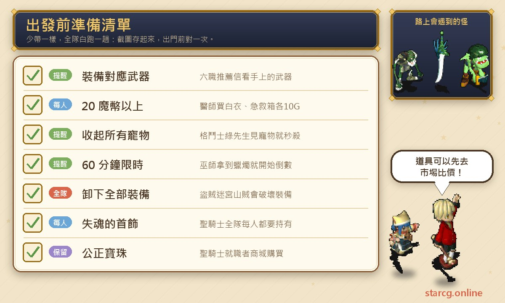
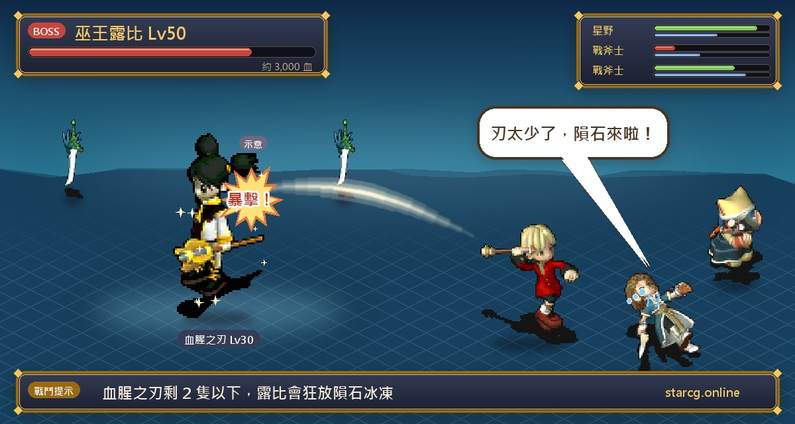
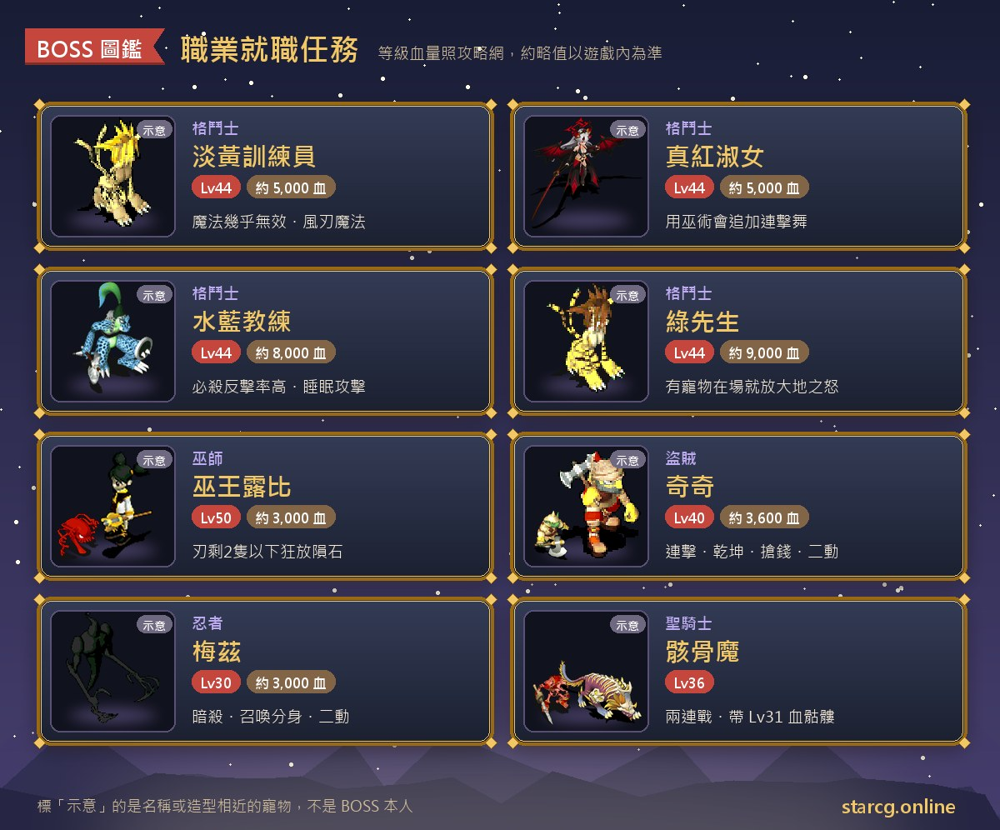

크로스게이트의 모든 직업은 먼저 「추천장(推薦信)」을 받아야 취직할 수 있어요. StarCG 공략 사이트는 이 취직 퀘스트를 10페이지로 정리해 두었어요. 검사, 도끼투사, 기사, 궁술사, 마술사, 조교술사는 하나의 선행 퀘스트를 함께 쓰고, 성직자, 주술사, 격투가, 의사, 무술사, 병사, 도적, 닌자, 성기사는 각자 전용 퀘스트가 있어요. 모두 합쳐 15개 직업이고, 난이도는 「NPC와 몇 마디 나누기」부터 「60분 제한 시간 안에 무왕 잡기」까지 다양해요.

이 글은 10개 취직 퀘스트의 조건, 권장 레벨, 단계별 NPC와 좌표, 만나게 되는 보스, 취직 후 배울 수 있는 스킬을 한곳에 모아서, 직업을 고르기 전에 얼마나 수고가 드는지 비교할 수 있게 했어요. 취직한 뒤 정직, 왕궁, 사범으로 계속 승급하고 싶다면 이어서 이 사이트의 [직업 승급 퀘스트 공략](/ko/posts/job-advance-quest-guide/)을 보세요. StarCG(星詠魔力), 水藍魔力, 初心魔力寶貝 어느 쪽을 하든 취직 퀘스트의 큰 흐름은 같고, StarCG 전용 조정은 본문에 따로 표시해 두었어요.

> 이 글은 [StarCG 공략 사이트](https://guide.starcg.net/)의 「직업 취임(職業就職)」 시리즈 페이지를 정리한 것이며, 스킬 설명은 [Atlantis 크로스게이트 정보 사이트](https://atlantis.cgsword.com/)의 인물 스킬 자료도 참고했어요. 순서와 문장은 저희 방식으로 다시 정리했고 그대로 옮기지 않았어요. 보스 HP와 수치는 대략적인 값이에요. 공략 사이트에 나와 있지 않은 수치는 「공략 사이트 미기재」라고 적고 임의로 채우지 않았어요. 게임 업데이트로 내용이 바뀔 수 있으니 실제 게임을 기준으로 해 주세요.

## 직업 취임 퀘스트란? 먼저 전체 순서부터

취직 퀘스트끼리는 선후 관계가 없어서, 되고 싶은 직업의 퀘스트만 하면 돼요. 유일한 예외는 성기사예요. 캐릭터가 이미 견습 기사이거나 정직 이상의 병사·검사여야 하므로, 먼저 다른 취직 퀘스트로 이 세 직업 중 하나가 된 뒤 조건에 맞는 계급까지 승급해야 해요.

| 구분 | 퀘스트 이름 | 권장 레벨 | 보상 |
|---|---|---|---|
| 6직업 | 검사, 도끼투사, 기사, 궁술사, 마술사, 조교술사 취직 | 없음(조건 없음) | 해당 직업 추천장, 명성 100 |
| 성직자 | 성직자 취직 퀘스트 | 없음(조건 없음) | 성직자 추천장, 회복 마법 |
| 주술사 | 주술사 취직 퀘스트 | 없음(조건 36레벨) | 주술사 추천장, 내성 스킬 6종 |
| 격투가 | 격투가 취직 퀘스트 | 45(조건 20레벨) | 격투가 취직, 혼란 공격 |
| 의사 | 의사 취임 퀘스트 | 10(조건 없음) | 의사 취직 |
| 무술사 | 무술사 취임 퀘스트 | 35(조건 20레벨) | 무술사 취직, 흡수/재생/정화 마법 |
| 병사 | 병사 전직 퀘스트 | 없음(조건 없음) | 병사 추천장 |
| 도적 | 도적 전직 퀘스트 | 40(조건 없음) | 도적 추천장, 훔치기 |
| 닌자 | 닌자 전직 퀘스트 | 35(조건 20레벨) | 닌자 추천장, 암살 |
| 성기사 | 성기사 취임 퀘스트 | 40(특정 계급과 아이템 필요) | 교단 기사 추천장, 신성 계열 스킬 |

한 문장으로 정리하면, **싸우지 않아도 되는 건 6직업·성직자·주술사·병사, 보스를 잡아야 하는 건 격투가·무술사·도적·닌자·성기사, 의사는 그 중간으로 미궁의 거스트만 잡으면 돼요.**

## 출발 전에 준비할 것

취직 퀘스트에서 가장 많이 막히는 건 전투가 아니라 「미리 안 보면 헛걸음하는」 조건들이에요. 엉뚱한 무기를 들고 있거나, 잔돈이 없거나, 펫을 데리고 링에 들어가거나, 양초를 받고 나서야 동료가 아직 안 왔다는 걸 알게 되는 경우죠. 10개 퀘스트에서 놓치기 쉬운 것들을 아래에 모았어요.

의사 퀘스트에서는 흰 가운과 구급상자를 각각 10골드에 사야 하니 최소 20골드는 남겨 두세요. 도적은 훔치기를 배우는 데 5,000골드, 성기사는 스킬 세 개에 합계 25,000G, 무술사는 흡수 마법을 배우는 데 역시 5,000골드가 들어요. 격투가 페이지에서는 전직하는 사람은 전직 비용을 준비하라고 안내하는데, 명성이 높을수록 비싸요. 돈이 부족하면 이 사이트의 [시세 검색](/ko/market/)에서 가진 재료가 얼마에 팔리는지 먼저 확인하고 무엇을 팔지 정하세요. 성기사에 필요한 「공정의 보주(公正寶珠)」는 상점(商城)에서 구매하고, 「혼을 잃은 목걸이(失魂的首飾)」는 판부르크의 여관 조사 퀘스트에서 얻어요. 두 가지 모두 출발 전에 준비해 두세요.

## 6직업: 검사, 도끼투사, 기사, 궁술사, 마술사, 조교술사 취직(무기에 따라 추천장 지급)

권장 레벨과 퀘스트 조건이 없고, 보상은 명성 100과 해당 직업의 추천장이에요. 공략 사이트에는 자동 길찾기 지원으로 표시돼 있어요. 여섯 직업이 같은 선행 퀘스트를 쓰고, 핵심은 **손에 든 무기가 무엇인지**예요.

1. 판부르크(法蘭城)의 「직업 소개소(職業介紹所)」(195, 50)에서 취업 지도원 **오파(歐帕)**(15, 9)와 대화해 원하는 직업을 고르고, **그가 주는 전용 무기를 장착**하세요.
2. 판부르크 동쪽 병원(東醫院)(221, 83)에서 약사 **폴롬(波洛姆)**(16, 35)에게 「진통제(止痛藥)」를 사세요.
3. 진통제를 판부르크 길드(公會)(73, 61)에 있는 이가 아픈 **앙브룬(安布倫)**(10, 6)에게 가져다주고 「통행증(通行證)」을 받으세요.
4. 판부르크 서문으로 나가 「국영 제24호 갱도(國營第24號坑道)」(351, 146)에 들어가세요. B1 왼쪽의 **할디아(哈魯迪亞)**에게 통행증을 내고 「시련의 동굴(試煉洞窟)」로 들어가세요.
5. 6층 홀까지 올라가 **보로미아(波羅米亞)**(23, 15)와 대화하면 추천장을 받아요.

**주의할 점**: 보로미아는 **그 순간 장착한 무기**에 따라 추천장을 줘요. 검이면 검사, 도끼면 도끼투사, 창이면 기사, 활이면 궁술사, 지팡이면 마술사, 단검이나 부메랑이면 조교술사예요. 이미 직업이 있고 다른 직업으로 바꾸고 싶다면 옆의 **앨런(亞倫)**(24, 12)에게 원하는 직업 이름을 말하면 추천장을 바꿔 줘요.

**취직 장소**:

| 직업 | 스승 위치 |
|---|---|
| 검사 | 판부르크 투기장(競技場)(123, 161)의 **디솔(迪索爾)**(18, 10) |
| 도끼투사 | 판부르크 투기장 백스테이지(123, 161)의 **오레가노(歐雷葛諾)**(20, 22) |
| 기사 | 리셰리아 성(里謝里雅堡) 2F 오른쪽 객실(67, 71)의 **아네트(亞涅特)**(11, 4) |
| 궁술사 | 판부르크 궁술사 길드(弓箭手公會)(190, 133)의 **라멜리노(拉美莉諾)**(6, 4) |
| 마술사 | 판부르크 서문 밖 마녀의 집(魔女之家)(301, 146). 문 앞의 신목(神木)을 클릭해 들어가면 4속성 단일 공격 마법도 함께 배울 수 있어요 |
| 조교술사 | 판부르크 길드(73, 61)의 **조교술사 팡시(馴獸師方席)** |

공략 사이트에는 시련의 동굴 안의 몬스터가 나와 있지 않아요. 조교술사는 취직 후 펫을 가장 많이 쓰니, 포획 전에 이 사이트의 [펫 도감](/ko/pets/)에서 성장과 능력을 먼저 확인해 보세요.

## 성직자: 성직자 취직 퀘스트(전부 「예」라고 대답)

권장 레벨과 퀘스트 조건이 없고, 공략 사이트는 「간단한 대화 퀘스트」라고 설명해요.

1. 판부르크 정북쪽의 대성당(大聖堂)(154, 29)에 들어가 북쪽으로 쭉 걸어가세요. 사제 **로데릭(羅德里克)**을 만나면 북동쪽 샛길로 계속 가서 작은 방으로 들어가세요.
2. 방 안의 **토트(托特)**(16, 11)와 대화하며 모든 질문에 「예」라고 대답하면 「추천장」을 받아요.
3. 옆의 **대승려 라마론(大僧侶拉馬隆)**(17, 19)과 대화해 성직자로 취직하고, 다음 방으로 들어가 「회복 마법(補血魔法)」과 「강력 회복 마법(強力補血魔法)」을 배우세요.

Atlantis의 스킬 자료는 회복 마법을 「마법으로 단일 대상의 체력을 회복」한다고 설명하고, 전용 직업은 성직자예요. 성직자가 나중에 초강력 회복 마법(超強補血魔法)을 배우려면 2차 승급 「신수 도전(挑戰神獸)」 퀘스트에서 배워야 하고, 그 과정은 [직업 승급 퀘스트 공략](/ko/posts/job-advance-quest-guide/)에 정리돼 있어요.

## 주술사: 주술사 취직 퀘스트(현실과 거울 속 저택)

권장 레벨은 없고 조건은 36레벨이에요. 보상은 주술사 추천장과 독 내성, 수면 내성, 석화 내성, 만취 내성, 혼란 내성, 망각 내성의 6가지 내성 스킬이에요.

**지름길**: 공략 사이트가 특별히 알려 주는 점은, 내성 스킬만 배우고 싶다면 퀘스트를 끝까지 할 필요 없이 2단계까지 진행해 주술사의 거점에 도착하면 안에 있는 NPC에게 바로 배울 수 있다는 거예요.

1. 프레이아 섬(芙蕾雅島)(200, 168)에서 세레네 해저 동굴(莎蓮娜的海底洞窟)에 들어가 지하 2층(32, 21)에서 일반 채널로 암호 「咒術」(주술)이라고 말하면 다른 해저 동굴로 이동돼요.
2. 남쪽의 **주술사의 거점(咒術師的據點)**(38, 37)으로 들어가 **주술사 히솝(咒術師希索普)**과 대화하고 「주기 붉은 염주(咒器紅念珠)」를 받으세요.
3. 판부르크로 돌아와 저택(豪宅)(96, 148)에 들어가 세 층에 걸쳐 수수께끼를 풀어요.
   - **1층**: 부엌 쓰레기통(33, 22)으로 들어가 지하실을 지나 반대편으로 돌아간 뒤, 거울(33, 10)로 들어가 「거울 속 저택(鏡中的豪宅)」으로 가세요. 수상한 찬장(35, 2)을 조사해 「1층 식료품 창고 열쇠(一樓食品庫的鑰匙)」를 얻고 뒤쪽 문(36, 9)을 연 다음, (27, 67)의 거울로 현실로 돌아와요.
   - **2층**: 다시 지하실을 지나 올라와 (59, 6)을 거쳐 2층으로 올라가고, 옆방(16, 9)의 거울로 들어가세요. 수상한 침대(40, 10)를 조사해 「2층 방 열쇠(二樓房間的鑰匙)」를 얻고 (40, 16)의 문을 연 다음, (17, 61)의 거울로 현실의 2층으로 돌아와요.
   - **다락방**: (5, 23)에서 숨겨진 계단을 찾아 다락방으로 들어가고, (14, 30)의 거울로 들어가 (14, 36) 계단으로 내려가세요. 수상한 책장(11, 35)을 조사해 「다락방 열쇠(閣樓的鑰匙)」를 얻고, 다락방으로 돌아와 (23, 20)의 문을 열어요.
4. 방에 들어가 **로렐(羅蕾兒)**과 대화하고 「신기 보라 염주(神器紫念珠)」를 받으세요.
5. 해저 동굴의 주술사 거점으로 돌아가 붉은 염주와 보라 염주를 **히솝**에게 건네고 「주술사 추천장」으로 바꾸세요.
6. 뒤쪽 통로로 들어가 **카크(卡克)**(10, 0)와 대화해 안쪽 방으로 들어간 뒤, **주술사 피니엘(咒術師菲尼爾)**과 대화하면 주술사로 취직해요.

**주의할 점**: 이 퀘스트는 전투가 없지만 거울과 문 좌표가 많아서, 현실과 거울 속을 오가다 층을 잘못 찾기 쉬워요. 공략 사이트에는 이 길에서 만나는 몬스터가 나와 있지 않아요.

## 격투가: 격투가 취직 퀘스트(사자의 굴 4연전)

권장 45레벨, 조건 20레벨이에요. 보상은 격투가 취직과 「혼란 공격(混亂攻擊)」이에요. Atlantis 자료에는 혼란 공격이 「공격 시 대상에게 상태 이상을 일으킬 수 있다」고 적혀 있고, 격투가·병사 전용이라고 되어 있어요.

1. 혼 대풍동(洪恩大風洞)의 가나(加納) 쪽 출구 근처에서 **사자의 굴(獅子之穴)**(380, 324)로 들어가세요.
2. **접수원 마나미(櫃台小姐真奈美)**와 대화해 44G를 내고 「사자의 굴 마음의 방(獅子之穴心之房)」에 들어가면 4연속 시련이 시작돼요.
3. 마음의 방, 기술의 방(技之房), 몸의 방(體之房), 육각형 링(六角形擂台)의 보스전 네 판을 차례로 이기세요.
4. 미스터 그린을 쓰러뜨리면 사범의 방으로 들어가요. **미스터 그린(綠先生)**과 대화해 「격투가 추천장(格鬥家推薦信)」을 받고, 옆의 **격투가 마신(格鬥家馬辛)**과 대화하면 격투가로 취직해요.

**보스 정보**(네 명 모두 44레벨, 한 턴에 2회 행동):

| 판 | 보스 | HP | 속성 | 핵심 |
|---|---|---|---|---|
| 마음의 방 | 연노랑 트레이너(淡黃訓練員) | 약 5,000 | 화 2/풍 8 | 마법이 거의 안 통하니 물리 공격 위주로 |
| 기술의 방 | 진홍 숙녀(真紅淑女) | 약 5,000 | 수 3/화 7 | 우리가 무술을 쓰면 연격무와 기공탄이 추가돼요 |
| 몸의 방 | 물빛 코치(水藍教練) | 약 8,000 | 지 3/수 7 | 필살·반격 확률이 매우 높고, HP가 낮으면 명경지수 |
| 육각형 링 | 미스터 그린 | 약 9,000 | 순수 지 10 | 필드에 펫이 있으면 대지의 분노를 무한 사용 |

**공략법**:

- **연노랑 트레이너**는 아지랑이(陽炎), 각 단계의 바람 칼날 마법(風刃魔法), 초강력 4속성 마법을 써요. 공략 사이트에 따르면 마법 공격은 그에게 거의 피해를 주지 못해요.
- **진홍 숙녀**는 공격, 아지랑이, 붕격(崩擊), 건곤(乾坤), 혼란 공격, 화염의 기도(火焰的祈禱), 속성 반전(屬性反轉)을 써요. **「공격 무효/공격 흡수/공격 반사」 같은 무술은 절대 쓰지 마세요.** 쓰면 그녀가 연격무(連擊舞)와 기공탄을 미친 듯이 써요.
- **물빛 코치**는 공격과 수면 공격을 써요. 공략 사이트는 합격(合擊)을 쓰거나, 활·기공탄·마법 같은 원거리 공격으로 반격을 피하라고 권해요.
- **미스터 그린**이 가장 위험한 판이에요. 전투 전에 **파티 전원이 반드시 펫을 넣어 두세요.** 필드에 펫이 하나라도 있으면 그가 대지의 분노(大地之怒)를 무한으로 써서 전원을 한 방에 쓰러뜨려요. 마찬가지로 무술을 쓰면 거의 확실하게 연격파(連擊破)에 날아가요. 그나마 다행인 점은, 우리 캐릭터의 HP가 낮으면 그가 일정 확률로 그 캐릭터에게 회복 마법을 걸어 준다는 거예요.

**이후 승급**: 사자의 굴에 들어가 입구의 **초록 사자(綠獅子)**와 대화하면 바로 방으로 이동해 격투가 마신을 만날 수 있어요. 공략 사이트는 이것이 **StarCG 전용 조정**이라고 적어 두었어요. 격투가 승급에는 혼란 공격을 해당 레벨까지 올릴 필요 없이 레벨과 명성만 채우면 돼요.

## 의사: 의사 취임 퀘스트(어둠의 의사의 동굴에서 아이템 4개 모으기)

권장 10레벨, 퀘스트 조건 없음. **최소 20골드는 들고 가세요.** 흰 가운과 구급상자가 각각 10골드라서 돈이 없으면 막혀요.

1. 판부르크 서문으로 나가 마녀의 집 근처에서 **어둠의 의사의 동굴(黑暗醫生的洞窟)** 입구를 찾으세요. 입구는 랜덤으로 나타나는 노란 전송 수정이에요.
2. 미궁에 들어가 랜덤 맵에서 **거스트(腐屍)**를 쓰러뜨려 「실험약(實驗藥)」과 「붕대(繃帶)」가 나올 때까지 모으세요.
3. 미궁에서 **간호사 미네루파(護士米內魯帕)**를 찾아 암호로 간호사장의 이름 「荷洛」(홀로)라고 대답하고, 10G를 내고 「흰 가운(白衣)」을 받으세요.
4. 맨 아래층의 알버스 연구소(阿魯巴斯研究所)에서 **무면허 의사 알버스(密醫阿魯巴斯)**를 찾아 암호로 「波羅米亞」(보로미아)라고 대답하고, 10G를 내고 「구급상자(急救箱)」를 받으세요.
5. 실험약, 붕대, 흰 가운, 구급상자를 모두 모으면 미궁에서 **돌팔이 의사 네빌(庸醫奈比爾)**을 찾아 아이템을 건네고 「추천서(推薦狀)」를 받으세요.
6. 판부르크 동쪽 병원으로 돌아가 **의사 텐핑(醫生天瓶)**(16, 8)과 대화하면 의사로 취직해요.

**주의할 점**: 의사 페이지에 적힌 동쪽 병원 좌표는 (211, 83), 6직업 페이지에 적힌 좌표는 (221, 83)으로 두 페이지가 서로 달라요. 실제 게임을 기준으로 하세요. 취직 후에는 동쪽 병원에서 **인턴 타오(實習生塔歐)**에게 「의학 전서(醫學全書)」(치료 성공률 증가)를, **간호사장 명화(護士長明花)**에게 「구급상자」(응급처치 성공률 증가)를 무료로 받는 걸 잊지 마세요. 둘 다 바닥에 버리면 사라지는 아이템이고, 잃어버려도 다시 받을 수 있어요. Atlantis 자료는 치료를 「부상 상태를 회복할 수 있다」, 응급처치를 「맵 화면에서 생명력을 회복할 수 있다」고 설명해요. 미궁은 랜덤 생성이니 이 사이트의 [미궁 계단 찾기](/ko/maze/)로 지나온 길을 기록할 수 있어요. 같은 동굴에는 키리 마을의 「어둠의 의사(黑暗醫生)」 취직 루트도 있으며, [키리 마을 퀘스트 공략](/ko/posts/chili-quest-guide/)에 정리돼 있어요.

## 무술사: 무술사 취임 퀘스트(60분 제한 시간 안에 무왕 루비 잡기)

권장 35레벨, 조건 20레벨이에요. 보상은 무술사 취직이고, 공격 흡수 또는 마법 흡수(둘 중 하나), 재생 마법(恢復魔法), 정화 마법(潔淨魔法)을 배울 수 있으며, 「나태의 죄서(怠惰的罪書)」가 랜덤으로 떨어질 수도 있어요. 공략 사이트는 이 퀘스트가 **자동 길찾기를 지원하지 않고**, 미궁도 랜덤 생성이라고 적어 두었어요.

1. 키리 마을(奇利村) PUB(46, 81)에서 **레오니(蕾歐妮)**를 찾아 편지 한 통을 받으세요.
2. 키리 마을을 나와 북쪽의 **폰누의 집(馮奴的家)**(349, 261)으로 가서 **아리엘(亞莉耶魯)**과 대화하고 「희망의 양초(希望的蠟燭)」를 받으세요. **양초를 받는 순간 60분 카운트다운이 시작되니** 파티 전원이 준비된 뒤 대화하세요.
3. 솔키아 해저 동굴(索奇亞海底洞穴) 지하 2층에서 맵 정중앙 아래쪽의 이상한 바위(35, 7)를 클릭하고, 노란 전송석을 밟아 미궁에 들어가세요.
4. 랜덤 미궁에서 랜덤으로 나타나는 NPC **모에코(萌子)**를 찾아 대화하고 「공포 여단의 증표(恐怖旅團之證)」를 받으세요. 전원이 다 받아야 해요.
5. 미궁 맨 아래까지 가서 노란 수정으로 「무왕 루비의 궁전(巫王露比的宮殿)」에 들어가, 제한 시간 안에 무왕 루비(巫王露比)를 쓰러뜨리세요.
6. 이기면 왼쪽의 **무술사 아리아나(巫師亞莉安娜)**에게 「공격 흡수」를, 오른쪽의 **무술사 마키(巫師瑪其)**에게 「마법 흡수」를 배울 수 있어요. 하나만 고를 수 있고 5,000골드가 들어요.
7. 다 배우면 입구의 **무술사 카모시(巫師卡莫西)**와 대화해 폰누의 방으로 이동하고, **폰누(馮奴)**와 대화하면 무술사로 취직해요.

**보스 정보**: 루비는 50레벨, HP 약 3,000, 사마계(邪魔系), 저주 내성, 2회 행동이에요. 성스러운 방패, (강력) 회복 마법, 재생 마법, 그리고 공격/마법의 흡수·반사·무효를 써요. 호위는 브랜디쉬(血腥之刃) 5마리(30레벨, 지 90 수 10, 금속계, 공격·연격무·붕격 사용)와 스펙터(鬼靈) 4마리(30레벨, 화 80 풍 20, 불사계, 강력 화염 마법과 강력 망각 마법 사용)예요.

**공략법**: **광역 스킬로 브랜디쉬를 다 쓸어버리면 절대 안 돼요.** 필드의 브랜디쉬가 2마리 이하로 남으면 루비가 초강력 운석, 초강력 빙결, 혼란 마법을 자주 써서 전멸하기 쉬워요. 공략 사이트는 루비에게 화력을 모아 합격하라고 권해요.

**막혔을 때**: 시간 초과, 접속 끊김, 도전 실패 시에는 **반드시 아리엘에게 돌아가 대화로 퀘스트를 포기하세요.** 그렇지 않으면 영영 다시 받을 수 없어요. 포기한 뒤 1단계부터 다시 하면 돼요. Atlantis 스킬 자료는 공격 흡수를 「물리 공격을 한 번 흡수」, 정화 마법을 「대상의 상태 이상을 회복할 수 있다」고 설명하며, 둘 다 무술사 전용 스킬이에요.

## 병사: 병사 전직 퀘스트(고블린 투구)

권장 레벨과 퀘스트 조건이 없고, 보상은 병사 추천장이에요.

1. 판부르크 동문 밖(508, 202) 근처에서 필드의 **고블린(哥布林)**이나 **홉 고블린(紅帽哥布林)**을 잡아 「초록 투구(綠頭盔)」×10 또는 「빨간 투구(紅頭盔)」×1을 모으세요. 둘 다 랜덤 드롭이에요.
2. 투구를 들고 판부르크 안쪽 대문(156, 102)으로 돌아가 문지기 **병사장 오리(士兵長歐里)**에게 건네면 「병사 추천장」을 받아요.
3. 리셰리아 성 1층의 **근위 병사장(近衛士兵長)**(81, 22)과 대화하면 병사로 취직해요.

**주의할 점**: 「고블린의 집(哥布林之家)」 안의 몬스터는 **투구를 떨어뜨리지 않으니** 필드에서 잡아야 해요. 공략 사이트는 이것이 **StarCG의 조정**이라고도 적어 두었어요. 원래 있던 「고블린 사관(哥布林士官)(435, 266)」 설정은 없어졌고, 필드 몬스터를 잡아 모으기만 하면 돼요.

## 도적: 도적 전직 퀘스트(산적 두목의 거점)

권장 40레벨, 퀘스트 조건 없음. 보상은 도적 추천장 또는 「두목 모자(頭目帽子)」 제작법(둘 중 하나), 그리고 「훔치기(偷竊)」 스킬이에요.

1. 코랄 마을(哥拉爾村)의 돌고래 술집(海豚酒吧)(136, 158)에서 **주바이안(裘拜安)**과 대화해 「아니요(不)」를 고르세요. **캐릭터마다 각자 대화해야 해요.**
2. 쿠룩스 섬(庫魯克斯島)의 **키키(奇奇)**(406, 407)를 찾아가 대화에서 「아니요」를 고르면 전투가 시작돼요.
3. 키키를 쓰러뜨리면 두목의 거점(頭目的據點)에 들어가 지하 5층까지 계속 내려가세요.
4. 지하 5층에서 적과 싸워 「두목의 열쇠(頭目的鑰匙)」를 얻어야 노란 전송 수정 앞의 잠긴 문을 열고 두목의 방에 들어갈 수 있어요.
5. **나레시아(娜蕾希亞)**(13, 8)와 대화하세요. 취직하려면 먼저 「아니요」, 그다음 「예」를 골라 동료가 되겠다고 하면 취직 방으로 이동돼요. 「예」를 골라 보물을 받겠다고 하면 두목 모자 제작법을 받지만 **취직할 수 없어요.**
6. 취직 방에서 다시 **나레시아**와 대화하면 도적으로 취직해요.
7. 옆의 **올산(歐魯桑)**(16, 10)에게 5,000골드를 내고 「훔치기」를 배우고, **니모키(尼摩其)**(16, 13)와 대화하면 장비 재료 「먹물 천(染墨布)」을 무료로 받을 수 있어요.
8. 코랄 마을 술집으로 돌아가 **주바이안**과 대화해야 퀘스트가 정식으로 완료돼요.

**보스 정보**: 키키는 40레벨, HP 약 3,600, 2회 행동이며 공격, 연격, 건곤, 붕격, 성스러운 방패, 돈 강탈을 써요. 곁에는 오크 산적(歐克山賊)(그리디호그(豬鬼), 35레벨, HP 약 1,500, 수 6 화 4, 연격과 장비 파괴 사용) 2마리와 오크 산적(오크(半獸人), 35레벨, HP 약 1,500, 지 4 풍 6, 돈 강탈 사용) 2마리가 있어요.

**주의할 점**: 미궁의 파란 오크 산적(그리디호그)가 **장비 파괴**를 자주 써서, 공략 사이트는 파티 전원이 장비를 모두 벗고 미궁을 지나가라고 강력히 권해요. 두목의 열쇠는 드롭률이 낮으니 전투에서는 장비를 파괴하는 파란 산적부터 먼저 처리하세요. 나중에 승급할 때는 쿠룩스 섬의 키키와 대화하면 두목의 방으로 바로 이동할 수 있어요.

## 닌자: 닌자 전직 퀘스트(암호 릴레이와 메즈전)

권장 35레벨, 조건 20레벨이에요. 보상은 닌자 추천장, 폭풍(嵐) 시리즈 부적, 「암살(暗殺)」 스킬, 그리고 펫 상태 공격 스킬 IV, 펫 마법 스킬 VII·VIII, 펫 상태 저항 스킬 IV예요. 공략 사이트는 이 퀘스트가 **캐릭터마다 하나씩 대화해야** 하고, 도중에 받은 아이템을 버린 채 NPC와 대화하면 퀘스트가 바로 중단된다고 경고해요.

※ 아래 「 」 안의 대사는 게임 속 중국어 원문 그대로 적었어요.

1. 판부르크 안키모 술집(安其摩酒吧)(102, 131)에서 **설명 좋아하는 행크(愛說明的漢克)**(20, 9)에게 「예」를 골라 퀘스트를 시작하세요. 두 번째로 대화할 때는 반드시 「아니요」를 골라야 하고, 그렇지 않으면 퀘스트가 중단돼요.
2. 코틀리아 술집(科特利亞酒吧)(219, 136)에서 **술 좋아하는 미네사카(愛喝酒的米內薩卡)**(17, 18)에게 「亞爾科爾...」(아르코르...)라고 말해 요리사 정보를 얻으세요. 정보를 못 얻으면 1단계가 잘못된 것이니 다시 받아야 해요.
3. 이르 마을(伊爾村) 샌프란시스코 술집(舊金山酒吧)(32, 65)에서 요리사 **아르코르(亞爾科爾)**(22, 3)에게 「心美...」(심미...)라고 말해 「아르코르의 쪽지(亞爾科爾的紙條)」를 받으세요.
4. 판부르크 토우 식품점(陶歐食品店)(72, 104)으로 돌아와 **보로니아(波羅尼亞)**(12, 11)와 두 번 대화하고 「예」를 고르세요.
5. 동문으로 나가 프레이아 섬(531, 251)에서 **토우(陶歐)**에게 「亞爾科爾...」라고 말해 「토우 식품점 정제 빵(陶歐食品店精製麵包)」을 받고, 샌프란시스코 술집의 아르코르에게 돌아가 「아르코르의 간식(亞爾科爾的點心)」으로 바꾸세요.
6. 판부르크 별실(別室)(196, 33)의 병사 **로미노트(羅米諾特)**(9, 5)에게 「毒...」(독...)이라고 말하고, 리셰리아 성 2층 도서실(圖書室)(1, 74)의 **딜하트 박사(迪爾哈特博士)**(17, 29)에게도 「毒...」라고 말해 「살인용 독(殺人用的毒)」을 받은 뒤, 세인트 라루카 마을(聖拉魯卡村) 병원의 약사 **신드(辛德)**(11, 14)에게 건네세요.
7. 윌노아 마을(維諾亞村)에서 병사 **드렘(德雷姆)**(50, 65)에게 먼저 「心美...」, 그다음 「毒...」라고 말하세요. 주민의 집(37, 52)에서 **안단(安丹)**에게 「心美...」라고 말해 지하실로 들어가, 간식을 **다친 소녀(受傷的少女)**(9, 10)에게 주고 두 번 대화해 「예」를 고르세요.
8. 프레이아(352, 381)의 개척자 **안멜(安梅爾)**에게 「烏克蘭...」(우크라이나...)라고 말하고, (354, 366)에서 샛길로 들어가 왼쪽 위 길로 간 다음 (46, 23)의 계단으로 나가면 닌자의 은거지(忍者的隱居地)에 도착해요.
9. 닌자의 집(忍者之家)에서 (13, 20)까지 걸어가 (13, 19)를 조사해 위층으로 올라가세요. **통로 정중앙으로 걸어야** 지하 1층으로 떨어지지 않아요. 이후 공략 사이트의 루트대로 (37, 19)에서 내려가 (45, 32), (48, 37)을 지나 동쪽 (63, 38)까지 가서 우물을 조사해 「예」를 고르면, 우물 밑 통로를 지나 우크라이나 마을(烏克蘭村)로 가요.
10. 우크라이나 마을 주민의 집(77, 47)에서 **로라이(羅萊)**에게 「毒...」라고 말하고, 촌장 집(69, 28) 지하실에서 **메즈(梅茲)**(11, 11)에게 「毒...」라고 말하세요.
11. **메즈 앞에서 「아니요」를 고르면** 전용 장면으로 이동되고, 메즈와 대화하면 취직전이 시작돼요. 「예」를 고르면 폭풍 시리즈 장신구를 랜덤으로 받지만 **닌자로 취직할 수 없어요.**
12. 이긴 뒤 **반드시 메즈와 한 번 더 대화해서** 「폭풍의 비전서(嵐的秘傳書)」를 받으세요.
13. 위층의 촌장 집으로 돌아가 비전서를 가진 채 **트왁(特瓦克)**에게 「忍者...」(닌자...)라고 말하면 「닌자 추천장」을 받아요. 비전서를 안단에게 줘서 심미를 돕는 쪽을 고르면 취직할 수 없어요.
14. 추천장을 들고 코스케의 집(小助的家)(46, 22)에서 **사스케(佐助)**(7, 5)의 문답을 풀어요. 모두 맞히면 닌자 길드(忍者公會)로 이동되고, 사스케와 대화해 추천장을 받은 뒤 **닌자 길드장(忍者公會會長)**과 대화하면 닌자로 취직해요.

**보스 정보**: 메즈는 30레벨, HP 약 3,000, 2회 행동이며 양날(諸刃), 아지랑이, 기공탄, 붕격, 명경, 성스러운 방패, 암살, 분신 소환을 써요. 분신은 검 장착형과 단검 장착형 두 종류로, 모두 30레벨, HP 약 1,500이에요.

**사스케의 문답**: 문제는 낮인지 밤인지에 따라 달라요. 공략 사이트에는 낮과 밤 각 10문제와 정답 힌트가 실려 있고, 틀리면 사스케와 다시 대화해 처음부터 풀 수 있어요.

**암살 배우기와 마무리**: 취직 후 샛길(45, 43)로 우물 밑에 돌아가 (19, 12)에서 닌자의 집으로 돌아가세요. 공략 사이트의 숨겨진 루트대로 (59, 5)를 조사해 벽을 통과하고, (62, 13)에서 2층으로, (71, 25)의 창문으로 숨겨진 길에 들어가 3층으로 간 다음, (4, 19)를 조사해 방에 들어가 **어둠의 월영(黑暗的月影)**에게 암살을 배워요. 공략 사이트에 적힌 비용은 2,500G예요(Atlantis 스킬 자료에는 5,000G로 나와 있으니 실제 게임 기준으로 확인하세요). 마지막으로 윌노아 마을 주민의 집에서 안단과 대화하고, 판부르크 대성당 왼쪽의 작은 무덤(144, 18)을 조사해야 퀘스트가 정식으로 끝나요. Atlantis는 암살을 「일정 확률로 적을 일격에 쓰러뜨리는」 패시브 스킬로 설명하며, 사마계에는 발동하지 않고, 활·단검·투척 무기 장착 시에도 발동하지 않으며, 스킬 사용이나 합격 때도 발동하지 않고, 혼란 상태에서는 동료를 암살할 수도 있다고 적어 두었어요.

**지름길**: 이후 승급할 때는 윌노아 마을 밖의 어둡고 작은 동굴(328, 451)에서 **코타케(小竹)**(13, 9)에게 「竹林山水甲天下」라고 말하고, 코타케의 집에 들어가 수제자를 찾으세요. 우크라이나 마을에 다시 가고 싶다면 판부르크 남문 밖의 **산마나(秋刀奈)**(409, 295)에게 전송을 부탁할 수 있지만, 퀘스트를 다시 받은 뒤에는 이 전송을 쓸 수 없어요.

## 성기사: 성기사 취임 퀘스트(순수한 영혼 수정 4개)

권장 40레벨이에요. 조건은 상점에서 산 「공정의 보주」와 여관 조사 퀘스트의 「혼을 잃은 목걸이」를 가지고 있어야 하고, 직업은 **견습 기사, 정직 병사, 정직 검사 또는 그 이상 계급**으로 한정돼요. 보상은 교단 기사 추천장(教團騎士推薦信, 성기사)이고, 신성한 빛(神聖光芒), 신성한 힘(神聖之力), 정화 마법을 배울 수 있어요. 혼을 잃은 목걸이를 얻는 과정은 [판부르크 퀘스트 공략](/ko/posts/fran-city-quest-guide/)의 여관 조사 항목에 정리돼 있어요.

1. 프레이아(513, 282)의 서광 기사단 야영지(曙光騎士團營地)로 가서 서광 야영지 지휘부(曙光營地指揮部)(52, 68)의 방(69, 70)에 들어가세요. **파티 전원**이 혼을 잃은 목걸이를 가졌는지 확인한 뒤 **성기사 팔티아(聖騎士法爾緹婭)**(95, 5)와 대화해 「예」를 고르고, 목걸이를 내고 「서광 휘장(曙光徽記)」을 받으세요(파티 전원이 가지고 있어야 해요).
2. 네 지역의 퀘스트로 「순수한 영혼 수정(純淨的靈魂水晶)」 4개를 모으세요. 순서는 상관없고, 공략 사이트가 권하는 루트는 서광 기사 야영지 → 가나 마을 우물 밑 → 사막의 사당 → 해적의 만이에요.
3. 다 모으면 서광 야영지 지휘부로 돌아가 **상급 교단 기사 카도(高階教團騎士卡多)**와 대화한 뒤, 방(69, 70)의 **팔티아**에게 수정 4개, 공정의 보주, 서광 휘장을 건네고 「교단 기사 추천장」을 받으세요. 공정의 보주가 없는 도우미 동료는 수정과 휘장을 내면 서광 시리즈 장비 하나로 바꿀 수 있어요.
4. 지휘부(97, 14)의 **문지기(守門人)**와 대화해 들어가서, 추천장을 가지고 **상급 교단 기사 열염(高階教團騎士裂炎)**(11, 5)과 대화하면 성기사로 취직해요.

**수정 4개 얻는 법**:

- **서광 기사 야영지(曙光騎士營地)**: 야영지(55, 47)의 신시아 탐색 지휘부(辛希亞探索指揮部)에서 (7, 4), (95, 9)를 거쳐 (14, 5)로 내려가 경비(암드본(武裝骷髏) 또는 카완챠(血骷髏))를 이긴 다음, (15, 1)로 함몰 구역(塌陷區域)에, (12, 7)로 함몰 통로(塌陷通路)에 들어가세요. 함몰 통로는 약 18층짜리 랜덤 미궁이고 몬스터는 20레벨 안팎의 스켈레톤계예요. 맨 아래층 봉인의 방(封印之間)에서 **해골마(骸骨魔)**와 싸워요. 파티 전원이 서광 휘장을 가지고 있으면 2연전이 돼요. 1전은 36레벨 해골마와 31레벨 카완챠, 2전은 15레벨 소여(索耶)예요. 이긴 뒤 공정의 보주와 서광 휘장을 가진 사람이 그림자와 대화하면 수정과 「낡은 일기장(殘破的日記)」을 받아요.
- **가나 마을 우물 밑(加納村井底)**: 가나 마을(53, 55)의 우물을 조사해 우물 밑으로 들어가고, 파티 전원이 서광 휘장을 가진 상태에서 이상한 돌(18, 20)을 조사해 미궁에 들어가세요. 몬스터를 잡으면 「성냥(火柴)」과 「횃불(火把)」이 랜덤으로 나오는데, 한 사람이 두 가지를 동시에 가지고 있으면 돼요. 맨 아래층에서 가진 사람이 **횃불을 더블클릭**해 장면을 바꾼 뒤 **그림자 실버버그(影子西爾弗伯格)**와 싸워요. 성냥과 횃불이 없으면 그림자는 쓰러져도 무한히 되살아나요.
- **사막의 사당(沙漠之祠)**: 솔키아 사막(索奇亞沙漠)에서 랜덤으로 나타나는 입구(대략 570~640, 300~400 범위)를 찾아 맨 아래층까지 내려가, (29, 37) 근처에서 **환영 하인라인(幻影海因萊茵)**과 싸워요.
- **해적의 만(海賊海灣)**: 밤에 티나 마을(蒂那村) PUB(46, 56)에서 계단 옆의 **해적 콜루니(海賊柯魯妮)**와 대화하면 해적 기지 지하 감옥(海賊基地地牢)에 갇혀요. 감옥 문밖의 **짠생선(鹹魚)**에게 「무거운 족쇄(很重的腳鐐)」를 받고, 리더가 족쇄를 장착한 채 전투에 들어가 팬 위도우(土蜘蛛)에게 맞아서 내구도를 4 이하로 떨어뜨린 다음, 짠생선에게 족쇄를 바꿔 달라고 하고 그를 기절시켜 「비린내 나는 두건(有魚腥味的頭巾)」을 얻어요. 내구도가 4 이상일 때 찾아가면 내구도를 15로 수리해 줄 뿐이에요. 그다음 공략 사이트의 루트맵대로 지하 5F에서 2F까지 탈출하며, 도중에 피시볼(魚蛋), 벌레새우(蟲蝦), 게돌이(蟹兒)를 찾아 브라운 술(布朗酒), 콜리치 술(柯利奇酒), 쪽지를 교환하고, 매혹의 상아(魅惑的象牙)를 만져 위층으로 올라가요. **올라간 뒤 로어크(爐魚克)와는 절대 대화하지 말고** 바로 옆 계단(7, 15)으로 해적의 만에 들어가세요. 그렇지 않으면 해적의 만에 갈 수 없어 처음부터 다시 해야 해요. 마지막으로 **툰 셰이드 형상의 셰클리(旋律影子形象的謝克利)**(16, 33)와 싸워요.

매 전투에서 이긴 뒤에는 **공정의 보주와 서광 휘장을 동시에 가진** 사람이 보스와 대화해야 수정을 받을 수 있어요. 공략 사이트에는 실버버그, 하인라인, 셰클리, 소여의 HP와 스킬이 나와 있지 않아요.

**스킬 배우기**: 교단 기사 치하네(教團騎士千羽)(8, 3)에게 10,000G로 신성한 힘, 교단 기사 루리(教團騎士琉璃)(11, 8)에게 10,000G로 신성한 빛, 무술사 만고(巫師萬古)(5, 3)에게 5,000G로 정화 마법을 배워요. 또 상자 속에 숨어 있는 로저(羅杰)에게 20,000G로 거래 불가 「성광 부적(聖光護符)」을 살 수 있어요. 서광의 반지, 팔찌, 펜던트, 귀걸이, 부적으로 이루어진 서광 시리즈 장신구에는 모두 칭호 「영혼 정화사(淨靈師)」가 붙어 있어요. 세 곳의 랜덤 미궁 모두 [미궁 계단 찾기](/ko/maze/)와 함께 쓰면 좋아요.

## 직업 취직 자주 묻는 질문

**검사, 기사 같은 직업의 추천장은 어떻게 고르나요?** 시련의 동굴 6층에서 보로미아와 대화할 때 손에 든 무기로 정해져요. 이미 직업이 있는 사람은 옆의 앨런에게 원하는 직업 이름을 말하면 돼요.

**격투가 마지막 전투에서 왜 계속 전멸하나요?** 가장 흔한 원인은 필드에 펫이 있는 거예요. 미스터 그린은 펫을 보면 대지의 분노를 무한으로 쓰니, 전투 전에 파티 전원이 펫을 넣어 두고 공격 무효·공격 흡수·공격 반사 같은 무술도 쓰지 마세요.

**무술사 퀘스트에서 시간이 초과되면 어떻게 하나요?** 아리엘에게 돌아가 대화로 퀘스트를 포기한 뒤 1단계부터 다시 하세요. 먼저 포기하지 않으면 이후 영영 다시 받을 수 없어요.

**도적 퀘스트에서 잘못 골라 두목 모자 제작법을 받았다면?** 공략 사이트에는 「예」를 고르면 제작법을 받고 취직할 수 없다고만 나와 있고, 다시 받는 방법은 적혀 있지 않아요. 취직하려면 먼저 「아니요」, 그다음 「예」를 골라야 해요.

**닌자 퀘스트는 어디서 가장 많이 실패하나요?** 세 곳이에요. 행크와 두 번째 대화할 때 「아니요」, 메즈 앞에서 「아니요」, 메즈를 이긴 뒤 반드시 다시 대화해 폭풍의 비전서를 받는 것. 그리고 캐릭터마다 직접 대화해야 하며, 도중에 받은 아이템을 버리면 안 돼요.

**견습 검사로 성기사 퀘스트를 받을 수 있나요?** 안 돼요. 공략 사이트의 조건은 견습 기사, 또는 정직 이상의 병사·검사예요. 검사와 병사는 먼저 정직으로 승급해야 하니 [직업 승급 퀘스트 공략](/ko/posts/job-advance-quest-guide/)의 1차 승급 과정을 참고하세요.

## 정리

직업 취임 퀘스트는 난이도 차이가 커요. 6직업, 성직자, 병사는 거의 심부름 수준이고, 주술사는 거울 속 저택의 수수께끼가 중심이에요. 의사는 랜덤 미궁에서 아이템 4개를 모아야 하고, 격투가, 무술사, 도적, 닌자는 각각 「잘못하면 전멸하거나 취직에 실패하는」 장치가 하나씩 있어요. 미스터 그린의 펫 규칙, 루비의 브랜디쉬 수, 나레시아와 메즈의 대화 선택지가 그래요. 성기사는 조건이 가장 많아서 맞는 계급, 공정의 보주, 혼을 잃은 목걸이를 먼저 갖춘 뒤 네 지역을 돌며 수정을 모아야 해요. 직업을 고르기 전에 해당 항목의 주의할 점을 한 번만 봐도 헛걸음을 크게 줄일 수 있어요.

더 자세한 원문은 [StarCG 공략 사이트](https://guide.starcg.net/)의 직업 취임 페이지에서 볼 수 있어요. 취직 후 승급하려면 이어서 [직업 승급 퀘스트 공략](/ko/posts/job-advance-quest-guide/)을 보세요. 수업료를 모을 때는 이 사이트의 [시세 검색](/ko/market/)를, 랜덤 미궁에서는 [미궁 계단 찾기](/ko/maze/)를 함께 쓰면 좋아요.

## 참고 자료

- [Atlantis 크로스게이트 정보 사이트: 인물 스킬 자료](https://atlantis.cgsword.com/skill_char.php)
