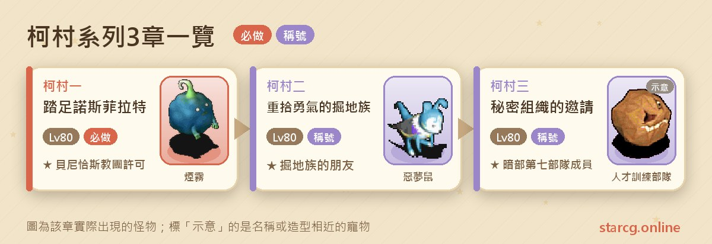
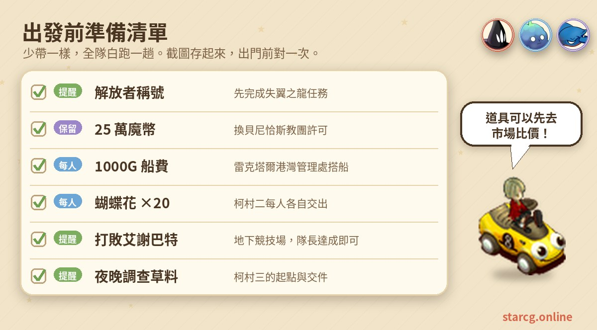
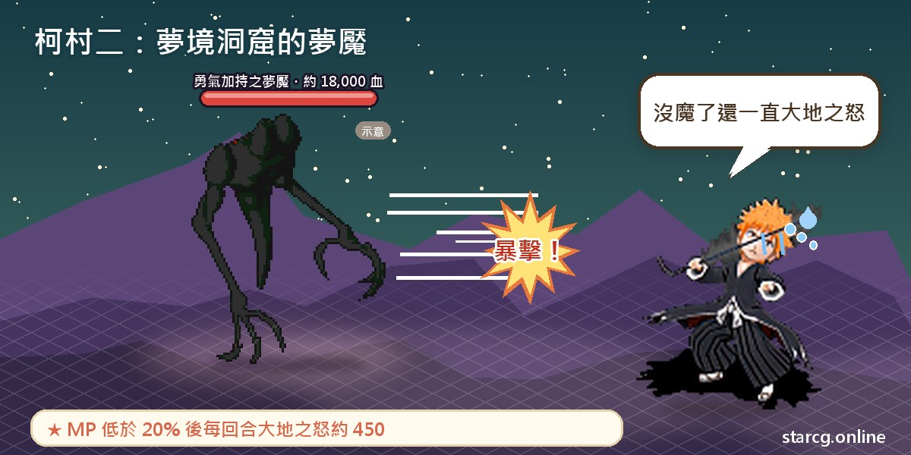
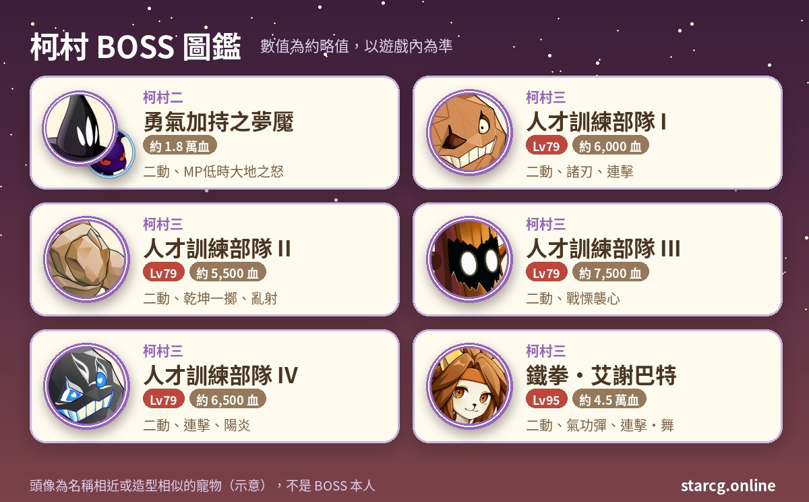

魔力寶貝的柯村系列，指的是以庫魯克斯島東邊海上的「柯馬特依村」（玩家習慣簡稱柯村）為舞台的三章任務：踏足諾斯菲拉特、重拾勇氣的掘地族、秘密組織的邀請。三章的推薦等級都是 80 級，共同的前提是擁有「解放者」稱號，也就是要先完成失翼之龍任務。柯村一負責拿到前往柯村必備的「貝尼恰斯教團許可」，柯村二幫助膽小的掘地族找回勇氣，柯村三則是受邀加入神秘的暗部組織。

做完的收穫包括：教團許可與未完成的護身符、永久稱號「掘地族的朋友」（之後可以從哥拉爾鎮西門外直接傳到雷克塔爾鎮門外），以及永久稱號「暗部第七部隊成員」與組織圖復刻版。另外，公主傳說三「生病的艾爾瑪公主」也要求先完成柯村一，想走公主傳說的人遲早要來一趟。不論你玩的是星詠魔力、水藍魔力還是初心魔力寶貝，柯村任務的流程都一樣，這份整理可以直接對照使用。

> 本文整理自 [星詠魔力攻略網](https://guide.starcg.net/) 的柯村系列頁面，並用我們自己的方式重新排序與改寫，沒有逐字照搬。BOSS 血量與數值是約略值，攻略網沒有列出的數值本文也不另外補；實際以遊戲內為準，遊戲更新後內容可能變動。

## 柯村系列是什麼？先看整體順序

柯村系列只有三章，但每一章的「門票」都不一樣。三章都需要「解放者」稱號；柯村二與柯村三另外要持有貝尼恰斯教團許可，所以實際上一定是先做柯村一。柯村二每位隊員都要準備 20 朵蝴蝶花；柯村三則要求**曾經在地下競技場打敗重量級的艾謝巴特**（隊長達成即可）。

| 章節 | 任務名稱 | 推薦等級 | 取得 |
|---|---|---|---|
| 柯村一 | 踏足諾斯菲拉特 | 80 | 貝尼恰斯教團許可、未完成的護身符 |
| 柯村二 | 重拾勇氣的掘地族 | 80 | 永久稱號「掘地族的朋友」 |
| 柯村三 | 秘密組織的邀請 | 80 | 永久稱號「暗部第七部隊成員」、組織圖復刻版 |

整理成一句話就是：**柯村一是門票，柯村二、三是稱號；想做公主傳說三，柯村一一定要先完成。**

## 出發前先準備好這些

柯村系列沒有長篇的道具清單，但幾個門檻一旦漏了就只能回頭補：解放者稱號、25 萬魔幣、每趟 1000G 的船費、每人 20 朵蝴蝶花，以及柯村三的競技場前置。

蝴蝶花是柯村二每個隊員都要各自交出的材料，整隊一起做時需求量會乘上人數。可以用本站的 [市場查價](/market/) 輸入「蝴蝶花」看看目前攤位價格，再決定要自己採集還是直接收購。

## 柯村一：踏足諾斯菲拉特（25 萬魔幣換教團許可）

推薦 80 級，條件是擁有「解放者」稱號。攻略網註明這一章**沒有難度，不需要陪打**。

1. 到雷克塔爾鎮找**加蒙神官**（83, 80），選「是」，拿到「聖女的親筆信偽」。如果你已經持有貝尼恰斯教團許可，這一步可以省略。
2. 前往庫魯克斯島的岬之神殿（832, 688），從（125, 87）進入神殿。
3. 找**魔法師烏莉兒**（36, 19），選「是」，交出 **25 萬魔幣**與聖女的親筆信偽，拿到「貝尼恰斯教團許可」，任務完成。

**前往柯馬特依村**：持有解放者稱號與教團許可之後，回到庫魯克斯島最東側（地圖右上方）的雷克塔爾鎮，到**港灣管理處**（100, 78）付 1000G 船費，就能搭船前往柯村。之後柯村二、柯村三的起點都是這艘船。

**未完成的護身符**：在柯村村外與煙霧、掘地蟲戰鬥時，會隨機掉落「毒氣樣本」。帶著毒氣樣本找**卡恩神官**交出，就能拿到未完成的護身符。攻略網沒有列出掉落機率，只能多打幾場碰運氣。

**要注意的地方**：25 萬魔幣是整個柯村系列最大的一筆開銷，而且這份許可同時是公主傳說三前往諾斯菲拉特的條件。已經持有許可的人無法再接這段前置，所以不用擔心重複花錢。

## 柯村二：重拾勇氣的掘地族（夢境之麥尼洞窟）

推薦 80 級，條件是解放者稱號、教團許可與 20 朵蝴蝶花。

1. 到庫魯克斯島最東方的雷克塔爾村，在港灣管理處（100, 78）付 1000G 搭船到柯馬特依村。
2. 找**阿斯提亞藥劑師**（68, 66）拿「通用語言藥水」。拿不到的話，可以先解散隊伍再對話，或先去跟老鼠掘地族說話。
3. 把通用語言藥水交給**掘地族**（67, 86）。
4. 再找阿斯提亞藥劑師（68, 66），選擇同意後交出 20 朵蝴蝶花，換「阿斯提亞試驗藥」。**每位隊員都要各自交出蝴蝶花**。
5. 把試驗藥交給掘地族（67, 86），被傳送到夢境之麥尼村的小屋。
6. 從小屋（6, 14）出去，走（47, 55）的黃色傳送石進入夢境之麥尼洞窟，穿過約 18 層的隨機迷宮。沿途是 85～87 級的惡魔蝙蝠與惡夢鼠，會吸血、聖盾、冰凍與強力冰凍。
7. 在最底層找**勇氣加持之夢魘**（40, 38）對話開戰。
8. 戰勝後找**膽怯的夢魘**（40, 39）拿「勇氣」，被傳回夢境之麥尼村；到小屋（32, 21）找**掘地族小古**（8, 7），傳回柯馬特依村，再到（67, 86）把勇氣交給小古。
9. 前往哥拉爾鎮，從西門出城到庫魯克斯島（218, 432），找**年邁的掘地族**進入庫魯克斯地底通道。
10. 在（478, 52）找**年輕的掘地族**，取得稱號「掘地族的朋友」，被傳送到雷克塔爾鎮門外（590, 380），任務完成。

**BOSS 資料**：勇氣加持之夢魘約 18,000 血（攻略網缺少等級資料），一回合兩動，技能有普通攻擊、混亂攻擊、連擊、吸血攻擊、孤注一擲、諸刃、大地之怒與強力遺忘魔法。最需要注意的是：**當牠的 MP 低於 20% 時，會追加傷害約 450 的大地之怒，之後每回合都會使用**。也就是說，戰鬥拖到後半段反而更危險，後期要確保隊伍血量保持在安全線上。

**要注意的地方**：洞窟沿途的惡魔蝙蝠與惡夢鼠會吸血與冰凍，18 層的隨機迷宮走起來不短；用 [迷宮找樓梯](/maze/) 邊走邊記樓梯位置，可以少繞很多路。打完之後別忘了最後一段要回到哥拉爾鎮西門外，任務才算完成。

**稱號的好處**：拿到「掘地族的朋友」之後，在哥拉爾鎮西門外找年邁的掘地族（218, 432），就能直接傳送到雷克塔爾鎮門外，往返柯村、諾斯菲拉特一帶方便很多。

## 柯村三：秘密組織的邀請（暗部第七部隊成員）

推薦 80 級，條件是解放者稱號、教團許可，以及**曾在地下競技場打敗重量級的艾謝巴特**（隊長達成即可）。這章依職業分成兩種流程。

**非忍者職業流程**

1. 到雷克塔爾村港灣管理處（100, 78）付 1000G 搭船到柯馬特依村。
2. **夜晚**調查**草料**（41, 61），選「是」，被傳送到諾斯菲拉特。選「否」會直接和 95 級的鐵拳艾謝巴特開戰，攻略網不建議。
3. 在諾斯菲拉特找到四名**人才訓練部隊**成員，逐一對話開戰，收集勝利證明 I～IV。
4. 集齊四張證明後，從地圖（802, 74）回到正常的柯馬特依村（也可以回城後重新搭船）。
5. 夜晚再調查草料（41, 61），交出勝利證明 I～IV，取得組織圖復刻版與稱號「暗部第七部隊成員」。

**人才訓練部隊資料**：

| 位置 | 外形 | 等級 | 約略血量 | 主要技能 | 掉落 |
|---|---|---|---|---|---|
| （770, 82） | 石頭 | 79，二動 | 6,000 | 諸刃、連擊 | 勝利證明 I |
| （732, 122） | 石頭 | 79，二動 | 5,500 | 乾坤一擲、亂射 | 勝利證明 II |
| （716, 92） | 樹 | 79，二動 | 7,500 | 乾坤一擲、戰慄襲心 | 勝利證明 III |
| （767, 85） | 石頭 | 79，二動 | 6,500 | 乾坤一擲、連擊、陽炎 | 勝利證明 IV |

四名成員的外形都不是人型，而是石頭與樹，找的時候別被外觀騙了。諾斯菲拉特（758, 74）有**暗部醫療部隊成員**可以補充魔力藥劑（非資深版），但**只在夜晚出現**，四場戰鬥之間可以善加利用。

**忍者職業流程**：同樣搭船到柯村，夜晚調查草料（41, 61）選「是」，就直接拿到組織圖復刻版與稱號，任務完成，不必打四名成員。

**BOSS 資料：鐵拳・艾謝巴特**：95 級、約 45,000 血，一回合兩動，擁有 100 閃避與 100 命中；會用明鏡止水（魔力低於 140 時放不出來）、氣功彈（傷害約 800、暴擊約 1,000，魔力低於 70 時放不出來），血量低於 50% 時追加奧義連擊・舞（傷害約 400 以上，不消耗魔力）。在柯村三的草料選「否」就會遇到牠，攻略網不建議這樣做；要達成任務條件，請到地下競技場挑戰。

**要注意的地方**：攻略網提到任務中的「夜晚」限制在某些情況下可能失效，白天也有可能執行，但不確定是不是 BUG。保險起見還是照夜晚來做，比較不會白跑。

## 柯村系列常見問題

**柯村任務一定要先做失翼之龍嗎？** 是的。三章都需要「解放者」稱號，而這個稱號要完成失翼之龍任務才拿得到。

**貝尼恰斯教團許可會不會重複花錢？** 不會。已經持有教團許可的人無法再接柯村一的前置流程，25 萬魔幣只需要付一次。

**柯村二的蝴蝶花可以一個人出就好嗎？** 不行。攻略網註明每位隊員都要各自交出 20 朵蝴蝶花，才能拿到自己的阿斯提亞試驗藥。

**柯村三一定要打艾謝巴特嗎？** 任務條件是「曾在地下競技場打敗重量級的艾謝巴特」，隊長達成即可；任務中草料選「否」也會觸發和牠的戰鬥，但攻略網不建議。

**忍者做柯村三有什麼不同？** 忍者夜晚調查草料選「是」就能直接完成任務，不需要收集四張勝利證明。

## 小結：先備齊門票，再一口氣做完

柯村系列的戰鬥量不大，真正的關卡在於「門票」：解放者稱號、25 萬魔幣的教團許可、每人 20 朵蝴蝶花，以及地下競技場的艾謝巴特。把這些前置準備好，柯村一到三可以很快地連續完成，順手打開公主傳說三的路線，也讓之後往返雷克塔爾鎮與諾斯菲拉特輕鬆很多。

想看原始任務頁的完整資料，可以到 [星詠魔力攻略網](https://guide.starcg.net/quests/ke-village) 查詢；也歡迎用本站的 [市場查價](/market/) 與 [迷宮找樓梯](/maze/)，把柯村之旅安排得更順。
