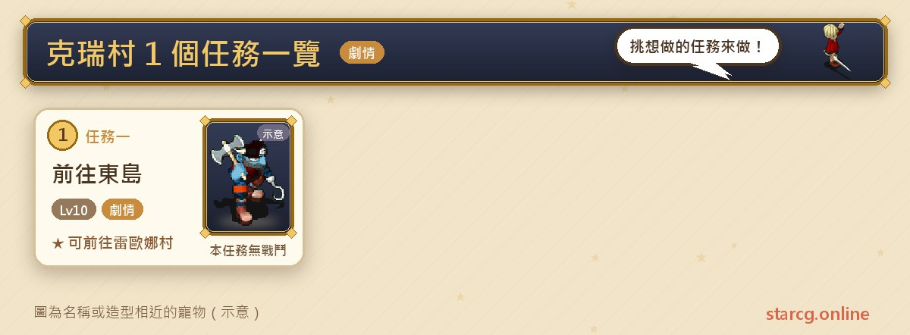
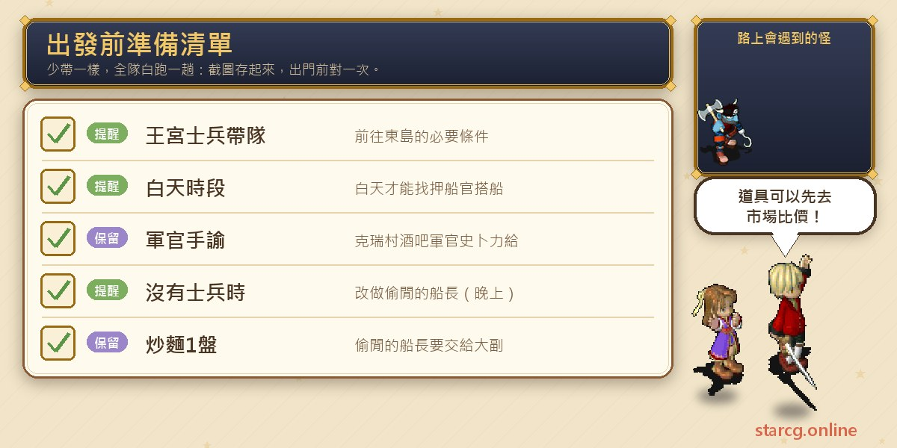

크레이 마을(克瑞村)은 공략 사이트에 지역 퀘스트가 하나만 올라와 있어요. 바로 **동쪽 섬으로 이동(前往東島)**예요. 몬스터를 잡거나 장비를 얻는 퀘스트가 아니라 일종의 「승선권」으로, 완료하면 동쪽 제놈 섬(傑諾姆島)의 레오나 마을(雷歐娜村)로 배를 타고 가서 봄바람이 가져온 희망, 채초엽의 사랑 같은 그곳 퀘스트를 할 수 있어요. 권장 레벨은 10레벨뿐이지만 조건이 특이해요. 반드시 **왕궁 병사**가 파티를 이끌어야 하고 **낮**에만 진행할 수 있어요.

이 글에서는 동쪽 섬으로 이동의 단계, NPC와 좌표를 짧은 목록으로 정리하고, 레오나 마을로 가는 다른 루트인 「한가로운 선장(偷閒的船長)」과 비교해 파티 상황에 맞게 고를 수 있게 했어요. StarCG(星詠魔力), 水藍魔力, 初心魔力寶貝 중 무엇을 하든 크레이 마을의 동쪽 섬으로 이동 진행은 같으니 그대로 활용하면 돼요.

> 이 글은 [StarCG 공략 사이트](https://guide.starcg.net/)의 크레이 마을 「동쪽 섬으로 이동」 퀘스트 페이지를 바탕으로, 같은 사이트의 네빌 해변 마을(尼維爾海村) 「한가로운 선장」 페이지를 참고해 저희 방식대로 순서를 다시 짜고 새로 쓴 것으로, 원문을 그대로 옮기지 않았어요. 공략 사이트에 없는 내용은 모두 「공략 사이트 미기재」로 적었고, 게임 업데이트 후 내용이 바뀔 수 있어요.

## 크레이 마을 퀘스트는 무엇인가요? 전체 순서부터

| 퀘스트 | 퀘스트 이름 | 권장 레벨 | 보상 |
|---|---|---|---|
| 퀘스트 1 | 동쪽 섬으로 이동 | 10 | 레오나 마을 이동 가능 |

한 줄로 정리하면: **왕궁 병사 한 명에게 파티를 이끌게 하고, 낮에 크레이 마을 술집에서 장교의 친필 명령서를 받은 뒤, 네빌 해변 마을의 선박 감독관에게 가서 배를 타요.**

공략 사이트의 전체 퀘스트 목록에는 이 퀘스트의 비고로, 왕궁 병사가 없을 때는 네빌 해변 마을의 「한가로운 선장」을 대신 하면 된다고 적혀 있어요. 두 퀘스트의 보상은 모두 「레오나 마을 이동 가능」이에요.

## 출발 전에 이것부터 준비하세요

동쪽 섬으로 이동은 재료를 모을 필요가 없고, 준비할 것은 파티 구성과 시간대예요.

가장 중요한 건 파티에 **왕궁 병사**가 있고 그가 리더를 맡는 거예요. 다음은 **낮**에만 선박 감독관에게 배를 탈 수 있다는 점이에요. 장교의 친필 명령서는 크레이 마을에서 받은 뒤 배에 탈 때까지 보관하세요. 이 퀘스트는 재료비가 들지 않지만, 이어서 레오나 마을 퀘스트를 할 거라면 그곳에서 스키야키, 생명력 회복약(400), 여러 요리와 영구 빙석이 필요하니 이 사이트의 [시세 조회](/ko/market/)로 시세를 먼저 확인해 보세요.

## 퀘스트 1: 동쪽 섬으로 이동(왕궁 병사 리더, 낮)

권장 10레벨, 조건은 왕궁 병사 리더, 낮이에요.

1. (스토리 단계, 생략 가능) **네빌 해변 마을**의 전비 물자 수송소(戰備物資運輸站)(29, 70)에서 **병사 메류파(士兵梅呂派)**와 대화해요.
2. **크레이 마을** 술집(86, 63)의 **장교 스프리(軍官史卜力)**(16, 4)와 대화해 「**장교의 친필 명령서(軍官手諭)**」를 받아요.
3. 낮에 **네빌 해변 마을**(37, 75)의 **선박 감독관 반길(押船官梵吉爾)**과 대화해 배를 타요.
4. 배에 탄 뒤 선박 감독관 반길과 다시 대화하면 **레오나 마을**에 도착해요.

**주의할 점**:

- 공략 사이트는 1단계를 스토리 단계로 표시해 건너뛸 수 있다고 했어요. 그래서 실제로는 「크레이 마을에서 명령서, 네빌 해변 마을에서 승선」 두 곳만 가면 돼요.
- 「왕궁 병사 리더」는 리더가 왕궁 병사여야 한다는 뜻이에요. 공략 사이트는 다른 파티원도 병사여야 하는지, 명령서를 가진 사람만 배에 탈 수 있는지는 적지 않았으니, 안전하게 리더인 병사가 명령서를 받으세요.
- 배는 낮에만 탈 수 있어서 밤에 네빌 해변 마을에 가면 헛걸음이에요.
- 이 퀘스트는 전투가 없고, 공략 사이트에도 몬스터 정보가 전혀 없어요.

## 다른 길: 한가로운 선장(왕궁 병사가 없을 때)

파티에 왕궁 병사가 없다면 공략 사이트는 네빌 해변 마을의 「한가로운 선장」을 대신 하라고 권해요. 조건은 **밤**, 권장 25레벨이고 진행은 동쪽 섬으로 이동보다 조금 길어요.

1. 네빌 해변 마을 술집(89, 29)의 **요리사 포드(廚師福德)**(13, 6)에게서 「볶음면 주문서」를 받아요.
2. 볶음면 주문서와 **볶음면 1접시**를 가지고 드웨트 섬(德威特島)(555, 350)의 **선원 세람(水手賽拉姆)**을 찾아 도크에 들어가요.
3. 주문서와 볶음면을 **일등 항해사 피셔(大副費雪)**(13, 48)에게 주고 「출항 시간표」를 받아요.
4. 드웨트 섬(332, 518) 근처에 랜덤으로 나타나는 **선장 리스(船長瑞斯)**에게서 「리스 선장의 친필 편지」를 받아요.
5. 도크로 돌아가 편지를 일등 항해사 피셔에게 주면 「표」 두 장(감정하면 「승선권」)을 받아요.
6. 밤에 밀수 도크의 **등록원 타코(登記員塔可)**(13, 34)에게서 밀수선을 타고, 배 위에서 일등 항해사 피셔(18, 13)와 대화하면 제놈 섬에 도착해요.

두 루트의 차이를 정리하면 다음과 같아요.

| 비교 | 동쪽 섬으로 이동 | 한가로운 선장 |
|---|---|---|
| 권장 레벨 | 10 | 25 |
| 시간대 | 낮 | 밤 |
| 특수 조건 | 왕궁 병사 리더 | 볶음면 1접시 준비 |
| 가야 할 곳 | 크레이 마을, 네빌 해변 마을 | 네빌 해변 마을, 드웨트 섬 |

한가로운 선장의 자세한 설명은 [네빌 해변 마을 퀘스트 공략](/ko/posts/neville-quest-guide/)에서 볼 수 있어요.

## 레오나 마을에 가면 무엇을 할 수 있나요?

레오나 마을에는 퀘스트가 두 개 있어요. 권장 80레벨의 「봄바람이 가져온 희망(春風帶來希望)」(벨리스 유적에서 마궁 바크다와 2연전, 난사 또는 마법 피해 20% 증가 장신구를 얻을 수 있음)과, 권장 100레벨에 장로 집 열쇠가 필요한 「채초엽의 사랑(彩葉草之戀)」(채엽원 통행증 교환)이에요. 또 공략 사이트의 채초엽의 사랑 페이지도 한가로운 선장이나 동쪽 섬으로 이동을 먼저 끝내고 출발하라고 권해요. 두 퀘스트의 전체 진행은 [레오나 마을 퀘스트 공략](/ko/posts/leona-quest-guide/)에 정리해 두었어요.

## 크레이 마을 자주 묻는 질문

**동쪽 섬으로 이동은 꼭 왕궁 병사가 있어야 하나요?** 네. 조건이 왕궁 병사 리더예요. 왕궁 병사가 없으면 네빌 해변 마을의 한가로운 선장을 대신 하면 돼요.

**동쪽 섬으로 이동을 밤에 할 수 있나요?** 아니요. 배는 낮에 타야 해요. 한가로운 선장은 밤이에요.

**네빌 해변 마을 전비 물자 수송소 단계는 해야 하나요?** 공략 사이트는 스토리 단계로 표시했고 생략할 수 있어요.

**동쪽 섬으로 이동에 전투가 있나요?** 없어요. 공략 사이트에는 전투나 몬스터가 전혀 없고, 퀘스트 보상은 레오나 마을로 갈 수 있게 되는 거예요.

## 정리: 병사가 있으면 동쪽 섬으로 이동

동쪽 섬으로 이동은 레오나 마을로 가는 가장 짧은 길이에요. 크레이 마을에서 명령서를 받고 네빌 해변 마을에서 낮에 배를 타면 두 곳으로 끝나고, 유일한 문턱은 파티에 왕궁 병사 리더가 있어야 한다는 거예요. 병사가 없는 파티는 밤에 한가로운 선장을 하면 돼요.

더 자세한 원문과 다른 퀘스트는 [StarCG 공략 사이트](https://guide.starcg.net/)에서 확인할 수 있어요. 이 사이트의 [시세 조회](/ko/market/)로 레오나 마을 퀘스트에 쓸 요리도 미리 준비해 두세요.
