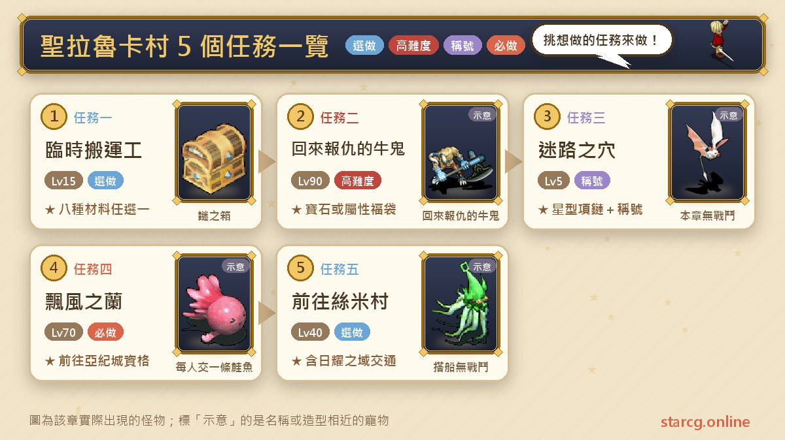
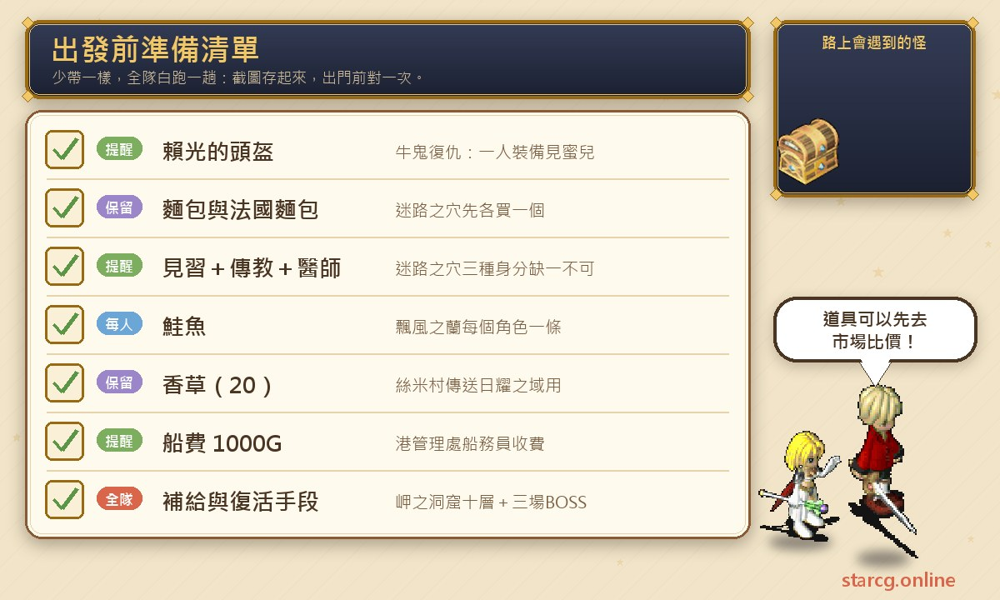
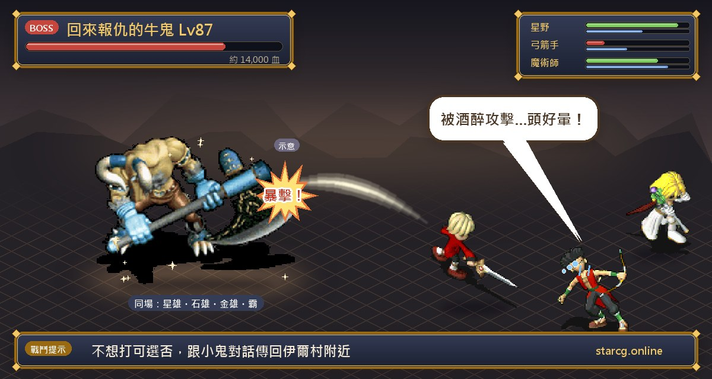
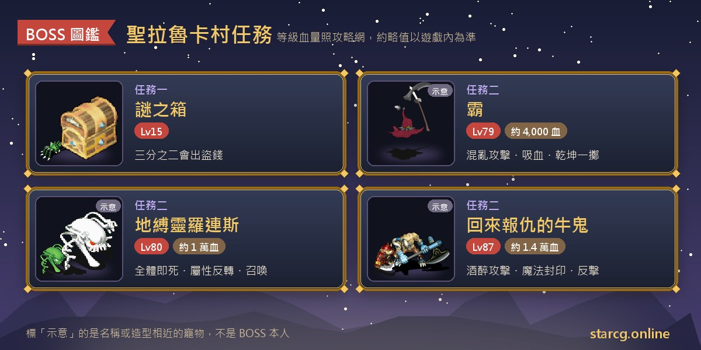

세인트 라루카 마을(聖拉魯卡村)은 프레이아(芙蕾雅)섬에 있고, 많은 모험가가 판부르크(法蘭城)를 처음 떠나 지나가게 되는 마을이에요. 마을과 주변에서 받을 수 있는 퀘스트는 난이도 차이가 커요. 15레벨부터 할 수 있고 생산 재료 하나를 고를 수 있는 「임시 운반공(臨時搬運工)」, 견습 캐릭터만 할 수 있고 성직자와 의사를 모아야 하는 「미혹의 구멍(迷路之穴)」, 권장 90레벨에 보스를 세 번 잡는 「역습의우귀(回來報仇的牛鬼)」가 있어요. 또 세인트 라루카 항에서 배를 타는 것이 스미 마을(絲米村), 태양의 영역(日耀之域), 아키 성(亞紀城)으로 가는 출발점이고, 「표풍의 란(飄風之蘭)」이 아키 성 통행 자격을 받는 퀘스트예요.

이 글은 세인트 라루카 마을 관련 퀘스트 다섯 개를 「초보 때 먼저 하고, 레벨이 되면 다시 오기」 관점에서 정리했어요. 퀘스트별 조건, NPC와 좌표, 미리 준비할 아이템, 보스 정보와 보상, 그리고 놓치기 쉬운 부분까지 담았어요. StarCG(星詠魔力), 水藍魔力, 初心魔力寶貝 어느 쪽을 하든 세인트 라루카 마을 퀘스트 흐름은 같으니 그대로 쓰면 돼요.

> 이 글은 [StarCG 공략 사이트](https://guide.starcg.net/quests/laruka)의 세인트 라루카 마을 퀘스트 페이지(「표풍의 란」과 「스미 마을 및 태양의 영역 가기」 두 페이지 포함)를 바탕으로, 저희 방식대로 순서를 다시 짜고 새로 써서 정리했어요(그대로 옮기지 않았어요). 보스 HP와 수치는 대략적인 값이니 실제 게임을 기준으로 하세요. 공략 사이트에 없는 부분은 「공략 사이트에 없음」으로 바로 표시했어요.

## 세인트 라루카 마을 퀘스트는 무엇이 있나요? 전체 순서부터

다섯 퀘스트는 꼭 지켜야 할 순서는 없지만 조건 차이가 커요. 가장 좋은 방법은 레벨별로 나누는 거예요. 판부르크를 막 나왔을 때 임시 운반공과 미혹의 구멍을 하고, 40레벨쯤 스미 마을로 가는 배편을 익히고, 70레벨에 표풍의 란으로 아키 성을 열고, 마지막으로 90레벨이 되어 이르 마을(伊爾村) 「우귀 토벌(牛鬼討伐)」에서 받은 라이코의 투구(賴光的頭盔)를 가지고 있을 때 역습의우귀에 도전하세요.

| 퀘스트 | 퀘스트 이름 | 권장 레벨 | 보상 |
|---|---|---|---|
| 퀘스트 1 | 임시 운반공 | 15 | 명성 100 + 재료 8종 중 하나 |
| 퀘스트 2 | 역습의우귀 | 90 | 무작위 8~10레벨 보석/속성 복주머니 |
| 퀘스트 3 | 미혹의 구멍 | 5 | 별 모양 목걸이 + 영구 칭호 |
| 퀘스트 4 | 표풍의 란 | 70 | 아키 성 입장 자격 |
| 퀘스트 5 | 스미 마을 및 태양의 영역 가기 | 40 | 이동 방법(보상 없음) |

이 중 「역습의우귀」는 이르 마을 「우귀 토벌」의 후속으로, 그 퀘스트의 라이코의 투구를 가지고 있어야 해요. 「표풍의 란」과 「스미 마을 가기」는 같은 배편 루트를 쓰니 두 페이지 설명을 함께 보면 좋아요.

## 출발 전에 준비할 것

세인트 라루카 마을 퀘스트는 서로 차이가 커서 준비물도 제각각이에요. 특정 직업이 필요한 것도 있고, 빵을 사야 하는 것도 있고, 캐릭터마다 연어를 한 마리씩 가져가야 하는 것도 있어요. 아래에 쓰일 물건을 한데 모았으니, 출발 전에 한 번 확인하면 헛걸음하지 않아요.

가장 자주 놓치는 건 미혹의 구멍을 위해 **빵(麵包)**과 **바게트(法國麵包)**를 하나씩 미리 지니고 있어야 한다는 것, 그리고 표풍의 란은 **캐릭터마다 연어(鮭魚)가 한 마리씩** 필요하다는 거예요. 연어는 고대 얼음실(古代冰室) 1층의 볼일 보는 사람에게 100G로 살 수 있고, 메이블 협곡(梅布爾隘地)에서 수렵 기술 R5로도 얻을 수 있어요. 직접 다니기 싫다면 이 사이트의 [시세 검색](/ko/market/)에서 파는 플레이어가 있는지 먼저 보세요. 배를 타고 스미 마을에 가려면 1000G, 스미 마을에서 태양의 영역으로 전송하려면 허브(香草)(20)와 1000G가 더 필요하니 돈을 넉넉히 남겨 두세요.

## 퀘스트 1: 임시 운반공(15레벨, 재료 하나 선택)

권장 15레벨, 조건도 15레벨이고 자동 길안내를 지원해요.

1. 세인트 라루카 마을 **장비점**(32, 70)에서 **상품 짐꾼 포크포코(商品搬運工波克波可)**(14, 3)와 대화해 「수수께끼 상자(謎之箱)」를 받아요.
2. 지하 공방에서 **창고지기 우치(倉庫員伍奇)**(23, 39)와 대화해 창고에 들어가요.
3. 3층부터 적이 무작위로 나오고, 쓰러뜨리면 「수수께끼 열쇠(謎之鑰)」를 얻을 수 있어요.
4. 맨 아래층까지 가서 상자를 놓고 수수께끼 열쇠로 열어요.
5. 그러면 **수수께끼 상자**(15레벨, 즉 스타틀러(藍魔嚇人箱))와 팬 위도우(土蜘蛛), 아라크노이드(火蜘蛛)가 나오고, 쓰러뜨리면 「편지(信)」를 받아요.
6. 편지를 **포크포코**에게 주고 철광석 20, 은광석 10, 전나무 20, 레몬그라스 20, 목면포 20, 펠트 10, 우유 20, 소금 10 중 하나를 골라요.

**주의할 점**: 공략 사이트는 5인 파티라면 보스를 따로따로 잡으라고 알려 줘요. 안 그러면 4번을 더 돌아야 해요. 또 수수께끼 상자는 3분의 2 확률로 돈 훔치기를 쓰니 현금을 많이 들고 들어가지 마세요. 보상은 고르는 생산 재료라서, 요리나 생산을 하는 플레이어라면 가장 부족한 걸 고르면 되고, 고르기 전에 재료별 시세를 확인해 봐도 좋아요.

## 퀘스트 2: 역습의우귀(90레벨, 보스 세 판)

권장 90레벨, 조건은 이르 마을 퀘스트 「우귀 토벌」의 **라이코의 투구** 소지예요. 세인트 라루카 마을에서 가장 어려운 퀘스트로, 주요 전투 세 번과 10층짜리 동굴 하나가 들어 있어요.

1. 세인트 라루카 북동쪽(175, 171)의 **미르(蜜兒)**를 찾아 라이코의 투구를 장착하고 대화해요. 투구는 꼭 착용해야 하지만, 파티에서 한 명만 장착해도 통과할 수 있어요.
2. **역습의우귀**(182, 101)와 대화해 전투에 들어가 **하(霸)**에게 도전해요. 이기면 파티에서 무작위로 한 명이 「귀문연어(鬼吻鮭)」를 받아요.
3. 귀문연어를 가지고 역습의우귀와 대화해 「조풍의 귀걸이(潮風的耳環)」로 바꿔요.
4. 가나 마을 북쪽(707, 58)에서, 조풍의 귀걸이를 가진 사람이 **파수꾼 호시구마(看守的星熊)**와 대화해 곶의 동굴(岬之洞窟)에 들어가요.
5. 귀걸이를 가진 사람이 **우귀 공주(牛鬼公主)**(16, 8)와 대화해 우귀 공주의 기억 속으로 들어가고, 마지막에 확정을 고르면 「단풍의 직물(紅葉的織布)」로 바꿔 줘요.
6. 10개 층을 지나 곶의 동굴 깊은 곳으로 들어가 제국 망령군(帝國亡靈軍)에 도전해요.
7. 이기면 위로 올라가 동굴을 나와 술의 전당(酒之殿堂)에 들어가고, 단풍의 직물을 가지고 **우귀**와 대화하면 5레벨 이상의 무작위 보석을 하나 받아요. 공략 사이트에 따르면 특수 방어구 갑옷, 옷, 로브가 나올 수도 있어요.
8. 우귀와 다시 대화하면 무예를 겨뤄 보겠냐고 물어요. 「아니요」를 고르면 옆의 **꼬마 도깨비(小鬼)**와 대화해 이르 마을 근처로 돌아갈 수 있고, 「예」를 고르면 최종 결전에 들어가요.
9. 이기면 보물상자 열쇠를 무작위로 받고 보물고로 전송되며, 상자를 열면 10레벨 보석이나 속성 복주머니 4종 중 하나를 받아요.

**보스 정보**:

- 하: 79레벨, HP 약 4천. 연속 공격 파쇄, 건곤일척, 아지랑이(陽炎), 붕격, 혼란 공격, 흡혈 공격을 써요.
- 지박령 로렌스(地縛靈羅連斯): 80레벨, HP 약 1만, 화 100. 초강력 화염 마법, 전체 즉사, 초회복, 암살, 속성 반전, 혼란을 쓰고, 제국병의 망령(帝國兵的亡靈)도 소환해요. 옆의 제국병의 망령은 60레벨로, 한 종류는 단일 속성 마법 네 가지(10레벨)와 아지랑이를, 다른 한 종류는 연속 공격 파쇄, 독성 공격, 아지랑이를 써요.
- 역습의우귀: 87레벨, HP 약 1만 4천, 사악형, 지수화풍 각 20. 건곤일척, 만취 공격, 반격, 마법 봉인을 써요. 같은 판에 성웅(星雄)(80레벨, 초회복 10레벨), 석웅(石雄)(81레벨, 붕격, 전율습심, 호위), 금웅(金雄)(82레벨, 연속 공격, 대지의 분노, 흡혈, 석화), 다시 나온 하가 함께 있어요.

**공략법**: 최종전은 적이 다섯이고 성웅은 회복, 석웅은 호위를 해요. 공략 사이트에 추천 처치 순서는 없지만, 기술을 보면 회복하는 적을 먼저 처리해야 우귀의 HP가 다시 차오르는 걸 막을 수 있어요. 우귀 자신이 마법 봉인을 쓰니, 마법 딜러 위주 파티라면 대체 수단을 준비하세요. 지박령 로렌스의 전체 즉사와 속성 반전도 위험하니 회복과 부활 수단을 충분히 남겨 두세요.

**특별 보상**: 공략 사이트에 따르면 우귀를 이기면 전설 무기 **우부(牛斧)**(10레벨 양손 도끼, 공격 +360~+400, 만취 +20, 필살 +27)가 나올 수도 있지만, 드롭률이 극히 낮아서 주목표로 삼는 건 추천하지 않아요.

## 퀘스트 3: 미혹의 구멍(견습 캐릭터 전용 파티 퀘스트)

권장 5레벨, 조건은 **견습 등급** 캐릭터이고, 파티에 **성직자**와 **의사**(이 둘은 등급 무관)가 있어야 해요. 파티 구성이 시험대가 되는 퀘스트로, 세 신분 중 하나라도 빠지면 안 돼요.

1. 먼저 **빵**과 **바게트**를 하나씩 사서 지니고 있어요.
2. 프레이아섬 세인트 라루카 마을 외곽(245, 210) 일대에서 노란 전송 수정을 찾아 미궁에 들어가요.
3. 미궁 안에서 무작위로 나타나는 **노인 마오시아(老人馬歐希亞)**를 찾아, 견습 캐릭터가 대화하면 빵을 사 오라며 20G를 줘요.
4. 빵을 주면 다시 50G를 주며 바게트를 사 오라고 해요. 바게트를 주면 핵심 아이템 「마다세트(馬達賽特)」를 받아요.
5. 마다세트를 **성직자**에게, 다시 **의사**에게 차례로 거래하고, 두 사람이 각자 가지고 있을 때 노인과 대화해요. 마지막으로 견습 캐릭터에게 다시 거래해 대화하면 「마오시아의 편지(馬歐希亞的信)」를 받아요.
6. 견습 캐릭터가 편지를 들고 이르 마을에 가서 **이르 마을 촌장 크니카토(伊爾村村長克尼卡托)**에게 주면 새 편지로 바꿔 줘요.
7. 미혹의 구멍으로 돌아가 마오시아를 찾아 다른 편지로 또 바꿔요.
8. 세인트 라루카 마을 촌장 집 2층의 **익명의 노인(匿名的老人)**에게 편지를 주면 세제리아 바(賽傑利亞酒吧)로 전송되고, **마오시야(瑪歐希雅)**와 대화해 아이템을 받은 뒤 밖으로 전송돼요.
9. 판부르크 리세리아 성(里謝里雅堡) 2층 알현실에서 **지역 방범 추진 회장(地域防犯推進會長)**(12, 12)과 대화하면 「별 모양 목걸이(星型項鏈)」와 칭호서를 받아요.

**주의할 점**: 퀘스트를 끝낼 때마다 **견습 캐릭터만 칭호서를 한 권** 받아요. 5인 파티가 모두 받으려면 다섯 번 해야 해요. 칭호는 캐릭터 체형에 따라 정해져서, 어린이 체형은 「반짝이는 마음(閃亮之心)」, 성인 체형은 「빛나는 백은의 혼(光輝的白銀之魂)」을 받고 외형 스킨은 상관없어요. 두 권을 모두 모아도 업적 시스템에서는 하나로만 쳐요. 여러 계정을 동시에 쓰는 플레이어는 꼭 「견습, 성직자, 의사」 순서로 거래하고 대화하세요. 별 모양 목걸이는 1레벨 장신구이고, 공략 사이트 장비 페이지에는 HP +15~+25, MP +10~+15로 나와 있어요.

## 퀘스트 4: 표풍의 란(70레벨, 아키 성으로)

권장 70레벨, 보상은 유키 단애(優紀斷堐)를 지나 아키 성으로 갈 수 있는 자격이에요. 판부르크, 윌노아 마을(維諾亞村), 프레이아섬, 스미 마을을 오가며 주로 편지를 모으는 심부름이에요.

1. 판부르크(144, 19)에서 **샹좡(香樁)**과 대화해 「예」를 고르면 샹좡의 신물(香樁的信物)을 받아요.
2. 윌노아 마을(58, 43)의 **위츠(雨慈)**를 찾아 위츠의 묘사(雨慈的形容)를 받아요.
3. 프레이아섬(414, 555)에서 **추인(竹隱)**과 대화해 추인의 수수께끼(竹隱的謎題)를 받고, 다시 **연어**를 주면 추인의 서신(竹隱的書信)으로 바꿔 줘요.
4. 윌노아 마을의 위츠에게 돌아가 위츠의 서신을 받고, 다시 판부르크의 샹좡에게 돌아가 샹좡의 서신을 받아요.
5. 배를 타고 스미 마을에 가서(방법은 퀘스트 5 참고) 긴지로 저택(錦次郎宅)(32, 46)의 **긴지로(錦次郎)**(9, 3)와 대화해 샹좡의 서신을 주면 유키 단애를 지날 자격을 받아요.
6. 스미 마을을 나가 하나코 반도(哈那可半島)(216, 61)의 **병사**와 대화하면 유키 단애로 전송되고, 통과한 뒤 하나코 반도(125, 85)에서 란국(蘭國)의 수도 **아키 성**에 들어갈 수 있어요.

**주의할 점**: **캐릭터마다 연어가 한 마리씩** 필요해요. 아키 성에 도착하면, 공략 사이트는 병원 옆 전송 교통 관리 센터(28, 50)에서 빨간 옷의 전송석 관리인(42, 22)을 찾아 전송 지점을 등록하라고 권해요. 등록하면 리세리아 성 출발의 방 2층(12, 26, 비용 2500G)이나 스미 마을(66, 37, 비용 2000G)에서 아키 성으로 바로 전송할 수 있어서 매번 걸어갈 필요가 없어요.

## 퀘스트 5: 스미 마을 및 태양의 영역 가기(40레벨 이동 방법)

권장 40레벨, 퀘스트 보상은 없어요. 사실상 이동 안내 페이지지만 표풍의 란과 그 뒤 태양의 영역에 갈 때 모두 쓰여요.

1. 세인트 라루카 마을의 **세인트 라루카 항 관리소(聖拉魯卡港管理處)**(25, 89)에서 **선무원(船務員)**(17, 17)과 대화해 「예」를 고르면 1000G를 내고 세인트 라루카 항으로 전송돼요.
2. **승선원(乘船員)**(51, 51)과 대화해 「예」를 고르고 배에 타요.
3. 스미 항에 도착하면 **객실 승무원(客房服務員)**(72, 26)과 대화해 「예」를 고르고 스미 항으로 전송돼요.
4. **선무원**(20, 52)과 대화해 「예」를 고르면 항만 관리소로 전송되고, 문(9, 22)으로 나가면 바로 스미 마을이에요.
5. **허브(20)**와 **1000G**를 가지고 스미 마을의 **전송 신관(傳送神官)**(66, 37)과 대화해 「예」를 고르면 태양의 영역으로 전송돼요. 「아니요」를 고른 뒤 「예」를 고르면 아키 성으로 전송되는데, 표풍의 란을 끝내고 전송 지점을 등록해 두어야 해요.

**주의할 점**: 이 루트는 전투가 없지만 구간마다 대화로 확인해야 하고, 뱃삯과 전송비를 합치면 적지 않으니 출발 전에 돈과 허브를 확인하세요. 공략 사이트에는 배 시간표나 대기 시간이 없어요.

## 세인트 라루카 마을 퀘스트 자주 묻는 질문

**역습의우귀는 어떻게 받나요?** 이르 마을 퀘스트 「우귀 토벌」에서 받은 라이코의 투구를 가지고, 미르를 만날 때 장착하고 있어야 해요. 파티에서 한 명만 장착해도 통과할 수 있어요.

**미혹의 구멍은 혼자 할 수 있나요?** 아니요. 파티에 견습 등급 캐릭터, 성직자, 의사가 함께 있어야 하고, 아이템을 세 사람이 차례로 거래하며 각자 노인과 대화해야 해요.

**미혹의 구멍 칭호가 왜 친구와 다르죠?** 칭호는 캐릭터 체형으로 정해져요. 어린이 체형은 「반짝이는 마음」, 성인 체형은 「빛나는 백은의 혼」이고, 외형 스킨은 상관없어요.

**표풍의 란 연어는 몇 마리 준비하나요?** 캐릭터마다 한 마리씩이에요. 고대 얼음실 1층에서 100G로 사거나 메이블 협곡에서 수렵 R5로 얻을 수 있어요.

**임시 운반공은 왜 따로 잡아야 하나요?** 공략 사이트는 5인 파티라면 맨 아래층의 수수께끼 상자를 따로 잡으라고 알려 줘요. 안 그러면 4번을 더 돌아야 해요.

**역습의우귀는 마지막 판까지 꼭 해야 하나요?** 아니요. 보석을 받은 뒤 「아니요」를 고르면 꼬마 도깨비와 대화해 이르 마을 근처로 돌아갈 수 있어요. 10레벨 보석, 속성 복주머니를 원하거나 우부를 노린다면 「예」를 골라 결전하면 돼요.

## 정리: 저레벨 퀘스트부터, 라이코의 투구는 90레벨까지

세인트 라루카 마을 다섯 퀘스트는 완전히 다른 레벨대에 퍼져 있어요. 임시 운반공과 미혹의 구멍은 막 시작한 캐릭터에게 맞고, 스미 마을 가기와 표풍의 란은 동쪽 지역을 여는 이동 퀘스트, 역습의우귀는 90레벨 이상의 도전이에요. 가장 실수하기 쉬운 건 미혹의 구멍의 직업 구성과 거래 순서, 표풍의 란의 1인당 연어 한 마리이고, 역습의우귀는 이르 마을의 라이코의 투구를 버리거나 팔지 않는 걸 잊지 마세요.

더 자세한 원문과 다른 퀘스트는 [StarCG 공략 사이트](https://guide.starcg.net/quests/laruka)에서 확인하세요. 이 사이트의 [시세 검색](/ko/market/)으로 연어와 재료 시세를 찾고, [데미지 계산기](/ko/damage/)로 파티가 역습의우귀의 HP를 뚫을 수 있을지 계산해 보세요.
