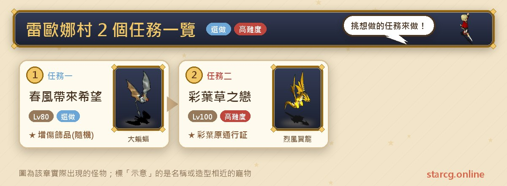
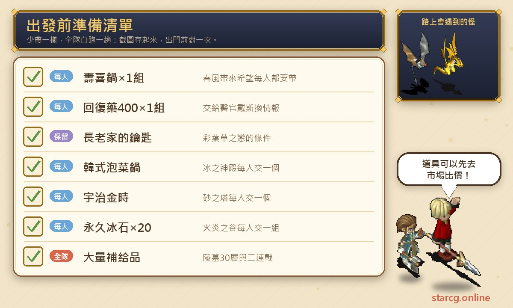
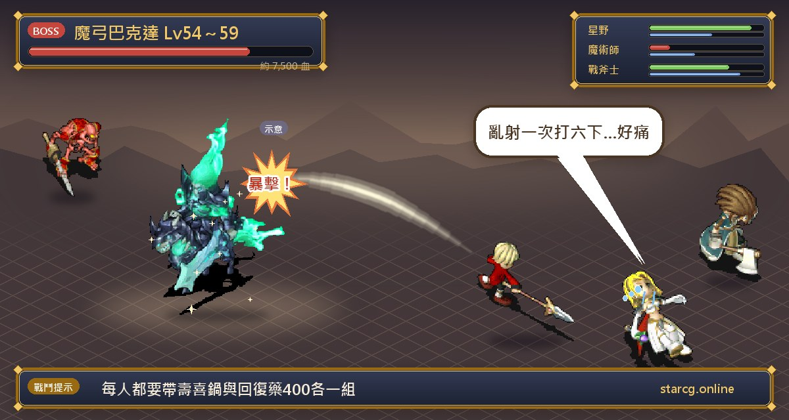

레오나 마을(雷歐娜村)은 동쪽 제놈 섬(傑諾姆島)에 있고, 공략 사이트에는 이곳에서 출발하는 퀘스트 두 개가 올라와 있어요. **봄바람이 가져온 희망(春風帶來希望)**은 물자를 의용군 전초기지로 나르고 벨리스 유적(貝力斯遺跡) 깊숙이 들어가 마궁 바크다(魔弓巴克達)와 2연전을 벌이는 퀘스트로, 난사 또는 마법 피해 20% 증가 장신구를 얻을 수 있어요. **채초엽의 사랑(彩葉草之戀)**은 아주 긴 고레벨 퀘스트 라인으로, 얼음의 신전, 프리드 섬(弗利德島), 해밀턴 마을(漢米頓村), 봉인의 땅 세 곳을 거쳐 채엽원 통행증(彩葉原通行証)을 받고, 마지막에 황후의 능침(皇后陵寢)에서 바크다와 부활한 클레어 왕비(可麗兒王后)를 상대해요. 권장 레벨은 각각 80레벨과 100레벨이고, 후자의 보스 레벨은 200레벨까지 올라가요.

이 글에서는 두 퀘스트의 조건, 단계별 NPC와 좌표, 지도 구간마다 만나는 몬스터, 각 전투 정보와 입장 때 내야 하는 아이템을 한곳에 모았어요. StarCG(星詠魔力), 水藍魔力, 初心魔力寶貝 중 무엇을 하든 레오나 마을 퀘스트 진행은 같으니 그대로 활용하면 돼요.

> 이 글은 [StarCG 공략 사이트](https://guide.starcg.net/)의 레오나 마을 퀘스트 페이지와 장비 페이지를 바탕으로 저희 방식대로 순서를 다시 짜고 새로 쓴 것으로, 원문을 그대로 옮기지 않았어요. 보스 HP와 수치는 대략적인 값이니 실제 게임을 기준으로 해 주세요. 공략 사이트에 없는 수치는 모두 「공략 사이트 미기재」로 적었고, 게임 업데이트 후 내용이 바뀔 수 있어요.

## 레오나 마을 퀘스트는 무엇인가요? 전체 순서부터

두 퀘스트는 서로 선후 관계가 없어요. 먼저 해결할 것은 「레오나 마을에 어떻게 가느냐」예요. 공략 사이트는 두 가지 방법을 권해요. 하나는 네빌 해변 마을(尼維爾海村)의 「한가로운 선장(偷閒的船長)」(밤, 밀수선 승선), 다른 하나는 크레이 마을(克瑞村)의 「동쪽 섬으로 이동(前往東島)」(왕궁 병사 리더, 낮에 승선)예요. 자세한 내용은 [네빌 해변 마을 퀘스트 공략](/ko/posts/neville-quest-guide/)과 [크레이 마을 퀘스트 공략](/ko/posts/kre-quest-guide/)을 보세요.

| 퀘스트 | 퀘스트 이름 | 권장 레벨 | 보상 |
|---|---|---|---|
| 퀘스트 1 | 봄바람이 가져온 희망 | 80 | 펫 코인(귀속)(기간 한정), 랜덤: 바크다의 사인/암영 궁술/암영 마주 |
| 퀘스트 2 | 채초엽의 사랑 | 100 | 장로의 휘장, 채엽원 통행증, 마지막에 통행증을 내고 신비한 알 |

한 줄로 정리하면: **봄바람이 가져온 희망의 핵심은 「모두가」 스키야키와 회복약을 가져가는 것, 채초엽의 사랑의 핵심은 장로 집 열쇠와 봉인의 땅 세 곳에서 1인당 내야 하는 입장 요리와 영구빙석이에요.**

## 출발 전에 이것부터 준비하세요

두 퀘스트 모두 「모두가 내야 하는」 아이템이 있어서, 한 명이라도 없으면 전원이 입장할 수 없어요.

봄바람이 가져온 희망은 **파티원 모두**가 **스키야키(壽喜鍋) ×1세트**와 **생명력 회복약(400) ×1세트**를 가지고 있어야 해요. 그렇지 않으면 전원이 정보를 받아 유적에 들어갈 수 없어요. 채초엽의 사랑은 먼저 **장로 집 열쇠**(아노만 성(亞諾曼城) 「사라진 왕자(消失的王子)」의 보상, [아노만 성 퀘스트 공략](/ko/posts/anoman-quest-guide/) 참고)가 있어야 하고, 이후 봉인의 땅 세 곳에서 각각 1인당 **김치찌개(韓式泡菜鍋)** 하나, 1인당 **우지킨토키(宇治金時)** 하나, 1인당 **영구빙석(永久冰石)** 20개 1세트를 내야 해요. 요리와 빙석 수량이 적지 않으니 이 사이트의 [시세 조회](/ko/market/)로 직접 만드는 것과 사는 것 중 어느 쪽이 나은지 비교해 보세요.

## 퀘스트 1: 봄바람이 가져온 희망(모두 물자를 챙기기)

권장 80레벨, 조건 없음이에요. 공략 사이트는 이 퀘스트를 **길안내 미내장**으로 표시해요.

1. 레오나 마을의 **장교 프린시페(軍官普林西比)**(25, 50)와 대화해 「스키야키 주문서」와 「물약 주문서」를 받아요.
2. 스키야키(1세트)와 생명력 회복약 400(1세트)을 가지고 레오나 마을을 나와 동쪽의 **의용군 전초기지(義勇軍前哨站)**(418, 204)로 가서 **의무관 데스(醫官戴斯)**에게 물자를 주면 「**바크다의 정보**」를 받아요. 정보는 파티원 모두가 가지고 있어야 해요.
3. 전초기지를 나와 북서쪽으로 가서 호수 한가운데의 **병사 인테(士兵英特)**(313, 166)에게 정보를 보여 주고 **벨리스 유적**에 들어가요.
4. 벨리스 유적(9, 3)에서 랜덤 미궁으로 들어가며 모두 15층이에요. 공략 사이트는 층마다 지도가 넓고 **계단이 바위에 가려 있을 수 있으니** 사각지대를 잘 보라고 해요.
5. 가장 깊은 곳의 **마족군 본부(魔族軍總部)** 지도 한가운데에 있는 **마궁 바크다**와 대화하면 2연전에 들어가요.
6. 이기면 바크다의 사인, 암영 궁술(暗影箭法), 암영 마주(暗影魔咒) 중 하나를 랜덤으로 얻어요. 아래로 내려가 **병사 스트롱(士兵史壯)**과 대화하면 의용군 전초기지로 돌아가고 퀘스트가 완료돼요. 남은 정보는 더 이상 쓸모가 없으니 버려도 돼요.

**보스 정보**:

- 1차전: 마궁 바크다 49레벨, HP 약 4,900, 지 100, 인형계, 2회 행동, 난사(3)를 써요. 주변에 카완챠(血骷髏) ×3(50레벨, 화 70·풍 30, 전율습심)과 그레이트 배트(大蝙蝠) ×2(50레벨, 지 70·수 30, 강력 회복 마법)가 있어요.
- 2차전: 마궁 바크다 54~59레벨, HP 약 7,500, 2회 행동, 건곤일척과 난사(6)를 써요. 주변에 카완챠 ×5와 그레이트 배트 ×4가 있고 모두 55레벨, HP 약 3,000이며, 공략 사이트에 따르면 이들은 한 턴 공격, 한 턴 방어를 고정으로 반복해요.

**공략법**: 그레이트 배트는 강력 회복 마법을 쓰니 방치하면 전투가 길어져요. 2차전은 잡몹이 아홉 마리나 되고, 바크다는 한 턴에 두 번 행동하며 난사 한 번에 여섯 번 때리니 범위 화력과 회복을 모두 준비하세요. 공략 사이트에 따르면 잡몹은 한 턴 공격, 한 턴 방어를 고정으로 하니, 잡몹이 방어하는 턴에 바크다를 집중 공략할 수 있어요.

**보상 설명**: 공략 사이트 장비 페이지에 따르면 암영 궁술은 1레벨 장신구, 내구 100, **난사 피해 20% 증가**이고, 암영 마주도 1레벨 장신구, 내구 100, **마법 피해 20% 증가**이며 둘 다 귀속이에요. 퀘스트 페이지 이미지 설명에는 전자가 「난사 궁술(亂射箭法)」로 적혀 있으니 실제 이름은 게임을 기준으로 하세요. 첫 클리어 펫 코인은 귀속, 7일 기간 한정이니 받으면 빨리 쓰세요.

## 퀘스트 2: 채초엽의 사랑(봉인의 탑 3곳에서 채엽원 통행증)

권장 100레벨, 조건은 **장로 집 열쇠** 소지예요. 공략 사이트는 공용 계정으로 자신을 레오나 마을까지 데려가는 방법도 언급해요.

### 전반: 얼음의 신전에서 해밀턴 마을까지

1. 장로 집 열쇠를 가지고 레오나 마을의 **토마스의 집(湯瑪斯家)**(69, 53)에서 **장로**를 찾고, 장로 집(17, 12)의 전송석 사람과 대화해 「예」를 고르면 **얼음의 신전(冰之神殿)**에 들어가요. 들어가도 열쇠는 회수되지 않아요.
2. 얼음의 신전에서 서쪽 철문(22, 36)으로 가면 **프리드 섬**으로 전송돼요. 이곳 몬스터는 사이클롭스, 화이트 버치(71~72레벨, 1~10마리)예요.
3. (66, 82)에서 **쿠드 동굴(庫德洞窟)**(고정 소형 지도)에 들어가요. 몬스터는 스피어 배트, 드래곤 엣지(殺龍之刃)(71~72레벨)이에요.
4. 동굴을 나오면 **화염 프리드 섬(火炎弗利德島)**이고, 몬스터는 페트로팀버, 스켈레톤(90~92레벨)예요.
5. (139, 230)의 마법진으로 **모래 프리드 섬(砂之弗利德島)**으로 전송돼요. 몬스터는 말벌, 니들리암(85~87레벨)예요.
6. (92, 102)에서 다시 쿠드 동굴(헤비 배트, 브랜디쉬(血腥之刃), 71~72레벨)에 들어가고, 나오면 프리드 섬(드래곤 퍼피(雛龍), 트로티(托羅帝鳥), 71~77레벨)으로 돌아와요.
7. (86, 159)에서 **해밀턴 마을**의 상가(商城)에 들어가요. 1층에 전송석 기록 지점, 3층에 전송석(30, 36)이 있어요. 이곳은 장로의 은신처로 보물 상자가 있고 자유롭게 드나들 수 있으며, 전송석 바로 옆이 병원이에요.

### 상가 다락: 장로의 휘장 받기

8. 상가 다락은 모두 15층이고, 몬스터는 그레나딘, 사령(84레벨부터)이에요. 15층에서 전송석에 들어가 **바크다의 부하(巴克達手下)**와 대화하면 전투가 시작돼요.
9. 이기면 **토마스 장로**를 만나 클레어 왕비의 부활과 봉인에 대한 정보를 듣고 **장로의 휘장(長老的徽章)**을 받아요(봉인의 탑에서 쓰는 아이템, 땅에 버리면 사라져요).

전투 정보: 바크다의 부하 115레벨, HP 약 10,000, 혼란 공격·흡혈 공격을 써요. 오누 키메라(歐奴奇美拉) ×4는 110레벨, HP 약 5,000이며 강력 운석 마법을 써요.

### 봉인의 땅 세 곳: 공주의 일기 세 권 모으기

- **얼음의 신전**: **신관 차미(神官恰咪)**와 대화하고 **1인당 김치찌개 하나**를 내야 신전의 바닥에 들어갈 수 있어요. 15층 랜덤 미궁이고, 몬스터는 칼라파스, 래빗 배트(84~89레벨)예요. 도중에 NPC **모험광 마르바(冒險狂馬爾巴)**를 만나는데 HP 100으로 정보를 얻을 수 있어요. 최하층에서 **바크다의 부하**(115레벨, HP 약 10,000, 건곤일척·혼란 공격)와 에드 키메라(艾德奇美拉) ×4(110레벨, HP 약 4,000, 운석 마법·강력 빙결 마법)를 쓰러뜨리고, **루나(露娜)**와 대화해 **공주의 일기**를 받아요.
- **모래의 탑(砂之塔)**: 모래 프리드 섬(173, 91)의 술집에서 **바텐더 나이트(酒保奈特)**(47, 33)를 찾아 **1인당 우지킨토키 하나**를 내야 들어갈 수 있어요. 15층 랜덤 미궁이고 보물 상자가 있으며, 몬스터는 크라스탈, 요화(89~94레벨)예요. 최하층에서 **바크다의 부하**(120레벨, HP 약 10,000, 혼란 공격·건곤일척·강력 바람 칼날 마법)와 오트 키메라(歐特奇美拉) ×4(115레벨, HP 약 4,000)를 쓰러뜨리고, **현자 루디(智者魯迪)**와 대화해 **공주의 일기 2**를 받아요.
- **화염의 계곡(火炎之谷)**: 화염 프리드 섬(189, 208)에서 **루프(若芙)**를 찾아 **1인당 영구빙석 20개 1세트**를 내야 들어갈 수 있어요. 15층 랜덤 미궁이고 보물 상자가 있으며, 몬스터는 아틀라스, 거대 늑대(94~99레벨, 2~8마리)예요. 최하층에서 **바크다의 부하**(125레벨, HP 약 10,000, 혼란 공격·건곤일척)와 이루트 키메라(依魯特奇美拉) ×4(120레벨, HP 약 5,000, 화염 마법)를 쓰러뜨리고, (14, 13)에 서서 책 더미를 눌러 **공주의 일기 3**을 받아요.

일기 세 권을 다 모으면 해밀턴 마을 상가 3층의 **라제팔(拉傑法爾)**에게 가서 **채엽원 통행증**으로 바꿔요. 공략 사이트에 따르면 **채엽원에서 레벨업만 하고 싶다면 여기까지 하면 돼요.**

### 후반: 채엽원과 황후의 능침

1. **드웨트 섬(德威特島)**(440, 483)에서 20층 미궁 **진홍의 골짜기(殷紅的山谷)**에 들어가요. 몬스터는 트렌트(39~42레벨, 1~8마리, 장비 파괴)와 부유 폭탄(39~42레벨, 0~2마리, 강력 회복)이에요. 꼭대기 층의 채엽원에 도착하면 몬스터가 60~80레벨의 트렌트와 부유 폭탄으로 바뀌어요.
2. 출렁다리(28, 58)의 **경비병**과 대화해 진홍 산길에 들어가고, 다리를 건너 (66, 28)의 전송석으로 **채초원 미궁(彩草原迷宮)**(20층)에 들어가요. 몬스터는 120레벨 이상의 베인 드래곤(烈風翼龍)과 녹색 연기(綠煙)이고, 여기서 「콜레우스 묘목(彩葉草苗)」이 랜덤으로 나와요.
3. 통과하면 **황후의 능침**에 도착해요. 리더가 콜레우스 묘목을 가지고 있지 않으면 몬스터는 베인 드래곤, 녹색 연기이고, 가지고 있으면 토타스크, 드래곤 퍼피(모두 140~145레벨)으로 바뀌어요.
4. **진묘수(鎮墓獸)**와 전투해요(통행증은 회수되지 않아요).
5. 이기면 **왕비의 묘(王妃陵墓)**에 들어가 30층의 묘도(에스포포(愛絲波波), 윙드래곤, 152~154레벨, 2~6마리)를 지나 묘실에 도착해요.
6. 세 겹의 봉인을 푼 **바크다**와 대화해 전투하고, 그를 쓰러뜨리면 **클레어 왕비**가 부활해 이어서 2차전을 해요.
7. 클레어 왕비를 쓰러뜨린 뒤 관을 조사해 비문을 읽고 **채엽원 통행증**을 내면 **신비한 알(神秘的蛋)**을 받아요. 공략 사이트에 따르면 신비한 알은 현실 시간 72시간이 지나면 변해서 **Lv1 아라우네(人魔草)**가 돼요.

**보스 정보**:

- 진묘수: 160레벨, HP 약 20,000, 2회 행동, 초강력 망각 마법(10레벨)과 계교계조(戒驕戒燥)를 써요. 주변에 묘지기 용(쁘띠 드래곤) ×3(141~144레벨, HP 약 4,000, 초강력 빙결 마법(10레벨))과 묘지기 용(드래곤 퍼피) ×4(같은 레벨·HP, 초강력 중독 마법(10레벨))가 있어요.
- 일편단심 바크다(癡心巴克達): 189레벨, 2회 행동, 건곤일척과 아지랑이(陽炎)를 써요. 공략 사이트의 HP는 2,000으로 레벨에 비해 낮은 편이니 실제 게임을 기준으로 하세요. 주변에 야마타노오로치(八岐大蛇) ×4(165레벨, HP 약 4,000, 혼란 공격)가 있어요.
- 클레어 왕비: 200레벨, HP는 공략 사이트 미기재, 2회 행동, 바람 칼날 마법과 전체 주술을 써요. 주변에 묘지의 덩굴(墓中籐蔓) ×4(198레벨, HP 약 4,000, 혼란 공격·만취 공격)가 있어요.

**주의할 점**: 바크다와 클레어 왕비는 연속 2연전이라 공략 사이트는 이때 **후방 보급이 더 중요하다**고 특별히 강조해요. 진묘수의 초강력 망각과 묘지기 용의 초강력 빙결·초강력 중독은 모두 10레벨 범위 상태 이상이니 해제 수단을 준비하세요. 가는 길에 랜덤 미궁이 아주 많으니(15층 봉인의 땅 세 곳, 각 20층인 진홍의 골짜기와 채초원 미궁, 30층 왕비의 묘) 이 사이트의 [미궁 계단 찾기](/ko/maze/)로 걸으면서 기록해 보세요.

**水藍魔力 버전 차이**: 水藍魔力 공략 위키는 이 퀘스트의 권장 레벨을 110으로 적고, 공주의 일기 세 권의 순서는 상관없으며 최종 보상이 「백년초의 알(百年草的蛋)」(24시간 뒤 백년초로 부화)로 바뀌었다고 기록해요. 버전마다 보상이 다를 수 있으니 자신이 하는 버전을 기준으로 하세요.

## 레오나 마을 자주 묻는 질문

**레오나 마을에는 어떻게 가나요?** 공략 사이트는 네빌 해변 마을의 「한가로운 선장」이나 크레이 마을의 「동쪽 섬으로 이동」를 권해요. 두 퀘스트 모두 완료하면 레오나 마을로 갈 수 있어요.

**봄바람이 가져온 희망에서 왜 유적에 못 들어가는 사람이 있나요?** 바크다의 정보는 파티원 모두가 가지고 있어야 해서, 각자 스키야키 ×1세트와 생명력 회복약(400) ×1세트를 직접 가져가 의무관 데스에게 줘야 해요.

**봄바람이 가져온 희망에서 피해 증가 장신구를 꼭 얻나요?** 아니요. 이기면 바크다의 사인, 암영 궁술, 암영 마주 중 하나를 랜덤으로 얻어요.

**채초엽의 사랑의 조건은 무엇인가요?** 장로 집 열쇠가 있어야 하고, 이는 아노만 성 「사라진 왕자」의 보상이에요.

**채엽원에서 레벨업만 하려면 어디까지 하면 되나요?** 공주의 일기 세 권으로 채엽원 통행증을 받는 데까지 하면 되고, 뒤의 황후의 능침은 나중에 도전해도 돼요.

**신비한 알은 어떻게 부화하나요?** 공략 사이트에 따르면 현실 시간 72시간이 지나면 변해서 Lv1 아라우네가 돼요.

## 정리: 아이템을 다 갖추고 한 번에 밀고 나가세요

레오나 마을의 두 퀘스트는 난이도 차이가 커요. 봄바람이 가져온 희망은 15층 미궁과 2연전으로 된 중간 규모 퀘스트로, 핵심은 1인당 한 세트씩의 물자예요. 채초엽의 사랑은 프리드 섬 각 지역을 돌며 백 층이 넘는 랜덤 미궁을 지나는 긴 고레벨 퀘스트로, 봉인의 땅 세 곳마다 1인당 내야 하는 입장 아이템이 있고 마지막에는 160레벨에서 200레벨까지의 보스가 기다려요. 요리, 영구빙석, 보급품을 한 번에 갖춰 출발하고, 이번에는 통행증만 받을지 황후의 능침까지 갈지 먼저 정하세요.

더 자세한 원문과 다른 퀘스트는 [StarCG 공략 사이트](https://guide.starcg.net/)에서 확인할 수 있어요. 이 사이트의 [미궁 계단 찾기](/ko/maze/)로 긴 미궁을 돌파하고, [펫 도감](/ko/pets/)에서 아라우네의 성장 정보도 찾아보세요.

## 참고 자료

- [水藍魔力 공략 위키: 채초엽의 사랑(彩葉草之戀)(Gamerch)](https://gamerch.com/blue-cg/entry/452874)
