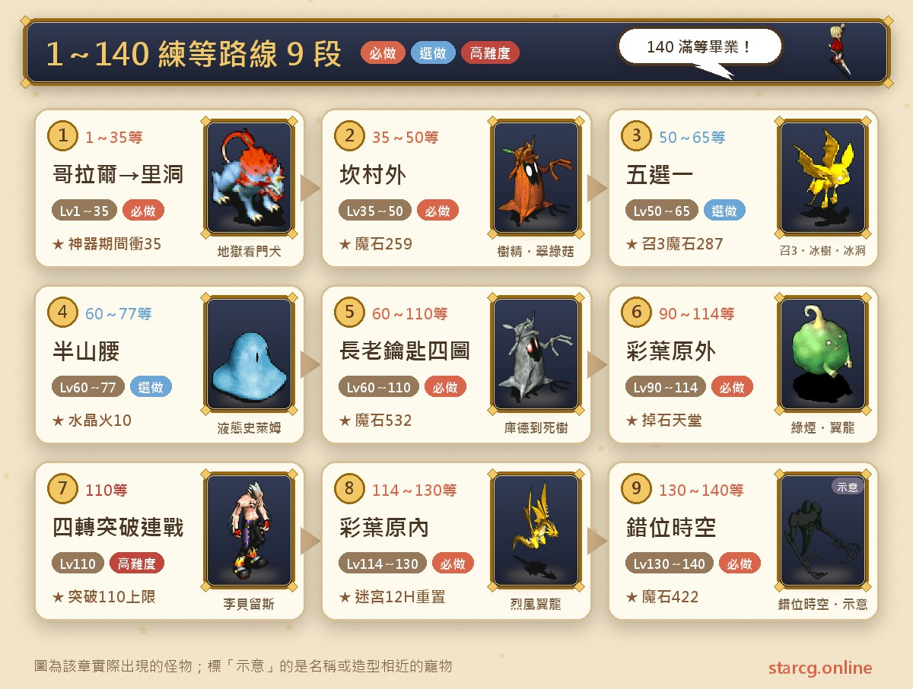
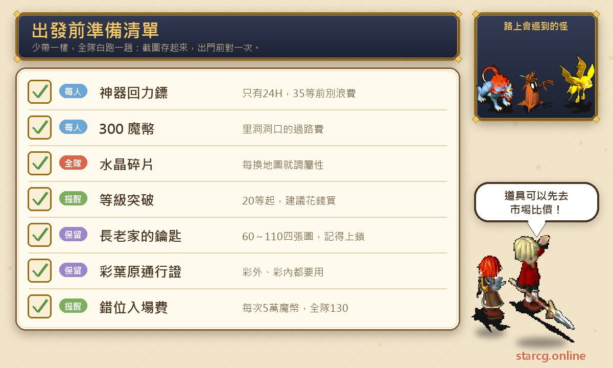
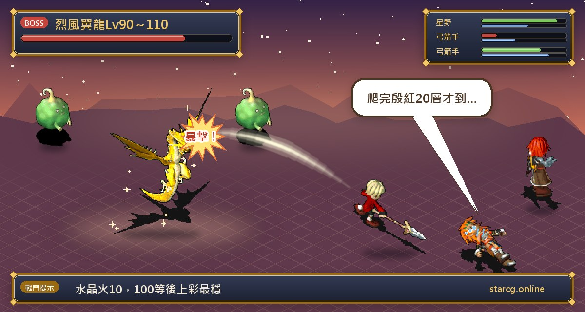

크로스게이트 레벨업에서 가장 많이 막히는 건 몬스터가 세서가 아니라 「다음엔 어느 맵으로 가야 하지?」예요. 이 글은 저희 사이트가 정리한, 실제로 키워 본 루트를 1레벨부터 140레벨 만렙까지 순서대로 담았어요. 초반에는 신기 부메랑으로 코랄 마을(哥拉爾鎮)과 리동(里洞)에서 35레벨까지 달리고, 중반에는 칸나베라 마을, 소환 3(召3), 얼음 동굴(冰洞), 반산 중턱(半山腰) 중에서 필요에 따라 고르고, 60레벨 이후에는 장로 집 열쇠로 쿠드, 범사마귀, 호넷, 죽은 나무 네 맵을 열어요. 90레벨 이후에는 채엽원(彩葉原)에 들어가고, 110레벨에 4차 돌파를 한 뒤, 마지막으로 130레벨에 StarCG의 새 맵 「어긋난 시공(錯位時空)」으로 옮겨 140레벨에서 졸업해요.

구간마다 레벨, 장소, 추천 수정 속성, 마석 가격, 먼저 풀어야 할 퀘스트를 적었어요. StarCG는 水藍魔力, 初心魔力寶貝와 사냥터와 퀘스트 흐름이 대체로 같지만, 「레벨 돌파」「혈마지」「미궁 리셋 시간 연장」「어긋난 시공」은 StarCG 고유 설계라 다른 버전이라면 게임 안 내용을 기준으로 보세요.

> 이 글은 저희 사이트가 정리한 1~140 레벨업 정리 글을 중심으로, [StarCG 공략 사이트](https://guide.starcg.net/)의 「사냥터」 페이지와 사이트의 기존 퀘스트 공략을 대조해 새로 썼어요. 정리 글과 공략 사이트가 다른 부분(레벨 구간, 수정 속성, 좌표 등)은 둘 다 적었고, 양쪽 모두 없는 수치는 적지 않았어요. 게임 업데이트로 내용이 바뀔 수 있으니 게임 안 내용을 기준으로 보세요.

## 1~140 레벨업 루트 총정리표

먼저 전체 루트를 표 하나로 볼게요. 레벨 구간은 레벨업 정리 글 기준이고, 괄호 안은 공략 사이트 사냥터 페이지의 표기예요. 둘이 다를 때는 함께 참고하세요.

| 레벨 구간 | 장소 | 수정 속성 | 마석 가격 | 조건 |
|---|---|---|---|---|
| 1~9 | 쿠루크스섬 코랄 마을 문 밖 | 땅 5 물 5 | 공략 사이트 미기재 | 없음 |
| 9~35/40 | 아노만 성 밖 리동(공략 사이트 1~35) | 땅 5 물 5(공략 사이트: 레벨 억제) | 96G/150G | 1인 300마폐 통행료 |
| 35~50 | 칸나베라 마을 밖(공략 사이트 35~42) | 아무거나 | 259G | 길목을 지나 칸나베라에 등록 |
| 50~65 | 얼음 나무(공략 사이트 45~60) | 땅 10 | 마석 없음 | 불가사의 3: 슬라임의 추억 |
| 50~65 | 소환 3 저주의 미로 31층 | 아무거나(공략 사이트: 불) | 287G | 앞 수호자 셋을 잡아 성조 획득 |
| 50~65 | 마이니 마을 밖/개룡 지역 | 물 10/땅 10 | 287G | 없음 |
| 53~65 | 얼음 동굴(공략 사이트 52~65) | 아무거나 | 341G | 신수+유다, 갈 때마다 요대 처치 |
| 60~77 | 반산 중턱(공략 사이트 67~74) | 불 10 | 205G(공략 사이트) | 반산 시리즈 선행 |
| 60~110 | 장로 열쇠: 쿠드, 범사마귀, 호넷, 죽은 나무 | 땅 10/불 10/물 10/바람 10 | 532G | 사라진 왕자(장로 집 열쇠) |
| 90~114 | 채엽원 바깥 | 불 10 | 532G | 채엽원 통행증 |
| 110 | 4차 돌파 연전 | — | — | 110레벨 사범, 도전 입장권 |
| 114~130 | 채엽원 안쪽 | 불 10 | 532G | 채엽원 통행증 |
| 130~140 | 어긋난 시공 | 불 5 바람 5 | 422G | 파티 전원 130레벨 이상, 입장료 5만 마폐 |

한 줄로 정리하면 **신기가 있을 때 35까지, 50~65는 필요에 따라 맵 하나, 60 이후는 장로 열쇠로 110까지, 4차 돌파 뒤 채엽원에서 130까지, 마지막으로 어긋난 시공에서 140 만렙이에요.**

## 출발 전에 챙길 것

이 루트는 맵을 계속 바꾸기 때문에 몇 가지를 미리 챙겨 두세요.

- **신기 부메랑**: 신기 상자는 무조건 부메랑이에요. 신기는 24시간뿐이라 그동안 취직이나 퀘스트에 시간을 쓰지 말고, 신기가 끝나기 전에 최소 35레벨까지 올리는 게 목표예요. 상자 여는 법은 [초보 1~40레벨 속성 육성 공략](/ko/posts/newbie-leveling-guide/)을 보세요.
- **가입 방법**: 레벨업 정리 글에 따르면 추천 코드로 가입하면 월간 카드 3일과 경험치 반지 24시간을 받고, 일반 가입은 월간 카드 2일에 경험치 반지가 없어요. 사이트 위쪽의 가입 버튼이 추천 코드가 들어간 링크라서, 아직 계정이 없다면 거기서 가입하면 돼요.
- **수정 조각**: StarCG는 조각으로 수정 속성을 바로 바꿀 수 있어요. 이 루트는 땅 5 물 5, 땅 10, 물 10, 불 10을 거쳐 불 5 바람 5까지 바꾸니 조각을 늘 챙겨 두세요.
- **레벨 돌파 비용**: StarCG는 20, 40, 60, 80, 90레벨에 돌파가 있고, 레벨업 정리 글은 돌파 보스전에 시간을 쓰지 말고 무조건 돈으로 통과를 사라고 추천해요.
- **혈지 보충**: 혈지가 모자라면 22레벨 이상부터 게임 노점 시장에서 물약을 사서 혈지에 넣을 수 있어요. 사기 전에 사이트의 [시세 검색](/ko/market/)으로 시세를 먼저 확인해 보세요.
- **통행증 두 개**: 60레벨 이후에 쓰는 「장로 집 열쇠」와 90레벨 이후에 쓰는 「채엽원 통행증」은 받으면 잠금을 걸어 보관하세요.

## 1~9레벨: 쿠루크스섬 코랄 마을 문 밖

1. 오른쪽 위 지도를 눌러 **쿠루크스섬(庫魯克斯島)**으로 날아가요.
2. 코랄 마을의 아무 문이나 골라 문 밖으로 이동한 뒤 바로 사냥해요. 수정은 **땅 5 물 5**를 추천해요.
3. 9레벨이 되면 오른쪽 위 귀환을 누르고, 동쪽·서쪽 병원 옆 **큐(水藍鼠)**에게서 마석을 한 번에 팔아요.

이 구간은 레벨업 말고도 **돈 모으기**가 목적이에요. 다음 리동은 1인당 300마폐 통행료를 받으니, 마석을 판 뒤 **모든 캐릭터가 300 이상** 가지고 있는지 확인하세요. 돈이 고르지 않으면 거래나 계정 은행으로 나눠 주면 돼요. 공략 사이트의 「최적 사냥 순서」는 코랄 마을 밖을 1~11레벨로 적어 두어서 거의 같아요.

## 9~35/40레벨: 신기 부메랑이 끝날 때까지 리동

리동은 이 루트 초반의 핵심 사냥터예요. 레벨업 정리 글은 **신기 부메랑이 끝날 때까지 계속 사냥**하라고 하고, 대략 35~40레벨이에요. 수정은 똑같이 땅 5 물 5예요.

**가는 법**: 공략 사이트에는 아노만 성 서문(21, 126)으로 나가 1인 300G 통행료를 내고 **노란 전송석**에 들어가면 리동이라고 나와요.

**공략 사이트 자료**: 몬스터는 20~24레벨의 워타이거(虎人, 땅 3 바람 7), 켈베로스(地獄看門犬, 물 6 불 4), 크리터(寶貝炸彈, 물 8 불 2), 후르츠 배트(水果蝙蝠, 땅 4 바람 6)이고 마석은 96G/150G예요. 깊이 갈수록 몬스터 레벨이 올라가서 1F 20레벨, 2~4F 21레벨, 5~7F 22레벨, 8~11F 23레벨, 12~14F 24레벨이에요. 공략 사이트의 수정 칸은 「레벨 억제」로 적혀 있어 정리 글의 땅 5 물 5와 달라서 함께 적어요.

**이 구간에서 주의할 것**:

- **20레벨 돌파**: 캐릭터가 20레벨이 되면 경험치가 멈추니 왼쪽 위 캐릭터 초상화를 눌러 돌파에 들어가요. 레벨업 정리 글은 **무조건 돈으로 통과**를 사라고 추천해요. 신기 시간이 아까우니까요.
- **마석이 차면 바로 귀환해서 팔기**: 가방이 마석으로 차면 귀환해서 큐에게 팔고 다시 와서 사냥해요.
- **혈지가 모자랄 때**: 22레벨 이상부터 게임 시장에서 물약을 사서 혈지에 넣을 수 있어요.

남은 시간 0분 전송석, 혈지 관리 같은 자세한 내용은 [초보 1~40레벨 속성 육성 공략](/ko/posts/newbie-leveling-guide/)을 보세요.

## 35~50레벨: 칸나베라 마을 밖

신기가 끝나면 다음은 **칸나베라 마을 밖**이에요. 오른쪽 위 지도에서 **미네갈섬(米內葛爾島)**을 골라 **칸나베라 마을(坎那貝拉村)**로 바로 날아가지만, 먼저 등록을 해야 바로 날아갈 수 있어요.

1. 미네갈섬에서 먼저 **아케루파 마을(阿凱魯法村)**로 가요.
2. **길목(路霸)**을 지난 뒤 칸나베라 마을에서 등록하면 그다음부터 바로 날아갈 수 있어요.

길목은 직접 싸워도 되고(흐름은 [아케루파 마을 퀘스트 공략](/ko/posts/akerfa-quest-guide/)의 길목의 아드키무와 「대지의 결정」 참고), 공략 사이트에는 대지의 결정을 가진 유저에게 안내를 부탁하거나 공용 계정을 쓰는 방법도 나와요. 레벨업 정리 글에도 공식 쪽에서 길목 통과용 공용 계정 캐릭터를 제공한다고 적혀 있어요. 그리고 공략 사이트에는 칸나베라의 **전송 지점은 40레벨부터 쓸 수 있다**고 적혀 있으니 레벨이 모자라면 주의하세요.

칸나베라에서는 **수정 아무거나, 아무 문 앞에서나 사냥**하면 돼요. 트렌트와 버섯은 맞아도 아프지 않고, 마석 259에 소모도 적어서 잘 올라요. 공략 사이트에 나온 몬스터는 40~42레벨의 트렌트(樹精, 불 6 물 4)와 폴카펑거스(翠綠菇, 땅 6 바람 4)이고 권장 레벨은 35~42예요.

**신기가 끝나면 취직해도 돼요**: 정리 글은 **성직자 1+궁술사 4**로 시작하고, 이후 해저 동굴을 지나 난사(亂射)를 배우는 걸 추천해요. 직업별 취직 흐름은 [직업 취직 퀘스트 공략](/ko/posts/job-change-quest-guide/)을 보세요.

## 50~65레벨: 다섯 가지 중에서 골라요

이 구간은 **절대적인 정답이 없어요**. 레벨업 정리 글은 다섯 가지를 들었으니 경험치, 마석, 편의성 중 무엇을 원하는지에 따라 고르세요.

| 선택지 | 몬스터 레벨 | 수정 | 마석 | 장점 | 단점/조건 |
|---|---|---|---|---|---|
| 얼음 나무 | 55(고정) | 땅 10 | 없음 | 아주 잘 오름 | 마석 없음, 술 창고 미궁, 슬라임의 추억 필요 |
| 소환 3 | 47~49 | 아무거나 | 287G | 잘 오르고 마석 천국 | 앞 수호자 셋, 레벨이 낮으면 장비와 물약 필수 |
| 마이니 마을 밖/개룡 지역 | 45~46 | 물 10/땅 10 | 287G | 편함, 퀘스트·미궁 불필요 | 마이니는 몬스터가 방어를 자주 하고 마을 병원 회복 불가 |
| 얼음 동굴(53 이후) | 57~59 | 아무거나 | 341G | 잘 오르고 마석 많음 | 신수+유다 필요, 갈 때마다 요대 처치 |
| 칸나베라 계속 | 40~42 | 아무거나 | 259G | 마법 가방 재료 채집 가능 | 경험치가 느린 편 |

### 얼음 나무(땅 10): 경험치는 최고, 마석은 없음

얼음 나무(冰樹)는 **고정 55레벨 몬스터**라 아주 잘 오르지만 **마석이 없고** 술 창고 미궁을 올라야 해요. 입장 조건은 「불가사의 3: 슬라임의 추억(史萊姆的回憶)」이고, 정리 글에는 11단계까지 풀어 **모두 손전등을 받아야** 한다고 나와요. 사이트의 [불가사의 퀘스트 공략](/ko/posts/wonder-quest-guide/)에서는 손전등을 다미다 술집 객실의 머리맡 서랍에서 받고, 손전등만 있으면 얼음 나무 구역을 반복해서 드나들 수 있다고 적혀 있어요(자료마다 단계 번호를 나누는 방식이 다르니 손전등을 받았는지를 기준으로 보세요).

공략 사이트 자료는 45~60레벨, 드라이어드(冰冷樹精, 물 7 불 3) 55레벨, 수정 땅 속성, 마석이 없어 마음 놓고 사냥할 수 있다는 내용이고, 6레벨 부메랑과 1~2레벨 초강력 회복(超補)을 추천해요.

### 소환 3(수정 아무거나): 손꼽히는 마석 천국

소환 3은 3차 전직 「저주의 미로(詛咒的迷宮)」의 **지하 31층**이에요. 몬스터는 47~49레벨, 마석 287로, 정리 글은 「크로스게이트에서 손꼽히는 마석 천국」이라고 해요.

1. 먼저 앞의 수호자 셋을 잡고 성조(聖詔)를 받아요. [3차 전직 공략](/ko/posts/job-advance-3-quest-guide/)에 따르면 성조를 더블클릭하면 해당 층으로 바로 날아갈 수 있어요.
2. 정리 글에 따르면 **한 번 풀면 8번 반복해서 갈 수 있어요**.
3. 레벨이 높지 않으면 **꼭 장비를 입고 물약을 챙겨** 가세요.

**입장 조건은 두 가지로 적혀 있어요**: 레벨업 정리 글과 [여는 자 퀘스트 공략](/ko/posts/opener-quest-guide/)은 StarCG에서는 신수+유다만 끝내면(왕궁 불필요) 소환 3에 갈 수 있다고 하고, 사이트의 3차 전직 공략은 공략 사이트를 따라 「왕궁 계급+여는 자 칭호」로 적었어요. 게임 안 접수 조건을 기준으로 보세요.

공략 사이트는 이곳을 펫 사냥터 「성소환 3(聖召3)」으로 적었어요. 44~49레벨, 몬스터는 쁘띠 가고(迷你石像怪, 불 3 바람 7)와 크리터(물 8 불 2), 수정은 불, 입구는 아바니스 마을이에요. 저주의 미로는 랜덤 미궁이라 사이트의 [미궁 계단 찾기](/ko/maze/)로 걸으면서 기록할 수 있어요.

### 마이니 마을 밖(물 10) 또는 개룡 지역(땅 10): 가장 편함

두 곳 모두 45~46레벨 몬스터에 마석은 보통(287)이고, **가장 큰 장점은 편하다는 것**이에요. 퀘스트도 미궁도 필요 없어요.

- **마이니 마을(麥尼村) 밖**: 오른쪽 위 지도로 쿠루크스섬에 가서 코랄 동문에서 다리 북쪽 병사에게 가 대화한 뒤 다리를 건너고, 마이니 마을 입구까지 길찾기로 가서 사냥해요. 몬스터가 방어를 자주 하고 **마을 병원에서 회복이 안 되니** 석화 저항을 배우는 걸 추천해요. 공략 사이트의 몬스터는 45~46레벨 후르츠 배트(땅 4 바람 6)와 강방패(強盾, 물 4 불 6)이고, 몬스터 체력이 낮다고 적혀 있어요.
- **개룡 지역(狗龍區)**: 마이니 마을에서 더 오른쪽 아래, 루미 마을(魯米村) 밖이에요. 정리 글은 마이니보다 잘 오르지만 멀다고 하고, 루미 마을로 전송한 뒤 서문으로 나가도 돼요. 공략 사이트에는 개룡 지역이 없어요.

### 얼음 동굴(53레벨 이후): 잘 오르고 마석도 많음

얼음 동굴은 57~59레벨 몬스터에 잘 오르고 마석도 많아요(341). 소환 3처럼 먼저 신수+유다를 끝내야 하고, **갈 때마다 요대(依代)를 잡아야** 해서 석화 저항을 추천해요. 정리 글에는 4단계까지만 풀면 된다고 나와요. 얼음 동굴이 있는 퀘스트는 시공의 문 2 「얼음의 감옥(冰雪的牢籠)」이에요. 사이트의 [시공의 문 퀘스트 공략](/ko/posts/time-gate-quest-guide/)에서는 3단계에 봉인된 제단에서 요대를 잡고, 4단계에 아스티아 신관이 프리보로로 보내 준 뒤 얼음 동굴로 들어가서 「4단계까지」라는 설명과 맞아요.

공략 사이트 자료는 52~65레벨, 몬스터 아에로(黑暗鳥人, 땅 5 바람 5)와 레이디큐르(妖狐, 물 5 불 5), 수정 아무거나, 입구 티나 마을이고, 선행 퀘스트는 「얼음과 눈의 감옥 성(冰雪的牢城, 요대 처치 필요)」으로 적혀 있어요. 몬스터 상태 이상이 많으니 고급 활로 한 턴에 정리하고 1~2레벨 초강력 회복을 함께 쓰라고 해요.

### 칸나베라에서 65까지 계속

퀘스트도 미궁도 싫다면 **칸나베라에서 65까지 계속 사냥**해도 돼요. 무과금 유저에게는 칸나베라 밖에서 마법 가방 재료를 모두 채집할 수 있다는 장점도 있어요.

**물 동굴(水洞)은 비추천**: 마석이 없고 어렵고 몬스터가 MP를 흡수해요. 공략 사이트도 물 동굴은 마석이 없고, 몬스터는 54~62레벨 무속성 크라스탈(水晶螃蟹), 캣시(貓妖), 스파이브(水藍鳥魔)라고 적어요.

## 60~77레벨: 반산 중턱(불 10)

반산 중턱 수정은 **불 10**이에요. 반산 몬스터가 72~74레벨이라 보통 **67레벨 이상**에서 오는 걸 추천하지만, 얼음 동굴이나 얼음 나무가 귀찮다면 60레벨에 일찍 와도 돼요.

공략 사이트 자료: 권장 67~74레벨, 몬스터는 72~74레벨 워타이거(땅 3 바람 7), 피그미 배트(迷你蝙蝠, 불 6 바람 4), 우즈(液態史萊姆, 땅 1 물 9), 날카로운 이빨(利牙, 불 1 바람 9), 마석 205G, 입구는 티나 마을 오른쪽 위와 판부르크(法蘭城) 서문이고, 몬스터가 약해 사냥하기 좋다고 해요.

선행 퀘스트는 표기가 여러 가지예요. 공략 사이트 사냥터 페이지는 「반산 1: 방황하는 망령」을 적고, 반산 5 완료 후 조건도 함께 적었어요. 사이트의 [반산 퀘스트 공략](/ko/posts/halfmountain-quest-guide/)은 반산 3까지 끝내면 반산 중턱 사냥 루트를 쓸 수 있다고 적었어요. 사냥만 할 거라면 반산 1~3을 먼저 끝내 두는 게 가장 확실해요.

## 60~110레벨: 장로 열쇠 시리즈 맵 네 곳

「사라진 왕자(消失的王子)」를 끝내고 **장로 집 열쇠**를 받으면 레오나 마을 장로 집 뒤의 얼음의 신전과 프리드 섬에 갈 수 있어요. 이 일대 네 맵은 **마석이 모두 532**이고, 60레벨부터 110레벨까지 이어서 키울 수 있어요.

| 맵 | 정리 글의 입장 레벨 | 캐릭터 수정 | 공략 사이트 자료 |
|---|---|---|---|
| 쿠드 | 60 이후 | 땅 10 | 따로 사냥터로 적지 않음 |
| 범사마귀 | 75 이후 | 불 10 | 77~82레벨, 워타이거와 버그 리퍼(螳螂) 80~82레벨, 수정 불 또는 바람 |
| 호넷 | 80 이후 | 물 10 | 82~87레벨, 호넷과 니들리암(兔耳仙人掌) 85~87레벨, 수정 물 |
| 죽은 나무 | 85 이후 | 바람 10 | 87~92레벨, 페트로팀버(死亡樹精)와 스켈레톤(骷髏戰士) 90~92레벨, 수정 바람, 100까지 사냥 가능 |

**가는 법**: 오른쪽 위 작은 지도로 **제놈 섬(傑諾姆島)**에 가서 레오나 마을의 **토마스 장로 집**(69, 54)에서 **전송석 사람**(17, 11)을 조사해 얼음의 신전에 들어가고, (18, 35)의 문으로 나가요. 공략 사이트의 좌표는 토마스의 집(69, 53), 전송석(17, 12)이라 조금 달라서 함께 적어요. 레오나 마을에 처음 갈 때는 배를 타야 하는데, 방법은 [크레이 마을 퀘스트 공략](/ko/posts/kre-quest-guide/)의 「동쪽 섬으로」를 보세요.

사라진 왕자 퀘스트 흐름, 휴버트(修伯特) 공략, 맵별 몬스터 레벨은 [사라진 왕자 퀘스트 공략](/ko/posts/lost-prince-quest-guide/)에 정리했어요. 열쇠를 받으면 **꼭 잠금을 거세요**. 열쇠를 잃으면 퀘스트를 처음부터 다시 해야 해요.

## 90~114레벨: 채엽원 바깥

90레벨 이후에는 **채엽원(彩葉園) 시리즈 맵**에 들어갈 수 있어요. 먼저 퀘스트로 「**채엽원 통행증**」을 받아야 하는데, 이건 레오나 마을 「채초엽의 사랑(彩葉草之戀)」 중간 보상이에요. 사냥만 할 거라면 일기 세 권으로 통행증을 받는 데까지만 하면 되고, 흐름은 [레오나 마을 퀘스트 공략](/ko/posts/leona-quest-guide/)을 보세요. 채엽원 바깥과 안쪽 모두 마석은 **532**예요.

**채엽원 바깥(90~114레벨, 불 10)**은 정리 글이 말하는 **마석 천국**이에요. 몬스터는 90~110레벨이라 보통 100레벨 이후에 올라가는 걸 추천하지만, 마석을 일찍 모으고 싶다면 90레벨에 가도 돼요.

**단점은 진홍 20층을 올라야 한다는 것**이에요. 레오나 마을 공략에는 드위트섬(德威特島, 440, 483)에서 20층짜리 「진홍의 골짜기(殷紅的山谷)」로 들어가며, 길에 있는 트렌트가 장비를 망가뜨린다고 적혀 있어요. 오르기 귀찮다면 **상점(商城)에서 채엽원 바깥 전송 두루마리(1,500晶)**를 사서 바로 날아갈 수 있어요.

공략 사이트는 이곳을 「채엽원(구름다리 뒤, 수정 미궁 진입 전)」으로 적었어요. 권장 100~110레벨, 몬스터는 90~110레벨 녹색 연기(綠煙, 땅 7 바람 3)와 베인 드래곤(烈風翼龍, 바람 10), 수정 불, 마석 532G예요. 공략 사이트는 마지를 가득 채우고, 몸에 요리를 가득 넣고, 민첩을 300 이상 찍으라고 하고, 산을 오를 때는 다수 대상 최고 레벨 기술로 한 턴에 정리해 트렌트가 장비를 망가뜨리지 못하게 하라고 해요.

## 110레벨: 4차 돌파 연전

채엽원 바깥이나 죽은 나무에서 **110레벨**까지 키우면 경험치가 상한에 걸려서, 더 올리려면 **4차 돌파 연전**을 해야 해요. 정리 글은 자주 쓰는 공략 두 가지로 **성직자 1+격투가 4**, 또는 **성직자 1+무술사 1+아무 직업 3**을 들었어요.

[4차 전직 공략](/ko/posts/job-advance-4-quest-guide/)에 따르면 조건은 사범(師範) 계급과 도전 입장권이고, 5연전 동안 물약으로 회복할 수 없어요. 그리고 **반드시 110레벨에서 이겨야** 110 상한도 함께 돌파돼요. 109레벨 이전에 이기면 4차만 오르고, 110레벨이 된 뒤 다시 도전해야 해요. 공략 사이트도 이것이 마폐나 명성으로 돌파할 수 없는 유일한 레벨 관문이라고 적었어요. 5전의 구성, F4 처치 순서와 스탯은 그 글에 있어요.

돌파한 뒤에는 **채엽원 바깥에서 114레벨까지** 올리고 채엽원 안쪽으로 옮겨요.

## 114~130레벨: 채엽원 안쪽

**채엽원 안쪽(114~130레벨, 불 10)**은 몬스터 119~124레벨, 마석 532예요. StarCG는 이곳의 **미궁 리셋 시간을 12시간으로 늘렸고**, 채널별 리셋 시간은 이래요.

| 채널 | 리셋 시간 |
|---|---|
| 1채널 | 오전·오후 10시 |
| 2채널 | 오전·오후 3시 |
| 3채널 | 오전·오후 8시 |

미궁은 층이 높을수록 몬스터 레벨도 높아요. 정리 글은 1F 119레벨, 2F 120레벨, 18F 124레벨로 적었고, 공략 사이트의 「채엽원(수정 미궁 진입)」은 더 자세하게 1F 119, 2~5F 120, 6~9F 121, 10~13F 122, 14~17F 123, 18~20F 124레벨로 적었어요. 몬스터는 똑같이 녹색 연기와 베인 드래곤, 수정은 불이고, 공략 사이트의 권장 레벨은 110~120이에요. 걷기 싫다면 **채엽원 안쪽 전송 두루마리도 1,500晶**이에요.

레오나 마을 공략에서는 이 구간 입구를 구름다리(28, 58)에서 경비병과 대화해 진홍 산길로 들어가고, 다리를 건넌 뒤 (66, 28)의 전송석으로 20층 채초원 미궁에 들어간다고 적었어요. 랜덤 미궁은 [미궁 계단 찾기](/ko/maze/)로 기록할 수 있어요.

## 130~140레벨: 새 맵 「어긋난 시공」

채엽원 안쪽에서 **130레벨**까지 올리면 StarCG의 새 맵 「**어긋난 시공(錯位時空)**」으로 옮겨 140 만렙까지 키우고 졸업해요.

1. **판부르크 휴게실**(36, 21)에서 전송해 들어가요.
2. 조건은 **파티 전원 Lv130 이상**이에요.
3. **입장료는 매번 50,000마폐**이고 파티장이 내요.

**맵 자료**: 몬스터 135~138레벨, 마석 422, 정리 글에 따르면 드롭률이 채엽원 바깥, 소환 3과 같은 **마석 천국**이에요. 수정은 **불 5 바람 5**를 추천해요. 몬스터가 **네 가지 속성**이고 한 전투에 **최대 10마리**가 나올 수 있으니, 보급과 화력을 잘 준비하고 가세요.

공략 사이트의 사냥터 페이지에는 아직 어긋난 시공이 없어서, 몬스터 이름 등 나머지 자료는 공략 사이트 미기재예요. 게임 안 내용을 기준으로 보세요.

## 1~140 레벨업 자주 묻는 질문

**신기 부메랑이 끝나기 전에 몇 레벨까지 올려야 해요?** 정리 글의 목표는 최소 35레벨이에요. 신기는 24시간뿐이니 그동안 취직이나 퀘스트를 하지 말고 코랄 마을과 리동에서 사냥에만 집중하세요.

**50~65레벨은 어디가 제일 좋아요?** 절대적인 정답은 없어요. 경험치는 얼음 나무(마석 없음), 마석은 소환 3이나 얼음 동굴, 귀찮은 게 싫으면 마이니 마을 밖이나 개룡 지역, 무과금으로 마법 가방 재료를 모으려면 칸나베라에 남으세요. 유일하게 비추천하는 곳은 물 동굴이에요.

**채엽원 바깥은 꼭 진홍 20층을 올라야 해요?** 아니에요. 상점에서 채엽원 바깥 전송 두루마리를 사서 바로 날아갈 수 있고 가격은 1,500晶이에요. 채엽원 안쪽도 같은 가격의 전송 두루마리가 있어요.

**110레벨에서 경험치가 안 올라요.** 110레벨 상한이에요. 4차 돌파 연전을 해야 하고, 꼭 110레벨이 된 상태에서 이겨야 돌파돼요.

**어긋난 시공은 뭘 준비해야 해요?** 파티 전원 130레벨 이상, 파티장에게 입장료 5만 마폐가 있어야 하고 수정은 불 5 바람 5를 추천해요. 몬스터가 네 가지 속성에 한 전투 최대 10마리라 준비를 단단히 하세요.

## 정리: 구간마다 맵 하나만 기억하기

1~140 루트가 길어 보여도 구간마다 핵심 하나만 기억하면 돼요. **신기가 있을 때 땅 5 물 5로 코랄과 리동에서 35까지, 칸나베라에서 50까지, 50~65는 얼음 나무·소환 3·마이니 마을·얼음 동굴·칸나베라 중 하나, 60 이후는 장로 열쇠로 쿠드·범사마귀·호넷·죽은 나무 순서로, 90 이후 채엽원 바깥에서 마석을 모으고, 110에 4차 돌파, 114에 채엽원 안쪽, 130에 어긋난 시공에서 140까지예요.** 맵을 바꿀 때 수정 속성을 먼저 맞추고 조건 퀘스트도 미리 풀어 두면 헛걸음을 많이 줄일 수 있어요.

사냥터별 몬스터와 마석은 [StarCG 공략 사이트](https://guide.starcg.net/)의 사냥터 페이지에서 볼 수 있어요. 사이트의 [펫 도감](/ko/pets/)에서 사냥용 펫을 고르고, [데미지 계산기](/ko/damage/)로 한 턴에 정리할 수 있는지 계산해 보세요.

## 더 읽어 보기

- [초보 1~40레벨 속성 육성 공략: 신기 부메랑·멀티·리동 사냥](/ko/posts/newbie-leveling-guide/)
- [사라진 왕자 퀘스트 공략: 장로 집 열쇠와 60~110 사냥터](/ko/posts/lost-prince-quest-guide/)
- [반산 퀘스트 공략: 반산 1~9 진행과 보스 정리](/ko/posts/halfmountain-quest-guide/)
- [레오나 마을 퀘스트 공략: 채초엽의 사랑과 채엽원 통행증](/ko/posts/leona-quest-guide/)
- [3차 전직 공략: 저주의 미로](/ko/posts/job-advance-3-quest-guide/)
- [4차 전직 공략: 4차 연속 전투와 110 돌파](/ko/posts/job-advance-4-quest-guide/)
