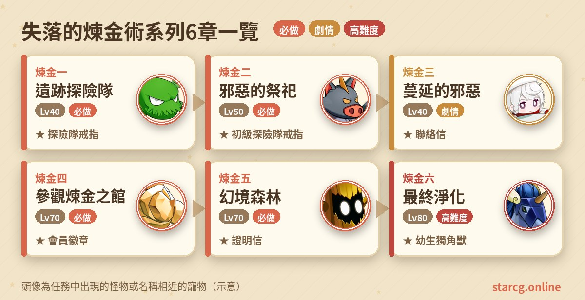
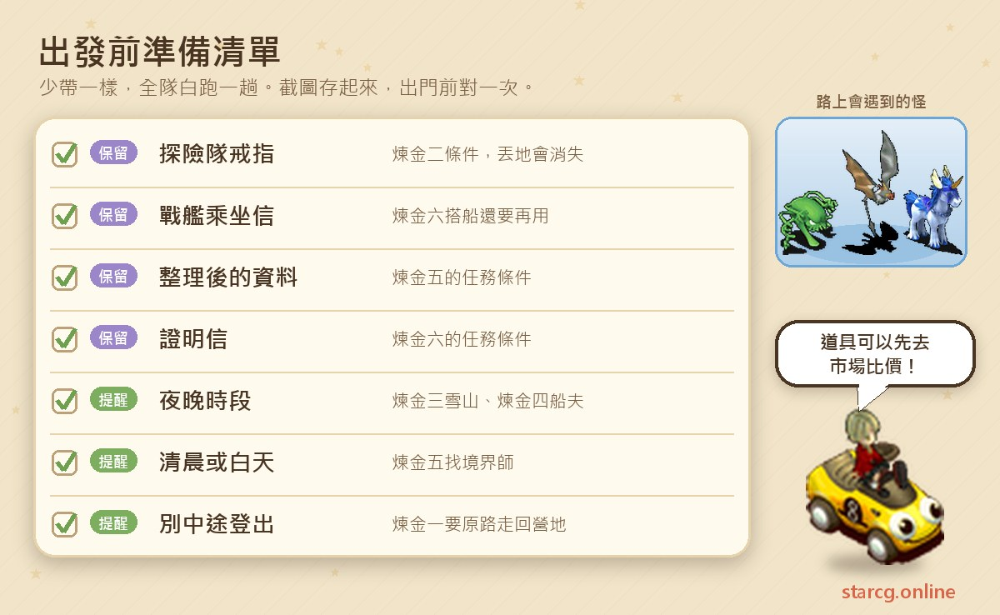
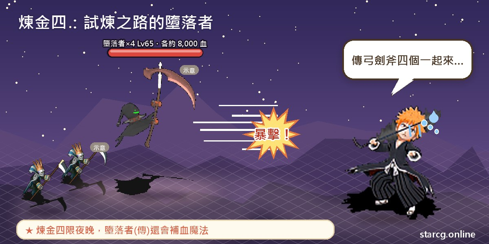
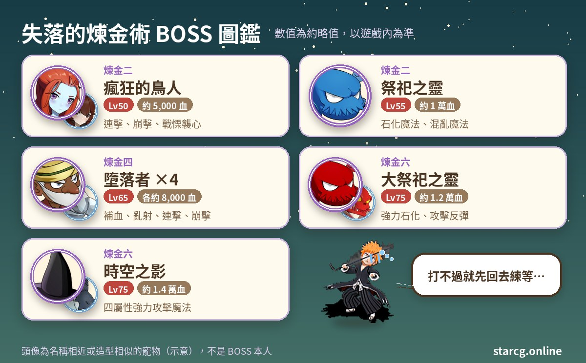

魔力寶貝的失落的煉金術系列（攻略網上也簡稱「煉金」系列），是從法蘭城謝里雅堡名人堂的探險隊開始，一路調查遺跡、荒島上的邪惡祭祀、加納村海岸的煉金之館與魔法大學的幻境森林，最後在無名神殿完成淨化的六章任務。第一章條件只要 40 級，前三章 40～50 級就能完成；從第四章開始推薦 70 級，最終章推薦 80 級。

做完的收穫有三個重點：第四章拿到的**會員徽章**讓你之後可以快速往返煉金之館；最終章的**煉金大師徽章**是 Lv.5 護身符，生命與魔力各 +150；任務最後還會直接送一隻**幼生獨角獸**。另外，第五章的境界隧道會掉「幻想碎片」，集滿 50 個也能再換一隻幼生獨角獸。不論你玩的是星詠魔力、水藍魔力還是初心魔力寶貝，失落的煉金術任務的流程都一樣，這份整理可以直接拿來對照。

> 本文整理自 [星詠魔力攻略網](https://guide.starcg.net/) 的失落的煉金術（煉金）系列頁面，並用我們自己的方式重新排序與改寫，沒有逐字照搬。BOSS 血量與數值是約略值，攻略網沒有列出的數值本文也不另外補；實際以遊戲內為準，遊戲更新後內容可能變動。

## 失落的煉金術是什麼？先看整體順序

這個系列是一條直線：每一章的獎勵，就是下一章的任務條件。煉金一給探險隊戒指，煉金二要交出它換初級探險隊戒指，煉金三再交出初級戒指換聯絡信，煉金四用聯絡信換整理後的資料，煉金五用資料換證明信，煉金六交出證明信完成淨化。**中間任何一個道具丟掉，後面就接不下去。**

| 章節 | 任務名稱 | 推薦等級 | 取得 |
|---|---|---|---|
| 煉金一 | 遺跡探險隊 | 40（條件 40） | 探險隊戒指 |
| 煉金二 | 邪惡的祭祀 | 50 | 初級探險隊戒指 |
| 煉金三 | 蔓延的邪惡 | 40 | 聯絡信 |
| 煉金四 | 參觀煉金之館 | 70（夜晚） | 整理後的資料、會員徽章 |
| 煉金五 | 幻境森林 | 70 | 證明信、境界寶石、參觀票 |
| 煉金六 | 最終淨化 | 80 | 煉金大師徽章、幼生獨角獸 |

整理成一句話就是：**前三章是 40～50 級的跑腿與小型迷宮，後三章才是真正的煉金之館與神殿戰鬥。**

## 出發前先準備好這些

失落的煉金術的戰鬥不算多，但「關鍵道具接力」和「時段限制」很容易出錯。煉金三要在夜晚上雪山之頂、煉金四要在夜晚才能找船夫、煉金五則要清晨或白天才能找境界師；煉金三拿到的戰艦乘坐信，到煉金六還要再用一次。

系列後半有好幾段 5～9 層的隨機迷宮，加上 75 級的神殿 BOSS，補血與補魔的道具要帶夠。出發前可以用本站的 [市場查價](/market/) 比較料理與藥水的攤位價格，一次買齊省得中途回城。

## 煉金一：遺跡探險隊（探險隊戒指）

推薦 40 級，條件 40 級。

1. 到法蘭城謝里雅堡名人堂（52, 61），找**工程人員**（11, 9）上到二樓。
2. 到二樓的（26, 49）房間找**探險隊聯絡員**（28, 87），選「是」，拿到「聯絡物資清單」。
3. 到法蘭城陶歐食品店（72, 104）門口找**聯絡官**（78, 106），交出清單換「物資包裹」。
4. 到莎蓮娜島（376, 298）找營地守衛，進入探險隊營地（在蒂娜村西邊）。
5. 找**物資聯絡官**（27, 17）交出包裹換「獎勵證明」，再找**探險隊長**（19, 21）選「是」，交出證明，拿到「聯絡信」與 200G。這裡選「否」的話只拿 200G，任務直接結束。
6. 找**營地守衛**（21, 14）通過柵欄，從（17, 13）的樓梯進入淺層遺跡（約 5 層隨機迷宮，40～42 級的徘徊的死靈、死靈、毒性軟泥、史萊姆）。
7. 在遺跡中繼點找**探險隊副隊長**（29, 9）選「是」，從（40, 9）的樓梯進入深層遺跡（約 3 層，42～44 級，多了徘徊的殭屍與殭屍）。
8. 在迷宮中找到隨機出現的寶箱並調查，拿到「殘破的祭品」與「殘破的紀錄」，被傳回中繼點。
9. 回營地找探險隊長（19, 21）交出兩樣東西換「發掘品包裹」，再回名人堂二樓（16, 49）房間交給**高級研究員**（14, 87），拿到探險隊戒指。

**要注意的地方**：這章沒有 BOSS 戰。從深層遺跡回營地**要原路走回去**，中途登出的話會進不了營地。探險隊戒指是 Lv.1 戒指（魅力 +5），也是下一章的條件，**丟在地上會消失**，千萬別丟。

## 煉金二：邪惡的祭祀（荒島與祭祀之靈）

推薦 50 級，條件是持有探險隊戒指。

1. 到名人堂（52, 61）找**工程人員**（11, 9）上二樓，到（16, 49）房間找**高級研究員**（12, 82），交出探險隊戒指，拿到「商船乘坐信」與「祭祀器具包裹」。
2. 到伊爾村港灣管理處找**商船船長**（13, 12），選擇同意並交出乘坐信換「船票」，被傳到坎普號補給船。
3. **等待約三分鐘**後找**商船船長**（44, 22）對話開戰。
4. 勝利後被傳到荒島碼頭，找**商船船長**（34, 22）交出船票，進入荒島探險團營地。
5. 找**探險團團長**（57, 39）選同意，交出祭祀器具包裹換「複製祭祀器」。
6. 找**營地守衛**（64, 28）進入祭祀迷宮入口，從（26, 20）的樓梯進入約 7 層的隨機迷宮。迷宮裡是 49～52 級的灰翼蝙蝠、大蝙蝠、無名的亡者、殭屍、邪能軟泥怪與史萊姆。
7. 抵達祭壇找**祭祀之靈**（15, 9）開戰。勝利後調查祭台（15, 5），交出複製祭祀器換「奇異的寶石」，被傳回迷宮入口。
8. 找**營地守衛**（22, 18）選同意回到營地，把奇異的寶石交給探險團團長，換「封印包裹」。
9. 回名人堂二樓（16, 49）房間交給高級研究員（12, 82），拿到初級探險隊戒指。

**BOSS 資料**：

| BOSS | 等級 | 約略血量 | 技能 |
|---|---|---|---|
| 瘋狂的鳥人 | 50 | 5,000 | 連擊、崩擊、戰慄襲心 |
| 瘋狂的鳥人 ×4 | 50 | 每隻 800 | 連擊、崩擊、戰慄襲心 |
| 祭祀之靈 | 55 | 10,000 | 戰慄襲心、石化魔法、混亂魔法 |
| 祭祀之靈 ×4 | 55 | 每隻 800 | 攻擊、防禦 |

**要注意的地方**：船上的瘋狂的鳥人五隻都會連擊與崩擊，祭壇的祭祀之靈則會石化與混亂魔法，帶能解異常狀態的手段會穩很多。初級探險隊戒指一樣**不能丟**，丟地也會消失。

## 煉金三：蔓延的邪惡（雪山之頂的月見草）

推薦 40 級，條件是持有初級探險隊戒指。這一章沒有 BOSS 戰，主要是跑腿。

1. 到名人堂（52, 61）找**工程人員**（11, 9）上二樓，到（36, 49）房間找**緊急聯絡官**（43, 89），交出初級探險隊戒指，拿到「戰艦乘坐信」與「緊急聯絡信」。
2. 到伊爾村港灣管理處找**戰艦艦長**（19, 11），傳送到荒島探險團營地。
3. 到隔離營房（57, 40）找**探險團醫生**（18, 16），交出緊急聯絡信換「特殊樣本」。
4. 到魔法大學內部找**高級藥劑師**（31, 46），交出特殊樣本換「收集用容器」。
5. 從莎蓮娜（84, 193）的黃色傳送石進入積雪山路，**夜晚**到雪山之頂調查**月見草**（15, 16），交出容器換「盛滿的容器」。
6. 回魔法大學找高級藥劑師（31, 46）換「分類樣本」，再找**匠師**（29, 47）換「申請信」。
7. 回法蘭城謝里雅堡二樓（**不是名人堂**）找**管理官**（57, 81），交出申請信，拿到「聯絡信」。

**要注意的地方**：戰艦乘坐信與聯絡信都是後續任務道具，**不可丟棄**——聯絡信是煉金四的條件，戰艦乘坐信到煉金六還要再用來搭船去荒島。最後一步的管理官在謝里雅堡二樓，攻略網特別標註不是名人堂，交件前先確認位置。

## 煉金四：參觀煉金之館（試煉之路與四名墮落者）

推薦 70 級，條件是持有聯絡信，並在**夜晚**進行。

1. 夜晚到加納村找**船夫**（90, 73），出示聯絡信後被送到海岸，再到（28, 33）進入煉金之館。
2. 從（11, 12）的樓梯上 2 樓，找**大煉金師**（66, 27）交出聯絡信換「通行證」。2 樓的**護士尤美兒**（55, 21）可以補血補魔。
3. 到 1 樓房間（22, 5）找**書庫管理員**（80, 70）後下樓，穿過（114, 84）的紅色傳送石進入「試煉之路」。這是 9 層的隨機迷宮，會遇到 60～62 級的魔甲守護者（金怪）與戰甲守護者（銀怪）。
4. 在迷宮深處找**墮落者**（15, 21）對話開戰。
5. 勝利後穿過柵欄，從（10, 2）進入地下書庫，調查**目錄管理者**（23, 32），交出通行證換「特殊資料」。
6. 調查傳送石（24, 10）回煉金之館，到 2 樓把特殊資料交給大煉金師（66, 27），拿到「接待信」與「整理後的資料」。
7. 找**接待員**（86, 27）交出接待信，拿到「會員徽章」與 3 張「參觀票」，任務完成。

**BOSS 資料**：墮落者一次出現四種，全部 65 級、各約 8,000 血——墮落者（傳）會補血魔法、超強風刃魔法與超強冰凍魔法；墮落者（弓）會亂射與陽炎；墮落者（劍）會連擊與諸刃；墮落者（斧）會諸刃、崩擊與乾坤一擲。四隻職業各異，有補血的「傳」也有群體輸出的「弓」，是整個系列最熱鬧的一戰。

**獎勵說明**：會員徽章是 Lv.1 護身符（魅力 +5），持有後可以直接找船夫傳到海岸、找圖書館管理員直接傳到地下書庫，省掉不少路；整理後的資料是煉金五的條件。這兩樣都**不要丟**。參觀票是支線用道具，可以丟，接待員那裡也能花 500G 買 3 張。9 層的試煉之路可以搭配 [迷宮找樓梯](/maze/) 邊走邊記樓梯。

## 煉金五：幻境森林（幼生獨角獸的碎片）

推薦 70 級，條件是持有整理後的資料。

1. 到煉金之館 2 樓找**大煉金師**（66, 27），交出整理後的資料換「接洽信」。
2. 到魔法大學內部技術室（51, 43）找**管理官**（28, 9），交出接洽信換「魔法寶石」。
3. **清晨或白天**到魔法大學（40, 26）找**境界師**切換地圖，從（17, 16）的黃色傳送石進入境界隧道（約 5 層隨機迷宮）。
4. 穿過迷宮抵達幻境森林（固定迷宮），找**幼生獨角獸**（31, 144）交出魔法寶石，拿到「獨角獸碎片」並被傳回魔法大學。
5. 回煉金之館 2 樓找**煉金師**（70, 23）交出碎片，任務完成。

**出現的魔物**：境界隧道是 65～69 級的境界追獵者（地獄妖犬）與境界巡遊者（漂浮炸彈）；幻境森林是 66～70 級的幼生獨角獸、幻境樹精（黃金樹精）與幻境靈草（妖花）。這章攻略網沒有列出 BOSS。

**幻想碎片換獨角獸**：在境界隧道擊倒魔物有機率掉落「幻想碎片」，**集滿 50 個**可以到煉金之館的**煉金獸合成大師**（16, 70）兌換幼生獨角獸。想多養一隻的人可以在這裡多刷幾趟。獎勵中的證明信是煉金六的條件，**請勿丟棄**；境界寶石完成後可以丟。

## 煉金六：最終淨化（煉金大師徽章與幼生獨角獸）

推薦 80 級，條件是持有證明信。

1. 到煉金之館 2 樓找**煉金師**（70, 23），交出證明信換「神聖的寶石」。
2. 到伊爾村港灣管理處，持**戰艦乘坐信**找**戰艦艦長**（19, 11），傳送到荒島探險團營地。
3. 找**煉金師隊長**（49, 54）拿「重要通行證」，再找**營地守衛**（64, 28）傳到無名神殿，從（144, 93）的樓梯進入神殿暗道（約 5 層隨機迷宮，64～68 級的毒蜘蛛、無名的亡者、狂暴軟泥怪）。
4. 穿過迷宮找**大祭祀之靈**（98, 60）開戰。勝利後調查水晶球（98, 49），交出神聖的寶石換「淨化之塵」。
5. 回營地找煉金術隊長（49, 54），交出淨化之塵與重要通行證換「定位寶石」。
6. 找**高級煉金術師**（48, 53）選「是」傳到無名神殿，從（35, 83）的樓梯進入第二段暗道（約 7 層，69～73 級的追獵者與遊蕩者）。
7. 穿過迷宮找**時空之影**（98, 60）開戰。勝利後調查水晶球（98, 49），交出定位寶石換「記憶水晶」。
8. 回煉金之館 2 樓找**管理官**（82, 10）交出記憶水晶，拿到「煉金大師徽章」與「領取證明」。
9. 到煉金之館 1 樓找**守衛者**（27, 19）進入房間，找**煉金獸合成大師**（22, 74）選「是」交出領取證明，拿到幼生獨角獸，任務完成。

**BOSS 資料**：

| BOSS | 等級 | 約略血量 | 技能 |
|---|---|---|---|
| 大祭祀之靈 | 75 | 12,000 | 吸血魔法、強力石化魔法、攻擊反彈 |
| 血護衛 ×4 | 75 | 每隻 4,500 | 攻擊反彈、孤注一擲型技能 |
| 時空之影 | 75 | 14,000 | 四屬性強力攻擊魔法 |
| 時空守衛 ×2 | 75 | 每隻 7,000 | 諸刃、攻擊反彈 |

**要注意的地方**：兩場戰鬥都有多名會**攻擊反彈**的敵人，物理輸出要留意被反彈的傷害；大祭祀之靈還會強力石化魔法。兩段暗道合計 5＋7 層的隨機迷宮，路線每次都不同。

**獎勵說明**：煉金大師徽章是 Lv.5 護身符、耐久 150，生命 +150、魔力 +150、魅力 +5，不可交易，**丟到地上會消失**。攻略網也註明，持有煉金大師徽章才能進入荒島探險團營地、煉金之館與幻境森林。任務完成後，戰艦乘坐信、境界寶石、會員徽章都可以丟掉。拿到的幼生獨角獸可以到本站的 [寵物圖鑑](/pets/) 查看成長與能力。

## 失落的煉金術常見問題

**失落的煉金術一定要從煉金一開始嗎？** 是的。每一章的條件都是上一章的獎勵道具，從探險隊戒指一路接力到證明信，跳不過去。

**哪些道具絕對不能丟？** 探險隊戒指、初級探險隊戒指、聯絡信、戰艦乘坐信（煉金六還要用）、整理後的資料、會員徽章、證明信。戒指類丟到地上還會直接消失。

**煉金一從遺跡回來進不了營地怎麼辦？** 攻略網提醒要原路走回營地，中途登出的話會無法進入營地。

**幼生獨角獸可以拿兩隻嗎？** 任務完成會送一隻；另外在煉金五的境界隧道收集 50 個幻想碎片，也能找煉金獸合成大師（16, 70）兌換。

**各章有時間限制嗎？** 煉金三的雪山之頂要夜晚、煉金四找船夫要夜晚、煉金五找境界師要清晨或白天，其他章節攻略網沒有標示時段。

## 小結：保管好接力道具

失落的煉金術任務的節奏很清楚：前三章在名人堂、荒島與魔法大學之間來回跑腿，後三章進入煉金之館與無名神殿，戰鬥強度從 50 級的瘋狂鳥人拉到 75 級的時空之影。只要把每一章的接力道具保管好、記住夜晚與白天的時段限制，六章就能順利走完，最後帶走煉金大師徽章和一隻幼生獨角獸。

想看原始任務頁的完整資料，可以到 [星詠魔力攻略網](https://guide.starcg.net/quests/alchemy) 查詢；也歡迎用本站的 [迷宮找樓梯](/maze/)、[寵物圖鑑](/pets/) 與 [市場查價](/market/)，把這條煉金之路規劃得更有效率。
