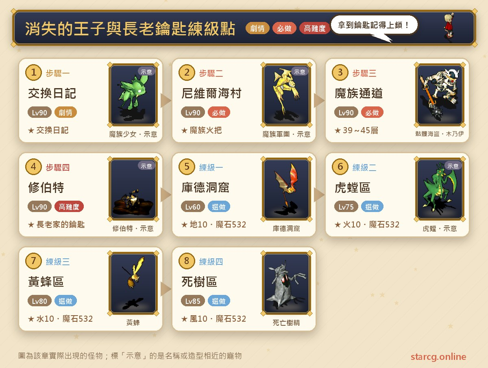
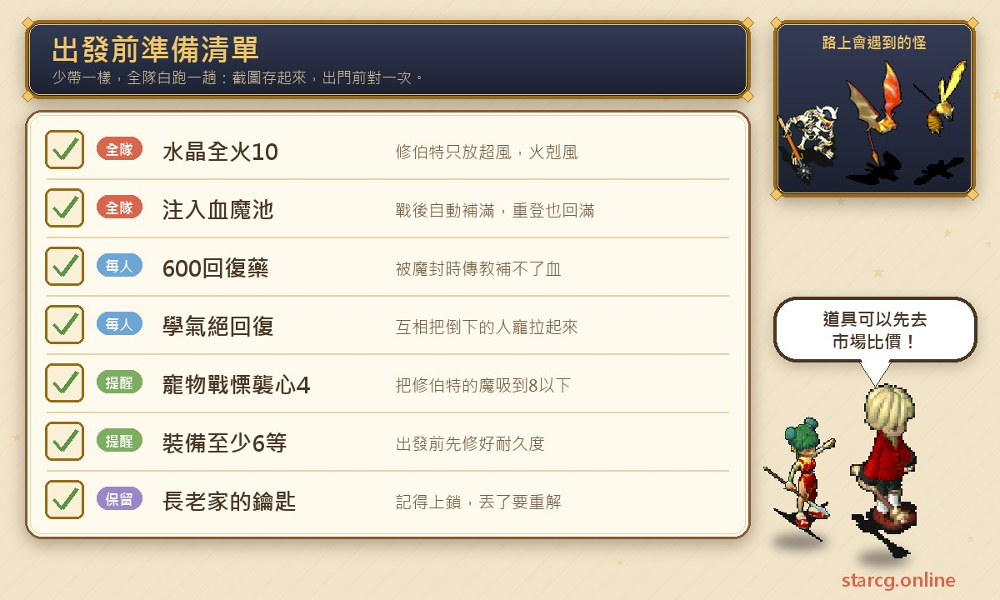
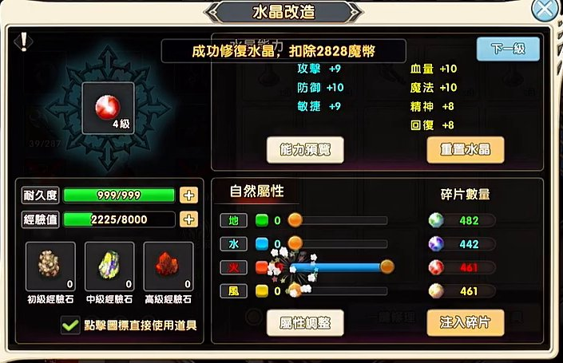
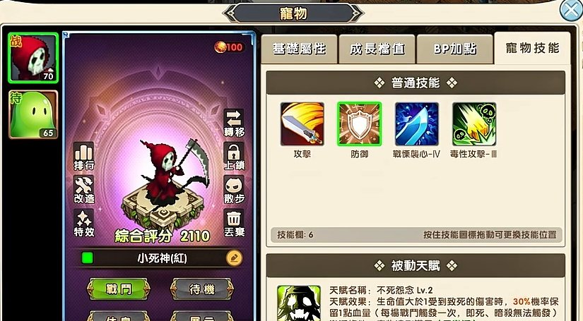
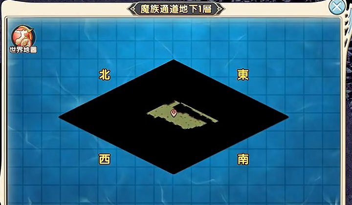
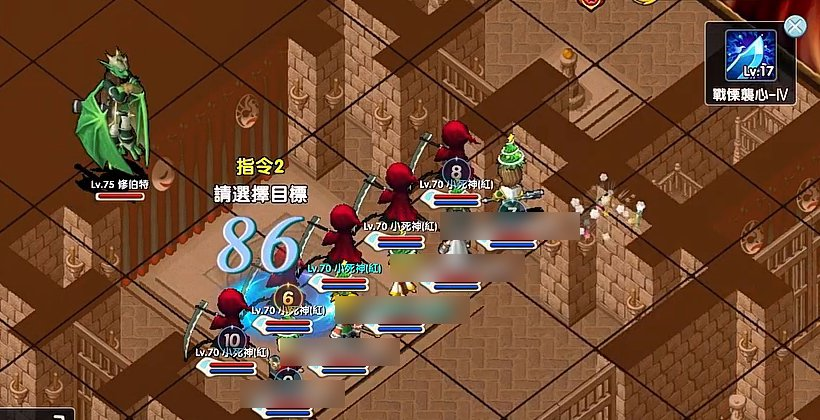
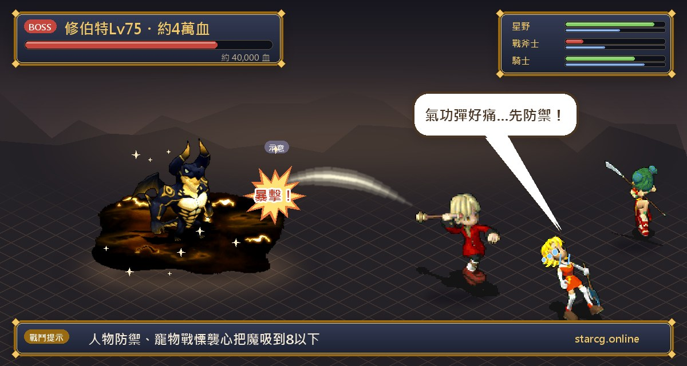
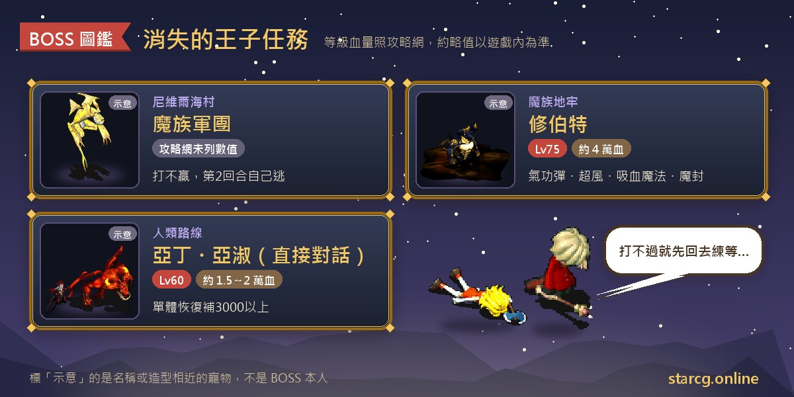
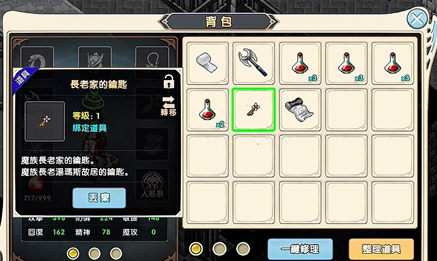
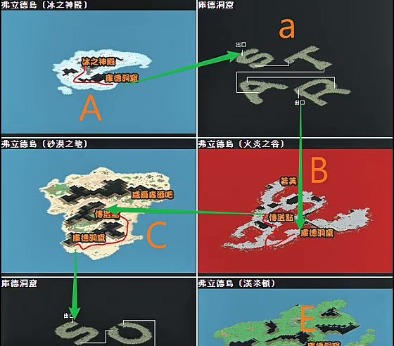

「消失的王子」是亞諾曼城最重要的一個任務：做完會拿到「長老家的鑰匙」，而這把鑰匙就是打開雷歐娜村長老家、進入冰之神殿與弗利德島一帶練級點的通行證。很多人口中的「長老鑰匙」任務指的就是它。攻略網寫的推薦等級是 90 級，但只要準備得當，實際跑過的隊伍是 72 級的四名上級忍者加一名傳教士，一樣可以打倒最後的 BOSS 修伯特。做完除了鑰匙，還能依路線拿到「偷襲密卷」或「閃躲之策」。

這篇把任務流程、魔族路線的實際走法、修伯特的打法細節，以及拿到鑰匙後 60～110 級怎麼安排練級點，整理成一篇可以邊玩邊看的攻略。不論你玩的是星詠魔力、水藍魔力還是初心魔力寶貝，消失的王子的任務流程都一樣，這份整理都能直接拿來用。

> 本文以 [星詠魔力攻略網](https://guide.starcg.net/) 的消失的王子任務頁為骨架，再加上本站實際跑過一次魔族路線的打法整理，用我們自己的方式重新排序與改寫，沒有逐字照搬。BOSS 血量與數值是約略值，實際以遊戲內為準；攻略網沒有列出的數值一律寫「攻略網未列出」，遊戲更新後內容可能變動。

## 消失的王子是什麼？先看整體順序

消失的王子沒有任務條件，分成「人類路線」和「魔族路線」兩條，兩條最後都會在魔族地牢打修伯特，也都會拿到長老家的鑰匙。開頭可以先到法蘭城西邊城門傳送石旁找**魔力小三菇莎芙特**（64, 83）聽情報，這是可以省略的劇情步驟。

| 階段 | 內容 | 推薦等級 | 取得 |
|---|---|---|---|
| 接任務 | 魔族少女拿交換日記（魔族）／比魯拿婚禮邀請函（人類） | 90 | 交換日記／婚禮邀請函 |
| 跑劇情 | 摩頓村包打聽小豆、尼維爾海村魔族軍團 | 90 | 魔族火把（魔族路線） |
| 迷宮 | 魔族通道 39～45 層（魔族）／魔族領域 20～25 層（人類） | 90 | — |
| BOSS | 魔族地牢的修伯特 | 90 | 長老家的鑰匙、偷襲密卷或閃躲之策 |
| 練級 | 雷歐娜村長老家 → 冰之神殿 → 弗利德島 | 60～110 | 魔石皆 532 魔幣 |

攻略網列出的獎勵是**寵物金幣（鎖定、限時）、長老家的鑰匙**，再加上依路線擇一的護身符：**人類路線拿「偷襲密卷」（可以增加偷襲率），魔族路線拿「閃躲之策」**。

### 人類路線還是魔族路線？

| | 人類路線 | 魔族路線 |
|---|---|---|
| 迷宮層數 | 20～25 層（實際跑過約 20 層） | 39～45 層（實際跑過是 40～45 隨機） |
| 額外戰鬥 | 克瑞村的亞丁、亞淑夫婦 | 沒有 |
| 要準備的東西 | 聖魔石，或每人一顆完全結晶體的紅寶石 | 不用準備寶石 |
| 護身符 | 偷襲密卷 | 閃躲之策 |

整理成一句話：**人類路線迷宮短，但要先處理亞丁夫婦；魔族路線不用寶石、不用多打一場，代價是迷宮多了將近一倍。**攻略網也寫到，不想做饕客兄弟、不想買聖魔石的話，可以走魔族路線。本站實際跑的就是魔族路線，下面會用它當主線，人類路線放在後面。

## 出發前先準備好這些

**水晶調成全火（火 10）**。修伯特雖然是全屬性，但牠只會放「超風」系的法術，火屬剋風，被打的傷害會小很多，這是能明顯提高勝率的一步。

**補給分兩層準備**。第一層是把回復藥注入「血魔池」：戰鬥結束後系統會自動用血池把全隊血量補滿，迷宮裡被扣的血、打輸重登後的血，都能一次回滿，實際跑過時是買 250 的藥水來注入。第二層是**每人身上帶 600 的回復藥**（400、500 的也可以），這是給 BOSS 戰用的，原因在修伯特那一段會說明。藥水和水晶碎片如果不想自己慢慢湊，可以先用本站的 [市場查價](/market/) 看看行情。

**裝備至少要 6 等**，耐久度出發前先修好。忍者比較特別，實際跑過的忍者隊是只帶斧頭、不穿防具也能過；一般職業就更應該把裝備穿齊。

**寵物要有「戰慄襲心 4」**，人物則每個人都要學「氣絕回復」。前者是打修伯特的關鍵，後者讓你在傳教士被魔封時，還有其他人可以把倒下的人或寵物拉起來。實際跑過用的是 70 級的小死神（紅），和半山的打法很像。

## 魔族路線：從交換日記到魔族通道

1. 在亞諾曼城往左上走，到城堡前找女妖精**魔族少女**（141, 77）。**第一句選「否」**，接著選「是」、再按確定，就會拿到「交換日記」。
2. 到摩頓村村門口找**包打聽小豆**（90, 37），對話後按確定即可，得知拉傑法爾去了尼維爾海村。這一步有時判定會出問題，保險一點可以用多控切換到每一個角色，各自再按一次確定。
3. 到尼維爾海村。**入村時會被強制離開隊伍**，要一個一個進村後重新組隊。村門口的**魔族軍團**（32, 62）就是進村後看到的紅色小豆，要走到他旁邊才能對話：面對他的話隔兩格內，沒有面對就要隔一格。
4. 對話後進入戰鬥，**這場是打不贏的**，第二回合敵人就會自己逃跑，所以一直按換位、什麼都不做就好。
5. 敵人逃跑後，往右上找**魔族少女凡妮莎**（39, 64）對話，拿到「魔族火把」，這是等一下進魔族迷宮的關鍵道具。
6. 回亞諾曼城，出東門後直接用導航前往克瑞村。進村後可以先到醫院找護士補滿狀態，順便確認裝備與寵物技能。
7. 點醫院旁的**雪人**（43, 72），會自動使用火把進入地下房間（全隊的魔族火把會在這時被收走），走到（34, 20）進入**魔族通道**。

**魔族通道的走法**：攻略網寫的是 39～45 層，魔物是 61～69 級的骷髏海盜與木乃伊；實際跑過的那次是 44 層看到王前的傳送石。每一層都不大，打開右上角地圖就能看到樓梯是一個顏色明顯不同的點，層數雖多但好找；想記錄走過的路，可以搭配本站的 [迷宮找樓梯](/maze/)。星詠魔力的骷髏海盜有調整過，打人並不痛，真正會痛的只有木乃伊；有先注入血魔池的話，每場打完血會自動補滿，整段迷宮的壓力不大。

### 順路去雷歐娜村記點（拿鑰匙後練級用）

拿到鑰匙後要去的長老家在傑諾姆島的雷歐娜村，還沒記過點的話，可以在拿到火把這時候順路處理。拿到火把後尼維爾海村會變成任務地圖，做法是先在尼維爾海村記點，用右上角世界地圖傳送離開再傳回來，村子就會變回原本的尼維爾海村。

到雷歐娜村要從尼維爾海村搭船，條件是由**王宮士兵**帶隊或王宮士兵在隊伍中，與**押船官梵吉爾**對話就能直接過去；攻略網也提到可以用公號帶自己前往。一次最多五人，帶了士兵就只剩四個位置，先送四人過去，再讓士兵回頭帶剩下的隊員，最後在雷歐娜村用多控一鍵召喚把隊伍湊齊。到了村長家後，去地下室記點就完成了。另一種方式是用「偷閒的船長」任務偷渡過去，不過白天找王宮士兵還是最簡單的。偷閒的船長的流程整理在 [尼維爾海村任務攻略](/posts/neville-quest-guide/)。

## 人類路線：婚禮、亞丁夫婦與 20 層迷宮

1. 在亞諾曼城與光頭小孩**比魯**（148, 122）對話，拿到「婚禮邀請函」。
2. 到克里特大教堂前找**門侍**（195, 69），進入參觀婚禮。
3. 與宰相以外的任一 NPC 對話會進入戰鬥，**戰鬥中只要防禦**，劇情對話完就會自動結束。
4. 與**宰相**（17, 12）對話，拿到「給莉塔的信」。
5. 到摩頓村村長家外找**莉塔**（58, 47）：選「是」拿到推進任務用的「莉塔的髮飾」；選「否」則拿到「莉塔的戒指」，回亞諾曼城找宰相可以換「莉塔的布偶」。
6. 在摩頓村門口找**包打聽小豆**（90, 37）聽情報。
7. 到尼維爾海村村門口找**魔族軍團**（32, 62）開戰，第二回合敵人會逃跑。之後找**重傷的凱中**（37, 61）聽情報。
8. （可跳過）到克瑞村外找**尼珥**（468, 90）聽情報。
9. 在克瑞村內找夫婦**亞丁**（75, 25）、**亞淑**（75, 24），用下表三種方式之一進入他們的家。
10. 進入亞丁的家，踩黃色傳送水晶（16, 7）到魔族領域第 1 領域，穿過 20～25 層的隨機迷宮，到最底層的魔族地牢找**修伯特**（23, 2）開戰。
11. 戰勝後被傳到牢房，與**拉傑法爾**（22, 36）對話；莉塔出現後交出莉塔的髮飾，拿到「長老家的鑰匙」與「偷襲密卷」。最後凡妮莎出現，會有一場看戲就好的劇情戰鬥。

| 進入亞丁家的方式 | 結果 |
|---|---|
| 直接對話 | 極高難度戰鬥：亞丁 60 級約 15,000 血、亞淑 60 級約 20,000 血，會單體恢復補 3,000 以上 |
| 交出一顆聖魔石 | 輕鬆戰鬥：兩人都是 30 級、約 9,000 血 |
| 每人交出一顆完全結晶體的紅寶石 | 免戰直接進入 |

聖魔石是饕客兄弟的獎勵之一，也可以向玩家購買；完全結晶體的紅寶石來自幽靈騎士任務或向玩家購買。

## BOSS 修伯特：人物防禦、寵物吸魔

到了魔族地牢，在（23, 2）與修伯特對話前，先養成一個好習慣：確認每個人裝備都有穿上、水晶屬性都調好，沒問題再開戰。

**BOSS 資料**：修伯特 75 級、約 40,000 血（攻略網數值）。攻略網的打法是人物防禦、寵物用戰慄襲心吸魔，吸乾後再普攻收掉。

實際跑過的細節如下：

1. **第一回合起就是人物選防禦、寵物放戰慄襲心**。修伯特最可怕的是「氣功彈」，傷害又痛又大，連轟幾發寵物和人物都可能扛不住；以六七十級的等級來打，普攻或氣功彈每下至少都是六七百。人物防禦，就是為了不被氣功彈直接打飛。
2. **把牠的魔吸到 8 以下**，修伯特就不會再丟氣功彈、法術、吸血魔法這些技能，吸到 5 就更確定不會了。魔吸乾之後，牠的普攻只剩 400 多，壓力立刻小很多。
3. 寵物的敏捷很重要。小死神的優點是敏捷比較高；如果換成穴熊、水龍這類敏捷比較低的寵物，比較不容易打到修伯特。
4. **修伯特很常放魔封**，一次大概 6～7 回合（也可能是 5 回合，確切回合數不確定），而且機率不低。這段時間傳教士補不了血，也不能用氣絕回復，**這就是每人要帶 600 水的原因**：沒帶水的話會陷入被動，甚至可能打輸，這是最嚴重的狀況。
5. 魔吸乾、大家血量拉回健康後，就讓全隊**保持合擊**。實際跑過時一回合合擊就打出 1,000 多的傷害；這時可以直接開自動、全部設定攻擊，因為只有一隻 BOSS，自動攻擊會自己變成合擊。
6. 魔封結束就讓傳教士補血，其他人用氣絕回復把倒下的寵物或人拉起來。血少的角色就讓他防禦、改由血多的角色丟水，其他人維持攻擊，**不要貪刀**，血少的時候被打到還是可能被打飛。

**要注意的地方**：打這隻王其實不用準備多好的武器，裝備穿齊、帶基本的斧頭就能打出穩定傷害，重點是有沒有必殺；有人會說要用神器斧，但修伯特的重點在續戰力，能不能扛住牠的傷害、戰術對不對，比武器重要。

**萬一一開場就被氣功彈連轟**：可以直接在那個回合登出重登。重登後會發現被扣的血已經被血魔池自動補滿，這就是出發前一定要先注入血魔池的原因。戰鬥結束後畫面會顯示已跳出血魔池，代表這場已經結束。

打倒修伯特後被傳到牢房，往右下找**拉傑法爾**（22, 36，也就是王子）對話，魔族路線在凡妮莎出現時交出交換日記，就能拿到「長老家的鑰匙」與「閃躲之策」；之後莉塔出現會觸發劇情戰鬥，看完就完成。

## 拿到長老家的鑰匙後：先按「上鎖」

拿到鑰匙後，**記得在道具說明右上角按上鎖**，以免誤丟。鑰匙一旦丟掉，就沒辦法進長老家練等，等於要再重解一次整個任務。另外，打完剩下的藥水可以存進帳號倉庫，之後解彩葉原通行證的任務還用得到。

## 長老鑰匙練級點：60～110 級怎麼排

有了長老家的鑰匙，就能去雷歐娜村長老家後面的冰之神殿與弗利德島練級，這一帶四個區域的魔石都是 532 魔幣。

**怎麼去**：右上角世界地圖先選傑諾姆島，再點雷歐娜村傳送，到**湯瑪斯長老家**，調查傳送石人進入冰之神殿，再從門出去就是弗利德島。座標有兩份資料，略有差異，並列給你參考：本站整理的走法是長老家（69, 54）、傳送石人（17, 11）、從（18, 35）的門出去；[雷歐娜村任務攻略](/posts/leona-quest-guide/)依攻略網整理的是湯瑪斯家（69, 53）、傳送石人（17, 12）、往西的鐵門（22, 36）。

**石像沒反應的 bug**：走到長老家旁的小屋門口會自動進入長老家，但有時候點石像會沒有反應，這時用多控切換一下人物，再跟石像講話就可以了。

| 練級點 | 建議等級 | 怪物等級 | 人物水晶 | 備註 |
|---|---|---|---|---|
| 庫德洞窟（圖中小 a） | 60 後 | 60～65 | 地 10 | 攻略網列的庫德洞窟怪是胖蝙蝠、殺龍之刃 71～72 級，兩份資料不同，以遊戲內為準 |
| 虎螳區（圖中 E，漢米頓一帶） | 75 後 | 80～82 | 火 10 | 攻略網未列出這區的怪物名稱 |
| 黃蜂區（圖中 C，砂漠之地） | 80 後 | 85～87 | 水 10 | 攻略網列的是黃蜂、兔耳仙人掌 85～87 級 |
| 死樹區（圖中 B，火炎之谷） | 85 後 | 90～92 | 風 10 | 攻略網列的是死亡樹精、骷髏戰士 90～92 級 |

整理成一句話：**60 級先在庫德洞窟，75 換虎螳、80 換黃蜂、85 換死樹，一路練到 110。**半山腰也是 60～77 級常用的選擇（一般建議 67 級以上再去），可以和庫德洞窟互相搭配，半山系列怎麼打開請看 [半山任務攻略](/posts/halfmountain-quest-guide/)。

**110 以後**：90～130 級還有彩葉園系列地圖（彩外、彩內），需要解任務拿「彩葉原通行證」，魔石同樣是 532 魔幣。不過死樹或彩外掛到 110 之後，要繼續往上練必須先做四轉突破連戰。長老家的鑰匙也是彩葉草之戀的條件，所以這把鑰匙之後還會再用到。

## 消失的王子常見問題

**長老家的鑰匙在哪裡拿？** 就是消失的王子的獎勵。人類路線與魔族路線打完修伯特、和拉傑法爾對話後都拿得到。

**魔族路線與人類路線差在哪？** 人類路線迷宮 20～25 層，但要處理克瑞村的亞丁夫婦（準備聖魔石或紅寶石最輕鬆），獎勵是偷襲密卷；魔族路線不用寶石，迷宮有 39～45 層，獎勵是閃躲之策。

**尼維爾海村的魔族軍團打不贏怎麼辦？** 本來就打不贏，第二回合牠會自己逃跑，一直按換位等牠跑掉就好。記得入村會被強制離隊，要重新組隊再對話。

**修伯特一直放氣功彈怎麼辦？** 人物全部防禦，寵物用戰慄襲心把牠的魔吸到 8 以下，牠就不會再放氣功彈和法術。開場真的被連轟，可以登出重登，靠血魔池把血補滿。

**一定要 90 級才打得過嗎？** 攻略網推薦 90 級；本站實際跑過是 72 級的忍者隊加傳教士，靠的是全火水晶、戰慄襲心吸魔與充足的回復藥。

**鑰匙不小心丟掉了？** 沒辦法再進長老家練等，只能重解一次任務，所以拿到後第一件事就是上鎖。

## 小結：準備對了，修伯特沒有想像中難

消失的王子的難點不在劇情，而在三件事：魔族通道或魔族領域的長迷宮、修伯特的氣功彈，以及魔封期間的續戰力。水晶調全火、出發前注入血魔池、每人帶 600 水、寵物帶戰慄襲心 4、全員學氣絕回復，這五件事做好，就算等級沒到 90 也有機會過。拿到長老家的鑰匙後先上鎖，接下來庫德、虎螳、黃蜂、死樹四個區域能陪你從 60 級一路練到 110。打王前可以用本站的 [寵物圖鑑](/pets/) 挑敏捷高、能學戰慄襲心的寵物，再用 [傷害計算機](/damage/) 估一下合擊收尾要打多久。

想看更完整的原文與其他任務，可以到 [星詠魔力攻略網](https://guide.starcg.net/) 查詢。

## 延伸閱讀

- [亞諾曼城任務攻略：沉睡的精靈、消失的王子、雪之櫻等六個任務](/posts/anoman-quest-guide/)
- [半山任務完整攻略：半山一到九流程與 BOSS 整理](/posts/halfmountain-quest-guide/)
