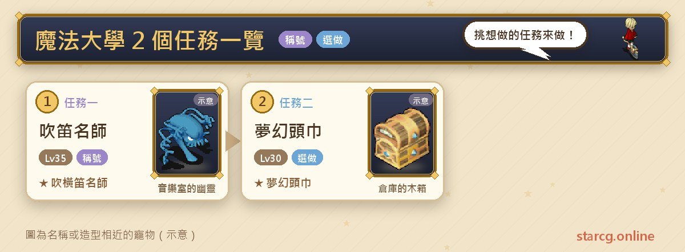
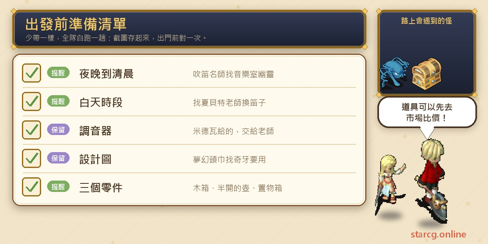
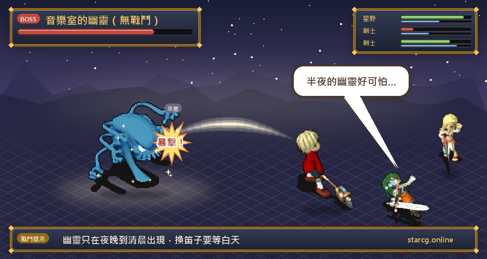

마법 대학(魔法大學)은 공략 사이트에 퀘스트가 두 개 올라와 있고, 둘 다 짧으며 자동 길안내를 지원해요. **피리 명인(吹笛名師)**은 밤에 음악실에서 유령을 찾아 조율기를 받고, 낮에 샤베트 선생님에게 주면 장비하는 것만으로 칭호가 붙는 「샤베트의 피리(夏貝特之笛)」로 바꿔 줘요. **몽환의 두건(夢幻頭巾)**은 대학 뒤쪽 지하 실험실에 다녀와 설계도를 받고, 창고 세 곳을 뒤져 부품을 찾는 퀘스트예요. 권장 레벨은 각각 35레벨과 30레벨로, 칭호와 작은 장신구를 겸사겸사 모으고 싶은 플레이어에게 잘 맞아요.

이 글에서는 두 퀘스트의 조건, NPC와 좌표, 조사할 물건과 보상을 한곳에 모았어요. StarCG(星詠魔力), 水藍魔力, 初心魔力寶貝 중 무엇을 하든 마법 대학 퀘스트 진행은 같으니 그대로 활용하면 돼요.

> 이 글은 [StarCG 공략 사이트](https://guide.starcg.net/)의 마법 대학 퀘스트 페이지와 장비 페이지를 바탕으로 저희 방식대로 순서를 다시 짜고 새로 쓴 것으로, 원문을 그대로 옮기지 않았어요. 공략 사이트에 없는 내용은 모두 「공략 사이트 미기재」로 적었고, 게임 업데이트 후 내용이 바뀔 수 있어요.

## 마법 대학 퀘스트는 무엇인가요? 전체 순서부터

두 퀘스트는 서로 선후 관계가 없고, 둘 다 전투가 적혀 있지 않아요.

| 퀘스트 | 퀘스트 이름 | 권장 레벨 | 보상 |
|---|---|---|---|
| 퀘스트 1 | 피리 명인 | 35 | 샤베트의 피리, 칭호 「횡적 명인」 |
| 퀘스트 2 | 몽환의 두건 | 30 | 몽환의 두건 |

한 줄로 정리하면: **피리 명인은 「밤에 받고 낮에 완료」, 몽환의 두건은 「실험실에서 설계도, 창고 세 곳에서 부품」이에요.**

## 출발 전에 이것부터 준비하세요

두 퀘스트 모두 재료를 준비할 필요가 없고, 핵심은 시간대와 장소예요.

피리 명인은 **밤부터 새벽** 사이에 음악실의 유령을 찾아야 하고, 피리 교환은 **낮**까지 기다려야 해요. 몽환의 두건은 시간대 제한이 없지만 창고 세 곳의 좌표를 잘 기억해 두세요. 두 퀘스트 모두 자동 길안내를 지원하니 대학 내부가 낯설면 길안내를 그대로 쓰면 돼요. 이 두 장신구의 플레이어 간 시세가 궁금하면 이 사이트의 [시세 조회](/ko/market/)를 이용해 보세요.

## 퀘스트 1: 피리 명인(밤에 받고 낮에 완료)

권장 35레벨, 조건은 밤이에요.

1. **밤부터 새벽** 사이에 마법 대학 내부의 **음악실**(76, 30)에서 **유령**(24, 11)과 대화하면 다른 장면으로 전송돼요.
2. 그 장면에서 **미드와(米德瓦)**와 대화해 「**조율기(調音器)**」를 받아요.
3. **낮**이 되면 **샤베트 선생님(夏貝特老師)**(24, 10)에게 돌아가 대화하고 「**샤베트의 피리**」를 받아요.
4. 샤베트의 피리를 장비하면 칭호 「**횡적 명인(吹橫笛名師)**」을 얻어요.

**보상 설명**: 공략 사이트 장비 페이지는 샤베트의 피리를 악기류로 분류하며, 1레벨 장신구, 방어 +2, 내구 200이라고 적었어요.

**주의할 점**: 유령은 밤부터 새벽까지만 나와서 낮에 음악실에 가면 찾을 수 없어요. 반대로 샤베트 선생님 단계는 낮까지 기다려야 해요. 퀘스트 전체에 전투가 없어요.

## 퀘스트 2: 몽환의 두건(창고 세 곳에서 부품 찾기)

권장 30레벨, 조건 없음이에요.

1. 마법 대학 뒤쪽 **실험실**(133, 49)에서 **키샤르(奇夏爾)**와 대화해 「예」를 고르면 **지하 실험실**로 전송되고, 그대로 「과학자의 감옥(科學家的牢房)」까지 걸어가요.
2. 맨 아래층에서 **노란 전송석**에 들어가면 실험실로 돌아오고, 다시 **키샤르**와 대화하면 「**설계도**」를 받아요.
3. 실험실을 나와 마법 대학 강당의 **기술실**에서 **학생 키아(學生奇牙)**와 대화한 뒤 창고 안으로 들어가요.
4. 부품 세 개를 차례로 찾아요.
   - (117, 140) 창고에서 **나무 상자**(15, 13)를 조사해 **첫 번째 부품**을 얻어요.
   - (117, 164) 창고에서 **반쯤 열린 항아리**(20, 15)를 조사해 **두 번째 부품**을 얻어요.
   - (117, 148) 창고에서 **수납함**(13, 10)을 조사해 **세 번째 부품**을 얻어요.
5. 다 모으면 **키아**에게 돌아가 대화하고 「**몽환의 두건**」을 받아요.

**보상 설명**: 퀘스트 페이지에는 몽환의 두건이 「방어 +2」로 적혀 있지만, 공략 사이트 장비 페이지는 부적류로 분류하고 1레벨 장신구, **회피 +2**, 내구 300이라고 적었어요. 두 페이지가 다르니 실제 능력은 게임을 기준으로 하세요.

**주의할 점**: 창고 세 곳의 좌표가 (117, 140), (117, 148), (117, 164)로 아주 가깝고 조사할 물건도 각각 달라요. 위 목록대로 한 곳씩 맞춰 보면 빠뜨리지 않아요. 지하 실험실에 몬스터가 있는지, 몬스터 레벨은 얼마인지는 공략 사이트 미기재예요.

## 마법 대학 자주 묻는 질문

**피리 명인에서 왜 유령을 못 찾나요?** 유령은 밤부터 새벽 사이에만 대화할 수 있어서 낮에 가면 시작되지 않아요.

**횡적 명인 칭호는 어떻게 얻나요?** 샤베트의 피리를 받아 장비하면 칭호 「횡적 명인」을 얻어요.

**몽환의 두건의 부품 세 개는 어디에 있나요?** (117, 140) 창고의 나무 상자, (117, 164) 창고의 반쯤 열린 항아리, (117, 148) 창고의 수납함이에요.

**몽환의 두건의 능력은 무엇인가요?** 퀘스트 페이지에는 방어 +2, 장비 페이지에는 회피 +2·내구 300으로 적혀 있어 서로 다르니 게임을 기준으로 하세요.

## 정리: 지나가는 길에 끝낼 수 있는 작은 퀘스트 두 개

마법 대학의 두 퀘스트는 전투도 없고 재료 준비도 필요 없어요. 피리 명인은 「밤에 유령, 낮에 선생님」만 지키면 되고, 몽환의 두건은 좌표대로 창고 세 곳을 뒤지기만 하면 돼요. 마법 대학을 지날 때 잠깐 시간을 내면 칭호와 장신구를 가방에 챙길 수 있어요.

더 자세한 원문과 다른 퀘스트는 [StarCG 공략 사이트](https://guide.starcg.net/)에서 확인할 수 있어요. 이 사이트의 [펫 도감](/ko/pets/)과 [시세 조회](/ko/market/)로 다음 모험도 준비해 보세요.
