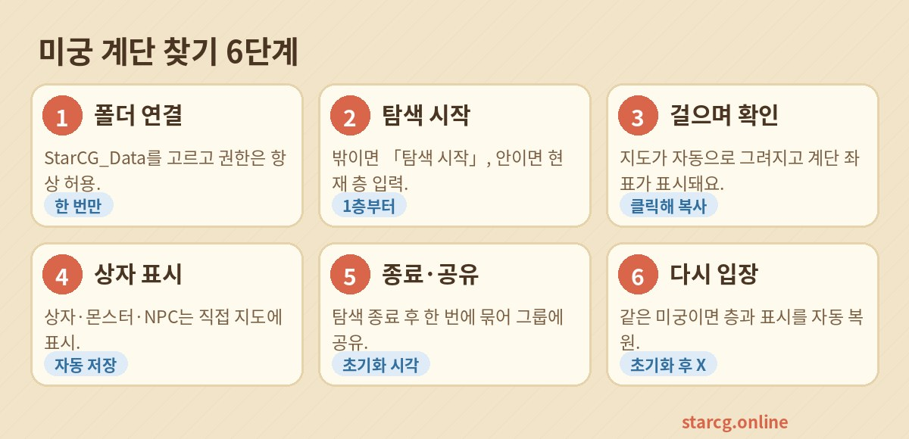

미궁에서 가장 시간이 걸리는 건 계단 찾기예요. [미궁 계단 찾기](/ko/maze/)는 게임이 PC에 저장하는 지도 파일을 직접 읽어서, 가는 곳마다 지도를 그리고 계단이 나타나면 바로 좌표를 표시해요. 설치도, 매번 파일을 넣을 필요도 없고 게임 파일을 업로드하거나 수정하지 않아요.

## 준비물

- **PC용 Chrome 또는 Edge**. 폴더 자동 읽기는 이 두 브라우저의 기능이에요. Firefox, Safari, 휴대폰에서는 파일을 직접 골라 볼 수만 있어요.
- 게임 설치 위치: 게임 폴더 안의 **StarCG_Data**(안에 `map` 폴더가 있어요).

## 처음 설정(한 번만)

1. [미궁 계단 찾기](/ko/maze/)를 열고 「게임 폴더 연결」을 누르세요.
2. **StarCG_Data** 폴더를 선택하세요(`map`을 골라도 돼요).
3. 브라우저가 읽기 허용을 물으면 **「방문할 때마다 허용」**을 고르세요. 다음부터는 페이지를 열기만 하면 자동으로 연결되고 상태 표시줄에 「실시간 감시 중」이 떠요.

> 실수로 「차단」을 눌렀다면 주소창 왼쪽 자물쇠 아이콘에서 권한을 허용으로 바꾸고 새로고침하세요.

## 탐험 시작

지도 영역에 「탐험 시작 준비」 패널이 먼저 나와요. 시작 방법은 두 가지:

- **아직 미궁 밖**: 「탐험 시작」을 누르세요. 미궁에 들어간 뒤 첫 지도가 1층이 되고 2, 3, 4층 순으로 이어져요.
- **이미 미궁 안**: 현재 층을 적고 「이 층부터 시작」을 누르면 지금 지도가 그 층으로 표시돼요.

탐험 중에 보이는 것:

- **층 목록**: 지도 위에 「1층, 2층…」이 나란히 표시되고, 새 층에 가면 자동으로 넘어가요(「자동 따라가기」가 켜져 있을 때). 되돌아보고 싶으면 층을 누르세요.
- **계단과 출입구**: 오른쪽에 올라가는 계단(초록), 내려가는 계단(빨강), 수정(보라)과 좌표가 나와요. 누르면 지도가 그 자리로 이동하고, 옆 버튼으로 좌표를 복사할 수 있어요.
- **흐린 영역**: 탐험 시작 전부터 있던 예전 지도(지난번에 남은 기록)는 흐리게, 「예전 기록」으로 표시되고 새로 걸어간 곳만 밝게 보여요.

## 보물상자·몬스터 직접 표시

보물상자, 몬스터, NPC는 지도 파일에 없어서 자동으로 찾을 수 없어요. 대신 직접 표시할 수 있어요:

1. 지도 제목 옆의 「보물상자」(또는 「몬스터」, 「NPC」, 「메모」)를 누르세요. NPC는 이름을 물어보는데 비워도 돼요.
2. 지도의 위치를 누르면 표시가 놓이고 목록에 좌표가 나와요.
3. 잘못 놓았으면 목록 옆 휴지통으로 지우세요.

표시는 이번 탐험과 함께 저장돼요.

## 종료와 이어가기

- 다 돌았으면 상태 표시줄의 **「탐험 종료」**를 누르세요. 화면이 비워지고 시작 패널로 돌아가요.
- 종료하면 **「이번 탐험 한 번에 정리해 공유」**가 나타나요. 미궁 이름·채널·리셋 시간(월/일 시:분:초)을 채우면 「한 번에 정리」 버튼이 생기고, 각 층의 계단·수정 좌표와 직접 표시한 상자·몬스터·NPC가 한 덩어리 글로 정리돼요. 「한 번에 복사」로 길드 채팅이나 Discord에 붙여 넣으세요.
- 미궁이 초기화되기 전에 같은 미궁에 다시 들어가면 다시 설정할 필요 없이, 지도 내용을 비교해 같은 미궁임을 알아보고 **지난 층 번호와 표시를 자동으로 이어서** 보여 줘요. 「지난 미궁을 알아봤어요. N층부터 이어가요」라고 알려 줘요.
- 초기화 뒤에는 지도가 달라서 잘못 이어지지 않아요. 「탐험 시작」으로 새로 시작하면 돼요.

## 지도 보기 팁

| 동작 | 방법 |
|---|---|
| 확대／축소 | 마우스 휠, 더블클릭, 또는 오른쪽 아래 ＋／－ |
| 이동 | 드래그 |
| 층 전체 보기 | 오른쪽 아래 조준점 버튼 |
| 시점 바꾸기 | 「게임 시점」은 게임과 같은 45° 사선, 「격자」는 좌표 맞추기에 편해요 |
| 플로팅 창 | 오른쪽 아래 작은 창 버튼. 항상 위에 뜨는 창으로 열려 게임 옆에 두고 볼 수 있어요 |
| 좌표 보기 | 마우스를 지도에 올리면 왼쪽 위에 동·남 좌표가 나와요 |

## 자주 묻는 질문

**미궁에 들어갔는데 지도가 안 나와요**
상태 표시줄이 「실시간 감시 중」인지 확인하세요. 「진단」을 펼치면 보고 있는 폴더와 파일 수가 나와요. 서버 폴더의 .dat가 0개라면 폴더를 잘못 고른 거예요. `StarCG_Data`로 다시 연결하세요.

**이전 층으로 돌아갔는데 안 바뀌어요**
게임이 예전 층으로 돌아가면 보통 그 층의 지도 파일을 다시 써서 자동으로 바뀌어요. 안 바뀌면 층 목록에서 직접 누르세요.

**층 번호가 틀렸어요**
「탐험 종료」 후 「이미 미궁 안」에 올바른 층을 적고 다시 시작하세요.

**게임 파일을 건드리나요?**
아니요. `StarCG_Data\map\1` 아래 서버 폴더의 지도 파일을 「읽기」만 하고, 쓰거나 지우지 않아요.
