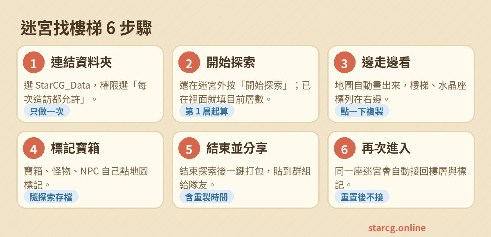
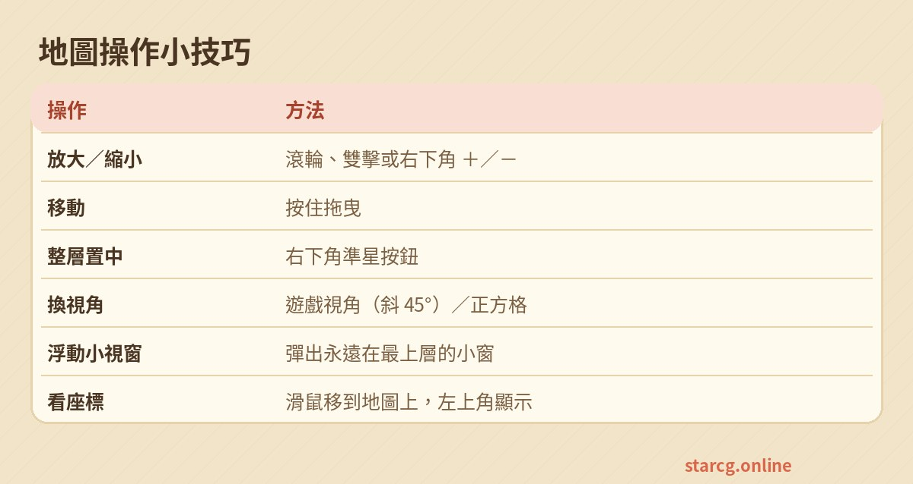

跑迷宮最花時間的就是找樓梯。[迷宮找樓梯](/maze/) 直接讀遊戲存在電腦裡的地圖檔，你走到哪、地圖就畫到哪，樓梯一出現就標好座標。不用安裝程式、不用每次丟檔案，也不會上傳或修改任何遊戲檔案。

## 需要什麼

- **電腦版 Chrome 或 Edge**。自動讀取資料夾是這兩個瀏覽器的功能；Firefox、Safari 和手機只能手動選檔案看。
- 知道遊戲裝在哪：找到遊戲資料夾裡的 **StarCG_Data**（裡面有 `map` 資料夾）。

## 第一次設定（只要做一次）

1. 打開 [迷宮找樓梯](/maze/)，按「連結遊戲資料夾」。
2. 選擇 **StarCG_Data** 資料夾（選 `map` 也可以）。
3. 瀏覽器會問要不要允許讀取，選 **「每次造訪都允許」**。之後打開這一頁就會自動接上，狀態列顯示「即時監看中」。

> 如果不小心按到「封鎖」，點網址列左邊的鎖頭圖示把權限改回允許，再重新整理即可。

## 開始探索

地圖區會先出現「準備開始探索」面板，兩種開始方式：

- **還在迷宮外**：按「開始探索」。進迷宮後第一張地圖就是第 1 層，往下依序 2、3、4……
- **已經在迷宮裡**：填目前第幾層，按「從這層開始」，目前這張地圖就標成那一層。

探索中會看到：

- **樓層列**：地圖上方一排「第 1 層、第 2 層…」，走到新的一層會自動切過去（「自動跟隨」開著時），想回頭看就點標籤。
- **樓梯與出入口**：右邊列出上樓梯（綠）、下樓梯（紅）、水晶（紫）與座標，點一下地圖會跳過去閃一下，旁邊的按鈕可以複製座標。
- **較淡的區域**：開始探索前就存在的舊地圖（上一次跑剩下的），會畫淡並標「舊記錄」，新走到的地方才是亮的。

## 自己標記寶箱與怪物

寶箱、怪物、NPC 不在地圖檔裡，網站抓不到，所以可以自己標：

1. 點地圖標題旁的「寶箱」（或「怪物」、「NPC」、「備註」）。NPC 會問一下名稱，可以留空。
2. 再點地圖上的位置，標記就放上去，清單裡會顯示座標。
3. 標錯了按清單旁的垃圾桶刪掉。

標記會跟著這次探索一起存起來。

## 結束與接回

- 跑完按狀態列的 **「結束探索」**，畫面就清空回到開始面板。
- 結束後會出現 **「打包分享這次探索」**：填好迷宮名稱、分流和迷宮重製時間（月／日 時：分：秒）就會出現「一鍵打包」，把每一層的樓梯、水晶座標和你標的寶箱、怪物、NPC 整理成一段文字，再按「一鍵複製」貼到群組或 Discord 給隊友。
- 在迷宮重置之前又回到同一座迷宮時，不用重新設定：網站會比對地圖內容，認出同一座迷宮後 **自動接回上次的樓層編號和標記**，並提示「認出上次的迷宮，接回第 N 層」。
- 迷宮重置後地圖不一樣，就不會誤接，直接按「開始探索」開新的一趟。

## 看地圖的小技巧

| 操作 | 方法 |
|---|---|
| 放大／縮小 | 滑鼠滾輪、雙擊，或右下角的 ＋／－ |
| 移動 | 按住拖曳 |
| 整層置中 | 右下角的準星按鈕 |
| 換視角 | 「遊戲視角」是和遊戲一樣的斜 45°，「正方格」方便對座標 |
| 浮動小視窗 | 右下角的小視窗按鈕，地圖會彈成永遠在最上層的小窗，放遊戲旁邊邊走邊看 |
| 看座標 | 滑鼠移到地圖上，左上角會顯示東、南座標 |

## 常見問題

**進迷宮後地圖沒出現？**
先確認狀態列是「即時監看中」。展開狀態列的「診斷」，裡面會列出它看到的資料夾與檔案數；如果分流資料夾裡的 .dat 是 0 個，表示選錯資料夾了，重新連結 `StarCG_Data`。

**走回上一層沒有跟著切？**
遊戲回到舊樓層時通常會重寫那層的地圖檔，網站就會跟著切；如果沒切，直接點樓層列的標籤即可。

**樓層編號錯了？**
按「結束探索」，再用「已經在迷宮裡」填正確樓層重新開始。

**會不會動到遊戲檔案？**
不會。網站只「讀」`StarCG_Data\map\1` 底下分流資料夾的地圖檔，沒有任何寫入或刪除。
