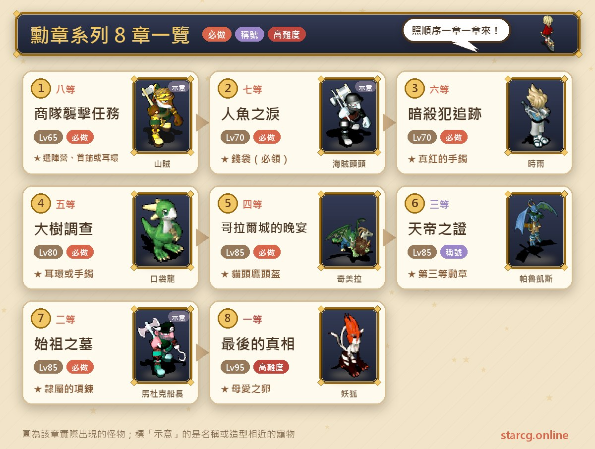
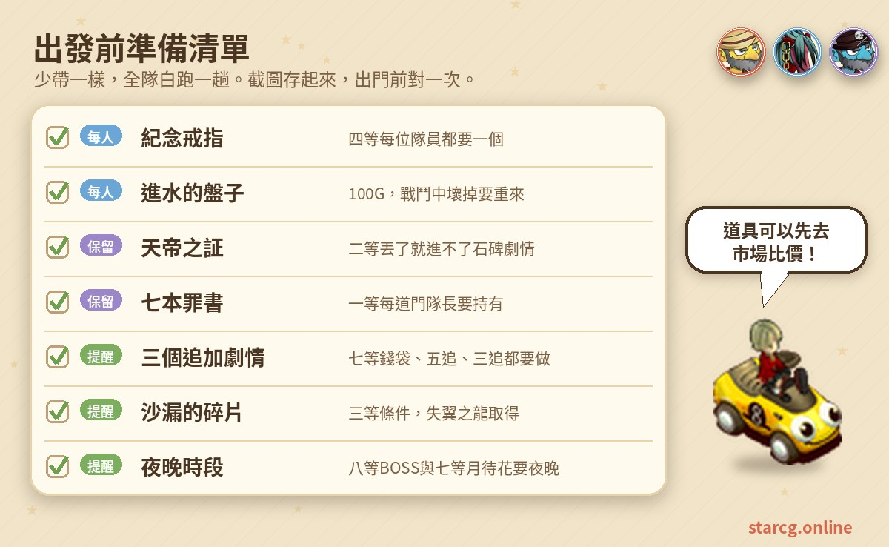
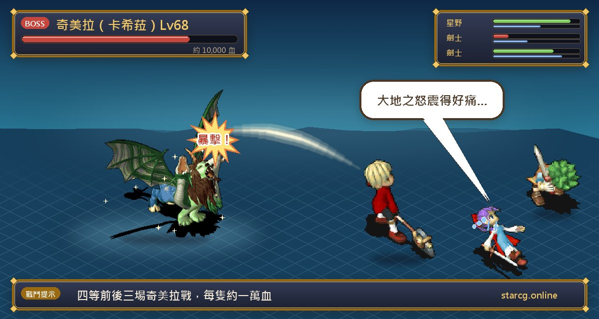
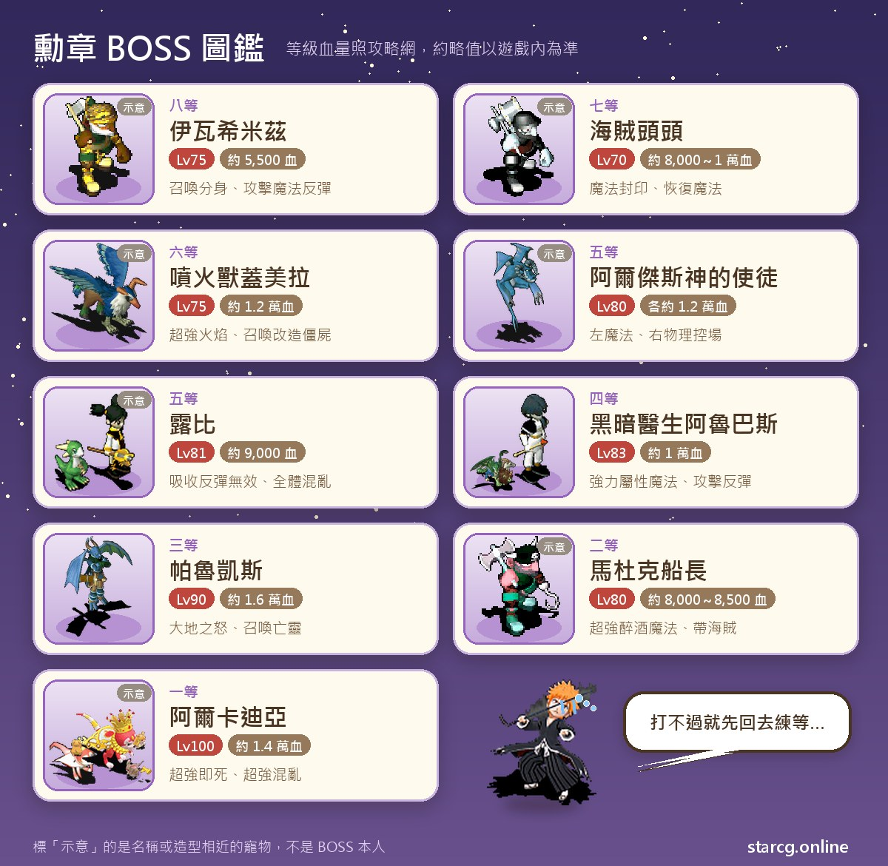

란국 훈장(艾爾巴蘭國勳章) 시리즈는 크로스게이트에서 가장 길고 서브 퀘스트가 가장 많이 얽힌 퀘스트 라인 중 하나예요. 8등 훈장의 상단 습격에서 시작해 1등 훈장 「마지막 진실(最後的真相)」까지 올라가는 동안, **란 왕국(蘭國)**과 **엘바(艾爾巴)** 두 진영 중 하나를 골라야 하고, 세 장에서 「추가 스토리」를 채워야 하며, 마지막에는 일곱 권의 죄서를 모아야 1등 훈장의 일곱 문을 열 수 있어요. 권장 레벨은 65에서 95까지 올라가고, 1등 훈장을 마치면 훈장 칭호 여덟 개를 **모성애의 알(母愛之卵)** 하나로 바꿀 수 있어요. 엘바는 초록 알을 받아 유니콘(獨角獸)이나 페가수스(天馬)가, 란 왕국은 빨간 알을 받아 그림리퍼(鐮刀魔)나 앙쿠우(斬首者)가 태어나요.

이 글은 여덟 장의 조건, 좌표, 두 진영의 경로 차이, 보스전마다의 레벨과 HP를 플레이하면서 바로 펼쳐 볼 수 있는 흐름으로 정리했고, 가장 많은 사람이 막히는 「예속의 목걸이(隸屬的項鍊)」 조건을 맨 앞에서 분명히 설명했어요. StarCG(星詠魔力)든 水藍魔力든 初心魔力寶貝든 훈장 시리즈 퀘스트 흐름은 똑같아서 이 정리를 그대로 쓰면 돼요.

> 이 글은 [StarCG 공략 사이트](https://guide.starcg.net/)의 훈장 시리즈 페이지를 바탕으로 저희 방식대로 순서를 다시 정리하고 새로 쓴 것으로, 그대로 옮기지 않았어요. 보스 HP와 수치는 대략적인 값이니 실제 게임을 기준으로 해 주세요. 게임 업데이트 후 내용이 바뀔 수 있어요.

## 훈장 시리즈란? 먼저 전체 순서부터

훈장 시리즈는 8등에서 1등으로 거꾸로 올라가고, 장마다 앞 장의 칭호가 있어야 받을 수 있어요. 8등 훈장이 끝날 때 진영을 고르고, 이후 7등과 5등 두 장은 진영에 따라 경로가 다르지만, 보스전은 대부분 진영을 섞어 파티를 짤 수 있어요.

한 문장으로 정리하면: **8~4등은 순서대로, 3등은 날개 잃은 용을 먼저, 2등은 예속의 목걸이를 받고, 1등은 죄서 일곱 권을 모으세요.**

| 장 | 퀘스트 이름 | 권장 레벨 | 획득 |
|---|---|---|---|
| 8등 훈장 | 상단 습격 퀘스트 | 65 | 8등 훈장 칭호, 케리샤의 목장식 또는 정령석 귀걸이 |
| 7등 훈장 | 인어의 눈물 | 70 | 7등 훈장 칭호, 돈주머니 |
| 6등 훈장 | 암살범 추적 | 70 | 6등 훈장 칭호, 진홍의 팔찌, 아르카디아 옛 동전 |
| 5등 훈장 | 거목 조사 | 80 | 5등 훈장 칭호, 뮤라 귀걸이 또는 수훈 팔찌 |
| 4등 훈장 | 코랄 성의 만찬 | 85 | 4등 훈장 칭호, 부엉이 투구 |
| 3등 훈장 | 천제의 증표 | 85 | 3등 훈장 칭호 |
| 2등 훈장 | 시조의 묘 | 85 | 2등 훈장 칭호, 예속의 목걸이(추가) |
| 1등 훈장 | 마지막 진실 | 95 | 1등 훈장 칭호, 모성애의 알 |

칭호는 진영에 따라 「란 왕국 제N등 훈장」 또는 「엘바 제N등 훈장」으로 표시돼요. 둘 다 영구 칭호지만 **한쪽만 가질 수 있어서**, 진영을 바꾸려면 8등 훈장부터 다시 시작해야 해요.

**가장 중요한 막힘 포인트: 예속의 목걸이**. 1등 훈장에 들어갈 때 쓰는 예속의 목걸이는 2등 훈장의 추가 스토리에서만 받을 수 있고, 선행 조건이 세 가지라 하나라도 빠지면 받을 수 없어요.

1. 7등 훈장 마지막 단계에서 퀘스트 물품을 건네고 **돈주머니를 받았을 것**.
2. 5등 훈장의 **추가 스토리**(루비전)를 마쳤을 것.
3. 3등 훈장의 **추가 스토리**(발케스전)를 마쳤을 것.

## 출발 전에 챙길 것

훈장 시리즈는 기간이 길어서 「이번 장에서 받고 몇 장 뒤에 쓰는」 아이템이 많아요. 무심코 버렸다가 1등 훈장 문 앞에서 막히는 경우가 가장 흔해요. 아래 그림에 장별로 챙길 것을 모아 두었으니 캡처해 두세요.

1등 훈장에 필요한 죄서 일곱 권은 4등 훈장, 5등 훈장, 그리고 마족 개조 계획, 얼음의 감옥, 무술사 취임 퀘스트, 개조좀비, 유괴 사건 같은 다른 퀘스트에서 나와요. 공략 사이트에 따르면 죄서는 랜덤 드롭이고 드롭률이 아주 낮아요. 한 권 한 권 직접 파밍하기보다, 먼저 사이트의 [시세 검색](/ko/market/)으로 어떤 죄서가 팔리고 있고 가격이 얼마인지 확인한 뒤 직접 잡을지 그냥 살지 정해 보세요.

## 8등 훈장: 상단 습격 퀘스트(진영 선택)

퀘스트 조건 없음, 권장 65레벨이에요.

1. 아케루파 성(阿凱魯法城) 2층 오른쪽의 총독 집정관실(42, 26)에서 **로산 총독 집정관(羅山督府執政官)**(16, 8)을 찾아 「호화로운 반지(가짜)(豪華的戒指（偽）)」를 받아요. 잃어버리면 다시 대화해 받을 수 있어요.
2. **아드키무(阿德基姆)**(309, 349)가 지키는 다리를 건너 미네갈섬(米內葛爾島) (279, 170) 근처에서 **호화로운 반지(가짜)를 장비**하면 밴디트가 랜덤으로 나와요. 이기면 호화 두건(豪華頭巾), 슈퍼 팬티(超級內褲), 느린 단도(緩慢的小刀) 중 하나를 랜덤으로 받는데, **하나만 있으면 돼요**.
3. 미네갈섬 (402, 242)에서 길가의 오솔길로 들어가, **밤에**, **밴디트 아이템을 장비한 캐릭터가 리더**가 되어 **이와시미즈(伊瓦希米茲)**(21, 14)와 대화해 전투를 시작해요.
4. 이긴 뒤 이와시미즈와 다시 대화해 진영을 골라요. 「예」를 고르면 **란 왕국**에 들어가 칭호와 케리샤의 목장식(凱力夏的首飾)을 받아요. 「아니요」를 고르면 **엘바**에 들어가 중간 아이템 「숲의 월석(森之月石)」을 받고, 아케루파로 돌아가 집정관에게 칭호와 정령석 귀걸이(精靈石的耳環)로 바꿔요.

**보스 정보**: 밴디트 양차나(楊恰那), 이오나(伊歐那), 나나르(娜娜爾)는 모두 50레벨, HP 약 3,000이고 훔치기와 도망을 쓰며, 나나르는 각종 상태 이상 공격도 써요. 이와시미즈 본인은 75레벨, HP 약 5,500이고 성스러운 방패, 초강력 중독, 공격·마법 반사를 쓰며, 분신 두 개(각 75레벨, HP 약 7,000, 아지랑이와 반사 사용)를 소환해요.

**공략법**: 이 전투에서 가장 망하기 쉬운 건 **본체가 먼저 쓰러지면 분신이 자폭한다**는 점이에요. 그러니 반드시 분신 둘을 먼저 정리하고 이와시미즈를 처리하세요. 또 진영 선택은 1등 훈장 마지막에 어떤 알을 받을지 정하니, 고르기 전에 유니콘·페가수스를 원하는지, 그림리퍼·앙쿠우를 원하는지 먼저 생각해 두세요.

## 7등 훈장: 인어의 눈물(돈주머니는 꼭 받기)

조건은 8등 훈장 칭호, 권장 70레벨이에요. 두 진영의 앞부분은 다르지만 마지막에는 모두 해적 두목의 방에서 만나니, 진영을 섞어 파티를 짜서 보스를 잡을 수 있어요.

**란 왕국 경로**:

1. 칸나베라 마을(坎那貝拉村)의 **월심 영감(月心爺)**(81, 70)을 찾아 퀘스트를 시작해요.
2. 소녀 쿠루루(庫魯魯)의 집(464, 473)에서 **나카토키(仲時)**를 찾아 「해적 귀걸이(海賊耳環)」를 받아요.
3. 미네갈섬 (586, 501)의 아이 **벨라(貝拉)**를 찾아 해적 기지에 들어가 **해적 데키(海賊德奇)**와 전투를 시작해요(60레벨, HP 약 4,500~5,500, 연격·양날·혼란 공격·성스러운 방패·돈 훔치기 사용). 이긴 뒤 귀걸이를 건네고 「헬륨 가스통(氦氣瓶)」을 받아요.
4. 두목 방 앞의 부하 **피라메(皮拉梅)**와 교환해 「훈도시(兜擋布)」를 받은 뒤, **해적 두목(海賊頭頭)**과 전투를 시작해요.
5. 전투 후 뒤쪽 계단(21, 6)으로 가서 계단 두 개를 지나 (36, 30)의 노란 전송석에서 「지하 수맥(地下水脈)」(랜덤 미궁 11~13층)에 들어가요.
6. 호숫가의 아이 **케레(凱雷)**(27, 68)에게 훈도시를 주고 「데키의 반지(德奇的戒指)」로 바꾼 뒤, 인어 **시린(席琳)**(32, 29)에게서 「나카토키의 비파(仲時的琵琶)」를 받아요.
7. **밤에** 미네갈섬 (488, 477)의 **월대화(月待花)**를 조사해 「달의 물방울(月之水滴)」을 얻어요.
8. (550, 440) 근처에서 비파를 더블클릭해 호숫가로 돌아가, 달의 물방울을 시린에게 주고 「인어의 눈물(人魚之淚)」로 바꿔요.
9. 인어의 눈물을 월심 영감(81, 70)에게 건네면 칭호를 받아요. 쿠루루의 집으로 이동된 뒤 데키의 반지를 나카토키에게 건네면 **돈주머니(錢袋)**로 바꿔 줘요.

**엘바 경로**:

1. 칸나베라 마을의 귀족 **밀리센트(米利聖特)**(34, 52)를 찾아 퀘스트를 시작해요.
2. 항만 관리소의 해운상 **흰 고양이(白貓)**를 찾아 펠리컨호(培里坎號) 선실로 이동하고, (78, 23)에서 갑판으로 올라가 선원 **도나루도(多納魯多)**(25, 25)를 찾으면 해적 기지로 이동돼요.
3. 나무 상자(46, 30)를 조사해 「엘카디아 동전(艾爾卡迪雅銅幣)」을 얻고, 문 앞의 도적 **몽키(蒙奇)**(47, 33)에게 「몽키의 열쇠(蒙奇的鑰匙)」로 바꾼 뒤, 열쇠로 (44, 37)의 철문을 조사해 감옥을 나가요.
4. 두목 방 북서쪽의 숨겨진 통로에서 상자(18, 20)를 조사해 「밀리센트의 보물(米利聖特的財寶)」을 얻은 뒤 **해적 두목**과 전투를 시작해요.
5. 이후는 똑같이 지하 수맥을 지나 시린에게 비파를 받고, 밤에 달의 물방울을 얻어 인어의 눈물로 바꿔요.
6. 인어의 눈물을 칸나베라 마을의 **야코브 총독 집정관(雅可布督府執政官)**(92, 56)에게 건네 칭호를 받고, 마지막으로 보물을 밀리센트에게 돌려주면 **돈주머니**로 바꿔 줘요.

**보스 정보**: 해적 두목은 70레벨로, 란 왕국 경로는 HP 약 8,000, 엘바 경로는 HP 약 1만으로 표기돼 있어요. 2회 행동을 하고 흡혈 공격, 건곤일척, 연격, 명경지수, 마법 봉인, 성스러운 방패, 회복 마법을 써요. 부하는 55레벨로 일반 공격만 해요(엘바 경로의 부하는 HP가 더 높게 표기돼 있어요).

**주의할 점**: **돈주머니는 꼭 받으세요.** 받지 않으면 시스템이 퀘스트 완료로 판정하지 않아서 나중에 2등 훈장에서 예속의 목걸이를 받을 수 없어요. 돈주머니는 4번 쓸 수 있고, 쓸 때마다 아르카디아 옛 동전이 1, 2, 4, 10, 30, 50개 중 랜덤으로 나와요.

## 6등 훈장: 암살범 추적(네 자매 연전)

조건은 7등 훈장 칭호, 권장 70레벨이에요.

1. 아케루파 성 2층 객실(14, 12)에서 **외무 부장관 스타(外務副長官史達)**에게 의뢰를 받아요. 「외무 부장관 스타의 의뢰를 받았다」 메시지가 나오지 않았다면 4단계까지 진행해 유적 밖으로 이동된 뒤에야 다시 받을 수 있어요. 공략 사이트가 표시한 알려진 문제예요.
2. 미네갈섬 (386, 329)에서 지하 유적에 들어가, 미궁에 랜덤으로 나타나는 **야코브 총독 집정관**에게 「나무 열쇠(木之鑰匙)」를 받아요.
3. **12층 랜덤 미궁**을 지나 나무 열쇠를 가진 채 석비(20, 31)를 조사하고, **아즈키(小豆)**(20, 18)와 전투를 시작해요.
4. 태고의 연구소(太古之研究所) 입구의 **시구레(時雨)**(26, 15)를 찾아 사쿠라(小櫻)의 방(12, 9), 우메(小梅)의 방(10, 9), 야마부키(山吹)의 방(10, 8)으로 차례로 이동해 한 번씩 싸워요.
5. 다 싸운 뒤 시구레를 찾아 동물 실험실에 들어가, 관리 연구실(25, 24)의 **알바스(阿魯巴斯)**와 두 번 연속 싸워요.
6. 전투 후 **집정관장 와기(執政官長瓦吉)**(20, 8)를 찾고, 아케루파 성으로 돌아가 스타에게 보상을 받아요.

**보스 정보**: 아즈키, 사쿠라, 우메, 야마부키는 모두 65레벨, HP 약 8,000~8,500의 인형계이고 2회 행동을 해요. 아즈키가 스킬이 가장 많고(연격파, 건곤일척, 기공탄, 전율습심, 성스러운 방패, 암살 등), 우메는 난사, 사쿠라는 회복 마법을 써요. 관리 연구실 첫 전투는 세 자매가 다시 나오고 2턴째부터 도망쳐요. 두 번째 전투는 **분화수 키메라(噴火獸蓋美拉)**(75레벨, HP 약 1만 2천)로, 초강력 화염 마법, 강력 중독 마법, 명경지수를 쓰고 개조좀비(改造僵屍)(50레벨, HP 약 2,500, 흡혈 공격과 자폭 사용)를 소환해요.

**주의할 점**: 7등 칭호가 없거나 스타에게 의뢰를 먼저 받지 않았다면, 아즈키를 잡고 대화할 때 바로 유적 밖으로 이동돼 퀘스트가 끊겨요. 12층 미궁은 사이트의 [미궁 계단 찾기](/ko/maze/)로 걸으면서 기록하면 좋아요.

## 5등 훈장: 거목 조사(추가 스토리 잊지 말기)

조건은 6등 훈장 칭호, 권장 80레벨이에요.

**란 왕국 경로**:

1. 칸나베라 마을의 **위병 호지(衛兵霍吉)**(60, 66)를 찾아 심문 조사실에 들어가고, **반장 도울(班長多烏爾)**(7, 4)을 찾아 성 지하 미궁에 들어가요.
2. 왕족 탈출 비밀 통로(王族脫逃暗道) 서쪽(63, 18), 동쪽(43, 7)을 거쳐 거목에 도착하고, 5층까지 올라가서(1F (41, 8), 2F (29, 28), 3F (10, 37), 4F (24, 16)) **아르제스 신의 사도(阿爾傑斯神的使徒)**에게 「예」를 골라 「서약의 깃털(誓約的羽毛)」을 받아요.
3. 거목 1층 (28, 23) 계단으로 거목 지하에 들어가 지하 9단까지 내려가고, 전송석으로 최하층 (21, 7)에 가서 **칠흑의 구멍(漆黑之穴)**에 들어가 **미트라 장군(米特拉將軍)**과 싸워 「푸른 반혼주(藍色返魂珠)」를 얻어요.
4. **루비(露比)**(23, 25)에게 반혼주와 깃털을 건네고 「루비의 초(露比的蠟燭)」를 받아요.
5. 거목 5층으로 돌아가 사도를 찾아 제재의 장소(制裁之處)로 이동하고 **사도**(11, 15)와 싸워요. 이긴 뒤 거목 (16, 10)의 병아리를 찾으면 「붉은 반혼주(紅色返魂珠)」를 얻어요. **칸나베라 마을로 날아갔다가 거목으로 걸어 돌아오지 마세요. 초를 회수당해요.**
6. 칠흑의 구멍으로 돌아가 루비에게 붉은 반혼주와 초를 건네면 칭호와 뮤라 귀걸이(謬拉耳環)를 받아요.

**엘바 경로**: 아케루파 마을(134, 113)의 **위병 카지나(衛兵卡吉納)**에게 「예」를 고르고, 아케루파 성의 **렌다 국왕(倫達國王)**(24, 20)에게 「왕족의 인장(王族之印)」을 받아요. 왕족 탈출 비밀 통로 가장 깊은 곳에서 **시구레**(94, 112)와 싸운 뒤, 똑같이 거목 5층에서 서약의 깃털을 받고, 칠흑의 구멍에서 미트라 장군을 잡아 푸른 반혼주를 얻어요. 5층으로 돌아가 건네면 거목 밖으로 이동되고, 마지막으로 렌다 국왕에게 칭호와 수훈 팔찌(殊勳手鐲)를 받아요.

**추가 스토리(필수)**: 칭호를 받은 뒤 퀘스트를 한 번 더 받아, 칠흑의 구멍에서 루비에게 「확인」을 골라 싸워요. 이기면 루비의 옷이나 **색욕의 죄서(色慾的罪書)**를 랜덤으로 받아요. 이 부분을 하지 않으면 2등 훈장에서 예속의 목걸이를 받을 수 없어요.

**보스 정보**: 미트라 장군은 78레벨, HP 약 9,000이고 연격, 반격, 전율습심, 명경지수, 독·흡혈 공격을 쓰며, 곁에 65레벨 「기어 나오는 그림자(匍匐冒出的陰影)」 여덟 마리(각 HP 약 2,800, 운석·빙결·화염·바람 칼날 네 유형, 모두 회복 마법과 즉사 마법 사용)가 있어요. 사도는 좌우 각각 80레벨, HP 약 1만 2천이고, 왼쪽은 마법 위주(초강력 4속성 마법, 초강력 망각), 오른쪽은 물리와 제어 위주(건곤일척, 전율습심, 암살)이며, 대지의 분노와 초강력 보혈을 쓰는 나무 정령(木靈) 다섯 마리도 있어요. 루비는 81레벨, HP 약 9,000이고 공격과 마법의 흡수·반사·무효를 모두 가지고 있으며 전체 혼란 마법도 써요. 시구레(엘바 경로)는 76레벨, HP 약 1만이고 닌자 일곱을 데리고 혼란 공격과 암살을 써요.

## 4등 훈장: 코랄 성의 만찬(부엉이 투구)

조건은 5등 훈장 칭호, 권장 85레벨이에요.

1. 코랄 마을(哥拉爾鎮) 병영 2층의 **병사 레오(士兵雷歐)**(12, 12)에게 「예」를 고르면 밤의 코랄 마을로 이동돼요. 랜덤으로 나오는 키메라(奇美拉)를 잡아 **기념 반지(紀念戒指)**를 얻는데, **파티원마다 하나씩** 필요해요.
2. 모두 받았으면 레오(172, 170)에게 돌아간 뒤 마을 안 (131, 48)의 카시라 저택(卡希菈豪宅)에 들어가 **과부 카시라(寡婦卡希菈)**(19, 12)에게 「예」를 골라 싸워요. 상대는 68레벨, HP 약 1만의 키메라(건곤일척, 암살, 대지의 분노, 강력 속성 마법 사용)예요. 이긴 뒤 **귀족 밀리산트(貴族米立山特)**(18, 11)에게 만찬 초대장을 받아요.
3. 쿠루크스섬(庫魯克斯島)의 신사숙녀 양성소(紳士淑女養成所)(349, 592)에서 **베그니아 숙녀(蓓格妮雅淑女)**(22, 11)에게 100G로 **물이 든 접시(進水的盤子)**를 사서 장비하고, **티나 숙녀(蒂娜淑女)**(16, 4)를 찾아 훈련 시설에 들어가 지하 5층의 시험관을 통과해요. **전투 중 접시가 깨지면 처음부터 다시 해야** 해요. 최하층에서는 모두가 접시를 **예절 대가(禮儀作法大師)**(16, 7)에게 주고 멋진 망토(帥氣的披風)나 화려한 드레스(華麗的洋裝)로 바꿔요.
4. 코랄 마을 (91, 136)의 집정관 와기 공관에 들어가 **집사 나이다(執事奈達)**(16, 6)를 찾아 휴게실로 가고, **한니발 집정관(漢尼伯執政官)**(16, 7)을 찾아 대홀로 이동해요.
5. **몽첨 부인(夢甜夫人)**(30, 9)에게 예, 예, 다음, 예, 아니요, 아니요, 예, 예 순서로 골라 복도에 들어가요. 짧은 간격으로 재배치되는 노란 전송석 여섯 개 중 올바른 통로를 찾아 비밀 통로로 들어가세요. 잘못 들어가면 벌칙 전투가 나올 수 있어요.
6. 란 왕국은 비밀 방에서 와기 집정관과, 엘바는 야코브 총독 집정관과 싸워(둘 다 70레벨, HP 약 1만의 키메라) **마도 연구탑 열쇠(魔導研究塔的鑰匙)**를 얻어요.
7. 쿠루크스섬 (700, 695)에서 (15, 2)의 문을 조사해 마도 연구탑에 들어가고, **16층 랜덤 미궁**을 지나 탑 꼭대기에서 **암흑 의사 알바스(黑暗醫生阿魯巴斯)**(25, 20)와 싸워요.
8. 이기면 미메이의 부적(蜜梅的護符)이나 **오만의 죄서(傲慢的罪書)**를 랜덤으로 받아요. 야코브 총독 집정관(32, 6)에게 야곱의 보고서(雅各的報告書)를 받아 코랄 마을 한니발의 집(159, 50)의 한니발 집정관(15, 10)에게 건네면 칭호와 **부엉이 투구(貓頭鷹頭盔)**를 받아요.

**보스 정보**: 알바스는 83레벨, HP 약 1만이고 강력 빙결·바람 칼날·운석 마법과 상태 이상 마법을 쓰며 공격 반사도 있어요. 곁에 아즈키, 사쿠라, 우메, 야마부키(각 65레벨, HP 약 5,500)와 노랑·파랑 두 마리의 70레벨, HP 약 1만 키메라가 있어서, 이 장에서 적이 가장 많은 전투예요.

**보상 안내**: 부엉이 투구는 8레벨 머리 장신구로 파티 기습 확률 +50%예요. 미메이의 부적은 미노키아 마을(米諾基亞村) 야곱의 집(104, 126)의 미메이 부인(蜜梅夫人)(14, 7)에게 가져가면 기도의 스카프(祈禱的圍巾)(생명 +200~+240)로 바꿀 수 있고, 캐릭터당 한 번만 가능해요. 투구를 반복해서 받고 싶다면 망토나 드레스를 보관해 두면 훈련 시설을 건너뛸 수 있어요.

## 3등 훈장: 천제의 증표(날개 잃은 용을 먼저)

조건은 4등 훈장 칭호와 「해방자(解放者)」 칭호, 「모래시계의 파편(沙漏的碎片)」이에요. 뒤의 두 가지는 용의 모래시계 시리즈 「날개 잃은 용(失翼之龍)」을 마쳐야 받을 수 있고, 권장 85레벨이에요.

1. 렉타르 마을(雷克塔爾鎮) (105, 22) 신전 현관에서 (1, 7)을 지나 헌금 수납처에 들어가, **간호사 치엔치엔(護士千千)**(8, 28)에게 「예」를 골라 의무실로 가서 **의사 세라비(醫師瑟拉維)**(16, 13)와 대화한 뒤 나와요.
2. 쿠루크스섬 (428, 682)의 마이니 마을(麥尼村)에서 **사냥꾼 샤오마이(獵人小麥)**(47, 55)를 찾아 마이니 동굴에 들어가 마이마이 풀(麥麥草)(10, 5)을 조사해요. **파티원 각자 받아야** 해요.
3. **월심(月心)**(40, 39)을 찾아 민가로 가서, 다시 월심(6, 7)에게 「예」를 골라요.
4. 렉타르 마을로 돌아가 마이마이 풀을 세라비에게 주고 특효약으로 바꿔 병실의 **시린**(6, 9)에게 건네요. 다시 의사를 찾아 보관고 입구로 이동하고, 통로(58, 14)로 보관고에 들어가 약 선반(10, 12)을 조사해 특효약을 받아(각자 받기) 마이니 마을의 월심(65, 54)에게 건네요(각자 건네기).
5. 다시 마이니 동굴에 들어가 최하층(약 16층)까지 가서 **사네토모(實朝)**(57, 60)와 싸워 「천제의 증표(天帝之証)」를 얻어요.
6. 신전으로 돌아가 치엔치엔을 찾아 병실에 들어가 **모리쿠니(森國)**(9, 7)와 싸우고, 이긴 뒤 천제의 증표를 시린에게 건네면 칭호를 받아요. **전투 전에 파티를 해산한 뒤** 시린과 대화하세요. 그렇지 않으면 가장 먼저 대화한 사람만 칭호를 받아요.

**추가 스토리(필수)**: 칭호를 받은 뒤 다시 치엔치엔과 세라비를 찾아, 마이니 마을 민가(18, 58)에서 귀족 밀리센트와 싸워요(상대는 70레벨, HP 약 1,500의 반란군의 망령(反叛軍的亡靈) 다섯). 이기면 「고급 신자의 증표(高級信者之証)」를 받아요. 새벽이나 해 질 녘에 쿠루크스섬 (458, 639)의 이름 없는 소녀를 찾아 과거의 숲으로 가서, **황녀 세코메도(皇女賽可梅多)**(29, 14)와 대화하고 (23, 25)에서 한 번 더 대화한 뒤, 숲 깊은 곳에 들어가 **발케스(帕魯凱斯)**와 싸워요.

**보스 정보**: 사네토모는 84레벨, HP 약 1만 4천이고 아지랑이, 명경지수, 초강력 중독과 초강력 혼란 마법을 써요. 모리쿠니는 82레벨, HP 약 1만 5천이고 기공탄, 명경지수, 독 공격을 써요. 발케스는 90레벨, HP 약 1만 6천이고 연격, 흡혈 공격, 기공탄, 대지의 분노를 쓰며 반란군의 망령(70레벨, 4속성 마법과 즉사 마법 사용)을 소환해요.

## 2등 훈장: 시조의 묘(예속의 목걸이 받기)

조건은 3등 훈장 칭호와 5등·3등의 추가 스토리 완료, 권장 85레벨이에요.

1. 미노키아 마을 (119, 103)의 **월심**을 찾아 시린의 숨겨진 집에 들어가 **시린**에게 「천제의 증표」를 받아요.
2. 미노키아 마을 (19, 117)의 **마독 선장(馬杜克船長)**에게 「예」를 고르고, 선실(79, 23)에서 갑판으로 올라가 신참 항해사 **로비(羅比)**를 찾아 스토리를 진행한 뒤 선장과 싸워요.
3. 이기면 여울의 동굴(淺瀨的洞窟)과 이름 없는 섬(無名島)을 지나 9층 랜덤 미궁과 1층 고정 미궁에 들어가고, 10층에서 지저호(地底湖)로 떨어져요.
4. 잡동사니(80, 51)를 조사해 유리 물병을 얻고 (38, 40)에서 물을 담아, **도키요리(時賴)**(47, 68)에게 「천수도(天守刀)」로 바꿔요.
5. 벽을 통해 조인의 동굴(鳥人的洞窟)에 들어가고, 다시 9층 랜덤 미궁을 지나 시조의 묘지에 도착해 도키요리와 싸워요. 이어서 **나카토키**와 두 번 더 싸운 뒤, 시린을 찾아 시조의 묘에 들어가요.
6. **시조(始祖)**에게 천제의 증표를 건네고 「다마테바코(玉手箱)」로 바꾼 뒤, 석비를 조사해 천수도를 건네요. 미노키아 마을로 돌아가 다마테바코를 시린에게 건네면 칭호를 받아요.

**추가 스토리**: 2등 훈장 칭호를 받은 뒤 이 퀘스트를 **한 번 더 진행**해야 해요. 선행 조건 세 가지를 만족하면, 원래 시조에게 천제의 증표를 건네던 단계가 석비를 조사해 「깊은 어둠(深遠的黑暗)」으로 이동하는 것으로 바뀌고, 거기서 **루비**를 찾아 **예속의 목걸이**를 받아요. 2단계에서 받은 천제의 증표는 **버리면 안 돼요**. 버리면 5등·3등 추가를 모두 했어도 석비 스토리에 들어갈 수 없어요. 추가 경로의 천수도는 버려도 돼요.

**보스 정보**: 마독 선장은 80레벨로, 첫 전투는 HP 약 8,000에 해적 넷을, 두 번째 전투는 HP 약 8,500에 80레벨 해적 여덟을 데리고 있고 강력·초강력 만취 마법을 써요. 도키요리는 85레벨, HP 약 1만이고 기공탄과 암살을 써요. 나카토키는 81레벨, HP 약 8,000이고 명경지수와 **자폭**을 써요. 마지막 사네토모는 84레벨, HP 약 1만 4,200이고 강력 화염과 운석 마법을 쓰며 닌자를 소환해요.

## 1등 훈장: 마지막 진실(일곱 문과 모성애의 알)

조건은 2등 훈장 칭호, 예속의 목걸이, **일곱 권의 죄서**, 권장 95레벨이에요.

| 문 | 죄서 | 출처 퀘스트 |
|---|---|---|
| 첫 번째 문 | 오만의 죄서 | 4등 훈장(암흑 의사 알바스) |
| 두 번째 문 | 질투의 죄서(嫉妒的罪書) | 마족 개조 계획(魔族改造計劃)(개조 알바스) |
| 세 번째 문 | 폭식의 죄서(暴食的罪書) | 얼음의 감옥(冰雪的牢籠)(루비) |
| 네 번째 문 | 색욕의 죄서 | 5등 훈장 추가(루비) |
| 다섯 번째 문 | 나태의 죄서(怠惰的罪書) | 무술사 취임 퀘스트(巫師就職任務)(루비) |
| 여섯 번째 문 | 탐욕의 죄서(貪慾的罪書) | 개조좀비(改造殭屍)(개조좀비) |
| 일곱 번째 문 | 분노의 죄서(憤怒的罪書) | 유괴 사건(誘拐事件)(알바스 또는 최종 결전형 우귀) |

1. 미네갈섬 (464, 381)에서 「**저주받은 고목(詛咒的古木)**」을 조사하고 (503, 370)에서 유적에 들어가요.
2. 문지기 일곱에게 차례로 도전해요. 유적 1층 오만, 지하 1층 질투(25, 29), 지하 2층 폭식(18, 45), 지하 3층 색욕(45, 16), 지하 5층 나태(18, 2), 지하 6층 탐욕(30, 8), 지하 7층 분노(70, 38)예요. **리더가 해당 죄서를 가지고 있어야** 전투를 시작할 수 있고, 없으면 입구로 돌려보내져요. 죄서는 문을 통과해도 소모되지 않아요.
3. 최하층에서 루비를 찾아 「예」를 고르면 **아르카디아(阿爾卡迪亞)**(공략 사이트 추천)와, 「아니요」를 고르면 루비(85레벨, HP 약 1만 3천, 큐(水藍鼠) 동반)와 싸워요.
4. 이기면 **호테프(荷特普)**(319, 136)를 찾아 1등 훈장 칭호를 받아요.
5. **노커 신상(大地鼠神像)**(221, 60)에서 「예」를 고르고 1~8등 훈장 칭호를 건네 알로 바꿔요. 엘바는 **모성애의 알(초록)**(유니콘 또는 페가수스), 란 왕국은 **모성애의 알(빨강)**(그림리퍼 또는 앙쿠우)을 받아요. 「아니요」를 고르면 칭호를 유지한 채 그대로 끝나요.

**보스 정보**: 문지기 일곱은 모두 악마 계열로 2회 행동을 하고, 레벨은 85~91, HP는 약 1만 3천~1만 4천이에요. 각자 80레벨 호위 네 마리를 데리고 있어요. 헬하운드(地獄獵犬), 수룡도마뱀(水龍蜥), 오크(半獸人)(HP가 낮으면 자폭), 붉은 전갈(紅蠍), 레드 아이(赤目黑熊)(HP가 낮으면 도망), 레이디큐르(妖狐)(공격·마법 반사), 유니콘이에요. 최하층의 아르카디아는 100레벨, HP 약 1만 4천이고 초강력 화염, 초강력 운석, 초강력 혼란, **초강력 즉사 마법**을 쓰며, 회복 마법 한 번에 약 1,550~1,600을 회복하고 85레벨 킹큐(鼠王) 네 마리를 데리고 있어요. 필드에 킹큐가 없으면 아르카디아는 6턴마다 고정으로 한 번 회복해요.

건넨 칭호는 업적 시스템에서 사라지지 않고 주황색으로 남아요. 나중에 알을 하나 더 받고 싶다면 선행 퀘스트를 다시 해서 칭호를 되찾아야 해요. 문지기전 일곱 번과 마지막 전투를 연달아 치르니, 먼저 [데미지 계산](/ko/damage/)으로 파티가 HP 1만 4천을 얼마나 깎을 수 있는지 계산해 보세요. 태어난 펫의 성장은 [펫 도감](/ko/pets/)에서 확인할 수 있어요.

## 훈장 시리즈 자주 묻는 질문

**왜 2등 훈장에서 예속의 목걸이를 받을 수 없나요?** 세 가지를 확인하세요. 7등 훈장에서 돈주머니를 받았는지, 5등 훈장 추가 스토리에서 루비를 잡았는지, 3등 훈장 추가 스토리에서 발케스를 잡았는지예요. 또 2등 2단계의 천제의 증표를 버렸다면 석비 스토리에 들어갈 수 없어요.

**란 왕국과 엘바는 뭐가 다른가요?** 주로 7등과 5등의 경로, 보상 장신구, 그리고 1등 훈장에서 받는 알이 달라요. 엘바는 유니콘이나 페가수스, 란 왕국은 그림리퍼나 앙쿠우예요. 두 칭호는 하나만 가질 수 있어서 진영을 바꾸려면 8등부터 다시 해야 해요.

**다른 진영끼리 파티를 짤 수 있나요?** 네. 7등 훈장에서 두 진영은 해적 두목의 방에서 만나니 함께 파티를 짜서 보스를 잡을 수 있어요.

**3등 훈장을 왜 받을 수 없나요?** 4등 훈장 칭호 외에도 「해방자」 칭호와 모래시계의 파편이 필요하고, 이 두 가지는 먼저 용의 모래시계 시리즈의 「날개 잃은 용」을 마쳐야 받아요.

**죄서 일곱 권은 꼭 직접 파밍해야 하나요?** 꼭 그렇진 않아요. 죄서는 일곱 개의 다른 퀘스트에서 나오고 드롭률이 아주 낮으니, 시장에서 살 수 있다면 그냥 사도 돼요. 문을 지날 때는 리더가 가지고 있어야 한다는 걸 기억하세요.

## 정리: 추가 스토리 세 가지부터 끝내기

훈장 시리즈에서 정말 시간이 드는 건 특정 보스가 아니라 앞뒤로 얽힌 조건이에요. 7등의 돈주머니, 5등과 3등의 추가 스토리, 3등의 선행 조건인 날개 잃은 용, 1등의 죄서 일곱 권이에요. 한 장을 마칠 때마다 추가 스토리를 했는지 다시 확인하고, 아이템은 일단 모두 보관했다가 모성애의 알을 받은 뒤에 가방을 정리하세요.

더 많은 퀘스트·펫·시장 정보는 [StarCG 공략 사이트](https://guide.starcg.net/)에서 원문을 확인하고, 사이트의 [시세 검색](/ko/market/), [미궁 계단 찾기](/ko/maze/), [펫 도감](/ko/pets/)으로 여정을 더 효율적으로 계획해 보세요.
