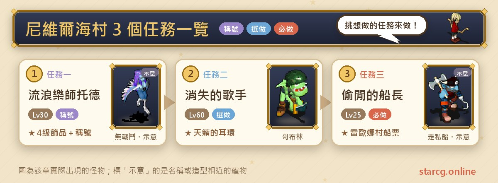
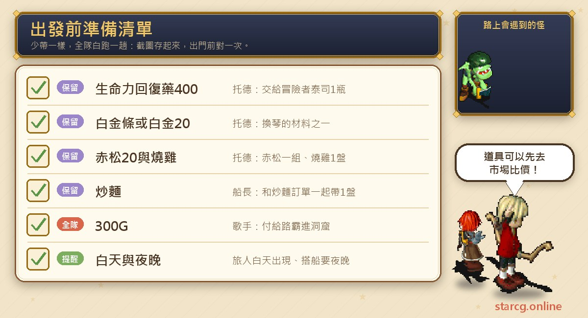
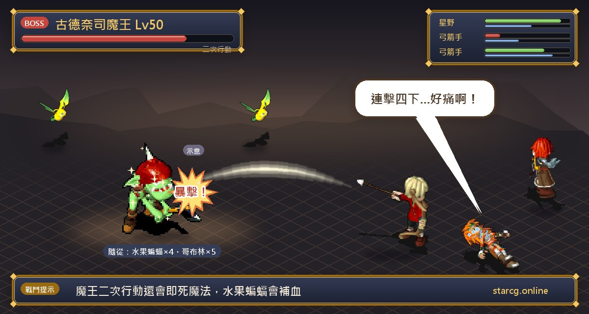
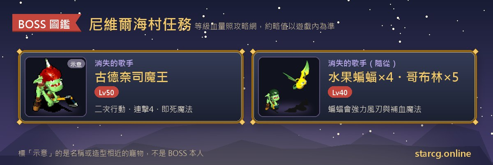

尼維爾海村是一座靠海的小村子，村裡的三個任務都跟「找人」有關：幫流浪樂師托德聯絡利利可洞窟深處的天才音樂家幽緒、替帝法德尋找失蹤的歌手卡西蒂，還有陪偷閒的船長湊齊開船時刻表，搭上開往傑諾姆島雷歐娜村的走私船。推薦等級分別是 30、60 與 25 級，屬於中前期就能完成的地區任務。

三個任務裡，**偷閒的船長**最實用，因為做完才能前往雷歐娜村，後面不少任務都會用到；**流浪樂師托德**則能拿到加攻擊、敏捷或防禦的 4 級飾品，以及兩個稱號；**消失的歌手**有一場二次行動魔王戰，獎勵是天籟的耳環。不論你玩的是星詠魔力、水藍魔力還是初心魔力寶貝，尼維爾海村任務的流程都一樣，這份整理都能直接拿來用。

> 本文整理自 [星詠魔力攻略網](https://guide.starcg.net/) 的尼維爾海村任務頁面，並用我們自己的方式重新排序與改寫，沒有逐字照搬。BOSS 血量與數值是約略值，實際以遊戲內為準；攻略網沒有列出的數值，本文一律寫「攻略網未列出」，遊戲更新後內容可能變動。

## 尼維爾海村任務是什麼？先看整體順序

三個任務彼此沒有前置關係，可以依照等級挑著做。不過如果你接下來想做雷歐娜村的任務，或是亞諾曼城「饕客兄弟」的後半段，就得先完成偷閒的船長。

| 任務 | 任務名稱 | 推薦等級 | 取得 |
|---|---|---|---|
| 任務一 | 流浪樂師托德 | 30 | 寵物銀幣(鎖定)×2、武神的臂環／躍動的項鍊／天使的守護 |
| 任務二 | 消失的歌手 | 60 | 寵物銀幣(鎖定)×2、天籟的耳環、卡西蒂的樂譜 |
| 任務三 | 偷閒的船長 | 25 | 船票，可前往雷歐娜村 |

整理成一句話：**25 級先做偷閒的船長打開雷歐娜村的航線，30 級做流浪樂師托德拿飾品，60 級再去里歐波多洞窟打古德奈司魔王。**

## 出發前先準備好這些

這三個任務幾乎都是「拿東西換東西」，戰鬥只有消失的歌手一場，所以準備重點在道具。

流浪樂師托德要準備**生命力回復藥(400)** 1 瓶，後半段還要**白金條 1 條**（或**白金一組 20 個**）、**赤松一組 20 個**與**燒雞 1 盤**。偷閒的船長要準備**炒麵 1 盤**。消失的歌手進里歐波多洞窟時要付給路霸 **300G**。燒雞、炒麵屬於料理，白金與赤松是採集材料，不想自己做的話可以先用本站的 [市場查價](/market/) 看看行情再決定。

## 任務一：流浪樂師托德（往返利利可洞窟送信）

推薦 30 級，沒有任務條件。

1. 在尼維爾海村托德的家二樓（63, 55）與**流浪樂師托德**對話，選「是」，拿到「關於泰司的情報」。
2. 到醫院（45, 67），帶著生命力回復藥(400) 1 瓶與關於泰司的情報，向**冒險者泰司**（39, 10）說「**幽緒**」，拿到「幽緒的情報」。
3. 回去找托德，拿到「給幽緒的信」。
4. 從通往摩頓村的通道（365, 548）裡（9, 27）的黃色傳送石進入**利利可洞窟**，走到最底層「利利可山洞深處」，與**天才音樂家幽緒**（9, 4）對話，換到「給托德的信」，並直接被傳回洞窟入口。
5. 回尼維爾海村把給托德的信交給托德，拿到「材料訂單」與「燒雞訂單」。
6. 帶著白金條 1 條（或白金一組 20 個）、赤松一組 20 個與燒雞 1 盤找托德，換到「琴」，鑑定後是**托德製作的琴**。
7. 再到利利可山洞深處，把托德製作的琴交給幽緒，換到「永遠的第二樂章」。
8. 把永遠的第二樂章交給托德，隨機拿到臂環、耳環或項鍊其中一種。

**獎勵資料**：

| 名稱 | 種類 | 等級 | 耐久 | 能力 |
|---|---|---|---|---|
| 武神的臂環 | 手環 | 4 | 190～240 | 攻擊 +15～+36 |
| 躍動的項鍊 | 項鍊 | 4 | 190～240 | 敏捷 +15～+36 |
| 天使的守護 | 耳環 | 4 | 190～240 | 防禦 +15～+36 |

三種飾品裝備後都得到稱號「不變的友誼」。

**要注意的地方**：這個任務會在尼維爾海村與利利可洞窟之間來回兩趟。好消息是攻略網寫明，拿到給托德的信後會直接傳回洞窟入口；持有永遠的第二樂章時再跟幽緒說話，也會直接傳回入口，回程不用自己走。另外，**持有托德製作的琴時**，去找管稱號的 NPC 對話可以拿到稱號「苦命的小弟」，琴交出去之後就沒機會了，記得先拿稱號再把琴送去給幽緒。利利可洞窟裡的怪物種類與等級攻略網未列出。

## 任務二：消失的歌手（里歐波多洞窟的古德奈司魔王）

推薦 60 級，沒有任務條件。

1. 到尼維爾海村卡西蒂的家（73, 26），與**帝法德**（5, 10）對話，拿到「卡西蒂的畫像」。
2. **白天**到德威特島（314, 510）附近找**無名的旅人**，拿到「卡西蒂的情報」。攻略網提到星詠魔力會顯示 NPC 名字，找起來比較容易。
3. 到里歐波多洞窟（129, 295），與**路霸**對話付 300G 進入洞窟，再進洞裡的黃色傳送石到里歐波多洞窟 1 樓。
4. 穿過迷宮到最底層，與**金猛**對話通過，再與**古德奈司魔王**對話進入戰鬥。
5. 戰勝後與**卡西蒂**對話，拿到「平安信」。
6. 回尼維爾海村卡西蒂的家，把平安信交給**帝法德**，拿到「樂譜？」與「耳環？」。

**BOSS 資料**：

- 古德奈司魔王：50 級，血量攻略網未列出，**二次行動**，會攻擊、防禦、連擊(4)與**即死魔法**。
- 哥布林 ×5：40 級，地 70 水 30，只會攻擊與防禦。
- 水果蝙蝠 ×4：40 級，地 20 風 80，會風刃魔法、強力風刃魔法與**補血魔法**。

**打法**：敵方一共 10 隻，魔王一回合動兩次，還帶即死魔法，隊伍等級接近推薦的 60 級時要留好復活手段。水果蝙蝠會幫隊友補血，攻略網雖然沒有寫建議順序，但從技能來看，先處理會補血的蝙蝠，可以避免魔王的血量被一直拉回來。哥布林只會普攻，威脅最低。

**獎勵**：樂譜？鑑定後是「卡西蒂的樂譜」，販店價 100G；耳環？鑑定後是「天籟的耳環」。

## 任務三：偷閒的船長（拿到雷歐娜村的船票）

推薦 25 級，條件是**晚上**（最後搭船那一步要在夜晚）。

1. 到尼維爾海村酒吧（89, 29），與**廚師福德**（13, 6）對話，拿到「炒麵訂單」。
2. 到德威特島（555, 350），身上帶著炒麵訂單和炒麵 1 盤，與**水手賽拉姆**對話，進入船塢。
3. 把炒麵訂單和炒麵交給**大副費雪**（13, 48），拿到「開船時刻表」。
4. 在德威特島（332, 518）附近找隨機出現的**船長瑞斯**，拿到「瑞斯船長的親筆信」。
5. 回走私船塢把信交給**大副費雪**，拿到兩張「票」，鑑定後是「船票」。
6. **夜晚**到走私船塢找**登記員塔可**（13, 34），搭上往雷歐娜村的走私船；上船後與**大副費雪**（18, 13）對話，抵達傑諾姆島。

**要注意的地方**：船長瑞斯是「隨機出現」在（332, 518）附近，到了座標沒看到人就在附近繞一下。搭船要在夜晚，白天拿到船票後要等時段。這個任務沒有戰鬥，重點是炒麵要先準備好：水手賽拉姆要看到你身上「同時」有炒麵訂單和炒麵，才會讓你進船塢。

完成後就能前往雷歐娜村，亞諾曼城的饕客兄弟後半段也需要到雷歐娜村的餐廳交訂單，可以參考 [亞諾曼城任務攻略](/posts/anoman-quest-guide/)。

## 尼維爾海村和其他任務的交集

除了自己的三個任務，尼維爾海村也是亞諾曼城「消失的王子」的必經之地：不論人類路線或魔族路線，都要到村門口（32, 62）跟魔族軍團打一場，第二回合敵人就會逃跑。攻略網特別提醒，**進村時會被強制離開隊伍**，要一個一個進村後重新組隊再對話，這點在做尼維爾海村自己的任務時也可以先記著。

## 尼維爾海村任務常見問題

**偷閒的船長完成後拿到什麼？** 兩張船票，可以搭走私船前往傑諾姆島的雷歐娜村。

**流浪樂師托德的三種飾品可以選嗎？** 不行，攻略網寫的是隨機拿到臂環、耳環或項鍊其中一種，三種都是 4 級、能力 +15～+36，裝備後都有稱號「不變的友誼」。

**「苦命的小弟」稱號怎麼拿？** 持有托德製作的琴時，去找管稱號的 NPC 對話。琴交給幽緒之後就無法再拿，記得先去。

**消失的歌手的無名的旅人找不到？** 他要在**白天**才會在德威特島（314, 510）附近出現。

**古德奈司魔王危險嗎？** 牠是 50 級、二次行動，會連擊(4)與即死魔法，身邊還有 9 隻小怪，推薦 60 級去打，復活道具最好帶上。

## 小結：先搭上船，再慢慢做

尼維爾海村三個任務都不長，最優先的是 25 級就能做的偷閒的船長——它把雷歐娜村的航線打開，後面許多任務都靠它。流浪樂師托德花比較多時間跑腿，但換到的 4 級飾品對中前期角色很實用，別忘了在交琴前拿「苦命的小弟」。消失的歌手是三個任務裡唯一的戰鬥，魔王的即死魔法和蝙蝠的補血是重點，出發前可以用本站的 [寵物圖鑑](/pets/) 看看哥布林與水果蝙蝠的資料，再用 [傷害計算機](/damage/) 估一下輸出夠不夠。

想看更完整的原文與其他任務，可以到 [星詠魔力攻略網](https://guide.starcg.net/) 查詢；亞諾曼城的消失的王子、饕客兄弟等任務，則整理在 [亞諾曼城任務攻略](/posts/anoman-quest-guide/)。
