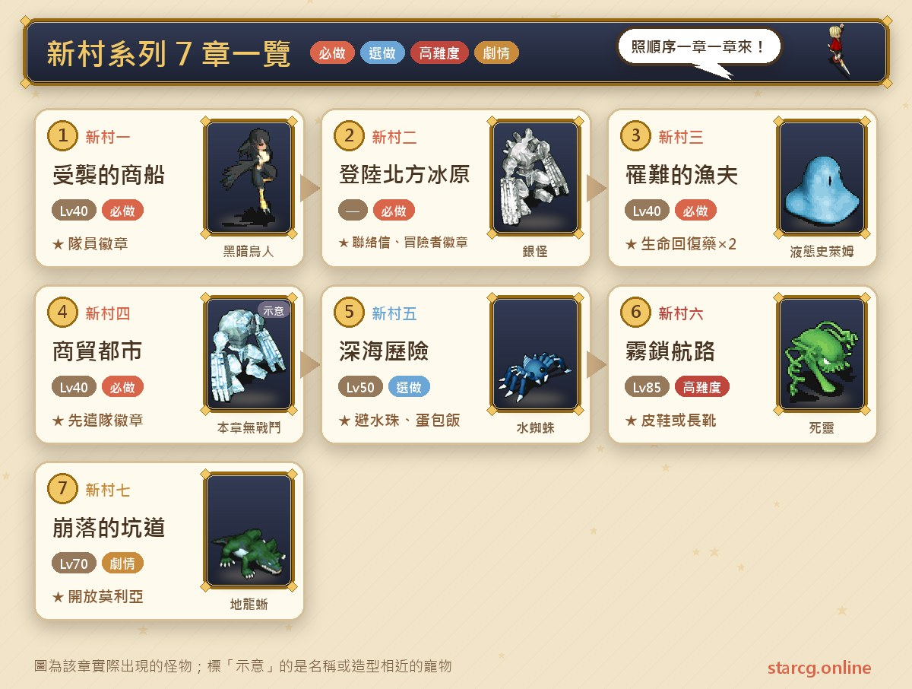
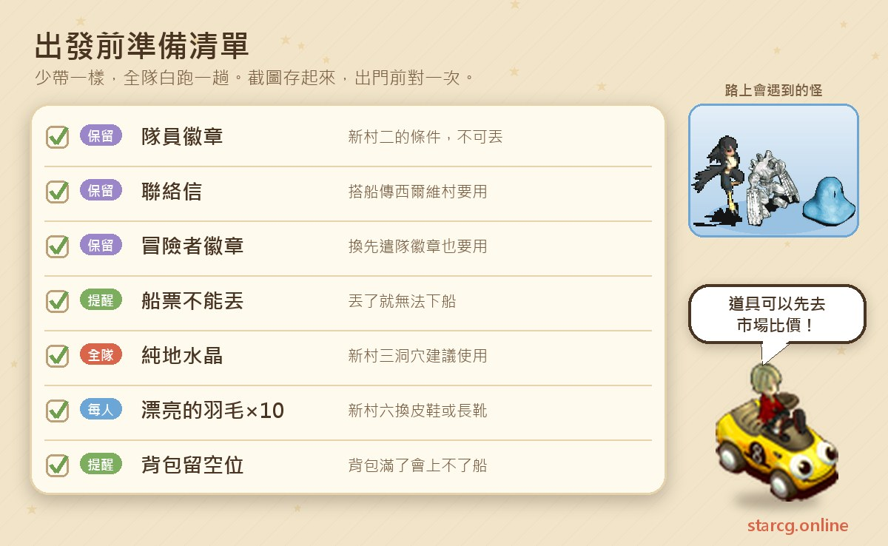
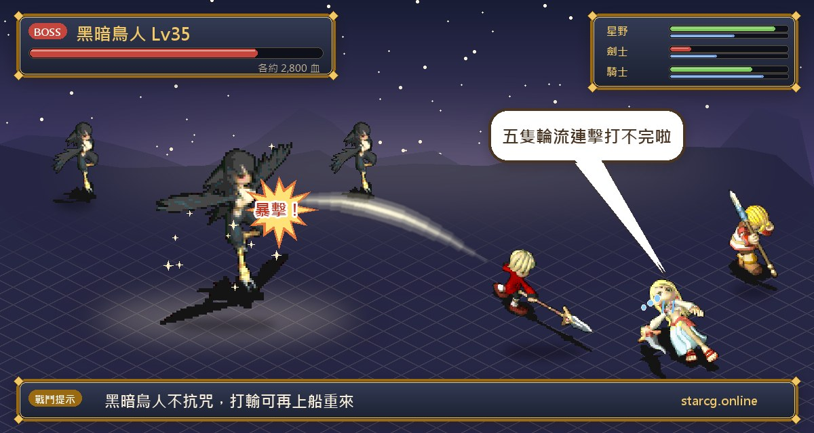
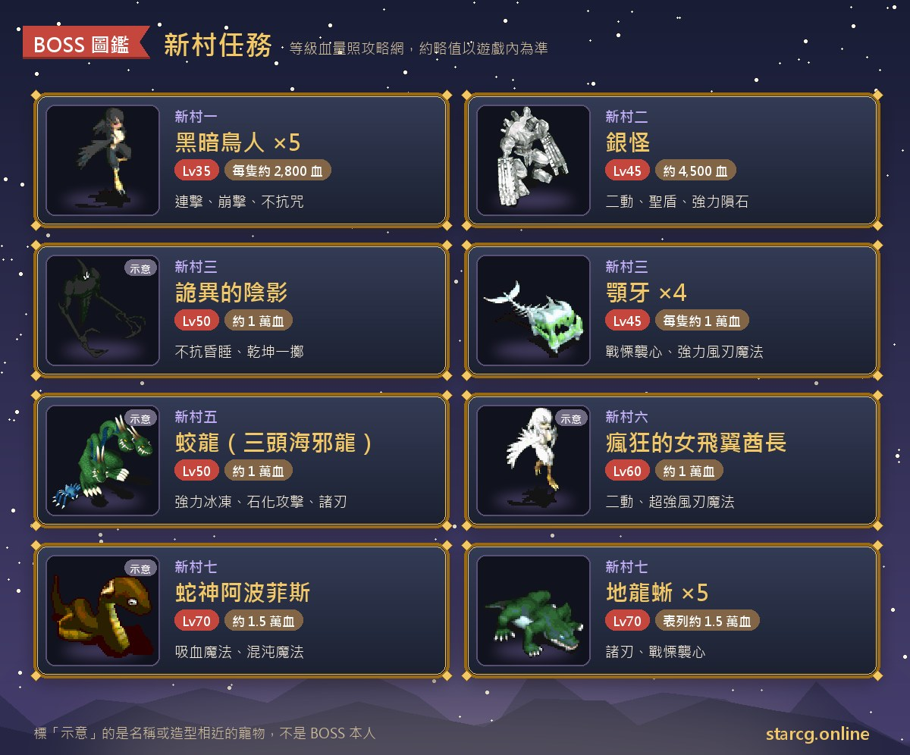

크로스게이트의 신촌(新村) 시리즈는 판부르크(法蘭城) 샤리아 성(謝里雅堡) 명예의 전당에서 받는 「조사 협조 편지」 한 통에서 시작해, 습격당한 상선과 북방 빙원을 지나 상업 도시 스트롬하임(斯特隆海姆)과 광산 마을 모리아(莫利亞)까지 이어지는 7장짜리 퀘스트예요. 플레이어들이 말하는 「신촌」은 이 루트로 열리는 북쪽의 새 지도, 즉 실비 마을(西爾維村), 마타타 평원(瑪塔塔平原), 레크아크 평원(雷克亞克平原), 스트롬하임 성을 가리켜요. 신촌 1의 조건은 40레벨뿐이고 앞의 네 장은 대부분 40레벨 전후로 끝낼 수 있지만, 뒤쪽의 신촌 6은 권장 85레벨, 신촌 7은 권장 70레벨로 난이도가 확 올라가요.

보상은 「통행권」과 실용적인 장신구가 중심이에요. 신촌 1~3에서는 대원 휘장, 연락 편지, 모험가 휘장을 받고, 이후 실비 마을까지 바로 배를 탈 수 있어요. 신촌 4는 Lv.4 부적 **선발대 휘장(先遣隊徽章)**을 주고, 신촌 5는 도중에 부적 피수주(避水珠)를 얻은 뒤 마지막에 오므라이스로 바꿔요. 신촌 6은 거래 가능한 **편안한 가죽 구두(舒適的皮鞋)** 또는 **편안한 롱부츠(舒適的長靴)**, 신촌 7은 광산 마을 모리아 출입을 열어 줘요. StarCG(星詠魔力), 水藍魔力, 初心魔力寶貝 어느 서버든 신촌 퀘스트 진행은 같으니 이 정리를 그대로 대조해서 쓰면 돼요.

> 이 글은 [StarCG 공략 사이트](https://guide.starcg.net/)의 신촌 시리즈 페이지를 바탕으로, 저희 방식대로 순서를 다시 정리하고 새로 쓴 것이에요. 그대로 옮기지 않았어요. 보스 HP와 수치는 대략적인 값이고, 공략 사이트에 없는 수치는 따로 채우지 않았어요. 실제 내용은 게임 안을 기준으로 하고, 업데이트 후 바뀔 수 있어요.

## 신촌 시리즈란? 전체 순서부터 보기

신촌 1~4는 일직선이라 각 장에서 받은 아이템이 다음 장의 입장권이에요. 신촌 4를 마치면 길이 갈라져서 **신촌 5와 신촌 6은 모두 신촌 4 완료 후 열리고**, 신촌 7은 신촌 6 다음에 이어져요. 신촌 5는 서브 퀘스트이고, 공략 사이트에는 광산 마을에 스킬을 올리러 가고 싶을 뿐이라면 신촌 5를 건너뛰고 바로 신촌 6을 해도 된다고 적혀 있어요.

| 장 | 퀘스트 이름 | 권장 레벨 | 획득 |
|---|---|---|---|
| 신촌 1 | 습격당한 상선 | 40(조건 40) | 대원 휘장 |
| 신촌 2 | 북방 빙원 상륙 | —(대원 휘장 소지) | 연락 편지, 모험가 휘장 |
| 신촌 3 | 조난당한 어부 | 40 | 생명 회복약(200) ×2 |
| 신촌 4 | 상업 도시 | 40 | 선발대 휘장 |
| 신촌 5 | 심해 모험 | 50 | 피수주, 오므라이스 |
| 신촌 6 | 안개에 갇힌 항로 | 85 | 편안한 가죽 구두 또는 편안한 롱부츠 |
| 신촌 7 | 무너진 갱도 | 70 | 광산 마을 모리아 출입 개방 |

한 문장으로 정리하면: **1~4는 꼭 해야 하는 길 열기 퀘스트, 5는 서브, 6과 7은 모리아와 신발이 필요할 때만 하면 돼요.**

## 출발 전에 준비할 것

신촌 시리즈의 가장 큰 함정은 「아이템을 버리면 막힌다」는 거예요. 대원 휘장, 연락 편지, 모험가 휘장은 모두 이후 퀘스트나 이동에 필요한 아이템이라 공략 사이트에서도 버리면 안 된다고 거듭 강조해요. 신촌 2의 승선권도 버리면 배에서 내릴 수 없어요. 또 여러 구간에서 「2~5분 기다린 뒤」 대화해야 하니 서두르면 안 돼요.

신촌 6의 보상인 편안한 가죽 구두와 편안한 롱부츠는 모두 **거래 가능**한 장비예요. 둘 중 하나만 필요하거나 직접 잡는 것과 사는 것을 비교하고 싶다면 이 사이트의 [시세 조회](/ko/market/)에서 현재 노점 가격을 먼저 확인해 보세요.

## 신촌 1: 습격당한 상선 (어둠의 조인 5마리)

권장 레벨 40, 조건 40레벨.

1. 판부르크 샤리아 성 (52, 61)에서 명예의 전당에 들어가 2층 방 (46, 49)의 **관리관**에게서 「조사 협조 편지」를 받아요.
2. 제노바 마을(傑諾瓦鎮) 동문으로 나가 먼저 북쪽, 그다음 동쪽으로 가서(다리는 건너지 마세요) (322, 500)의 게시판을 조사하면 손상된 상선에 들어가요.
3. (82, 27)을 조사해 조사 협조 편지를 건네고 「낡은 항해 일지」로 바꿔요.
4. 명예의 전당 2층의 관리관에게 일지를 건네 「조사 휘장」으로 바꾸고, **5분 기다린 뒤** 다시 대화해 조사 휘장을 건네면 「증명서」를 받아요.
5. 티나 마을(蒂娜村) 남문 밖의 **상회 선장**(650, 314)에게 증명서를 건네 「호위자 증명」으로 바꾸면 손상된 상선으로 전송돼요.
6. **5분 기다린 뒤** 배 위의 **상회 선장**(33, 26)과 대화하면 전투가 시작돼요.
7. 이기면 호위자 증명을 건네 「선장의 편지」로 바꾸고 상선에서 나와요. 명예의 전당 2층의 관리관에게 전하면 「대원 휘장(隊員徽章)」을 받고 퀘스트 완료예요.

**보스 정보**: 어둠의 조인(黑暗鳥人) ×5, 각 35레벨, HP 약 2,800, 땅 50·바람 50, 인간형이고 **저주 저항이 없어요**. 공격, 방어, 연속 공격, 붕격, 바람칼날 마법을 써요. 다섯 마리가 동시에 움직여서 막 40레벨이 된 파티에게는 힘든 싸움이고, 주술 계열 제어 스킬이 크게 활약할 수 있어요.

**주의할 점**: 호위자 증명이 있으면 다시 배에 탈 수 있어서, 전투에서 지면 5단계를 몇 번이든 반복할 수 있어요. 이미 신촌 1~4를 끝낸 도우미 플레이어는 호위자 증명을 받은 뒤 신촌 4가 끝날 때까지 다시 대화할 필요가 없고, 도중의 퀘스트 아이템도 언제든 버려도 돼요. **대원 휘장은 신촌 2의 조건이니 절대 버리지 마세요.**

## 신촌 2: 북방 빙원 상륙 (산 정상의 은 괴물)

조건은 대원 휘장 소지이고, 공략 사이트에 권장 레벨은 표시되어 있지 않아요.

1. 샤리아 성 (47, 49)에서 명예의 전당에 들어가 2층 방 (57, 87)의 **관리원**에게 대원 휘장을 건네 「모험대 휘장」으로 바꿔요. 신촌 1에 바로 이어서 한다면 약 5분 기다린 뒤 대화해야 해요.
2. 이르 마을(伊爾村) 항만 관리소의 **연락 소대 연락관**(20, 17)에게서 「승선권」을 받으면 연합 소대 전함으로 전송돼요. 배에 탈 수 없다면 가방이 가득 찼는지, 아직 대원 휘장을 모험대 휘장으로 바꾸지 않았는지 확인하세요.
3. 약 2분 기다린 뒤 **선장**(44, 25)에게 승선권을 건네면 임시 주둔지로 전송돼요. **승선권은 버리면 안 돼요.** 버리면 배에서 내릴 수 없어요.
4. **연합 소대 부대장**(31, 60)에게서 「보급 물자」를 받고 (44, 42)에서 산길로 들어가요. 도우미 플레이어는 이 대화를 건너뛰고 바로 북쪽으로 가야 해요. 부대장이 조심해서 가라는 대사를 한다면 **확인을 누르지 마세요**. 누르면 바로 실비 마을로 전송돼요.
5. 랜덤 미궁을 지나 산 정상에 가서 **선발대원**(54, 45)에게 보급 물자를 건네 「각성 음료」로 바꾸고, 북쪽 (49, 32)에서 하산길로 들어가요.
6. 랜덤 미궁을 지나 산기슭에서 **광폭한 거인**(47, 35)과 대화하면 전투가 시작돼요.
7. 이긴 뒤 다시 거인에게 말을 걸어 각성 음료를 건네면 「대지의 심장」을 받고 산 정상으로 돌아가요. 선발대원(54, 45)에게 전하면 「연락 편지」를 받고 퀘스트 완료예요.

**보스 정보**: 은 괴물(銀怪)은 45레벨, HP 약 4,500, 1턴 2회 행동이고 공격, 방어, 성스러운 방패, 양날, 강력 운석 마법을 써요.

**이후의 지름길**: 연락 편지와 모험가 휘장이 있으면 이르 마을 항만 관리소의 연락관에게서 배를 타고, 약 2분 뒤 선장과 대화해 내린 다음 임시 주둔지의 부대장에게 가면 실비 마을로 전송돼요. **연락 편지와 모험가 휘장은 버리면 안 돼요.** 버리면 이 이동 경로가 사라져요. 오르막·내리막 두 구간의 랜덤 미궁은 [미궁 계단 찾기](/ko/maze/)로 길을 기록하며 가면 편해요.

## 신촌 3: 조난당한 어부 (이상한 동굴)

권장 레벨 40, 조건은 연락 편지와 모험가 휘장 소지예요.

1. 실비 마을 여관 2층 (54, 45)의 **연합 소대 부대장**(46, 16)에게 연락 편지를 건네 「통행증」을 받아요. 이미 완료한 도우미 플레이어는 받을 수 없지만, 6단계부터 함께 싸워 줄 수 있어요.
2. **어부의 아내**(46, 55)에게서 「작은 물자 자루」를 받아요.
3. 마타타 평원 (116, 182)의 나무 울타리를 조사해 바위 동굴에 들어가, **어부**(14, 9)에게 작은 물자 자루를 건네면 「마을 사람 정보」를 받아요.
4. 여관 2층으로 돌아가 부대장에게 통행증과 마을 사람 정보를 건네고 「조사증」으로 바꿔요.
5. 마타타 평원 (154, 174)의 나무 울타리를 조사해 이상한 동굴에 들어가 약 9층의 랜덤 미궁을 지나가요. 도중에는 42~46레벨의 리퀴드 슬라임(液態史萊姆), 구울, 악아(顎牙)가 나오고, 공략 사이트는 순수 땅 수정이나 땅·물 파티를 권해요.
6. 맨 아래에서 **기괴한 그림자(詭異的陰影)**와 대화하면 전투가 시작돼요.
7. 이긴 뒤 **이상한 수정**에 조사증을 건네면 「수정 조각」을 받고 미궁 꼭대기 층으로 전송돼요. 걸어서 실비 마을로 돌아가요.
8. 여관 2층의 부대장에게 수정 조각을 건네 「보급 편지」로 바꾸고, **보급관**에게 전하면 생명 회복약(200) ×2를 받고 퀘스트 완료예요.

**보스 정보**: 기괴한 그림자는 50레벨, HP 약 10,000이고 **수면 저항이 없어요**. 공격, 방어, 붕격, 연속 공격, 건곤일척을 써요. 곁에는 45레벨 악아 4마리가 있고 각 HP 약 10,000에 전율습심과 강력 바람칼날 마법을 써요. 적 다섯 모두 HP가 두꺼워서 신촌 전반부에서 가장 지구력이 필요한 전투예요. 메인 보스가 수면 저항이 없다는 점을 잘 활용하세요.

## 신촌 4: 상업 도시 (선발대 휘장)

권장 레벨 40, 신촌 3을 완료하면 받을 수 있고 다른 선행 아이템은 필요 없어요.

1. 실비 마을 여관 2층의 **연락관**(44, 16)에게서 「연락 편지」를 받아요. 퀘스트를 받을 수 없고 이미 신촌 전송석을 쓸 수 있다면, 이 장은 이미 완료한 거예요.
2. 실비 마을에서 출발해 마타타 평원 (304, 95)에서 태고의 지하 수맥으로 들어가요.
3. (41, 37)의 계단으로 레크아크 평원에 나가, (108, 164)로 가면 스트롬하임에 도착해요.
4. 의사당 (34, 34)의 **탐험대 대장**(10, 4)에게 연락 편지와 모험가 휘장을 건네면 「선발대 휘장」을 받고 퀘스트 완료예요.

**선발대 휘장**: Lv.4 부적, 내구 100, 민첩 +10, 회복 +10, 필살 +5, 명중 +10, 생명 +50이에요. 거래할 수 없고 **바닥에 버리면 사라져요**. 이후 퀘스트에 꼭 필요한 아이템은 아니니 필요 없으면 버려도 돼요. 이 장에는 전투가 없고, 스트롬하임까지 길을 여는 것이 주된 목적이에요.

## 신촌 5: 심해 모험 (피수주와 오므라이스)

권장 레벨 50, 신촌 4를 완료하면 받을 수 있는 서브 퀘스트예요.

1. 스트롬하임 성 자료관 (45, 33)의 **민속학자 팔운송(八雲松)**(23, 11)에게서 「조사 노트」를 받아요.
2. 황혼부터 밤 사이에 스트롬하임 성 (22, 42)의 **한가로운 어부**를 찾아 해도 비경에 들어가요.
3. **물거미(水蜘蛛)**(28, 55)와 싸워요(45레벨, HP 약 500의 물거미 4마리). 이기면 **거북 현자(烏龜賢者)**(34, 36)에게서 「공주의 구조 요청 편지」를 받고 전송석 (29, 28)로 해저 터널에 들어가요.
4. 랜덤 미궁을 지나 게 장군 영지에서 **철게 장군(鐵蟹將軍)**(26, 11)에게 구조 요청 편지를 건네 「군사 정보 편지」로 바꾸면 전송되어 나와요. 군사 정보 편지를 거북 현자에게 건네면 「거북 현자의 신표」를 받고, 다시 자료실의 팔운송에게 가요.
5. 실비 마을 (56, 60)의 **호쾌한 어부**에게 신표를 건네 「벽수주(碧水珠)」로 바꿔요.
6. 황혼부터 밤 사이에 다시 한가로운 어부를 통해 비경에 들어가, 물거미를 쓰러뜨린 뒤 거북 현자(69, 13)를 통해 궁전에 들어가 **삼두 해사룡(三頭海邪龍)**과 대화하면 전투가 시작돼요.
7. 이긴 뒤 거북 현자에게 조사 노트와 벽수주를 건네면 「해족의 사례품」과 「어부에게 줄 사례품」을 받아요. 해족의 사례품을 팔운송에게 건네 **피수주**로 바꾸고, 어부에게 줄 사례품을 실비 마을의 호쾌한 어부에게 건네면 오므라이스를 받고 퀘스트 완료예요.

**보스 정보**: 적 표에 적힌 이름은 교룡(蛟龍)이고(진행 단계에서는 삼두 해사룡이라고 불러요), 50레벨, HP 약 10,000에 강력 빙결 마법, 석화 공격, 양날을 써요. 곁에는 45레벨, HP 약 900의 물거미 4마리가 있고 연속 공격을 써요.

**피수주와 무극 소용돌이**: 피수주는 Lv.4 부적, 거래 불가, 내구 100, 필살 +8, 명중 +15이고 수치는 변동돼요. 또한 해도 비경에서 물거미를 쓰러뜨린 뒤 **거북 보좌관**(46, 24)을 찾아 울타리를 지나면 노란 전송석으로 「무극 소용돌이(無極漩渦)」에 들어갈 수 있어요. 약 5층의 랜덤 미궁이고 48~55레벨의 철가위 게, 물거미, 거대 집게 게가 나와요.

## 신촌 6: 안개에 갇힌 항로 (뒤틀린 등대와 편안한 롱부츠)

권장 레벨 85, 신촌 4를 완료하면 받을 수 있어요.

1. 스트롬하임 성 의사당 (34, 34)의 **보좌관**(12, 4)에게서 「조사 증명」을 받아요.
2. 레크아크 평원 (209, 231)의 **부상자**에게 조사 증명을 건네 「증언 1」로 바꾸고, 성으로 돌아가 **늙은 선원**(27, 41)에게 증언을 건네 「조사서」로 바꿔요.
3. 의사당 2층의 **물자관**(18, 6)에게 조사서를 건네 「해도 조사 편지」로 바꿔요. **몸에 조사 증명이 아직 남아 있다면 먼저 버려야** 해요. 그렇지 않으면 해도 조사 편지를 받을 수 없어요.
4. 레크아크 평원 (176, 242)의 **조사대원**에게 해도 조사 편지를 건네 「위병의 구조 요청 편지」로 바꾸고, 마법 대학(魔法大學)의 **쾌활한 법사**(88, 139)에게 가서 「결계 수정」으로 바꿔요.
5. 조사대원에게 돌아가 (185, 247)의 전송석으로 「뒤틀린 등대(扭曲的燈塔)」에 들어가 약 10층의 랜덤 미궁을 지나가요. 도중에는 49~54레벨의 사령(死靈), 조인(鳥人), 흙거미(土蜘蛛)가 나오고, 쓰러뜨리면 일정 확률로 「예쁜 깃털(漂亮的羽毛)」을 떨어뜨려요.
6. 미궁 맨 아래층에서 **광란의 여성 비익 족장(瘋狂的女飛翼酋長)**과 대화하면 전투가 시작돼요.
7. 이긴 뒤 조사대원에게 결계 수정을 건네면 「등대 보고서」를 받고 탑 밖으로 전송돼요. 의사당 2층의 **관리관**(18, 7)에게 보고서를 건네면서 **예쁜 깃털 10개**를 가지고 있으면 장비를 받을 수 있어요.

**보스 정보**: 광란의 여성 비익 족장은 60레벨, HP 약 10,000, 1턴 2회 행동이고 연속 공격, 초강력 바람칼날 마법, 건곤일척을 써요. 곁에는 55레벨, HP 약 2,300의 비익 호위 4마리가 있고 흡혈 마법과 화염 마법을 써요.

**보상**: 편안한 가죽 구두(방어 +17~23, 민첩 +25~30, 정신 +3~5, 명중 +6~8) 또는 편안한 롱부츠(방어 +45~65, 민첩 +5~8, 명중 +5~10, 마법 저항 +15~30)이고, 둘 다 Lv.6, 내구 200, 거래 가능이에요. 예쁜 깃털 10개를 가지고 있으면 물자관에게서 바로 교환할 수도 있어요. 퀘스트 완료 후에는 다시 받을 수 없지만, 등대에 들어가 다른 사람을 도우면서 깃털을 계속 모을 수 있어요.

## 신촌 7: 무너진 갱도 (사신 아포피스)

권장 레벨 70, 조건은 신촌 6 완료예요. 공략 사이트에는 보상이 「없음」으로 표시되어 있지만, 완료하면 광산 마을 모리아를 자유롭게 드나들 수 있어요.

1. 스트롬하임 성 의사당 2층의 **관리관**(18, 6)에게서 「의뢰 편지」를 받고, 성 안 (63, 32)의 **광산 마을 연락원**에게 가서 「의뢰 증서」로 바꿔요.
2. 레크아크 평원 북동쪽 (269, 45)에서 의뢰 증서를 가지고 **위병**에게 가면 광산 마을 모리아에 들어가요.
3. 촌장의 집 (30, 29)의 **촌장**(60, 81)에게서 「촌장의 의뢰서」로 바꾸고, (41, 23)의 **자경단 단장**에게 가서 「긴급 소포」로 바꿔요.
4. (41, 21)에서 모리아 갱도에 들어가고, (47, 6)에서 음산한 광로로 들어가 랜덤 미궁을 지나 모리아 광구에 도착한 뒤, (21, 25)에서 무너진 통로로 들어가요.
5. (28, 8)에서 지도를 바꾸고, (7, 11)의 바위를 조사해 긴급 소포를 건네면 「부대장의 노트」를 받아요. 다시 (29, 3)에서 오래된 심연의 균열로 들어가요.
6. 랜덤 미궁을 지나 맹약의 성전(盟約聖殿)에 도착하면, (7, 39)를 조사해 장면을 바꾸고 (48, 39)의 수정석을 조사해 전투를 시작해요.
7. 이긴 뒤 **그로크・한철(格羅克・寒鐵)**(55, 6)에게 노트를 건네 「대장의 설명서」로 바꾸면 갱도로 돌아가요. 촌장의 집에서 촌장에게 전하면 퀘스트 완료예요.

**보스 정보**: 사신 아포피스(蛇神阿波菲斯)는 70레벨, HP 약 15,000이고 빙결 마법, 흡혈 마법, 강력 운석 마법, 혼돈 마법을 써요. 곁에는 70레벨 땅 용도마뱀(地龍蜥) 5마리가 있고 양날과 전율습심을 쓰며, 공략 사이트 표에는 이들도 HP 약 15,000으로 나와 있어요. 적 여섯 모두 HP가 두꺼우니 보급과 장기전 준비를 충분히 하세요. 완료 후에는 의뢰 증서 없이도 위병을 통해 모리아에 들어갈 수 있어요.

## 신촌 자주 묻는 질문

**신촌 퀘스트는 최소 어디까지 해야 하나요?** 실비 마을 배편 이동을 원하면 신촌 2까지, 선발대 휘장과 스트롬하임 길 열기를 원하면 신촌 4까지 하면 돼요. 신촌 5는 서브 퀘스트이고, 신촌 6과 7은 신발과 모리아를 위한 장이에요.

**신촌 2에서 배에 탈 수 없으면 어떻게 하나요?** 먼저 가방이 가득 찼는지 확인하고, 명예의 전당에서 대원 휘장을 모험대 휘장으로 바꿨는지 확인하세요.

**연락 편지와 모험가 휘장은 버려도 되나요?** 안 돼요. 버리면 임시 주둔지를 통해 실비 마을로 이동할 수 없고, 신촌 4에서 선발대 휘장을 받을 때도 모험가 휘장이 필요해요.

**신촌 6의 물자관이 왜 해도 조사 편지를 안 주나요?** 몸에 조사 증명이 남아 있으면 받을 수 없어요. 조사 증명을 먼저 버리고 다시 대화하면 돼요.

**편안한 롱부츠를 여러 켤레 받을 수 있나요?** 퀘스트 자체는 다시 받을 수 없지만, 예쁜 깃털 10개가 있으면 물자관에게서 바로 교환할 수 있어요. 깃털은 뒤틀린 등대에서 다른 사람을 도우며 계속 모을 수 있어요.

## 정리: 휘장을 챙기고, 순서대로 길 열기

신촌 퀘스트의 전투 난이도는 40레벨의 어둠의 조인에서 70레벨의 사신 아포피스까지 올라가지만, 진행이 순조로울지를 정하는 건 아이템 관리예요. 대원 휘장, 연락 편지, 모험가 휘장은 버리면 안 되고, 승선권도 버리면 안 되며, 신촌 6에서는 남은 조사 증명을 버리는 걸 잊지 마세요. 1~4 순서대로 북쪽 지도를 열고, 필요에 따라 5, 6, 7을 골라서 하면 신촌 루트 전체를 한 번에 끝낼 수 있어요.

원래 퀘스트 페이지의 전체 자료는 [StarCG 공략 사이트](https://guide.starcg.net/quests/newvillage)에서 볼 수 있어요. 이 사이트의 [미궁 계단 찾기](/ko/maze/)와 [시세 조회](/ko/market/)도 함께 써서 신촌의 미궁과 장보기 시간을 줄여 보세요.
