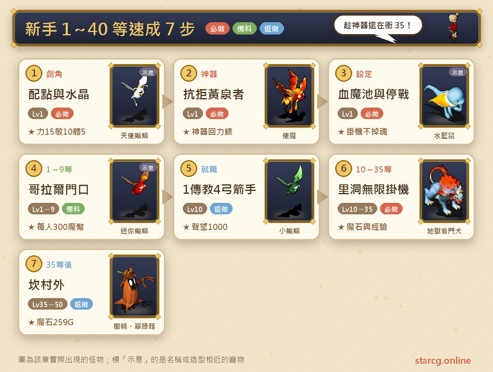
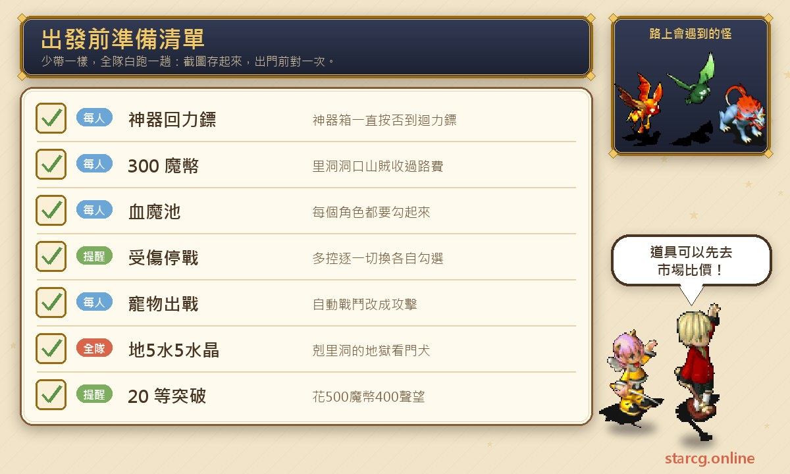
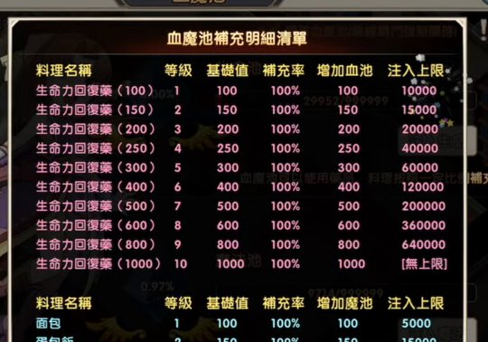
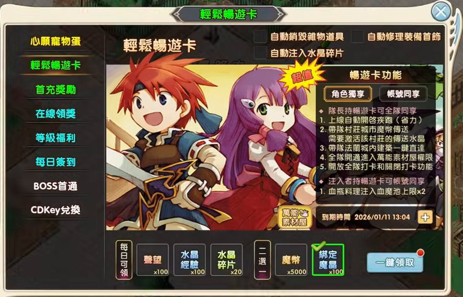
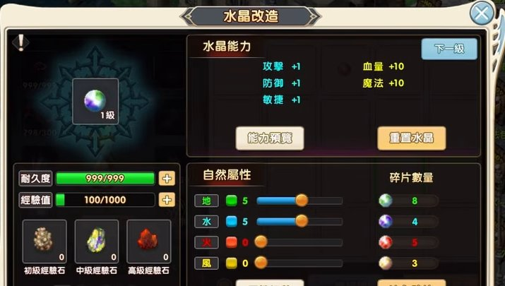
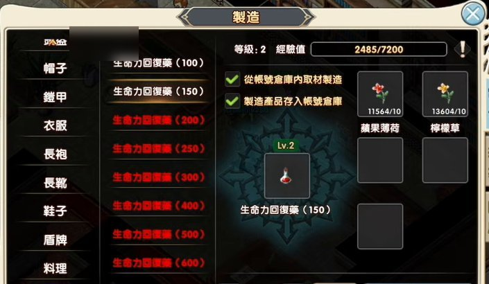
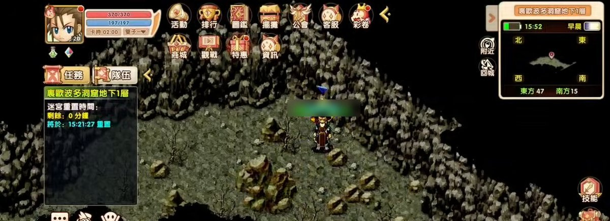
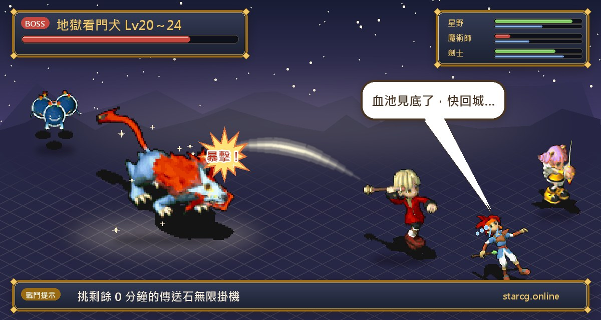
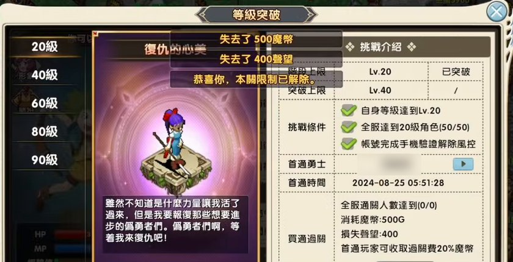

크로스게이트를 막 시작한 초보가 가장 많이 묻는 건 「어디서 레벨업하나요」와 「이 버튼들은 뭐예요」예요. 이 글은 저희 사이트가 실제로 돌려 본 초보 루트를 하나의 흐름으로 정리했어요. 캐릭터 생성, 스탯 분배와 수정 속성부터 시작해서, 첫 퀘스트 「황천에 항거하는 자(抗拒黃泉者)」를 끝낸 뒤 신기 상자를 열어 **신기 부메랑**을 받고, 신기가 24시간뿐인 동안 멀티 조작으로 캐릭터 5명을 데리고 코랄(哥拉爾) 문 앞에서 10레벨까지, 이어서 아노만 성(亞諾曼城) 밖의 **리동(里洞, 裏歐波多洞窟)**에서 35레벨 이상까지 사냥해요. 중간에 혈마지(血魔池), 부상 시 전투 정지, 이용권(暢遊卡·월간 카드), 작업 시간(工時), 채집, 레벨 돌파 같은 StarCG만의 화면도 함께 설명할게요.

StarCG는 水藍魔力, 初心魔力寶貝와 퀘스트 흐름이 대체로 같지만, 「1창 5개 멀티」「혈마지」「레벨 돌파」「작업 시간」 같은 시스템은 StarCG 고유 설계라 다른 버전에는 없을 수 있어요. 다른 버전을 플레이한다면 사냥터 부분만 참고하면 돼요.

> 이 글은 저희 사이트가 예전에 만든 초보 가이드 영상의 내용을 다시 정리해 새로 쓴 것이고, [StarCG 공략 사이트](https://guide.starcg.net/)의 「사냥터(練功地點)」「고유 특색(獨有特色)」 페이지와 사이트의 기존 글 [초보 퀘스트 공략](/ko/posts/newbie-quest-guide/)을 대조했어요. 영상 속 구성과 경험은 객관적인 표현으로 바꿨고, 자료끼리 맞지 않는 부분은 나란히 적었어요. 게임 업데이트 후 내용이 바뀔 수 있으니 실제 게임을 기준으로 해 주세요. 사진은 모두 중국어 화면이에요.

## 초보 속성 루트: 전체 순서부터

핵심은 한 문장이에요. **월간 카드 첫날과 신기 부메랑의 높은 데미지를 이용해서, 신기가 끝나기 전에 35레벨 이상까지 올리기.** 신기는 24시간뿐이라 너무 먼 곳을 돌아다니며 시간을 낭비하지 말고, 취직도 가장 빠른 두 직업만 골라요.

| 단계 | 레벨 | 장소 | 할 일 |
|---|---|---|---|
| 캐릭터 생성 | 1 | 생성 화면 | 힘15·민첩10·체력5, 수정 땅5물5, 남녀 섞기 |
| 첫 퀘스트 | 1 | 판부르크(法蘭城) 리셰리아 성 | 황천에 항거하는 자, 보상 받고 신기 상자에서 부메랑 |
| 화면 설정 | 1 | 어디서나 | 혈마지, 부상 시 전투 정지, 펫 출전, 자동 전투 |
| 첫 사냥터 | 1~9 | 쿠루크스섬(庫魯克斯島) 코랄 문 앞 | 10레벨까지 사냥, 1인당 300마폐 모으기 |
| 취직 | 10 | 판부르크 | 성직자 1+궁술사 4, 명성 1000 받기 |
| 주력 사냥터 | 10~35 이상 | 아노만 성 밖 리동 | 남은 시간 0분인 전송석에서 무한 사냥 |
| 이후 | 35~65 | 칸나베라 마을 밖, 얼음 동굴 등 | 필요에 따라 선택 |

## 출발 전에 챙길 것

초보는 장비를 따로 살 필요가 없어요. 중요한 건 세 가지예요. **신기 부메랑**(모든 캐릭터가 받기), **1인당 최소 300마폐**(리동 통행료), 그리고 **모든 캐릭터에 혈마지와 부상 시 전투 정지를 확실히 체크**하기. 레벨업 정리 글에서는 혈마지가 부족하면 22레벨 이상부터 게임의 노점 시장에서 물약을 사서 주입할 수 있다고 해요. 사기 전에 사이트의 [시세 검색](/ko/market/)으로 물약 시세를 보고 환산가가 가장 싼 노점을 골라 보세요.

## 캐릭터 생성: 스탯, 수정 속성, 남녀 구성

StarCG는 계정 하나로 캐릭터 5명을 동시에 조작할 수 있어서, 5명을 한 번에 만들어 두는 걸 추천해요. 하나 만들 때마다 로그아웃하고 다음 캐릭터를 만들면 돼요. 생성 화면 왼쪽에서 외형을 고르고(통통한 버전·날씬한 버전, 1.0/2.0 외형), 오른쪽에서 능력치를 나눠요.

1. **스탯**: 모든 캐릭터를 **힘 15, 민첩 10, 체력 5**로.
2. **수정 속성**: **땅 5 물 5** 추천. 나중에 사냥할 리동의 켈베로스(地獄看門犬)가 물·불 속성이라 땅 5 물 5로 상성을 잡으면 효율이 좋고 소모도 줄어요. 공략 사이트 사냥터 페이지에도 리동 켈베로스가 물6 불4로 나와 있어 방향이 같아요.
3. **남녀 섞기**: 나중에 유다(猶大, 시공의 문 1: 개척자) 퀘스트에서 필요해서 남자·여자 캐릭터를 함께 두는 게 좋아요. StarCG에서는 남녀 파티장이 서로 촛불만 주고받으면 되도록 바뀌었어요. 실제로 돌린 구성은 남자 4명, 여자 1명이에요.

레벨업 후 스탯은 **힘 2·민첩 1·체력 1**로 계속 찍는 걸 추천해요. 나중에 성직자가 될 캐릭터도 우선 똑같이 찍고, 40레벨에 받는 재생약으로 일반 성직자 스탯으로 다시 바꿔요(아래 「40레벨 재생약」 참고).

## 첫 퀘스트와 신기 상자: 모두 부메랑으로

캐릭터를 만들고 처음 접속하면 왼쪽 퀘스트 목록에서 「황천에 항거하는 자」를 누르면 자동 길찾기가 돼서, 예전처럼 큰 지도를 눌러 한 칸씩 걸을 필요가 없어요. 퀘스트 흐름과 좌표는 [초보 퀘스트 공략](/ko/posts/newbie-quest-guide/)에 정리돼 있어요. 왕궁 소환사 게이즈를 찾고, 영당에서 죽은 자의 반지를 받고, 국왕을 알현해 하사장을 받은 뒤, 병사에게 국민 장비·반창고와 임프(使魔) 또는 쁘띠 배트(小蝙蝠)를 받아요. 보상 중에는 **경험치 2배 반지**가 있고, 빨강·파랑 수정은 혈마지에 주입하는 아이템이에요.

다음이 이 루트에서 가장 중요한 단계, **신기 상자 열기**예요.

1. 오른쪽 아래 「멀티(多控)」로 상자를 열 캐릭터로 바꿔요.
2. 신기 상자를 열고 「아니요」를 계속 눌러 **부메랑**이 나올 때까지 넘겨요(실제로는 아니요를 5번쯤 눌렀던 것으로 기억해요).
3. 부메랑이 나오면 「예」를 골라 「**아카스(阿卡斯)**」라는 무기를 받아요.
4. 다음 캐릭터로 바꿔 똑같이 반복해서 5명 모두 신기 부메랑을 받아 장착해요.

레벨업 정리 글도 같은 조언이에요. 신기 상자는 무조건 부메랑, 신기는 24시간뿐이라 끝나기 전에 최소 35레벨까지 올려야 해요. 부메랑을 장착한 뒤에는 입을 수 없는 평민 장비를 버리고 소지품 칸을 비워 두세요. 그래야 마석을 모을 공간이 생겨요. 마지막으로 **모든 캐릭터의 펫을 「전투」로** 바꾸는 것도 잊지 마세요. 어떤 캐릭터에서 버튼이 안 눌리면 멀티로 그 캐릭터로 바꿔 다시 눌러서 모든 펫이 출전 상태인지 확인해요.

## 화면 한 번에 보기: 멀티, 길찾기, 소지품

- **멀티(1창 5개)**: 오른쪽 아래 「멀티」를 누르고 각 캐릭터의 로그인을 누르면 초록불이 켜져요. 「일괄 소환」을 누르면 5명이 바로 파티가 돼요. 공략 사이트에 따르면 일괄 로그인·일괄 소환은 최대 5명이고, 멀티 전투 중 180초 동안 조작이 없으면 캐릭터가 자동으로 접속 종료돼요.
- **질주**: 왼쪽 아래 질주를 누르면 걷는 속도가 빨라져요.
- **자동 길찾기**: 왼쪽 퀘스트를 누르면 자동으로 걸어가고, 오른쪽 위 길찾기는 현재 지도의 이동 지점을 보고 경로를 정해요.
- **5명 장비 동시 조작**: 멀티로 5명의 장비를 한 번에 입히고, 각 캐릭터의 소지품·마폐·카드 시간·마정도 동시에 볼 수 있어요.
- **일괄 집합**: 왼쪽에서 파티원을 한 번에 곁으로 모을 수 있어요.

## 혈마지: StarCG의 자동 회복 시스템

예전 크로스게이트는 물약을 챙겨 다니고 마나가 없으면 직접 채워야 했어요. StarCG는 자동 사냥이 되기 때문에 **혈마지**로 바뀌었어요. 전투가 끝날 때마다 설정에 따라 풀에서 캐릭터와 펫의 HP·MP를 자동으로 채워 줘요. 예를 들어 혈지·마지가 각 10,000이고 한 전투에서 HP 100, MP 100을 썼다면 끝난 뒤 풀은 각 9,900이 돼요.

설정 방법: 아래쪽 혈마지를 누르고 **모든 캐릭터의 혈마지 기능을 체크**한 다음 빨강·파랑 수정을 주입해요. 혈마지는 계정 안의 모든 캐릭터가 함께 써요.

혈지는 물약으로, 마지는 요리로 채우고 아이템 등급이 높을수록 많이 채워져요. 위 사진은 게임 안의 「혈마지 보충 명세표」예요. 생명력 회복약(100)은 혈지 100 증가·주입 상한 10,000, 생명력 회복약(150)은 150 증가·상한 15,000, 이런 식으로 올라가요. 요리는 빵이 마지 100 증가·상한 5,000, 오믈렛 라이스(蛋包飯)가 150 증가·상한 15,000이에요. **이용권(월간 카드)이 있으면 주입 상한이 2배**라서, 실제로 150 물약의 상한은 15,000인데 30,000까지 주입할 수 있었어요.

혈마지를 공짜로 채우는 방법도 두 가지 있어요.
- **접속 보상**: 30분 이상 접속하면 혈지·마지 각 500(캐릭터 5명 합계 2,500), 2시간 이상이면 명성 100과 수정 경험치를 받아요.
- **출석 체크**: 첫날에도 혈지를 받을 수 있어요.

## 꼭 켜기: 부상 시 전투 정지와 기타 설정

초보가 가장 신경 써야 할 설정은 「설정」 안의 **부상 시 전투 정지(受傷停戰)**예요. 혈마지가 다 떨어졌는데도 계속 사냥하면 회복이 안 돼 캐릭터가 쓰러지고, 계속 다치면 **혼이 빠져서(掉魂)** 능력치가 크게 떨어져요. 혼을 되찾는 데도 돈이 많이 드니 꼭 피해야 해요.

설정 안의 다른 유용한 항목이에요.
- **1레벨 펫을 만나면 자동 전투 정지**, 그리고 알림음도 나와요.
- **조우 방식 「움직이지 않기」**: 기본값은 예전처럼 캐릭터가 계속 걸어 다니며 몬스터를 만나는데, 「움직이지 않기」를 켜면 화면이 흔들리지 않아요.
- **플레이어 숨기기**: 플레이어가 많으면 화면이 버벅이니 숨기면 화면도 깔끔해져요.
- 노점 일괄 보기, 거래 허용 등은 상황에 맞게 켜고 끄세요.
- 모바일 유저는 시야를 150%까지 넓혀 더 멀리 볼 수 있어요.

**주의할 점**: 실제로 돌려 보니 한 캐릭터에서 모든 캐릭터를 한꺼번에 체크하면 설정이 적용되지 않을 때가 있었어요. 멀티로 **캐릭터 하나씩 바꿔 가며 각각 체크**하고, 다시 돌아가 부상 시 전투 정지가 제대로 체크됐는지 확인하세요. 자동 전투를 시작할 때는 오른쪽 아래 「자동」을 누르고, 펫을 기본값 「방어」에서 「공격」으로 바꾸는 것도 잊지 마세요.

## 이용권(월간 카드)은 뭐가 좋아요?

이용권은 정액제로, 월간 카드라고도 해요. 초보 퀘스트에서 48시간짜리 월간 카드 기능을 주니까 이 시간을 레벨업에 쓰면 딱 좋아요.

화면에 나오는 이용권 기능은 이래요. 파티장이 이용권을 가지면 파티 전체가 공유, 접속 시 질주 자동 켜기, 파티를 이끌고 마을·도시로 마폐 이동(해당 마을의 이동 수정 활성화 필요), 판부르크 안 건물로 파티 일괄 직행, 파티 전체 만능 소재 집 입장 권한, 파티 전체 출근 체크와 출근 해제 기능, 그리고 주입자가 이용권을 가지면 계정 공유로 물약·요리의 혈마지 주입 상한 ×2. 위쪽에는 「잡동사니 자동 파기」와 「수정 조각 자동 주입」도 있어서, 물음표 카드를 얻으면 자동으로 버리고 수정 조각을 얻으면 자동으로 수정에 주입해요.

**매일 받을 수 있는 것**: 명성 ×100, 수정 경험치 ×100, 수정 조각 ×20, 그리고 마폐 ×5000과 귀속 마정(綁定魔晶) ×100 중 택1이에요. 보통은 상점에서 작업 시간을 살 수 있는 **귀속 마정**을 더 추천해요(다음 절 참고).

월간 카드가 있으면 편한 점이 더 있어요.
- 판부르크에서 건물을 바로 눌러 그 건물 안으로 날아갈 수 있어요(예: 대성당(大聖堂), 동쪽 의원).
- 정액제가 있으면 병원 옆 **큐(水藍鼠)**에게 마석을 한 번에 다 팔 수 있어요.
- 오른쪽 아래 「자주 쓰기」의 **빠른 출근 체크**로 파티 전체가 한 번에 출근 체크를 할 수 있지만, 캐릭터마다 100마폐가 들어요. 월간 카드가 없으면 각자 따로 체크해야 해요.

**주의할 점**: 코랄 사냥을 마치고 보니 몸에 수정 조각이 남아 있었어요. 자동 주입과 자동 파기가 적용되지 않았다는 뜻이에요. 이 체크도 멀티로 캐릭터마다 하나씩 바꿔 가며 각각 체크하는 게 좋아요.

## 수정 조각: 수정 속성 바로 바꾸기

수정 조각을 주입하면 「수정 개조」에서 수정 속성을 바로 바꿀 수 있어서, 정식 서버처럼 수정을 사러 갈 필요가 없어요. 예를 들어 바람 5 땅 5로 바꾸고 싶으면 막대를 바람 5, 땅 5로 맞추고 「조정」을 누르면 돼요. 조각만 충분하면 바로 바뀌어요. 공략 사이트도 수정 속성 변경에는 수정 조각이 필요하고, 조정할 때마다 그만큼 차감되며 미리 주입해 둘 수 있다고 설명해요.

## 1~9레벨: 쿠루크스섬 코랄 문 앞 사냥

1. 오른쪽 위 지도(세계 지도)를 누르고 **쿠루크스섬**을 골라요.
2. 코랄의 아무 문이나 골라 누르면 마을 밖으로 바로 이동해요. 서문·동문·북문 어디든 괜찮아요.
3. 문 앞에서 자동 사냥만 하면 돼요. 레벨업 정리 글도 속성은 똑같이 땅 5 물 5를 추천해요.

이 구간의 목적은 레벨업과 함께 **돈 모으기**예요. 리동 입구에서 1인당 300마폐를 받으니 코랄에서 마석을 충분히 모아 둬요(실제 목표는 1인당 마석 4개 이상). 실제로 30분쯤 사냥하니 10레벨이 됐어요.

**마석 팔기와 돈 나누기**: 오른쪽 위 귀환을 누르고 병원 옆 **큐**에게 마석을 팔아요(서쪽 의원은 왼쪽, 동쪽 의원은 오른쪽). 정액제가 있으면 한 번에 다 팔려요. 판 뒤 위쪽 돈을 보고 300마폐가 안 되는 캐릭터가 있으면(실제로 한 명이 200 남짓이었어요) 왼쪽 일괄 집합으로 모은 뒤 그 캐릭터를 눌러 거래하고 마폐를 올려 건네주면 돼요. 은행도 쓸 수 있어요. 은행 NPC는 둘인데, 실제로 왼쪽에 넣은 돈은 다른 캐릭터로 꺼낼 수 없었어요. 돈을 옮기려면 **오른쪽 계정 은행**에서 입출금해야 해요.

## 작업 시간과 채집: 취직부터 해야 채집 가능

StarCG의 「작업 시간(工時)」은 채집에 쓰는 시간이에요. 다른 버전은 채집계·제조계·무기 수리·방어구 수리계가 따로 있지만 여기서는 모두 하나로 합쳐져서, 감정·방어구 수리·무기 수리를 캐릭터가 직접 해요. 모든 캐릭터에 **무기·방어구 수리 10, 감정 10, 정맹 10이 기본 내장**(따로 올릴 필요 없음)이라 봉인사 직업도 없고, 어느 직업이든 펫을 잡을 수 있어요. 공략 사이트 고유 특색 페이지에도 초기 수리·감정 기술 레벨이 10이고, 제조는 대기 시간이나 MP 소모 없이 마폐만 차감된다고 나와 있어요.

1. 매일 받은 귀속 마정 100으로 위쪽 「상점」에서 **작업 시간 알람시계(1H) ×5**, 즉 5시간의 작업 시간을 사요.
2. 채집 화면이나 이용권 화면의 노란 버튼으로 **채집 집(만능 소재 집)**에 바로 날아갈 수 있어요. 이것도 이용권 전용 기능이에요.
3. 나중에 혈지에 넣을 물약을 만들려면 **애플민트(蘋果薄荷)**와 **레몬그라스(檸檬草)**가 필요해요. 그런데 채집을 눌러 보면 **취직을 해야 채집할 수 있어요**.

**카드 시간과 현상금**: 하루 카드 시간 상한은 2시간이고, 자정이 지나면 2시간이 자동으로 채워져요. 이 2시간은 출근 체크에 쓰거나, 캐릭터 30레벨 이후 **현상금(懸賞)** 퀘스트 두 개를 풀어 2시간의 카드 시간을 2시간의 작업 시간으로 바꿀 수 있어요. 30레벨이 넘으면 위쪽에 현상금 버튼이 생겨요.

## 10레벨 취직: 성직자 1+궁술사 4

저희가 정리한 1~130 레벨업 글은 원래 **처음부터 취직하는 걸 추천하지 않아요**. 이번에 반대로 가는 이유는 꽃풀을 채집해 물약을 만들어야, 돈을 쓰지 않고도 혈지를 직접 채워 리동 사냥을 더 안정적으로 할 수 있기 때문이에요. 가장 흔한 구성은 궁 4 성 1로, 남자 4명이 궁술사(弓箭手), 여자가 성직자(傳教士)예요. 직업별 취직 흐름과 좌표는 [직업 취임 퀘스트 공략](/ko/posts/job-change-quest-guide/)에 정리돼 있어요.

**성직자**: 대성당으로 바로 날아가 방 안 NPC에게 계속 「예」를 골라 취직 편지를 받고(사이트 취직 공략에 따르면 **토트(托特)**(16, 11)), 옆 NPC와 대화해 취직을 골라요(취직 공략에는 **대승려 라마론(大僧侶拉馬隆)**(17, 19)). 이러면 성직자 취직 완료예요. 파티를 해산한 뒤 뒤쪽 NPC를 따라 작은 방에 들어가면 단일 회복과 T 회복을 배울 수 있어요. T 회복은 강력 회복이라고도 하며 한 번에 4명을 회복해요.

**궁술사**:
1. **직업 소개소(職業介紹所)**에서 취업 지도 NPC에게 궁술사가 되고 싶다고 말하면 **평민 활**을 줘요. 다른 남자 캐릭터 3명도 똑같이 해요.
2. **동쪽 의원**으로 날아가 간호사 옆에 모여 각자 **진통제(특가품)**를 하나씩 사요. 3마폐뿐이에요.
3. 오른쪽 위 지도를 열어 왼쪽 아래로 끌어 직업 길드(職業公會)로 날아가고, 왼쪽 위로 가서 **NPC 안브론(安布倫)**과 대화해 「예」를 고르면 시련의 동굴 통행증을 받아요.
4. 세계 지도에서 **프레이아 섬(芙蕾雅島)**을 누르고 「국영 24호 동굴(國營24號洞穴)」로 바로 길찾기를 하면 판부르크 서문에서 자동으로 걸어가요.
5. 동굴에 들어가 왼쪽 위 NPC와 대화해 시련의 동굴로 들어가고, 왼쪽 퀘스트 길찾기로 가장 아래층까지 자동 이동해 NPC에게 취직 편지를 받아요.
6. 궁술사 길드로 돌아가 취직해요.

**주의할 점**:
- 추천장은 **손에 든 무기**로 정해져요. 실제로 한 번 실수했는데, 신기 부메랑을 든 채로 가서 **조교술사(馴獸師)** 취직 편지를 받았어요. 궁술사 추천장을 받으려면 먼저 평민 활로 바꿔 들어야 해요.
- 이미 성직자로 취직한 캐릭터는 취직 퀘스트 길찾기가 안 돼요(시스템이 이미 직업이 있다고 판단해요). 이럴 땐 멀티로 아직 무직(遊民)인 다른 캐릭터 4명 중 하나로 바꿔 왼쪽 퀘스트 길찾기를 누르면 자동으로 걸어가요.
- 취직 후에는 평민 활을 다시 **부메랑으로 바꿔** 드세요.

**취직 후 명성**: 아무 직업이나 취직한 뒤 직업 소개소의 그 NPC에게 다시 말을 걸면 **명성 1,000**을 줘요. 두 번째 대화에서는 기술도 주는데, 성직자는 단일 회복, 궁술사는 아지랑이(陽炎)를 받았던 것으로 기억해요.

## 채집 집으로 돌아가 물약 만들기

5명 모두 직업이 생기면 채집 집으로 돌아가 채집해요. 벌목은 처음에 1레벨이라 우선 모두 **애플민트**를 캐고, 레몬그라스는 2레벨이 돼야 캘 수 있어요. 20레벨쯤 되면 채집이 2레벨 정도가 되니 이어서 레몬그라스를 캐요. 채집을 시작할 때 「꺼낸 물건을 계정 창고에 보관」을 체크하면 재료가 오른쪽 계정 은행에 들어가요.

물약을 만들 때는 제조 화면에서 「물약」을 고르고 「계정 창고 안 재료로 제조」와 「제조품을 계정 창고에 보관」을 체크하면, 만든 물약이 계정 창고(은행 오른쪽 NPC)에 들어가 나중에 혈마지를 채우기 편해요. 100 물약에는 애플민트와 레몬그라스가 필요하고, 제조 레벨이 2가 되면 150 물약도 만들 수 있어요.

**주의할 점**: 제조에는 마폐가 들어요. 실제로 150 물약을 한 번에 만들 때 2만 마폐가 드는데 재료가 다 쓰이지 않았고, 원인은 제조 캐릭터의 돈이 모자랐기 때문이었어요. 다른 캐릭터의 돈 일부를 계정 창고에 넣고 물약 담당 캐릭터가 꺼내면 돼요. 다만 모두 꺼내지는 말고, 리동에 들어갈 300마폐는 각자 남겨 두세요.

## 10~35레벨: 리동 무한 사냥

**StarCG에서 리동은 초보 레벨업의 성지**예요. 몬스터가 쉽고 마석도 엄청 잘 떨어져서 최소 35레벨까지는 사냥할 수 있고, 신기 부메랑이 있으면 거의 부담이 없어요.

1. 오른쪽 위 지도에서 **드위트섬(德威特島)**을 고르고 **아노만 성**으로 바로 날아가요.
2. 왼쪽 아래 서문으로 가요. 서문 수비병이 40레벨이 돼야 나갈 수 있다고 하지만 무시하고 성문으로 걸어가면 나갈 수 있어요.
3. 계속 길찾기로 리동 밖까지 가서 동굴 입구의 **산적**과 대화하고 들어가요. 1인당 300마폐를 받아요(그래서 처음에 코랄에서 사냥한 거예요).
4. 아무 전송석에나 들어가면 사냥할 수 있어요.

공략 사이트 사냥터 페이지의 보충 내용: 아노만 성 서문(21, 126)으로 나가서 **노란 전송석**에 들어가야 리동이에요. 몬스터는 20~24레벨의 워타이거(虎人), 켈베로스, 크리터(寶貝炸彈), 후르츠 배트(水果蝙蝠)이고, 마석은 96G/150G예요.

**남은 시간 0분인 전송석 고르기**: 동굴에 들어가 왼쪽 미궁 리셋 시간을 보면 「남은 0분」으로 표시되는 전송석이 있어요. 보통 미궁은 4시간이나 8시간이면 리셋되지만, 리동의 몇몇 전송석은 영원히 리셋되지 않을 수도 있어요. StarCG의 혜택(또는 착한 버그)이라 리동에서 무한 사냥이 가능하고, 자면서 돌려도 돼요. 들어간 전송석이 30분으로 나오면 아까 0분이던 곳으로 돌아가세요.

**아래층에서 사냥**: 1층 몬스터는 20레벨, 2층은 반드시 21레벨이라 한 레벨 높은 만큼 경험치가 더 좋아요. 더 빨리 올리고 싶으면 계속 내려가 24레벨 몬스터를 잡아도 돼요.

**혈지 관리**: 이때는 성직자가 아직 회복을 쓰지 않고 모두 물리 공격이라 혈지만 잘 챙기면 돼요(안 그러면 회복이 안 돼요). 실제 기록은 이래요. 처음 받은 혈마지 각 1만으로 시작해 한 시간쯤 뒤 혈지가 4,000 남짓 남았고, 접속 보상으로 7,500까지 채운 뒤 30분쯤 더 돌리니 20레벨, 다시 한 시간 반쯤 돌리니 27레벨이 됐어요. 혈지가 거의 바닥나면 귀환해서 마석을 팔고 카드 시간도 멈춘 뒤, 캐 둔 재료로 물약을 만들어 주입해요.

**레벨 돌파(20레벨)**: StarCG에는 돌파 시스템이 있어서 20·40·60·80·90레벨마다 돌파해야 하고, 그 레벨이 되면 경험치가 멈춰요. 초상화 아래 돌파 버튼으로 들어가요.

돌파 보스전은 난이도가 높아서, 저희 실제 루트와 레벨업 정리 글 모두 **돈을 내고 통과를 사는 것**을 추천해요. 신기 시간이 아주 소중하니까요. 화면에 나온 20레벨 돌파 도전 조건은 본인 레벨 Lv20 달성, 서버 전체 20레벨 캐릭터 달성(50/50), 계정 휴대폰 인증으로 위험 관리 해제이고, 통과 구매 시 마폐 500G 소모, 명성 400 감소예요. 그래서 먼저 귀환해 마석을 파는 거예요.

**40레벨 재생약**: 레벨 보상으로 40레벨에 재생약을 하나 줘요(단, 50레벨 전에 BP 초기화를 해야 해요). 성직자는 초반에 힘·민첩 스탯이라, 이때 재생약으로 일반 성직자 스탯으로 바꿔요.

**신기가 끝난 뒤**: 신기 부메랑이 만료되면 성직자가 마지로 회복해야 하고, 궁술사가 난사(亂射)를 쓸 때도 MP가 들어서 마지가 혈지보다 더 중요해져요. 성직자는 MP만 쓰면 파티 전체를 회복할 수 있어서, 사냥 중에는 혈지를 아예 포기해도 돼요(둘 다 채우면 비용이 너무 커요).

**공략 사이트와 다른 점**: 공략 사이트 사냥터 페이지는 리동을 캐릭터 1~35레벨로 표시하고, 레벨업 정리 글은 9레벨 이후 바로 가서 신기 부메랑이 끝날 때(35~40레벨)까지 사냥하라고 해요. 두 자료 모두 최소 35레벨까지는 가능하다는 점은 같아요.

## 35레벨 이후: 칸나베라 마을 밖과 50~65레벨 선택지

리동에서는 신기 부메랑으로 최소 35레벨 이상까지 올린 뒤 칸나베라 마을로 가는 걸 추천해요. 아래는 레벨업 정리 글을 공략 사이트와 대조한 내용이에요.

- **칸나베라 마을 밖(35~50레벨)**: 오른쪽 위 지도 미네갈섬(米內葛爾島)에서 칸나베라 마을(坎那貝拉村)로 날아가지만, 먼저 등록 지점을 기록해야 해요. 미네갈섬 → 아케루파 마을(阿凱魯法村) → 길목의 아드키무(路霸)를 지난 뒤 기록해야 바로 날아갈 수 있어요. 월간 카드가 없으면 아케루파에서 날아가야 하니, 월간 카드가 있을 때 아케루파 등록 지점을 풀어 두는 걸 추천해요. 수정은 아무거나, 아무 문 앞에서나 사냥하면 되고, 트렌트(樹精)와 폴카펑거스(翠綠菇)는 맞아도 아프지 않아요. 마석 259G에 소모도 적어요. 공략 사이트에 나온 몬스터는 40~42레벨의 트렌트(불6물4)와 폴카펑거스(땅6바람4)예요. 길목의 아드키무 공략과 「대지의 결정」은 [아케루파 마을 퀘스트 공략](/ko/posts/akerfa-quest-guide/)을 보세요. 신기가 끝난 뒤 여기서 취직해도 되고, 성 1 궁 4로 시작해 해저 동굴을 지나 난사를 배우는 걸 추천해요.
- **얼음 나무(冰樹, 땅 10)**: 고정 55레벨 몬스터라 아주 잘 오르지만 마석이 없고 술 창고 미궁을 올라야 해요. 「불가사의 3: 슬라임의 추억(史萊姆的回憶)」 퀘스트가 필요하고, 레벨업 정리 글에는 11단계까지 풀어 모두 손전등을 받아야 한다고 나와요. 흐름은 [불가사의 퀘스트 공략](/ko/posts/wonder-quest-guide/)을 보세요.
- **소환 3(召3, 수정 아무거나)**: 47~49레벨 몬스터, 마석 천국(마석 287G)으로, 저주받은 미궁 지하 31층까지 풀고 사냥해요. StarCG는 신수+유다만 끝내면(왕궁 불필요) 갈 수 있어요. 레벨이 높지 않으면 꼭 장비를 입고 물약을 챙기세요. 랜덤 미궁은 사이트의 [미궁 계단 찾기](/ko/maze/)로 걸으면서 지도를 그릴 수 있어요.
- **마이니 마을(麥尼村) 밖(물 10) 또는 개룡 지역(狗龍區, 땅 10)**: 45~46레벨 몬스터, 마석은 보통(287G)이고 가장 큰 장점은 편하다는 것, 퀘스트도 미궁도 필요 없어요. 쿠루크스섬 코랄 동문에서 다리 북쪽 병사에게 가서 대화한 뒤 다리를 건너요. 마이니 마을 몬스터는 방어를 자주 하고 마을 병원에서 회복이 안 되니 석화 저항을 배우는 걸 추천해요.
- **얼음 동굴(冰洞, 53레벨 이후)**: 57~59레벨 몬스터, 잘 오르고 마석도 많아요(341G). 먼저 신수+유다를 끝내야 하고 갈 때마다 이다이(伊代)를 잡아야 해서 석화 저항을 추천해요. 공략 사이트에는 「얼음과 눈의 감옥(冰雪的牢城)」 완료가 필요하다고 나와요.
- **칸나베라 마을에서 65까지 계속**: 무과금 유저에게는 칸나베라 마을 밖에서 마법 가방 재료를 모두 채집할 수 있다는 장점이 있어요.
- **물 동굴(水洞)은 비추천**: 마석이 없고 어렵고 몬스터가 MP를 흡수해요. 공략 사이트도 물 동굴은 마석이 없고 몬스터가 단단하며 마법을 쓴다고 적어요.

## 초보 선물 패키지는 살까요?

StarCG에는 초보 선물 패키지가 있어 일반판과 고급판 중에 고를 수 있어요(패키지마다 한 번만 구매 가능). 게임 안에 나오는 내용은 이래요. 일반판은 카드 시간 6시간과 작업 시간 6시간으로 112대만달러, 고급판은 600대만달러로 금펫 뽑기용 금알, 소지품 칸을 여는 망치 총 15개(가방 10칸 추가 가능), 그리고 기술 이동 두루마리까지 들어 있어 귀찮은 퀘스트, 심지어 전문 기술 외 퀘스트도 한 번에 배울 수 있어요. 저희는 일반판의 가성비가 더 좋다고 봐요. 살지 말지는 각자 예산에 맞게 정하면 돼요.

## 초보 속성 육성 자주 묻는 질문

**신기 상자는 꼭 부메랑이어야 해요?** 저희 실제 루트와 레벨업 정리 글 모두 무조건 부메랑(받는 무기 이름은 아카스)을 추천해요. 높은 데미지로 24시간 안에 레벨을 올리기 위해서예요. 상자를 열면 부메랑이 나올 때까지 「아니요」를 누르고, 나오면 「예」를 눌러요.

**리동 들어가는 데 얼마 들어요?** 동굴 입구 산적이 1인당 300마폐를 받아요. 그래서 먼저 코랄 문 앞에서 사냥해 마석을 팔고, 모두 300이 넘는지 확인한 뒤 출발해요.

**아노만 성 서문 병사가 40레벨이어야 나갈 수 있대요.** 무시하고 성문으로 걸어가면 나갈 수 있어요.

**부상 시 전투 정지는 왜 꼭 켜야 해요?** 혈마지가 떨어졌는데 계속 사냥하면 캐릭터가 쓰러지고, 계속 다치면 혼이 빠져 능력치가 크게 떨어지고 되찾는 비용도 비싸요. 멀티로 캐릭터마다 하나씩 바꿔 각각 체크하면 적용 안 되는 일이 줄어요.

**20레벨에서 경험치가 안 올라요.** 레벨 돌파예요. 초상화 아래 돌파 버튼을 누르고, 초보는 500마폐와 명성 400으로 통과를 사는 걸 추천해요.

**조교술사 추천장을 받았어요.** 추천장은 손에 든 무기로 정해져요. 부메랑을 들고 있으면 조교술사가 나오니, 궁술사가 되려면 평민 활로 바꿔 들고 가세요.

## 정리: 신기가 남아 있을 때 35레벨까지

초보 속성 육성의 핵심은 시간이에요. 신기 부메랑은 24시간, 초보 퀘스트의 월간 카드 기능은 48시간이라, 캐릭터를 만들 때 스탯(힘15·민첩10·체력5)과 수정(땅5물5)을 정해 두고, 황천에 항거하는 자를 끝내자마자 신기 상자에서 부메랑을 받아요. 코랄 문 앞에서 10레벨까지 올리며 300마폐를 모으고, 성 1 궁 4로 취직한 뒤 곧장 리동으로 가서 남은 시간 0분 전송석에서 계속 사냥하면 돼요. 중간에 모든 캐릭터의 혈마지와 부상 시 전투 정지 체크, 펫을 공격으로, 20레벨 돌파는 돈으로, 이 세 가지만 기억하세요. 35레벨 이상이 되면 필요에 따라 칸나베라 마을, 얼음 동굴, 소환 3으로 가면 돼요.

사냥터별 몬스터와 마석은 [StarCG 공략 사이트](https://guide.starcg.net/)의 사냥터 페이지에서 확인할 수 있어요. 사이트의 [펫 도감](/ko/pets/)으로 펫 성장을 보고, [데미지 계산기](/ko/damage/)로 부메랑 데미지도 계산해 보세요.

## 더 읽어 보기

- [크로스게이트 초보 퀘스트 공략: 황천에 항거하는 자 좌표](/ko/posts/newbie-quest-guide/)
- [크로스게이트 미니 도구 사용법: 시세·환산·펫 육성 한눈에](/ko/posts/site-guide/)
