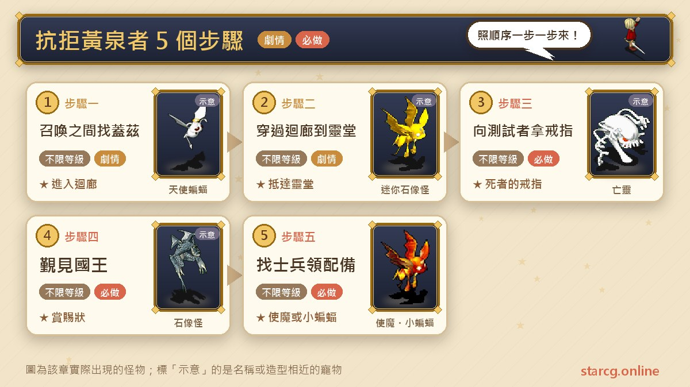
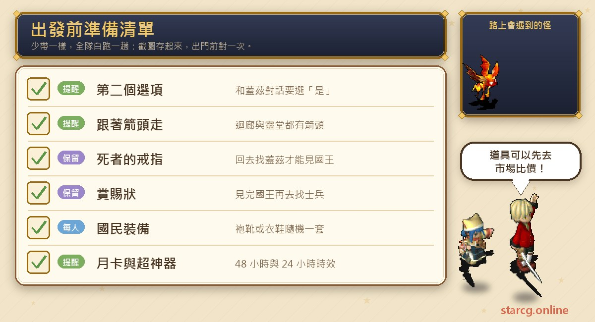
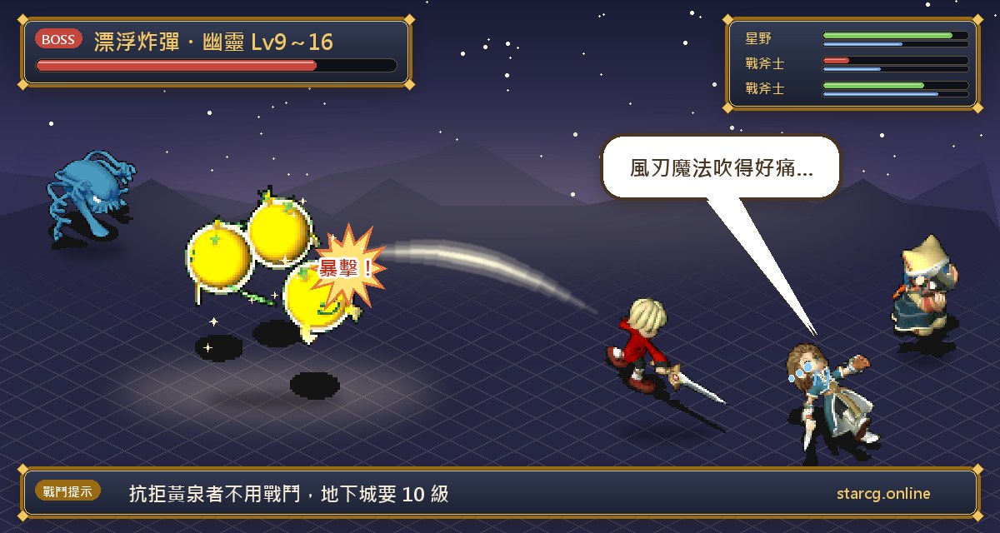

在魔力寶貝裡建好角色、第一次登入時，你會站在法蘭城里謝里雅堡的「召喚之間」。從這裡開始的第一個任務叫**抗拒黃泉者**，攻略網把它歸在「魔力新人」分類，說明是幫助新手了解遊戲的引導任務。整個流程只有五步：和王宮召喚士說話、穿過迴廊到靈堂拿戒指、回來覲見國王、最後找士兵領裝備。沒有等級條件，也沒有任何戰鬥，剛出生的角色就能直接做完。

做完能拿到的東西對新手很重要：**月卡功能（48 小時）**、**超神器禮盒（24 小時）**、一套隨機的國民裝備、OK 繃，以及第一隻寵物——**使魔或小蝙蝠**隨機一隻。不論你玩的是星詠魔力、水藍魔力還是初心魔力寶貝，抗拒黃泉者的流程都一樣，下面的座標與步驟都能直接對照。

> 本文整理自 [星詠魔力攻略網](https://guide.starcg.net/) 的「抗拒黃泉者」任務頁面，並用我們自己的方式重新排序與改寫，沒有逐字照搬。攻略網沒有列出的內容，本文不自行補充；遊戲更新後內容可能變動，實際以遊戲內為準。

## 抗拒黃泉者是什麼？先看整體順序

抗拒黃泉者只有一個任務，但會帶你走過里謝里雅堡裡好幾個之後還會再來的地方：召喚之間、迴廊、靈堂、謁見之間，以及二樓的樓梯口。攻略網標示這個任務**支援自動導航**，不知道路的話可以直接跟著導航走；迴廊和靈堂裡也有箭頭指引。

| 步驟 | 地點 | 要做的事 | 取得 |
|---|---|---|---|
| 步驟一 | 召喚之間 | 找王宮召喚士蓋茲（19, 6），第二個選項選「是」 | 可以進入迴廊 |
| 步驟二 | 迴廊 | 從（27, 8）進迴廊，走到底再往下右轉，從（23, 19）的樓梯下去 | 抵達靈堂 |
| 步驟三 | 靈堂 | 走到東北角找測試者（54, 2），選「是」 | 死者的戒指 |
| 步驟四 | 謁見之間 | 回去找蓋茲傳送，和國王（7, 3）交談 | 賞賜狀 |
| 步驟五 | 里謝里雅堡二樓 | 找士兵喬金（51, 79）或士兵亞瑟爾（47, 79） | 國民裝備、OK 繃、使魔或小蝙蝠 |

推薦等級與任務條件，攻略網都寫「無」。

## 出發前先準備好這些

這個任務不用買任何東西，也不用打怪，要注意的只有幾個「選項」和「拿到的東西別亂丟」。

最常出錯的是第一步：和王宮召喚士蓋茲說話時，要在**第二個選項**選「是」，才會接著進入迴廊。靈堂裡的測試者同樣要選「是」才會給戒指。拿到的「死者的戒指」是回去找蓋茲、被傳送到謁見之間的關鍵，「賞賜狀」則是見完國王後的證明，兩樣在任務結束前都不要丟掉或賣掉。任務完成後如果想替新角色添點裝備或補給，可以先用本站的 [市場查價](/market/) 看看行情。

## 步驟一：召喚之間找王宮召喚士蓋茲

第一次登入時，你會出現在**召喚之間**。旁邊就是**王宮召喚士蓋茲**（19, 6），和他說話，在**第二個選項**選「是」，接著從旁邊的**迴廊**入口（27, 8）進去。

**要注意的地方**：攻略網特別寫明是「第二個選項」選「是」，對話時看清楚再按；如果發現進不了下一步，先回來確認這一步是否照做。

## 步驟二：沿著箭頭穿過迴廊到靈堂

進入迴廊後，**沿著地上的箭頭一路走到底**，再往下、右轉，從（23, 19）的樓梯下去，就會抵達**靈堂**。

這條路之後還會用到。法蘭城的「礦工的安全帽」任務也是從里謝里雅堡的召喚之間進迴廊、由迴廊（23, 19）進靈堂，再從靈堂往下走到地下牢房找喬爾凱夫。新手時先把這段路記熟，之後就不用再找。

## 步驟三：靈堂東北角向測試者拿死者的戒指

在靈堂裡同樣**跟著箭頭走到東北角**，找到**測試者**（54, 2），和他說話並選「是」，拿到「**死者的戒指**」。

這是整個任務唯一要「拿東西」的地方：在靈堂拿到死者的戒指，再帶回去覲見國王。攻略網沒有寫這枚戒指之後還有其他用途，所以本文也不另外推測；把它當作這個任務的通行證就好。

## 步驟四：回去找蓋茲，覲見國王拿賞賜狀

帶著死者的戒指，回到召喚之間找**王宮召喚士蓋茲**說話，他會把你傳送到**謁見之間**。和**國王**（7, 3）交談，拿到「**賞賜狀**」。

**要注意的地方**：要回頭找的是同一位蓋茲，不用另外找傳送點。如果傳送後找不到國王，可以直接開自動導航。

## 步驟五：里謝里雅堡二樓找士兵領基本配備

最後到**里謝里雅堡二樓的樓梯口旁**，和**士兵喬金**（51, 79）或**士兵亞瑟爾**（47, 79）說話，兩位找其中一位就可以。這一步會隨機拿到一套基本配備：

- 裝備：「國民袍＋國民靴」或「國民衣＋國民鞋」其中一套。
- 道具：「OK 繃」。
- 寵物：1 級的**使魔**或**小蝙蝠**其中一隻。

裝備和寵物都是隨機給的，拿到哪一套、哪一隻都不影響任務完成。想知道使魔和小蝙蝠的成長與能力，可以到本站的 [寵物圖鑑](/pets/) 查；之後要幫寵物配點，也可以用寵物頁的成長工具試算。

## 任務獎勵整理

| 獎勵 | 說明 |
|---|---|
| 月卡功能 | 有效 48 小時 |
| 超神器禮盒 | 有效 24 小時 |
| 國民裝備 | 國民袍＋國民靴，或國民衣＋國民鞋，隨機一套 |
| OK 繃 | 道具 |
| 第一隻寵物 | 1 級使魔或小蝙蝠，隨機一隻 |

月卡功能與超神器禮盒都有時效（48 小時與 24 小時），攻略網沒有寫可以延後啟用，所以最好在完成任務後就接著上線練功，把這段時間用在前期升級上，不要做完就下線放著。

## 做完之後去哪？里謝里雅堡附近的下一步

抗拒黃泉者全程不用戰鬥，但同一座城堡裡就有迷宮可以練功。同樣在里謝里雅堡裡，「摯愛的誓言」任務要從**地下靈堂**（9, 8）進入地下城迷宮：只有**黃昏或清晨**會出現守門的士兵，而且人物要 **10 級以上**才能和他說話。迷宮裡是 9～16 級的**漂浮炸彈**（會風刃魔法）和**幽靈**（會崩擊），打完任務可以拿到體力上限 +25～35 的祈禱的耳飾。

在升到 10 級之前，法蘭城還有幾個不用戰鬥、很適合新手順手做的任務：

- **神祕連絡**：在安其摩酒吧（102, 131）的客房對連絡員A說出暗號「頭目萬歲」，用 100G 買 10 把能開隨機迷宮普通寶箱的鑰匙。
- **友情香草**：在里玲香料店（216, 158）和里謝里雅堡二樓的圖書館之間傳話，拿到全套香料優待卷與聲望 100。
- **哥布林綠頭盔**：把城外哥布林掉的綠頭盔交給拿潘食品店（217, 53）的愛頭盔的波月，換全套麵包優待卷。

這些任務的完整流程，我們整理在 [法蘭城任務攻略](/posts/fran-city-quest-guide/)。之後轉職、晉級的流程，則可以參考 [職業晉級任務攻略](/posts/job-advance-quest-guide/)。

## 抗拒黃泉者常見問題

**抗拒黃泉者有等級限制嗎？** 沒有。攻略網列出的推薦等級與任務條件都是「無」，第一次登入就能做。

**這個任務要打怪嗎？** 不用。五個步驟都是對話與移動，沒有戰鬥。

**使魔和小蝙蝠可以自己選嗎？** 攻略網寫的是隨機拿到其中一隻，裝備也是兩套隨機一套。

**和蓋茲說話後沒有反應怎麼辦？** 確認在第二個選項選的是「是」；拿到死者的戒指後，也是回來找同一位蓋茲才會被傳送到謁見之間。

**月卡功能和超神器禮盒可以用多久？** 月卡功能 48 小時、超神器禮盒 24 小時。

## 小結：五步走完，拿第一隻寵物出門

抗拒黃泉者是每個新角色都會經過的第一步：從召喚之間的蓋茲開始，跟著箭頭穿過迴廊和靈堂拿到死者的戒指，覲見國王拿賞賜狀，最後在二樓樓梯口領國民裝備、OK 繃與使魔或小蝙蝠。要記住的只有兩個「選是」和兩個座標上的士兵，加上月卡功能與超神器禮盒的時效。做完之後，可以先跑法蘭城幾個不用戰鬥的小任務，升到 10 級再去地下靈堂挑戰摯愛的誓言。

想看原文與其他任務，可以到 [星詠魔力攻略網](https://guide.starcg.net/) 查詢；也歡迎用本站的 [寵物圖鑑](/pets/) 看看第一隻寵物的成長，再用 [市場查價](/market/) 替新角色添購補給。
