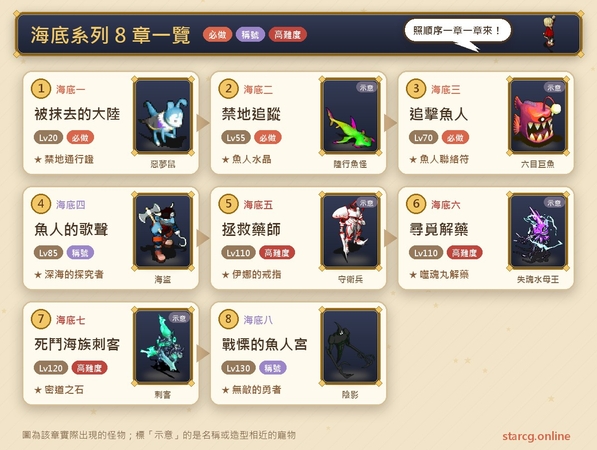
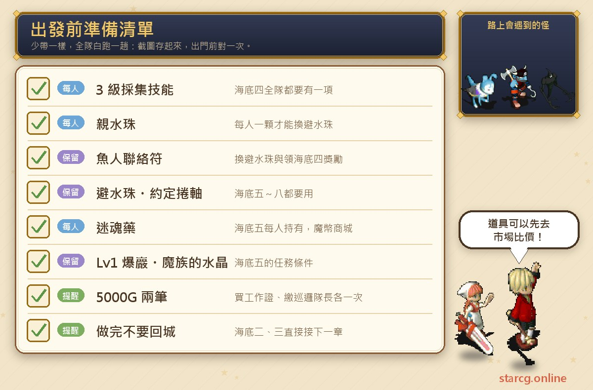
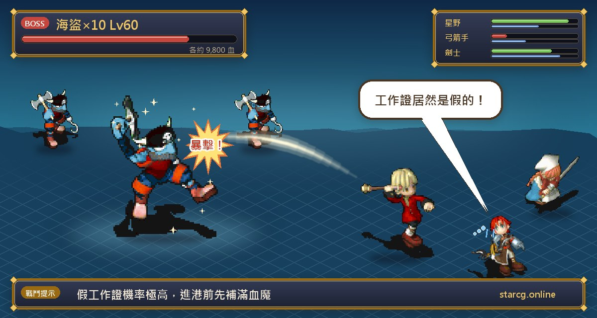
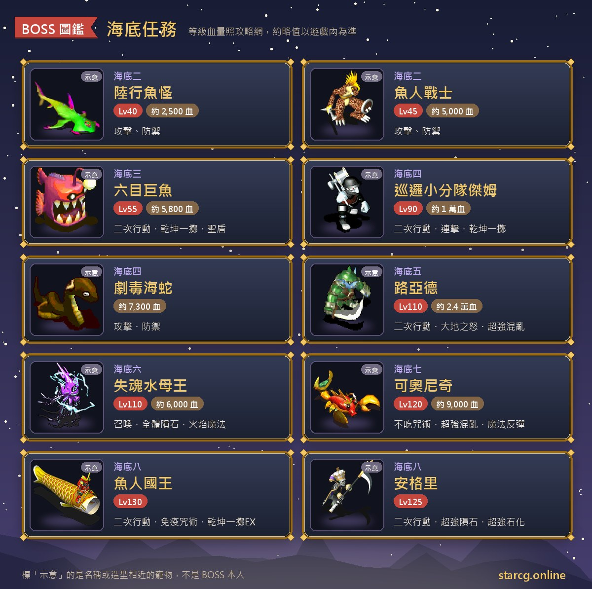

크로스게이트의 해저(海底) 시리즈(해저 세계 시리즈라고도 불러요)는 모두 8장이에요. 판부르크(法蘭城)의 비틀거리는 노부인에게서 시작해 비밀 조직을 쫓으며, 판부르크 창고의 비밀 기지, 프레이 신목(芙蕾神木), 어인 밀도(魚人密道)를 거쳐 조리아 해구(喬利雅海溝)까지 잠수하고, 마지막에는 페데오아 해분(費德奧亞海盆) 깊은 곳의 어인 궁전(魚人宮殿)에 쳐들어가요. 권장 레벨은 해저 1의 20에서 해저 8의 130까지 뛰어서 폭이 아주 넓어요. 앞의 4장을 끝내면 영구 칭호 「**심해의 탐구자(深海的探究者)**」, 이후 퀘스트에 쓰이는 **약속의 두루마리(約定捲軸)**와 **피수주(避水珠)**, 그리고 인어 스킨(美人魚皮膚) 또는 천조백태 오라(千潮百態環繞)(확률 9:1)를 얻어요. 뒤의 4장에서는 차례로 이나의 반지(伊娜的戒指), 서혼환 해독제(噬魂丸解藥), 밀도의 돌(密道之石)을 얻고, 마지막에 Lv.10 부적 「바다의 심장 조각(海洋之心的碎片)」, 랍스터 알(龍蝦之卵), 영구 칭호 「**무적의 용자(無敵的勇者)**」를 받아요.

앞의 3장은 모두 짧고, 첫 번째 고비는 해저 4예요. 작업증을 사고, 변신해서 해적선에 섞여 들고, 친수주(親水珠)를 모아 피수주로 바꾸고, 미궁에서 랜덤으로 나타나는 NPC를 찾고, 암호 두 개까지 입력해야 해요. 해저 5~8은 레벨 110~130의 고난도 콘텐츠로, 장마다 연전이나 2회 행동 보스가 있어요. 이 글은 8장의 순서, 좌표, 아이템, 보스 정보를 플레이하면서 펼쳐 볼 수 있는 흐름으로 정리했어요. StarCG(星詠魔力), 水藍魔力, 初心魔力寶貝 어디서 플레이하든 해저 시리즈의 진행은 같아서 이 정리를 그대로 쓸 수 있어요.

> 이 글은 [StarCG 공략 사이트](https://guide.starcg.net/)의 해저 시리즈 페이지를 바탕으로, 水藍魔力 공략 wiki 페이지도 참고해 저희 방식으로 순서를 다시 짜고 새로 쓴 내용이에요(그대로 옮기지 않았어요). 보스 HP와 수치는 대략적인 값이니 실제 게임 내 정보를 기준으로 하세요. 게임 업데이트 후 내용이 바뀔 수 있어요.

## 해저 시리즈란? 전체 순서부터 보기

앞의 4장은 반드시 순서대로 완료해야 해요. 각 장이 이전 장을 선행 조건으로 하고, 이전 장에서 얻은 아이템을 다음 장에서 바로 써요. 해저 1의 금지 통행증(禁地通行證)은 프레이 신목에 들어갈 때, 해저 2의 어인 수정(魚人水晶)은 어인 밀도를 열 때, 해저 3의 어인 연락부(魚人聯絡符)는 해저 4에서 피수주로 바꿀 때와 마지막 보상을 받을 때 모두 필요해요. 뒤의 4장은 조건이 「특정 아이템 소지」로 바뀌어요. 해저 4의 피수주와 약속의 두루마리는 끝까지 쓰이고, 해저 5의 이나의 반지, 해저 6의 서혼환 해독제, 해저 7의 밀도의 돌이 각각 다음 장의 입장권이에요.

한 문장으로 정리하면 이래요. **해저 1~3은 연속 단거리, 해저 4는 장거리 여행이에요. 해저 2·3은 끝내고 마을로 돌아가지 말고 바로 다음 장을 받으세요. 해저 5부터는 레벨 110부터 시작하는 고난도 장이에요.**

| 장 | 퀘스트 이름 | 권장 레벨 | 획득 |
|---|---|---|---|
| 해저 1 | 지워진 대륙(被抹去的大陸) | 20(조건 없음) | 금지 통행증 |
| 해저 2 | 금지 추적(禁地追蹤) | 55 | 어인 수정 |
| 해저 3 | 어인 추격(追擊魚人) | 70 | 어인 연락부 |
| 해저 4 | 어인의 노래(魚人的歌聲) | 85 | 칭호 「심해의 탐구자」, 약속의 두루마리, 피수주, 인어 스킨 또는 천조백태 오라 |
| 해저 5 | 약사 구출(拯救藥師) | 110 | 기지 두루마리, 이나의 반지 |
| 해저 6 | 해독제 찾기(尋覓解藥) | 110 | 카치의 반지 또는 목걸이, 서혼환 해독제, 해파리 정수 |
| 해저 7 | 해족 자객과의 사투(死鬥海族刺客) | 120 | 밀도의 돌, 오징어 알 |
| 해저 8 | 전율의 어인궁(戰慄的魚人宮) | 130 | 바다의 심장 조각, 랍스터 알, 칭호 「무적의 용자」 |

권장 레벨 차이가 커서 해저 1은 레벨 20이면 할 수 있고, 해저 4는 권장 85, 해저 8은 이미 130이에요. 많은 분들이 낮은 레벨일 때 해저 1을 먼저 해 두고, 레벨이 되면 2~4를 한 번에 끝낸 뒤, 해저 5부터는 110 이상으로 키운 다음 도전해요.

## 출발 전에 준비할 것

해저 시리즈는 소모품이 많이 필요하지 않지만, 「없으면 진행할 수 없는」 물건이 몇 가지 있고 해저 4와 해저 5에 몰려 있어요. 아래에 목록으로 정리했어요.

가장 중요한 건 해저 4가 **파티원 전원에게 3레벨 채집 스킬 하나씩**을 요구한다는 거예요. 뒤에서 편지 한 통을 채집해야 하기 때문이에요. 또 **파티원마다 친수주가 하나씩** 있어야 피수주로 바꿀 수 있어요. 水藍魔力 공략 wiki에 따르면 친수주는 미리 잡아 둘 수도, 다른 플레이어에게서 살 수도 있고, 은행 보관·거래·펫 우편이 가능해요. 파티에 구슬이 없는 사람이 있다면 먼저 사이트의 [시세 검색](/ko/market/)에서 친수주를 파는 사람이 있는지 확인해 보세요. 해저 4에서는 5000G를 두 번(작업증 구매, 순찰대장 납부) 내야 하니 골드도 준비해 두세요. 해저 5는 **피수주, 약속의 두루마리, 마족의 수정(魔族的水晶), Lv1 폭암(爆巖) 펫 한 마리**를 먼저 준비해야 하고, **파티원 모두가 미혼약(迷魂藥)을 가지고 있어야 해요**(골드 상점(魔幣商城)에서 구매 가능).

## 해저 1: 지워진 대륙(암호 「冒險之心永不歇止」)

퀘스트 조건 없음, 권장 레벨 20.

1. 셰리아 성(里謝里雅堡)(33, 23)에서 **비틀거리는 노부인(腳步蹣跚的老婦人)**과 대화해 「예」를 골라 퀘스트를 받아요.
2. 셰리아 성 2층 도서관(0, 74)에서 **책에 빠진 노인(看書入迷的老頭子)**(26, 22)과 대화해 「예」를 고르면 암호 「**冒險之心永不歇止**(모험의 마음은 멈추지 않는다)」를 알려 줘요.
3. 판부르크 창고(192, 177)에서 문을 향해 암호를 입력하면 안으로 전송되고, 경비병과 한 번 싸운 뒤 창고 안으로 들어가요.
4. (16, 8)의 쓰러진 통을 클릭하면 비밀 기지로 전송돼요.
5. 경비병과 대화해 전투하고, 끝나면 뒤쪽으로 전송되어 **비밀 조직 연구원(神秘組織研究員)**(31, 10)과 대화해요.
6. (35, 12)에서 책임자 방으로 들어가 **비밀 조직 책임자(神秘組織負責人)**(11, 11)와 대화해 「예」를 고르면 지하 통로로 전송돼요. 이 구간에서는 Lv16~18의 바람 거미(風蜘蛛)와 악몽 쥐(惡夢鼠)를 만나요.
7. 사령부 지하 감옥에서 왼쪽 위 (21, 10)으로 가 **죄수**와 대화하면 감옥 가운데로 전송되고, 다시 **장교(軍官)**(25, 16)와 대화해 「예」를 고르면 사령부로 전송돼요. 가는 길에는 Lv20~24의 지하 감옥 위병이 나와요.
8. **사령부 지휘관(司令部指揮官)**과 대화하면 「금지 통행증」을 받아요.

**주의할 점**: 공략 사이트는 **퀘스트를 먼저 받아야 암호가 통한다**고 알려 줘요. 창고 문 앞에서 바로 암호를 입력했는데 반응이 없다면, 노부인과 대화했는지 먼저 확인하세요. 이 장은 몬스터 레벨이 높지 않아 레벨 20 전후 파티로 순조롭게 끝낼 수 있어요.

## 해저 2: 금지 추적(10층 신목 미궁 두 구간)

권장 레벨 55, 조건은 해저 1 완료예요.

1. 윌노아 마을(維諾亞村) 오른쪽 아래의 **병사**(299, 538)와 대화해 해저 동굴에 들어가요.
2. 동굴을 나와 위쪽 (314, 425)로 가서 **병사 즈와(士兵茲瓦)**와 대화해 전송을 이용해요.
3. (310, 345)에서 프레이 신목 바닥의 지하 1층으로 들어가 10층 미궁을 지나 신목의 심장(神木之心)에 도착해요.
4. **비밀 조직 책임자**(26, 20)와 대화해 전투해요. 상대는 육행어괴(陸行魚怪)예요.
5. 끝난 뒤 (27, 12)에서 신목 꼭대기 1층으로 들어가 다시 10층 미궁을 지나 신목의 꼭대기(神木之頂)에 도착해요.
6. **경비병**(68, 56)과 대화해 전송된 뒤 **어인 전사(魚人戰士)**와 대화해 전투해요.
7. **수사 작전 집행관(搜查行動執行官)**(70, 61)과 대화하면 「어인 수정」을 받고 신목 밖으로 전송돼요.

**보스 정보**: 육행어괴 Lv40, HP 약 2,500, 어인 전사 Lv45, HP 약 5,000. 공략 사이트에는 공격과 방어만 적혀 있고 다른 스킬 정보는 없어요. 권장 레벨 55 기준으로 두 전투 모두 어렵지 않아요.

**주의할 점**: 공략 사이트는 마지막에 어인 수정을 받을 때 **파티원과 한 명씩 대화한 뒤 파티를 해산**하라고 알려 줘요. 그리고 이어서 해저 3을 할 거라면 **끝나고 마을로 돌아가지 마세요**. 해저 3은 신목 밖에서 출발해요. 이 장에는 10층 미궁이 두 구간 있으니, 걸으면서 사이트의 [미궁 계단 찾기](/ko/maze/)로 계단 위치를 표시하면 시간을 꽤 아낄 수 있어요.

## 해저 3: 어인 추격(혼자 어인 밀도로 진입)

권장 레벨 70, 조건은 해저 2 완료예요. 시리즈 전체에서 가장 짧은 장이에요.

1. 신목 밖에서 왼쪽 위로 간 뒤 오른쪽 (356, 284)로 가요. 어인 수정을 가지고 있으면 **파티가 자동으로 해산되고 혼자 들어가게 돼요**.
2. 어인 밀도 2층에서 **비밀 조직 책임자**(38, 16)와 대화해 전투해요.
3. **시허스(施賀斯)**(38, 16)와 대화해 「예」를 고르면 「어인 연락부」를 받고, 이후 전송 수정으로 나갈 수 있어요.

**보스 정보**: 여섯눈 거대어(六目巨魚) Lv55, HP 약 5,800, 2회 행동, 건곤일척·명경지수·성스러운 방패 사용. 옆에 육행어요(陸行魚妖) 4마리가 있고, 각 Lv50, HP 약 2,100으로 공격과 방어만 써요.

**주의할 점**: 밀도에 들어갈 때 파티가 해산되는 건 어인 수정을 가지고 있을 때의 정상 동작이지 오류가 아니에요. 해저 2와 마찬가지로 이어서 해저 4를 할 거라면 **마을로 돌아가지 마세요**. 어인 연락부는 해저 4에서 피수주로 바꿀 때와 최종 보상을 받을 때 모두 건네야 하는 아이템이니 절대 버리지 마세요.

## 해저 4: 어인의 노래(변신, 친수주, 암호 두 개)

권장 레벨 85, 선행 조건은 해저 3 「어인 추격」 완료이고 **파티원 전원에게 3레벨 채집 스킬이 하나씩** 있어야 해요. 공략 사이트 페이지의 선행 링크는 이 페이지 자신을 가리키지만, 본문 10단계에 적힌 선행 조건은 「어인 추격」이니 어인 추격을 기준으로 하세요. 水藍魔力 공략 wiki에는 Lv80 이상, 5인을 권장한다고 적혀 있어요.

### 1구간: 해적선에 섞여 들기

1. **밤**에 신목 밖(288, 237)의 **케이틀린(凱特琳)**과 대화해 동의를 골라요. 水藍魔力 공략 wiki의 댓글에 따르면 신목 밖에서 왼쪽으로 가야 이 좌표에 갈 수 있어요.
2. 밤인 상태로 티나 마을(蒂娜村)(40, 44)의 **해적 피피(海盜皮皮)**에게 5000G를 내고 「피피 작업증(皮皮工作證)」과 「해적 변신 카드(海盜變身卡)」를 사요.
3. 해적 항만(海盜港灣)(33, 34)에서 변신한 뒤 **견습 항해사(見習船副)**와 대화해요. 진짜 작업증이면 배로 전송되고, **가짜 작업증이면 바로 해적과 3연전을 해요**.
4. 항해사에게 「비밀 지도(秘密地圖)」를 받아요. 비밀 통로로 가는 배에서는 **10분을 기다려야** 하고, 시간이 되어 다시 대화해야 맵이 바뀌어요.
5. **순찰 소분대 젬(巡邏小分隊傑姆)**과 대화해 전투해요. 이 전투의 젬은 Lv60, HP 약 8,600이고 HP가 얼마 안 남으면 도망가요.
6. 전투 후 항해사와 대화하면 무인도(23, 22)로 전송되고 젬과 두 번째 전투를 해요. 이번 젬은 Lv90, HP 약 1만, 2회 행동에 연격과 건곤일척을 쓰고, 주변에 Lv60, HP 약 6,000의 순찰병 9마리(전율습심 사용)도 있어요.

**주의할 점**: 공략 사이트는 「가짜 작업증을 살 확률이 매우 높다」고 바로 경고하고, 水藍魔力 공략 wiki도 「높은 확률로 가짜 작업증」이라고 표시해요. 가짜 작업증을 사면 해적 10마리(각 Lv60, HP 약 9,800, 전율습심·혼란 공격·성스러운 방패 사용)와 3연전을 해야 하니, 항구에 들어가기 전에 HP·MP와 보급품을 가득 채워 두세요.

### 2구간: 암시장 거래소, 열쇠, 친수주

7. 전투 후 「암시장 거래소 1층(黑市交易點 1 層)」으로 전송돼요. (25, 70), (62, 44), (84, 77) 근처에서 순찰병을 잡으면 **낮은 확률**로 「열쇠」(거래 불가)가 떨어져요.
8. 위쪽으로 돌아 오른쪽 아래 (68, 85)에서 「암시장 거래소 2층」에 들어가면, 랜덤 인카운트로 보스전이 시작돼요. **맹독 바다뱀(劇毒海蛇)**(HP 약 7,300, 공격과 방어 사용)이에요.
9. 이기면 정체불명의 구슬을 얻고, 감정하면 「친수주」예요. **파티원마다 하나씩 필요해요**.
10. 파티 전원이 친수주를 갖추면 1층(19, 74)으로 돌아가, 열쇠를 가진 사람이 감옥 문과 대화해 들어가고, **명(冥)**(22, 85)과 두 번 대화해 친수주를 「피수주」로 바꿔요. 이 단계에서는 **어인 연락부를 반드시 가지고 있어야 해요**.

**주의할 점**: 열쇠에는 내구 제한이 있어서 **감옥에 들어갈 때 한 번, 나올 때 한 번 깎이고, 두 번 쓰면 부서져 사라져요**. 드나들기 전에 순서를 잘 생각하세요. 水藍魔力 공략 wiki 댓글에는 암시장 거래소 2층에서 뿔 소라게(牛角寄居蟹) 등 다른 몬스터도 나와서 항상 바다뱀이 나오는 건 아니라는 이야기도 있어요.

### 3구간: 조리아 해구와 암호 두 개

11. 2층(70, 73)의 **문지기 개 예루(看門狗耶魯)**를 찾아 뒤쪽 미궁 「비밀 입해 통로 100m(秘密入海通到 100 米)」(75, 73)로 들어가요.
12. 미궁 10층에서 랜덤으로 나타나는 **케이틀린**과 대화하면 「어인 변신 카드(魚人變身卡)」와 암호 하나를 받아요.
13. 10층 출구로 「조리아 해구 1구역」에 가서 **파티 전원이 먼저 어인 변신 카드를 쓰고**, 경비병과 대화하면 뒤쪽으로 전송돼요.
14. (10, 3)에서 해구 2구역으로 들어가 (15, 8)로 가서 **순찰대장(巡邏隊長)**에게 암호 「**金幣**(금화)」를 입력하고 5000G를 내면 뒤쪽으로 전송돼요.
15. (3, 7)에서 3구역으로 들어가 (42, 10)에서 3레벨 채집 스킬로 채집하면 「채집한 편지(採集來的信)」(귀속)를 얻어요.
16. (15, 8)로 돌아가 **순찰대장 라이언(巡邏隊長萊恩)**과 대화하면 파티 전원이 뒤쪽으로 전송돼요.
17. (12, 11)의 돌 앞에서 12단계에서 받은 암호를 입력하면 비밀 기지로 전송돼요.
18. **이나(伊娜)**(14, 3)와 대화해 어인 연락부를 건네고 최종 보상을 받으면 시작의 방(起始之間)으로 전송되며 퀘스트 완료예요.

**주의할 점**:

- 12단계의 미궁 10층은 맵이 넓고 케이틀린도 랜덤으로 나타나요. 水藍魔力 공략 wiki는 미궁 탐지기와 지도를 가지고 찾으라고 권해요.
- 水藍魔力 공략 wiki는 해구에 들어가기 전에 어인 변신 카드로 어인이 되어야 하고, 그렇지 않으면 전투에 들어간다고 알려 줘요.
- 水藍魔力 공략 wiki에는 17단계에서 돌에 암호를 입력해도 반응이 없으면 약속의 두루마리를 창고에 맡긴 뒤 입력해 보라는 내용도 있어요.
- 마지막 보상은 인어 스킨 또는 천조백태 오라(공략 사이트 표시 확률 9:1)이고, 영구 칭호 「심해의 탐구자」도 받아요. **약속의 두루마리와 피수주는 이후 퀘스트에 쓰이는 아이템이니 버리지 마세요**.

**인어 스킨은 받을 가치가 있나요?** 공략 사이트가 특별히 추천해요. 인어 스킨은 공격 모션 속도가 아주 빨라서 궁술사가 「난사(亂射)」로 사냥할 때 장착하기 좋아요.

## 해저 5: 약사 구출(감옥 3연전과 루아드)

권장 레벨 110, 조건은 **피수주, 약속의 두루마리, 마족의 수정, Lv1 폭암 펫** 소지예요.

1. 약속의 두루마리로 비밀 기지(해저 4의 기지가 아니에요)에 가서 **이나 공주(公主伊娜)**와 대화해요. 약속의 두루마리는 내구 5로 5번 전송할 수 있어요.
2. 비밀 기지의 **정보 전문가 마르카스(情報專家馬爾卡斯)**에게서 Lv1 폭암과 미혼약(모두 필요)을 준비해야 한다는 걸 들어요. 폭암을 건네면 「페데오아 어인 변신 카드(費德奧亞魚人變身卡)」와 「감옥 작업증(監牢工作證)」을 받고 페데오아 해분으로 전송돼요.
3. 어인으로 변신해 페데오아 해분(181, 129)의 **감옥 경비병(監牢守衛兵)**에게 작업증을 보여 주고 페데오아 감옥 로비(費德奧亞監牢大廳)에 들어가요.
4. (6, 15)에서 감옥장 거실로 들어가 파티장이 미혼약을 건네고 감옥장과 3연전을 해요. 이기면 랜덤 1명이 「감옥 열쇠(監牢鑰匙)」를 받아요(이미 열쇠가 있으면 이 단계를 건너뛰어도 돼요).
5. 거실 안의 전송석으로 감옥 로비(15, 6)에 돌아가 (9, 5)에서 10층짜리 감옥 미궁에 들어가요. 미궁 몬스터는 Lv106~110이고 24시간마다 초기화되며, 공략 사이트는 사냥터로도 쓸 수 있다고 해요. 미궁에서 랜덤으로 나타나는 **떠돌이 굴착 소라게(流浪的掘地寄居蟹)**와 대화하면 조개껍데기 조각(貝殼碎片)을 받을 수 있어요.
6. 파티 중 누군가 열쇠를 가지고 있으면 감옥 경비병을 통과할 수 있어요. (45, 5)의 전송석으로 감옥에 들어가 **갇힌 어부(被囚禁的漁人)**와 대화하면 「감옥 안 함정 두루마리(監牢內的陷阱捲軸)」를 받아요(퀘스트 실패 시 이걸로 함정 안으로 돌아갈 수 있어요).
7. 랜덤 1명의 미혼약을 **부감옥장(副監獄長)**에게 건네면 맞은편으로 전송되고, 10층짜리 감옥 비밀 통로 미궁에 들어가요.
8. 미궁에서 랜덤으로 나타나는 **실종된 굴착 소라게(失蹤的掘地寄居蟹)**에게 마족의 수정과 조개껍데기 조각을 건네면 「굴착 소라게에게 보내는 신호(給掘地寄居蟹的信號)」를 받아요. 수정은 하나만 필요하지만 여러 개를 가지고 있으면 전부 가져가요.
9. 약사의 감옥으로 가서 감옥 문(9, 9)에 신호를 건네면 지하 통로로 전송되고, (4, 0)으로 나가요.
10. **약사 이코이반(藥師依科伊凡)**과 대화해 랜덤 1명의 미혼약을 건네면 전투가 시작돼요.
11. 이긴 뒤 약사와 대화하면 「공주에게 보내는 전언석(給公主的傳訊石)」을 받고 페데오아 해분(168, 142)으로 전송돼요. 다시 (142, 169)의 **모네드(莫內德)**를 찾아가면 비밀 기지로 돌아가요.
12. 공주와 대화하면 「기지 두루마리(基地捲軸)」(내구 5, 약속의 두루마리와 같은 기능)와 「이나의 반지」(Lv.8, MP +248, 내구 100)를 받아요.

**보스 정보**: 감옥장 3연전의 앞 두 전투는 각각 경비병 9마리(Lv95, HP 약 12,000, 사마계, 전율습심·독성 공격·성스러운 방패 사용)이고, 세 번째 전투는 감옥장(Lv100, HP 약 14,000, HP 50% 미만에서 초강력 중독 추가)이에요. 약사전의 상대는 **루아드(路亞德)**(광폭 아님) Lv110, HP 약 24,000, 사마계, 2회 행동이며, 대지의 분노(펫을 데리고 있을 때), 연격, 건곤일척, 초강력 혼란 마법, 초강력 수면 마법, 성스러운 방패를 쓰고 HP 25% 미만에서 명경지수를 추가로 써요. 같은 전투의 **필릭(菲麗克)**(Lv70, HP 약 1,000, 식물계)은 아무 행동도 하지 않아요.

**공략**: 공략 사이트는 루아드의 공격력이 아주 높으니 기사의 명예(騎士之譽) 스킬을 끝까지 올리라고 권해요. 루아드는 첫 턴에 보통 건곤일척을 연달아 쓰는데, 첫 타는 필릭을 날려 버리고 두 번째 타에야 플레이어를 때려요. 공략 사이트가 알려 주는 방법은 Lv1 펫을 호위로 데려가 공격 반사를 걸어 두고, 대지의 분노로 펫이 날아가면 캐릭터가 2회 행동을 되찾게 하는 거예요. 혼란 내성과 수면 내성도 미리 배워 두는 걸 권해요.

## 해저 6: 해독제 찾기(작열 마사의 혈청과 넋 잃은 해파리왕)

권장 레벨 110, 조건은 **낮**에 진행하는 것과 피수주, 기지 두루마리, 이나의 반지 소지예요.

1. 약속의 두루마리나 기지 두루마리로 비밀 기지에 간 뒤, 전송석으로 조리아 해구 3구역으로 돌아가요(해저 5에서 이어서 하면 바로 3구역으로 돌아가요).
2. **낮**에 조리아 해구 3구역(16, 32)의 **카치(卡琪)**에게 퀘스트를 받아, 그녀의 펫 무무(姆姆)를 찾아 줘요.
3. 오른쪽 (21, 45)의 전송석으로 8층짜리 해구 깊은 곳 미궁에 들어가요. 최하층에서는 「해구 깊은 곳(海溝深處)」이라는 이름의 전송석만 다음 단계로 이어지고, 나머지는 모두 입구로 돌아가요.
4. 해구 깊은 곳의 **괴짜 의사 퀸(怪醫奎因)**은 작열 마사의 혈청(熾炎魔蛇的血清) 100개를 원하는데, **파티원 모두가 필요해요**. 미궁에서 작열 마사를 쓰러뜨려 얻어요.
5. 혈청 100개를 가지고 퀸에게 가면 「환각 특효 해독제(致幻特效解藥)」로 바꿔 주고 무무 곁으로 전송돼요.
6. 무무와 대화해요. 「아니요」를 고르면 해독제를 보관한 채 퀘스트를 계속하고, 입구로 돌아가 카치에게서 **카치의 반지**(Lv.4, 공격 +30, MP +100, 마공 +30)를 받아요. 「예」를 고르면 해독제를 건네고 퀘스트가 끝나며, 대신 **카치의 목걸이**(Lv.4, 방어 +30, 민첩 +50, HP +200)를 받아요. 둘 다 카치에게 반복해서 퀘스트를 받아 파밍할 수 있어요.
7. 카치의 반지를 가지고 조리아 해구 3구역(9, 9)의 석비와 대화하면 비밀 기지에 들어가요(해저 5와는 다른 기지이고, 반지가 꼭 있어야 해요).
8. **이코이반**에게 퀘스트를 받아 재료 목록을 받은 뒤 혼석(魂石)을 찾으러 가요.
9. 3구역(5, 6)에서 1층짜리 바다 난류(海洋亂流) 미궁에 들어가, 「바다 난류」라는 이름의 노란 전송석으로 페데오아 해분에 도착해요. 다른 전송석을 잘못 타면 난류 심연(亂流深淵)에 빠져 빠져나오는 데 시간이 걸려요.
10. **밤**에 페데오아 해분(216, 82)의 석비와 대화해 약 10층의 사령 묘지(死靈墳場)를 지나 사령의 땅(死靈之地)에 도착하면 넋 잃은 해파리왕(失魂水母王)과 전투해요.
11. 이긴 뒤 넋 잃은 해파리왕과 대화하면 「혼석」을 받고 페데오아 해분으로 돌아가요. 다시 3구역(9, 9)의 석비로 비밀 기지에 들어가요.
12. 재료 목록을 이코이반에게 건네 「해족 신혈(海族神血)」로 바꾸고, 공주와 대화해 이나의 반지, 해족 신혈, 혼석, 환각 특효 해독제를 건네면 **서혼환 해독제**와 해파리 정수(水母精華)를 받아요. **아이템을 건네기 전에 방을 나가지 마세요**. 나가면 퀘스트를 완료할 수 없어요.

**보스 정보**: 넋 잃은 해파리왕 Lv110, HP 약 6,000, 지 20·수 100·화 100·풍 20. 첫 턴에 소환하고, 화염 마법(HP 25% 미만에서 피해가 매우 높음), 정화 마법(潔淨魔法), 붕격, 전체 운석 마법을 써요. 주변의 넋 잃은 해파리 4~9마리는 각 Lv105, HP 약 5,000이고 전율습심·연격·마법 반사·석화 공격·명경지수를 쓰며, 보스가 죽은 뒤에는 전체 석화 마법도 추가로 써요.

**공략**: 공략 사이트는 순수 지 속성 수정을 쓰고 회피·석화 내성 장비를 입으라고 권해요. 펫이 석화 내성 V를 배우면 석화를 사실상 무시할 수 있어요. 펫은 앞줄, 캐릭터는 뒷줄에 세우고, 시작하면 펫이 보스의 MP를 흡수하고 캐릭터는 초강력 석화를 걸어요. 보스는 MP가 떨어지면 계속 소환만 하니, 이때 펫은 일반 공격으로 합격하고 캐릭터는 계속 석화를 걸고, 보스가 쓰러지면 잡몹을 하나씩 정리하세요. 승리 후 맵에서는 신족 망령(神族亡靈)을 만날 수도 있어요. 해파리 정수를 쓰면 꼬마 말차 물고기(小抹茶魚)(49.5%), 꼬마 블루베리 물고기(小藍莓魚)(49.5%), 번개 슈크림 물고기(閃電泡芙魚)(1%) 중 하나가 랜덤으로 나오니, 쓰기 전에 펫 칸에 빈자리가 있는지 확인하세요.

## 해저 7: 해족 자객과의 사투(난류 심연과 코오니치)

권장 레벨 120, 조건은 피수주와 서혼환 해독제 소지예요.

1. 약속의 두루마리나 기지 두루마리로 비밀 기지에 가요(해저 6에서 이어서 하면 바로 조리아 해구 3구역으로 돌아가면 돼요).
2. 3구역(9, 9)의 석비와 대화해 비밀 기지에 들어가요. 이 기지는 **서혼환 해독제**가 있어야 들어갈 수 있어요.
3. 서혼환 해독제를 가지고 **이나 공주**와 대화하면 「참가 연락부(參賽連絡符)」를 받아요.
4. 3구역(4, 5)에서 바다 난류로 들어가 랜덤으로 나타나는 **피투성이 옷(沾滿鮮血的衣服)**과 대화하면 해류 틈새(洋流夾縫)로 전송되고, 난류 심연 미궁에 들어가요. 해류 틈새에 들어간 뒤에는 **왔던 길로 돌아갈 수 없어요**. 미궁에는 방해용 전송석이 있고, 이름이 붙은 전송석도 1층으로 돌려보내요.
5. 미궁에서 랜덤으로 나타나는 **카메스타(卡麥絲塔)**에게 참가 연락부를 건네 전투하고, 이기면 랜덤으로 「자객 단검(刺客匕首)」을 받아요. **지면 1단계부터 다시 해야 해요**. 공략 사이트는 잡몹부터 정리하라고 권하고, 그림자 자객은 이후 도망가요.
6. 미궁을 지나 해류 틈새 바닥에 도착하면 **코오니치(可奧尼奇)**와 대화해 전투해요.
7. 이기면 뒤쪽으로 전송되고, 해류 틈새 바닥(12, 10)의 **자객**과 대화해 전투해요.
8. 자객과 대화해 「자객 전언석(刺客傳訊石)」을 받고, 다시 대화해 페데오아 해분으로 돌아간 뒤 3구역(9, 9) 석비로 비밀 기지에 들어가요.
9. 공주와 대화해 자객 전언석을 건네면 **밀도의 돌**과 「오징어 알(魷魚之卵)」(멍한 오징어(呆萌魷魚) 49.5%, 성난 오징어(暴躁魷魚) 49.5%, 번개 오징어(閃電魷魚) 1%)을 받아요.

**보스 정보**:

| 전투 | 적 | 레벨 | 대략 HP | 스킬과 특성 |
|---|---|---|---|---|
| 카메스타 | 자객 | 115 | 6,000 | 건곤일척, HP 25% 미만에서 도망 |
| 카메스타 | 인어 전사(人魚戰士) ×9 | 112 | 4,000 | 독성 공격, 전율습심, 성스러운 방패 |
| 해류 틈새 바닥 | 코오니치 | 120 | 9,000 | 저주 무효, 양날 공격·붕격·명경지수·초강력 혼란 마법·마법 반사, 혼자 남으면 소환 |
| 해류 틈새 바닥 | 어린 흰동가리(幼年小丑魚) ×9 | 117 | 2,000 | 성스러운 방패, 필드에 펫이 없으면 자폭 추가 |
| 자객전 | 자객(본체) | 120 | 7,000 | 첫 턴 소환, 건곤일척·회복 마법·공격 반사·암살 |
| 자객전 | 자객(분신) ×8 | 117 | 6,000 | 건곤일척, 회복 마법, 공격 반사 |

**공략**: 코오니치 본인은 저주가 통하지 않지만 흰동가리에게는 통해요. 공략 사이트는 시작하자마자 전체 공격으로 정리하고 석화로 제어하라고 권해요. 흰동가리는 마법 피해가 높으니 2~3마리만 남긴 상태에서 보스를 잡는 게 좋아요. 보스 혼자만 남으면 스스로 소환하니, 이때는 도망쳐서 다시 하는 것도 고려해 보세요.

## 해저 8: 전율의 어인궁(어인 국왕과 앙그리 연전)

권장 레벨 130, 조건은 피수주와 밀도의 돌 소지예요.

1. 약속의 두루마리나 기지 두루마리로 비밀 기지에 가요(해저 7에서 이어서 하면 바로 조리아 해구 3구역으로 돌아가면 돼요).
2. 비밀 기지를 나와 왼쪽으로 바다 난류에 들어가, 출구를 찾아 페데오아 해분에 도착해요.
3. 북서쪽 (133, 107)로 가서 5층짜리 페데오아 환류(費德奧亞環流) 미궁(500M)에 들어가요. 통과하면 해분의 다른 곳으로 전송돼요.
4. (스토리, 생략 가능) 서쪽 석비(70, 129)로 가서 클릭하면 페데오아 생물 연구소(費德奧亞生物研究所)에 들어가요.
5. 계단(102, 86)으로 이스턴 해협(伊斯頓海峽)에 들어가 출발점(186, 55)에서 도착점(72, 178)까지 걸어가요. 도중의 **초록색 구간은 계속 HP가 깎여요**.
6. 도착점(72, 178)에서 전송되면 노란 전송석 6개가 보이는데, **올바른 미궁은 하나뿐이에요**. 각 미궁은 10층, 2시간마다 초기화되고, 틀린 미궁의 출구는 모두 (94, 95), 올바른 출구는 (186, 128)이에요. 틀리면 왔던 길로 돌아가야 하고, 돌아가는 길에 다른 틀린 미궁에 잘못 들어갈 수도 있어요.
7. (186, 128)에서 빨간 전송석(169, 88)으로 가서 대화하면 왕족 밀도(王族密道)에 들어가요. **밀도의 돌과 서혼환 해독제가 없으면 눌러도 반응이 없어요**.
8. 해왕족 밀도(3, 2)에서 어인 궁전에 들어가 **어인 국왕(魚人國王)**이나 **앙그리(安格里)** 중 한 명과 대화하면 연전이 시작돼요.
9. (스토리, 생략 가능) 이긴 뒤 어인 국왕과 대화해 스토리를 확인해요.
10. 마법진(26, 48)과 대화해 「예」를 고르면 맵이 바뀌고 「바다의 심장 조각」(Lv.10 부적, 방어 +100, HP +200, 내구 100, 거래 불가)을 받아요.
11. 어인 국왕과 대화해 밀도의 돌과 서혼환 해독제를 건네면 「랍스터 알」과 영구 칭호 「**무적의 용자**」를 받고 소환의 방(召喚之間)으로 전송되며, 해저 메인 스토리가 모두 끝나요.

**보스 정보**(공략 사이트의 HP 칸에 수치가 없어서 레벨과 스킬만 적었어요):

- 첫 번째 전투: **어인 국왕** Lv130, 고정 2회 행동, 저주 면역. 마법 봉인, 건곤일척 EX, 대지의 분노(250~500), 붕격, 수면 공격, 석화 공격, 초강력 운석 마법, 초강력 수면 마법, 성스러운 방패, 명경지수를 써요. 주변의 **어인 병사(魚人士兵)** 9마리(Lv127, 1회 행동, 저주가 통함)는 추월(追月), 수면 공격, 강력 운석 마법, 초강력 중독 마법, 속성 반전, 성스러운 방패를 써요.
- 두 번째 전투: **앙그리** Lv125, 고정 2회 행동, 저주 면역. 초강력 운석 마법, 초강력 석화 마법, 성스러운 방패, 명경지수를 써요. 주변의 **그림자(陰影)** 9마리(Lv120, 1회 행동, 저주가 통함)는 강력 운석 마법, 대지의 분노(250~500), 붕격, 초강력 석화 마법, 성스러운 방패, 명경지수, 강력 회복 마법, 대지의 기도를 써요.

**공략**: 공략 사이트는 첫 번째 전투에서 반드시 저주 계열을 쓰고 석화로 병사를 처리하라고 권해요. 어인 국왕의 건곤일척은 피해가 커서 누군가 방어로 자리를 지켜야 해요. 두 번째 전투는 초강력 회복과 초강력 석화를 함께 써서 그림자를 먼저 석화시키고 앙그리를 상대하세요. 앙그리의 MP가 바닥나면 초강력 중독으로 그림자를 하나씩 정리하면 돼요. 랍스터 알에서는 바다 랍스터(海龍蝦)(45%), 늪 랍스터(沼澤龍蝦)(45%), 랍스터 패왕(龍蝦霸王)(귀속, 5%) 또는 오라-거품(環繞-泡泡)(5%)이 나와요.

## 해저 자주 묻는 질문

**해저 1 암호를 입력해도 반응이 없어요.** 먼저 셰리아 성(33, 23)의 비틀거리는 노부인에게 퀘스트를 받고, 도서관에서 암호 「冒險之心永不歇止」를 들어야 판부르크 창고(192, 177)에서 쓸 수 있어요.

**해저 4는 꼭 파티 전원이 3레벨 채집 스킬을 가져야 하나요?** 공략 사이트의 퀘스트 조건에 파티 전원이 3레벨 채집 스킬 하나가 필요하다고 적혀 있으니, 출발 전에 모두 확인해 두는 게 좋아요.

**친수주는 몇 개 필요한가요?** 파티원마다 하나씩이에요. 친수주는 거래가 되니 미리 잡아 두거나 다른 플레이어에게 사도 돼요.

**항구에 들어가자마자 해적에게 둘러싸인 이유는?** 가짜 피피 작업증을 샀기 때문이에요. 공략 사이트는 가짜 작업증 확률을 「매우 높다」고 표현하고, 가짜를 사면 바로 3연전이에요.

**해저 4를 끝내면 무엇을 받나요?** 영구 칭호 「심해의 탐구자」, 약속의 두루마리, 피수주, 그리고 인어 스킨 또는 천조백태 오라(공략 사이트 표시 확률 9:1)예요.

**해저 5는 무엇을 준비해야 하나요?** 피수주, 약속의 두루마리, 마족의 수정, Lv1 폭암 펫 한 마리, 그리고 파티원 모두가 미혼약(골드 상점에서 구매 가능)을 가지고 있어야 해요.

**해저 6은 꼭 낮에 해야 하나요?** 퀘스트를 받는 조건이 낮이에요. 후반에 사령 묘지로 들어가는 석비는 밤에 대화해야 해요.

**해저 8에서 왕족 밀도에 못 들어가요.** 빨간 전송석(169, 88)은 밀도의 돌과 서혼환 해독제를 모두 가지고 있어야 하고, 하나라도 없으면 눌러도 반응이 없어요.

**해저 시리즈의 최종 보상은?** 해저 8을 끝내면 Lv.10 부적 「바다의 심장 조각」, 랍스터 알, 영구 칭호 「무적의 용자」를 받고 해저 메인 스토리가 모두 끝나요.

## 정리: 해저 4를 먼저 계획하고, 레벨 110 이후 장에 도전하세요

해저 시리즈 앞의 3장은 템포가 빨라서 해저 1은 레벨 20이면 할 수 있고, 해저 2·3은 「끝나고 마을로 돌아가지 말고」 바로 다음 장을 받으면 돼요. 처음으로 계획이 필요한 건 해저 4예요. 파티 전원의 3레벨 채집 스킬, 1인당 친수주 하나, 어인 연락부, 5000G 두 번, 그리고 암호 두 개요. 위 목록으로 출발 전에 한 번 확인하고 가짜 작업증 3연전에 대비한 보급품까지 챙기면 심해의 탐구자와 인어 스킨을 순조롭게 얻을 수 있어요. 해저 5~8은 레벨 110~130의 고난도 연전이고, 루아드, 넋 잃은 해파리왕, 코오니치, 어인 국왕과 앙그리는 각각 공략 사이트가 권하는 공략법이 있어요. 피수주, 두루마리, 장별 핵심 아이템을 잘 보관하며 「무적의 용자」까지 달려가세요.

더 자세한 원문은 [StarCG 공략 사이트](https://guide.starcg.net/)에서 확인할 수 있어요. 사이트의 [시세 검색](/ko/market/)에서 친수주를 찾고, [미궁 계단 찾기](/ko/maze/)로 신목과 입해 통로 미궁을 걷고, [펫 도감](/ko/pets/)에서 해저에 나오는 물고기 계열 펫도 확인해 보세요.

## 참고 자료

- [水藍魔力 공략 wiki: 어인의 노래(魚人的歌聲)](https://gamerch.com/blue-cg/921901)
