「開啟者」是時空之門系列的第一章，因為最後的 BOSS 是猶大，很多玩家直接叫它「猶大任務」。任務從莎蓮娜島傑諾瓦鎮附近的阿斯提亞神官開始，走過試煉之道、進入阿斯提亞鎮，再由男女兩條路線各自前進、交換三次「誓言的燭台」，最後在洗禮的試煉打倒猶大。攻略網的推薦等級是 55 級，一般 50～60 級左右就能完成；做完會拿到稱號「開啟者」，還能花 10,000G 學六種全體超強咒術魔法，也是冰雪的牢籠與三轉詛咒的迷宮的必要條件。

這篇把本站實際跑過的打法整理成一份獨立攻略：怎麼用一個帳號自己解完、三次換燭台的位置與第三次的快速捷徑、交易時怎麼避免把燭台給錯，以及猶大戰「留一隻小怪、用遠程慢慢耗」的正規打法。不論你玩的是星詠魔力、水藍魔力還是初心魔力寶貝，開啟者的任務流程都一樣（星詠魔力在組隊條件上有簡化，下面會註明），這份整理都可以直接拿來用。

> 本文由本站整理：步驟、座標與 BOSS 資料來自 [星詠魔力攻略網](https://guide.starcg.net/) 的開啟者頁面，打法與捷徑則是本站實際跑過一次的紀錄，用我們自己的方式重新改寫，沒有逐字照搬。實際跑的配置是 79 級的四名忍者加一名傳教士，等級比推薦高不少，傷害與承傷數字只供參考；遊戲更新後內容可能變動，請以遊戲內為準。

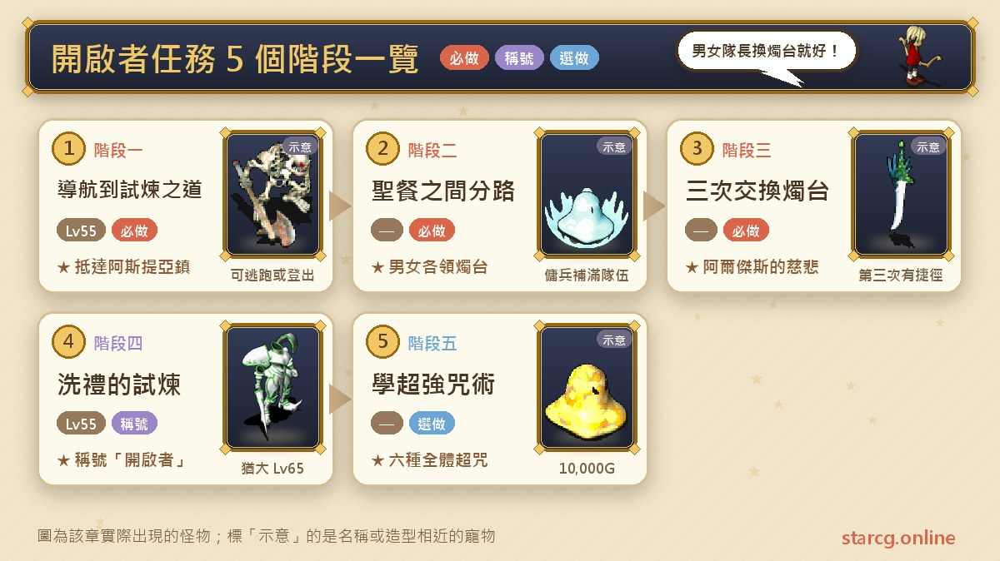

## 開啟者任務是什麼？先看整體順序

開啟者的接取條件只有一個：**先完成「挑戰神獸」**（也就是大家說的王宮任務、打神獸）。要注意的是，打猶大**不需要已經是王宮階級**，只要神獸任務做完就可以接。接下來的冰雪的牢籠才要求王宮階級。

傳統魔力寶貝要五男五女兩支滿編隊伍，而且每個人都要互相交換燭台；**星詠魔力優化成只要一男一女兩位隊長互換燭台，隊員不用換**。遊戲裡也會跳出提示，寫明只需要隊長領取和交換燭台、隊長的性別決定走男生還是女生路線。也就是說，只要帳號裡有男有女，一個人就能把開啟者解完。

| 階段 | 內容 | 推薦等級 | 取得 |
|---|---|---|---|
| 一 | 自動導航到阿斯提亞神官，走試煉之道到阿斯提亞鎮 | 55（約 50～60 可解） | 進入阿斯提亞鎮 |
| 二 | 在聖餐之間分成男生路線與女生路線 | — | 男女隊長各領一個燭台 |
| 三 | 三次交換誓言的燭台（第三次有捷徑） | — | 進入阿爾傑斯的慈悲 |
| 四 | 洗禮的試煉打猶大 | 猶大 65 級 | 稱號「開啟者」 |
| 五 | 聖餐之間找阿斯提亞僧兵學咒術（選做） | — | 六種全體超強咒術 |

## 出發前先準備好這些

開啟者的戰鬥不算難，但有幾件事沒準備好就會很麻煩：隊伍性別、遠程攻擊手段，以及讓寵物撐住的回復道具。

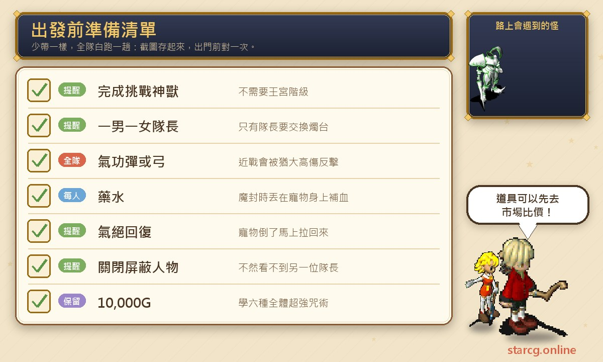

**隊伍最好有男有女。**主要原因就是可以靠自己解猶大。實際跑過的做法是讓四個戰鬥系角色同一個性別、傳教士是另一個性別，這樣隊伍裡一定有一男一女，也剛好讓傳教士自己走一條路線。

**準備遠程攻擊。**猶大會「反擊」，近戰打他被反擊的傷害特別高，所以推薦學**氣功彈**或者拿弓。平常拿斧頭的忍者，進王戰前記得把斧頭脫掉改用氣功彈；傳教士如果配點有一點力量，也可以學氣功彈一起打。

**帶藥水，或有人會氣絕回復。**正規打法要靠前排寵物扛猶大的高傷害，寵物倒了要能拉回來、被魔封時也要能補血。出發前可以先到本站的 [市場查價](/market/) 比一下藥水價格，順便留好學超強咒術要用的 10,000G。

## 階段一：自動導航到試煉之道

1. 從傑村（莎蓮娜島的傑諾瓦鎮）出發，點畫面左側的**任務 → 時空之門 → 選「開啟者」**，按自動導航。
2. 導航會帶你到莎蓮娜島（傑諾瓦鎮附近）的**阿斯提亞神官**（260, 360），再跟神官對話進入洞窟，也就是試煉之道。
3. 進洞窟後一樣按左側任務繼續導航。攻略網的地圖標示是：藍點男性路線、紅點女性路線、紫點共同路線。
4. 抵達阿斯提亞鎮，在大廳找**克里斯夫多祭司**（26, 23），傳到聖餐之間。

**要注意的地方**：路上會遇到怪，可以選擇逃跑，或是用「登出大法」——直接登出遊戲再重新登入，閃過打怪的過程。登出通常是比較好的選擇，因為逃跑可能失敗，失敗就勢必會被怪打，也會浪費血魔池。

## 階段二：聖餐之間分成男生路線與女生路線

1. 到了聖餐之間後，**在繼續導航到下一位 NPC 之前，先解散隊伍或把異性隊員踢掉**。例如男生當隊長，就把女角色（這裡是傳教士）踢出隊伍。
2. 空出來的位子召喚傭兵塞滿 5 人，路上打怪會比較輕鬆。
3. 繼續導航找**阿斯提亞神官**（40, 12），男生隊長就會進入男生路線。導航到傳送石時會拿到一個燭台（男生是「誓言的燭台（紅）」，由**艾奧其亞**給；女生是「誓言的燭台（青）」，由**迪歐梅雅**給）。
4. 接著切換到女角色，一樣跟 NPC 講話進入女生路線。女生路線只有傳教士一個人，所以同樣用傭兵把隊伍塞滿。

**一個帳號兩台設備同時跑**：星詠魔力同一個帳號有 5 個角色，可以用不同設備登入。例如兩支手機，一支登入女生加 4 個傭兵，另一支登入同帳號另外 4 個男生，男女路線同時進行，到換燭台的地方剛好碰頭，可以省下很多時間。如果只有一台設備，女生走完之後還要再切回男生把男生路線走一次，雙方都在各自的換燭台點時才能互相給燭台。

## 階段三：三次交換誓言的燭台

攻略網整理的三次交換位置如下，每次都是男女隊長先找 NPC 傳送，再走到指定座標附近交換：

| 交換 | 男生隊長 | 女生隊長 |
|---|---|---|
| 第一次 | 經（27, 30）樓梯找艾奧其亞，走到（71, 41）附近 | 經（24, 76）樓梯找迪歐梅雅，走到（72, 49）附近 |
| 第二次 | （106, 26）找艾梅斯傳送，到（90, 44）附近 | （109, 34）找芙蕾雅特傳送，到（90, 52）附近 |
| 第三次 | （140, 12）找米力歐提斯傳送，到（140, 27）附近 | （133, 78）找歐魯尼斯傳送，到（137, 41）附近 |

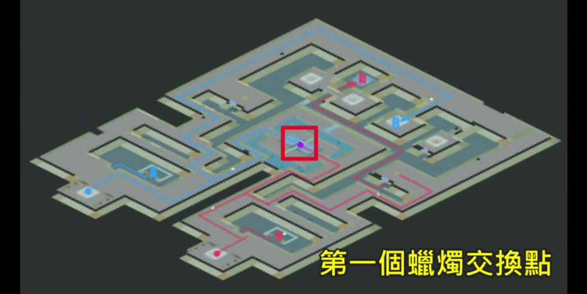

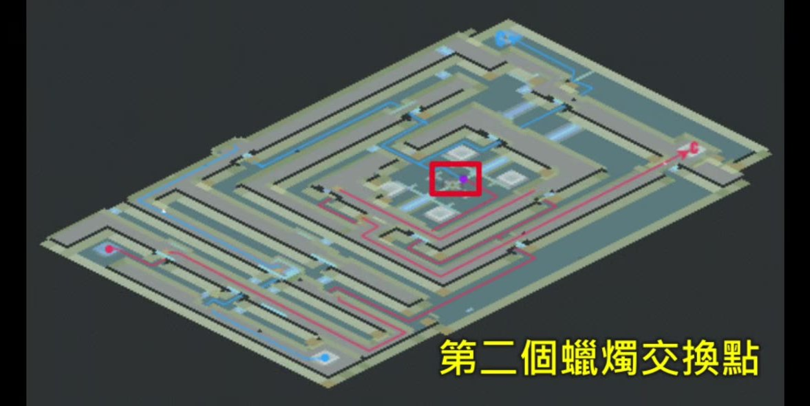

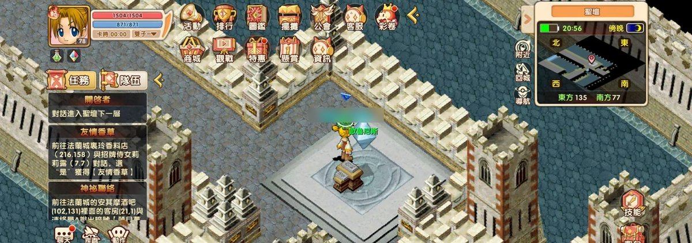

### 交易的順序：最後一格是對方剛給的

每次交換的做法都一樣：

1. 有開「屏蔽人物」的話記得先關掉，不然看不到對方。
2. 切到男生，把他拉近一格跟女生交易，**先把燭台給女生**。
3. 切到女生，再把燭台交易給男生。

這裡最容易出錯：**對方剛給你的燭台一定會顯示在背包的最後一格**，所以你要拿「前一格」那個燭台給對方。燭台給錯就功虧一簣，而且進去這裡之後沒辦法出來，給燭台的時候一定要搞清楚先後順序。

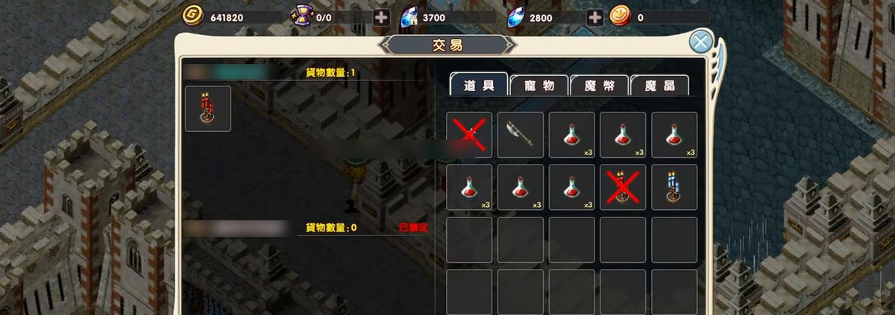

### 第三次交換的快速捷徑

第三次交換有一條很省時間的捷徑，也是本站最想推薦的一段：

1. 點擊傳送石，傳到最後一次換燭台的那張地圖。
2. 走到下圖黃框的「快速換燭台地點」。**女生站在這個點上，座標是（54, 57）**。
3. 男生一樣讓任務自己導航走路，接近那個地點時切換成手動。男生先傳出去再走回來，就會發現自己站在剛剛女生位置的斜對角，實際看到的座標是（56, 59）——不過當時有叫傭兵，座標顯示可能有異常，請以現場位置為準。
4. 這時**男生沒辦法點女生，但女生可以先點男生**。先讓女生把燭台給男生，再把傭兵解散，切回男生就恢復正常了。
5. 男生再把燭台給女生。跟前面一樣，記得要用「前一個」燭台，因為對方剛給你的才是最新的那一個。

換完之後傳送石就在附近，不論男生女生都一樣，所以比走到正常的換燭台點（下圖紅框，也就是攻略網寫的（140, 27）／（137, 41）一帶）快很多。兩種方式都能完成任務，看你想走哪一條。

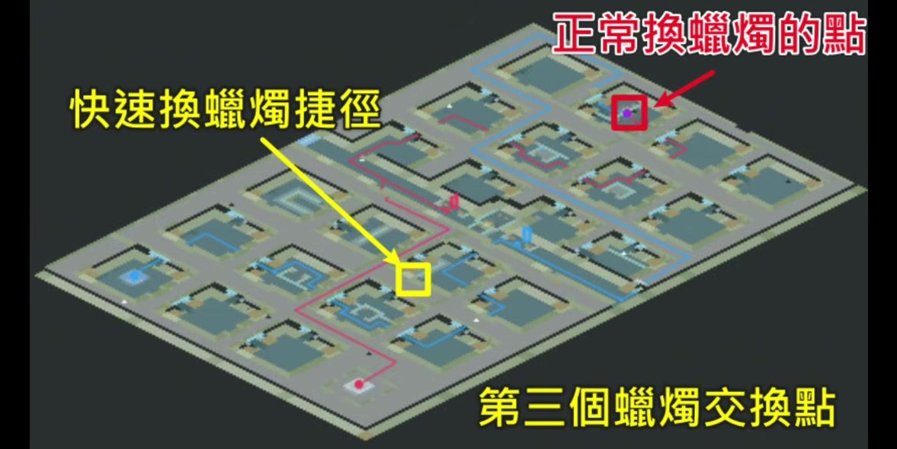

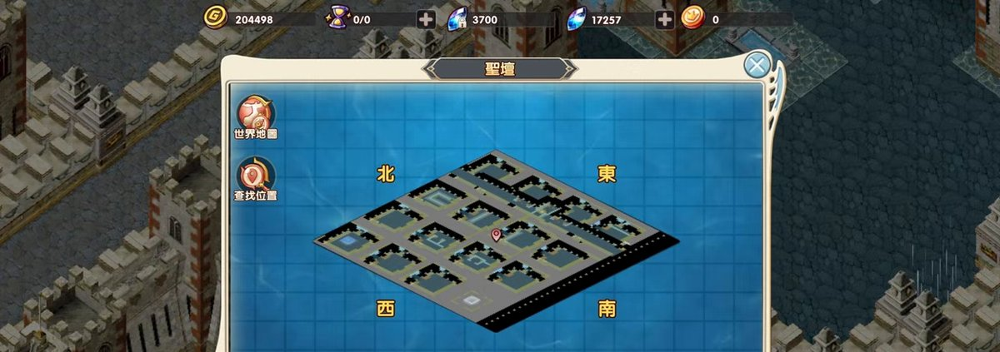

### 換完燭台後重新組隊

換完之後切回女生，一樣按導航。男女兩邊再按導航時，走到中心點都一定會經過同一個地方，這是必經路線，所以可以在這裡把隊伍重新組起來：

- 剛剛男生那幾個角色原本在同一個隊伍裡，**把它登出再重新登入，原本的隊伍就會解散**，這時再按一鍵召喚把大家組起來就可以了。
- 之後依攻略網的步驟：男生隊長到（80, 63）與「???」對話、女生隊長到（80, 43）找**法爾卡特**，雙方都會被傳到「阿爾傑斯的慈悲」。
- 找**阿斯提亞神官**（93, 49）進入洗禮的試煉，再跟**猶大**（15, 8）對話開戰。

## 階段四：洗禮的試煉打猶大

**BOSS 資料**（攻略網）：猶大 65 級、約 7,000 血，二次行動，會攻擊、乾坤一擲、戰慄襲心、崩擊、反擊、聖盾、強力與超強補血魔法，以及**魔法封印**。身邊有九隻 50 級小怪：

| 小怪 | 數量 | 屬性 | 技能 |
|---|---|---|---|
| 武裝骷髏 | 3 | 地 7／水 3 | 攻擊、防禦、聖盾、連擊 |
| 冰怪 | 2 | 水 10 | 攻擊、乾坤一擲 |
| 火焰之刃 | 2 | 火 9／風 1 | 攻擊、強力與超強火焰魔法 |
| 亡靈 | 2 | 火 2／風 8 | 防禦、強力風刃魔法、超強石化魔法 |

### 為什麼要留王前面那一隻小怪

猶大的乾坤（實際戰鬥中也提到諸刃，攻略網的技能表未列出諸刃）會帶來極高的傷害。正規打法是**讓猶大前面那一隻小怪留著**，這樣猶大相對就只能打到前排的寵物；身上再帶一些藥水或有氣絕回復，確保寵物不死，死了就氣絕拉回來。做到這樣，猶大基本上完全打不到人，再用遠程攻擊慢慢把他耗死就可以。這和攻略網「先清掉猶大以外的小怪，最後用遠程武器與寵物打後排的猶大」的建議是同一個思路。

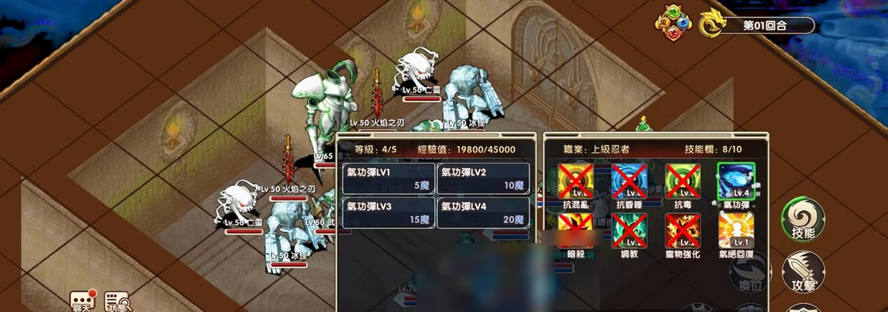

### 打法：人丟氣功彈 1 打王，寵物清小怪

1. 進入王戰後，一開始就可以直接用氣功彈打猶大。
2. **氣功彈丟 1 就好，不要丟 4。**丟 4 可能會打到前面那隻小怪，而這場的目標就是不能打到前面那隻小怪，所以保持丟 1。（實際跑的時候有幾回合故意丟 4，那是錯誤示範，一般不建議。）
3. 寵物優先打**火焰之刃**（俗稱火刀）和白鬼（對照攻略網的小怪表，另一種會放魔法的是亡靈），因為這兩種都會放法術，打起來有點痛；之後再把王前之外的小怪全部清掉。傷害不夠的話，人跟寵物可以一起先清小怪。
4. 魔封結束後如果還剩 5 隻小怪，人去打王，寵物就算一下：每隻寵物平均打剩下的怪 1～2 下，控制好，**保留一隻小怪在前面**，就可以無損地用氣功彈打王。

實際跑的忍者是平均流配點，力量沒有全滿，打王大概 90 多的傷害（畫面上看到的多是 80 多），打起來是偏低的；想先估算自己的氣功彈能打多少，可以用本站的 [傷害計算機](/damage/)。

**猶大的高傷害由寵物來扛。**猶大真的打出乾坤這種高傷害時，會由前排的史萊姆（寵物）承受。實際跑時寵物已經七十幾級，照理來說沒那麼痛，但被打還是 500；如果你的等級更低，例如 50、60 級，寵物留在前面扛傷害就很重要。沒魔或被魔封時，身上帶水可以直接丟藥水在寵物身上（魔封時傳教士不能丟補血），讓牠快速回血；寵物真的不幸被打死，最起碼還有氣絕回復。

**反擊與合擊**：猶大的反擊傷害蠻高的。如果剛好打出合擊是最好的狀況，因為合擊時王的反擊會失效；可是合擊是賭，不能奢望它總是發生，最務實的方法還是靠人用氣功彈慢慢打。

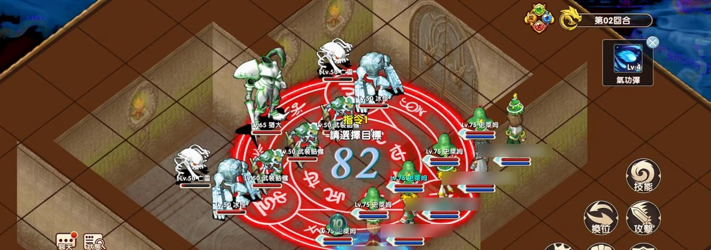

秉持這套邏輯就能順利通關：最後一顆氣功彈讓猶大倒下、最後的小怪也打掉，王戰就算通過了。

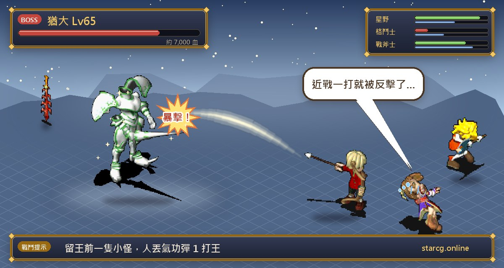

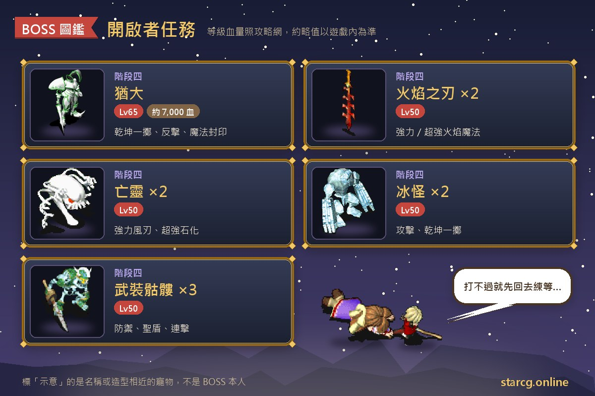

## 階段五：拿稱號、學超強咒術

1. 戰勝後會傳到開啟者之間，跟**布魯梅爾**（17, 9）對話，取得稱號「開啟者」並回到聖餐之間。
2. （選做）在聖餐之間花 **10,000G** 找**阿斯提亞僧兵**，可以學超強中毒、超強昏睡、超強石化、超強酒醉、超強混亂、超強遺忘六種全體超強咒術魔法，打完猶大後咒術師就能學這些「超咒」（超石、超睡、超毒等）。

**打完猶大之後能做什麼？**有了「開啟者」稱號，可以接時空之門第二章冰雪的牢籠（還要王宮階級），也可以去挑戰職業晉級三轉「詛咒的迷宮」與 60 樓的雙王。實際跑完的說法是：在星詠魔力只要完成王宮任務（挑戰神獸）跟猶大，就可以直接去打雙王，也就是可以提早去召 3（詛咒的迷宮 31 樓）。那裡是各版本魔力寶貝中最會掉石的地方之一，怪物又很軟、打人不痛，小資或無課玩家甚至可以考慮在那邊練到 60 甚至 70 級。不過本站的 [三轉攻略](/posts/job-advance-3-quest-guide/) 依攻略網寫的接取條件是「王宮階級＋開啟者稱號」，兩者寫法不同，實際以遊戲內接取條件為準。

## 開啟者任務常見問題

**一個人真的可以解猶大嗎？**可以。星詠魔力只要男女兩位隊長互換燭台，隊員不用換；帳號裡有一男一女，其他位子用傭兵補滿就能走完兩條路線。有兩台設備的話同時登入同一個帳號、男女路線一起跑最省時間。

**一定要是王宮階級嗎？**不用。打猶大只要完成「挑戰神獸」，不需要到王宮階級；王宮階級是下一章冰雪的牢籠才要求的。

**燭台給錯了怎麼辦？**給錯就功虧一簣，而且進去之後沒辦法出來，所以一定要事先避免：對方剛給你的燭台會出現在最後一格，你要給對方的是前一格那個。

**為什麼不能用近戰打猶大？**猶大會反擊，近戰被反擊的傷害特別高；他的乾坤一擲傷害也很高。用氣功彈或弓遠程打、留一隻小怪擋在王前面，才能讓他只打得到前排寵物。

**氣功彈要丟幾級？**丟 1。丟 4 可能打到猶大前面那隻小怪，小怪死了猶大就能直接打到人。

**路上的怪很煩怎麼辦？**可以逃跑，或直接登出再重新登入閃過；登出比較穩，逃跑失敗會被打、還會浪費血魔池。

## 小結：兩位隊長、一個捷徑、一隻留著的小怪

開啟者的重點可以濃縮成三件事：星詠魔力只要一男一女兩位隊長換燭台，一個帳號就能自己解；第三次換燭台走（54, 57）的快速捷徑能省下大量時間，交易時記得給「前一格」的燭台；猶大戰留王前一隻小怪、人丟氣功彈 1、寵物扛傷害，就能安全通關。拿到「開啟者」之後，冰雪的牢籠、超強咒術與詛咒的迷宮都在前面等著你。

想看更完整的任務原文，可以到 [星詠魔力攻略網](https://guide.starcg.net/) 查詢；要比較藥水價格或估算氣功彈傷害，歡迎使用本站的 [市場查價](/market/) 與 [傷害計算機](/damage/)，寵物成長則可以查 [寵物圖鑑](/pets/)。

## 延伸閱讀

- [時空之門任務完整攻略：開啟者、冰雪的牢籠、風鳴之塔、六曜之塔](/posts/time-gate-quest-guide/)
- [職業晉級三轉任務攻略：詛咒的迷宮 60 層守護者與雙王](/posts/job-advance-3-quest-guide/)

## 參考資料

- [星詠魔力攻略網：時空之門系列・開啟者](https://guide.starcg.net/quests/time-gate/開啟者)
