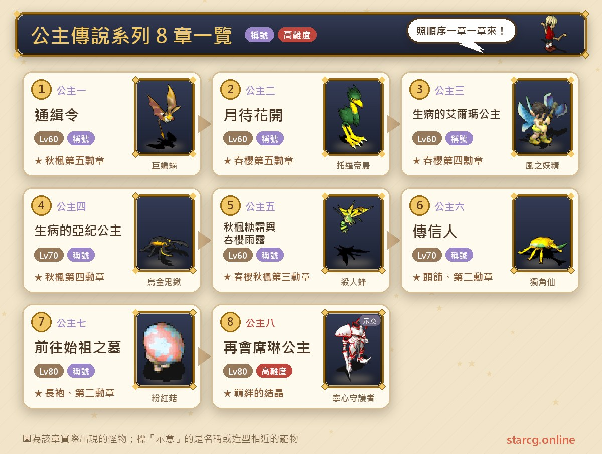
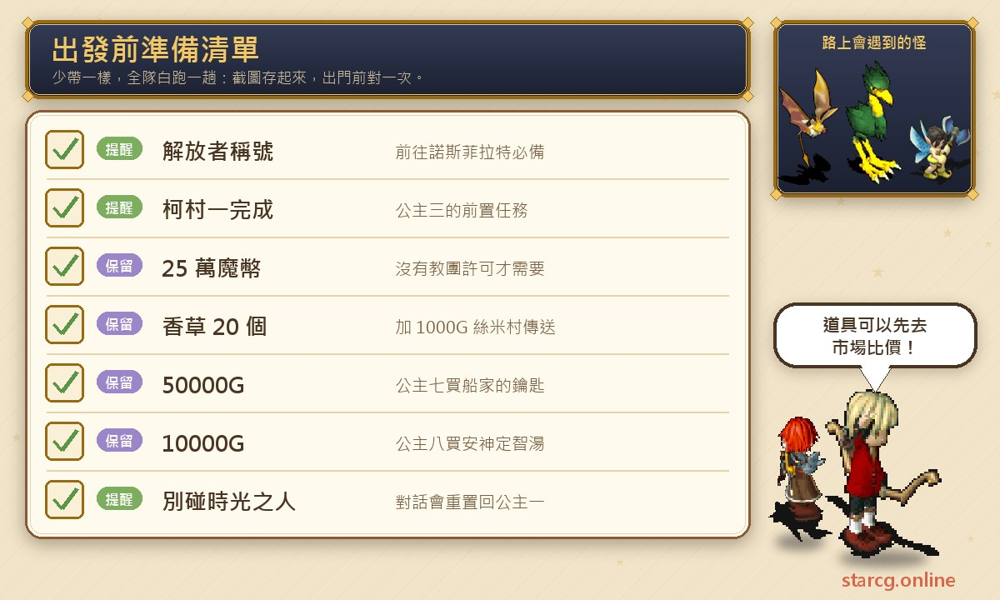
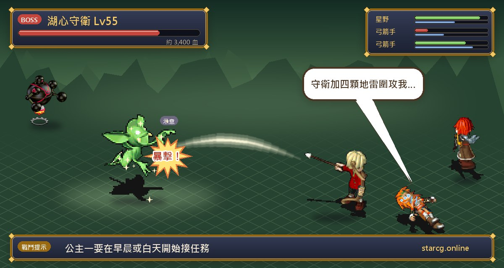
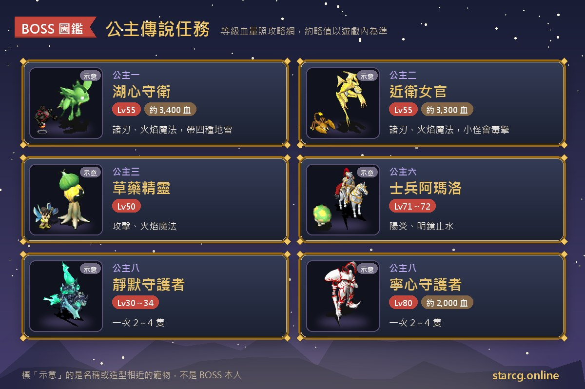

크로스게이트의 공주 전설(公主傳說) 시리즈는 엘바란 왕국(艾爾巴蘭國)과 아키 성(亞紀城)의 두 공주, 그리고 실종된 실린 공주(席琳公主)를 둘러싼 8장짜리 연속 퀘스트예요. 이야기 배경은 두 나라가 왕위 계승 분쟁으로 계속 다투는 가운데, 실린 공주의 유복자가 새로운 불씨가 되었다는 설정이에요. 플레이어는 고랄 마을(哥拉爾鎮), 아키 성, 칸나벨라 마을(坎那貝拉村), 미노키아 마을(米諾基亞村), 노스페라트(諾斯菲拉特), 일요의 영역(日耀之域)을 오가며 편지를 전하고, 미궁을 지나고, 수호자를 쓰러뜨린 끝에 숨어 사는 실린 공주를 찾아내요. 시리즈 전체의 권장 레벨은 60~80이고, 앞의 다섯 장은 60~70레벨로 충분하며 7장과 8장은 80레벨에 출발하는 걸 권해요.

보상도 꽤 알차요. 장마다 영구 칭호를 하나씩 주는데, 「추풍 제5훈장(秋楓第五勳章)」부터 시작해 「춘앵 제1훈장(春櫻第一勳章)」과 「추풍 제1훈장(秋楓第一勳章)」까지 모을 수 있어요. 도중에 펫 스킨 교환권, 실린 의상 주머니의 로브, 머리 장식 4종 중 하나, 마력 소모를 줄여 주는 로브 11종도 받을 수 있고, 마지막의 「인연의 결정(羈絆的結晶)」을 5개 모으면 인간형 환영 펫으로 바꿀 수 있어요. StarCG(星詠魔力), 水藍魔力, 初心魔力寶貝 어느 서버든 공주 전설 퀘스트 진행은 같으니 이 정리를 그대로 대조해서 쓰면 돼요.

> 이 글은 [StarCG 공략 사이트](https://guide.starcg.net/)의 공주 전설 시리즈 페이지를 바탕으로, 저희 방식대로 순서를 다시 정리하고 새로 쓴 것이에요. 그대로 옮기지 않았어요. 보스 HP와 수치는 대략적인 값이고, 공략 사이트에 없는 수치는 따로 채우지 않았어요. 실제 내용은 게임 안을 기준으로 하고, 업데이트 후 바뀔 수 있어요.

## 공주 전설이란? 전체 순서부터 보기

공주 전설은 모두 8장이고 반드시 순서대로 해야 해요. 각 장의 선행 조건은 「이전 장 완료」예요. 특이한 건 3장인데, 2장 완료 외에도 커 마을 시리즈의 「노스페라트 입성」을 먼저 끝내야 해요. 퀘스트가 노스페라트로 사람을 찾으러 가게 하기 때문이에요. 또 노스페라트에 가려면 「해방자(解放者)」 칭호(날개 잃은 용 퀘스트에서 획득)가 필요하니, 이 두 조건은 공주 전설을 시작하기 전에 미리 확인해 두는 걸 권해요.

| 장 | 퀘스트 이름 | 권장 레벨 | 획득 |
|---|---|---|---|
| 공주 1 | 수배령 | 60(아침/낮 한정) | 칭호 「추풍 제5훈장」, 케이브베어 또는 노란 입냄새 도깨비 스킨 교환권 |
| 공주 2 | 달을 기다려 피는 꽃 | 60 | 칭호 「춘앵 제5훈장」, 강력 껌 또는 부트라의 카드 |
| 공주 3 | 병든 엘마 공주 | 60 | 칭호 「춘앵 제4훈장」, 마력 증강약/무외 정수/바라스의 카드 |
| 공주 4 | 병든 아키 공주 | 70 | 칭호 「추풍 제4훈장」, 천벌/깃털 목걸이/오금 사슴벌레의 카드 |
| 공주 5 | 추풍 설탕서리와 춘앵 우로 | 60 | 칭호 「춘앵 제3훈장」 「추풍 제3훈장」, 실린 의상 주머니 |
| 공주 6 | 전령 | 70 | 칭호 「춘앵 제2훈장」, 현자의 축복(머리 장식) |
| 공주 7 | 시조의 묘로 | 80 | 칭호 「추풍 제2훈장」, 아키의 선물(로브) |
| 공주 8 | 실린 공주와의 재회 | 80 | 칭호 「춘앵 제1훈장」 「추풍 제1훈장」, 인연의 결정 |

시리즈 전체에 아주 중요한 장치가 하나 있어요. 바로 **아키 성의 시간의 사람(時光之人)(50, 35)**이에요. 공주 전설을 모두 끝낸 뒤에, 또는 퀘스트 도중에 그와 대화하면 진행 상황이 공주 1 「수배령」의 시작점으로 초기화돼요. 보물 주머니 보상을 다시 노리는 사람은 이걸 활용하면 되지만, 퀘스트 중간에 실수로 말을 걸지 않도록 조심하세요.

## 출발 전에 준비할 것

공주 전설은 전투 난이도가 높지 않고, 진짜 발목을 잡는 건 「돈」과 「선행 조건」이에요. 3장에서 아직 베니차스 교단 허가가 없다면 25만 골드를 준비해야 하고, 7장의 뱃사공 열쇠는 50000G, 8장의 안신정지탕은 10000G, 4장에서 스미 마을(絲米村) 전송을 쓰려면 허브 20개와 1000G가 필요해요. 이 지출을 한데 모아 보면 왜 돈을 먼저 모아 두고 시작하라고 하는지 알 수 있어요.

허브 같은 재료는 직접 채집해도 되고 다른 플레이어에게 바로 사도 돼요. 이 사이트의 [시세 조회](/ko/market/)에 아이템 이름을 입력하면 현재 노점 가격을 볼 수 있으니, 파티로 함께 한다면 먼저 가격을 비교하고 출발하는 게 가장 편해요. 또 공주 1은 아침이나 낮에만 받을 수 있고 6단계는 저녁이나 밤까지 기다려야 하니 시간대를 먼저 확인하세요.

## 공주 1: 수배령 (아키 공주가 월심 장군을 쫓다)

권장 레벨 60, 아침이나 낮에만 시작할 수 있어요. 이야기는 아키 공주가 추격령을 내려 은퇴한 월심 장군(月心將軍)을 쫓는 내용이에요.

1. (스토리 단계, 생략 가능) 아키 성의 **아리(阿黎)**(50, 44)와 **루 할머니(盧奶奶)**(51, 45)에게서 정보를 들어요.
2. 아침이나 낮에 아키 성의 **전령병(傳令兵)**(52, 38)에게서 「엘바란 왕국 연락관에게 보내는 편지」를 받아요.
3. 고랄 마을 동문 근처의 **연락관(連絡官)**(167, 102)에게 편지를 건네 「칸나벨라 연락원에게 보내는 편지」로 바꿔요.
4. 칸나벨라 마을의 **연락원(連絡人)**(53, 45)에게 편지를 건네 「공주에게 보내는 편지」로 바꿔요.
5. 아침이나 낮에 아키 성의 **전령병**(52, 38)에게 돌아가 편지를 건네 「전령병의 정보 I」로 바꿔요.
6. 저녁이나 밤에 아키 성 남문으로 나가 성 밖의 **전령병**(148, 131)에게 정보를 건네 「열쇠」로 바꾸고, 뒤쪽의 나무를 클릭해 열쇠를 건네면 「？」로 전송돼요.
7. 동굴 (17, 17)에서 「호수 한가운데로 가는 동굴」에 들어가 7층 미궁을 지나 지하 호수에 도착해요. 동굴에서는 18~19레벨의 슬라임과 거대 배트(巨蝙蝠)가 1~7마리씩 나와요.
8. 지하 호수에서 **호심 수위(湖心守衛)**(39, 32)와 대화하면 전투가 시작돼요.
9. 이긴 뒤 다시 호심 수위에게 말을 걸면 입구로 돌아가고, 칭호 「추풍 제5훈장」과 「보물 주머니」를 얻어요.

**보스 정보**: 호심 수위는 55레벨, HP 약 3,400, 사악 계열이고 공격, 방어, 양날, 화염 마법을 써요. 곁에는 점프 폽마인(跳跳地雷), 산산 폽마인(碎碎地雷), 피피 폽마인(皮皮地雷), 사프 폽마인(薩普地雷)이 있고, 모두 50~53레벨, HP 약 1,000의 금속 계열이에요. 네 폽마인은 속성이 각각 달라서(점프 폽마인 땅 100, 산산 폽마인 불 40 바람 60, 피피 폽마인 땅 60 물 40, 사프 폽마인 물 40 불 60), 싸우기 전에 파티 속성 조합을 먼저 확인해 두면 좋아요.

**보물 주머니와 스킨 교환권**: 보물 주머니에서는 「케이브베어 스킨 교환권」 또는 「노란 입냄새 도깨비 스킨 교환권」이 무작위로 나와요. 10장을 모아 해당 펫을 데리고 판부르크(法蘭城) 펫 상점의 펫 외형 개조 NPC를 찾아가면, 두 가지 스킨 중 하나로 무작위로 영구 변경할 수 있어요(자수정 케이브베어, 붉은 눈 케이브베어/노란 독입술 도깨비, 노란 빨간입술 도깨비). 펫의 능력, 레벨, 등급은 바뀌지 않아요. 단, **한 번 바꾸면 원래 색으로 되돌릴 수 없고**, 교환권으로 다른 스킨으로만 다시 바꿀 수 있어요.

## 공주 2: 달을 기다려 피는 꽃 (고요한 오두막의 근위 여관)

권장 레벨 60, 수배령을 완료하면 받을 수 있어요.

1. 고랄 마을 동문의 **연락관**(167, 102)에게서 「연락관의 의뢰 편지」를 받아요.
2. 칸나벨라 마을의 **연락원**(53, 45)에게 편지를 건네 「미노키아 연락원에게 보내는 편지」로 바꿔요.
3. 미노키아 마을의 **연락관**(47, 91)에게 편지를 건네 「연락관의 서신」으로 바꿔요.
4. 미노키아 마을 동문으로 나가 성 밖의 큰 나무 (523, 831)를 클릭하면 「？」로 전송돼요.
5. 전송석 (14, 12)로 약 7층 미궁을 지나 고요한 오두막으로 가요. 지하 통로에서는 27~29레벨의 새끼 용과 토로티 새(托羅帝鳥)가 매번 1~7마리씩 나와요.
6. **근위 여관(近衛女官)**(25, 17)과 대화해 전투하고, 이긴 뒤 「연락관의 서신」을 건네 「근위 여관의 보고서」로 바꾸고 오두막을 나가요.
7. 고랄 마을의 **연락관**(167, 102)에게 돌아가면 칭호 「춘앵 제5훈장」과 보물 주머니를 받아요.

**보스 정보**: 근위 여관은 55레벨, HP 약 3,300, 사악 계열이고 스킬은 호심 수위와 같은 공격, 방어, 양날, 화염 마법이에요. 곁에는 토로티 새 2~3마리(51~52레벨)와 킬러 전갈(殺手蠍) 2~3마리(51~55레벨)가 있고, 두 졸개 모두 **독 공격**을 써요. 해독이나 회복을 할 수 있는 파티원을 데려가는 걸 권해요. 보물 주머니에서는 강력 껌(생명 50, 마력 50 회복)이나 부트라(布特拉)의 카드가 무작위로 나와요.

## 공주 3: 병든 엘마 공주 (노스페라트로)

권장 레벨 60, 선행 조건은 달을 기다려 피는 꽃과 커 마을 1 「노스페라트 입성」 완료예요.

1. 고랄 마을 하얀 궁전(白之宮殿) 밖의 **시녀 샤오주(小竹)**(47, 34)에게서 「공주의 초상화」를 받아요.
2. 노스페라트의 시드페니키(錫德婓尼基) (234, 378)로 가서 민가 (23, 17)에 들어가 **마고(麻姑)**(7, 9)에게 초상화를 건네면 「지도」를 받아요.
3. 렉타르 마을(雷克塔爾鎮)로 돌아가 **성급한 남자**(45, 74)에게 지도를 건네 「통행증」으로 바꿔요.
4. 남문에서 서쪽으로 가 **골짜기 입구 수위**(561, 387)를 찾으면 「？」로 전송되고, 정령의 골짜기 전송석(100M~1100M)으로 들어가요.
5. **약초 정령(草藥精靈)**(29, 13)과 대화해 전투하고, 이긴 뒤 약초 (29, 13)를 클릭해 통행증을 건네면 「약초」를 받고 전송되어 나와요.
6. 렉타르 마을의 **성급한 남자**(45, 74)에게 약초를 건네면 칭호 「춘앵 제4훈장」과 보물 주머니를 받아요.

**주의할 점**: 노스페라트에 가려면 「해방자」 칭호가 필요해요. 아직 **베니차스 교단 허가(貝尼恰斯教團許可)**가 없다면, 먼저 쿠룩스 섬(庫魯克斯島) 렉타르 마을의 **가몬 신관(加蒙神官)**(83, 80)에게서 「성녀의 친필 편지(위조)」를 받고, 곶의 신전 (832, 688)에서 (125, 87)로 들어가 **마법사 우리엘(烏莉兒)**(36, 19)에게 **25만 골드**와 편지를 건네 허가를 받아야 해요. 그다음 렉타르 마을 항만 관리소 (100, 78)에서 1000G를 내고 배를 타 커마테이 마을(柯馬特依村)로 가요. 이미 허가를 가진 사람은 건너뛰어도 되고, 허가를 가지고 있으면 이 선행 과정은 다시 받을 수 없어요.

**보스 정보**: 약초 정령은 50레벨, 사악 계열이고 공격과 화염 마법을 써요. 곁에는 바람의 요정(風之妖精)과 땅의 요정(地之妖精)이 각 2마리씩(43~45레벨, 인간형) 있어요. HP는 공략 사이트에 나와 있지 않아요. 정령의 골짜기에서는 몬스터가 1~6마리씩 나와요. 보물 주머니에서는 마력 증강약(마력 상한 +100, 10분 지속, 본인 한정), 무외 정수(생명 200, 마력 20 회복), 바라스(巴拉斯)의 카드 중 하나가 무작위로 나와요.

## 공주 4: 병든 아키 공주 (욱일산과 조일산)

권장 레벨 70, 이전 장을 완료하면 받을 수 있어요. 이 장에는 고정 보스전이 없고, 핵심은 15층짜리 산 두 개예요.

1. 아키 성 공주부 (55, 39)의 **시녀 허웨(荷月)**(15, 12)에게서 「허웨의 의뢰」를 받아요.
2. 일요의 영역으로 가요. 스미 마을에서 허브 20개와 1000G를 들고 **전송 신관**(66, 37)에게 「예」를 고르면 일요의 영역으로 전송돼요. 또한 전송석으로 아키 성에 바로 가고 싶다면 「표풍의 난(飄風之蘭)」 퀘스트를 먼저 완료하고, 아키 성 병원 옆의 전송 교통 관리 센터 (28, 50)에서 **전송석 관리원**(42, 22)에게 전송 지점을 등록해야 해요.
3. 벽파 마을(碧波鎮) 촌장의 집에서 **월심 할아버지(月心爺)**(16, 5)에게 「월심 군령」 2개를 받아, 욱일 마을(旭日村)과 조일 마을(朝日村)의 연락원에게 하나씩 전해요. 순서는 상관없어요.
4. **욱일산(旭日山)**: 욱일 마을의 **연락원 아카이(阿凱)**(45, 61)에게서 통행증을 받고, 남문으로 나가 수위 (658, 346)를 통해 「？」에 들어가 노란 전송석으로 욱일산에 가요. 15층을 올라 정상의 (63, 40)에서 「약초」를 채집해요. 도중에는 75레벨의 브라즈(布拉茲)와 젤리 슬라임이 나오고, 가끔 75레벨의 미니 드래곤과 오금 사슴벌레(烏金鬼鍬)도 만나요.
5. **조일산(朝日山)**: 조일 마을의 **연락원 아후(阿虎)**(61, 39)에게서 통행증을 받고, 동문에서 남동쪽으로 가 수위 (367, 352)를 통해 「？」에 들어가 노란 전송석으로 조일산에 가요. 15층을 올라 정상의 (36, 23)에서 「약초」를 채집해요. 도중에는 75레벨의 열풍 와이번(烈風翼龍)과 데스 트렌트(死亡樹精)가 나와요.
6. 두 가지 약초를 가지고 벽파 마을의 **월심 할아버지**에게 가면 칭호 「추풍 제4훈장」과 보물 주머니를 받아요.

**주의할 점**: 권장 레벨은 70이지만 두 산의 졸개는 모두 75레벨이고, 브라즈는 강력 운석 마법도 써서 레벨이 딱 맞는 파티는 보급에 신경 써야 해요. 각 15층짜리 랜덤 미궁 두 곳이 이 장에서 가장 시간이 걸리는 부분이라, [미궁 계단 찾기](/ko/maze/)로 걸으면서 계단 위치를 기록하면 훨씬 편해요. 보물 주머니에서는 부적 「천벌」, 「깃털 목걸이」, 오금 사슴벌레의 카드 중 하나가 무작위로 나와요.

## 공주 5: 추풍 설탕서리와 춘앵 우로 (15층 미궁 두 곳)

권장 레벨 60, 병든 아키 공주를 완료하면 받을 수 있어요.

1. (스토리, 생략 가능) 아케르파 마을(阿凱魯法村)의 **월심 할아버지**(179, 132)에게서 정보를 들어요.
2. 아키 성의 **전갈 시녀(傳信侍女)**(46, 42)에게서 「어의에게 보내는 편지」를 받고, 공주부의 **어의 카오리(香織)**(15, 8)에게 가서 「주베에에게 보내는 편지」로 바꿔요.
3. 공주부를 나와 **주베에(十兵衛)**(54, 36)를 통해 전송석으로 **꽃의 골짜기(花之山谷)**에 들어가, 15층 미궁을 지나 골짜기 꼭대기의 **우오(雨梧)**(33, 23)에게서 「추풍 설탕서리(秋楓糖霜)」를 받아요. 도중에는 49~51레벨의 살인벌(殺人蜂), 홍학 꼬마 요괴(독 사용), 해바라기 꼬마 요괴가 매번 3~6마리씩 나와요.
4. 고랄 마을의 **전갈 시녀**(126, 205)에게서 「어의에게 보내는 편지」를 받고, 하얀 궁전 밖의 **어의 엘루피(艾露菲)**(36, 42)에게 가서 「구루에게 보내는 편지」로 바꿔요.
5. 궁전에 들어가 **병사 구루(古魯)**(73, 15)를 통해 **회월의 탑(回月之塔)**에 들어가, 15층 미궁을 지나 탑 꼭대기의 **사쿠라코(櫻子)**에게서 「춘앵 우로(春櫻雨露)」를 받아요. 도중에는 29~31레벨의 붉은 토끼, 버섯 토란 꼬마 요괴(독 사용), 화염 양이 나와요.
6. 설탕서리와 우로를 가지고 아케르파 마을의 **월심 할아버지**(179, 132)에게 가면 「춘앵 제3훈장」 「추풍 제3훈장」 두 칭호와 「실린 의상 주머니」를 받아요.

**보상 설명**: 실린 의상 주머니에서는 혈맹의 옷(血盟之衣), 재앙의 로브(禍害之裳), 무정의 로브(無情之裳), 늠렬의 로브(凜冽之裳), 작열의 로브(炙熱之裳) 중 하나가 무작위로 나와요. 뒤의 네 가지는 로브이고, 해당 마법의 마력 소모를 줄여 줘요. 이 장은 공략 사이트에 보스가 나와 있지 않고, 두 미궁의 졸개가 모두 독을 쓰니 해독 수단을 조금 챙기면 돼요.

## 공주 6: 전령 (운무의 호수의 병사 아마로)

권장 레벨 70, 이전 장을 완료하면 받을 수 있어요.

1. 고랄 마을 하얀 궁전 바깥의 **엘마 공주(艾爾瑪公主)**(64, 25)에게서 「친구에게 보내는 편지」를 받아요.
2. 하나코 반도(哈那可半島) 스미 마을의 망우곡(忘憂谷)에서 **오마(奧瑪)**(284, 259)에게 가서 「공주에게 보내는 편지」로 바꾸고, 엘마 공주에게 돌아가 전한 뒤 「현자에게 보내는 편지」를 받아요.
3. 고랄 마을 서문에서 쿠룩스 섬 (197, 442)으로 가 **이름 없는 소나무(無名松)**(197, 441)를 클릭해 운무령(雲霧嶺) 입구에 들어가고, (25, 22)까지 걸어가 운연의 골짜기(雲煙之谷)에 들어가요.
4. 19층 미궁을 지나 운무의 호수(雲霧之湖)에 가서(50~51레벨의 비취 버섯(翠綠菇)과 장수풍뎅이(獨角仙)가 나오고 2~3연전이 될 확률이 있어요), **수호 병사 아마로(阿瑪洛)**(73, 57)와 전투해요.
5. 이긴 뒤 동굴 (9, 4)에서 운연의 골짜기 2에 들어가, 다시 9층 미궁을 지나 운연 산령에 가요.
6. 현자의 집 (74, 22)의 **숲의 현자**(21, 7)에게서 「공주에게 보내는 편지」를 받아 엘마 공주에게 전하면 퀘스트 완료예요.

**보스 정보**: 병사 아마로는 71~72레벨, 4속성 각 30, 사악 계열이고 「아지랑이」와 「명경지수」를 써요. 곁에는 30~32레벨의 비취 버섯과 분홍 버섯(粉紅菇)이 있어요. HP는 공략 사이트에 나와 있지 않아요. 이 전투는 7장 입구에서 한 번 더 만나니, 한 번 싸워 보면 파티를 어떻게 짜야 할지 알 수 있어요.

**보상**: 칭호 「춘앵 제2훈장」과 「현자의 축복」이에요. 사용하면 공주 베일관, 아기 돼지 인형, 공주 이마띠, 시바견 인형 네 가지 머리 장식 중 하나를 무작위로 얻어요. 이 장은 19층과 9층 미궁을 합쳐서 지나가야 하고 연전 확률도 낮지 않으니 보급품을 넉넉히 챙기세요.

## 공주 7: 시조의 묘로 (50000G의 뱃삯)

권장 레벨 80, 전령을 완료하면 받을 수 있어요.

1. 미노키아 마을 (120, 126)의 **시녀**에게서 「시녀의 의뢰」를 받아요.
2. 미노키아 마을 (25, 115)의 **뱃사공**에게 **50000G**를 내고 「뱃사공의 열쇠」로 바꿔요.
3. (30, 112)의 **시위**를 통해 추일호(秋日號)에 타고, 배 위의 **시위**(68, 20)를 통해 폭풍이 부는 바다로 전송돼요.
4. 바다 위 아무 곳이나 클릭해 대화창이 나오면 「확인」을 눌러 작은 섬으로 전송돼요.
5. 작은 섬 (65, 45)에서 동굴로 들어가 신비한 묘지 지하 1층으로 가고, 10층 미궁을 지나 시조의 묘 입구에 도착해요.
6. **시위**(14, 14)와 대화하면 전투가 시작돼요. 적은 병사 아마로(71~72레벨)와 분홍 버섯, 비취 버섯 각 2마리예요.
7. 시조의 묘에 들어가 **아키 공주**(13, 7) 또는 **시조**(15, 8)에게 가면 작은 섬으로 돌아가고, **아키 공주**(62, 90)에게서 칭호와 「아키의 선물」을 받아요.

**주의할 점**: 입구 전투에서 이기면 펫 코인, 붉은 기밀문서, 비취 버섯의 카드 중 하나를 무작위로 얻는데, 공략 사이트에 따르면 앞의 두 가지는 현재 **쓸 곳이 없고** 관련 퀘스트도 아직 열리지 않았으니 따로 보관할 필요는 없어요. 아키의 선물에서는 대지, 바다, 화염, 구름, 결계, 병소, 성채, 마소, 전령, 마령, 인온의 로브 등 11종 중 하나가 무작위로 나와요. 모두 레벨 2 또는 3, 방어 +30의 로브이고 각각 특정 마법 하나의 마력 소모를 줄여 줘요. 예를 들어 인온의 로브(氤氳之裳)는 「초강력 회복 마법」의 마력 소모를 줄이고 마력 +100이에요.

## 공주 8: 실린 공주와의 재회 (두 갈래 채집과 인연의 결정)

권장 레벨 80, 시리즈의 마지막 장이고 두 갈래로 나눠 진행해요.

1. 이르 마을(伊爾村)의 **월심 할아버지**(52, 49)에게서 「실린의 구조 요청 편지」 2통을 받아 두 공주에게 하나씩 전해요. 순서는 상관없어요.
2. **엘마 공주 라인**: 고랄 마을 하얀 궁전의 **전속 시녀 샤오칭(小青)**(77, 15)을 통해 접견실에 들어가 **엘마 공주**(14, 16)에게서 통행증을 받아요. 북문으로 나가 **골짜기지기(守谷人)**(285, 294)를 통해 쿠룩스 섬으로 전송되고, 전송석 (31, 28)로 정묵의 골짜기(靜默谷) 1900M를 지나 정묵의 숲에 가요. **정묵의 수호자(靜默守護者)**(27, 15)와 싸워 이긴 뒤 정묵초 (29, 12)를 클릭해 「정묵초(靜默草)」를 얻어요.
3. **아키 공주 라인**: 아키 성 공주부의 **전속 시녀 샤오훙(小紅)**(11, 3)을 통해 접견실에 들어가 **아키 공주**(15, 8)에게서 통행증을 받아요. 남문으로 나가 **골짜기지기**(165, 173)를 통해 하나코 반도로 전송되고, 전송석 (29, 20)으로 영심의 골짜기(寧心谷) 1900M를 지나 영심의 숲에 가요. **영심의 수호자(寧心守護者)**(29, 12)와 싸워 이긴 뒤 영심화를 클릭해 「영심화(寧心花)」를 얻어요.
4. 판부르크 서쪽 병원의 **약사 샤오미(小咪)**(16, 6)에게서 **10000G**로 「안신정지탕(安神定智湯)」을 사요.
5. 세랄카 마을(聖拉魯卡村)의 **즈얼(芝兒)**(19, 37)을 통해 뒷산에 들어가, 북쪽의 **골짜기지기**(142, 79)를 통해 프레이아(芙蕾雅)로 전송되고, 전송석 (33, 26)으로 바닷가의 골짜기 1900M를 지나 은밀한 골짜기에 도착해요.
6. **월심 할아버지**(42, 24)를 통해 실린의 집에 들어가 **실린(席琳)**(15, 4)과 대화하고, 나오면 「춘앵 제1훈장」 「추풍 제1훈장」과 「인연의 결정」을 얻어요.

**보스 정보**: 정묵의 수호자는 한 번에 2~4마리, 30~34레벨이고, 영심의 수호자는 한 번에 2~4마리, 80레벨, 마리당 HP 약 2,000이에요. 둘 다 4속성 각 30의 사악 계열이에요. 영심의 숲 전투는 시리즈 전체에서 적 레벨이 가장 높은 전투라, 수가 많을 때는 포위 공격을 조심하세요.

**인연의 결정으로 펫 교환**: 인연의 결정을 5개 모아 판부르크 펫 교환소 (194, 72)에 가면 환영 시리즈 펫 중 하나를 무작위로 받을 수 있어요. 부러진 칼날의 환영(불), 영창의 환영(땅), 파공의 환영(물), 유성의 환영(바람)이고, 모두 인간형 실버 카드, 스킬 칸 8, 등급 122예요. 한 번에 결정을 1개만 받기 때문에, 펫을 받으려면 시간의 사람으로 초기화해서 시리즈 전체를 여러 번 다시 해야 해요. 네 환영의 성장 수치는 이 사이트의 [펫 도감](/ko/pets/)에서 비교해 볼 수 있어요.

**가는 길 팁**: 은밀한 산꼭대기의 전송석 (56, 11)을 이용하면 바닷가의 골짜기와 은밀한 산꼭대기를 거쳐 프레이아에 도착하고, 다시 남서쪽으로 걸어가 「예」를 고르면 프레이아 (216, 169)의 세레네(莎蓮娜) 해저 동굴 옆으로 돌아갈 수 있어요.

## 공주 전설 자주 묻는 질문

**공주 전설 퀘스트는 꼭 순서대로 해야 하나요?** 네. 각 장의 조건은 이전 장 완료이고, 3장은 추가로 커 마을 1 「노스페라트 입성」을 완료하고 노스페라트에 가는 데 필요한 「해방자」 칭호를 가지고 있어야 해요.

**시간의 사람은 무슨 역할을 하나요?** 아키 성의 시간의 사람(50, 35)은 공주 전설 진행 상황을 공주 1로 초기화해요. 모두 끝낸 뒤 그를 통해 시리즈를 다시 할 수 있지만, 퀘스트 도중에 실수로 클릭해도 초기화되니 특히 조심하세요.

**인연의 결정은 어떻게 5개를 모으나요?** 공주 8을 한 번 끝낼 때마다 1개만 주기 때문에, 시간의 사람으로 초기화한 뒤 시리즈 전체를 반복해서 끝내야 해요. 5개를 모으면 판부르크 펫 교환소 (194, 72)에서 환영 펫으로 바꿔요.

**공주 7에서 받은 펫 코인과 붉은 기밀문서는 쓸모가 있나요?** 공략 사이트 설명에 따르면 이 두 아이템은 현재 쓸 곳이 없고, 관련 퀘스트도 아직 열리지 않았어요.

**시리즈 전체에 돈이 얼마나 드나요?** 공략 사이트에 나온 고정 지출은 교단 허가 25만 골드(허가가 없을 때만), 배 1000G, 스미 마을 전송 1000G와 허브 20개, 뱃사공 열쇠 50000G, 안신정지탕 10000G예요.

## 정리: 선행 조건과 여비부터 갖추고 시작하기

공주 전설 퀘스트 자체의 전투는 어렵지 않고, 진짜 계획이 필요한 건 세 가지예요. 3장 전에 커 마을 1을 끝내고 해방자 칭호를 받아 둘 것, 시리즈 전체의 여비를 미리 모아 둘 것, 그리고 4, 5, 6장의 15~19층 랜덤 미궁이에요. 순서대로 한 장씩 진행하면 훈장 칭호 8개를 모두 모을 수 있고, 환영 펫을 원한다면 시간의 사람을 이용해 몇 번 더 돌면 돼요.

원래 퀘스트 페이지의 전체 자료는 [StarCG 공략 사이트](https://guide.starcg.net/quests/)에서 볼 수 있어요. 아이템 가격은 이 사이트의 [시세 조회](/ko/market/), 미궁 계단은 [미궁 계단 찾기](/ko/maze/), 환영 펫의 성장은 [펫 도감](/ko/pets/)에서 확인해서 공주 전설 전체를 더 순조롭게 진행해 보세요.
