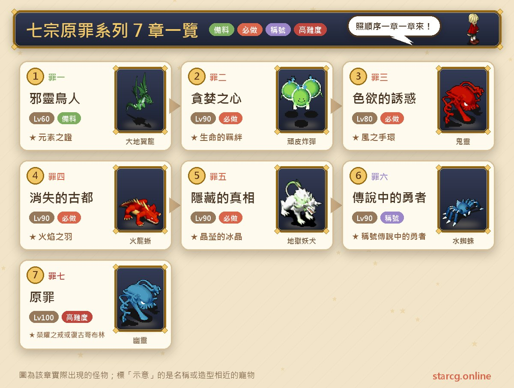
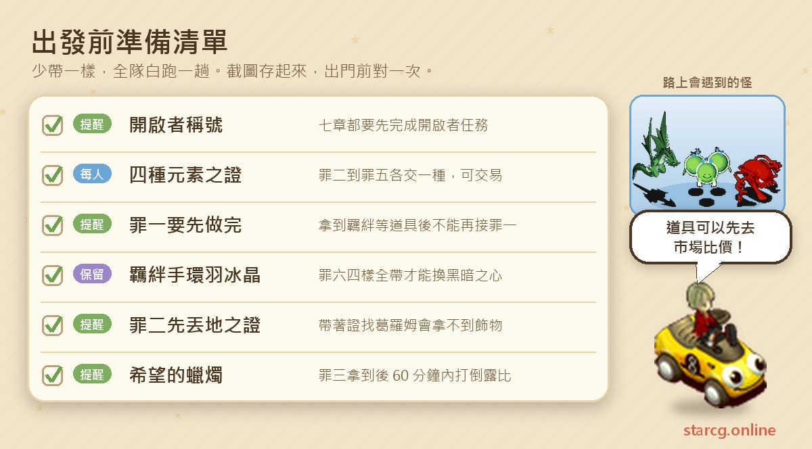
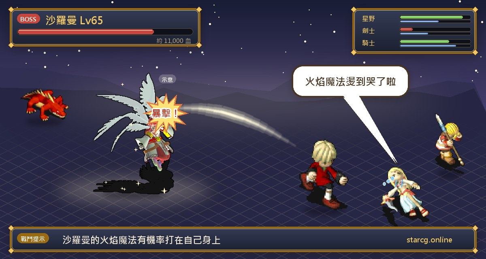
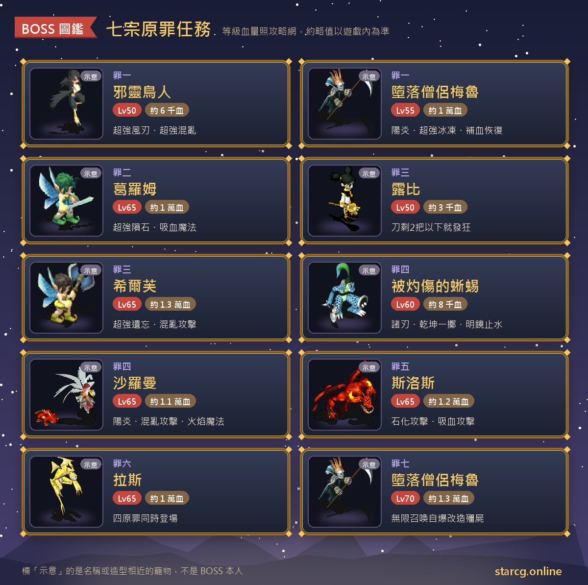

칠대 죄(七宗原罪)는 크로스게이트에서 「여는 자(開啟者)」 칭호와 이어지는 퀘스트 라인이에요. 시리즈는 모두 7장이에요. 죄 1에서 먼저 원소의 증표(元素之證)를 받고, 죄 2~죄 5에서는 땅·바람·불·물 네 가지 원소의 증표를 각각 들고 네 동굴의 4대 정령을 찾아가 핵심 아이템으로 바꿔요. 죄 6에서 네 아이템을 내고 「전설의 용사(傳說中的勇者)」 칭호를 받고, 마지막 죄 7에서 3연전을 끝내면 **영광의 반지(榮耀之戒)**와 펫 **레트로 고블린(復古哥布林)** 중 하나를 골라 받아요. 권장 레벨은 60부터 시작하고, 죄 2 이후는 대부분 90, 죄 7은 100이에요.

주요 아이템 말고도 죄 2~죄 5는 많은 직업이 **직업 전용 장신구**와 **직업 전용 스킬**을 받는 곳이라, 시리즈 전체를 할 생각이 없어도 한 장만 하는 사람이 많아요. 이 글은 7장의 순서, 조건, 좌표, 장마다 보스와 장신구를 한곳에 모으고, 가장 헷갈리기 쉬운 「원소의 증표 소지 규칙」을 확실히 정리했어요. StarCG(星詠魔力), 水藍魔力, 初心魔力寶貝 어느 쪽이든 칠대 죄 퀘스트 흐름은 같으니 이 정리를 그대로 쓰면 돼요.

> 이 글은 [StarCG 공략 사이트](https://guide.starcg.net/)의 칠대 죄 시리즈 페이지를 바탕으로 저희 방식으로 순서를 다시 짜고 새로 쓴 것이에요. 그대로 옮기지 않았어요. 보스 HP와 수치는 대략적인 값이니 실제 게임을 기준으로 하세요. 게임 업데이트 후 내용이 바뀔 수 있어요.

## 칠대 죄란? 전체 순서부터 보기

7장 모두 「여는 자」 칭호가 먼저 있어야 해요. 즉 「여는 자」 퀘스트를 먼저 끝내야 해요. 죄 2~죄 5는 각각 원소의 증표 한 종류가 필요하고 서로 선후 제한은 없어요. 죄 6은 죄 2~죄 5에서 받은 아이템 네 개를 모두 챙겨야 해요.

한 줄 정리: **죄 1에서 증표 받기, 죄 2~죄 5에서 아이템 교환(겸 직업 장신구), 죄 6에서 칭호, 죄 7에서 선택.**

| 장 | 퀘스트 이름 | 권장 레벨 | 획득 |
|---|---|---|---|
| 죄 1 | 사령 조인 | 60 | 원소의 증표(4개 중 1개, 거래 가능) |
| 죄 2 | 탐욕의 마음 | 90 | 생명의 인연, 병사/닌자/의사 장신구 |
| 죄 3 | 색욕의 유혹 | 80 | 바람의 팔찌, 궁술사/조교술사 장신구 |
| 죄 4 | 사라진 고도 | 90 | 화염의 깃털, 검사/기사/도끼투사/격투가 장신구 |
| 죄 5 | 숨겨진 진실 | 90 | 투명한 얼음 결정, 성직자/무술사/주술사/마술사 장신구 |
| 죄 6 | 전설의 용사 | 90 | 칭호 「전설의 용사」 |
| 죄 7 | 원죄 | 100 | 영광의 반지 또는 레트로 고블린 |

직업 전용 스킬을 배우는 조건은 모두 같아요. 「왕궁」 등급이어야 하고 「여는 자」 칭호가 있어야 해요. 스킬북은 장신구를 받는 곳 바로 옆에 있고 한 번에 100G예요.

## 출발 전에 준비할 것

칠대 죄 준비의 핵심은 소모품이 아니라 「무엇을 가지고 있고 무엇을 가지고 있지 않은가」예요. 아래 그림에 장마다 필요한 핵심 아이템을 모아 두었어요.

**원소의 증표 규칙은 시리즈 전체에서 가장 헷갈리기 쉬운 부분이에요.** 죄 1은 할 때마다 원소의 증표를 한 종류 고를 수 있지만, 다음 경우에는 「영혼 정석(靈魂晶石)」을 받지 못해 죄 1을 받을 수 없어요. 「어둠의 마음(黑暗之心)」을 교환한 적이 있을 때, 생명의 인연·화염의 깃털·바람의 팔찌·투명한 얼음 결정 중 하나라도 가지고 있을 때, 속성이 다른 원소의 증표 네 종류를 동시에 가지고 있을 때, 같은 속성 원소의 증표를 두 개 이상 가지고 있을 때예요. 다시 말해 **죄 2~죄 5 중 한 장이라도 끝내서 그 네 아이템 중 하나를 받으면 다시 죄 1로 돌아갈 수 없어요.** 4종 원소의 증표를 먼저 다 준비한 뒤 죄 2~죄 5를 시작하는 게 가장 매끄러워요.

원소의 증표는 거래할 수 있어서, 죄 1을 반복하기 번거로우면 다른 플레이어에게 사도 돼요. 이 사이트의 [시세 검색](/ko/market/)에 「元素之證」이나 특정 속성 이름을 넣으면 지금 파는 사람이 있는지 볼 수 있어요. 죄 7의 영광의 반지도 거래할 수 있으니 완성품을 바로 사고 싶다면 먼저 시세를 확인해 보세요.

## 죄 1: 사령 조인(원소의 증표 받기)

권장 60레벨, 조건은 「여는 자」 칭호예요.

1. 판부르크(法蘭城) 셰리아 성(謝里雅堡)에서 **헤튼모어(赫頓摩爾)**(34, 70)와 대화하고 동의를 골라 「영혼 정석」을 받아요.
2. 제노바 마을(傑諾瓦鎮) 서문으로 나가 세레네(莎蓮娜) 섬 (150, 334)에서 **헤튼의 식신(赫頓的式神)**과 대화하면(베즈렘 신전(貝茲雷姆神殿) 근처) 베즈렘 오솔길(貝茲雷姆小徑)로 들어가요. 오솔길에서는 큰 폭탄(大炸彈)과 대지 와이번(大地翼龍)이 나와요.
3. 미궁을 지나 색욕의 전당(色欲之殿)에서 **사령 조인(邪靈鳥人)**(14, 14)과 대화하면 전투가 시작돼요.
4. 이기면 빨간 전송석(14, 4)을 조사해 어두운 방(暗房)으로 들어가요.
5. **타락 승려 메루(墮落僧侶梅魯)**(11, 11)와 대화하면 전투가 시작돼요.
6. 이긴 뒤 메루와 다시 대화해 영혼의 돌(靈魂之石)을 내고, 네 속성의 원소의 증표 중 하나를 골라요. 그다음 (14, 4)의 계단으로 세레네 섬 (151, 334)으로 돌아갈 수 있어요.

**보스 정보**: 사령 조인은 50레벨, HP 약 6천, 화 60·풍 60이고 바람 칼날 마법, 초강력 바람 칼날 마법, 초강력 혼란 마법을 써요. 타락 승려 메루는 55레벨, HP 약 1만, 지·수·화·풍 각 40이고 아지랑이(陽炎), 건곤일척, 빙결과 초강력 빙결 마법을 쓰며 회복과 상태 회복도 해요. 둘 다 사마계(邪魔系)이고 저주 내성이 없어서 주술 계열 제어 스킬이 잘 통해요.

**주의할 점**: 공략 사이트 페이지에는 「영혼 정석」과 「영혼의 돌」 두 표기가 함께 나오는데 같은 아이템을 가리키는 것으로 보여요. 가진 원소의 증표가 너무 많아 퀘스트를 받을 수 없으면 증표를 바닥에 버리거나 다른 사람에게 거래로 넘기세요.

## 죄 2: 탐욕의 마음(땅 원소의 증표, 병사/닌자/의사)

권장 90레벨, 조건은 「여는 자」 칭호와 **땅 원소의 증표** 소지예요. 직업 장신구가 필요 없다면 7단계부터 바로 시작해도 메인 라인과 스킬 배우기에 영향이 없어요.

1. (장신구 루트) 셰리아 성에서 **병사 브루(士兵布魯)**(35, 68)와 대화해 「예」를 고르면 마족 토벌 지휘부(魔族討伐指揮部)로 들어가고, **지휘관 라이(指揮官萊伊)**(9, 7)와 대화해요.
2. 아류트 마을(亞留特村) 북문으로 나가 프레이아(芙蕾雅) 섬 (541, 40) 근처에 랜덤으로 나타나는 노란 전송석을 찾아 「이상한 동굴(奇怪的洞窟)」로 들어가요.
3. 미궁에서 랜덤으로 나타나는 **무면허 간호사 미네루파(無照護士米內魯帕)**를 찾아 대화해 「실험약」을 받고, 랜덤으로 나타나는 **인간(人類)**을 찾아 싸워 이기면 「유품 스카프(遺物絲巾)」를 받아요. 파티원마다 한 장씩 필요하고 인간은 10분마다 다시 나타나서, 공략 사이트는 파티를 해산하고 각자 대화해 싸우길 권해요.
4. 아류트 마을 낸시의 집(南希家)(34, 54)에서 **낸시의 큰오빠(南希的大哥)**(8, 4)와 대화해 스카프를 내고 「현자의 돌(賢者之石)」로 바꿔요.
5. 아류트 마을 동문으로 나가 프레이아 섬 (628, 133)에서 땅 원소의 증표를 가진 채 **초록 수정석**을 조사하면 비취 동굴(翠綠洞窟)로 전송돼요.
6. (장신구 루트) 비취 동굴 8번째 지도에서 **받침대**(256, 110)를 조사해 「예」를 고르고 현자의 돌을 내면 「부서진 석상(破碎的石像)」을 받아요.
7. **동굴 수호자(洞窟守護者)**(98, 26)와 대화해 「아니요」를 고르면 전투가 시작돼요. 「트렌트 장로의 최후(樹精長老的末日)」 퀘스트의 묘목을 가지고 있다면 수호자(98, 15)에게 주고 「생명의 반지(生命之戒)」로 바꿀 수 있어요.
8. 미궁을 지나 비취 동굴 꼭대기 층에서 **그롬(葛羅姆)**(14, 8)과 대화해 최종전에 들어가요.
9. (장신구 루트) **먼저 땅 원소의 증표를 바닥에 버리고**, 그롬과 대화해 부서진 석상을 내면 직업 전용 장신구를 받아요. 그다음 증표를 다시 주우세요. 옆의 스킬북으로 100G에 병사 스킬 「장비 숙련(裝備專精)」을 배울 수 있어요.
10. 그롬과 대화해 원소의 증표를 내면 **생명의 인연(生命的羈絆)**(죄 6 필수)을 받아요. 생명의 반지가 있다면 **시녀 티아(侍女蒂雅)**(18, 9)에게 주고 「비취의 마음(翠綠之心)」으로 바꿀 수 있어요.
11. **시녀 티아**(18, 10)와 대화하면 판부르크로 돌아가요.

**보스 정보**: 7단계의 수호자는 60레벨, HP 약 7천이고 운석 마법과 초강력 망각 마법을 써요. 최종전의 그롬은 65레벨, HP 약 1만이고 초강력 운석 마법과 흡혈 마법을 써요. 옆에 수호자 3마리(60레벨, HP 약 7천, 건곤일척·붕격(崩擊)·강력 혼란 마법·초강력 수면 마법)와 장난꾸러기 폭탄(頑皮炸彈) 3마리(60레벨, HP 약 5천, 운석 마법·성스러운 방패)가 있어요. 수호자와 그롬은 모두 지 70, 사마계이고 저주 내성이 없어요.

**주의할 점**: 9단계 순서가 아주 중요해요. 공략 사이트가 특별히 경고하듯 **땅 원소의 증표를 가진 채 그롬을 찾아가면 시스템이 바로 생명의 인연을 주고 진행을 끝내 버려서** 장신구를 받을 수 없어요. 장신구는 병사의 용기의 장식(勇氣之飾), 닌자의 그림자의 장식(暗影之飾), 의사의 재생의 장식(再生之飾)이에요. 뒤의 죄 시리즈를 할 생각이 없다면 증표를 내지 말고 땅 원소의 증표를 남겨 둬도 돼요.

## 죄 3: 색욕의 유혹(바람 원소의 증표, 궁술사/조교술사)

권장 80레벨, 조건은 「여는 자」 칭호와 **바람 원소의 증표** 소지예요.

1. (스토리, 생략 가능) 셰리아 성에서 **병사 브루**(35, 68)와 대화해 마족 토벌 지휘부로 들어가고, **병사장 함(士兵長哈姆)**(12, 4)과 대화해요.
2. (전용 스킬이나 장신구가 필요할 때만) 《무술사 취직 퀘스트》를 끝내고 루비(露比)를 쓰러뜨려야 해요. 키리 마을(奇利村) PUB(46, 81)에서 레오니(蕾歐妮)에게 편지를 받고, 펀누의 집(馮奴的家)(349, 261)에서 아리에루(亞莉耶魯)에게 「희망의 양초(希望的蠟燭)」를 받아요. **양초를 받는 순간 60분 카운트다운이 시작되니** 파티 전원이 준비된 뒤 대화하세요. 이어서 솔키아(索奇亞) 해저 동굴 지하 2층의 「이상한 바위」(35, 7)를 누르고 노란 전송석을 밟아 미궁에 들어가, 랜덤으로 나타나는 **모에코(萌子)**에게 「공포 여단의 증표(恐怖旅團之證)」를 받아요. 전원이 받으면 미궁 바닥의 노란 수정으로 「무왕 루비의 궁전(巫王露比的宮殿)」에 들어가 제한 시간 안에 루비를 쓰러뜨려요.
3. (생략 가능) 바람 원소의 증표를 가진 채 **병사 홀(士兵霍爾)**(26, 19)과 대화하면 「회복의 결정(恢復之晶)」을 받아요.
4. 키리 마을에서 **아루니(亞魯尼)**(45, 60)와 대화해 「예」를 고르면 라스트의 집으로 전송되고, **라스트(拉斯特)**(11, 9)와 대화해 「노란 프리즘석(黃色稜石)」을 받아요.
5. 키리 마을 북문에서 솔키아 섬 (267, 253)으로 가서 바람 원소의 증표를 가진 채 노란 수정석을 조사하면 염황 동굴(炎黃洞窟)로 전송되고, (23, 6)의 계단으로 미혹의 염황 동굴(迷惑的炎黃洞窟)에 들어가요.
6. **동굴 수호자**(40, 49)와 대화하면 전투가 시작돼요.
7. 노란 프리즘석을 가진 채 **라스트**(16, 21)와 대화하면 실프 앞으로 전송되고, **실프(希爾芙)**(17, 7)와 대화해 프리즘석을 내면 전투가 시작돼요.
8. 이긴 뒤 실프와 대화해 바람 원소의 증표를 내면 **바람의 팔찌(風之手環)**(죄 6 필수)를 받아요.
9. (생략 가능) 회복의 결정을 가진 채 **라스트**(23, 10)와 대화해 싸우고, 이기면 회복의 결정을 실프에게 주고 직업 전용 장신구로 바꿔요. 옆 스킬북으로 100G에 직업 전용 스킬을 배울 수 있어요.

**보스 정보**:

- 루비: 50레벨, HP 약 3천, 사마계, 저주 내성 있음, 2회 행동. 성스러운 방패, 강력 회복과 상태 회복, 공격·마법 흡수/반사 무효를 써요. 곁에 귀령(鬼靈) 4마리와 피의 칼날(血腥之刃) 5자루가 있어요.
- 6단계의 수호자 ×2: 60레벨, HP 약 7천. 건곤일척, 바람 칼날 마법, 초강력 석화 마법을 써요.
- 실프: 65레벨, HP 약 1만 3천. 아지랑이, 바람 칼날 마법, 초강력 망각 마법, 혼란 공격, 성스러운 방패를 써요. 곁에 떠다니는 폭탄(漂浮炸彈) 3마리와 수호자 3마리가 있어요.
- 장신구 루트의 라스트와 글러트니(格拉托尼): 둘 다 65레벨, HP 약 8천.

**공략법**: 루비 전에는 폭주 기믹이 있어요. 필드의 피의 칼날이 2자루 이하로 남으면 루비가 운석, 빙결, 혼란을 자주 써서 전멸하기 쉬워요. 공략 사이트는 **광역 스킬로 피의 칼날을 다 쓸어 버리지 말고** 루비에게 화력을 모으라고 권해요. 시간 안에 못 쓰러뜨리면 아리에루 단계부터 다시 해야 해요. 장신구는 궁술사가 맹격의 장식(猛擊之飾), 조교술사가 길들임의 장식(馴養之飾)이고, 다른 직업은 회복의 결정을 내도 아무것도 받지 못해요.

## 죄 4: 사라진 고도(불 원소의 증표, 검사/기사/도끼투사/격투가)

권장 90레벨, 조건은 「여는 자」 칭호와 **불 원소의 증표** 소지예요.

1. (스토리, 생략 가능) 셰리아 성 **병사 브루**(35, 68) → 마족 토벌 지휘부 **병사장 코드(士兵長柯德)**(7, 2) → 가루나 마을(加納村) 남문 밖 솔키아 섬 (518, 232)의 **조사원 486(調查員 486)**.
2. 솔키아 섬 (570, 235)에서 노란 전송석으로 사막 동굴(沙漠洞穴)에 들어가 랜덤 미궁을 지나 바닥층에서 **화상 입은 도마뱀(被灼傷的蜥蜴)**(9, 6)과 대화해 **「아니요」를 고르면** 전투가 시작돼요. 「예」를 고르면 미궁 입구로 돌려보내져요.
3. 이기면 작열 동굴(灼熱洞窟)로 전송되고, **동굴 수호자**(175, 100)와 대화해 「아니요」를 고르면 전투가 시작돼요. 이기면 울타리를 지나갈 수 있어요.
4. 받침대(271, 158)를 조사해 「예」를 고르고 불 원소의 증표를 내면 작열 동굴 (258, 168)로 전송돼요.
5. 계단(234, 192)으로 작열 동굴 바닥층에 들어가 **사라만(沙羅曼)**(25, 25)과 대화해 「예」를 고르면 전투가 시작돼요.
6. 이긴 뒤 사라만과 대화해 「사라만의 기억(沙羅曼的記憶)」을 받고, 비석(25, 13)을 조사하면 사라진 고도로 전송돼요. 고도에서는 자기 직업의 전용 장신구로 바꿀 수 있고, 교환 NPC 옆 스킬북으로 100G에 직업 전용 스킬을 배울 수 있어요. 위치는 검사(78, 35), 기사(70, 140), 격투가(42, 94), 도끼투사(170, 160)예요.
7. 계단(166, 112)으로 작열 동굴 바닥층에 돌아와 사라만과 다시 대화하면 **화염의 깃털(火焰之羽)**을 받고, 한 번 더 대화하면 솔키아 섬으로 돌아가요.

**보스 정보**: 화상 입은 도마뱀은 60레벨, HP 약 8천이고 양날(諸刃), 건곤일척, 회복, 상태 회복, 명경지수를 써요. 수호자 ×2는 각각 60레벨, HP 약 8천, 화 100이고 화염 계열 마법과 초강력 석화 마법을 써요. 사라만은 65레벨, HP 약 1만 1천이고 아지랑이, 혼란 공격, 화염 마법(일정 확률로 자기에게 씀)을 쓰며, 옆의 불 용도마뱀(火龍蜥)은 65레벨, HP 약 8천이에요.

**주의할 점**: 화염의 깃털은 죄 6에 쓰니 버리지 마세요. 사라만의 기억은 화염의 깃털을 받은 뒤라면 버려도 돼요. 네 가지 장신구는 검사의 신과의 장식(迅果之飾), 기사의 돌격의 장식(突擊之飾), 도끼투사의 통격의 장식(痛擊之飾), 격투가의 분신의 장식(奮迅之飾)이에요.

## 죄 5: 숨겨진 진실(물 원소의 증표, 성직자/무술사/주술사/마술사)

권장 90레벨, 조건은 「여는 자」 칭호와 **물 원소의 증표** 소지예요.

1. (스토리, 생략 가능) 셰리아 성 **병사 브루**(35, 68) → 마족 토벌 지휘부 **병사장 모르켄(士兵長莫爾肯)**(11, 8).
2. 세레네 (84, 193)의 노란 전송석으로 눈 덮인 산길(積雪山路)을 지나 설산 정상(雪山之頂)으로 가요.
3. 물 원소의 증표를 가지고 있는지 확인하고 **병사 피루콜(士兵皮魯柯爾)**(33, 32)과 대화하면 벽람 동굴(碧藍洞窟)로 들어가요. 앞부분은 고정 지도이고 몬스터는 50레벨 지옥견(地獄妖犬)과 좀비(殭屍)예요.
4. **동굴 수호자**(12, 80)와 대화해 「예」를 고르면 전투가 시작돼요.
5. 이기면 노란 전송석(15, 74)으로 동굴 깊은 곳에 들어가요. 약 10층의 랜덤 미궁이고 몬스터는 47~51레벨 큰 배트(大蝙蝠), 미니 배트(迷你蝙蝠), 떠다니는 폭탄이에요.
6. 벽람의 전당(碧藍之殿)에서 돌기둥(50, 170)을 조사해 「예」를 고르고 **물 원소의 증표를 내면** 안으로 들어가요.
7. **운디네(溫蒂妮)**(42, 41)와 대화해 「예」를 고르면 2연전이 시작돼요.
8. 이긴 뒤 운디네와 다시 대화하면 **투명한 얼음 결정(晶瑩的冰晶)**(죄 6 필수)을 받아요. 성직자, 무술사, 주술사, 마술사는 주변의 해당 물 원소 정령에게 전용 장신구를 받고, 스킬북으로 100G에 직업 전용 스킬을 배울 수 있어요.
9. 운디네와 대화해 「예」를 고르면 설산 정상으로 돌아가요.

**보스 정보**: 수호자는 60레벨, HP 약 6천, 수 100이고 연격, 전율습심, 빙결 계열 마법, 초강력 수면 마법을 써요. 2연전에서는 슬로스(斯洛斯)(65레벨, HP 약 1만 2천, 성스러운 방패·연격·건곤일척·붕격·석화 공격·흡혈 공격)와 라스(拉斯)(65레벨, HP 약 1만, 혼란 공격·아지랑이·회복 마법·암살·명경지수)를 만나요.

**주의할 점**: 이 장의 권장 레벨은 90이지만 동굴 일반 몬스터는 47~51레벨뿐이고, 진짜 부담은 2연전이에요. 죄 5 장신구는 성직자의 인애의 장식(仁愛之飾), 무술사의 회복의 장식(恢復之飾), 주술사의 고혹의 장식(蠱惑之飾), 마술사의 위력의 장식(威力之飾)이에요.

**장신구는 다시 받을 수 있어요**: 죄 2~죄 5 페이지 모두, 몸과 가방 어디에도 그 장신구가 없으면 한 번 더 받을 수 있다고 적혀 있어요. 받은 장신구를 장비한 뒤 다른 장비 페이지로 바꿔 숨기면 돼요.

## 죄 6: 전설의 용사(아이템 네 개로 칭호 받기)

권장 90레벨, 조건은 「여는 자」 칭호와 **생명의 인연, 투명한 얼음 결정, 화염의 깃털, 바람의 팔찌** 네 아이템 소지예요.

1. 셰리아 성에서 **헤튼모어**(34, 70)와 대화하고(스토리는 건너뛰어도 돼요) 네 아이템을 모두 가지고 있는지 확인해요.
2. 제노바 마을 서문에서 세레네 섬 (150, 334)으로 가서 **헤튼의 식신**과 대화해 베즈렘 오솔길로 들어가요.
3. 미궁을 지나 색욕의 전당에서 빨간 전송석으로 어두운 방에 들어가요.
4. **타락 승려 메루**(11, 11)와 대화해 네 아이템을 내면 「어둠의 마음」을 받고 세레네 섬으로 돌려보내져요.
5. 가루나 마을 남문으로 나가 솔키아 섬 (470, 380)에서 노란 수정석을 조사하고 어둠의 마음을 내면 「???」로 들어가요.
6. 빨간 전송석(33, 20)으로 「무너진 동굴(塌方的洞窟)」에 들어가요. 약 12층의 랜덤 미궁이고 몬스터는 60레벨 부패시체(腐屍)와 물거미(水蜘蛛)예요.
7. 미궁을 지나 지하실에서 **라스**(20, 16)와 대화하면 전투가 시작돼요.
8. 이긴 뒤 라스와 대화하면 장면이 바뀌고, **헤튼모어**(7, 16)와 대화하면 칭호 「전설의 용사」를 받아요.

**보스 정보**: 이 전투에서는 네 원죄가 동시에 나와요. 모두 65레벨, 사마계, 저주 내성 없음이고 글러트니와 라스트는 각각 HP 약 8천, 라스는 약 1만, 슬로스는 약 1만 2천이에요. 글러트니는 건곤일척, 양날, 붕격, 연격, 독 공격, 전율을 쓰고, 라스트는 4속성 단일 마법, 공격 무효, 흡혈 마법을, 슬로스는 성스러운 방패, 석화, 흡혈을 써요.

**주의할 점**: 어두운 방에 들어간 뒤 **뒤쪽 계단 입구를 누르지 마세요.** 밖으로 보내지면서 앞의 진행이 모두 무효가 돼요. 무너진 동굴은 12층 랜덤 미궁이니 이 사이트의 [미궁 계단 찾기](/ko/maze/)로 걸으면서 기록하면 편해요. 또 「전설의 용사」를 받은 뒤에는 죄 1에 다시 도전할 수 없어요.

## 죄 7: 원죄(3연전과 마지막 선택)

권장 100레벨, 조건은 「전설의 용사」 칭호예요.

1. (스토리, 생략 가능) 셰리아 성 **헤튼모어**(34, 70) → 가루나 마을 남문 밖 솔키아 섬 (652, 387)의 **헤튼의 식신**.
2. 용사 칭호를 가진 채 유골이 있는 곳(654, 386)을 조사하고 동의를 고르면 「로널드의 일기(羅納德的日記)」를 받아요.
3. 가루나 마을로 돌아가 **수잔나(蘇珊娜)**(42, 46)에게 일기를 내고 「표시된 지도(被標記的地圖)」로 바꿔요.
4. 솔키아 섬 (652, 387)의 **헤튼의 식신**에게 돌아가 「발굴 도구(挖掘工具)」를 받아요.
5. 솔키아 섬 (614, 259)에서 발굴 도구를 더블클릭하고 표시된 지도와 발굴 도구를 내면 칠흑 동굴(漆黑洞窟)로 전송돼요. 고정 미궁이고 고스트(幽靈), 귀령, 61~63레벨 좀비가 나와요.
6. 가장 아래층에서 **타락 승려 메루**(17, 8)와 대화하면 3연전이 시작돼요.
7. 이긴 뒤 메루(16, 8)와 다시 대화하면 칠흑 동굴 가장 아래층으로 전송돼요(NPC 왼쪽의 계단 입구는 장식일 뿐이에요).
8. **헤튼모어**(12, 7)와 대화해 선택해요. 「예」를 고르면 「전설의 용사」 칭호를 내고 펫 **레트로 고블린**을 받고, 「아니요」를 고르면 칭호를 지키고 **영광의 반지**를 받아요. 칭호를 내도 칭호 업적에는 영향이 없어요.

**보스 정보**:

- 1차전: 타락 승려 메루, 55레벨, HP 약 1만으로 죄 1과 같아요.
- 2차전: 글러트니, 라스트, 그리드(格利德)(각 HP 약 4천), 라스(약 5천), 슬로스(약 6천) 다섯이 동시에 나오고 모두 65레벨이에요.
- 3차전: 타락 승려 메루, 70레벨, HP 약 1만 3천. 성스러운 방패, 건곤일척, 회복 마법을 쓰고 빙결 계열 마법 데미지는 1로 고정이며, **개조 좀비(改造殭屍)를 끝없이 소환해요**(70레벨, HP 약 1천, 수 무제한, 전체 데미지 자폭).

**공략법**: 3차전의 핵심은 메루가 계속 좀비를 불러내고 좀비가 자폭으로 전체를 때린다는 점이에요. 오래 끌수록 위험하니 화력을 메루에게 모으세요. 파티가 한 턴에 HP를 얼마나 깎을 수 있는지 미리 보려면 이 사이트의 [데미지 계산기](/ko/damage/)로 계산해 보세요.

**영광의 반지**는 10레벨 반지, 내구도 150이고 거래할 수 있어요. 공격, 방어, 민첩, 정신, 회복이 최대 각 +5, 필살, 반격, 명중, 회피가 각 +2이고, 장비하면 칭호 「신역의 신뢰를 받은 자(被神域信賴的人)」를 얻을 수 있어요.

## 칠대 죄 자주 묻는 질문

**칠대 죄는 꼭 죄 1부터 해야 하나요?** 죄 2~죄 5의 조건은 「여는 자」 칭호와 해당 원소의 증표이고, 원소의 증표는 거래할 수 있어서 이론상 증표를 사면 바로 할 수 있어요. 하지만 죄 6에 필요한 아이템 네 개는 죄 2~죄 5에서 받아야 해요.

**왜 죄 1을 받을 수 없나요?** 생명의 인연, 화염의 깃털, 바람의 팔찌, 투명한 얼음 결정 중 하나를 이미 가지고 있는지, 같은 속성 증표가 두 개 이상이거나 네 속성이 다 모였는지, 어둠의 마음을 교환한 적이 있는지 확인하세요. 「전설의 용사」가 이미 있어도 죄 1에 다시 도전할 수 없어요.

**죄 2에서 직업 장신구를 못 받으면 어떻게 하나요?** 가장 흔한 원인은 땅 원소의 증표를 가진 채 그롬을 찾아간 경우예요. 먼저 증표를 바닥에 버리고, 부서진 석상을 내서 장신구를 받은 뒤 증표를 다시 주우세요.

**직업 장신구를 두 번째로 받을 수 있나요?** 네. 몸과 가방 어디에도 그 장신구가 없으면 다시 받을 수 있어요. 장신구를 장비한 뒤 다른 장비 페이지로 바꿔 숨기면 돼요.

**죄 7에서 영광의 반지와 레트로 고블린 중 무엇을 고르나요?** 「아니요」를 고르면 칭호를 지키고 영광의 반지를, 「예」를 고르면 「전설의 용사」를 내고 레트로 고블린을 받아요. 칭호를 내도 업적 계산에는 영향이 없으니 반지와 펫 중 원하는 쪽으로 고르면 돼요.

## 정리: 원소의 증표부터 모으고 출발하기

칠대 죄의 전투 난이도는 아주 높지 않아요. 보스 대부분이 60~65레벨이고 저주 내성이 없어요. 정말 신경 써야 하는 건 아이템 규칙이에요. 죄 1의 수락 제한, 죄 2에서 증표를 내기 전에 먼저 버리고 장신구 받기, 죄 4·죄 5의 핵심 아이템 버리지 않기, 죄 6 어두운 방에서 계단 함부로 누르지 않기. 4종 원소의 증표를 먼저 준비하고, 죄 2~죄 5를 한 뒤, 마지막으로 죄 6과 죄 7을 하는 이 순서대로라면 영광의 반지까지 순조롭게 갈 수 있어요.

더 자세한 원문은 [StarCG 공략 사이트](https://guide.starcg.net/)에서 볼 수 있어요. 원소의 증표나 영광의 반지가 필요하다면 이 사이트의 [시세 검색](/ko/market/)으로 시세를 먼저 보고, 죄 7 3연전 전에는 [데미지 계산기](/ko/damage/)로 파티 화력도 확인해 보세요.
