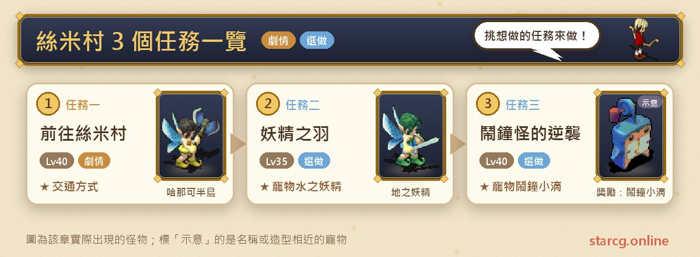
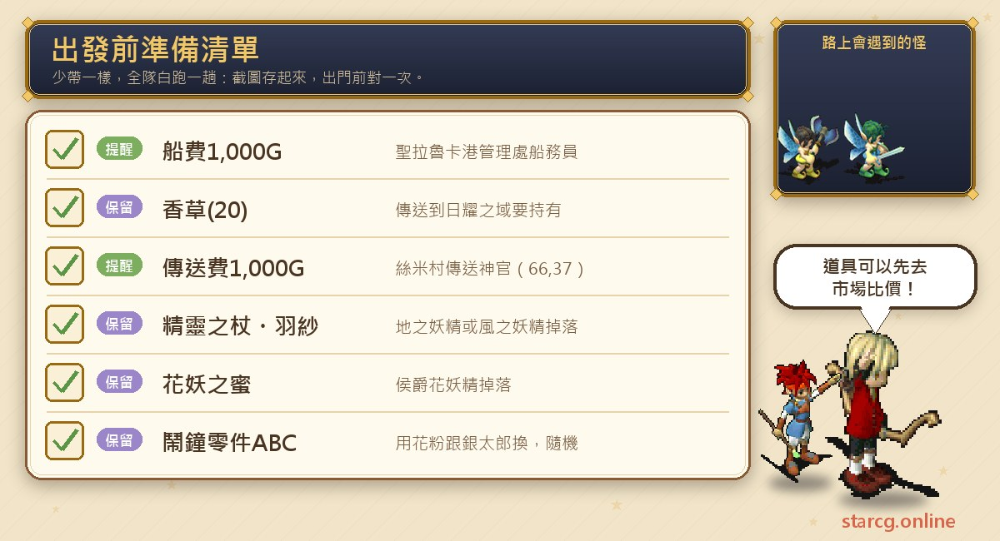
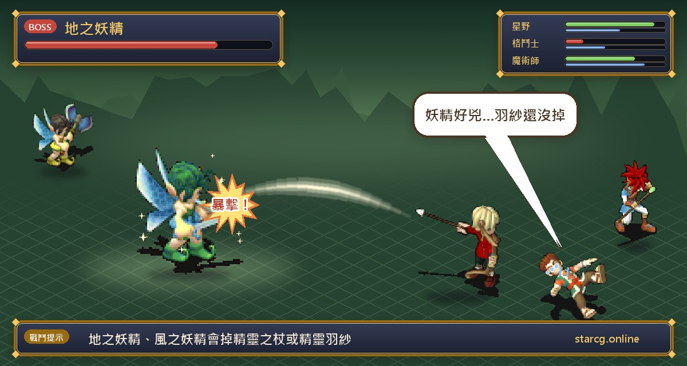

스미 마을(絲米村)은 공략 사이트의 「지역 퀘스트」 탭에 세 항목이 올라와 있어요. **스미 마을 및 태양의 영역 가는 길(前往絲米村 及 日耀之域)**은 세인트 라루카 마을(聖拉魯卡村)에서 배를 타고 가는 방법을 알려 주는 교통 안내이고, **요정의 깃털(妖精之羽)**는 마을 밖 하나코 반도(哈那可半島)에서 요정을 잡아 아이템 세 가지를 모아 펫 「물의 요정(水之妖精)」으로 바꾸는 퀘스트, **알람시계 괴물의 역습(鬧鐘怪的逆襲)**은 태양의 영역(日耀之域)의 사야 바(沙夜酒吧)에서 꽃가루를 모아 자명종 부품 세 개로 바꾸고 펫 「자명종 물방울(鬧鐘小滴)」을 조립하는 퀘스트예요. 권장 레벨은 35~40레벨이고, 두 펫 퀘스트 모두 보스를 잡을 필요가 없어서 펫을 모으고 싶은 플레이어에게 잘 맞아요.

이 글에서는 교통 방법, 두 펫 퀘스트의 단계와 좌표, 잡아야 할 몬스터를 한곳에 모았어요. StarCG(星詠魔力), 水藍魔力, 初心魔力寶貝 중 무엇을 하든 스미 마을 퀘스트 진행은 같으니 그대로 활용하면 돼요.

> 이 글은 [StarCG 공략 사이트](https://guide.starcg.net/) 전체 퀘스트 페이지의 「스미 마을」 아래에 있는 세 페이지(교통 안내는 세인트 라루카 마을 분류, 알람시계 괴물의 역습은 태양의 영역 분류에 있어요)를 바탕으로 했고, 펫 수치는 이 사이트의 펫 도감에서 가져왔어요. 저희 방식대로 순서를 다시 짜고 새로 쓴 것으로 원문을 그대로 옮기지 않았어요. 공략 사이트에 없는 내용은 모두 「공략 사이트 미기재」로 적었고, 게임 업데이트 후 내용이 바뀔 수 있어요.

## 스미 마을 퀘스트는 무엇인가요? 전체 순서부터

세 항목 중 교통 안내가 나머지 둘의 전제예요. 먼저 스미 마을에 갈 수 있어야 하나코 반도에서 요정을 잡을 수 있고, 알람시계 괴물의 역습은 스미 마을에서 다시 태양의 영역으로 전송해야 해요.

| 퀘스트 | 퀘스트 이름 | 권장 레벨 | 보상 |
|---|---|---|---|
| 퀘스트 1 | 스미 마을 및 태양의 영역 가는 길 | 40 | 없음(교통 방법) |
| 퀘스트 2 | 요정의 깃털 | 35 | 펫 「물의 요정」 |
| 퀘스트 3 | 알람시계 괴물의 역습 | 40 | 펫 「자명종 물방울」 |

한 줄로 정리하면: **세랄카 항에서 1,000G를 내고 배로 스미 항에 가요. 요정의 깃털은 하나코 반도에서 요정을 잡아 아이템 세 가지를 모으고, 알람시계 괴물의 역습은 퀴니와 1,000G를 가지고 태양의 영역으로 전송해 사야 바에서 꽃가루를 모아 부품으로 바꿔요.**

## 출발 전에 이것부터 준비하세요

세 퀘스트 모두 특수 재료는 필요 없고, 주로 여비와 전송용 퀴니가 필요해요.

세랄카 항까지 가는 데 **1,000G**가 들고, 스미 마을에서 태양의 영역으로 전송하려면 **퀴니(香草)(20)**와 **1,000G**를 가지고 있어야 해요. 또 공략 사이트의 「차를 좋아하는 고양이(愛喝茶的貓)」 같은 아키 성(亞紀城) 퀘스트에도 퀴니가 쓰이니, 부족하면 이 사이트의 [시세 조회](/ko/market/)로 시세를 먼저 확인해 보세요.

## 퀘스트 1: 스미 마을 및 태양의 영역 가는 길(교통 방법)

권장 40레벨, 조건 없음, 보상 없음이며 순수한 교통 안내예요.

1. 세인트 라루카 마을의 **세랄카 항 관리소(聖拉魯卡港管理處)**(25, 89)에서 **선무원(船務員)**(17, 17)과 대화해 「예」를 고르고 1,000G를 내면 세랄카 항으로 이동해요.
2. **승선 안내원(乘船員)**(51, 51)과 대화해 「예」를 고르고 배에 타요.
3. 스미 항에 도착하면 **객실 승무원(客房服務員)**(72, 26)과 대화해 「예」를 골라 스미 항으로 전송돼요.
4. **선무원**(20, 52)과 대화해 「예」를 고르면 항만 관리소로 이동하고, 입구(9, 22)로 나가면 **스미 마을**이에요.
5. 태양의 영역에 가려면 퀴니(20)와 1,000G를 가지고 스미 마을의 **전송 신관(傳送神官)**(66, 37)과 대화해 「예」를 고르세요. 「아니요」 다음 「예」를 고르면 아키 성으로 전송돼요.

**주의할 점**: 공략 사이트에 따르면 아키 성 전송석은 먼저 「바람에 날리는 난초(飄風之蘭)」 퀘스트로 아키 성에 간 뒤, 병원 옆 전송 교통 관리 센터(28, 50)에서 빨간 옷의 **전송석 관리원(傳送石管理員)**(42, 22)에게 전송 지점을 등록해야 해요. 그 뒤에야 리셰리아 성 출발의 방(里謝里雅堡啟程之間) 2층(12, 26, 2,500G)이나 스미 마을(66, 37, 2,000G)에서 전송할 수 있어요.

## 퀘스트 2: 요정의 깃털(하나코 반도에서 요정 사냥)

권장 35레벨, 조건 없음이에요. 보상은 펫 **물의 요정**이에요.

1. 스미 마을 밖의 **하나코 반도** (287, 244), (230, 70) 근처에서 랜덤으로 나오는 적을 쓰러뜨려 아이템 세 가지를 모아요.
   - **대지의 요정(地之妖精)**이나 **바람의 요정(風之妖精)**을 쓰러뜨리면 「**정령의 지팡이(精靈之杖)**」 또는 「**정령의 깃털 베일(精靈羽紗)**」이 랜덤으로 나와요. 추천 장소는 (287, 244), (230, 70) 근처예요.
   - **후작 꽃요정(侯爵花妖精)**을 쓰러뜨리면 「**꽃요정의 꿀(花妖之蜜)**」이 랜덤으로 나와요. 추천 장소는 (230, 70) 근처예요.
2. 정령의 지팡이, 정령의 깃털 베일, 꽃요정의 꿀 세 가지를 가지고 스미 마을에서 서쪽으로 가서 하나코 반도(57, 202)의 **코렌(小戀)**과 대화하면 펫 「**물의 요정**」을 받아요.

**주의할 점**: 정령의 지팡이와 정령의 깃털 베일은 모두 대지의 요정과 바람의 요정에게서 랜덤으로 나오니 두 가지를 다 모으려면 여러 번 싸워야 할 수도 있어요. 꽃요정의 꿀은 후작 꽃요정만 떨어뜨리고, 공략 사이트는 (230, 70) 근처를 추천해요. 세 아이템의 드롭률과 요정의 레벨은 모두 공략 사이트 미기재예요.

**물의 요정 정보**: 이 사이트의 펫 도감에 따르면 물의 요정은 인형계, 일반 카드(普卡)이고, 다섯 가지 성장 수치(BP)는 체력 29, 힘 30, 강도 23, 속도 8, 마법 10(합계 100), 스킬 칸 8칸, 속성은 수 70·화 30이에요. 다른 펫의 성장과 비교하고 싶다면 이 사이트의 [펫 도감](/ko/pets/)에서 찾아보세요.

## 퀘스트 3: 알람시계 괴물의 역습(사야 바에서 꽃가루 모으기)

권장 40레벨, 조건 없음이에요. 보상은 펫 **자명종 물방울**이에요. 공략 사이트는 이 퀘스트를 태양의 영역 분류에 두었고, 전체 퀘스트 페이지에서는 스미 마을 아래에 올려 두었어요.

1. 태양의 영역의 **사야 바**(421, 172)에서 주인 **긴타로(銀太郎)**(49, 33)와 대화해 「예」를 고르면 사야 바 안으로 들어가요.
2. 랜덤으로 나오는 적을 쓰러뜨리면 「**꽃가루(花粉)**」가 랜덤으로 나와요.
3. 사야 바의 전송석(76, 5)에서 나가기를 고르면 주인 긴타로(49, 33) 앞으로 돌아와요.
4. 꽃가루를 가지고 긴타로와 대화하면 **자명종 부품 A, B, C** 중 하나를 랜덤으로 받아요.
5. A, B, C를 하나씩 모은 뒤 부품을 사용하면 「**자명종 물방울 소환 구슬**」을 얻고, 이를 사용하면 펫 「**자명종 물방울**」을 얻어요.

**주의할 점**: 꽃가루가 랜덤 드롭이고 바꿔 주는 부품도 랜덤이라서 같은 부품이 겹칠 수 있어요. A, B, C가 하나씩 모일 때까지 계속 바꿔야 해요. 사야 바에 어떤 몬스터가 몇 레벨로 나오는지는 공략 사이트 미기재예요.

**자명종 물방울 정보**: 이 사이트의 펫 도감에 따르면 자명종 물방울은 금속계, 일반 카드이고, 다섯 가지 성장 수치(BP)는 체력 22, 힘 28, 강도 33, 속도 7, 마법 9(합계 100), 스킬 칸 8칸, 속성은 수 60·지 40이에요.

## 스미 마을 자주 묻는 질문

**스미 마을에는 어떻게 가나요?** 세인트 라루카 마을의 항 관리소(25, 89)에서 선무원에게 1,000G를 내고 세랄카 항으로 간 뒤, 배를 타고 스미 항에 가서 항만 관리소 입구로 나가면 스미 마을이에요.

**태양의 영역에는 어떻게 가나요?** 퀴니(20)와 1,000G를 가지고 스미 마을의 전송 신관(66, 37)과 대화해 「예」를 고르세요.

**요정의 깃털에서는 어떤 몬스터를 잡나요?** 대지의 요정, 바람의 요정은 정령의 지팡이나 정령의 깃털 베일을, 후작 꽃요정은 꽃요정의 꿀을 떨어뜨려요.

**알람시계 괴물의 역습에서 계속 같은 부품이 나오면요?** 부품은 랜덤으로 주니 A, B, C가 하나씩 모일 때까지 꽃가루를 더 모아 계속 바꾸는 수밖에 없어요.

**두 퀘스트에 보스가 있나요?** 공략 사이트에는 보스가 전혀 없고, 두 퀘스트 모두 일반 전투의 랜덤 드롭으로 아이템을 모아요.

## 정리: 펫 두 마리, 인내심으로 드롭 모으기

스미 마을 퀘스트는 어렵지 않고 어려운 건 운이에요. 요정의 깃털은 랜덤 드롭 세 가지를, 알람시계 괴물의 역습은 랜덤 부품 세 가지를 모아야 해요. 먼저 교통 안내대로 길을 익히고 퀴니와 여비를 준비한 뒤, 하나코 반도와 사야 바에서 차근차근 모으면 물의 요정과 자명종 물방울을 모두 데려올 수 있어요.

더 자세한 원문과 다른 퀘스트는 [StarCG 공략 사이트](https://guide.starcg.net/)에서 확인할 수 있어요. 이 사이트의 [펫 도감](/ko/pets/)에서 두 펫과 다른 펫의 수치도 비교해 보세요.
