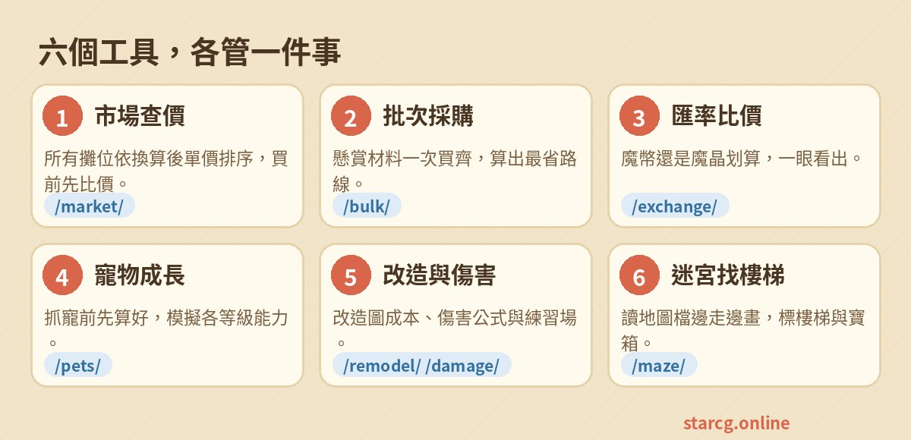

魔力寶貝小工具是給星詠魔力玩家用的免費小幫手。下面依照「最常用」的順序，快速介紹每個工具能幫你做什麼。

## 1. 市場查價：買之前先比價

到 [市場查價](/market/) 輸入商品名稱，就能看到官方擺攤市場目前所有的攤位，依「換算後最便宜」排序。

- **只想看最低價**：在「篩選與顯示」把攤位顯示改成「各商品最低價」。
- **要買很多個**：選「可滿足需求的攤位」並填數量，只列出一攤就買得齊的攤位。
- **想知道行情**：切到「成交行情」，看近 7／30／90 天真正賣出的價格與每日走勢。

> 小技巧：常買的東西按 ☆ 加到「我的最愛」，下次一點就能查。

## 2. 批次採購：懸賞材料一次買齊

在市場查價切到「批次採購」，點選要買的商品與數量，再選起點（東門、西門、南門或自己的座標），網站會依分流與幣別排出要跑哪幾攤、照什麼順序走最快。

## 3. 匯率比價：魔幣還是魔晶划算？

[匯率比價](/exchange/) 先填目前的行情（預設 3,000 魔晶＝100 萬魔幣、1 台幣＝40 魔晶），之後：

1. 「三向換算」任一格輸入金額，魔幣、魔晶、現金立刻換算。
2. 「單品比價」填同一件商品的魔晶價與魔幣價，馬上知道用哪種貨幣買比較省。

## 4. 寵物成長：抓寵前先算好

[寵物成長](/pets/) 從圖鑑挑一隻寵物，調整等級、檔次、改造次數與配點，就能看到各等級的能力值，還能加入比較清單和朋友分享。

## 5. 改造圖成本與傷害計算

- [改造圖成本](/remodel/)：算魔物幻境要打幾場、能湊幾套改造圖、技能突破石大概掉幾顆，以及改造到目標次數的期望花費。
- [傷害計算](/damage/)：填攻擊方與防禦方數值，物理、魔法傷害範圍一次算好。

## 6. 迷宮找樓梯：邊走邊畫地圖

[迷宮找樓梯](/maze/) 會自動讀取遊戲存在電腦裡的迷宮地圖，走到哪、地圖就畫到哪，樓梯和水晶出現時直接標出座標。只要設定一次，不用每次丟檔案：

1. 用電腦版 Chrome 或 Edge 打開，按「連結遊戲資料夾」，選遊戲裡的 **StarCG_Data**，瀏覽器詢問時選「每次造訪都允許」。
2. 進迷宮前按「開始探索」，之後第一張地圖就是第 1 層；已經在迷宮裡就填目前樓層再按「從這層開始」。
3. 走到哪都會自動跟著換層；看到寶箱可以按「寶箱」再點地圖，自己標起來。
4. 跑完按「結束探索」。迷宮重置前再回來，網站會自動認出同一座迷宮，接回上次的樓層。

詳細步驟與常見問題看這篇：[迷宮找樓梯完整教學](/posts/maze-guide/)。

---

有想看的教學或心得，也歡迎持續關注這個「心得分享」專區！
